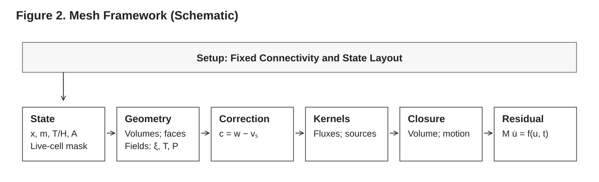
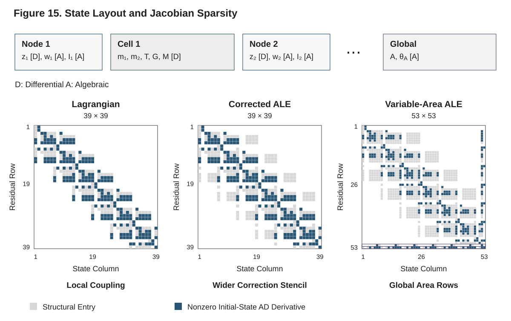

# Pyrolysis.jl — Technical Reference Guide

A complete mathematical and physical description of the Pyrolysis.jl condensed-phase pyrolysis solver: governing equations with derivations and justifications, constitutive models, the finite-volume and ALE discretizations, cell deactivation, the time integration with the colored Jacobian, and the verification and validation basis. Companion to the **User Guide**.

_This document is the canonical source; the per-chapter views in `docs/guide/technical_reference` are regenerated from it with `julia scripts/split_guides.jl`._

---

## Contents

- [1. Introduction, Scope, and Modeling Philosophy](#1-introduction-scope-and-modeling-philosophy)
- [2. Nomenclature](#2-nomenclature)
- [3. Governing Equations of the Continuum Model](#3-governing-equations-of-the-continuum-model)
- [4. Materials, Components, and Property Functions](#4-materials-components-and-property-functions)
- [5. Effective (Mixture) Properties and Mixing Rules](#5-effective-mixture-properties-and-mixing-rules)
- [6. Reaction Kinetics and Stoichiometry](#6-reaction-kinetics-and-stoichiometry)
- [7. Heat Conduction, Gas Convection, and Energy Assembly](#7-heat-conduction-gas-convection-and-energy-assembly)
- [8. Thermal Radiation](#8-thermal-radiation)
- [9. Gas-Phase Mass Transport and Pressure](#9-gas-phase-mass-transport-and-pressure)
- [10. Volume Change, Swelling, Intumescence, and Lateral Shrinkage](#10-volume-change-swelling-intumescence-and-lateral-shrinkage)
- [11. The Arbitrary Lagrangian–Eulerian (ALE) Framework](#11-the-arbitrary-lagrangianeulerian-ale-framework)
- [12. Boundary and Initial Conditions](#12-boundary-and-initial-conditions)
- [13. Finite-Volume Spatial Discretization](#13-finite-volume-spatial-discretization)
- [14. Cell Deactivation and Burnout](#14-cell-deactivation-and-burnout)
- [15. Temporal Integration, the DAE, and the Colored Jacobian](#15-temporal-integration-the-dae-and-the-colored-jacobian)
- [16. Conservation Ledgers and the Audit](#16-conservation-ledgers-and-the-audit)
- [17. Sensitivity Analysis (Theory)](#17-sensitivity-analysis-theory)
- [18. Verification and Validation](#18-verification-and-validation)

---

# 1. Introduction, Scope, and Modeling Philosophy

This chapter establishes what Pyrolysis.jl is, the class of physical problems it solves, and the modeling decisions that govern every later chapter. Pyrolysis.jl is a one-dimensional (through-thickness) condensed-phase pyrolysis solver: it integrates the coupled heat-conduction, multi-species reaction-transport, and (optionally) gas-pressure equations that describe a solid heated to thermal decomposition. We position the code relative to the three established reference solvers it is most often compared to — ThermaKin2Ds, Gpyro, and the FDS solid-phase pyrolysis model — and we state the binding conventions (coordinate orientation, flux sign, divergence sign, heat-of-reaction sign) and the energy equation that the remainder of the Technical Reference Guide derives and exploits. Everything asserted here is grounded in the actual implementation; where a textbook form and the code differ, the code is authoritative and the deviation is flagged.

---

## 1.1 Purpose and intended audience

Pyrolysis.jl simulates the thermal decomposition (pyrolysis) of condensed-phase materials subjected to an external heat flux — the canonical fire-science and materials-degradation problem of a solid that heats up, undergoes one or more Arrhenius-rate reactions, releases gaseous volatiles, and (in the charring/intumescent cases) changes its conductivity, porosity, and physical dimensions as it does so. The numerical core is a cell-centered finite-volume discretization on a face-based mesh that may move with the solid (Arbitrary Lagrangian–Eulerian, ALE; the mesh velocity is the solid velocity plus a correction, $w = v_s + c$). The semi-discrete equations form a mass-matrix differential-algebraic system $\mathsf M\,d\mathbf u/dt = \mathbf f(\mathbf u, t)$, advanced by the stiff Rosenbrock integrator `Rodas5P` with a Jacobian obtained by colored sparse forward-mode automatic differentiation of the residual on a sparsity pattern built from the mesh connectivity.

This document — the **Technical Reference Guide** — derives and justifies all of the mathematics and physics: the continuum governing equations (§3, Governing Equations of the Continuum Model), the constitutive closures (§4, Materials & Property Functions; §5, Effective Properties & Mixing Rules; §6, Reaction Kinetics; §8, Thermal Radiation), the discretization (§7, Heat Conduction, Gas Convection & Energy Assembly; §13, Finite-Volume Discretization), the moving-mesh framework (§10, Volume Change & Lateral Shrinkage; §11, The ALE Framework), the boundary treatment (§12, Boundary & Initial Conditions), burnout (§14, Cell Deactivation and Burnout), the temporal integration and Jacobian machinery (§15, Temporal Integration, the DAE, and the Colored Jacobian), and the conservation, sensitivity, and verification apparatus (§16 Conservation Ledgers and the Audit, §17, §18). It is a *reference*, not a tutorial: it states the equations as the code implements them, with file-and-function attribution, and explains why each modeling choice was made. The companion **User Guide** (Part II of the documentation) teaches workflow — how to build materials, set boundary conditions, choose the physics options, and run the solver.

The reader is assumed to be comfortable with the heat equation, the Arrhenius law, finite-volume / finite-difference discretization, and the basic vocabulary of stiff ODE integration. No prior knowledge of ThermaKin2Ds, Gpyro, or FDS is required, but readers familiar with any of them will find explicit notation-mapping and contrast subsections throughout.

### 1.1.1 How to read the two guides

The Technical Reference and the User Guide share a single, authoritative symbol table — the **unified nomenclature** reproduced verbatim in §2 (Nomenclature). Every chapter conforms to it. Three conventions in that table are *load-bearing* and are restated below in §1.5 because misreading any of them inverts a sign in a governing equation:

1. the spatial-coordinate orientation and the meaning of "top" and "bottom",
2. the positive-flux direction and the outflow-positive divergence operator, and
3. the heat-of-reaction sign convention.

A typical reading path for a first-time reader is: §1 (this chapter) → §3 (the PDE system) → the User Guide quick-start, returning to §4–§9 as constitutive questions arise, and to §13–§16 when numerical behavior needs explaining. A developer extending the code should additionally read §11 (ALE) and §15 (the DAE and the colored Jacobian) in full.

---

## 1.2 Scope: the class of problems modeled

Pyrolysis.jl targets the **one-dimensional, through-thickness** decomposition of a planar sample. The spatial domain is a column of material of thickness $L$ and cross-sectional area $A$; the only resolved spatial coordinate is the axial coordinate $z$ (see §1.5.1). The unresolved lateral plane carries the area $A$, which may itself vary in time to represent lateral (radial) shrinkage or swelling (§10). A line may also be read in cylindrical or spherical coordinates, $z$ then being the radius (the mesh's `coordinates`, §13).

The state of the material is described, in every finite-volume cell $i$, by:

- the **component masses** $m_{j,i}$ [kg] of every chemical component $j \in \{1,\dots,N_C\}$ — the integrated unknowns; the **mass concentrations** $\xi_{j,i} = m_{j,i}/V_i$ [kg·m⁻³] that every constitutive law reads are derived from them — and
- one **energy state**: the cell temperature $T_i$ [K] (the default), or the cell's sensible-enthalpy inventory $H_i = \sum_j m_{j,i}\,h_j(T_i)$ [J] (`energy_state = :enthalpy`), from which the temperature is recovered (§1.4.2).

The choice of mass concentration $\xi_j$ (rather than mass fraction $Y_j = \xi_j/\rho$) as the constitutive species variable is deliberate: it makes the species conservation law a plain transport equation with a reaction source, with no embedded density derivative, and it is the form the reaction kinetics naturally produce (§6). Integrating the cell masses themselves makes the discrete mass balance exact: a cell's mass changes only by its reaction sources and its face fluxes, and a moving cell's change of volume needs no correction term (§3.2, §11.3.4). Further unknowns are introduced only when the corresponding physics is enabled — on a moving mesh (`use_ale = true`) the node positions $z_n$ (differential) and node velocities $w_n$ (algebraic, held by the cells' volume balances; §11.3); under `BEER_LAMBERT` the face intensities $I_f$ (algebraic; §8); under a lateral-shrinkage law the conversion-history pair $(G_i, m_{\mathrm{dry},i})$ of every cell and the cross-section area $A$ with its lateral strain rate $\theta_A$ (algebraic; §10).

### 1.2.1 Intended applications

The solver is designed for, and validated against, the following experiment and material classes (the shipped `examples/` directory exercises each):

- **Cone calorimetry.** A sample is irradiated at a controlled flux (commonly 25–75 kW·m⁻²) while surface temperature, mass-loss rate (MLR), and a heat-release-rate proxy are recorded. The exposed top face takes a radiative-plus-convective boundary condition; the back face is typically adiabatic or a lumped loss, and impermeable. Examples `06_cone_calorimeter.jl` (5.8 mm of PMMA under 25 kW·m⁻² on a moving mesh, with cell deactivation) and `07_douglas_fir_cone.jl` (12 mm of charring Douglas fir under 75 kW·m⁻² on a moving mesh, with Darcy–Fick transport and surface absorption) are the reference configurations.
- **Idealized thermal-analysis experiments.** Thermogravimetric analysis (TGA), differential scanning calorimetry (DSC), and microscale combustion calorimetry (MCC) can be idealized as a thin, thermally-thin sample with a prescribed heating rate. In the limit of a single well-mixed cell, the species equations reduce to the 0-D Arrhenius mass-loss ODE that TGA inversion assumes; this idealization underpins the single-reaction verification case in §18 (Verification & Validation).
- **Charring, non-charring, and intumescent solids.** Non-charring polymers (PMMA) leave essentially no residue; charring solids (wood) form an insulating char layer with conductivity and porosity that differ sharply from the virgin material; intumescent coatings swell by orders of magnitude. The component/reaction/property-function machinery (§4) plus the swelling factor $\gamma_j$ and lateral-shrinkage law (§10) span all three.
- **Pressure-treated and wet wood / moisture transport.** Hygroscopic materials carry liquid water that evaporates endothermically and migrates as vapor under pressure gradients. Darcy–Fick transport (§9, Gas-Phase Mass Transport & Pressure; selected when a condensed component is permeable) and the `StateDependentProperty` heat-of-sorption closure (§4) handle these; examples `08_pressure_treated_wood_cone.jl`, `ptw_comparison.jl`, and `moisture_hos_comparison.jl` are the reference cases.

### 1.2.2 What is **not** modeled

The scope boundary is as important as the scope itself. The following are explicitly out of scope:

- **Multi-dimensional geometry.** Full solves are one-dimensional in $z$. The cross-section $A$ is a scalar gauge, not a resolved 2-D/3-D field; lateral shrinkage is a column-global area scaling driven by an empirical law (§10), not a resolved lateral transport. Meshes of two and three dimensions (`box_mesh`, `cell_mesh`) exist at the residual level — a potential closure of the mesh motion, conductivity tensors and element death are implemented and tested there (§11.3.5, §14.5) — but `setup` refuses gas transport, in-depth radiation, the variable cross section, the equidistribution correction and cell deactivation on them, and they are not a supported path for full solves.
- **Full two-temperature gas.** The gas phase is *not* given its own energy equation with a separate gas temperature. Gas is assumed to be in local thermal equilibrium with the matrix at the cell temperature $T$: it stores sensible heat like every other phase, and its flux relative to the skeleton carries its sensible enthalpy across the cell faces (§1.4.3, §7).
- **Multi-reactant reactions.** Each `Reaction` supports exactly one reactant ($N_{\text{in}}=1$; a reaction with more is rejected by problem validation; `_apply_reaction_source!` in `src/Physics/kinetics.jl` also guards source evaluation). The reactant is consumed with unit mass stoichiometry and products are explicit yields summing to 1.0 (§6). Bimolecular or competitive oxygen-sensitive schemes (which ThermaKin and Gpyro support natively) must be approximated as sequences of single-reactant steps. Extending the reactant tuple to a 3-ary `(idx, order, mass_stoich)` form is an open item (§1.8.1).
- **Pressure- or oxygen-dependent kinetics, and distributed activation energy.** The Arrhenius pre-exponential $A_i$ is temperature-independent, the rate has no explicit pressure or oxygen factor, and there is no built-in distributed-activation-energy (DAEM) tooling (§6).

These exclusions are not accidental: they are the modeling simplifications that make the 1-D solver fast, type-stable, and differentiable with respect to its state, and they are shared (to varying degrees) by the reference codes discussed in §1.6.

---

## 1.3 Design philosophy: a generalized model with optional physics

The organizing principle of Pyrolysis.jl is a **single generalized model with opt-in physics layers**. Rather than maintaining separate solvers for "simple conduction," "charring wood," and "pressure-driven char," the code expresses one general residual and selects which physical terms are active through the *types* of the definition it reads. `setup` turns a `PyrolysisProblem` and the solve keywords into a `CoreDefinition` whose state layout, kernel tuple, gas-transport model and mesh closure are type parameters, so the residual specializes at compile time without runtime branching and without method explosion: there is exactly one residual method (`test/jacobian/test_allocations.jl` asserts it), and a physics option that is off contributes no kernel, no rows and no work.

### 1.3.1 What `setup` decides

`setup(problem; ...)` (file `src/Integration/setup.jl`; `solve` calls it) makes each of the following choices once, from the problem and the keywords:

| Choice | Decided by | What it changes |
|---|---|---|
| Energy state | `energy_state` (`:temperature`, the default, or `:enthalpy`) | the energy row of every cell carries $T_i$ or $H_i$ (§1.4.2, §3.3.5) |
| Mesh motion | `use_ale` | node positions (differential) and node velocities (algebraic, the balance rows of `BalanceRowClosure`) join the state; without it every node is pinned |
| Mesh correction | `correction`; by default a rule | `EquidistributionCorrection` where the mesh moves, cells are deactivated and some cell, converted completely, would fall below the deactivation threshold; the inventories then cross the faces at the relative velocity (`RelativeFluxKernel`, §11.7) |
| Radiation | `radiation_model` | under `BEER_LAMBERT` the face intensities (algebraic) and `BeerLambertKernel`; otherwise the incident flux enters the surface energy balance (§8) |
| Gas transport | the material and the mass boundary conditions | none (no gas component, or nothing can move it), Fickian (some component carries a gas-transfer coefficient or a boundary condition passes mass), Darcy–Fick (a condensed component is permeable); `GasTransportKernel` (§9) |
| Cross section | the material's `lateral_shrinkage_law` | the conversion-history pair per cell and the global rows of $A$ and $\theta_A$ (`LateralShrinkage`, §10); needs `use_ale = true` |
| Burnout | `deactivation`, `threshold`, `band` | `CellDeactivation`: an event that removes cells whose condensed mass falls below the threshold (§14) |

The kernels run in a fixed order, each present only when its physics is: `ReactionKernel`, `GasTransportKernel`, `BeerLambertKernel`, `ConductionKernel`, `ThermalBoundaryKernel`, `RelativeFluxKernel` (`_kernels`, `src/Integration/setup.jl`). The order matters where one kernel reads another's output: the surface energy balance of the thermal boundary kernel reads the outward gas fluxes of the gas transport for its blowing models and for the enthalpy those fluxes carry (§7.6, §15.3).

The layout's type parameters are read by `@inline` accessors with zero runtime cost:

```julia
@inline is_moving(::StateLayout{NC,E,Mov}) where {NC,E,Mov} = Mov
```

The entry point `residual!(du, u, def::CoreDefinition, t, ws::CoreWorkspace)` (file `src/Assembly/residual.jl`, reached through `Pyrolysis.Internal`) runs the same sequence for every configuration — the state mapping `derive!`, the node corrections, the kernels in order, the mesh closure's rows, the external sources, the row assembly (§15.3). Its buffers are built once per problem, and once per dual-number type the Jacobian evaluates the residual at (`CoreWorkspace`, `src/Assembly/definition.jl`); a configuration without a moving mesh carries no position or velocity rows, one without Darcy–Fick transport evaluates no porosity, pressure or mobility.

> **Implementation note.** `_gas_transport` chooses the transport model, `_installed_correction` the default correction, `_kernels` the kernel tuple, and `_require_supported` refuses a problem that needs physics its mesh does not support (`src/Integration/setup.jl`). The layout, closure and kernel types are not exported at the top level; they are reached through `Pyrolysis.Internal` or their submodules (`Pyrolysis.States`, `Pyrolysis.Closures`, `Pyrolysis.Kernels`).

### 1.3.2 Opt-in physics layers

The same opt-in philosophy governs the constitutive layers. Each of the following is off (or set to its cheapest closure) by default and is enabled only when the problem requires it:

- **Radiation in depth.** `NO_RADIATION` and `SURFACE_ABSORPTION` both route the incident flux of a `RadiativeFluxBC` through the surface energy balance, with no volumetric deposit, at $O(1)$ cost (the two give identical residuals); `BEER_LAMBERT` resolves exponential in-depth absorption through face intensities that are algebraic unknowns of the state, which keeps the Jacobian banded. The models are mutually exclusive (§8).
- **Darcy gas flow.** With Fickian transport, gas migrates only by (volume-fraction-gradient) diffusion. When a condensed component carries a permeability, `setup` selects Darcy–Fick transport, which adds pressure-driven bulk flow $v_g=-(\kappa/\mu)\nabla P$ with the ideal-gas pressure closure (§9); the state mapping then also evaluates every cell's porosity, pressure and mobility.
- **ALE moving mesh.** A fixed mesh suffices for thermally-thin or non-receding problems. With `use_ale = true` the mesh moves with the solid: the node positions are differential unknowns, the node velocities algebraic unknowns held by each cell's volume balance, and the cell volumes follow from the positions, so the Geometric Conservation Law holds by construction (§11). Where cells must burn out, an equidistribution correction moves the mesh relative to the solid so that a vanishing layer's cells thin together (§11.7).
- **Variable cross-section.** A material's `lateral_shrinkage_law` enables lateral shrinkage/swelling through the column conversion $\bar\chi$ and an empirical area law (§10).
- **Burnout.** With `deactivation = true`, a cell whose condensed mass falls below the fraction `threshold` ($\varepsilon_m$, default $10^{-2}$) of its initial condensed mass is deactivated, together with the near-threshold cells outward of it (the band), in an event located inside the step; its inventories go to the live cell beneath, and the state keeps its size (§14, User Guide §10). There is no mesh refinement.

The cost of an optional layer is therefore paid only when it is used, and the modeling assumptions of the default (cheapest) configuration are exactly those of the reference codes (§1.6).

### 1.3.3 Implementation goals stated up front

Three implementation properties are treated as first-class requirements throughout the code, and they drive many modeling micro-decisions documented in later chapters:

1. **Type stability.** Every hot-path function is written so the Julia compiler can infer concrete types, using heterogeneous tuples for the component/reaction lists and `@generated` or recursive tuple functions to unroll loops over $N_C$ components and $N_R$ reactions (e.g. `_gas_partial_pressure_sum`, `_heat_capacity_sum`, `dry_pyrolysis_gas_indices`). The number of components $N_C$ and reactions $N_R$ are static type parameters of `Material{NC,NR,…}` (§4), and every physics option is a type parameter of the definition the residual reads.
2. **Allocation-free assembly.** The residual and the colored Jacobian evaluate with zero heap allocation per call. All scratch storage lives in the derived state and the kernel contributions of the `CoreWorkspace`, with twins for each dual-number element type built on first use; the state mapping `derive!` is the only reader of the state vector and the row assembly the only writer of its derivative (§15.2). A dedicated test (`test/jacobian/test_allocations.jl`) asserts zero bytes for one residual and one Jacobian evaluation on every configuration it builds, in both energy forms.
3. **AD-compatibility (differentiability).** The entire residual — including the geometry from the node positions, the surface-temperature Newton solve, the caloric inversion of the enthalpy form, and the property evaluations — propagates `ForwardDiff.Dual` numbers, and the colored Jacobian is its exact derivative. This requires every non-smooth construct to take the form of a C¹ surrogate or by a guard that is the identity on physical states: the kernels evaluate the property laws at the *trial temperature*, the cell temperature smoothly clamped into the property bracket [200, 3000] K with 1 K joins; masses enter the property laws through a one-sided positive part; the floors on the heat capacity, the conductivity, the porosity and the viscosity are smooth (§13); hard temperature gates become $\tfrac12(1+\tanh(\cdot))$ ramps; and the depletion limiter multiplies each reactant's rate by a C¹ factor that is exactly zero at and below zero concentration (§6.3). The one deliberate exception is an upwind side, which is read from the value of its velocity, so an upwind flux has a kink where its velocity changes sign (§9, §11.6). Differentiability is what makes the exact Jacobian (§15) possible, and the same smoothness keeps the finite-difference sensitivities of §17 well-defined.

These three goals are not merely engineering niceties: AD-compatibility in particular *constrains the physics formulation*, because every modeling term must be expressible as a smooth function of the state.

---

## 1.4 The energy equation

The single most important modeling decision in Pyrolysis.jl is the form of the energy equation. The code solves the energy balance of a one-temperature porous medium: the pore gas is in local thermal equilibrium with the matrix, **every component stores sensible heat**, and the gas flux relative to the skeleton carries its sensible enthalpy across the cell faces. The conserved quantity is the sensible-enthalpy content of the material, and the integrator carries either the cell temperature or the cell's sensible-enthalpy inventory (§1.4.2). This subsection states the balance, derives the temperature equation from it, and explains how it maps onto the reference codes.

### 1.4.1 The energy equation and its derivation

Let $\xi_j$ be the bulk mass concentration of component $j$, $\mathbf v_s$ the velocity of the skeleton (every condensed component moves with it), and $\mathbf J_g = \xi_g(\mathbf v_g - \mathbf v_s)$ the gas mass flux *relative to the skeleton* — the quantity Darcy's law and the volume-fraction-gradient diffusion law return (§3.4, §3.5, §11.1.2). Every component's enthalpy is written on one datum as $h_j^0 + h_j(T)$, with $h_j^0$ its formation enthalpy at $T_{\text{ref}}$ and $h_j(T)=\int_{T_{\text{ref}}}^{T} c_{p,j}\,dT'$ its sensible enthalpy. The species balance is $\partial_t\xi_j + \nabla\!\cdot(\mathbf v_s\xi_j) = \omega_j - \nabla\!\cdot\mathbf J_j$, with $\mathbf J_j = 0$ for condensed $j$ and $\omega_j = \sum_r \nu_{r,j}\,r_r$ the net production by reaction.

**The conservative balance.** The total enthalpy has no reaction source: per bulk volume,
$\partial_t\sum_j \xi_j(h_j^0+h_j) + \nabla\!\cdot\big(\mathbf v_s\sum_j\xi_j(h_j^0+h_j)\big) + \nabla\!\cdot\sum_g (h_g^0+h_g)\mathbf J_g = -\nabla\!\cdot\mathbf q_{\text{cond}} + Q_{\text{rad}}$.
Subtracting $h_j^0$ times each species balance leaves the formation term $-\sum_j h_j^0\,\omega_j$ on the right. With the heat of reaction at the local temperature, $h_r(T) = \sum_j \nu_{r,j}\big(h_j^0 + h_j(T)\big)$ — the calibrated, DSC-style datum (§6.6.3) — that term is $-\sum_r r_r\big(h_r(T) - \sum_j\nu_{r,j}h_j(T)\big) = Q_{\text{rxn}} + \sum_j \omega_j h_j(T)$, so the sensible enthalpy obeys

$$
\partial_t\Big(\sum_j \xi_j h_j\Big) + \nabla\!\cdot\Big(\mathbf v_s \sum_j \xi_j h_j\Big) + \nabla\!\cdot\Big(\sum_g h_g \mathbf J_g\Big)
= -\nabla\!\cdot\mathbf q_{\text{cond}} + Q_{\text{rad}} + Q_{\text{rxn}} + \sum_j \omega_j\,h_j ,
\tag{1.1}
$$

with $Q_{\text{rxn}} = -\sum_r h_r r_r$ the reaction heat (§1.5.3). The last term converts the heat of reaction, quoted at the local temperature, to the sensible-enthalpy datum. Equation (1.1) is what the cell rows of the code integrate (§1.4.4).

**The temperature equation.** The storage coefficient is the **mixture volumetric heat capacity**

$$
\rho c_{p}^{\text{eff}}(T,\boldsymbol\xi)
= \sum_{j=1}^{N_C} \xi_j\,c_{p,j}(T),
\tag{1.2}
$$

summed over **every** component, gas included (discretely, the cell's heat-capacity sum $C_i = \sum_j m_{j,i}c_{p,j}(T_i)$, §1.4.4). Expanding each $\xi_j h_j$ in (1.1) with the product rule, substituting the species balances, and using $\nabla h_g = c_{p,g}\nabla T$, the composition terms cancel: $\sum_j h_j\omega_j$ appears on both sides, and $-\sum_g h_g\nabla\!\cdot\mathbf J_g$ cancels the second half of $\nabla\!\cdot(\sum_g h_g\mathbf J_g) = \sum_g c_{p,g}\mathbf J_g\!\cdot\!\nabla T + \sum_g h_g\nabla\!\cdot\mathbf J_g$. Hence

$$
\Big(\sum_j \xi_j c_{p,j}\Big)\frac{D_s T}{Dt}
= -\nabla\!\cdot\mathbf q_{\text{cond}} - \sum_g c_{p,g}\,\mathbf J_g\!\cdot\!\nabla T + Q_{\text{rad}} + Q_{\text{rxn}},
\qquad \frac{D_s}{Dt} \equiv \partial_t + \mathbf v_s\!\cdot\!\nabla ,
\tag{1.3}
$$

which is ThermaKin Eq. 17 term for term: the all-component storage sum, the convective term $c_g(\mathbf J_g\!\cdot\!\nabla T)$, and the deformation term, which is the $\mathbf v_s\!\cdot\!\nabla T$ part of $D_sT/Dt$. On a fixed mesh $D_s/Dt = \partial_t$; on a mesh that moves with the skeleton $D_sT/Dt$ is the mesh-frame rate, and neither (1.1) nor (1.3) carries an advection term of any kind. Where the equidistribution correction moves the mesh relative to the skeleton, every inventory crosses the faces at the relative velocity $-\mathbf c$ (§11.2.2, §11.6).

**Why the gas is stored.** The gas concentration $\xi_g$ is an integrated state, so the term $\xi_g c_{p,g}\,\partial_t T$ is available at no cost and dropping it would be an approximation with no benefit. Gpyro drops it in its default thermal-equilibrium form (the quasi-steady-gas approximation, restored by its `FULL_QSG` option); FDS has no in-depth gas, so the term is identically zero there. Its size is $\varphi\rho_g c_{p,g}$ against the matrix heat capacity: for a char of porosity 0.8 and bulk heat capacity $1.5\times10^5$ J·m⁻³·K⁻¹ holding pore gas at 1 atm and 800 K ($\rho_g \approx 0.44$ kg·m⁻³, $c_{p,g}\approx 1100$ J·kg⁻¹·K⁻¹), about a quarter of a percent of $\rho c_p$ — small, but exact at no cost.

### 1.4.2 The two energy states

The integrator carries one energy unknown per cell, chosen by `energy_state`. Both rows are the discrete form of (1.1) on a cell (§1.4.4); they differ in which variable is integrated:

- **Temperature form** (`energy_state = :temperature`, the default): the cell temperature $T_i$, with the row $C_i\,dT_i/dt = E_i - \sum_j h_j(T_i)\,\dot M_{j,i}$, the cell integral of (1.3). Energy is conserved to the integrator's order.
- **Inventory form** (`energy_state = :enthalpy`): the sensible-enthalpy inventory $H_i = \sum_j m_{j,i}h_j(T_i)$, with the row $dH_i/dt = E_i + \sum_j \omega_{j,i}V_i\,h_j(T_i)$, the cell integral of (1.1). The inventory then changes by exactly the integral of its rate (the inventory less the integrated rate is a linear invariant of the semi-discrete system, which every Runge–Kutta step conserves to round-off); the temperature is recovered from $H_i$ and the masses by a regularized inversion of the caloric relation (§3.3.5).

The two rows are one equation: applying the product rule to $H_i$ with the mass rows $dm_{j,i}/dt = \omega_{j,i}V_i + \dot M_{j,i}$ turns either into the other. The conserved density is $\sum_j\xi_j h_j(T)$, not $\rho c_p^{\text{eff}}\,T$, which is not an enthalpy density ($h_j(T) \ne c_{p,j}\,T$ in general); both forms conserve it, and the energy ledger closes exactly in both, to round-off in the inventory form and at the integrator's order in the temperature form (§16.5.2). The temperature form is the default because the temperature is the observable that the property laws and the surface Newton solve read directly, and because it is the form of the reference codes (§1.6); the inventory form is the choice when the energy ledger must close to round-off.

### 1.4.3 The source terms and the surface gas enthalpy

The terms of (1.1) and (1.3) are (full derivations in §7, §8, §6):

- $-\nabla\!\cdot\mathbf{q}_{\text{cond}}$, the conductive flux divergence, with Fourier's law $\mathbf{q}_{\text{cond}}=-k\,\nabla T$ and a distance-weighted harmonic-mean face conductivity (§1.4.4).
- The **gas enthalpy flux** $\nabla\!\cdot(\sum_g h_g\mathbf J_g)$: the sensible enthalpy carried by the through-flow of volatiles relative to the skeleton. It is assembled at the faces in flux form — every face carries $\sum_g J_{g,f}\,h_g(T_f)$, with the same $J_{g,f}$ the mass rows carry and $T_f$ the distance-weighted face temperature between two cells, the surface temperature on a boundary face — and its temperature-form reading is the term $-\sum_g c_{p,g}\,\mathbf J_g\!\cdot\!\nabla T$ of (1.3). It is active wherever gas moves, and it is the only place the gas flux enters the energy balance.
- $Q_{\text{rad}}$, the volumetric radiation absorption (model-dependent; §8).
- $Q_{\text{rxn}} = -\sum_r h_r r_r$, the reaction heat (sign convention in §1.5.3), with $h_r$ at the local temperature; in (1.1) it is accompanied by the formation term $\sum_j\omega_j h_j(T)$.

The surface balance itself carries no gas-enthalpy term. Under local thermal equilibrium the gas leaves through the exposed face at $T_s$: the outward mass flux of the boundary face carries its sensible enthalpy at $T_s$ in that face's energy flux, and the surface balance reduces to conducted flux equals applied flux, $q_{\text{BC}}(T_s) = q_{\text{cond}}(T_s)$. The sensible heat the escaping gas carries away is thereby counted once: its enthalpy at formation sits in $h_r(T)$, and its heating from the formation temperature to $T_s$ is the enthalpy the face fluxes carry along its path. A surface term $\sum_g \dot m_g \Delta h_g(T_s, T_\infty)$ in the balance would count that heating a second time — for an outflow of 10 g·m⁻²·s⁻¹ with $c_{p,g} = 1.5$ kJ·kg⁻¹·K⁻¹ heated by 500 K, a spurious sink of about 7.5 kW·m⁻² — and would under-predict surface temperature and MLR. The surface balance is therefore a plain convective + radiative balance — the ThermaKin Eq. 17 convention, which Gpyro's thermal-equilibrium form shares. The only boundary use of the gas flux inside the balance is the blowing model of a convective BC, which reads the outward gas flux to reduce the heat-transfer coefficient (§12.3.3).

### 1.4.4 The discrete energy update

Integrating (1.1) over a finite-volume cell $i$ gives the rows the integrator advances (`_energy_row`, `src/Assembly/residual.jl`). With $s_{if} = +1$ when the normal of face $f$ points out of cell $i$ and $-1$ otherwise, the cell's energy right-hand side is

$$
E_i = \big(Q_{\text{rxn},i} + Q_{\text{rad},i}\big)V_i - \sum_{f\in\partial i} s_{if}\,A_f\,F^{E}_{f},
\qquad
F^{E}_{f} = q_f + \sum_j F_{j,f}\,h_j(T_f),
\tag{1.4}
$$

with $F_{j,f}$ the mass flux of component $j$ through face $f$ along its normal and $F^E_f$ the face's energy flux: conduction plus the sensible enthalpy its mass fluxes carry. The energy row is then

$$
\text{temperature form:}\quad C_i\,\frac{dT_i}{dt} = E_i - \sum_j h_j(T_i)\,\dot M_{j,i},
\qquad
\text{inventory form:}\quad \frac{dH_i}{dt} = E_i + \sum_j \omega_{j,i}V_i\,h_j(T_i),
\tag{1.5}
$$

with $\dot M_{j,i} = -\sum_{f\in\partial i} s_{if}A_f F_{j,f}$ the face-flux part of the mass rate and $C_i$ the cell's heat-capacity sum $\sum_j m_{j,i}c_{p,j}$ at the trial temperature, smoothly floored at $\rho c_{p,\text{floor}}V_i(0)$ ($\rho c_{p,\text{floor}} = 10^3$ J·m⁻³·K⁻¹, `RHO_CP_FLOOR`) so that a cell emptied of all mass keeps a finite rate. The conductive face flux between the owner cell $o$ and the neighbour cell $n$ of a face is

$$
q_f = -k_f\,\frac{T_n-T_o}{d_o+d_n},
\qquad
k_f = \frac{(d_o+d_n)\,k_o k_n}{d_o k_n + d_n k_o + \eta\,(d_o+d_n)},
\tag{1.6}
$$

with $d_o$, $d_n$ the distances of the two cell centers from the face. The face conductivity $k_f$ is the **distance-weighted harmonic mean** (resistance-in-series) of the two cell conductivities, derived from flux continuity across the interface (the total thermal resistance $R = d_o/(k_o A) + d_n/(k_n A)$ inverts to it); it reduces to $2k_ok_n/(k_o+k_n)$ on a uniform mesh, and the guard $\eta = 10^{-20}$ W·m⁻¹·K⁻¹ makes it vanish continuously, with a finite derivative, as either side's conductivity does (`guarded_harmonic_mean`, `src/Properties/effective_properties.jl`). The same mean is applied to the gas-transfer coefficient and, with a smaller guard, to the Darcy mobility (§5, §9).

> **Implementation note.** Each kernel adds its face fluxes, per unit area along the face normal, and its cell sources to the contributions: conduction in `ConductionKernel` (`src/Kernels/conduction.jl`), the gas mass fluxes and the enthalpy they carry in `GasTransportKernel` (`src/Kernels/gas_transport.jl`), the boundary energy fluxes with the enthalpy of the outward mass fluxes at $T_s$ in `ThermalBoundaryKernel` (`src/Kernels/thermal_boundary.jl`), and the reaction sources in `ReactionKernel`. The row assembly `assemble_rows!` (`src/Assembly/residual.jl`) is the only writer of the derivative: it scatters each face flux as $-F_fA_f$ into the owner and $+F_fA_f$ into the neighbour and forms (1.5). The kernel order and the full residual sequence are documented in §7.6 and §15.3.

The species equation is solved in conservative form, the cell masses being the unknowns:

$$
\frac{dm_{j,i}}{dt}
= \omega_{j,i}\,V_i + \dot M_{j,i},
\qquad
\omega_{j,i}=\sum_r \nu_{r,j}\,r_{r,i},
\tag{1.7}
$$

where the face fluxes of the gas transport carry gas components only, and where the equidistribution correction moves the mesh relative to the skeleton, every component also crosses the faces at the relative velocity (§3.2.3, §11.6).

---

## 1.5 Units and coordinate conventions

All quantities are SI (see §2 for the complete table). Three conventions are restated here because they fix signs in the governing equations.

### 1.5.1 Coordinate orientation

The single spatial coordinate is the **axial / through-thickness coordinate $z$** [m]:

- $z=0$ is the **bottom / substrate**, the boundary tag `:bottom`, at face 1 and the pinned node 1;
- $z=L$ is the **top / exposed surface**, the boundary tag `:top`, at face $n+1$.

Heat enters from the **top** (the irradiated face); a charring/receding material shrinks **downward** toward the substrate. The lateral plane carries the cross-sectional area $A$. Boundary conditions are keyed by tag; there are no numeric boundary ids. Cells are numbered $i=1,\dots,n$ from bottom to top, and the state vector interleaves node and cell blocks in the order node 1, cell 1, node 2, …, cell $n$, node $n+1$ (§3.1.2, §15.1); a user who needs a field should read it through the solution's accessors (`get_temperatures`, `get_profile`, User Guide §9) rather than index the state.

### 1.5.2 Flux and divergence sign conventions

- **A face flux is the transport per unit face area along the face normal**, and the normal points from the face's owner cell to its neighbour, out of the domain on a boundary face. On a line every interior face and the `:top` face therefore have their normal along $+z$ (positive flux = transport bottom → top), and the `:bottom` face along $-z$ (positive flux = outflow through the back). Fourier's law $q_f=-k_f(T_n-T_o)/(d_o+d_n)$ gives $q_f>0$ on an interior face when $T_o>T_n$: heat flows upward, from hot to cold, opposite the gradient.
- **The discrete divergence is outflow-positive**: $(\nabla\!\cdot F)_i = (1/V_i)\sum_{f\in\partial i} s_{if}A_f F_f$ is positive when the quantity flows *out* of cell $i$. The rows are extensive (W, kg·s⁻¹): the energy right-hand side (1.4) carries $-\sum_f s_{if}A_fF^E_f$, so a net conductive outflow cools the cell, as physically required.

### 1.5.3 Heat-of-reaction sign convention

The internal (storage) convention is **$h>0$ endothermic (cools)** and **$h<0$ exothermic (heats)**, with $h$ measured per kilogram of the (single) reactant [J·kg⁻¹]. The volumetric reaction heat source carries the minus sign:

$$
Q_{\text{rxn}} = -\sum_r h_r\,r_r,
\tag{1.8}
$$

verified verbatim in `reaction_heat_source` (`src/Physics/kinetics.jl`, `Q -= heats[i]*rates[i]`). Hence an endothermic reaction ($h>0$, $r>0$) gives $Q_{\text{rxn}}<0$ (cooling), and an exothermic reaction ($h<0$) gives $Q_{\text{rxn}}>0$ (heating).

> **Overload caution (binding).** ThermaKin *publishes* the opposite sign — in its manual $h>0$ denotes an exothermic reaction — so a heat of reaction taken from ThermaKin input is entered in Pyrolysis.jl with its sign flipped. Gpyro and FDS use the same convention as Pyrolysis.jl ($h>0$ endothermic; §6.9.2), and their heats are entered as published. This is overload resolution H1 of the nomenclature (§2); the minus sign in (1.8) is what turns the stored heat into the volumetric source.

Two further nomenclature overloads that recur in this guide and are worth flagging here (full list in §2): the symbol $A$ denotes **cross-sectional area** in the physics chapters (and $A_f$ the area of face $f$), while the Arrhenius pre-exponential is always written subscripted, $A_i$ (or $A_{\alpha\beta}$); and $\chi$ always denotes **pyrolysis progress**, never a cross-section ratio (the area ratio is $A/A_0=\mathrm{law}(\bar\chi)$).

### 1.5.4 Fixed physical constants

The constants used throughout are defined in `src/Materials/constants.jl` (the air molar mass of the Chapman–Enskog estimate is `M_AIR` in `src/Properties/effective_properties.jl`) and match the nomenclature table exactly:

| Constant | Symbol | Value | Units |
|---|---|---|---|
| Universal gas constant | $R_g$ | 8.31446261815324 | J·mol⁻¹·K⁻¹ |
| Stefan–Boltzmann constant | $\sigma$ | 5.670374419×10⁻⁸ | W·m⁻²·K⁻⁴ |
| Reference temperature | $T_{\text{ref}}$ | 298.15 | K |
| Reference pressure | $P_{\text{ref}}$ | 101325 | Pa |
| Reference molar mass (air, Chapman–Enskog estimate) | $M_{\text{ref}}$ | 0.029 | kg·mol⁻¹ |

The numerical constants and defaults — the property bracket, the floors of the state mapping, the deactivation threshold and band — are tabulated in the numerical-constants table of §2 (Nomenclature).

---

## 1.6 Relation to ThermaKin2Ds, Gpyro, and the FDS solid-phase model

Pyrolysis.jl deliberately adopts the established modeling conventions of three reference solvers so that its results are directly comparable and its inputs largely portable. This subsection maps notation and contrasts conventions; detailed equation-by-equation comparisons appear in the relevant later chapters (§3, §6, §7, §9, §15).

### 1.6.1 ThermaKin2Ds

ThermaKin2Ds is a 1-D/quasi-2-D condensed-phase pyrolysis solver widely used for inverse parameter estimation from cone/TGA data. The correspondence:

- **Energy convention.** ThermaKin's energy equation (its Eq. 17) is the same equation as (1.3): the storage term sums $c_p$ over **all** components including gas, its convective term $c_g(\mathbf{J}_g\!\cdot\!\nabla T)$ is the temperature-form reading of the gas enthalpy flux that Pyrolysis.jl assembles at the faces, and its deformation term is the skeleton-following derivative that the ALE mesh frame absorbs (§11). Because the face fluxes carry the gas enthalpy, the surface balance has no gas-enthalpy term (§1.4.3). ThermaKin's Eq. 15 applies the same deformation term to every component, gas included — the frame choice Pyrolysis.jl makes in §11.1.2.
- **Stoichiometry.** ThermaKin writes stoichiometric coefficients as $\theta_i^j$; Pyrolysis.jl uses $\nu_{i,j}$ (negative for reactants, positive for products). The symbol $\theta$ is reserved here for the volumetric strain rate, so $\theta_i^j$ appears only in ThermaKin-comparison passages and is mapped immediately to $\nu_{i,j}$ (overload A2, §2).
- **Heat of reaction.** ThermaKin publishes $h>0$ as exothermic, the opposite of Pyrolysis.jl (§1.5.3).
- **Kinetics.** ThermaKin supports bimolecular rates ($\xi_{\text{COMP1}}\xi_{\text{COMP2}}$); Pyrolysis.jl is single-reactant only (§6).
- **Boundary fluxes and mesh.** ThermaKin uses piecewise external/flame BCs with reflected incident flux, and a dynamically adjusted mesh; Pyrolysis.jl's ALE framework (§11) with cell deactivation (§14) and its surface-temperature Newton solve (§12) are the analogs.

### 1.6.2 Gpyro

Gpyro is a generalized 1-D (with limited multi-D) condensed-phase pyrolysis model built on Patankar-style control-volume discretization.

- **Conservation form.** Gpyro writes control-volume conservation of $\bar\rho\,\Delta z$, $\bar\rho Y_i\,\Delta z$, gas mass, and energy. Its bulk density $\bar\rho$ and volume fractions $X_\alpha$ map to Pyrolysis.jl's mixture density $\rho$ and volume fractions $v_j$; its pre-exponential $Z$ maps to $A_i$; its permeability $K$ maps to $\kappa$; its conversion variable $\alpha_{\text{conv}}$ is distinct from the absorption coefficient $\alpha$ (overloads A3, A4, A5, §2). Pyrolysis.jl's cell masses $m_{j,i}$ are Gpyro's $\bar\rho Y_i\,\Delta z$ times the cell's area.
- **Energy storage and gas frame.** Gpyro's thermal-equilibrium form drops the gas storage $\rho_g\bar\psi c_{pg}\,\partial T/\partial t$ by default (its Eq. 65) and restores it with `FULL_QSG`; Pyrolysis.jl always keeps it (1.2). Gpyro writes its gas balance (Eq. 58) on control volumes that deform with the solid, with only the Darcy flux crossing their faces — the same skeleton-bound frame as the ALE mesh (§11.1.2).
- **Gas momentum.** Gpyro uses a Darcian mass flux $\dot m''=-(K/\nu)(\partial P/\partial z - g\rho_g)$ with a pressure-evolution equation; Pyrolysis.jl's Darcy–Fick transport uses $v_g=-(\kappa/\mu)\nabla P$ with an ideal-gas pressure closure (§9), omitting the buoyancy term (negligible in a heated thin sample).
- **Discretization and solve.** Gpyro uses Patankar's Peclet-based scheme selection, harmonic interface interpolation, and TDMA within a fully-implicit backward-Euler linearization. Pyrolysis.jl shares the harmonic interface interpolation (§1.4.4) but writes the semi-discrete system as a mass-matrix DAE and advances it with a stiff Rosenbrock integrator and the exact colored Jacobian instead of a hand-linearized backward Euler (§13, §15).
- **Mixing rules.** Gpyro averages properties by volume fraction with power-law $T$-dependence; Pyrolysis.jl offers parallel, series, weighted, Bruggeman, and Carman–Kozeny rules per property (§5).

### 1.6.3 The FDS solid-phase pyrolysis model

FDS (Fire Dynamics Simulator) embeds a 1-D solid-phase pyrolysis model behind each wall/boundary cell of its CFD gas solver.

- **Energy and storage.** FDS solves a 1-D Fourier conduction equation with the condensed-phase heat capacity and Arrhenius source terms; it carries no in-depth gas, so the gas term of (1.2) is identically zero there. The FDS boundary condition $-k\,\partial T/\partial x = \dot q_c'' + \dot q_r''$ (convective + radiative) corresponds to Pyrolysis.jl's surface energy balance (§12).
- **Kinetics.** FDS rates can include density, oxygen, and temperature powers ($\rho^n O_2^n T^n$) and provide a recipe for recovering $A_i,E_i$ from a TGA reference temperature and peak rate; Pyrolysis.jl supports the same TGA-recovery recipe (§6, User Guide §4.9) but without the oxygen/density power factors.
- **Swelling/shrinkage.** FDS uses max/sum density-ratio rules for swelling and shrinkage; Pyrolysis.jl uses the swelling factor $\gamma_j$ and the $\chi$-driven lateral-shrinkage law (§10).
- **Radiation.** FDS uses a two-flux (Schuster–Schwarzschild) in-depth radiation treatment; Pyrolysis.jl offers surface absorption and Beer–Lambert in-depth absorption (§8), with no in-depth emission and no scattering.
- **Energy accounting.** The Pyrolysis.jl conservation ledgers and audit (§16) are the analog of FDS's energy-conservation accounting (its Appendix P).

### 1.6.4 Summary contrast

| Aspect | ThermaKin2Ds | Gpyro | FDS solid phase | **Pyrolysis.jl** |
|---|---|---|---|---|
| Dimensionality | 1-D / quasi-2-D | 1-D (limited multi-D) | 1-D per face | **1-D** |
| Gas sensible storage in $\rho c_p$ | included | dropped by default (`FULL_QSG` restores) | no in-depth gas | **included** |
| Gas enthalpy transport | $c_g\mathbf J_g\!\cdot\!\nabla T$ | conservative div | surface BC | **face fluxes $\sum_g J_g h_g(T_f)$ (ThermaKin's term in flux form)** |
| Heat-of-reaction sign | $h>0$ exo | $h>0$ endo | $h>0$ endo | **$h>0$ endo**, $Q=-\sum h r$ |
| Reactants per reaction | bimolecular | nth-order conv. | $\rho^nO_2^nT^n$ | **single reactant** |
| Gas momentum | Boyle-law Darcy | Darcy + buoyancy | — | **Darcy (no buoyancy)** |
| Time integration | Crank–Nicolson | implicit BE + TDMA | implicit | **mass-matrix DAE, `Rodas5P` with the colored Jacobian** |
| Residual differentiable by AD | no | no | no | **yes, with respect to the state** |

The last row is the distinguishing capability: the Pyrolysis.jl residual is automatically differentiable with respect to the state, which gives the integrator its exact Jacobian by colored forward-mode differentiation (§15). Parameter sensitivities, as in the reference codes, come from repeated forward runs (§17).

---

## 1.7 Document roadmap

The Technical Reference Guide proceeds from continuum theory to discretization to numerics to verification:

- **§2 Nomenclature** — the verbatim symbol table and the three sign conventions; binding overload resolutions.
- **§3 Governing Equations of the Continuum Model** — the full coupled PDE system and its discrete unknowns, the gas-vs-solid species transport, the energy balance and its two energy states, the ideal-gas pressure closure, deformation as mesh motion, and side-by-side comparison tables with the reference codes.
- **§4 Materials & Property Functions** and **§5 Effective Properties & Mixing Rules** — the constitutive layer: components, phases, property-function types and the derivatives automatic differentiation takes of them, mixture density and porosity, and the conductivity/transfer/permeability mixing rules.
- **§6 Reaction Kinetics** — the Arrhenius rate law, smooth temperature gates, the one-sided depletion limiter, stoichiometry, and the heat-of-reaction source.
- **§7 Heat Conduction, Gas Convection & Energy Assembly** — Fourier conduction, the gas enthalpy flux, the energy rows, and the residual sequence.
- **§8 Thermal Radiation** — the three radiation models and the Beer–Lambert face intensities.
- **§9 Gas-Phase Mass Transport & Pressure** and **§10 Volume Change & Lateral Shrinkage** — diffusive and Darcy fluxes, the ideal-gas pressure, the strain rate, the conversion-history pair and the cross-section rows.
- **§11 The ALE Framework**, **§12 Boundary & Initial Conditions**, **§13 Finite-Volume Discretization**, **§14 Cell Deactivation and Burnout** — the discretization, the moving mesh and its correction, and burnout.
- **§15 Temporal Integration, the DAE, and the Colored Jacobian**, **§16 Conservation Ledgers and the Audit**, **§17 Sensitivity Analysis**, **§18 Verification & Validation** — the numerical engine, the audits, and the V&V program.

Part II (the User Guide) mirrors this structure at the workflow level, beginning with installation and a quick-start cone-calorimeter run.

---

## 1.8 Limitations and open issues

The model carries several known limitations, recorded here so that users size their expectations correctly (each is revisited in the relevant chapter):

1. **Dimensionality and lateral transport.** Full solves are 1-D (meshes of more dimensions exist at the residual level only, §1.2.2); lateral shrinkage is a column-global area scaling driven by an *empirical* law $A/A_0=\mathrm{law}(\bar\chi)$, not a resolved 2-D field. The physical justification of the shrinkage law and its interaction with multi-dimensional geometry is an open question (§10).
2. **One temperature.** The matrix and the pore gas share one temperature (local thermal equilibrium); there is no two-temperature gas energy equation, so regimes with very fast, hot gas throughput are outside the model (§3.9).
3. **Single-reactant kinetics only.** Multi-reactant (bimolecular, competitive) reactions are unsupported, as are temperature-dependent activation energy, pressure dependence, and distributed-activation-energy tooling (§6).
4. **The heat-of-reaction datum.** The energy balance takes the heats of reaction at the local temperature (the DSC-style, inverse-calibrated convention), which the formation term $\sum_j\omega_j h_j(T)$ of (1.1) converts to the sensible-enthalpy datum exactly. A heat quoted at the datum $T_{\text{ref}}$ differs from the local-temperature heat by Kirchhoff's law, $h_r(T) = h_r(T_{\text{ref}}) + \sum_j\nu_{r,j}h_j(T)$, and must be converted before it is supplied (§6.6.3). The datum decides which heat is released, not whether energy is conserved: the energy ledger closes exactly in both energy forms for any composition change (§16.5.2).
5. **Transport closures are first-order / heuristic in places.** Gas advection uses first-order upwind, diffusion applies one mixture transfer coefficient to every gas species (no per-species discrimination, with only heuristic Lennard-Jones parameter estimates available for sizing it), and the pore-gas viscosity is one curve per material with no composition-dependent (Wilke) mixing (§5, §9).
6. **Burnout inside an envelope; sensitivities across events.** Cell deactivation is verified under joint refinement of the mesh and the tolerance inside the envelope stated in User Guide §10.9 — the threshold, the band, the cells across a vanishing layer, the tolerance — and outside it the end-of-layer transient need not converge with resolution (§14.2.4). Finite-difference parameter sensitivities remain valid across located deactivation events, whose times are smooth functions of the parameters, but an objective that samples an event at the data's times can be rough at small steps, so the step is chosen by a convergence check (§17.7.3).
7. **Imported calibrations must respect the surface convention.** Pyrolysis.jl carries the gas enthalpy in the face fluxes and applies no surface gas-enthalpy term (§1.4.3); parameters calibrated against a solver that applies both will predict higher $T_s$ and MLR here and should be re-validated (§18).

These limitations bound the model's domain of applicability; within that domain — 1-D, single-reactant, atmospheric-to-moderate-pressure condensed-phase pyrolysis — the formulation is rigorous, differentiable, and conservation-audited.

### 1.8.1 Known gaps and missing physics

The physics below is absent from the model. It is ordered by its expected effect on the validation cases; items already listed above are cross-referenced rather than repeated.

**Likely to bias the validation cases**

1. **Flame heat-flux feedback.** There is no ignition-triggered flame heat-flux boundary condition. After ignition a cone-calorimeter flame returns roughly 20–30 kW·m⁻² (PMMA) or 10–15 kW·m⁻² (wood) to the surface, 40–60 % on top of a 50 kW·m⁻² exposure, so parameters calibrated without it absorb that net-flux bias. The natural form is a flame-flux BC switched on by a critical-MLR or critical-$T_s$ callback. Flame feedback and the blowing reduction of the convective coefficient (the `blowing` model of `ConvectiveBC`, §12.3.3) act in opposite directions and partially cancel: enabling a blowing model alone on a cone example calibrated without either raises $T_s$ and MLR. Both belong in place before the cone examples are recalibrated.
2. **Multi-reactant kinetics** (item 3 above). A reaction with more than one reactant is rejected by problem validation; source evaluation also checks the restriction (`_apply_reaction_source!`, `src/Physics/kinetics.jl`). This blocks char oxidation, recondensation, and autocatalysis (Prout–Tompkins fits cannot be represented). The extension point is a 3-ary reactant tuple `(idx, order, mass_stoich)`; it touches the reaction type, the kinetics, the volumetric strain rate, and the reaction kernel (the colored Jacobian differentiates whatever the kernel computes).

**Relevant to near-term applications**

3. **Oxidative pyrolysis and char oxidation with O₂ ingress** (about 32.8 MJ per kg of carbon). It dominates at sub-critical fluxes, after flameout, and in smoldering, and it controls the late-time MLR tail and the residue mass of the Douglas-fir case. It needs multi-reactant kinetics (item 2) and a per-species ambient concentration, which `ConvectiveMassBC` already accepts (`ξ_inf` per species). The upwind Darcy outflow suppresses ingress at high MLR.
4. **Equilibrium (pressure-dependent) moisture evaporation and recondensation.** Drying is a pressure-independent Arrhenius reaction; no saturation pressure $P_{\text{sat}}(T)$ appears anywhere. Vapor recondensation ahead of the drying front (which raises the local moisture content by 30–50 %) is absent, and at the 1.5–2 atm pore pressure of pressure-treated wood the boiling point shifts to 112–121 °C, which Arrhenius drying cannot represent. It needs item 2 and a smooth $r \propto (P_v - P_{\text{sat}}(T))$ closure; the pressure is already evaluated in the state mapping under Darcy–Fick transport.
5. **Backing layer and contact resistance at the back face.** There is no contact-resistance or substrate model. An adiabatic back face over-predicts late-time back-half temperatures (the missing loss is about 0.7–3 kW·m⁻² for 25 mm of wood over 10–20 min); a lumped Robin condition on the bottom face (radiative + convective, as in example `06_cone_calorimeter.jl`) is the available approximation. A contact conductance plus a semi-infinite-substrate $h(t)$ would close the gap.
6. **Kinetics expressiveness.** Normalized-conversion ($\alpha$) tracking, a $T^n$ pre-factor, and DAEM-style stacking are absent. Any real order $n \ge 0$ per reactant ($\xi^n$) is supported and equals $\xi_0^n(1-\alpha)^n$ up to a rescaling of $A_i$, so the gap is $\alpha$-normalization, not the conversion order.
7. **Transport-closure accuracy** (item 5 above): no composition-dependent (Wilke) viscosity mixing, air-default Lennard-Jones parameters for the Chapman–Enskog estimate, and first-order upwind Darcy advection with no TVD limiter; and under Darcy–Fick transport the diffusive flux keeps the isobaric driving potential $-(\lambda/T)\,\partial(\xi T)/\partial z$, dropping the term proportional to $\nabla(\varphi P)$ that a resolved pressure field and sharp char fronts carry (`gas_flux`, `src/Physics/gas_transport.jl`).

**Niche or future**

- Spectral (two-band) radiation and in-depth emission from glowing char; a model of that kind would add further algebraic intensity rows to the state, as the Beer–Lambert face intensities do (§8).
- Substrate reflection; scattering ($\sigma_s$ is not modeled); view-factor edge fall-off.
- Knudsen/Klinkenberg slip, $\kappa_{\text{eff}} = \kappa(1 + b/P)$: $b \approx 28$ kPa for 1 µm pores but about 280 kPa for 0.1 µm, up to about 4× $\kappa$ at 1 atm in sub-µm char.
- Stefan–Maxwell multicomponent diffusion (first relevant with O₂ ingress against the pyrolyzate efflux) and a tortuosity factor (the porosity $\varphi$ over the tortuosity, a factor of 2–10) on the diffusivity and the gas-transfer coefficient.
- Liquid free-water capillarity (relevant only above the fiber-saturation point, about 30 % moisture content) and bound-water diffusion ($\sqrt{Dt} \approx 0.25$ mm over a cone test, negligible at fire heating rates).
- Mechanics (char cracking, delamination, spalling), anisotropic conductivity (about 2× along the wood grain), melting and dripping, and 2-D/3-D edge burning (about a 10–20 % effect on late-time MLR in cone tests; item 1 above).

---

# 2. Nomenclature

This is the **single, authoritative symbol table** for the Pyrolysis.jl Technical
Reference Guide and User Guide. Every writer **MUST** conform to these symbols,
meanings, and SI units verbatim. Where a symbol is used differently in different
source subsystems, the **conflict has been resolved here** and the resolution is
binding. Conflicts and overloads are called out explicitly in the
"Overloaded / reserved symbols" section at the end.

Conventions:
- The spatial coordinate is **z** (axial, through-thickness). `z = 0` is the
  **back / bottom / substrate** (boundary tag `:bottom`, face 1, at the pinned
  node 1); `z = L` is the **exposed surface / top** (boundary tag `:top`, face
  `n + 1`). Heat enters from the top; the material shrinks downward. The
  transverse/lateral plane carries the cross-sectional area `A`. Boundary
  conditions are keyed by tag; there are no numeric boundary ids.
- Sign convention for fluxes: a face flux `F_f` is the transport **per unit face
  area along the face normal**, and the normal points from the face's owner cell
  to its neighbour, out of the domain on a boundary face. On a line every
  interior face and the `:top` face therefore have their normal along **+z**
  (positive flux = transport bottom → top), and the `:bottom` face along **−z**
  (positive flux = outflow through the back). The discrete divergence
  `(1/V_i) Σ_f s_if A_f F_f` is positive when the quantity flows *out* of cell
  `i`.
- Heat-of-reaction sign convention: **h > 0 endothermic (cools)**,
  **h < 0 exothermic (heats)**; the volumetric heat source is `Q_rxn = −Σ h_r r_r`,
  so endothermic reactions give `Q_rxn < 0`. (This is the storage convention used
  internally; note ThermaKin publishes `h > 0 = exothermic`; Gpyro and FDS use this convention — see overload
  note H1.)
- "Bulk" density `ρ_j` is the pure-phase density used by mixing rules and mixture
  density; "intrinsic/skeletal" density `ρ_{i,j}` (cell-wall density) is used
  ONLY in the porosity (skeletal volume fraction) formula.
- Mass concentration `ξ_j` (kg/m³) is the **constitutive species variable**, not
  mass fraction: `ξ_j = Y_j ρ`. The integrated discrete state is the cell
  inventory `m_{j,i} = ξ_{j,i} V_i` (kg); every kernel reads
  `ξ_{j,i} = m_{j,i}/Ṽ_i`, with `Ṽ_i` the smoothly floored cell volume.
- The chapters write their mathematics in LaTeX; this table gives each symbol in
  Unicode. Two pairs of glyphs are distinct symbols and must not be interchanged:
  porosity is **`φ`** (U+03C6, LaTeX `\varphi`) and the potential-closure
  multiplier is **`ϕ`** (U+03D5, LaTeX `\phi`), overload note A8; the
  emissivities and the deactivation fractions are **`ε`** (LaTeX `\varepsilon`)
  and the numerical slope and regularization scales are **`ϵ`** (LaTeX
  `\epsilon`), overload note E1.
- Calligraphic letters denote sets (`𝒟`, `𝓕_live`), the correction's monitor
  `𝓜`, the pooling conductance `𝒢`, the extended caloric relation `𝓔_i`, and
  the smooth guards `𝒫`, `𝒮`.

---

## 1. Latin letters

| Symbol | Meaning | SI units |
|---|---|---|
| `A` | Cross-sectional area of the 1D column (the mesh's cross-section measure; an algebraic unknown under a lateral-shrinkage law) | m² |
| `A_0` | Initial / calibration-reference cross-sectional area (fixed at setup) | m² |
| `A_f`, `A_n` | Area of face `f` (`A` in planar coordinates; `2π r A`, `A r²` on cylindrical and spherical meshes). On a line face `n` sits at node `n`, so the balance rows' `A_i`, `A_{i+1}` are the areas of the two faces of cell *i* (overload A3) | m² |
| `A_{αβ}`, `A_i` | Arrhenius pre-exponential factor for reaction *i* (or *αβ*) | s⁻¹ (1st-order); m³·kg⁻¹·s⁻¹ (bimolecular) |
| `a_j` | Surface absorptivity of component *j* for incident radiation (`surface_absorptivity`; `ε_j(T)` when unset, Kirchhoff) | – |
| `a_eff` | Effective (composition-weighted) surface absorptivity, `Σ_j v_j a_j` | – |
| `a`, `a_s` | Absorptivity applied to the incident flux of a `RadiativeFluxBC`: the condition's own `absorptivity` when it has one, otherwise `a_eff` of the outermost live cell (§8.3.2, §12.3.5) | – |
| `a_i`, `a_n` | Activation switch of cell *i* / node *n* of the equidistribution correction (§11; overload A9) | – |
| `B` | Spalding blowing number `ṁ''c_{p,g}/h` of the convective blowing models (§12.3.3) | – |
| `B_λ`, `B_Γ` | Film parameters of the blowing models: `B_λ = 2λ ṁ'' c_{p,g}/h` (`CouetteFilm`, `λ` its film constant, overload A6); `B_Γ = (ṁ'' c_{p,∞}/h)(Γ_∞/Γ_g)^{n_Γ}` (`PropertyRatioFilm`, `PoolingFilm`) (§12.3.3; overload B1) | – |
| `C_i` | Heat-capacity sum of cell *i*, `Σ_j m_{j,i} c_{p,j}(T̃_i)` at the trial temperature, smoothly floored at `C_{floor,i}` | J·K⁻¹ |
| `C_{floor,i}` | Capacity floor of cell *i*, `ρc_{p,floor} V_i(0)` (§5.4.3, §13.10.4) | J·K⁻¹ |
| `C_{reg,i}` | Regularizing capacity of the extended caloric relation: zero while the cell's guaranteed heat capacity is at least `2C_{floor,i}`, rising to `C_{floor,i}` as that capacity vanishes (§5.4.3, §13.10.4, §16.4) | J·K⁻¹ |
| `c_p`, `c_{p,j}` | Specific heat capacity (of component *j*) | J·kg⁻¹·K⁻¹ |
| `c_{p,j,min}` | Half the sampled minimum of the heat-capacity law of component *j*, the guaranteed capacity of the caloric extension (§13.10.4) | J·kg⁻¹·K⁻¹ |
| `c_{p,ref}` | Mass-weighted heat capacity of a cell at its initial temperature, the scale of its enthalpy-row tolerance (§13.10.5, §15.5.6) | J·kg⁻¹·K⁻¹ |
| `c`, `c_n` | Node correction of a moving mesh, `c = w − v_s`: the mesh velocity relative to the solid's (overload C1) | m·s⁻¹ |
| `D_{AB}`, `D_j`, `D_{k,∞}` | Binary diffusion coefficient (Chapman–Enskog, §5.10); `D_{k,∞}` of species *k* into the free stream (pooling film, §12.3.3) | m²·s⁻¹ |
| `𝒟` | Set of dead cells that merge into the receiver *k* in one deactivation event, outermost first (§14.3.3, §16.7) | – |
| `d`, `d_L`, `d_R`, `d_o`, `d_n`, `d_{LR}` | Distance from cell center to face (left/right, owner/neighbour) / between adjacent cell centers (overload D1) | m |
| `d_m`, `d_H`, `d_m^rel`, `d_H^rel` | Mass and energy defects of the conservation audit, and each over the largest term of its balance (§16.3.3, §16.5.4; overload D1) | kg; J; – |
| `𝐝_k` | Vector from a cell's centre to the centre of its neighbour *k* in the least-squares gradient (more dimensions, §13.6.4; overload D1) | m |
| `E`, `E_{αβ}`, `E_i` | Activation energy for reaction *i* | J·mol⁻¹ |
| `E_i` (assembly) | Energy right-hand side of cell *i*, `S_{E,i} − Σ_f s_if A_f F^E_f`: its sources plus its face energy fluxes (§1.4.4, §7.3.3, §13.3.4) | W |
| `e` | Euler's number / base of natural log (literal) | – |
| `𝓔_i(T; m)` | Extended caloric relation of cell *i*: its sensible-enthalpy inventory as a function of the temperature at the masses `m`, `Σ_j (m_j)⁺ h_j(T) + C_{reg,i}(m)(T − T_ref)` (§13.10.4, §14.3.3) | J |
| `F` | Radiative view factor (overload F1) | – |
| `F_b(x)` | Film factor `x/(e^x − 1)` of the blowing models (§12.3.3; overload F1) | – |
| `F_i` | Deformation gradient of cell *i* (meshes of more dimensions, residual level; §15.3.2; overload F1) | – |
| `F_f`, `F_{j,f}` | Face flux per unit area along the face normal (of component *j*: the mass flux the kernels write) | (flux units)·m⁻² |
| `F^E_f`, `F^E_{rel,f}` | Face energy flux per unit area along the normal, `q_f + Σ_j F_{j,f} h_j(T_f)`: conduction plus the sensible enthalpy the mass fluxes carry; `F^E_{rel,f}` its relative-flux part (§1.4.4, §7.3.3, §11.6.4, §16.5.1) | W·m⁻² |
| `𝓕_live` | Set of live boundary faces: for each boundary face of the mesh, the face that bounds the live cells on its side (§16.3.2) | – |
| `f` | Generic field, or Newton-residual function `f(T_s)` (`Φ` where the face index `f` is in the same formula) | varies |
| `G_i` | Cumulative dry pyrolysis gas produced by cell *i*: first member of the conversion-history pair (variable cross section) | kg |
| `𝒢` | Gas-exchange conductance of the pooling film without outflow, `h/c̄_{p,∞}` (§12.3.3) | kg·m⁻²·s⁻¹ |
| `g` | Gravitational acceleration (Darcy buoyancy, comparison only) | m·s⁻² |
| `g(x)` | One-sided onset of the depletion limiter, `x = ξ/ξ_th` (§6.3) | – |
| `H(·)` | Heaviside step (implemented as smooth tanh ramp; overload H2) | – |
| `H_{min,i}(T)`, `H_{max,i}(T)` | Smooth lower / upper temperature gates of reaction *i*, tanh ramps at `T_min,i`, `T_max,i` (§6.2.2; overload H2) | – |
| `H_i` | Sensible-enthalpy inventory of cell *i*, `Σ_j m_{j,i} h_j(T_i)`; the energy state of the enthalpy form (overload H2) | J |
| `H_live` | Sensible-enthalpy inventory of the live cells, `Σ_{i live} H_i` (§16.4) | J |
| `Ḣ_in` | Enthalpy rate of the live region, positive entering: `−F^E_f A_f` over the live boundary faces plus the live cells' energy sources and formation terms (§16.5.1) | W |
| `H_m` | Summed sensible enthalpy a deactivation receiver takes, less what the event loses (§16.7) | J |
| `H^lost_e`, `H^reg_e` | Sensible enthalpy deactivation event *e* removes from the live region without passing it to the receiver (vented gas, the last cell's inventory) / caloric regularization the merged cells held that the receiver does not (§16.7) | J |
| `h` (kinetics), `h_r` | Heat of reaction, per kg of first reactant | J·kg⁻¹ |
| `h_j(T)` | Sensible enthalpy of component *j* on the `T_ref` datum, `∫_{T_ref}^{T} c_{p,j} dT` (overload H1) | J·kg⁻¹ |
| `h_conv` | Convective heat-transfer coefficient (bare `h` inside §12.3.3); `h_eff = R_b h_conv` the coefficient under blowing | W·m⁻²·K⁻¹ |
| `h_m` | External mass-transfer (film) coefficient | m·s⁻¹ |
| `h_P` | Pressure-transfer coefficient (convective pressure BC) | m·Pa⁻¹·s⁻¹ |
| `Δh`, `Δh_g` | Sensible enthalpy difference `∫ c_p dT` between two temperatures, e.g. `Δh_g(T_s, T_∞)`; `Δh_c,eff` the effective heat of combustion (User Guide 2) | J·kg⁻¹ |
| `I(z)` | Radiation intensity along the beam (Beer–Lambert) | W·m⁻² |
| `I_f`, `I_up`, `I_down` | Intensity at face *f* (an algebraic unknown under Beer–Lambert) / at a cell's upstream and downstream face | W·m⁻² |
| `I_inc`, `I_e` | Intensity entering the medium through the exposed face *e*, `a q_inc` (§8.3.2, §8.3.4) | W·m⁻² |
| `I_b` | Intensity reaching the last face of the beam, transmitted out through the back (`radiation_transmitted`, §8.3.2) | W·m⁻² |
| `J` | Jacobian `∂f/∂u` of the residual (linear-algebra context only) | mixed |
| `J_j`, `J_{j,f}` | Mass flux of (gas) component *j* relative to the solid (at face *f*: the gas-transport flux, §9, §13.7) | kg·m⁻²·s⁻¹ |
| `J_j^diff`, `J_j^adv` | Diffusive / advective part of the gas flux | kg·m⁻²·s⁻¹ |
| `J_{bc,j}` | Flux of component *j* into the domain that a mass condition prescribes at a boundary face (§12.4, §13.7.5) | kg·m⁻²·s⁻¹ |
| `K`, `κ` | Permeability — **use `κ`**; `K` reserved for Gpyro-comparison text only | m² |
| `k`, `k_j` | Thermal conductivity (of component *j*) | W·m⁻¹·K⁻¹ |
| `k_eff`, `k_f` | Effective (mixture) / face-averaged thermal conductivity | W·m⁻¹·K⁻¹ |
| `k_B` | Boltzmann constant (reduced temperature `T* = k_B T/ε`) | J·K⁻¹ |
| `L` | Domain thickness (total material length); also characteristic length in convection correlations | m |
| `L_layer`, `L̇_layer` | Thickness of a layer of the equidistribution correction, from its inner bounding node to its outermost live node, and its rate of change (§11.7.6) | m; m·s⁻¹ |
| `M`, `M_j` | Molar mass (of component *j*) (overload M1) | kg·mol⁻¹ |
| `M_face`, `M_∞` | Molar mass of the gas at the face (from the pooling film's mass fractions) / of the free stream (§12.3.3) | kg·mol⁻¹ |
| `M` (linear algebra) | The integrator's diagonal mass matrix: one on the differential rows, zero on the algebraic rows (`𝖬` in §3 and §15) | – |
| `M_ref` | Reference molar mass in the Chapman–Enskog combining rules (= 0.029, air; §5.10) | kg·mol⁻¹ |
| `M_dry` | Total initial dry-solid mass in the column, `Σ_i m_{dry,i}` | kg |
| `𝓜`, `𝓜̃_i` | Monitor of the equidistribution correction, `𝓜 = α_M + β_M ρ_c/ρ_ref` (`ρ_c` a cell's condensed mass per volume, `ρ_ref` the largest initial one), and its value in cell *i* over its layer's initial mean (§11.7.4; overload M1) | – |
| `m_{j,i}` | Mass of component *j* in cell *i* — **the integrated state** | kg |
| `m_j` | Total mass of component *j* in the domain, `Σ_i m_{j,i}` | kg |
| `m_live` | Mass inventory of the live cells, `Σ_{i live} Σ_j m_{j,i}` (§16.3.1) | kg |
| `m^lost_{j,e}`, `m^lost_e` | Mass of component *j* (summed over the components) that deactivation event *e* removes from the live region without passing it to the receiver: the vented gas on a fixed mesh, the last cell's inventory (§16.3.3, §16.7); `m^vent_{j,d}` the gas mass vented from dead cell *d* (§14.3.3) | kg |
| `m^s_i(0)` | Reference condensed mass of cell *i*: its initial solid and liquid mass (the deactivation reference and the scale of its mass tolerances); `m^s_i` its current condensed mass | kg |
| `m_{dry,i}` | Initial dry-solid mass of cell *i*: second member of the conversion-history pair (code `M`), the χ denominator | kg |
| `m̂_{j,k}`, `V̂_k` | Mass of component *j* in, and volume of, the receiver *k* after a deactivation merge (§14.3.3) | kg; m³ |
| `ṁ_g`, `ṁ''`, `ṁ''_k` | Outward gas mass flux at the surface (`ṁ''` in the blowing models, `ṁ''_k` of species *k*; §12.3.3) | kg·m⁻²·s⁻¹ |
| `ṁ_out` | Outflow rate of the live region, positive leaving, `Σ_{f∈𝓕_live} Σ_j F_{j,f} A_f` (§16.3.2) | kg·s⁻¹ |
| `Ṁ_{j,i}` | Face-flux part of the mass rate of component *j* in cell *i*, `−Σ_f s_if A_f F_{j,f}` | kg·s⁻¹ |
| `mob_i`, `mob_f` | Gas mobility `κ/μ` of cell *i* (permeability over the floored viscosity) / its guarded harmonic face mean (§5.7.4, §9.5.2; overload M1) | m²·Pa⁻¹·s⁻¹ |
| `N` | Partial-pressure sum (numerator of ideal-gas pressure; overload N1) | Pa |
| `N_C` (`NC`) | Number of chemical components (type parameter) | – |
| `N_R` (`NR`) | Number of reactions (type parameter) | – |
| `N_state` | Length of the state vector (§3.1.2, §15.1.1) | – |
| `N_node`, `N_cell`, `N_blk` | Rows of a node block / of a cell block of the interleaved state on a line, and their sum, the stride (§15.1.1) | – |
| `𝖭_i` | Normal matrix of the least-squares gradient of cell *i*, `Σ_k w_k 𝐝_k 𝐝_kᵀ` (§13.6.4) | – |
| `n` | Number of finite-volume cells | – |
| `n_c` | Number of colors of the colored Jacobian (§15.7) | – |
| `n_layer` | Number of cells across a layer of the equidistribution correction; its gain is `n_layer²/τ_eq` (§11.7.2; overload N1) | – |
| `n_nodes`, `n_faces` | Number of mesh nodes / faces (= n+1 in 1D) | – |
| `n_{i,j}`, `n_s` | Reaction order of reaction *i* w.r.t. reactant *j* | – |
| `n_Γ`, `n_D` | Exponents of the property-ratio film (`n_Γ` on `Γ_∞/Γ_g`, default 0.6) and of the pooling film's face fractions (`n_D`, default 1/2) (§12.3.3) | – |
| `P` | Gas pressure in the porous medium | Pa |
| `P_ref` | Reference pressure (= 101325) | Pa |
| `Q_rxn` | Volumetric reaction heat source, `−Σ h_r r_r` | W·m⁻³ |
| `Q_rad` | Volumetric radiation absorption source | W·m⁻³ |
| `q`, `q_cond`, `q_f` | (Conductive) heat flux; at face *f*, along its normal | W·m⁻² |
| `q_BC` | Boundary-condition heat flux (positive into domain) | W·m⁻² |
| `q_inc` | Incident radiative flux of a `RadiativeFluxBC` | W·m⁻² |
| `q'''`, `q_rad'''`, `q^rad_i` | Volumetric radiation source (Beer–Lambert; `q^rad_i` its average over cell *i*, §8.3.2) | W·m⁻³ |
| `R_b` | Blowing ratio `h_eff/h` of a convective condition's blowing model, 1 at zero outflow (§12.3.3; the code's `χ`, overload B1) | – |
| `R_g` (`R`, `R_gas`) | Universal gas constant (= 8.31446261815324) | J·mol⁻¹·K⁻¹ |
| `r`, `r_i` | Reaction rate (per unit volume) of reaction *i* | kg·m⁻³·s⁻¹ |
| `r_hi`, `r_lo` | Activation bounds of the equidistribution correction, fractions of a cell's initial thickness (defaults 0.3, 0.1) | – |
| `S` | Sutherland constant (= 110.4 K, air) in the viscosity law | K |
| `S_j`, `S_{j,i}` | Species source term for component *j* (in cell *i*), `Σ_r ν_{r,j} r_r` (= `ω_{j,i}`); the rows carry the cell's reaction source `ω_{j,i} Ṽ_i` [kg·s⁻¹] | kg·m⁻³·s⁻¹ |
| `S_dry,i` | Dry-pyrolysis-gas source term in cell *i* (source of `G_i`) | kg·m⁻³·s⁻¹ |
| `S_{E,i}` | Energy source of cell *i*: its reaction heat `Q_{rxn,i} Ṽ_i` plus the in-depth radiation it absorbs (§7.3.3, §13.3.4, §16.5.1) | W |
| `S_T`, `S_{T,i}` | External temperature-rate source (manufactured solutions): `S_T` on the temperature row, `C_i S_T` on the enthalpy row (§7.3.3, §13.5.3) | K·s⁻¹ |
| `S^rad_i` | In-depth radiation absorbed by cell *i*, `I_up A_up − I_down A_down` (§8.3.3) | W |
| `s_if` | Orientation of face *f* relative to cell *i* (written `s_{if}` or `s_{i,f}`; `s_f` in §6, where *i* is the reaction index and the cell carries no index): +1 when its normal points out of *i* (*i* its owner), −1 otherwise | – |
| `s_k` | Diffusivity ratio `D_{k,∞}/α_{th,∞}` of species *k* in the pooling film (§12.3.3) | – |
| `T` | Absolute temperature | K |
| `T_s` | Surface (boundary face) temperature | K |
| `T_cell` | Temperature at the cell center adjacent to a boundary | K |
| `T_∞` | Ambient / surroundings temperature | K |
| `T_ref` | Reference temperature for enthalpy datum (= 298.15) | K |
| `T_f` | Face temperature of the enthalpy the gas fluxes carry: the distance-weighted interpolation `(d_n T_o + d_o T_n)/(d_o + d_n)` at an interior face, the surface temperature on a boundary face (§13.6.2) | K |
| `T̄_f`, `T_face` | Mean `(T̃_o + T̃_n)/2` of the two cells' trial temperatures inside the Fickian flux (written `T_face = (T_L + T_R)/2` in §3.4 and §9.1; §13.6.2, §13.7.2) | K |
| `T̃_f` | Face temperature of the relative fluxes: the upwind van Albada reconstruction on the stencil of the mass flux it carries (§11.6.4, §13.6.2) | K |
| `T_trial`, `T̃_i` | Trial temperature: `T` smoothly clamped into the property bracket `[200, 3000]` K with 1 K transitions | K |
| `T_m` | Merged temperature of a deactivation receiver: the root of the extended caloric relation at `H_m` and the merged masses (§14.3.3, §16.7) | K |
| `T_min,i`, `T_max,i` | Lower / upper temperature gate for reaction *i* | K |
| `T*` | Reduced temperature `k_B T / ε_AB` (collision integral) | – |
| `t` | Time | s |
| `u` | Flat DAE state vector | mixed |
| `du` | Time derivative of state vector | mixed |
| `V`, `V_i`, `V_i(0)` | Cell volume (of cell *i*; initial) | m³ |
| `Ṽ_i` | Smoothly floored cell volume, `smooth_floor(V_i, 10⁻⁸ V_i(0))`, the volume the concentrations and the reaction sources use (code `V_eval`; §5.13.1, §13.10.2, §13.10.3) | m³ |
| `v_g` | Bulk (Darcy, superficial) gas velocity at a face | m·s⁻¹ |
| `v_s` | Solid (skeleton) velocity; at the nodes `v_s = w − c` | m·s⁻¹ |
| `v_j` | Volume fraction of component *j* | – |
| `v_j^solid` | Solid volume fraction (excludes non-swelling gases) | – |
| `v_m` | Matrix volume fraction, `Σ_j γ_j ξ_j/ρ_j` (§5.1.3) | – |
| `v_out` | Outward Darcy velocity a pressure condition drives at a boundary face (§12.5, §13.7.5) | m·s⁻¹ |
| `v_{rel,f}` | Velocity of the solid relative to face *f* along its normal, `(v_s − w)·n̂_f = −c_f n̂_f` (§11.6.1) | m·s⁻¹ |
| `W` | The integrator's iteration matrix `J − M/(γ_RK Δt)` | – |
| `w`, `w_n` | Mesh node velocity (at node *n*), `w = v_s + c`; an algebraic unknown on a moving mesh (overload W1) | m·s⁻¹ |
| `w_k` | Weight `\|𝐝_k\|⁻²` of neighbour *k* in the least-squares gradient (§13.6.4); a quadrature weight in §16.5.3 (overload W1) | m⁻²; – |
| `X_α` | Volume fraction (FDS/Gpyro comparison notation; internally `v_j`) | – |
| `x`, `y` | Transverse/lateral coordinates (multi-dimensional meshes and comparison text) | m |
| `x_J` | Join of the depletion limiter's onset, in units of `ξ_th` (`join`, default 1; §6.3.2) | – |
| `Y_j` | Mass fraction of component *j*, `ξ_j/ρ` (`Y_k` of species *k* at the face in the pooling film, §12.3.3) | – |
| `Z` | Pre-exponential factor (Gpyro/FDS comparison notation; internally `A`) | varies |
| `z` | Axial / through-thickness coordinate (primary spatial variable) | m |
| `z_n` | Position of mesh node *n* (a differential unknown on a moving mesh) | m |
| `z_i^c` | Cell-center position of cell *i* | m |
| `Δz`, `Δz_i`, `Δz_i(0)` | Cell thickness (of cell *i*; initial) | m |

---

## 2. Greek letters

| Symbol | Meaning | SI units |
|---|---|---|
| `α` (`α_eff`) | Volumetric absorption (extinction) coefficient | m⁻¹ |
| `α_j` | Mass-basis absorption coefficient of component *j* | m²·kg⁻¹ |
| `α_conv` | Conversion / extent variable (Gpyro kinetics comparison) | – |
| `α_{th,∞}` | Thermal diffusivity of the free stream (pooling film, §12.3.3; overload A5) | m²·s⁻¹ |
| `α_M`, `β_M` | Monitor coefficients of the equidistribution correction, `monitor = (α_M, β_M)` (defaults 1, 0) | – |
| `β` | Weighting parameter of the WEIGHTED mixing rule, `k = βk_∥ + (1−β)k_series` | – |
| `γ` (`γ_j`) | Swelling factor of component *j* (1 = solids, 0 = non-swelling gas) | – |
| `γ_RK` | Stage coefficient of the integrator in `W = J − M/(γ_RK Δt)` | – |
| `Γ` | Thermal property ratio `k/c_p` of a gas (property-ratio and pooling films, §12.3.3; overload G1) | kg·m⁻¹·s⁻¹ |
| `Γ_i` | Volume rate the node corrections sweep through the faces of cell *i*, `A_{i+1} c_{i+1} − A_i c_i` on a line (§11.5.2; overload G1) | m³·s⁻¹ |
| `Δ` | Forward-difference / change operator (prefix) | varies |
| `Δ_i` | Thickness of cell *i* along the Beer–Lambert beam, the sum of its two floored centre-to-face distances (`Δz_i` away from the floors; §8.3.3, §13.5.2) | m |
| `δ_{ij}` | Kronecker delta | – |
| `δ_i` | Positive-part mass scale of cell *i*, `reltol · ε_m · m^s_i(0)` (its mass tolerance) | kg |
| `δ_b` | Scale of the softplus finite base of the depletion limiter (`base_scale`, default 10⁻⁸; §6.3.2) | kg·m⁻³ |
| `δ_mov`, `δ_BL`, `δ_χ` | Configuration flags of the state layout: one on a moving mesh / under Beer–Lambert radiation / under a lateral-shrinkage law, zero otherwise (§3.1.2, §15.1.1) | – |
| `ε`, `ε_j` | Emissivity (of component *j*) | – |
| `ε_eff` | Effective (composition-weighted) emissivity | – |
| `ε_m` | Deactivation threshold: fraction of a cell's reference condensed mass below which it deactivates (`threshold`, default 1e-2; overload E1) | – |
| `ε_band` | Near-threshold band of deactivation, `ε_m ≤ ε_band < 1` (`band`) | – |
| `ε_AB` | Lennard-Jones well depth (collision integral) | J |
| `ϵ_ξ`, `ϵ_T`, `ϵ_G` | Slope scales of the van Albada reconstruction for the concentrations, the temperature and the history values: the square of a tolerance over the upwind cell's reference thickness (§11.6.2; overload E1) | (field units)²·m⁻² |
| `ϵ_LS` | Relative regularization of the least-squares normal matrix, 10⁻⁸ (`GRADIENT_REGULARIZATION`; §13.6.4; overload E1) | – |
| `η` | Guard of the distance-weighted harmonic face means, 10⁻²⁰ in the property's units (`FACE_MEAN_GUARD`; §1.4.4, §5.12, §7.1.2, §9.1.4); in §17 the relative finite-difference step (overload E2) | property units |
| `η_m` | Guard of the face mobility mean, 10⁻³⁰ (`MOBILITY_GUARD`; §9.5.2; overload E2) | m²·Pa⁻¹·s⁻¹ |
| `θ`, `θ_i` | Volumetric strain rate (dilation) of cell *i*, `(1/V) dV/dt` (bold `θ` in §17 is the parameter vector; overload A2) | s⁻¹ |
| `θ_A` | Column-global **radial** volumetric strain rate, `(1/A) dA/dt` (an algebraic unknown under a lateral-shrinkage law) | s⁻¹ |
| `θ_L` | **Axial** volumetric strain rate (`θ − θ_A`) | s⁻¹ |
| `θ_i^j` | Stoichiometric coefficient (ThermaKin comparison notation; internally `ν_{i,j}`) | – |
| `κ` (`κ_j`, `κ_eff`) | Permeability (Darcy) of component *j* / of the cell's mixture | m² |
| `κ_s` | Solid absorption coefficient (FDS comparison notation; internally `α`) | m⁻¹ |
| `Λ` | Face buoyancy of the pooling film relative to the hot free stream, `[1 − (M_face/T_s)(T_∞/M_∞)]/(1 − T_∞/T_s)` (§12.3.3; overload B1) | – |
| `Λ_c`, `Λ_w` | Centre and width of the pooling factor's logistic switch in `Λ` (`PoolingFilm` keywords `Λc`, `Λw`, defaults 0.35, 0.10; §12.3.3) | – |
| `λ` (`λ_j`, `λ_face`, `λ_eff`) | Gas transfer (diffusion) coefficient | m²·s⁻¹ |
| `λ_τ` | Factor of the layer equidistribution time, `τ_eq = λ_τ L_layer/\|L̇_layer\|` (`ActivationTime`, default 1.8; overload A6) | – |
| `ℓ` | Characteristic particle/pore diameter (Carman–Kozeny); in §17 the scalar loss | m |
| `μ`, `μ_i` | Gas dynamic (Sutherland) viscosity (of cell *i*) | Pa·s |
| `μ_ref` | Reference viscosity (= 1.716×10⁻⁵ at 273.15 K, air) | Pa·s |
| `ν` | Kinematic viscosity (Gpyro Darcy comparison) | m²·s⁻¹ |
| `ν_{i,j}` | Stoichiometric coefficient (yield) of component *j* in reaction *i* (negative reactant, positive product) | – |
| `ξ_j`, `ξ_{j,i}` | Mass concentration of component *j* (in cell *i*), `m_{j,i}/Ṽ_i` — **constitutive species variable** | kg·m⁻³ |
| `ξ⁺_{j,i}` | Positive-part concentration `(m_{j,i})⁺/Ṽ_i` at which the property laws are evaluated | kg·m⁻³ |
| `ξ_th` | Concentration scale of the depletion limiter (`DepletionLimiter` `threshold`, default 1 kg·m⁻³) | kg·m⁻³ |
| `ξ_{tol,i}` | Mass tolerance of cell *i* over its initial volume, the positivity scale of the relative-flux face states (§11.6.2, §11.6.3) | kg·m⁻³ |
| `ρ` | Mixture / bulk density (`Σ ξ_j` for total; mixture-density formula for effective) | kg·m⁻³ |
| `ρ_j` | Bulk (pure-phase) density of component *j* | kg·m⁻³ |
| `ρ_{i,j}` | Intrinsic / skeletal density of component *j* (skeletal volume fraction only) | kg·m⁻³ |
| `ρ_g` | Gas-phase density (ideal-gas law) | kg·m⁻³ |
| `ρc_p^eff` | Effective (mixture) volumetric heat capacity, every component, `Σ_j ξ_j c_{p,j}` (discretely `C_i/V_i`) | J·m⁻³·K⁻¹ |
| `σ` | Stefan–Boltzmann constant (= 5.670374419×10⁻⁸) | W·m⁻²·K⁻⁴ |
| `σ_s` | Scattering coefficient (not modeled) | m⁻¹ |
| `σ_AB` | Lennard-Jones collision diameter | Å |
| `τ_eq` | Equidistribution time of a layer in the correction (keyword `τ`; overload T1) | s |
| `τ_i` | Optical thickness of cell *i*, `α_i Δz_i` (always subscripted or called optical; overload T1) | – |
| `φ` | Porosity (gas void fraction), `1 − Σ_{S,L} ξ_j/ρ_{i,j}` (U+03C6, LaTeX `\varphi`; overload A8) | – |
| `ϕ_i` | Multiplier of cell *i* in the potential closure (multi-dimensional meshes only; U+03D5, LaTeX `\phi`; overload A8) | m²·s⁻¹ |
| `χ`, `χ_i` | **Pyrolysis progress** in cell *i*, `G_i/m_{dry,i}` (cumulative dry-gas mass released per unit initial dry-solid mass) | – |
| `χ̄` | Column conversion, `Σ_i G_i / Σ_i m_{dry,i}` (the `m_dry`-weighted mean of `χ_i`) | – |
| `χ̄_c` | Column conversion smoothly clamped into `[−10⁻³, 1 + 10⁻³]` (`LATERAL_CLAMP_WIDTH`), the argument of the lateral-shrinkage law (§10.4) | – |
| `ψ`, `ψ_0` | Pooling factor of the pooling film, the share of the no-outflow exchange the face keeps, and its floor (`PoolingFilm` keyword `ψ0`, default 0.59; §12.3.3; overload B1) | – |
| `ψ_VA(a, b; ϵ)` | Smooth van Albada slope of the relative-flux reconstruction (§11.6.2) | (field units)·m⁻¹ |
| `Φ` | Generic cell field in the two-point gradient, where the face index `f` shares the formula (§13.6.1); `Φ_i(ξ)` the reactant concentration product of reaction *i* (§6.4); in §17 the terminal part of a loss | varies |
| `Ω(t)`, `Ω_i(t)` | Live region of the column (§16.2); region of cell *i* (§7.2, §11.2.1) | – |
| `Ω_D` | Diffusion collision integral (Neufeld) | – |
| `ω_{j,i}` | Net volumetric production rate of component *j* by reaction in cell *i*, `Σ_r ν_{r,j} r_r` (= `S_{j,i}`; the code's `ω`); the cell's reaction source is `ω_{j,i} Ṽ_i` | kg·m⁻³·s⁻¹ |
| `ω̇'''` | Volumetric reaction rate (Gpyro comparison notation; internally `r`) | kg·m⁻³·s⁻¹ |

---

## 3. Subscripts

| Subscript | Meaning |
|---|---|
| `j` | Component / species index (1…N_C) |
| `i` | Cell index (1…n); also reaction index in kinetics context (see overload I1) |
| `n` | Node index (1…n+1) in node quantities (`z_n`, `w_n`, `c_n`); bare `n` is the cell count |
| `r`, `αβ` | Reaction index; in §15, where stated, a row of the state vector (`f_r`, `s_r`, `J_{rc}`) |
| `k` | Layer or cell index inside a sweep (closure and correction context); the receiver of a merge (§14, §16.7); a neighbour in the least-squares gradient (§13.6.4); a species of the pooling film (§12.3.3); a quadrature node (§16.5.3) |
| `q` | Parameter index (§17); a node of a face in the multi-dimensional sweep vectors `s_{q,f}` (§11.6.5) |
| `e` | Exposed face of the Beer–Lambert beam (`I_e`, `A_e`, §8); a deactivation event in the ledger (`m^lost_e`, §16) |
| `b` | Last face of the beam, at the back (`I_b`, `A_b`, §8) |
| `g` | Gas phase / gaseous component |
| `s` | Solid / condensed phase |
| `ℓ`, `liq` | Liquid phase |
| `L`, `R` | Left / right of a face |
| `o`, `n` (face context) | Owner / neighbour cell of a face |
| `f` | Face-centered quantity |
| `face` | Face-averaged property |
| `eff` | Effective (mixture) property |
| `cell` | Cell-centered quantity |
| `s` (boundary) | Surface (boundary face) — e.g. `T_s`, `ξ_{j,s}` |
| `up`, `down` | Upstream / downstream face of a cell along the Beer–Lambert beam |
| `inc` | Incident (radiation entering the exposed face) |
| `∞` | Ambient / surroundings; the free stream of a blowing model |
| `ref` | Reference value |
| `in` | Cell-entrance (radiation); entering the live region (`Ḣ_in`) |
| `out` | Leaving (`ṁ_out`, `v_out`) |
| `live` | Restricted to the live cells or the live boundary faces (§16) |
| `layer` | A layer of the equidistribution correction (`n_layer`, `L_layer`) |
| `rel` | Relative to the moving mesh (`v_{rel,f}`, `F^E_{rel,f}`) |
| `tol` | Tolerance scale (`ξ_{tol,i}`) |
| `floor`, `reg` | Floor / regularizing part of the caloric extension (`C_{floor,i}`, `C_{reg,i}`) |
| `ext` | External source |
| `min`, `max` | Lower / upper bound |
| `dry` | Dry-pyrolysis-gas (excludes water vapor) |
| `init`, `0` | Initial value |
| `top`, `bot` | Top (z=L) / bottom (z=0) boundary |
| `rxn` | Reaction-source contribution |
| `cond`, `conv`, `rad` | Conduction / convection / radiation contribution |
| `∥`, `series` | Parallel / series mixing limit |
| `total` | All-component total (e.g. `ρ_total = Σ_j ξ_j`) |

## 4. Superscripts and accents

| Mark | Meaning |
|---|---|
| `°`, `^o`, `_init` | Value at previous time step / initial value |
| `(0)` | Value at the initial (reference) state, e.g. `V_i(0)`, `Δz_i(0)`, `m^s_i(0)` |
| `+`, `−` (radiation) | Forward / backward hemispheric intensity (two-flux, FDS comparison) |
| `⁺` | One-sided positive part, e.g. `ξ⁺`, `(m)⁺` (zero at and below zero, the identity above the scale `δ_i`); never a state after an event, which carries a hat |
| `^` (hat) | The receiver's state after a deactivation merge (`m̂_{j,k}`, `V̂_k`, §14.3.3); `n̂_f` the unit normal of face *f* |
| `solid` | Restricted to solid/liquid (non-swelling) components |
| `diff`, `adv` | Diffusive / advective flux component |
| `E` | Energy (the face energy flux `F^E_f`) |
| `rad` | In-depth radiation (`q^rad_i`, `S^rad_i`) |
| `lost`, `reg` | What a deactivation event removes from the live region / the caloric regularization it writes to its record (`m^lost_e`, `H^lost_e`, `H^reg_e`) |
| `rel` (on a defect) | Relative defect (`d_m^rel`, `d_H^rel`) |
| `^c` | Cell-center (e.g. `z_i^c`) |
| `‾` (overbar) | Column / spatial average (e.g. `χ̄`, `J̄_g`), a two-point face mean (`T̄_f`), or Gpyro-style mixture average (`ρ̄`); `c̄_{p,∞}` the free-stream heat capacity averaged between `T_∞` and `T_s` |
| `~` (tilde) | Normalized, clamped or guarded trial-state quantity (e.g. `𝓜̃`, `T̃_i` the trial temperature, `Ṽ_i` the floored volume); on a face temperature, `T̃_f`, the relative-flux reconstruction |
| `·` (overdot) | Time rate / flux (e.g. `ṁ`, `Ṁ`, `ω̇`) |
| `'`, `''`, `'''` | Per-length / per-area / per-volume (blowing-model fluxes `ṁ''`; FDS/Gpyro comparison notation) |

## 5. Operators

| Operator | Meaning |
|---|---|
| `∂/∂t` | Partial time derivative (Eulerian, fixed point) |
| `D_s/Dt` | Solid-following time derivative, `∂/∂t + v_s·∇` (the mesh-frame rate where the mesh moves with the solid) |
| `d/dt` | Total time derivative; of a cell inventory, following the cell |
| `∇`, `∇·` | Gradient / divergence (1D: `∂/∂z`, `(1/V_i) Σ_f s_if A_f F_f`) |
| `∇²` | Laplacian / second derivative |
| `Σ`, `∫` | Sum / integral |
| `clamp(x,a,b)` | Clamp `x` to `[a,b]` |
| `smooth_clamp`, `smooth_floor`, `(·)⁺`, `𝒫(x, δ)` | The C¹ guards of trial states (§13.10.3): clamp with cubic joins, floor, one-sided positive part (written `𝒫(x, δ)` with its scale `δ` in §11.6.3) |
| `𝒮(x)` | Smoothstep `x²(3 − 2x)` clamped to `[0, 1]` (the correction's activation, §11.7.3) |
| `tanh` | Hyperbolic tangent (smooth temperature gates; the depletion onset above its join) |
| `‖·‖_2`, `‖·‖_W` | Euclidean norm / norm weighted by the matrix `W` of a least-squares loss (§17, §18) |
| `diag(v)` | Diagonal matrix from vector `v` |
| `J`, `M`, `W` | Jacobian / mass matrix / iteration matrix (§15) |

---

## 6. Physical constants (fixed values)

| Constant | Symbol | Value | Units |
|---|---|---|---|
| Universal gas constant | `R_g` | 8.31446261815324 | J·mol⁻¹·K⁻¹ |
| Stefan–Boltzmann constant | `σ` | 5.670374419×10⁻⁸ | W·m⁻²·K⁻⁴ |
| Reference pressure | `P_ref` | 101325 | Pa |
| Reference temperature | `T_ref` | 298.15 | K |
| Reference molar mass (air) | `M_ref` | 0.029 | kg·mol⁻¹ |
| Reference viscosity (air, 273.15 K) | `μ_ref` | 1.716×10⁻⁵ | Pa·s |
| Sutherland constant (air) | `S` | 110.4 | K |
| Kozeny constant (spheres) | — | 180 | – |

### 6.1 Numerical constants and defaults

| Quantity | Symbol | Value | Units | Source |
|---|---|---|---|---|
| Property bracket | `[T_min, T_max]` | [200, 3000] | K | `T_PROPERTY_MIN`, `T_PROPERTY_MAX` |
| Width of the trial clamp's joins | — | 1 | K | `TRIAL_TEMPERATURE_WIDTH` |
| Floor of the volumetric heat capacity | `ρc_{p,floor}` | 1.0×10³ | J·m⁻³·K⁻¹ | `RHO_CP_FLOOR` |
| Porosity floor (smooth) | — | 10⁻¹² | – | `POROSITY_FLOOR` |
| Viscosity floor (smooth) | — | 10⁻¹² | Pa·s | `MU_FLOOR` |
| Guard of the harmonic face means | `η` | 10⁻²⁰ | property units | `FACE_MEAN_GUARD` |
| Guard of the face mobility mean | `η_m` | 10⁻³⁰ | m²·Pa⁻¹·s⁻¹ | `MOBILITY_GUARD` |
| Regularization of the least-squares gradient | `ϵ_LS` | 10⁻⁸ | – | `GRADIENT_REGULARIZATION` |
| Half-width of the clamp band of `χ̄_c` | — | 10⁻³ | – | `LATERAL_CLAMP_WIDTH` |
| Deactivation threshold | `ε_m` | 10⁻² | – | `solve(...; threshold)` |
| Near-threshold band under a moving correction | `ε_band` | 0.1 | – | `CORRECTION_BAND` |
| Activation bounds | `(r_hi, r_lo)` | (0.3, 0.1) | – | `EquidistributionCorrection` |
| Layer-time factor | `λ_τ` | 1.8 | – | `ACTIVATION_TIME_FACTOR` |
| Fallback equidistribution time | `τ_eq` | 720 | s | `EQUIDISTRIBUTION_TIME` |
| Depletion-limiter scale | `ξ_th` | 1.0 | kg·m⁻³ | `DepletionLimiter()` |
| Join of the depletion onset | `x_J` | 1.0 | – (units of `ξ_th`) | `DepletionLimiter()` |
| Scale of the finite power base | `δ_b` | 10⁻⁸ | kg·m⁻³ | `DepletionLimiter()` |

---

## 7. Overloaded / reserved symbols — resolutions (BINDING)

These symbols are overloaded somewhere in the source subsystems. The resolution
below is authoritative; writers must use the disambiguating subscript/context.

- **χ (chi) — A1 [pyrolysis progress vs. cross-section ratio].** The variable
  cross section defines `χ_i = G_i/m_{dry,i}` as the **pyrolysis progress**
  (dimensionless, cumulative dry-gas mass released per unit initial dry-solid
  mass) and `χ̄ = Σ G_i/Σ m_{dry,i}` as the column conversion; it is easily
  misread as the cross-section area ratio. **Resolution:** `χ` is *always*
  pyrolysis progress; the cross-section ratio is `A/A_0 = law(χ̄)` and is never
  written as `χ`. No time-derivative operator carries a `χ` subscript. The
  blowing ratio, which the code calls `χ`, is written `R_b` (B1).

- **θ (theta) — A2 [strain rate vs. stoichiometry vs. parameters].** Internally
  `θ` is the **volumetric strain rate** (s⁻¹), with `θ_A` radial and `θ_L`
  axial. ThermaKin uses `θ_i^j` for stoichiometric coefficients.
  **Resolution:** use `ν_{i,j}` for stoichiometry everywhere; reserve `θ` for
  strain rate. `θ_i^j` appears only in the ThermaKin-comparison passage and is
  immediately mapped to `ν_{i,j}`. The one exception is §17 (sensitivity), where
  the bold `θ ∈ ℝ^p` is the vector of parameters and `θ_q` its *q*-th entry;
  the strain rate does not appear in that chapter.

- **A — A3 [area vs. pre-exponential factor].** `A` is the **cross-sectional
  area** and `A_f` the area of face `f`; the Arrhenius pre-exponential is `A_i` /
  `A_{αβ}` (always subscripted by reaction). **Resolution:** bare `A` = area in
  physics chapters; `A_f` = face area; `A_i` = pre-exponential (kinetics). The
  FDS/Gpyro pre-exponential `Z` is mapped to `A_i` on first use. In the
  mesh-motion rows on a line (§10, §11, §15) a face is named by its node, so
  `A_i` and `A_{i+1}` there are the areas of the faces at nodes `i` and `i + 1`,
  the two faces of cell `i`; a reaction subscript never appears in those rows.

- **κ vs. K — A4 [permeability].** Use **`κ`** for permeability throughout.
  `K` (Gpyro permeability) appears only in comparison text and is mapped to `κ`.

- **α — A5 [absorption vs. conversion vs. absorptivity].** `α` (or `α_eff`) =
  **volumetric absorption coefficient** (m⁻¹); `α_j` = mass-basis absorption
  coefficient (m²·kg⁻¹). Conversion (Gpyro) is `α_conv`; FDS `κ_s` maps to `α`.
  The absorptivity of a surface for incident radiation is **`a`** (`a_j`,
  `a_eff`, `a_s`), never `α`; it equals `ε_eff` under Kirchhoff's law unless a
  component sets its own `surface_absorptivity`. The correction's monitor
  coefficients are `α_M`, `β_M`, always subscripted, and the free stream's
  thermal diffusivity in the pooling film is `α_{th,∞}`.

- **λ — A6 [gas transfer vs. anything else].** `λ` is reserved for the **gas
  transfer (diffusion) coefficient** (m²·s⁻¹). Do not use `λ` for thermal
  conductivity (that is `k`) or eigenvalues. Two exceptions carry a code keyword
  `λ`: the factor of `ActivationTime` (default 1.8), written **`λ_τ`** wherever a
  formula needs it (prose may call it "the layer-time factor λ = 1.8" when
  `ActivationTime` is named in the same sentence); and the film constant of
  `CouetteFilm` (default 1/2), which appears only inside `B_λ = 2λ ṁ'' c_{p,g}/h`
  in §12.3.3 and the User Guide's blowing passage, always with `CouetteFilm`
  named. The layer-time factor is never written `Λ`; `Λ` is the pooling film's
  face buoyancy (B1).

- **ρ subscripts — A7 [bulk vs. intrinsic].** `ρ_j` = bulk density (mixing,
  mixture density); `ρ_{i,j}` = intrinsic/skeletal density (skeletal volume
  fraction only). Never write a bare `ρ_i` for skeletal density without the
  explicit "intrinsic" qualifier; prefer `ρ_{i,j}`.

- **h — H1 [heat of reaction; sign; sensible enthalpy].** `h` (kinetics) and
  `h_r` = heat of reaction per kg of first reactant, with **h > 0 endothermic**
  internally; ThermaKin publishes `h > 0 = exothermic` (Gpyro and FDS do not). The conversion to the
  volumetric source carries the minus sign: `Q_rxn = −Σ h_r r_r`. With a
  *component* subscript, `h_j(T)` is the component's **sensible enthalpy**
  `∫_{T_ref}^{T} c_{p,j} dT`; the two never share a subscript (`r` reaction, `j`
  component). The sensible enthalpy on the datum is always `h_j(T)`, never
  `Δh_j(T)`; `Δh` is reserved for a difference between two stated temperatures
  (`Δh_g(T_s, T_∞)`) and for the effective heat of combustion `Δh_c,eff`. The
  convective coefficient is `h_conv`, the mass coefficient `h_m`, the pressure coefficient
  `h_P`, all subscripted (inside §12.3.3 the convective coefficient of the
  blowing formulas is the bare `h`, and `h_eff = R_b h`). A cell thickness is
  `Δz_i`, never `h_i`, even where the code names it `h`. In §17 `h_q` is the
  finite-difference step of parameter `q`.

- **H — H2 [Heaviside vs. inventory].** `H(·)` with an argument is the
  Heaviside step (realized as a tanh ramp), and `H_{min,i}(T)`, `H_{max,i}(T)`
  are the smooth temperature gates of reaction `i` (§6.2.2); `H_i` with a cell
  subscript is the sensible-enthalpy inventory of cell `i`, and `H_live`, `H_m`,
  `H^lost_e`, `H^reg_e` are the ledger's and the deactivation event's
  sensible enthalpies (§16).

- **i — I1 [cell index vs. reaction index].** `i` is the **cell index** in
  discretization/geometry/mesh-motion chapters; in the kinetics chapter `i` is
  the **reaction index** (with `j` the component index). Each chapter states its
  convention in its first paragraph. Where both appear together, use `i` = cell,
  `r` = reaction.

- **φ — A8 [porosity only].** `φ` (U+03C6, LaTeX `\varphi`) is **porosity**; do
  not reuse it for view factor (that is `F`), a potential or a generic field
  (that is `f`, or `q` in a reconstruction). `φ` denotes the intrinsic-density
  form `1 − Σ_{S,L} ξ_j/ρ_{i,j}`, one minus the skeletal volume fraction; it is
  evaluated unclamped where admissibility is tested and floored smoothly at
  10⁻¹² where the pressure closure divides by it. The all-phase gas volume
  fraction `Σ v_j^gas` is a different quantity and is not written `φ`. The
  potential closure's per-cell multiplier (code `φ`) is written `ϕ_i` (U+03D5,
  LaTeX `\phi`); since the two glyphs are easily confused, `ϕ` appears only with
  its cell subscript and only in the multi-dimensional closure. The blowing
  models' film parameter, which the code calls `φ`, is written `B_λ` or `B_Γ`
  (B1).

- **S — S1 [source vs. Sutherland constant].** `S` with a subscript
  (`S_j`, `S_dry`, `S_{E,i}`, `S_T`, `S^rad_i`) is a source term; bare `S` is
  the Sutherland constant in the viscosity law only. The lowercase `s_if` is the
  face orientation sign; `s_r` (row subscript, §15.5.4) is the equation scale of
  a row and `s_k` (§12.3.3) the pooling film's diffusivity ratio. In §17,
  `S_{kq} = ∂y_k/∂θ_q` is the sensitivity matrix and `S_q^1`, `S_q^T` the
  first-order and total Sobol indices; no source term appears there.

- **ε — E1 [emissivity vs. thresholds vs. numerical scales].** `ε`, `ε_j`,
  `ε_eff` are emissivities; `ε_m` (deactivation threshold) and `ε_band` (band)
  are fractions of a cell's reference condensed mass; `ε_AB` is the
  Lennard-Jones well depth. The subscript always disambiguates. The numerical
  scales of the van Albada slope (`ϵ_ξ`, `ϵ_T`, `ϵ_G`, and the `ϵ` argument of
  `ψ_VA`) and of the least-squares regularization (`ϵ_LS`) use the lunate `ϵ`
  (LaTeX `\epsilon`); the physical quantities and the deactivation fractions use
  `ε` (LaTeX `\varepsilon`).

- **η — E2 [guards vs. finite-difference step].** `η` is the guard added to the
  denominator of a guarded harmonic face mean, in the units of the averaged
  property (10⁻²⁰); the mobility mean's guard is `η_m` (10⁻³⁰ m²·Pa⁻¹·s⁻¹). In
  §17 `η` is the relative finite-difference step and `η_abs` its absolute
  floor; no face mean appears there.

- **τ — T1 [optical thickness vs. equidistribution time].** `τ_i` with a cell
  subscript, or "optical thickness" in words, is `α_i Δz_i`; `τ_eq` in the
  mesh-correction and burnout chapters (§11, §14) is a layer's equidistribution
  time [s]. A time variable of integration is written `t`, never `τ`.

- **M — M1 [molar mass vs. mass matrix vs. history vs. monitor].** `M`, `M_j`
  (and `M_face`, `M_∞`) is molar mass; `M` in the linear-algebra context of §15
  is the integrator's mass matrix (sans-serif `𝖬` in §3 and §15). The second
  member of the conversion-history pair, which the code calls `M`, is written
  `m_{dry,i}`, its rate `ṁ_{dry,i}`; the correction's monitor is the
  calligraphic `𝓜` (`𝓜̃_i` normalized). The gas mobility `κ/μ` is written
  `mob_i` (`mob_f` at a face), never `m`, which is a mass.

- **c — C1 [heat capacity vs. correction].** The specific heat capacity is
  always `c_p` (`c_{p,j}`); bare `c` (or `c_n` at node `n`) is the node correction
  `w − v_s`.

- **a — A9 [absorptivity vs. activation].** `a_j`, `a_eff`, `a_s` (component,
  effective or surface subscript) are surface absorptivities; `a_i`, `a_n` (cell
  or node subscript, correction context only) are the correction's activation
  switches. A row's absolute tolerance is written `atol_r` (§15.5.4), never
  `a_r`.

- **N — N1 [partial-pressure sum vs. counts].** `N` in the pressure closure is
  the partial-pressure sum; every count carries a subscript: `N_C`, `N_R`,
  `N_state`, `N_node`, `N_cell`, `N_blk`. The number of cells across a layer of
  the equidistribution correction is `n_layer`, in the gain `n_layer²/τ_eq`.

- **Blowing — B1 [blowing ratio, film parameters, pooling].** The code's
  blowing ratio `χ` is written **`R_b`** (`h_eff/h`) and its film parameter `φ`
  is written **`B_λ`** (`CouetteFilm`) or **`B_Γ`** (property-ratio and pooling
  films), because `χ` is the pyrolysis progress (A1) and `φ` the porosity (A8);
  `F_b(x) = x/(e^x − 1)` is the film factor, `ψ` the pooling factor (`ψ_0` its
  floor) and `Λ` the face buoyancy (`Λ_c`, `Λ_w` the switch constants). Code
  keyword names (`λ`, `n_Γ`, `n_D`, `ψ0`, `Λc`, `Λw`) are kept as they are in
  code wherever a keyword is meant.

- **d — D1 [distances vs. defects vs. least-squares vectors].** `d` with a face
  or cell subscript (`d_L`, `d_o`, `d_{U,f}`, `d_{LR}`) is a distance;
  `d_m`, `d_H` (and their relative forms `d^rel`) are the conservation audit's
  mass and energy defects (§16); the bold `𝐝_k` is the centre-to-centre vector
  of the least-squares gradient (§13.6.4).

- **F — F1 [view factor vs. fluxes vs. film factor vs. deformation].** Bare `F`
  is the radiative view factor; `F_f`, `F_{j,f}`, `F^E_f` (face subscript) are
  face fluxes; `F_b(x)` is the blowing models' film factor; `F_i` (cell
  subscript, meshes of more dimensions) is the deformation gradient.

- **Γ — G1 [thermal property ratio vs. sweep].** `Γ = k/c_p` (with `∞` or `g`,
  free stream or leaving gas) belongs to the blowing models of §12.3.3; `Γ_i`
  with a cell subscript is the volume rate the node corrections sweep (§11.5.2).

- **w — W1 [node velocity vs. weights].** `w`, `w_n` is the mesh node velocity;
  `w_k` (neighbour or quadrature-node subscript) is a weight of the
  least-squares gradient (§13.6.4) or of a quadrature rule (§16.5.3).

---

# 3. Governing Equations of the Continuum Model

This chapter states the full coupled system of partial differential equations that
Pyrolysis.jl solves *before* it is discretized, and the discrete unknowns that carry
it. We introduce the continuum state (temperature $T$ and component mass
concentrations $\xi_j$), the integrated unknowns of every cell (the component masses
$m_{j,i}$ and one energy state), and the further unknowns carried only when their
physics is on (node positions and velocities on a moving mesh, face intensities under
Beer–Lambert radiation, the conversion-history pair and the cross-section rows under a
lateral-shrinkage law), then derive each conservation law: condensed-phase mass,
per-species transport, the energy balance and the temperature equation it implies, the
ideal-gas pressure closure, and Darcy momentum. The chapter is deliberately a
*statement and justification* of the continuum model; the discrete operators that
realize it are derived in §7 (Heat Conduction, Gas Convection & Energy Assembly), §9
(Gas-Phase Mass Transport & Pressure), §11 (The ALE Framework), and §13 (Finite-Volume
Discretization). Every equation here is verified against the implementing source and,
where the textbook form and the code differ, the chapter documents what the **code**
actually does.

All symbols, units, and sign conventions are those fixed in §2 (Nomenclature). The
three binding sign conventions are repeated here because the entire chapter rests on
them:

1. **Flux positivity.** A face flux is the transport of its quantity per unit face
   area along the face normal, and the normal points from the face's owner cell to its
   neighbour, out of the domain on a boundary face. On a line every interior face and
   the top face ($z=L$, tag `:top`) have their normal along $+z$, so a positive flux
   moves the quantity from the bottom/substrate toward the exposed surface; the bottom
   face ($z=0$, tag `:bottom`) has its normal along $-z$, so a positive flux there is
   an outflow through the back.
2. **Divergence positivity.** The discrete divergence
   $(\nabla\cdot\boldsymbol F)_i = (1/V_i)\sum_{f\in\partial i} s_{if}A_f F_f$, with
   $s_{if}=+1$ when the normal of face $f$ points out of cell $i$, is positive when the
   quantity flows *out* of cell $i$ on net. In the energy and species balances the
   divergence enters with a leading minus sign, so net outflow lowers the stored
   quantity.
3. **Heat-of-reaction sign.** Internally $h_r > 0$ is **endothermic** (the reaction
   cools the matrix) and $h_r < 0$ is **exothermic**. The volumetric reaction heat
   source therefore carries an explicit minus sign,
   $Q_{\mathrm{rxn}} = -\sum_r h_r r_r$, so an endothermic reaction
   ($h_r>0$, $r_r>0$) gives $Q_{\mathrm{rxn}}<0$. (ThermaKin publishes the opposite
   convention, $h>0=$ exothermic; Gpyro and FDS share ours. The mapping is given in
   §3.7 and in overload note H1 of §2.)

---

## 3.1 The continuum model and its state variables

### 3.1.1 Domain and idealization

Pyrolysis.jl models a one-dimensional column of reacting condensed-phase material
of thickness $L$ and (possibly time-varying) cross-sectional area $A(t)$. The column
exchanges heat and mass with its surroundings through two boundaries: the **top**
($z=L$, exposed to the heat source) and the **bottom** ($z=0$, the substrate). The
physical picture is a slab in a cone calorimeter, a TGA/DSC/MCC sample idealized as a
thin film, or a charring/intumescing solid. The transverse plane is not resolved; all
lateral effects (lateral shrinkage, swelling of the cross-section) are folded into the
scalar area $A(t)$ via the law of §3.6 and §10.

The condensed phase is a **multi-component, multi-reaction mixture**. Each component
$j \in \{1,\dots,N_C\}$ is one of three phases — solid, liquid, or gas — encoded at
the type level (`SolidComponent`, `LiquidComponent`, `GaseousComponent`) so that
phase-specific behaviour is decided when the problem is set up, not in the inner loops
(§4). Solids and liquids form the load-bearing *matrix*; gases are decomposition
products that percolate through the matrix pores and ultimately escape. Reactions
convert a single reactant component into one or more product components (§6).

### 3.1.2 Primary and auxiliary state variables

The continuum state at every point $z$ and time $t$ is

$$
\boxed{\; T(z,t) \quad\text{and}\quad \xi_j(z,t),\; j=1,\dots,N_C. \;}
$$

- $T$ [K] is the **single** (condensed-phase + in-pore gas) temperature. Pyrolysis.jl
  is a *one-temperature* model: the gas and the matrix are assumed in local thermal
  equilibrium at each point, justified by the fast heat exchange between the pore
  gas and the pore walls relative to the matrix thermal-diffusion time. Every
  component, gas included, stores sensible heat at that temperature (§3.3).
- $\xi_j$ [kg·m⁻³] is the **mass concentration** of component $j$ — mass of $j$ per
  unit *bulk* volume of the column. This is the canonical constitutive species
  variable, *not* the mass fraction $Y_j = \xi_j/\rho$. Choosing $\xi_j$ avoids ever
  forming $\rho$ at intermediate points and degrades gracefully as a component
  vanishes.

In the discrete model the state is cell-centered, and the integrated unknowns of
cell $i=1,\dots,n$ are

- the **component masses** $m_{j,i}=\int_{V_i}\xi_j\,dV$ [kg]; every kernel reads the
  concentrations $\xi_{j,i}=m_{j,i}/V_i$, and
- one **energy state**: the temperature $T_i$ [K] (`energy_state = :temperature`, the
  default) or the sensible-enthalpy inventory $H_i = \sum_j m_{j,i}h_j(T_i)$ [J]
  (`energy_state = :enthalpy`), $h_j(T)=\int_{T_{\mathrm{ref}}}^{T}c_{p,j}\,dT'$
  (§3.3.5).

Further unknowns appear only in the configurations that need them (`setup` builds the
layout from the problem and the solve keywords; §15.1):

- **Node positions** $z_n$ [m] and **node velocities** $w_n$ [m·s⁻¹],
  $n=1,\dots,n+1$, on a moving mesh (`use_ale = true`). The positions are differential
  unknowns, $dz_n/dt = w_n$; the velocities are algebraic, each held by the volume
  balance of one cell (§3.6.3, §11.3).
- **Face intensities** $I_f$ [W·m⁻²], one per face, under `BEER_LAMBERT`: algebraic
  unknowns that satisfy the attenuation of the beam across each cell (§3.3.3, §8).
- The **conversion-history pair** $(G_i, m_{\mathrm{dry},i})$ [kg] of every cell and the
  global **cross-section area** $A$ [m²] with its **lateral strain rate** $\theta_A$
  [s⁻¹] under a lateral-shrinkage law: the pair differential, $A$ and $\theta_A$
  algebraic (§3.6.4, §10).

The state vector interleaves node and cell blocks, so that every row's unknowns lie
near it and the Jacobian is banded:

$$
\boldsymbol u =
\bigl[\,\underbrace{z_1, w_1, I_1}_{\text{node }1},\;
\underbrace{m_{1,1},\dots,m_{N_C,1},\,T_1,\,G_1,\,m_{\mathrm{dry},1}}_{\text{cell }1},\;
\underbrace{z_2, w_2, I_2}_{\text{node }2},\;\dots,\;
\underbrace{z_{n+1}, w_{n+1}, I_{n+1}}_{\text{node }n+1},\;
A,\;\theta_A \,\bigr],
$$

with $T_i$ the energy state (the inventory $H_i$ under `energy_state = :enthalpy`)
and each entry present only in its configuration. On a line its length is

$$
N_{\mathrm{state}} = (n+1)\,(2\delta_{\mathrm{mov}} + \delta_{\mathrm{BL}})
+ n\,(N_C + 1 + 2\delta_{\chi}) + 2\delta_{\chi},
$$

where $\delta_{\mathrm{mov}}$, $\delta_{\mathrm{BL}}$, $\delta_\chi$ equal one on a
moving mesh, under Beer–Lambert radiation and under a lateral-shrinkage law, and zero
otherwise. For three components on four cells the state has 16 rows on a fixed mesh;
36 on a moving mesh under a lateral-shrinkage law, of which 7 are algebraic (the five
node velocities, $A$ and $\theta_A$); and 41 with Beer–Lambert radiation added, of
which 12 are algebraic. The integrator's mass matrix is diagonal — one on the
differential rows, zero on the algebraic ones — so the semi-discrete system is the
semi-explicit DAE $\mathsf M\,d\boldsymbol u/dt = \boldsymbol f(\boldsymbol u, t)$
(§15.4).

**Why masses, not concentrations.** With $m_{j,i}$ as the unknown, the discrete mass
balance is exact by construction: a cell's mass changes only by its reaction sources
and its face fluxes, and every face flux leaves one cell and enters its neighbour. The
volume of a moving cell enters only through $\xi=m/V$, so a change of volume needs no
dilation term in any row (§11.3.4).

> **Implementation notes.** The state layout and its index functions (`mass_index`,
> `energy_index`, `position_index`, `velocity_index`, `intensity_index`,
> `history_index`, `area_index`, `lateral_rate_index`) are
> `StateLayout{NC,E,Mov,Rad,Chi,D,U,Car}` in `src/States/layout.jl`; the state mapping
> `derive!` (`src/States/derived.jl`) is the only reader of $\boldsymbol u$ and fills
> the derived state every kernel reads; the residual is `residual!` in
> `src/Assembly/residual.jl`. The layout, its row kinds and its index arithmetic are
> detailed in §13 and §15.1.

### 3.1.3 Overview of the coupled system

Collecting the laws derived below, the continuum model is the coupled system

$$
\begin{aligned}
&\text{Energy:}\quad
\partial_t\Big(\sum_j\xi_j h_j\Big) + \nabla\cdot\Big(\mathbf v_s\sum_j\xi_j h_j\Big)
+ \nabla\cdot\Big(\sum_g h_g\mathbf J_g\Big)
= -\nabla\cdot\mathbf q_{\mathrm{cond}} + Q_{\mathrm{rad}} + Q_{\mathrm{rxn}}
+ \sum_j\omega_j h_j, \\[4pt]
&\text{Gas species:}\quad
\partial_t\xi_j + \nabla\cdot(\mathbf v_s\xi_j)
= -\nabla\cdot\mathbf J_j + \omega_j, \\[4pt]
&\text{Condensed (solid/liquid) species:}\quad
\partial_t\xi_j + \nabla\cdot(\mathbf v_s\xi_j) = \omega_j,
\end{aligned}
$$

with $\mathbf v_s$ the skeleton velocity (zero on a fixed mesh, which does not
represent the volume change), $\mathbf J_g$ the gas flux relative to the skeleton and
$\omega_j=\sum_r\nu_{r,j}r_r$ the net production by reaction. The system is closed by
the constitutive laws inventoried in §3.8 (Fourier conduction, Arrhenius kinetics,
mixture properties, the ideal-gas pressure $P = N(\xi,T)/\varphi$, Darcy momentum
$v_g = -(\kappa/\mu)\nabla P$, and the volume-change/ALE relations). The energy
balance is written for the conservative sensible-enthalpy density, with every
component, gas included, in it; its product-rule expansion is the temperature
equation, and the integrator carries either the temperature or the cell's enthalpy
inventory (§3.3). Each term and its sign are derived in the sections that follow.

---

## 3.2 Condensed-phase mass and total density

### 3.2.1 Mixture (total) density

The bulk **total density** of the mixture is the sum of all component mass
concentrations,

$$
\boxed{\;\rho = \sum_{j=1}^{N_C} \xi_j. \;}
$$

This is exact by the definition of $\xi_j$ as mass-per-bulk-volume and requires no
property evaluation. Mass fractions $Y_j = \xi_j/\rho$ are formed from it wherever
they are needed.

The **mixture density used by the swelling/specific-volume bookkeeping**,
`mixture_density`, is a *different* quantity: it is the density a parcel would have if
its components occupied their pure-phase volumes, every component contributing volume
through its swelling factor $\gamma_j$ (the universal γ weighting, shared with the
dilation rate θ and the conductivity/emissivity volume fractions, §5):

$$
\frac{1}{\rho_{\mathrm{mix}}}
= \sum_{j} \gamma_j\,\frac{Y_j}{\rho_j},
$$

where $\rho_j(T)$ is the **bulk pure-phase density** of component $j$ (overload note A7
of §2: $\rho_j$ is the bulk density, distinct from the skeletal/intrinsic density
$\rho_{i,j}$ that appears only in porosity). For canonical materials
($\gamma_j = 1$ condensed, $\gamma_j = 0$ gas) the gas terms drop out and the
mixture occupies only the solid/liquid volume; for intumescent gases
($\gamma_j=1$) the escaping gas creates matrix volume; a $\gamma_j = 0$
condensed phase (the `LiquidComponent` default) is volumeless. The
distinction between $\rho=\sum_j\xi_j$ (total) and $\rho_{\mathrm{mix}}$ (specific-volume
form) matters because the two enter different parts of the model: $\rho=\sum\xi_j$ is
the conserved bulk inventory per unit volume; $\rho_{\mathrm{mix}}$ enters the film
flux of the mass boundary conditions (§12.4), and the per-component specific volumes
$\gamma_j/\rho_j$ feed the volume-change rate of §3.6. The full derivation of the
swelling mixture density is in §5.

> **Implementation notes.** `mixture_density` is in `src/Properties/mixture_rules.jl`;
> the $\rho_{\mathrm{mix}}$ swelling form is `_specific_vol_with_swelling_direct` (same
> file).

### 3.2.2 No separate bulk-continuity PDE

Pyrolysis.jl does **not** solve an independent continuity equation for $\rho$. The
cell masses are the unknowns, and a cell's total mass $\sum_j m_{j,i}$ is a derived
quantity whose rate is the sum of its mass rows (§3.2.3). Because every reaction is
mass-balanced at build time (the single reactant is consumed with stoichiometric mass
$1$ and the product yields sum to $1$, §6), the reaction contribution telescopes,

$$
\sum_{j=1}^{N_C} \omega_j
= \sum_r \Bigl(\underbrace{-1}_{\text{reactant}} + \underbrace{\textstyle\sum_{\text{products}}\nu}_{=\,1}\Bigr) r_r
= 0,
$$

so reactions move mass *between* components without creating or destroying it. A
cell's total mass changes only by its face fluxes; the column's changes only by the
fluxes through its boundary faces (and, when cells are deactivated on a fixed mesh, by
the gas a dead cell vents, which the event records; §14.4). This build-time invariant
is enforced by the `Reaction` constructor (`_validate_stoichiometry`, relative
tolerance $10^{-10}$); `mass_balance_error` and `verify_stoichiometry` report it (§6).

### 3.2.3 Phase-resolved mass: solids/liquids are immobile, only gases transport

The per-species conservation law is the foundation of the model. In integral
(finite-volume) form over a cell $i$ whose faces move with the skeleton,

$$
\frac{d}{dt}\!\int_{V_i}\!\xi_j\,dV
= -\oint_{\partial V_i}\!\mathbf J_j\cdot\mathbf n\,dA
+ \int_{V_i}\! \omega_j\,dV ,
$$

where $\mathbf J_j$ is the **mass flux** of component $j$ *relative to the skeleton*.
The decisive modeling choice is *which components transport*. In Pyrolysis.jl the
matrix is rigid relative to itself: solids and liquids do **not** flux between cells
— they are consumed/produced in place by reactions and (on a moving mesh) carried by
the mesh, never by molecular transport. Only gas components diffuse and advect through
the pore network, and they do so *relative to the skeleton*: Darcy's law and the
volume-fraction-gradient diffusion law both return the gas velocity relative to the
pore walls, so the laboratory-frame gas flux is $\xi_g\mathbf v_s + \mathbf J_g$ and the
pore gas is carried with the pores it occupies (§11.1.2). Hence the **gas-vs-solid
dispatch**, in the frame of the skeleton:

$$
\boxed{\;
\partial_t\xi_j + \nabla\cdot(\mathbf v_s\xi_j) =
\begin{cases}
-\,\nabla\cdot \mathbf J_j + \omega_j,
& \text{if } j \text{ is gas},\\[6pt]
\omega_j,
& \text{if } j \text{ is solid or liquid.}
\end{cases}
\;}
$$

The continuous gas flux $\mathbf J_j$ is the Fickian or Darcy–Fick flux closed in §3.4,
§3.5 and detailed in §9; the reaction source $\omega_j = \sum_r \nu_{r,j}\,r_r$ is the
stoichiometry-weighted sum of reaction rates ($\nu_{r,j}<0$ reactant, $>0$ product;
§6). The discrete realization is one mass row per component and cell,

$$
\frac{dm_{j,i}}{dt} = \omega_{j,i}\,V_i + \dot M_{j,i},
\qquad
\dot M_{j,i} = -\sum_{f\in\partial i} s_{if}\,A_f\,F_{j,f},
\qquad \omega_{j,i} = \sum_r \nu_{r,j}\,r_{r,i},
$$

where the face flux $F_{j,f}$ is the gas-transport flux for a gas component and zero
for a condensed one. The gas-transport kernel flags its gas components once, when the
problem is set up (`map(is_gas, material.components)`), and forms face fluxes for
those alone: the divergence is never formed for the matrix phases. Where an
equidistribution correction moves the mesh relative to the skeleton (§3.6.3), every
component — solid, liquid and gas alike — also crosses the faces with the skeleton at
the relative velocity $-\mathbf c\cdot\mathbf n$, carried by a positivity-bounded
upwind face state (`RelativeFluxKernel`, §11.6); without a correction that kernel is
absent.

> **Implementation notes.** The gas mass fluxes are formed by `GasTransportKernel`
> (`src/Kernels/gas_transport.jl`), the fluxes relative to a corrected mesh by
> `RelativeFluxKernel` (`src/Kernels/relative_flux.jl`). The reaction sources
> $\omega_{j,i}V_i$ are added by `ReactionKernel` (`src/Kernels/reactions.jl`) from
> `species_source_terms!` in `src/Physics/kinetics.jl`; the per-reaction application
> enforces the single-reactant mass-balance convention in `_apply_reaction_source!`
> (same file). The row assembly `assemble_rows!` (`src/Assembly/residual.jl`) scatters
> every face flux as $-F_{j,f}A_f$ into its owner and $+F_{j,f}A_f$ into its neighbour
> and writes the mass rows.

---

## 3.3 The energy equation

### 3.3.1 Statement

Pyrolysis.jl solves the energy balance of a one-temperature porous medium for the
**sensible-enthalpy density** $\sum_j\xi_j h_j(T)$, with every component, gas
included, in it (derivation in §1.4.1 and §3.3.2):

$$
\boxed{\;
\partial_t\Big(\sum_j\xi_j h_j\Big) + \nabla\cdot\Big(\mathbf v_s\sum_j\xi_j h_j\Big)
= -\,\nabla\cdot \mathbf q_{\mathrm{cond}}
-\nabla\cdot\Big(\sum_g h_g\mathbf J_g\Big)
+ Q_{\mathrm{rad}}
+ Q_{\mathrm{rxn}}
+ \sum_j\omega_j h_j .
\;}
$$

The terms, with sign conventions, are:

| Term | Meaning | Continuous form | Sign / units |
|---|---|---|---|
| $\partial_t(\sum_j\xi_jh_j)+\nabla\cdot(\mathbf v_s\sum_j\xi_jh_j)$ | sensible-enthalpy storage, every component, following the skeleton | $h_j(T)=\int_{T_{\mathrm{ref}}}^{T}c_{p,j}\,dT'$ | W·m⁻³ |
| $-\nabla\cdot\mathbf q_{\mathrm{cond}}$ | Fourier conduction | $\mathbf q_{\mathrm{cond}} = -k_{\mathrm{eff}}\nabla T$ | net outflow cools |
| $-\nabla\cdot(\sum_g h_g\mathbf J_g)$ | sensible enthalpy carried by the gas flux | assembled at the faces; temperature-form reading $-\sum_g c_{p,g}\mathbf J_g\!\cdot\!\nabla T$ | W·m⁻³ |
| $Q_{\mathrm{rad}}$ | volumetric radiation absorption | model-dependent | W·m⁻³ |
| $Q_{\mathrm{rxn}}$ | reaction heat, at the local temperature | $-\sum_r h_r r_r$ | W·m⁻³ |
| $\sum_j\omega_jh_j$ | formation term | converts $h_r(T)$ to the sensible-enthalpy datum | W·m⁻³ |

Its product-rule expansion (§3.3.2) is the **temperature equation**

$$
\rho c_p^{\mathrm{eff}}(T,\xi)\,\frac{D_sT}{Dt}
= -\nabla\cdot\mathbf q_{\mathrm{cond}} - \sum_g c_{p,g}\,\mathbf J_g\!\cdot\!\nabla T
+ Q_{\mathrm{rad}} + Q_{\mathrm{rxn}},
\qquad
\rho c_p^{\mathrm{eff}} = \sum_j\xi_jc_{p,j}(T).
$$

The discrete rows integrate the balance over a cell. With the cell's energy
right-hand side $E_i = (Q_{\mathrm{rxn},i}+Q_{\mathrm{rad},i})V_i - \sum_{f\in\partial i}
s_{if}A_fF^E_f$ and the face energy flux $F^E_f = q_f + \sum_jF_{j,f}h_j(T_f)$
(conduction plus the sensible enthalpy the face's mass fluxes carry at the face
temperature $T_f$),

$$
\text{temperature form:}\quad C_i\frac{dT_i}{dt} = E_i - \sum_jh_j(T_i)\,\dot M_{j,i},
\qquad
\text{inventory form:}\quad \frac{dH_i}{dt} = E_i + \sum_j\omega_{j,i}V_i\,h_j(T_i),
$$

with $C_i$ the cell's heat-capacity sum (§3.3.2) and $\dot M_{j,i}$ the face-flux part
of its mass rate (§3.2.3). This is precisely the row assembly of the residual: the face
energy fluxes are scattered into the owner and the neighbour, and the row is formed
from $E_i$ in the form the layout carries. The detailed discretization of each term —
the distance-weighted harmonic-mean face conductivity, the face temperatures of the
enthalpy flux, the order in which the kernels run — belongs to §7; here we justify the
*continuous* form.

> **Implementation notes.** The rows are formed by `assemble_rows!` and `_energy_row`
> in `src/Assembly/residual.jl`; $C_i$ is the derived state's `cp_sum` and the
> sensible enthalpies $h_j(T_i)$ its `h` (`derive!`, `src/States/derived.jl`); the
> conductive flux is formed by `ConductionKernel` (`src/Kernels/conduction.jl`).

### 3.3.2 The mixture heat capacity and where the gas enthalpy goes

The storage coefficient of the temperature equation is the **mixture** (solid +
liquid + gas) volumetric heat capacity,

$$
\rho c_p^{\mathrm{eff}}(T,\xi)
= \sum_{j=1}^{N_C} \xi_j\, c_{p,j}(T),
$$

and its discrete counterpart is the cell's heat-capacity sum
$C_i = \sum_j m_{j,i}\,c_{p,j}(T_{\mathrm{trial},i})$ [J·K⁻¹], over every component
and at the trial temperature (the cell temperature smoothly clamped into the property
bracket), smoothly floored at $\rho c_{p,\mathrm{floor}}V_i(0)$ with
$\rho c_{p,\mathrm{floor}} = 10^3$ J·m⁻³·K⁻¹ so that a cell emptied of all mass keeps a
finite rate. The pore gas is at the matrix temperature (one-temperature model,
§3.1.2) and its concentration $\xi_g$ is an integrated state, so its sensible storage
$\xi_g c_{p,g}\,\partial_t T$ is available at no cost and is kept. Dropping it — the
*quasi-steady-gas approximation* of Gpyro's default thermal-equilibrium form, and of
FDS, which carries no in-depth gas at all — would be an approximation with no benefit
here; its size, $\varphi\rho_gc_{p,g}$ against the matrix heat capacity, is estimated
in §1.4.1 at about a quarter of a percent of $\rho c_p$ in a porous char at 1 atm.

Where the rest of the gas enthalpy goes follows from the derivation of §1.4.1,
summarized here. Write the enthalpy of component $j$ as $h_j^0 + h_j(T)$, with $h_j^0$
its formation enthalpy at $T_{\mathrm{ref}}$ and $h_j(T)=\int_{T_{\mathrm{ref}}}^T
c_{p,j}\,dT'$ its sensible enthalpy; let every condensed component move at the
skeleton velocity $\mathbf v_s$, and let $\mathbf J_g = \xi_g(\mathbf v_g - \mathbf v_s)$
be the gas flux relative to the skeleton (§3.2.3). The total enthalpy has no reaction
source; subtracting $h_j^0$ times each species balance from its balance leaves the
formation term $-\sum_jh_j^0\omega_j$, and with the heat of reaction at the local
temperature, $h_r(T) = \sum_j \nu_{r,j}\big(h_j^0 + h_j(T)\big)$, that term equals
$Q_{\mathrm{rxn}} + \sum_j\omega_jh_j(T)$: this is the balance of §3.3.1. Expanding
it with the product rule and the species balances
$\partial_t\xi_j + \nabla\!\cdot(\mathbf v_s\xi_j) = \omega_j - \nabla\!\cdot\mathbf J_j$
(with $\mathbf J_j = 0$ for condensed $j$), and using $\nabla h_g = c_{p,g}\nabla T$,
gives

$$
\Big(\sum_j \xi_j c_{p,j}\Big)\Big(\partial_t T + \mathbf v_s\!\cdot\!\nabla T\Big)
= -\nabla\!\cdot\mathbf q_{\mathrm{cond}}
-\sum_g c_{p,g}\,\mathbf J_g\!\cdot\!\nabla T
\underbrace{-\sum_r h_r(T)\,r_r}_{Q_{\mathrm{rxn}}}
+ Q_{\mathrm{rad}} ,
$$

the temperature equation of §3.3.1. Three things follow:

1. **The gas enthalpy flux is exact**, with $\mathbf J_g$ the skeleton-relative flux
   the transport closures return. It is the only place the gas flux enters the energy
   balance, and its temperature-form reading is the term
   $-\sum_g c_{p,g}\mathbf J_g\!\cdot\!\nabla T$.
2. **The heats of reaction are taken at the local temperature** — the DSC-style,
   inverse-calibrated convention (§6.6.3) — and the formation term
   $\sum_j\omega_jh_j(T)$ converts them to the sensible-enthalpy datum exactly; the
   composition-change enthalpy $\sum_jh_j\,\partial_t\xi_j$ is carried in full, by the
   formation term and by the gas enthalpy flux. A heat quoted instead at the datum
   $T_{\mathrm{ref}}$ differs from the local-temperature heat by Kirchhoff's law,
   $h_r(T) = h_r(T_{\mathrm{ref}}) + \sum_j\nu_{r,j}h_j(T)$; the code does not apply that
   conversion, so heats of reaction are supplied at the reaction temperature (§6.6.3).
3. **The skeleton-following derivative $\partial_t T + \mathbf v_s\!\cdot\!\nabla T$ is
   the mesh-frame rate on a mesh that moves with the skeleton** (§3.6, §11). The
   temperature equation then carries no advection term of any kind, and the statement
   holds unchanged on a fixed mesh with $\mathbf v_s = 0$. Where an equidistribution
   correction moves the mesh relative to the skeleton, the inventories, and the
   enthalpy they carry, cross the faces at the relative velocity (§11.2.2, §11.6).

This is ThermaKin Eq. 17 term for term (all-component storage, the convective term
$c_g\mathbf J_g\!\cdot\!\nabla T$, and the deformation term as the
$\mathbf v_s\!\cdot\!\nabla T$ piece); Gpyro's `FULL_QSG` form is the same equation
(§3.7).

> **Implementation notes.** The heat-capacity sum is `heat_capacity_sum`
> (`src/States/caloric.jl`), which has no phase branch and skips only a component
> whose mass is exactly zero; `derive!` (`src/States/derived.jl`) evaluates it at the
> trial temperature on the raw masses and floors it smoothly. The sensible enthalpies
> $h_j(T)$ are the components' enthalpy laws (`component_enthalpies`, same file;
> §4.4.10). The same functions feed the energy rows, the colored Jacobian (through
> dual-number evaluation), the enthalpy that a deactivation transfers to the receiving
> cell (§14.3.3) and the energy ledger (§16).

### 3.3.3 Conduction, radiation, and reaction-heat terms

**Conduction.** $\mathbf q_{\mathrm{cond}} = -k_{\mathrm{eff}}(T,\xi)\nabla T$ is
Fourier's law with the composition- and temperature-dependent effective conductivity
$k_{\mathrm{eff}}$ (mixing rules in §5). The minus sign in $-\nabla\cdot\mathbf q_{\mathrm{cond}}$
makes net conductive *outflow* cool the cell. At a face the flux is discretized with a
distance-weighted harmonic-mean conductivity (resistance-in-series), reducing to the
ordinary harmonic mean on a uniform mesh; the full derivation is in §7.

**Radiation.** $Q_{\mathrm{rad}}$ is the volumetric radiation absorption and is
entirely model-dependent. For `NO_RADIATION` and `SURFACE_ABSORPTION` it is zero —
the absorbed flux $a\,q_{\mathrm{inc}}$ of a `RadiativeFluxBC` enters through the
*surface energy balance* (boundary Newton solve, §12.3.5), not as a volumetric
deposit, and the two models give identical residuals. For `BEER_LAMBERT` it follows
the in-depth attenuation $q''' = \alpha I(z)$ with
$I(z) = I_{\mathrm{inc}}\exp(-\int\alpha\,dz')$: the face intensities are algebraic
unknowns, each satisfying $0 = I_{\mathrm{down}} - I_{\mathrm{up}}\,e^{-\alpha_i\Delta z_i}$
across its cell (and $0 = I_e - a\,q_{\mathrm{inc}}$ at the exposed face), and cell $i$
absorbs $I_{\mathrm{up}}A_{\mathrm{up}} - I_{\mathrm{down}}A_{\mathrm{down}}$, the exact
cell integral of $\alpha I$. The three models, their mutual exclusivity, and their
numerics are the subject of §8.

**Reaction heat.** With the internal sign convention $h_r>0$ endothermic,

$$
Q_{\mathrm{rxn}} = -\sum_{r=1}^{N_R} h_r\, r_r,
$$

so an exothermic reaction ($h_r<0$, $r_r>0$) gives $Q_{\mathrm{rxn}}>0$ (heats the
cell) and an endothermic reaction ($h_r>0$) gives $Q_{\mathrm{rxn}}<0$ (cools it). The
units check: $h_r$ [J·kg⁻¹ of first reactant] $\times$ $r_r$ [kg·m⁻³·s⁻¹] gives
W·m⁻³. The implementing loop literally accumulates `Q -= heats[i] * rates[i]`. The heat
of reaction $h_r$ may itself be temperature- or state-dependent (e.g. a
moisture-sorption heat $h(T,\xi)$ via `StateDependentProperty`); the rate law $r_r$ is
the smoothly-gated Arrhenius form of §6, evaluated at the trial temperature.

> **Implementation notes.** $Q_{\mathrm{rxn}} = -\sum_r h_r r_r$ is
> `reaction_heat_source` in `src/Physics/kinetics.jl`, with the negative
> sign documented in-source ("Note the negative sign!"). Reaction rates and heats are
> evaluated together by `evaluate_reactions!` (same file), called per cell by
> `ReactionKernel` (`src/Kernels/reactions.jl`), which adds $Q_{\mathrm{rxn},i}V_i$ to the
> cell's energy source. The Beer–Lambert rows and cell sources are formed by
> `BeerLambertKernel` (`src/Kernels/radiation.jl`).

### 3.3.4 The gas enthalpy flux and the surface gas enthalpy

**The face flux (active wherever gas moves).** The sensible enthalpy convected by the
gas flux is assembled in flux form: every face carries, in its energy flux,

$$
\sum_g F_{g,f}\,h_g(T_f),
$$

with $F_{g,f}$ the same mass flux the mass rows carry and $T_f$ the face temperature
of the flux that carries the mass: between two live cells the distance-weighted
interpolation $T_f = (d_n T_o + d_o T_n)/(d_o + d_n)$ of the owner and neighbour
temperatures; on a boundary face the surface temperature $T_s$ of the surface energy
balance; for the fluxes relative to a corrected mesh the reconstructed face
temperature of §11.6. In the temperature row the subtraction of
$\sum_jh_j(T_i)\dot M_{j,i}$ leaves each face contributing
$-s_{if}A_f\sum_g F_{g,f}\big(h_g(T_f) - h_g(T_i)\big)$ to cell $i$, which is the cell
integral of $-\sum_g c_{p,g}\mathbf J_g\!\cdot\!\nabla T$ to the order of the face
interpolation. The flux form has three properties the volumetric reading lacks: it is
conservative (the enthalpy leaving one cell enters its neighbour), it is exact for a
temperature-dependent $c_{p,g}$ (no linearization of $h_g$), and a uniform
temperature field stays exactly at rest, since then $h_g(T_f) = h_g(T_i)$. It is the
only carrier of gas sensible enthalpy in the energy balance (§7.4).

**No surface gas-enthalpy term.** The gas-enthalpy divergence splits by the product
rule as

$$
\nabla\cdot\Big(\sum_g h_g\,\mathbf J_g\Big)
= \sum_g c_{p,g}\,\mathbf J_g\cdot\nabla T + \sum_g h_g\,\nabla\cdot\mathbf J_g ,
$$

exactly even for temperature-dependent $c_{p,g}$, since $\nabla h_g = c_{p,g}(T)\,\nabla T$.
The first piece is the temperature-form term; the second cancels exactly against the
transport part of the gas composition-change term ($\partial_t\xi_g = \omega_g -
\nabla\cdot\mathbf J_g$ in the skeleton's frame, §3.3.2), whose reaction part is
carried by $Q_{\mathrm{rxn}}$ and the formation term. The gas enthalpy is therefore
carried entirely by the face fluxes, and at the exposed face the outward mass flux
carries its sensible enthalpy at $T_s$ in the boundary face's energy flux: the gas
leaves at the surface temperature. The surface boundary condition is then a plain
convective + radiative balance, $q_{\mathrm{BC}}(T_s) = q_{\mathrm{cond}}(T_s)$, with
**no** gas-enthalpy term. A surface term $\sum_g \dot m_g\,\Delta h_g(T_s,T_\infty)$
would apply the outflow's heating a second time, on top of what the face fluxes carry —
for an outflow of 10 g·m⁻²·s⁻¹ with $c_{p,g}=1.5$ kJ·kg⁻¹·K⁻¹ heated by 500 K, a
spurious sink of about 7.5 kW·m⁻². The gas flux reaches the surface balance only
through the blowing model of a `ConvectiveBC`, which reduces the convective
coefficient (§12.3.3); it sees the gas-transport fluxes alone, because the fluxes
relative to a corrected mesh are formed after the thermal boundary kernel. The surface
energy balance is detailed in §12.

> **Implementation notes.** The interior-face enthalpy flux is formed with the gas
> mass fluxes in `GasTransportKernel` (`src/Kernels/gas_transport.jl`); the boundary
> face's, at $T_s$, by `ThermalBoundaryKernel` (`_carried_enthalpy`,
> `src/Kernels/thermal_boundary.jl`); the relative-flux faces' by `RelativeFluxKernel`
> (`src/Kernels/relative_flux.jl`). The surface solve and its convention are in
> `src/BoundaryConditions/surface_balance.jl`.

### 3.3.5 Temperature or enthalpy: the two energy states

The energy row of every cell carries one of two unknowns, chosen by `energy_state`
(`solve` and `setup` keyword; `TemperatureState`, `EnthalpyState` in
`src/States/layout.jl`):

- **Temperature form** (`:temperature`, the default). The unknown is $T_i$ and the row
  is $C_i\,dT_i/dt = E_i - \sum_jh_j(T_i)\dot M_{j,i}$. The temperature is directly
  observable, the property laws and the surface Newton solve read it with no
  inversion, and it is the FDS/Gpyro/ThermaKin tradition for solid-phase pyrolysis.
  Energy is conserved to the integrator's order: the identity
  $dH_i/dt = E_i + \sum_j\omega_{j,i}V_ih_j(T_i)$ holds at every state, but a step's
  change of $H_i$ departs from the integral of its rate by the method's local error.
- **Inventory form** (`:enthalpy`). The unknown is $H_i = \sum_jm_{j,i}h_j(T_i)$ and
  the row is $dH_i/dt = E_i + \sum_j\omega_{j,i}V_ih_j(T_i)$. The inventory less its
  integrated rate is a linear invariant of the semi-discrete system, which every
  Runge–Kutta step conserves to round-off. The temperature is recovered in the state
  mapping by inverting the cell's caloric relation, regularized so that it is defined
  for every real state:
  $$
  H_i = \sum_j m_{j,i}^{+}\,h_j(T_i) + C_{\mathrm{reg},i}(m)\,(T_i - T_{\mathrm{ref}}),
  $$
  with $m^{+}_{j,i}$ the one-sided positive part of the mass (exactly zero at and below
  zero, exactly $m_{j,i}$ above the cell's mass tolerance $\delta_i$) and
  $C_{\mathrm{reg},i}$ a C¹ capacity switch that is zero while the cell's guaranteed
  heat capacity is at least twice its floor and rises to the floor as it vanishes. The
  relation is strictly increasing in $T_i$ with slope at least the floor, so it has
  exactly one root for every real $H_i$; a bracketed Newton iteration started at the
  cell's previous temperature finds it, and a dual-number inventory is differentiated
  through the defining relation (one Newton correction per nesting level), so the
  colored Jacobian carries the implicit-function derivative exactly
  (`CaloricExtension`, `invert_caloric`, `src/States/caloric.jl`). The relation agrees
  with the physical caloric relation on every state in which each component is absent
  or holds at least $\delta_i$.

The two rows are the same equation (the product rule with the mass rows turns either
into the other), and both conserve the sensible-enthalpy inventory: the energy ledger
closes exactly in both, to round-off in the inventory form and at the integrator's
order in the temperature form (§16.5.2). On a gasifying PMMA column (5 mm, 20 cells,
a 50 kW·m⁻² heat flux with re-radiation, 120 s, `abstol = 1e-8`, `reltol = 1e-6`),
audited with `ConservationRecorder` and `conservation_audit`, the relative energy
defect is $5.1\times10^{-5}$ in the temperature form and $1.6\times10^{-6}$ in the
inventory form, and the final surface temperatures differ by $4\times10^{-4}$ K; both
defects include the recorder's quadrature of the rates on the step interpolant
(§16.5.3), which is why the inventory form's is not at round-off.

The absolute tolerances follow the unknown: a temperature row takes `abstol` [K]; an
enthalpy row takes $\varepsilon_m\,m^s_i(0)\,c_{p,\mathrm{ref}}\,$`abstol` [J], so that a
cell at the deactivation threshold resolves its temperature to `abstol` as the
temperature form does (`abstol_vector`, `src/States/tolerances.jl`). The inventory
form pays one caloric inversion per cell per residual evaluation; it is the choice when
the energy ledger must close to round-off. In it the residual depends, at the
inversion's round-off, on the temperatures of the workspace's latest evaluation, from
which the inversion starts.

---

## 3.4 Gas-phase mass conservation and the pressure closure

### 3.4.1 The gas species balance and its flux

For each gas component the balance is the gas branch of §3.2.3,
$\partial_t \xi_j + \nabla\cdot(\mathbf v_s\xi_j) = -\nabla\cdot\mathbf J_j + \omega_j$.
The flux $\mathbf J_j$ closes by one of two constitutive models, which `setup` chooses
from the material and the mass boundary conditions (§3.5): Darcy–Fick transport when a
condensed component is permeable, Fickian transport otherwise. In Fickian transport
the flux is the volume-fraction-gradient form,

$$
J_j = -\,\lambda_{\mathrm{face}}\,
\frac{\xi_R T_R - \xi_L T_L}{T_{\mathrm{face}}\,d_{LR}},
\qquad T_{\mathrm{face}} = \tfrac12(T_L+T_R),
$$

evaluated at the trial temperatures and the cell concentrations $\xi=m/V$, with
$\lambda_{\mathrm{face}}$ the guarded distance-weighted harmonic mean of the cell
gas-transfer coefficients (§5.12). The reason the gradient is of $\xi T$, not of
$\xi$, is the ideal-gas density dependence: for a gas $\rho_g\propto P/T$, so the
mass-fraction gradient that actually drives Fickian diffusion expands by the product
rule as

$$
\xi_R T_R - \xi_L T_L = T_{\mathrm{face}}(\xi_R-\xi_L) + \xi_{\mathrm{face}}(T_R-T_L),
$$

cleanly separating ordinary (composition) diffusion from thermal (Soret) diffusion. The
derivation, the partial-pressure-gradient equivalence, and the boundary fluxes
are all in §9;
here the essential point for the governing system is simply that $\mathbf J_j$ is a
known constitutive function of the state.

> **Implementation notes.** The Fickian gas flux is `gas_flux` in
> `src/Physics/gas_transport.jl`, applied on every interior face between live cells by
> `GasTransportKernel` (`src/Kernels/gas_transport.jl`). The face mean
> $\lambda_{\mathrm{face}}$ is `guarded_harmonic_mean` in
> `src/Properties/effective_properties.jl`.

### 3.4.2 Algebraic gas-pressure closure: the ideal-gas law in a porous medium

The gas pressure is not an independent evolved variable; it is closed algebraically
— an **exact equation-of-state evaluation**, not a quasi-steady approximation: the
gas storage is fully retained in the mass rows of the gas components, and the summed
gas rows reproduce total gas continuity with no spurious source. The closure is built
from the gas concentrations, temperature, and porosity by the ideal-gas law applied to
the **pore volume**. Summing partial pressures over gas components and dividing by the
porosity $\varphi$ (the gas occupies only the void fraction of the bulk volume),

$$
\boxed{\;
P = \frac{N(\xi,T)}{\varphi},
\qquad
N(\xi,T) = \sum_{j:\,\mathrm{is\_gas}(j)} \frac{\xi_j R_g T}{M_j} .
\;}
$$

Only gas components with $M_j>0$ contribute to $N$ (the `GaseousComponent`
constructor requires a positive molar mass); solids and liquids are skipped. The
division by $\varphi$ is physically essential: the same gas mass concentration in a
nearly-solid cell occupies a much smaller pore volume and therefore exerts a higher
pressure (confined gas).

The porosity is the **intrinsic-density form** (overload note A8 of §2), one minus the
skeletal volume fraction,

$$
\varphi = 1 - \sum_{j\in\{\text{solid},\text{liquid}\}} \frac{\xi_j}{\rho_{i,j}(T)},
$$

where $\rho_{i,j}$ is the **intrinsic (skeletal, cell-wall) density** — the density of
the condensed material itself, ignoring pore volume — and gases do not enter the sum.
When a component is constructed without an explicit intrinsic density, $\rho_{i,j}$
falls back to its bulk density, and the component contributes no pore volume. (The
all-phase gas volume fraction $\sum_j v_j^{\text{gas}}$ of §5.1.2 is a different
quantity; the intrinsic-density form above is the porosity the pressure closure and
the Carman–Kozeny permeability use.) The formula carries no clamp; the code applies it
in two ways:

- **In the state mapping**, under Darcy–Fick transport, every cell's porosity is
  evaluated at the positive-part concentrations $\xi^+$ and the trial temperature and
  floored smoothly, $\varphi_i = \mathrm{smooth\_floor}\big(1 - \sum\xi^+_j/\rho_{i,j},
  \,10^{-12}\big)$, so that the pressure stays finite, with a finite derivative, as a
  cell approaches fully solid; `ideal_gas_pressure` itself divides by
  $\max(\varphi, 10^{-12})$. The derivatives the Jacobian needs
  ($\partial\varphi/\partial\xi_j = -1/\rho_{i,j}$ for solid/liquid, $0$ for gas, and
  the floor's slope) are taken by the colored forward-mode differentiation of the
  state mapping itself (§5.3.2, §15).
- **In the integrator's domain test**, the porosity is read unguarded from the raw
  masses and volume of each live cell, and a proposed state whose porosity leaves
  $[0,1]$ by more than the skeletal volume of the cell's mass tolerances is rejected
  (`DomainCheck`, §15.5.4).

Pressure matters only under Darcy–Fick transport. Under Fickian transport the state
mapping evaluates neither porosity nor pressure; the gas flux is purely diffusive and
the pressure closure is inert. The pressure derivatives $\partial P/\partial T$ and
$\partial P/\partial\xi_k$ (the gas direct term plus the porosity-coupling term) are
obtained by forward-mode differentiation of the closure itself — see §9.6.

> **Implementation notes.** $P = N/\max(\varphi,10^{-12})$ is `ideal_gas_pressure`
> in `src/Physics/pressure.jl` (porosity floor `_PHI_FLOOR = 1e-12`; gas-only
> partial-pressure sum `_gas_partial_pressure_sum`). The skeletal volume fraction is
> `skeletal_volume_fraction` in `src/Properties/mixture_rules.jl`; the state mapping
> forms $\varphi$, $P$ and the mobility in `_gas_properties!` (`src/States/derived.jl`,
> `POROSITY_FLOOR = 1e-12`); the domain test is `DomainCheck`
> (`src/Integration/checks.jl`).

---

## 3.5 Gas-phase momentum: Darcy's law

### 3.5.1 Darcy velocity and the Darcy–Fick flux

When pressure-driven flow is significant — some condensed component of the material
has a permeability law that is not identically zero (`has_darcy_flow`), so `setup`
selects Darcy–Fick transport — the bulk gas velocity is given by **Darcy's law**,

$$
\boxed{\; v_g = -\frac{\kappa}{\mu}\,\nabla P. \;}
$$

The state mapping forms the per-cell **mobility** $\kappa/\mu$, with $\kappa$ the
cell's effective permeability at its smoothly floored porosity (§5.7) and $\mu$ the
material's pore-gas viscosity at the trial temperature (Sutherland's law for air by
default), smoothly floored at $\mu_{\mathrm{floor}} = 10^{-12}$ Pa·s (`MU_FLOOR`). A face
combines the two sides with the guarded distance-weighted harmonic mean (§9.5.2),
whose guard of $10^{-30}$ m²·Pa⁻¹·s⁻¹ (`MOBILITY_GUARD`) lets the face mobility vanish
continuously, with a finite derivative, when either side is impermeable (an
impermeable cell is an infinite series resistance). The pressure gradient is the
two-point difference across the face:

$$
v_g = -\,\mathrm{mob}_{\mathrm{face}}\,\frac{P_R-P_L}{d_{LR}} .
$$

Gases flow *through* the matrix, so only solid/liquid components carry
permeability; `get_permeability` returns $0$ for a `GaseousComponent`.

The full gas flux under Darcy–Fick transport superposes advection and diffusion,

$$
J_j^{\mathrm{DF}} = \underbrace{\frac{\xi_j^{\mathrm{upwind}}}{\varphi_{\mathrm{face}}}\, v_g}_{\text{advection}}
\;+\; \underbrace{\Bigl(-\lambda_{\mathrm{face}}\frac{\xi_R T_R - \xi_L T_L}{T_{\mathrm{face}}\,d_{LR}}\Bigr)}_{\text{diffusion}},
\qquad
\xi_j^{\mathrm{upwind}} =
\begin{cases}\xi_{L,j}, & v_g\ge 0,\\ \xi_{R,j}, & v_g<0,\end{cases}
$$

a first-order upwind selection for the advected concentration, with
$\varphi_{\mathrm{face}}$ the arithmetic mean of the two cells' floored porosities; the
$1/\varphi_{\mathrm{face}}$ converts the bulk concentration to the intrinsic pore
density that the superficial Darcy velocity transports (§9.4). The upwind side is read
from the value of $v_g$ alone, so at $v_g = 0$ every derivative pass takes the
$v_g\ge0$ side and the flux has a kink there. All gas species are carried equally by
the bulk velocity $v_g$, and they share a single diffusive transfer coefficient —
there is no per-species molecular-weight scaling (§9.2). At a boundary face the
pressure condition drives an outward Darcy velocity from the boundary cell's pressure
and mobility, and only outflow carries gas (the ambient carries none of the tracked
gases). The permeability and viscosity closures are detailed in §5 and §9.

> **Implementation notes.** The face velocity, the face porosity and the upwind
> advective flux are `_darcy_face` and `_advective_flux` in `GasTransportKernel`
> (`src/Kernels/gas_transport.jl`); the boundary-face velocity is
> `outward_darcy_velocity` (same file). The cell mobility is formed in
> `_gas_properties!` (`src/States/derived.jl`) from `effective_permeability` and the
> material's `gas_viscosity` property (§5.9).

### 3.5.2 Where momentum is not solved

There is no separate momentum PDE, no inertial or viscous-stress terms in the gas, and
no two-temperature treatment. Darcy's law is an algebraic constitutive closure for the
bulk velocity given the (algebraically closed) pressure field of §3.4. This is the
standard porous-medium-pyrolysis assumption: pore Reynolds numbers are tiny and the
flow is creeping. The pressure boundary conditions (Dirichlet/Neumann/Convective) enter
through the outward Darcy velocity at the boundary faces, not through a pressure
evolution equation (§12).

---

## 3.6 Deformation: from ThermaKin's single-reference-point source to ALE mesh motion

### 3.6.1 The volumetric strain rate

As reactions consume condensed mass and (optionally) swell the matrix, the material
deforms. The local **volumetric strain rate** (relative rate of cell-volume change) is

$$
\boxed{\;
\theta_i = \frac{1}{V_i}\frac{dV_i}{dt}
= \sum_{j=1}^{N_C} \gamma_j\,\frac{\omega_{j,i}}{\rho_j(T_i)} ,
\;}
$$

derived from the mixture continuity relation: when component $j$ (with bulk density
$\rho_j$) changes its mass concentration by reaction at rate $\omega_j$, it frees or
claims volume at rate $\omega_j/\rho_j$, weighted by the swelling factor $\gamma_j$ that
decides whether the component participates in the matrix skeleton. Solids default to
$\gamma=1$ (depletion shrinks the matrix); gases default to $\gamma=0$ (they escape
without changing matrix volume); intumescent gases may take $\gamma=1$ (gas creates
matrix volume); partial values $\gamma\in(0,1)$ are allowed. The implementing kernel
`volume_change_rate` sums exactly $\sum_j \gamma_j\,\omega_j/\rho_j(T)$, skipping any
component with $\gamma_j\le 0$, at the trial temperature and with the *reaction* mass
sources alone as the driver: the mesh closure forms it from the kernels' reaction
sources before any external source is added, so a manufactured source of a
verification run does not move the mesh. The absolute rate is $dV_i/dt = V_i\theta_i$
on a mesh that moves with the skeleton.

> **Implementation notes.** $\theta = \sum_j \gamma_j\,\omega_j/\rho_j(T)$ is
> `volume_change_rate` (`_volume_change_rate`) in `src/Physics/volume_change.jl`
> (with `if γ > 0` guards), called per cell by `closure_rows!`
> (`src/Closures/balance.jl`). It is the swelling-weighted per-component form, not
> $-(\sum_j\omega_j)/\rho$.

### 3.6.2 The ThermaKin/Gpyro single-reference-point deformation source

In ThermaKin and Gpyro the same physics is expressed as a *deformation source* added to
the transport equations on a fixed (Eulerian) grid that is then re-mapped to a single
reference point. Schematically, ThermaKin introduces a convective-like term
$\int (1/\rho)(\partial\rho/\partial t)\,dx$ that displaces material relative to a
reference coordinate as the density changes; Gpyro tracks a per-cell solid fraction /
conversion and rescales control-volume thicknesses. Both encode the *same* local strain
$\theta$ but realize the resulting mesh deformation by re-referencing the grid.

### 3.6.3 Pyrolysis.jl's recasting via ALE mesh motion

Pyrolysis.jl instead makes the strain drive an **Arbitrary Lagrangian–Eulerian** mesh
(`use_ale = true`). The node velocities are algebraic unknowns, and the mesh velocity
is the solid velocity plus a correction, $w = v_s + c$. The solid velocity $w - c$ is
held by one **balance row** per cell, the cell's volume balance at the solid velocity,
placed on the velocity row of its node farther from the pinned back node:

$$
0 = w_1,
\qquad
0 = A_{i+1}\,(w - c)_{i+1} - A_i\,(w - c)_i - (\theta_i - \theta_A)\,V_i
\quad (i = 1,\dots,n),
$$

with $A_i$ the area of the face at node $i$. On a planar line, where every face has the
area $A$ of the cross section, the rows reduce to the cumulative integral of the axial
strain from the pinned bottom node,

$$
v_{s,1} = 0,
\qquad
v_{s,i+1} = v_{s,i} + (\theta_i - \theta_A)\,\Delta z_i,
\qquad \Delta z_i = \frac{V_i}{A},
$$

where $\theta_A$ is the **column-global radial strain rate** subtracted to avoid
double-counting volume change that is instead expressed through the cross-section (see
below). The node positions advance as $dz_n/dt = w_n$, and the cell volumes are
computed from the positions ($V_i = A(t)\,|z_{i+1}-z_i|$ on a planar line), so
$dV_i/dt = \theta_iV_i + s_i$ holds semi-discretely, with $s_i$ the volume the
correction sweeps: the discrete Geometric Conservation Law holds by construction, not
by a correction (§11.5). Because the cell masses are the unknowns, a change of volume
enters only through $\xi = m/V$; no row carries a dilation term (§11.3.4). The balance
rows are bidiagonal from the pinned node, so the Jacobian stays banded.

While $c = 0$ the mesh moves with the skeleton and every component — the pore gas
included, since its transport flux is relative to the skeleton — rides with it, so the
mesh frame introduces **no advection term** in any equation. The correction is zero
unless an equidistribution correction is installed: by default `setup` installs one
where the mesh moves, cells are deactivated and some cell, converted completely, would
fall below the deactivation threshold, so that the cells of a vanishing layer thin
together and leave in one event (§11.7, §14.2.1). Under it every inventory — each
component's mass, the sensible enthalpy it carries and the conversion-history pair —
crosses the faces at the relative velocity $-c$ (§11.6). The mesh kinematics, the
geometric conservation law and the correction are derived in full in §11 (The ALE
Framework) and the strain rate in §10 (Volume Change & Lateral Shrinkage). This chapter
records only that the deformation physics is *the same* as ThermaKin/Gpyro's; the
implementation choice is a moving mesh rather than a reference-point source.

> **Implementation notes.** The balance rows are `BalanceRowClosure` and
> `closure_rows!` in `src/Closures/balance.jl`; the position rows $dz_n/dt = w_n$ and
> the velocity rows are written by `assemble_rows!` (`src/Assembly/residual.jl`); the
> correction is `EquidistributionCorrection` (`src/Closures/correction.jl`), installed
> by `_installed_correction` (`src/Integration/setup.jl`). The initial node velocities
> that satisfy the balance rows are computed by `consistent_state!` (same file).

### 3.6.4 Variable cross-section and the pyrolysis-progress state $\chi$

Lateral (radial) shrinkage or swelling is folded into the scalar cross-sectional area

$$
A(t) = A_0\cdot \mathrm{law}(\bar\chi),
$$

driven by the **column conversion**

$$
\bar\chi = \frac{\sum_i G_i}{\sum_i m_{\mathrm{dry},i}},
\qquad
\frac{dG_i}{dt} = S_{\mathrm{dry},i}\,V_i,
\quad
S_{\mathrm{dry},i} = \sum_{j\in\text{dry gas}} \omega_{j,i},
\quad
\frac{dm_{\mathrm{dry},i}}{dt} = 0 ,
$$

where $(G_i, m_{\mathrm{dry},i})$ is the **conversion-history pair** of §3.1.2: $G_i$ the
cumulative dry pyrolysis gas cell $i$ has produced, and $m_{\mathrm{dry},i}$ the cell's
initial solid mass, which has no source. The cell's pyrolysis progress is
$\chi_i = G_i/m_{\mathrm{dry},i}$, so $\bar\chi$ is the $m_{\mathrm{dry}}$-weighted mean
of the $\chi_i$. Water vapour is excluded from the dry-gas sum (it is
sorption/desorption, not pyrolysis; §4.6.4). Where an equidistribution correction moves
the mesh, the pair crosses the faces with the solid's mass flux (§11.6), so that it stays
attached to the material that produced it. The area and the **column-global radial
strain rate** $\theta_A = (1/A)\,dA/dt$ are algebraic unknowns with two rows,

$$
0 = A - A_0\,\mathrm{law}(\bar\chi_c),
\qquad
0 = \theta_A - \frac{d}{dt}\log\mathrm{law}(\bar\chi_c),
$$

the second the logarithmic rate of the first, taken by forward differentiation of
$\log\mathrm{law}$ along the column sums of the history rates
$(\sum_i\dot G_i, \sum_i\dot m_{\mathrm{dry},i})$ — by the chain rule
$\theta_A = \big(\mathrm{law}'(\bar\chi)/\mathrm{law}(\bar\chi)\big)\,d\bar\chi/dt$ — so the
area row's own rate is exactly $\theta_A A$. Here $\bar\chi_c$ is $\bar\chi$ smoothly
clamped into $[-10^{-3}, 1+10^{-3}]$ (the identity on every physical conversion), and
$\sum_i m_{\mathrm{dry},i}$ is smoothly floored at $10^{-8}$ of its initial value. The
law must be positive and finite on that interval and equal one at zero conversion,
which `LateralShrinkage` checks when the problem is set up; a lateral-shrinkage law
needs a moving mesh (`use_ale = true`) and planar coordinates. The two rows read every
cell's history pair (the second also their rates): they are the system's only dense
rows, and their Jacobian rows are assembled from six column sums after the colored pass
(§15.9). The lateral-shrinkage law, its identity/linear-shrink/swell variants, and the
first-principles-vs-empirical discussion are in §10.

> **Implementation notes.** The cross section is `LateralShrinkage`, its rows
> `lateral_rows` and their consistent values `consistent_lateral`
> (`src/Closures/lateral.jl`); the history sources (the dry gas of each cell's reaction
> sources) are `_history_sources!` (same file), the history and cross-section rows are
> written by `_history_rows!` and `_lateral_rows!` in `src/Assembly/residual.jl`.

---

## 3.7 Comparison to ThermaKin2Ds, Gpyro, and FDS

Pyrolysis.jl is, by design, a synthesis of the three established condensed-phase
pyrolysis solvers. This section maps their governing forms onto ours and contrasts the
modeling choices. On first use we map each code's notation to the unified symbols of §2:
ThermaKin's stoichiometric coefficient $\theta_i^j \to \nu_{r,j}$; Gpyro/FDS
pre-exponential $Z \to A_r$, permeability $K\to\kappa$, kinematic viscosity
$\nu\to\mu/\rho_g$, volumetric reaction rate $\dot\omega''' \to r$, volume fraction
$X_\alpha\to v_j$; FDS solid absorption $\kappa_s\to\alpha$. **Heat-of-reaction sign:**
ThermaKin publishes $h>0=$ exothermic; Gpyro and FDS publish $h>0=$ endothermic, as
Pyrolysis.jl stores it (§6.9.2). Pyrolysis.jl carries the minus sign in
$Q_{\mathrm{rxn}}=-\sum_r h_r r_r$, so a ThermaKin exothermic $h_{\text{pub}}>0$
corresponds to our $h_r<0$, while Gpyro and FDS heats are entered as published.

### 3.7.1 Species / mass conservation

| Quantity | Pyrolysis.jl | ThermaKin2Ds | Gpyro | FDS solid phase |
|---|---|---|---|---|
| Species state | cell masses $m_{j,i}$; mass concentration $\xi_j = m/V$ [kg·m⁻³] the constitutive variable | mass concentration | $\bar\rho Y_i$ (mass per bulk volume) | $\rho_{s,\alpha}$ component densities |
| Solid transport | none (in place; carried by the mesh, crossing faces only at a correction's relative velocity) | none (in-place) | none; control-volume $\Delta z$ rescaled | none; layer thicknesses adjusted |
| Gas transport | face fluxes of $\mathbf J_j$ (Fickian or Darcy–Fick) | $-\nabla\cdot\mathbf J_j$, $J=-\rho_g\lambda\,\partial(\xi_g/\rho_g)/\partial x$ | Darcian $\dot m'' = -(K/\nu)(\partial P/\partial z - g\rho_g)$ + pressure-evolution eq. | lumped gas release |
| Reaction source | $\sum_r\nu_{r,j}r_r$, single reactant, $\sum_{\text{prod}}\nu=1$ | $\sum_i\theta_i^j r_i$ (bimolecular $\xi_{\mathrm{C1}}\xi_{\mathrm{C2}}$ allowed) | $n$-th order in conversion, O₂ sensitivity | $\rho^n\,Y_{\mathrm O_2}^{n}$ |

All four share the central idea that condensed components are immobile and only gas
fluxes. ThermaKin's gas flux $J=-\rho_g\lambda\,\partial(\xi_g/\rho_g)/\partial x$ is the
mass-fraction-gradient form; Pyrolysis.jl's $\xi T$-gradient form (§3.4) is the same
physics written so the $\rho_g\propto P/T$ density dependence appears explicitly,
splitting ordinary and thermal diffusion. Gpyro additionally evolves the pressure field
through a gas-mass-balance PDE and uses Darcian mass flux; Pyrolysis.jl closes pressure
*algebraically* ($P=N/\varphi$) and uses Darcy's law only for the velocity. ThermaKin
supports bimolecular reactions; Pyrolysis.jl enforces a single reactant (§6).

### 3.7.2 Energy equation

| Aspect | Pyrolysis.jl | ThermaKin2Ds | Gpyro | FDS |
|---|---|---|---|---|
| Primary unknown | temperature $T$ (default) or the sensible-enthalpy inventory $H$ | $T$ | $T$ | $T$ |
| Storage coefficient | all phases $\sum_j\xi_j c_{p,j}$ | all phases $\sum_j\xi_j c_{p,j}$ (Eq. 17) | matrix by default; all phases with `FULL_QSG` | matrix (no in-depth gas) |
| Gas sensible transport | face fluxes $\sum_g J_g h_g(T_f)$; temperature-form reading $-\sum_g c_{p,g}\mathbf J_g\!\cdot\!\nabla T$ | convective term $c_g(\mathbf J_g\!\cdot\!\nabla T)$ | $\dot m'' c_{pg}\,\partial T/\partial z$ (thermal-equilibrium form) | boundary outflow |
| Conduction | Fourier, harmonic-mean face $k$ | Fourier | Fourier, Patankar harmonic interface | 1D Fourier |
| Reaction heat | $-\sum_r h_r r_r$ ($h>0$ endo) | $\sum h_i r_i$ ($h>0$ exo) | $-\sum_k\dot\omega'''_k\Delta H_k$ ($\Delta H>0$ endo) | $-\sum r_{\alpha\beta}H_{r,\alpha\beta}$ ($H_r>0$ endo) |

Pyrolysis.jl's energy equation is ThermaKin Eq. 17 term for term: the all-phase
storage coefficient, the convective term $c_g(\mathbf J_g\cdot\nabla T)$ (the
temperature-form reading of our face enthalpy flux), and the deformation term, which
the ALE mesh frame absorbs (§3.3.2, §11.2.2). Gpyro's thermal-equilibrium form drops the
gas storage $\rho_g\bar\psi c_{pg}\,\partial T/\partial t$ by default and restores it
with `FULL_QSG`, which makes its Eq. 65 the same equation; FDS carries no in-depth gas,
so the gas storage is identically zero there. The one-dimensional Cartesian energy
equation is otherwise identical in all four codes; ThermaKin additionally supports a
cylindrical (radial) Laplacian $\frac1r\partial_r(rk\partial_r T)$. A Pyrolysis.jl line
may likewise be cylindrical or spherical (its mesh's `coordinates`, §13), but a sample's
lateral shrinkage is represented only through the scalar area $A(t)$ of a planar line,
not by resolving a radial coordinate.

### 3.7.3 Control-volume conservation forms

Gpyro writes its discretization as control-volume balances of $\bar\rho\,\Delta z$ (bulk
mass per area), $\bar\rho Y_i\,\Delta z$ (per-species mass), gas mass, and energy, with
$\Delta z$ itself a state (variable control-volume thickness); its gas balance (Eq. 58)
is written on those deforming volumes with only the Darcy flux $\dot m''$ crossing
their faces. Pyrolysis.jl's ALE mesh motion (§3.6.3) is the moving-mesh analog of the
same frame: its unknowns are the cell masses (Gpyro's $\bar\rho Y_i\,\Delta z$ times the
area), the nodes move so that $V_i = A|z_{i+1}-z_i|$ tracks the strain, every component
including the pore gas rides the cell, and the cell volumes computed from the node
positions make the volume bookkeeping exact (§11). ThermaKin's Eqs. 15 and 17 apply one
deformation term to every component and to the energy equation — again the same frame.
FDS adjusts solid-layer thicknesses according to a max/sum density-ratio swell/shrink
rule (§10). All three strategies enforce the same physical volume change; they differ
in *bookkeeping*.

### 3.7.4 Reaction kinetics

FDS recovers Arrhenius parameters from a TGA reference temperature and peak rate
($A$, $E$ from $T_{\mathrm{peak}}$ and $r_{\mathrm{peak}}$) and uses rate laws of the form
$\rho^n Y_{\mathrm O_2}^{n} T^{n}$; Gpyro uses $n$-th order in conversion $\alpha_{\mathrm{conv}}$
with optional oxygen sensitivity $g(Y_{\mathrm O_2})$ and critical-temperature Heaviside
gates; ThermaKin permits bimolecular products $\xi_{\mathrm{C1}}\xi_{\mathrm{C2}}$.
Pyrolysis.jl uses the mass-concentration Arrhenius law $r = A\,e^{-E/R_gT}\prod_j\xi_j^{n_{r,j}}$
with smooth `tanh` temperature gates and a one-sided depletion limiter (a C¹ factor
that is exactly zero at and below zero concentration), restricted to a single reactant
(§6). These are *kinetics* details; for the governing system the only relevant fact is
that $r_r$ and $\nu_{r,j}$ are known functions of $(\xi,T)$.

---

## 3.8 Closure inventory: which constitutive law closes each equation

The PDE system of §3.1.3 is incomplete until every flux and source is expressed in terms
of the state — the masses and the energy state, and the node positions and velocities,
face intensities, history pair and cross-section unknowns where they are carried. The
table below inventories the closures and points to the chapter where each is derived.
This is the contract that makes the residual a *pure function* of the state.

| Governing equation / term | Closure | Constitutive law | Chapter |
|---|---|---|---|
| Total density $\rho$ | exact | $\rho=\sum_j\xi_j$, $\xi_j = m_j/V$ | §3.2, §5 |
| Storage $\rho c_p^{\mathrm{eff}}$ | property + mixing | $\sum_j\xi_j c_{p,j}(T)$, every component; discretely $C_i$, smoothly floored | §4, §5 |
| Sensible enthalpy $h_j$ | caloric law | $\int_{T_{\mathrm{ref}}}^{T}c_{p,j}\,dT'$, closed form or tabulated | §4.4.10 |
| Conductive flux $\mathbf q_{\mathrm{cond}}$ | Fourier + mixing | $-k_{\mathrm{eff}}(T,\xi)\nabla T$, guarded harmonic-mean face $k$ | §5, §7 |
| Reaction rate $r_r$ | Arrhenius | $A_r e^{-E_r/R_gT}\prod_j\xi_j^{n_{r,j}}$, tanh gates, one-sided limiter, at the trial temperature | §6 |
| Species source $\omega_j$ | stoichiometry | $\sum_r\nu_{r,j}r_r$ | §6 |
| Reaction heat $Q_{\mathrm{rxn}}$ | enthalpy of reaction at the local temperature | $-\sum_r h_r(T,\xi)\,r_r$ | §6 |
| Radiation source $Q_{\mathrm{rad}}$ | radiation model | surface balance / Beer–Lambert face intensities | §8 |
| Gas enthalpy flux | face flux | $\sum_g J_{g,f}h_g(T_f)$, $T_f$ distance-weighted or $T_s$ | §7 |
| Gas diffusive flux $\mathbf J_j^{\mathrm{diff}}$ | Fick (volume-fraction gradient) | $-\lambda_{\mathrm{face}}(\xi_R T_R-\xi_L T_L)/(T_{\mathrm{face}}d_{LR})$ | §9 |
| Gas advective flux $\mathbf J_j^{\mathrm{adv}}$ | upwind intrinsic density $\times$ Darcy | $(\xi_j^{\mathrm{upwind}}/\varphi_{\mathrm{face}})\,v_g$ | §9 |
| Pressure $P$ | ideal gas in pores | $N(\xi,T)/\varphi$ | §9 |
| Porosity $\varphi$ | intrinsic density | $1-\sum_{S/L}\xi_j/\rho_{i,j}$, smoothly floored at $10^{-12}$ where divided by | §5 |
| Gas velocity $v_g$ | Darcy | $-(\kappa/\mu)\nabla P$, guarded harmonic mobility $\kappa/\mu$, material $\mu(T)$ smoothly floored | §9 |
| Effective $k_{\mathrm{eff}},\lambda_{\mathrm{eff}},\kappa_{\mathrm{eff}},\varepsilon_{\mathrm{eff}},a_{\mathrm{eff}},\alpha_{\mathrm{eff}}$ | mixing rules | parallel/series/weighted/Bruggeman/Carman–Kozeny | §5 |
| Volume-change rate $\theta$ | swelling continuity | $\sum_j\gamma_j\omega_j/\rho_j(T)$, reaction sources only | §10 |
| Node velocity $w$ | balance rows | $0=A_{i+1}(w-c)_{i+1}-A_i(w-c)_i-(\theta_i-\theta_A)V_i$, $0 = w_1$ | §11.3.2, (11.9)–(11.10) |
| Node correction $c$ | equidistribution | installed by `setup`'s rule, or given | §11.7 |
| Cross-section $A$, $\theta_A$ | algebraic rows | $A=A_0\,\mathrm{law}(\bar\chi_c)$, $\theta_A = \frac{d}{dt}\log\mathrm{law}(\bar\chi_c)$ | §10, §11.3.3 |
| Boundary fluxes $q_{\mathrm{BC}}, J_{j,s}, v_{g,s}$ | thermal/mass/pressure BCs | surface Newton balance, film resistance, outward Darcy velocity | §12 |
| Initial state | initial conditions | $T_{\mathrm{initial}}$, $\xi_{j,\mathrm{initial}}$ at the cell centres; $m_{j,i}=\xi_jV_i$; energy state from $T$; algebraic unknowns made consistent | §12.8 |

With every entry of this table substituted, the right-hand side of the system is a
fully determined function $\boldsymbol f(\boldsymbol u, t)$, and the algebraic rows are
fully determined constraints. The unified `residual!` evaluates exactly this function in
one sequence for every configuration: the state mapping `derive!` (concentrations,
temperatures, their trial clamp, heat-capacity sums, sensible enthalpies, cell
properties), the node corrections, the kernels in their fixed order, the mesh closure's
rows (strain rates, velocity rows), the external sources, and the row assembly; options
that are off contribute no kernel and no rows (§1.3). The discretization of the
operators (finite-volume face fluxes, face means and face temperatures), the temporal
integration (the Rosenbrock method `Rodas5P` on the mass-matrix DAE, with the stage
matrix $W = J - \mathsf M/(\gamma_{\mathrm{RK}}\Delta t)$), and the colored Jacobian are
the subjects of §13–§15.

---

## 3.9 Limitations and open issues

The continuum model rests on several approximations that are exact only in limiting
regimes. The most important, with the section that quantifies or discusses each:

- **One temperature.** Matrix and in-pore gas are assumed in local thermal equilibrium;
  there is no two-temperature gas energy equation. This breaks for very fast, hot gas
  throughput, where the pore gas does not equilibrate with the walls within a cell.
- **Algebraic (not evolved) pressure.** Pressure is closed instantaneously by
  $P=N/\varphi$ (§3.4.2), with $\varphi$ smoothly floored at $10^{-12}$; there is no
  transient gas-mass-balance pressure PDE as in Gpyro. Acoustic and fast
  compressibility transients are not represented.
- **First-order upwind advection** for the Darcy–Fick advective flux (§3.5.1); no TVD or
  MUSCL limiter on the gas advection. The scheme is monotone but numerically
  diffusive where the cell Péclet number exceeds one, and its upwind switch is a kink
  in the residual (§17.7.6).
- **Single reactant per reaction.** Multi-reactant (bimolecular) kinetics, supported by
  ThermaKin, is not implemented; the per-reactant tuple would need extending to carry a
  mass stoichiometry (§6). There is also no temperature-dependent $A$ or pressure
  dependence, and no distributed-activation-energy tooling.
- **Scalar lateral shrinkage.** Radial deformation is captured only through the single
  scalar $A(t)=A_0\,\mathrm{law}(\bar\chi)$ (§3.6.4); there is no resolved transverse
  coordinate, so genuinely 2D/axisymmetric effects (ThermaKin's cylindrical Laplacian
  applied to a shrinking sample) are not represented. The functional form of
  $\mathrm{law}(\chi)$ is user-supplied and largely empirical; a first-principles
  closure (e.g. percolation-based) is an open question (§10). Cross-section collapse is
  excluded only by requiring the law to be positive on $[-10^{-3}, 1+10^{-3}]$.

These limitations are inherited by every downstream chapter; where a later chapter
relaxes or quantifies one of them (e.g. §16 for the mass and energy ledgers, §18 for
regime-validity checks), the cross-reference is given there.

---

# 4. Materials, Components, and Property Functions

This chapter specifies the *constitutive layer* of Pyrolysis.jl: how a pyrolyzing
substance is decomposed into discrete phase-typed **components**, how each
component carries its thermophysical **property functions**, how those functions
are evaluated and differentiated, and how components and reactions are assembled
into the static `Material` object that every physics kernel reads. The governing
PDE system (Chapter 3, *Governing Equations*) closes only once these laws are
supplied; the homogenization of per-component properties into mixture (effective)
properties is the subject of Chapter 5, *Effective Properties and Mixing Rules*,
to which this chapter forwards repeatedly. Throughout, the spatial coordinate is
$z$ (axial, through-thickness, $z=0$ substrate / bottom, $z=L$ exposed surface),
the primary species state variable is the **mass concentration** $\xi_j$ [kg·m⁻³],
and the heat-of-reaction sign convention is $h>0$ endothermic with the volumetric
source $Q_\mathrm{rxn} = -\sum_r h_r r_r$ (overload note H1 of Chapter 2). In the
kinetics passages of this chapter the index $i$ denotes a **reaction** and $j$ a
**component** (overload note I1); elsewhere $i$ is a cell index.

---

## 4.1 The phase model: solids, liquids, and gases

### 4.1.1 Why phase is a *type*, not a field

A pyrolyzing material is a heterogeneous mixture of condensed-phase species
(virgin polymer, char, moisture) and gaseous species (pyrolyzate, water vapor,
oxidizer). The three phases obey structurally different conservation laws
(Chapter 3): condensed species are **Lagrangian** — they do not transport
relative to the matrix, so the mass of a condensed component in a cell that
moves with the skeleton changes only through reaction — whereas gaseous species
flow through the porous matrix and therefore carry a flux divergence in addition
to a reaction source. The gas-vs-condensed dispatch appears in the species
balance, written in the frame of the skeleton ($\mathbf v_s$ its velocity, zero
on a fixed mesh; §3.2.3):

$$
\partial_t\xi_j + \nabla\!\cdot(\mathbf v_s\,\xi_j) =
\begin{cases}
-\,\nabla\!\cdot\mathbf{J}_j \;+\; \omega_j
   & j \text{ is gas},\\[1.2ex]
\omega_j
   & j \text{ solid or liquid,}
\end{cases}
\tag{4.1}
$$

with $\omega_j = \sum_r\nu_{r,j}r_r$ the net production by reaction and
$\mathbf J_j$ the gas flux relative to the skeleton.

Because this branch is taken for every face and every component, it must not
incur a runtime type check. Pyrolysis.jl encodes the phase **at the type
level**: there are three concrete subtypes of `AbstractComponent`, and the phase
predicate is a method that dispatches on the component's type. The predicates
are resolved once, when the problem is set up: the gas-transport kernel stores
the flags `map(is_gas, material.components)`, a tuple of `Bool`s, and forms face
fluxes only for the components it marks, so its inner loop reads a stored flag,
never a type. Where a predicate is called inside an unrolled loop over the
concrete component tuple (a `@generated` or recursive tuple function), the
compiler folds it to a constant. The runtime `Phase` enum (`SOLID=1`,
`LIQUID=2`, `GAS=3`) exists only for printing, logging, and comparison; it is
*not* consulted in hot paths.

```julia
@enum Phase begin SOLID = 1; LIQUID = 2; GAS = 3 end
```

> **Implementation note.** Phase types and predicates are defined in
> `SolidComponent`, `LiquidComponent`, `GaseousComponent`, and `is_solid` /
> `is_liquid` / `is_gas` / `phase` in `src/Materials/components.jl`. Eq. (4.1)
> is realized by `GasTransportKernel` (`src/Kernels/gas_transport.jl`), whose
> `gas` field holds the gas flags, and by the row assembly, which adds each
> component's face fluxes and reaction source to its mass row
> (`src/Assembly/residual.jl`). The matrix phases cross faces only with the
> skeleton, where an equidistribution correction moves the mesh relative to it
> (`RelativeFluxKernel`, §11.6).

### 4.1.2 The three component types

**`SolidComponent`** is the matrix-forming condensed phase. It carries seven
property-function fields, an optional constant surface absorptivity, and two
scalar (`Float64`) fields:

```julia
struct SolidComponent{Pρ,Pc,Pk,Pλ,Pκ,Pε,Pa,Pρi} <: AbstractComponent
    name::Symbol
    density::Pρ                # bulk density ρ_j           [kg/m³]
    heat_capacity::Pc          # c_{p,j}(T)                 [J/(kg·K)]
    thermal_conductivity::Pk   # k_j(T)                     [W/(m·K)]
    gas_transfer_coeff::Pλ     # λ_j(T)                     [m²/s]
    permeability::Pκ           # κ_j(T)                     [m²]
    emissivity::Pε             # ε_j(T)                     [-]
    surface_absorptivity::Pa   # a_j, Nothing = Kirchhoff   [-]
    absorption_coeff::Float64  # α_j (mass basis)           [m²/kg]
    swelling_factor::Float64   # γ_j                        [-]
    intrinsic_density::Pρi     # skeletal density ρ_{i,j}   [kg/m³]
end
```

The seven property fields are each parameterized by their own type (`Pρ`, `Pc`, …),
so a component built with a constant conductivity and a polynomial heat capacity
is a *distinct concrete type* from one built with two constants. This preserves
type stability and allocation-free evaluation through the heterogeneous component
tuple. The emissivity `ε_j(T)` is a property function like `k_j(T)` (the `ε`
keyword accepts the same forms) and is evaluated at the cell's trial temperature
by the mixing rule (§5.8). `surface_absorptivity` is the optional constant absorptivity
`a_j` for *incident* (heater-spectrum) radiation, `Pa <: Union{Nothing,Float64}`:
`Nothing` selects Kirchhoff's law `a_j = ε_j(T)` at the type level, so the
absorptivity mixture (§5.8.2) is a static sum. The two scalar fields (`α_j`, `γ_j`)
are stored as plain `Float64` because they are not given temperature dependence
in the current model.

**`LiquidComponent`** has the *identical* field layout to `SolidComponent`
(bulk and intrinsic density, the five property functions, the optional surface
absorptivity, the two scalars). It
is the matrix-forming condensed phase used for moisture / liquid water in
hygroscopic materials. Its convenience constructor differs only in defaults
(see §4.1.5): $\lambda$ defaults to $2\times10^{-5}$ m²·s⁻¹, $\varepsilon$ to
0.95 (condensed liquids are strong emitters — water ≈ 0.96),
$\gamma$ to 0 (volumeless bound moisture, ThermaKin `L SWELLING: 0`), and
$\kappa$ to 0 (a liquid normally fills pore space and blocks gas flow).

**`GaseousComponent`** represents species that flow *through* the matrix:

```julia
struct GaseousComponent{Pρ,Pc,Pk,Pλ,Pε} <: AbstractComponent
    name::Symbol
    molar_mass::Float64        # M_j                        [kg/mol]
    density::Pρ                # ρ_g(T), default ideal gas  [kg/m³]
    heat_capacity::Pc
    thermal_conductivity::Pk
    gas_transfer_coeff::Pλ
    emissivity::Pε             # ε_j(T)
    absorption_coeff::Float64
    swelling_factor::Float64
end
```

A gas has **no permeability field, no intrinsic density, and no surface
absorptivity** (`get_absorptivity` always returns its `ε_j(T)`) — it is not part
of the matrix skeleton. It carries instead a `molar_mass` $M_j$, used by the ideal-
gas density law (§4.3), the ideal-gas pressure closure (Chapter 9), and the
Chapman–Enskog diffusivity estimate (§5.10).

### 4.1.3 Compile-time phase accessors

All cross-phase property access goes through dispatched accessors that return
phase-appropriate defaults, so a kernel may ask any component for any quantity
without a runtime field-existence test:

| Accessor | Solid / Liquid | Gas |
|---|---|---|
| `is_solid(c)` | `true` / `false` | `false` |
| `is_liquid(c)` | `false` / `true` | `false` |
| `is_gas(c)` | `false` | `true` |
| `phase(c)` | `SOLID` / `LIQUID` | `GAS` |
| `molar_mass(c)` | `0.0` | `c.molar_mass` |
| `get_permeability(c, T)` | `c.permeability(T)` | `0.0` |
| `has_permeability(c)` | `true` | `false` |
| `get_intrinsic_density(c, T)` | `c.intrinsic_density(T)` | `0.0` |

Each is `@inline` and resolves at compile time on the component's concrete type; none branch
on a stored field. The gas's `get_permeability` and `get_intrinsic_density`
return exactly `0.0`, which is the algebraically correct value for the matrix
mixing rules (a gas contributes nothing to permeability or to the solid
skeleton).

> **Implementation note.** Accessors `get_intrinsic_density`, `get_permeability`,
> `has_permeability`, `get_emissivity`, `get_absorptivity`,
> `is_solid/is_liquid/is_gas`, `phase`, `molar_mass`, all in
> `src/Materials/components.jl`. Kernels read the remaining property fields
> (`density`, `heat_capacity`, …) directly.

### 4.1.4 Bulk versus intrinsic (skeletal) density

The single most important constitutive distinction at the component level is
between two densities (overload note A7 of Chapter 2):

- **Bulk (pure-phase) density** $\rho_j$ [kg·m⁻³] — the mass of pure phase $j$ per
  unit of the *bulk volume it would occupy in the mixture*. This is the density
  used by every mixing rule, by the mixture-density formula, and by the volume-
  change kernels (Chapter 10). Field `density`.

- **Intrinsic / skeletal density** $\rho_{i,j}$ [kg·m⁻³] — the density of the
  cell-wall material itself, ignoring any pore volume internal to the component.
  This is used by **one formula only**, the porosity (Chapter 5, §5.3):

  $$
  \varphi = 1 - \sum_{j\in\{S,L\}} \frac{\xi_j}{\rho_{i,j}} .
  \tag{4.2}
  $$

  The formula carries no clamp: the state mapping floors it smoothly at
  $10^{-12}$ where the pressure divides by it, and the integrator's domain test
  reads it unguarded (§3.4.2, §4.2.3). Field `intrinsic_density`.

When a component is constructed without an explicit intrinsic density, the field
defaults to the bulk density, $\rho_{i,j}=\rho_j$: the pure phase is assumed to
have no internal pores. The resolution logic enforces that a
caller pass *either* `ρ_intrinsic` *or* a pure-phase porosity $\varphi$ (from which
$\rho_{i,j}=\rho_j/(1-\varphi)$ is computed, requiring a constant bulk $\rho_j$),
never both:

```
1. both ρ_intrinsic and φ given        → ArgumentError
2. ρ_intrinsic given                    → to_property(ρ_intrinsic)
3. φ given (requires ρ::Real, 0≤φ<1)    → ConstantProperty(ρ / (1 − φ))
4. neither                              → fall back to bulk ρ
```

> **Implementation note.** `_resolve_intrinsic_density`, `src/Materials/components.jl`.
> The `φ` path requires `raw_ρ isa Real` and `0 ≤ φ < 1`, throwing an
> `ArgumentError` otherwise. Gas components do not store an intrinsic density;
> `get_intrinsic_density(::GaseousComponent, ::Real) = 0.0`, which is consistent
> with Eq. (4.2) summing only over solid/liquid.

### 4.1.5 The swelling factor

The swelling factor $\gamma_j\in[0,1]$ controls whether changes in component $j$'s
concentration change the *bulk volume* of the cell. Physically it answers: when
this component is created or destroyed, does the material expand/shrink, or does
the mass simply enter/leave the existing pore space?

- $\gamma_j = 1$ (default for solids): full contribution. Depletion of the solid
  shrinks the bulk volume; this is the charring/recession behavior.
- $\gamma_j = 0$ (default for gases): no contribution. Gas fills existing pores
  and escapes without expanding the bulk.
- $\gamma_j \in (0,1)$: partial contribution, the intumescent case, where evolved
  gas creates new bulk volume.

$\gamma_j$ enters two places: the mixture-density formula (§4.2.2, where a gas with
$\gamma_j=0$ contributes zero specific volume) and the volumetric strain rate
$\theta = \sum_j \gamma_j \rho_j^{-1}\,\mathrm{d}\xi_j/\mathrm{d}t$ that drives the
ALE mesh motion (Chapter 10). It also weights the **matrix volume fractions**
used for conductivity/emissivity (Chapter 5, §5.1): every component carries
weight $\gamma_j\,\xi_j/\rho_j$ there, so a $\gamma_j = 0$ component (the
canonical gas) carries no weight in the matrix radiative surface.

> **Why the cap $\gamma_j \le 1$ is a model decision, not a missing feature.**
> Construction rejects $\gamma_j > 1$ (`_validate_swelling_factor`) because
> the *same* $\gamma$ weight feeds three mixing rules with volume-fraction
> semantics — the strain kernel, the mixture density, and the $k/\varepsilon$
> matrix volume fractions — and a weight above 1 corrupts all three (volume
> fractions would not sum consistently). Expansion beyond the reactant's
> volume is already expressible the physical way: give the product a **low
> bulk density** ($V_f/V_0 = \sum_j y_j\gamma_j\rho_A/\rho_j$ — the swelling
> permutation of the V-CPL-03 verification case, a reactant of
> $\rho_A = 1000$ kg·m⁻³ converted to a product of half its bulk density,
> ends at $V_f/V_0 = 2$), with $\gamma \in
> (0,1]$ tuning how much of that specific volume the matrix keeps. A
> *decoupled* intumescent expansion factor (strain contribution independent
> of the mixing weight) would be a separate modeling design; no use case
> demands it.

---

## 4.2 Component property fields and their roles

### 4.2.1 Inventory

Each property field of a component, its symbol, its SI units, and where it is
consumed downstream:

| Field | Symbol | Units | Phase | Primary consumer |
|---|---|---|---|---|
| `density` | $\rho_j$ | kg·m⁻³ | all | mixing rules, $\rho$ (§4.2.2), volume change (Ch. 10) |
| `intrinsic_density` | $\rho_{i,j}$ | kg·m⁻³ | S, L | porosity $\varphi$ (§4.2.3, Eq. 4.2) |
| `heat_capacity` | $c_{p,j}(T)$ | J·kg⁻¹·K⁻¹ | all | heat-capacity sum $C_i$ and sensible enthalpies $h_j(T)$ (§4.4.10): energy rows, gas enthalpy fluxes, deactivation transfer, energy ledger (Ch. 5, 7, 14, 16) |
| `thermal_conductivity` | $k_j(T)$ | W·m⁻¹·K⁻¹ | all | $k_\mathrm{eff}$ (Ch. 5), Fourier flux (Ch. 7) |
| `gas_transfer_coeff` | $\lambda_j(T)$ | m²·s⁻¹ | all | $\lambda_\mathrm{eff}$ (Ch. 5), gas diffusion (Ch. 9) |
| `permeability` | $\kappa_j(T)$ | m² | S, L | $\kappa_\mathrm{eff}$ (Ch. 5), Darcy velocity (Ch. 9) |
| `emissivity` | $\varepsilon_j(T)$ | – | all | $\varepsilon_\mathrm{eff}$ (Ch. 5), radiative BC (Ch. 12) |
| `surface_absorptivity` | $a_j$ (or `nothing` ⇒ $\varepsilon_j(T)$) | – | S, L | $a_\mathrm{eff}$ (§5.8.2), incident-flux BC (Ch. 12), Beer–Lambert incident intensity (Ch. 8) |
| `absorption_coeff` | $\alpha_j$ | m²·kg⁻¹ | all | $\alpha_\mathrm{eff}=\sum_j\xi_j\alpha_j$ (Ch. 5, 8) |
| `swelling_factor` | $\gamma_j$ | – | all | $\rho$, strain rate $\theta$ (Ch. 10) |
| `molar_mass` | $M_j$ | kg·mol⁻¹ | G | $\rho_g$ (§4.3), $P$ (Ch. 9), Chapman–Enskog estimate (§5.10) |

Note that $\alpha_j$ is a **mass-basis** absorption coefficient [m²·kg⁻¹]; it is
multiplied by concentration to give the volumetric (extinction) absorption
coefficient $\alpha_\mathrm{eff}=\sum_j\xi_j\alpha_j$ [m⁻¹] used by Beer–Lambert
radiation (Chapter 8), at the positive-part concentrations. A solid usually carries a nonzero $\lambda_j$
in practice (e.g. $2\times10^{-5}$ m²·s⁻¹; the `SolidComponent` default is 0, and
`validate_problem` warns when a gas-producing Fickian material leaves it there,
§5.6): although solids do not themselves
diffuse, their $\lambda_j$ contributes to the *mixture* gas-transfer coefficient
through the volume-weighted mixing rule, matching the ThermaKin convention.

### 4.2.2 Mixture density with per-component swelling

The mixture density combines per-component bulk densities through specific
volumes (volume per unit mass), every component weighted by its own swelling
factor (the universal γ semantics shared with θ and the mixing-rule volume
fractions, §5.1.3):

$$
\frac{1}{\rho}
= \sum_{j} \gamma_j\,\frac{Y_j}{\rho_j},
\qquad Y_j = \frac{\xi_j}{\rho_\mathrm{tot}},\quad
\rho_\mathrm{tot}=\sum_k \xi_k.
\tag{4.3}
$$

Here $Y_j$ is the mass fraction. A non-swelling gas ($\gamma_j=0$) contributes
**zero** specific volume — its mass is "free" in the pore space and does not
change the bulk volume — whereas a swelling gas ($\gamma_j=1$) contributes its
full specific volume like a solid. This is the discrete realization of the
swelling semantics of §4.1.5.

> **Important — correction to a common gloss.** The swelling weight in Eq. (4.3)
> is applied **per component**, with each component's *own* `swelling_factor` —
> not an averaged $\gamma_\mathrm{avg}$ multiplying the gas sum, and not gases
> only. The source evaluates `γ_j · Y_j/ρ_j` term by term for every component
> (a γ = 0 term contributes nothing).

> **Implementation note.** `mixture_density` and the inline, allocation-free
> kernel `_specific_vol_with_swelling_direct`,
> `src/Properties/mixture_rules.jl`. The
> inline form computes $Y_j=\xi_j\,/\rho_\mathrm{tot}$ on the fly to avoid
> allocating an intermediate mass-fraction tuple. Degeneracy guards: if
> $\rho_\mathrm{tot}<10^{-20}$ or the accumulated specific volume
> $<10^{-20}$, the function returns `0.0`.

### 4.2.3 Porosity and its single use

Porosity $\varphi$ (Eq. 4.2) is the void fraction of the bulk *not* occupied by the
solid/liquid skeletal frame. It is computed from **intrinsic** densities as one
minus the skeletal volume fraction, $\varphi = 1-\sum_{j\in\{S,L\}}\xi_j/\rho_{i,j}$,
with no clamp. Its derivatives are exactly

$$
\frac{\partial \varphi}{\partial \xi_j} =
\begin{cases}
-\,1/\rho_{i,j} & j\in\{S,L\},\\
0 & j\in G.
\end{cases}
\tag{4.4}
$$

A gas does not enter $\varphi$ because it occupies the void that the solid frame
leaves; adding gas mass does not displace skeletal material. Porosity feeds (i)
the ideal-gas pressure closure $P=N(\xi,T)/\varphi$ (Chapter 9) and (ii) the
Carman–Kozeny permeability closure (Chapter 5, §5.7), both through the state
mapping, which under Darcy–Fick transport evaluates it at the positive-part
concentrations and the trial temperature and floors it smoothly at $10^{-12}$
(the floor's slope is part of the derivative the colored Jacobian takes); and
(iii) the integrator's domain test, which reads it unguarded from the raw masses
and volume of each live cell (§3.4.2). The all-phase gas volume fraction
$\sum_{j\in G} v_j$ is a different quantity; the **intrinsic-density form
Eq. (4.2) is canonical**, the complement of what `skeletal_volume_fraction`
computes (overload note A8 of Chapter 2).

> **Implementation note.** The skeletal volume fraction is
> `skeletal_volume_fraction` → `_skeletal_volume`, in
> `src/Properties/mixture_rules.jl`; a component contributes
> $\xi_j/\rho_{i,j}$ only when `is_solid(c) || is_liquid(c)` *and*
> $\rho_{i,j}>0$. The state mapping forms the floored porosity in
> `_gas_properties!` (`src/States/derived.jl`); the domain test is `DomainCheck`
> (`src/Integration/checks.jl`). Full development is in Chapter 5.

---

## 4.3 Ideal-gas density and the gaseous-component default

By default a `GaseousComponent` constructed via the convenience constructor is
given a density obeying the ideal-gas law at the **reference pressure**:

$$
\rho_g(T) = \frac{P_\mathrm{ref}\,M_j}{R_g\,T},
\tag{4.5}
$$

with $P_\mathrm{ref}=101325$ Pa, $R_g=8.31446261815324$ J·mol⁻¹·K⁻¹, and $M_j$
the gas molar mass. The constructor wraps this in a `CallableProperty`:

```julia
ρ_func = CallableProperty(T -> P_REF * M_float / (R_GAS * T))
```

Two modeling points deserve emphasis:

1. **The density used for mixing/volume is at $P_\mathrm{ref}$, not the local
   pressure $P$.** The component's `density(T)` is consulted for volume fractions,
   specific volumes, and the mixture density. The *local* pressure-dependent gas
   density (which matters for the pore-pressure closure $P=N/\varphi$) is handled
   separately by the ideal-gas formula of the pressure closure (Chapter 9), not by
   the component's `density` field. The component-level density at $P_\mathrm{ref}$
   is what enters the **specific volume** in mixing rules. In the
   swelling-weighted bases (mixture density, conductivity/emissivity weights)
   the gas's contribution is usually gated to zero by $\gamma_j=0$ (Eq. 4.3);
   in the **all-phase** basis used for λ mixing (§5.6) the gas volume is
   present regardless of γ and is over-weighted by ~$P/P_\mathrm{ref}$ in a
   pressurized cell — acceptable at the ≤ atm-scale overpressures of the
   validated cases. The pressure closure $P=N/\varphi$ and the porosity are
   unaffected (they never use this density).

2. **The user may override the gas density** by passing any property function
   (constant, polynomial, table, callable) — Eq. (4.5) is merely the default
   produced when one constructs a gas with `GaseousComponent(:name; M=…, c=…, k=…,
   λ=…)`.

> **Implementation note.** `GaseousComponent(name; M, c, k, λ, ε=0.0, α=0.0,
> γ=0.0)` constructor, `src/Materials/components.jl`. Defaults for a gas are
> $\varepsilon=0$, $\alpha=0$, $\gamma=0$ (a gas escapes without swelling and is
> not part of the radiating surface).

---

## 4.4 Property-function types

A *property function* is a callable object $p$ such that $p(T)$ (or, for
state-dependent properties, $p(T,\xi)$) returns the property value at the given
state. All eight concrete types subtype `AbstractPropertyFunction` and implement
both the `(p)(T)` and `(p)(T, ξ)` call signatures (the latter ignoring $\xi$ for
all but `StateDependentProperty`). This uniformity lets a single component field
hold any property law, and lets the kinetics evaluator pass $\xi$ to a heat-of-
reaction property without knowing whether it is composition-dependent.

**The property bracket.** Every temperature-dependent law evaluates on the
clamped argument $\tilde T = \operatorname{clamp}(T, T_{\min}, T_{\max})$ with
$[T_{\min}, T_{\max}] = [200, 3000]$ K (`property_temperature`;
`T_PROPERTY_MIN`, `T_PROPERTY_MAX` in `src/Materials/constants.jl`). Inside the
bracket the clamp is the identity with unit derivative, so nothing changes for
any physical state; outside it the law sees the nearest bracket end. The kernels
do not hand a law the raw cell temperature: they pass the **trial temperature**
$T_{\mathrm{trial}}$, the cell temperature smoothly clamped into the same bracket
with cubic joins 1 K wide (`trial_temperature`,
`src/States/guards.jl`), so the composite $p(T_{\mathrm{trial}}(T))$ is C¹ in the
state. A trial state with a nonphysical (even negative) temperature therefore
gives a finite residual with a finite derivative, not a `DomainError` out of a
fractional power or a fitted polynomial's far extrapolation, and the
integrator's domain test rejects the state (§15.5.4). The surface energy balance
evaluates its condition at the trial temperature of its Newton iterate and never
clamps the iterate itself (§12.2). No derivative is hand-coded: the colored
Jacobian evaluates each law on `ForwardDiff.Dual` arguments (§4.5), so the
derivatives quoted below are what automatic differentiation of the law returns —
and, through the clamp, zero outside the bracket.

The component constructors sample every law on the bracket at 1 K steps and
reject a component whose bulk or intrinsic density, heat capacity or thermal
conductivity is not positive there (a gas may have $c_p = 0$), whose gas
transfer coefficient or permeability is negative, or whose emissivity leaves
$[0, 1]$. The error names the first offending temperature: a linear fit
$k = 0.3 - 4.2\times10^{-4}\,T$ is rejected at 715 K because it turns a cell
into a perfect insulator once it reaches that temperature. Hold a fit constant
outside its measured range (`T -> law(clamp(T, T_lo, T_hi))`) or pass
`validate_properties = false` for laws built programmatically from search
parameters, where an unphysical value should reach the objective function
instead of throwing.

### 4.4.1 `ConstantProperty`

$$
p(T) = \texttt{value}, \qquad \frac{\mathrm{d}p}{\mathrm{d}T}=0.
$$

The workhorse for properties given a single number. It has a *fast path* in the
parameter-evaluation interface (§4.7) that bypasses the dynamic-dispatch hop.

### 4.4.2 `LinearProperty`

$$
p(T) = a + bT, \qquad \frac{\mathrm{d}p}{\mathrm{d}T}=b.
$$

Fields `a` (intercept at $T=0$) and `b` (slope). Constructed automatically from a
two-tuple via `to_property((a,b))`.

### 4.4.3 `PolynomialProperty`

$$
p(T) = \sum_{m=0}^{N-1} c_m\, T^{m} = c_0 + c_1 T + c_2 T^2 + \cdots,
$$

evaluated with `evalpoly` (Horner's scheme) for numerical stability and to avoid
recomputing powers. Forward-mode AD through Horner's scheme returns the exact
derivative

$$
\frac{\mathrm{d}p}{\mathrm{d}T} = \sum_{m=1}^{N-1} m\,c_m\,T^{m-1}
= c_1 + 2c_2 T + 3c_3 T^2 + \cdots .
\tag{4.6}
$$

### 4.4.4 `ArrheniusProperty`

$$
p(T) = A\,\exp\!\left(-\frac{E}{R_g\,T}\right),
\qquad
\frac{\mathrm{d}p}{\mathrm{d}T} = p(T)\,\frac{E}{R_g\,T^2}.
\tag{4.7}
$$

Fields `A` (pre-exponential), `E` (activation energy [J·mol⁻¹]), and `T_ref` (a
reference temperature, defaulting to $T_\mathrm{ref}=298.15$ K, carried for
normalization purposes but not used in the value itself). The law shares its
functional form with the reaction-rate constant (§4.5.3, Chapter 6).

### 4.4.5 `TableProperty`

Tabulated $(T_m, v_m)$ pairs with **linear interpolation** and **flat
extrapolation**. The constructor validates that the temperatures are strictly
increasing (`error` otherwise). For a query $T_q$:

$$
p(T_q) =
\begin{cases}
v_1 & T_q \le T_1,\\[1ex]
v_m + \dfrac{T_q - T_m}{T_{m+1}-T_m}\,(v_{m+1}-v_m)
   & T_m \le T_q < T_{m+1},\\[2ex]
v_N & T_q \ge T_N.
\end{cases}
\tag{4.8}
$$

The interval search is **linear for $N\le 8$** (fewer comparisons than a binary
search on small tables) and **binary for $N>8$** (logarithmic). Under AD the
derivative is the slope of the segment containing $T_q$ (the right-hand segment at
a knot) and zero in the flat extrapolation; it jumps at every knot.

### 4.4.6 `CallableProperty`

Wraps an arbitrary callable $f(T)$. Its value is $p(T)=f(\tilde T)$ on the
clamped argument of the property bracket; its derivative is whatever AD
propagates through $f$, so $f$ must accept `ForwardDiff.Dual` arguments (no
`Float64` annotations or conversions inside). This is the type produced by
`to_property(f)` for a function `f` and is how the ideal-gas density default
(Eq. 4.5) is stored.

### 4.4.7 `SutherlandProperty`

Sutherland's law for a gas transport property, carrying its own three constants:

$$
p(T) = \mu_{\text{ref}}
\left(\frac{T}{T_{\text{ref}}}\right)^{3/2}
\frac{T_{\text{ref}}+S}{T+S}.
$$

`SutherlandProperty()` is the canonical **air** triple
($\mu_{\text{ref}}=1.716\times10^{-5}$ Pa·s, $T_{\text{ref}}=273.15$ K,
$S=110.4$ K) and is the default `Material.gas_viscosity` (§5.9), so a material
that says nothing about its pore gas uses air. Its derivative, as AD returns it, is

$$
\frac{\mathrm{d}p}{\mathrm{d}T} = p(T)\left(\frac{3}{2T} - \frac{1}{T+S}\right),
$$

(the AD-cleanliness of the type is tested in
`test/materials/test_gas_viscosity_property.jl`).

Like every property law it evaluates on the clamped argument $\tilde T$ of the
property bracket. The positivity floor `MU_FLOOR` ($10^{-12}$ Pa·s) is applied
once, centrally, by the state mapping, which forms the Darcy mobility $\kappa/\mu$
with $\mu$ = `smooth_floor(material.gas_viscosity(T_trial), MU_FLOOR)` (§5.9), so
that every curve a material may carry is protected rather than just this one.

### 4.4.8 `StateDependentProperty`

A property that depends on **both** temperature and the full concentration tuple,
$p(T,\xi)=f(T,\xi)$. Calling it with $T$ alone raises an error (state is
mandatory). Its canonical use is a moisture-dependent heat of sorption: the heat
released/absorbed when water desorbs depends on the current moisture content, so

$$
h(T,\xi) = f\!\left(T,\; \mathrm{MC}(\xi)\right),
$$

where $\mathrm{MC}$ is, e.g., the moisture content reconstructed from the
concentration tuple. The kinetics evaluator always passes $\xi$ to the heat
property (§4.5, Chapter 6), so a `StateDependentProperty` heat is evaluated with
the live composition.

Its derivatives in $T$ and in each $\xi_j$ are propagated by AD through $f$
(§4.5), so $f$ must accept a `Dual` temperature and a tuple of `Dual`
concentrations.

### 4.4.9 `to_property` conversions

The convenience converter normalizes user inputs to property functions, so that
component constructors and reaction constructors accept either property objects
or bare values:

| Input | Result |
|---|---|
| an `AbstractPropertyFunction` | passes through unchanged |
| a `Real` number | `ConstantProperty(Float64(x))` |
| a `Tuple{Real,Real}` $(a,b)$ | `LinearProperty(a, b)` |
| a `Function` | `CallableProperty(f)` |

> **Implementation note.** All property types, their call methods,
> `linear_interpolate`, and `to_property` are in
> `src/Materials/property_functions.jl`.

### 4.4.10 Sensible enthalpy of a heat-capacity law

The energy rows, the enthalpy the face fluxes carry, the caloric relation of the
inventory form and the deactivation transfer all read the sensible enthalpy of
each component on one datum (Chapter 3, §3.3; Chapter 7),

$$
h_j(T) = \int_{T_\mathrm{ref}}^{T} c_{p,j}(\tilde T')\,\mathrm{d}T',
\qquad T_\mathrm{ref} = 298.15\ \mathrm{K},
\tag{4.9}
$$

the integral of the law as it evaluates, on the clamped argument, so that
$c_{p,j}$ is constant outside the property bracket and $h_j$ continues linearly
there. Each component's enthalpy law is built once per problem from its
heat-capacity law (`enthalpy_law`, collected in `CaloricLaws`):

- A `ConstantProperty`, `LinearProperty`, `PolynomialProperty` or
  `TableProperty` is integrated in closed form — the antiderivative of the
  clamped law, piecewise across the bracket ends and the table knots (the
  trapezoid rule is exact on each linear piece of a table) — so
  $\mathrm{d}h_j/\mathrm{d}T$ is the law itself to round-off.
- Any other law (`ArrheniusProperty`, `SutherlandProperty`, `CallableProperty`)
  is integrated once, when the problem is set up, onto the 1 K knots $T_k$ of the
  bracket by five-point Gauss–Legendre quadrature on each interval, and is
  evaluated between knots by the cubic Hermite interpolant of the integral $h_k$
  and the law $c_k$ at the knots (`TabulatedEnthalpy`):
  $$
  h(T) = (2s^3-3s^2+1)\,h_k + (s^3-2s^2+s)\,c_k + (-2s^3+3s^2)\,h_{k+1} + (s^3-s^2)\,c_{k+1},
  \qquad s = \frac{T - T_k}{1\ \mathrm{K}} \in [0,1),
  \tag{4.10}
  $$
  which is C¹ in $T$, its derivative given in closed form (`enthalpy_slope`). The
  interpolant reproduces exactly every heat-capacity law of polynomial degree two
  or less: wrapping the linear law $c_p = 1000 + T$ in a `CallableProperty`
  reproduces its closed-form enthalpy to within $3\times10^{-10}$ J·kg⁻¹, on
  enthalpies of order $10^6$ J·kg⁻¹.
  Both the interpolant and its slope are `NaN` at a `NaN` temperature, so a wild
  trial state gives a `NaN` residual, which the integrator rejects, rather than an
  error.
- A `StateDependentProperty` needs the composition and has no temperature-only
  form, so it cannot serve as a heat-capacity law.

> **Implementation note.** `sensible_enthalpy`, `enthalpy_slope`,
> `enthalpy_law`, `TabulatedEnthalpy`, `CaloricLaws` and `component_enthalpies`
> are in `src/States/caloric.jl`.

---

## 4.5 Property derivatives and their role in the Jacobian

Implicit time integration (Chapter 15) requires the Jacobian
$\partial\boldsymbol f/\partial\boldsymbol u$ of the residual. Because effective
properties depend on $T$ and $\xi$, and the residual depends on effective
properties, the per-component derivatives $\mathrm{d}p_j/\mathrm{d}T$ and
$\partial p_j/\partial \xi_k$ propagate through the chain rule into the Jacobian
(Chapter 5, §5.15 for the mixing-rule chain). The property types carry no
derivative methods, and no part of the Jacobian is hand-coded: the colored
Jacobian evaluates the whole residual — the state mapping, where the property
laws are evaluated, and every kernel — on `ForwardDiff.Dual` numbers, a few
columns at a time on a sparsity pattern built from the mesh connectivity
(Chapter 15). The property derivative is therefore the derivative of the law as
written, composed with the trial-temperature clamp and the positive part of the
masses through which the state mapping reaches it (§4.4). A dense forward-mode
Jacobian of the same residual is the reference the tests compare the colored one
against.

### 4.5.1 Temperature derivative $\mathrm{d}p/\mathrm{d}T$

What forward-mode AD returns for each type, inside the property bracket:

| Type | $\mathrm{d}p/\mathrm{d}T$ |
|---|---|
| `ConstantProperty` | $0$ |
| `LinearProperty` | $b$ |
| `PolynomialProperty` | $\sum_{m\ge 1} m c_m T^{m-1}$ (Eq. 4.6) |
| `ArrheniusProperty` | $p(T)\,E/(R_g T^2)$ (Eq. 4.7) |
| `TableProperty` | slope of the active segment; $0$ in the flat extrapolation |
| `CallableProperty` | $f'(T)$, as propagated through `f` |
| `SutherlandProperty` | $p(T)\,(3/(2T) - 1/(T+S))$ |
| `StateDependentProperty` | $\partial f/\partial T$ at fixed $\xi$ |

These values are exact derivatives of the evaluated law, with no truncation
error. A `TableProperty` has a discontinuous derivative at every knot, which the
integrator sees as a kink in the Jacobian; a smooth law (polynomial, Arrhenius,
Sutherland) avoids it.

### 4.5.2 Concentration derivative $\partial p/\partial \xi_j$

For every property type *except* `StateDependentProperty`, the two-argument call
`p(T, ξ)` ignores $\xi$, so $\partial p/\partial \xi_j = 0$ exactly. For a
`StateDependentProperty` the derivative is $\partial f/\partial \xi_j$, propagated by
AD through `f(T, ξ)` with the concentration tuple carrying `Dual` entries. The
kinetics evaluator passes the cell's concentrations to every heat-of-reaction
property, so a moisture-dependent heat of sorption contributes its composition
derivative to the rows of the cell's energy source.

> **Implementation note.** The call methods `(p)(T)` and `(p)(T, ξ)` are in
> `src/Materials/property_functions.jl`. The heats are evaluated with the rates by
> `evaluate_reactions!` (`src/Physics/kinetics.jl`), which `ReactionKernel`
> (`src/Kernels/reactions.jl`) calls per cell; the colored Jacobian
> (`src/ColoredJacobian/`) differentiates that kernel with the rest of the
> residual.

### 4.5.3 The reaction-rate connection

The Arrhenius derivative (Eq. 4.7) is identical in form to the
temperature-derivative of the reaction-rate constant
$k(T)=A\exp(-E/(R_g T))$, since $\mathrm{d}k/\mathrm{d}T = k\,E/(R_g T^2)$; the
Jacobian obtains it by forward-mode differentiation of the reaction kernel
(Chapter 15). The full reaction-rate derivative including the depletion limiter and
temperature gates is developed in Chapter 6.

---

## 4.6 Material assembly

### 4.6.1 The `Material` type

A `Material` is the static, fully type-specialized aggregate that every physics
kernel reads. It is **immutable** and **heterogeneously typed** so the compiler
can specialize every loop over its components and reactions:

```julia
struct Material{NC,NR,C<:Tuple,RT<:Tuple,LSL,Pμ,DL<:AbstractDepletionLimiter} <:
       AbstractMaterial
    name::Symbol
    components::C          # heterogeneous component tuple
    reactions::RT          # heterogeneous reaction tuple
    mixing::NamedTuple{(:k,:λ,:κ),Tuple{MixingSpec,MixingSpec,MixingSpec}}
    lateral_shrinkage_law::LSL   # A(t)/A₀ = law(χ̄), or nothing
    depletion_limiter::DL  # one-sided rate roll-off near depletion (§6.3)
    gas_viscosity::Pμ      # pore-gas μ(T), default SutherlandProperty() (§5.9)
end
```

The type parameters carry compile-time information:

- `NC` — number of components, a static integer driving every `@generated`
  unroll (`Val(NC)`).
- `NR` — number of reactions, likewise static.
- `C`, `RT` — the *exact* concrete tuple types of the components and reactions.
  Because these are full tuple types (not `Vector{AbstractComponent}`), iterating
  over them is type-stable and allocation-free; the cost is that each distinct
  material *shape* is a distinct compiled type.
- `LSL` — the lateral-shrinkage-law type, a concrete `Function` subtype or
  `Nothing`. Parameterizing it here lets calls through
  `material.lateral_shrinkage_law` specialize statically rather than dispatch
  through a `Union{Function,Nothing}` (Chapter 10). The inner constructor
  enforces `LSL === Nothing || LSL <: Function`.
- `Pμ` — the type of the pore-gas viscosity property function, parameterized for
  the same reason so `material.gas_viscosity(T)` stays monomorphic. The inner
  constructor probes the curve at 200, 300, 500, 800, 1200 and 1800 K and rejects
  one that is not positive and finite at any of them (§5.9).
- `DL` — the concrete type of the depletion limiter, so that rate evaluation
  specializes on it.

The `mixing` field bundles three `MixingSpec`s — one each for thermal
conductivity ($k$), gas transfer ($\lambda$), and permeability ($\kappa$) — in a
fixed-order `NamedTuple` so that `material.mixing.k` compiles to a direct field
read. Each `MixingSpec` carries `(rule, β, ℓ)`: the mixing rule, the WEIGHTED
blend weight $\beta$ (default 0.5), and the Carman–Kozeny characteristic length
$\ell$ (NaN unless the rule is `CARMAN_KOZENY`). The default channel rules are

$$
k:\ \text{WEIGHTED},\ \beta=0.5;\qquad
\lambda:\ \text{PARALLEL};\qquad
\kappa:\ \text{WEIGHTED},\ \beta=0.5,
$$

built by `MaterialMixing()`. The `MixingSpec` constructor validates
$0\le\beta\le1$ and, for `CARMAN_KOZENY`, requires a finite positive
`length_scale`, failing fast otherwise. The semantics of each rule (PARALLEL,
SERIES, WEIGHTED, BRUGGEMAN, CARMAN_KOZENY), the BRUGGEMAN rejection for $\lambda$
and $\kappa$, and the Newton solve for BRUGGEMAN, are all developed in Chapter 5.

The `depletion_limiter` field carries the material's own `DepletionLimiter`
(defaults `threshold = 1.0` kg·m⁻³, `join = 1.0`, `base_scale = 1e-8` kg·m⁻³,
`enabled = true`), set via the constructor's `depletion_limiter` keyword and read
by the reaction kernel for every reaction-rate evaluation. It is one-sided: each
reactant's rate factor is exactly zero at and below zero concentration and C¹
through it, and rises to $\tanh(\xi/\xi_\mathrm{th})$ above `join` times the
threshold (§6.3).

> **Implementation note.** `Material`, its inner/outer constructors,
> `_construct_material`, `MixingRule`, `MixingSpec`, `MaterialMixing`, in
> `src/Materials/materials.jl`. Counts via `n_components`, `n_reactions`.

### 4.6.2 `PendingReaction` and symbolic resolution

Reactions may be written against component **symbols** rather than integer
indices, which is far less error-prone for the user:

```julia
Reaction(:decomposition, :virgin => :MMA;          A=8.5e12, E=188e3, h=870e3)
Reaction(:charring,      :virgin => (:char, :gas); A=1e15,  E=2e5, h=5e5, yields=(0.2,0.8))
```

A symbolic constructor produces a `PendingReaction`, which stores the symbol
payloads plus the kinetic parameters. When `Material(...)` is called, it builds a
`name → index` map from the components tuple (erroring on a duplicate component
name) and resolves every `PendingReaction` into a numeric `Reaction`. The
resolution path is taken **only if** at least one reaction is pending — the common
all-numeric case skips the `Dict` allocation entirely:

```
needs_resolution = any(rxn isa PendingReaction for rxn in reactions)
needs_resolution || return reactions          # fast path, no Dict
```

Numeric reactions (built against integer indices directly) bypass resolution.

> **Implementation note.** `PendingReaction`, the symbolic `Reaction` constructors,
> `resolve_reaction`, and `_resolve_reactions` (called from the `Material`
> constructor) in `src/Materials/reactions.jl` and `src/Materials/materials.jl`.

### 4.6.3 The single-reactant mass-balance convention

The `Reaction` type is n-ary in both reactants and products in principle, but the
current model **supports only single-reactant reactions** ($N_\mathrm{in}=1$). The
mass-balance convention (developed fully in Chapter 6) is:

- The lone reactant is consumed with implicit mass stoichiometry $-1$ per unit
  reaction extent.
- Each product $j$ is produced with an explicit mass yield $\nu_j > 0$.
- Mass conservation requires $\sum_{\text{products}} \nu_j = 1$.

The `Reaction` inner constructor enforces this at build time — every
construction path, including the bare positional constructor, runs the
validators. Reaction orders must be $n \ge 0$ (`_validate_reaction_order`);
every product yield must be $\ge 0$ (`_validate_yield`, enforced
unconditionally — a negative yield consumes a species the rate law does not
see and drives its concentration negative without bound; note $(1.5, -0.5)$
sums to 1 and would pass a sum-only check); and for a single-reactant reaction
the product yields must sum to 1 (`_validate_stoichiometry`, relative tolerance
$\max(10^{-10}\cdot(1+\Sigma\nu), 10^{-14})$), raising an `error` on violation.
Passing `validate_mass=false` disables only the sum check (not recommended);
the non-negativity and order checks always run.

> **Implementation note.** `_validate_stoichiometry`, `verify_stoichiometry`
> (tol $10^{-10}$, returns `false` + `@warn` on failure), and `mass_balance_error`
> in `src/Materials/reactions.jl`.

### 4.6.4 Dry-pyrolysis-gas identification

For variable-cross-section (lateral shrinkage, Chapter 10) the cumulative gas
$G_i$ of the conversion-history pair, and with it the pyrolysis progress
$\chi_i = G_i/m_{\mathrm{dry},i}$, counts only **dry** pyrolysis gas — water vapor is
excluded because moisture evaporation should not drive radial shrinkage. The set
of dry-gas component indices is computed by a recursive tuple walk that includes a
component index iff it is a gas **and** its name is not a water-vapor name. The
water-vapor test is a substring/equality heuristic on the component name (it
contains `H2O`, contains `water` in any letter case, or is `h2o` in any letter
case):

```
is_gas(c) && !_is_water_vapor_name(c.name)  ⇒ include index
```

This name-based identification is a documented heuristic (open issue §4.9); a
gas whose name does not contain a recognized water token is treated as dry
pyrolyzate regardless of its actual chemistry.

> **Implementation note.** `dry_pyrolysis_gas_indices` →
> `_collect_dry_pyrolysis_gas_indices` and the heuristic `_is_water_vapor_name`,
> `src/Materials/materials.jl`. The phase test dispatches on the component types;
> the name test runs when the indices are computed, once, as the problem is set
> up: `LateralShrinkage` (`src/Closures/lateral.jl`) stores the result as the flag
> tuple `dry_gas`, and its history sources add the reaction mass sources of the
> flagged components into $G_i$.

### 4.6.5 Type-stable iteration over heterogeneous tuples

The defining performance pattern of the Materials subsystem is the use of
`@generated` functions and recursive tuple decomposition to **unroll** every
loop over the (heterogeneous) component and reaction tuples at compile time. A
naive `for c in material.components` over a heterogeneous tuple would box each
element and allocate; instead, e.g., the cell's heat-capacity sum
$C_i = \sum_j m_{j,i}\,c_{p,j}(T)$ is a recursion over the tuple of the cell's
masses and the tuple of the components' heat-capacity laws
(`src/States/caloric.jl`):

```julia
@inline _heat_capacity_sum(acc, m::Tuple, c::Tuple, T) = _heat_capacity_sum(
    iszero(first(m)) ? acc : acc + first(m) * first(c)(T),
    Base.tail(m),
    Base.tail(c),
    T,
)
@inline _heat_capacity_sum(acc, ::Tuple{}, ::Tuple{}, T) = acc
```

Each call peels the first element of both tuples, whose concrete type is known,
and recurses on the tails; the compiler inlines the recursion into $N_C$
statically dispatched terms with no runtime loop. A component whose mass is
exactly zero is skipped (its term would add an exact zero), and `iszero` of a
dual number reads its partials too, so a derivative is never dropped. The same
idiom — a recursion on tuples or a `@generated` unroll — appears in
`evaluate_reactions!`, the species sources, the partial-pressure and
skeletal-volume sums, the strain rate, and the mixing-rule sums (Chapter 5). The
net effect is that the state mapping and the kernels allocate nothing per
evaluation: all composition-dependent dispatch is resolved at compile time, all
intermediate tuples are statically sized, and there are no dictionary lookups in
hot paths. `test/jacobian/test_allocations.jl` asserts zero bytes for one
residual and one colored-Jacobian evaluation on every configuration it builds.

---

## 4.7 Time- and temperature-parameter evaluation

Several kernels accept "flexible" parameters that may be a constant, a function
of time, or a property function — for example a boundary heat flux $q(t)$, a
ramped convective coefficient, or a temperature-dependent property given as a
property object. Two thin, AD-preserving dispatch helpers normalize these.

**Time-dependent parameters** (`evaluate_param(param, t)`):

$$
\texttt{evaluate\_param}(p, t) =
\begin{cases}
\texttt{convert}(\mathrm{typeof}(t),\,p) & p::\text{Real},\\
p(t) & p::\text{Function}.
\end{cases}
$$

The `convert(typeof(t), p)` for a constant returns a value in the number type
of its argument, so the helper is type-stable for every argument type. In a
residual evaluation $t$ is a plain number: a dual-number time is not supported,
and every integrator policy takes the time derivative of the right-hand side by
finite differences (the docstring of `residual!`, Chapter 15). Where a
time-dependent parameter meets the state, the kernel promotes it explicitly
(the Beer–Lambert kernel adds `zero` of the state's element type to the incident
flux it evaluates), and parameter sensitivities are finite differences of whole
solves (Chapter 17).

**Temperature-dependent parameters** (`evaluate_param_T(param, T)`):

$$
\texttt{evaluate\_param\_T}(p, T) =
\begin{cases}
\texttt{convert}(\mathrm{typeof}(T),\,p) & p::\text{Real},\\
p(T) & p::\text{Function},\\
p(T) & p::\text{AbstractPropertyFunction}.
\end{cases}
$$

with the same type-preserving `convert` for constants. Here the conversion
matters: the temperature carries `ForwardDiff.Dual` numbers in every
colored-Jacobian pass — the surface temperature of the surface energy balance,
for example, at which a `RadiativeBC` evaluates an emissivity given as a law — so
a bare `Float64` constant is promoted to the dual type and the computation stays
in the AD number type end to end. A dedicated fast-path method short-circuits the
most common case:

```julia
@inline evaluate_param_T(param::ConstantProperty, T) = param.value
```

This bypasses the `param(T)` dynamic-dispatch hop and reads the value field
directly — measurable in tight loops where the same constant property is queried
per cell per step.

> **Implementation note.** `evaluate_param`, `evaluate_param_T`, and the
> `ConstantProperty` fast path in `src/Materials/property_functions.jl`.

---

## 4.8 Comparison to ThermaKin2Ds, Gpyro, and FDS

Pyrolysis.jl's material model is a deliberate synthesis of the three reference
condensed-phase pyrolysis codes. We map their notation to ours on first use.

### 4.8.1 Component / species representation

**ThermaKin2Ds** represents a material as a set of *components* with mass
concentrations as the primary state — the convention Pyrolysis.jl adopts wholesale
($\xi_j$ in kg·m⁻³ is the species state, not mass fraction). ThermaKin distinguishes
condensed from gaseous components and applies the *solid-volume-fraction*
convention to conductivity and emissivity — exactly Pyrolysis.jl's
`solid_volume_fractions` (Chapter 5, §5.1), which excludes non-swelling gases
(ThermaKin: "when $\gamma=0$, gaseous components do not contribute to the thermal
conductivity"). ThermaKin's stoichiometric coefficient $\theta_i^{\,j}$ maps to our
$\nu_{i,j}$ (overload note A2).

**Gpyro** uses a control-volume formulation with $\bar\rho\,\Delta z$ (mass per
unit area) and mass fractions $Y_i$ of *condensed-phase species*; its gas species
are tracked separately. Gpyro's volume-fraction property averaging $X_\alpha$
maps to our $v_j$, and its power-law temperature dependence of properties is
representable here as a `PolynomialProperty` or `CallableProperty`. Gpyro's
solid-fraction $\mathrm{SF}_k$ / conversion $\chi_k$ mechanism for selecting
non-charring / charring / intumescent / shrinkage behavior corresponds to our
swelling-factor $\gamma_j$ plus the lateral-shrinkage law (Chapter 10).

**FDS** (solid phase) uses a layered material model with per-material density,
$c_p$, $k$, and emissivity, plus Arrhenius reaction parameters; its
pre-exponential $Z$ maps to our $A_i$ (overload note A3) and its solid absorption
coefficient $\kappa_s$ maps to our volumetric $\alpha$ (overload note A5). FDS's
material density-ratio swell/shrink rule corresponds to our $\gamma_j$-weighted
volume change (Chapter 10).

### 4.8.2 Heat capacity and the gas-storage convention

ThermaKin's energy equation (its Eq. 17) sums the volumetric heat capacity
over **all** components, gas included:
$\rho c_p^{\,\text{ThermaKin}} = \sum_{j\in\text{all}} \xi_j c_{p,j}$. Pyrolysis.jl
uses the same sum as the storage coefficient of its temperature equation
(Chapter 3), discretely the cell's heat-capacity sum $C_i$:

$$
\rho c_p^\mathrm{eff} = \sum_{j=1}^{N_C} \xi_j\, c_{p,j}(T),
\tag{4.11}
$$

because the pore gas shares the matrix temperature and its concentration is an
integrated state, so its sensible storage is available at no cost (Chapter 5,
§5.4 and Chapter 7). Gpyro's default thermal-equilibrium form drops the gas
term (restored by its `FULL_QSG` option) and FDS has no in-depth gas; both are
approximations of (4.11) that Pyrolysis.jl does not make. The gas *flux*
relative to the skeleton enters the energy balance only through the sensible
enthalpy its face fluxes carry, $\sum_g J_{g,f}h_g(T_f)$ (Chapter 3, §3.3.4;
Chapter 7).

> **Implementation note.** `heat_capacity_sum` → `_heat_capacity_sum` (every
> component, no phase branch; §4.6.5), `src/States/caloric.jl`, evaluated by the
> state mapping at the trial temperature and smoothly floored
> (`src/States/derived.jl`).

### 4.8.3 Reaction kinetics representation

ThermaKin supports bimolecular rates $\propto \xi_{\text{COMP1}}\xi_{\text{COMP2}}$;
Gpyro uses an nth-order-in-conversion rate with optional O₂ sensitivity
$g(Y_{O_2})$ and a critical-temperature Heaviside; FDS uses
$\rho^n\cdot Y_{O_2}^{n}\cdot$ a temperature factor with kinetic-parameter recovery
from a TGA reference temperature and peak rate. Pyrolysis.jl restricts to
**single-reactant** mass-action kinetics in mass-concentration basis with smooth
tanh temperature gates and a one-sided depletion limiter, exactly zero at and
below zero concentration and C¹ through it (Chapter 6). The
representation of heats of reaction as property functions — including the
state-dependent moisture-sorption heat via `StateDependentProperty` — generalizes
all three codes' scalar heats. The full kinetic comparison is in Chapter 6.

### 4.8.4 Property functions and temperature dependence

ThermaKin and Gpyro both permit temperature-dependent properties (tabulated or
power-law). Pyrolysis.jl's property-function abstraction subsumes both: a Gpyro
power law $p(T)=p_0(T/T_0)^m$ is a `CallableProperty`; a ThermaKin table is a
`TableProperty`; FDS ramp-style piecewise data is a `TableProperty` with linear
interpolation and flat extrapolation. The distinctive addition is the uniform
$(T,\xi)$ call signature, which allows composition-dependent properties (heat of
sorption) without a special-case code path.

---

## 4.9 Limitations and open issues

The following are documented limitations of the constitutive layer; several are
revisited where the relevant physics is developed.

1. **Single-reactant reactions only.** $N_\mathrm{in}=1$ is enforced. Multi-step
   schemes must be modeled as *sequences* of single-reactant reactions.
   Multi-reactant (e.g. genuine bimolecular char oxidation) would require
   extending the reactant tuple to 3-ary `(idx, order, mass_stoich)` and a
   revised mass-balance convention (Chapter 6).

2. **Intrinsic-density fallback may be unphysical.** When $\rho_{i,j}$ is not
   supplied it defaults to the bulk $\rho_j$, asserting the pure phase has no
   internal pores. For genuinely microporous solids this under-predicts porosity
   and over-predicts the matrix volume.

3. **Name-based dry-gas identification.** Water vapor is excluded from the
   pyrolysis-progress source by a substring match on the component name
   (`_is_water_vapor_name`). A water species named outside the recognized tokens
   would be (incorrectly) counted as dry pyrolyzate, and a non-water species named
   with a water token would be (incorrectly) excluded.

4. **Kinked and AD-dependent property laws.** A `TableProperty` is differentiated
   segment by segment, so its derivative jumps at every knot and the integrator
   sees a kink in the Jacobian there. `CallableProperty` and `StateDependentProperty`
   are differentiated by propagating `ForwardDiff.Dual` numbers through the user's
   function, which must therefore be generic in its argument types (§4.5).

5. **Heterogeneous-tuple compilation cost.** Preserving the exact component and
   reaction tuple types yields allocation-free, type-stable hot paths, but at the
   cost of recompiling the residual for each distinct material *shape*. Materials
   that differ only in numerical parameters share a compiled type; materials that
   differ in the *types* of their property functions do not.

6. **No temperature-dependent pre-exponential or pressure-dependent kinetics.**
   The Arrhenius property and `Reaction` carry constant $A$ and $E$ (no Kissinger/
   Ozawa $T$-dependent activation energy, no distributed-activation-energy
   tooling, no explicit pressure dependence). See Chapter 6.

7. **Heat-of-reaction sign mapping to reference codes.** Internally $h>0$ is
   endothermic ($Q_\mathrm{rxn}=-\sum_r h_r r_r$), whereas ThermaKin publishes
   $h>0$ as exothermic. Users porting parameters from ThermaKin must flip the
   sign; Gpyro and FDS use the same convention as Pyrolysis.jl, and their heats
   are entered as published (Chapter 2, overload note H1; Chapter 6, §6.9.2).

---

# 5. Effective (Mixture) Properties and Mixing Rules

This chapter derives, in full, how Pyrolysis.jl collapses the per-component
thermophysical and transport properties of a multi-phase pyrolyzing solid into
the *single* effective property each governing equation needs. It covers the
averaging bases (mass fractions and volume fractions, the two flavours of the
latter, and the blend between them in an emptying cell), the swelling-aware
mixture density, the intrinsic-density pore fraction, the mixture heat capacity
and the sensible enthalpies the energy row reads, the four conductivity mixing
rules (parallel / series / weighted / Bruggeman) together with the Bruggeman
Newton solve, the effective gas-transfer and permeability closures (component
mixing versus Carman–Kozeny), the radiative properties (emissivity, surface
absorptivity and absorption), the gas viscosity (Sutherland) and Chapman–Enskog
diffusivity, the absence of per-species transport scaling, the guarded
distance-weighted harmonic face mean, the cell properties the state mapping
evaluates, and how the colored Jacobian obtains their derivatives. Every
equation, constant, guard, threshold, and sign below follows
`src/Properties/mixture_rules.jl`, `src/Properties/effective_properties.jl`,
`src/States/derived.jl`, `src/States/caloric.jl`, `src/States/guards.jl`,
`src/Materials/components.jl`, and `src/Materials/materials.jl`; where the
implementation departs from the textbook form (most importantly which basis each
property uses, the harmonic-mean face average, and which mixing rules are
rejected for which channel), **the code is authoritative** and the deviation is
called out explicitly.

Throughout this chapter `j` is the **component (species) index** running over the
`N_C` components of a `Material`, and `i` is the **cell index** running over the
`n` finite volumes (overload resolution I1, §2). The primary species variable is
the **mass concentration** `ξ_j` (kg·m⁻³), not the mass fraction (§3, Governing
Equations); the integrated state is the cell mass `m_{j,i} = ξ_{j,i} V_i`. Two
density symbols are used with care: the **bulk** (pure-phase) density `ρ_j`
drives all mixing rules and the mixture density, while the **intrinsic**
(skeletal, cell-wall) density `ρ_{i,j}` appears *only* in the pore-fraction
formula (overload resolution A7, §2). The three binding sign conventions of §2
are assumed without restatement.

The property functions below are written in `(ξ, T)`. The residual evaluates
every one of them once per cell, in the state mapping, at the positive-part
concentrations `ξ⁺_{j,i}` and the trial temperature `T_trial` (§5.13); both
equal `ξ_{j,i}` and `T_i` on every physical state the tolerances can
distinguish.

---

## 5.1 Averaging bases: mass fractions and volume fractions

A homogenized property must be a weighted combination of its component values,
and the *correct weight* depends on the physics. Pyrolysis.jl uses three distinct
weighting bases, each computed from the cell's mass-concentration tuple
`ξ = (ξ_1,…,ξ_{N_C})` and (for the volume bases) the temperature `T`.

### 5.1.1 Total density and mass fractions

The **total (bulk) density** of a cell is simply the sum of mass concentrations,

$$
\rho_{\text{tot}}(\boldsymbol\xi) \;=\; \sum_{j=1}^{N_C} \xi_j ,
\tag{5.1}
$$

This is the density in *bulk-density space* — the mass per unit bulk volume — before any
swelling correction (§5.2). It is the natural denominator for **per-unit-mass**
properties, because such a property averaged over the mixture must weight each
component by its share of the mass.

The **mass fraction** of component `j` is

$$
Y_j \;=\; \frac{\xi_j}{\rho_{\text{tot}}}, \qquad \sum_j Y_j = 1 ,
\tag{5.2}
$$

Mass fractions are the conceptual weights for the swelling mixture density
(§5.2), where `Y_j` is folded in inline (with an empty-cell guard
`ρ_tot < 1e-20`) so that no mass-fraction tuple is built; the heat-capacity
sum of the energy row weights by the cell masses `m_{j,i}` directly (§5.4).
They are *not* the right weights for transport properties, which act over
volumes.

### 5.1.2 All-phase volume fractions

A transport property such as thermal conductivity is governed by *how much
volume* each phase occupies along the heat-flow path, not by how much mass it
carries. The **bulk volume fraction** of component `j` is

$$
v_j \;=\; \frac{\xi_j/\rho_j(T)}{\displaystyle\sum_{k=1}^{N_C}\xi_k/\rho_k(T)},
\qquad \sum_j v_j = 1 ,
\tag{5.3}
$$

where `ρ_j(T)` is the component's **bulk** density evaluated through its property
function (constant, polynomial, table, or callable — §4). The quantity
`ξ_j/ρ_j` is the volume occupied by component `j` per unit bulk volume, so (5.3)
normalizes those volumes to a partition of unity. This is `volume_fractions(ξ, T,
material)` (`mixture_rules.jl`).

The function builds the denominator `v_total = Σ_k ξ_k/ρ_k` via
`_sum_specific_vol` and, if `v_total < 1e-20` (a vanished cell), returns the zero
tuple. Each per-component term is itself guarded `ξ_k > 0 && ρ_k > 0`, so a
component with zero concentration or a (non-physical) zero density contributes
nothing. The all-phase basis is used for **gas transfer** (§5.6), where every
phase — including the gas that occupies pore space — participates in the
volumetric averaging; component-based permeability (§5.7.1) uses the
swelling-weighted basis (5.4).

### 5.1.3 Swelling-weighted (matrix) volume fractions and why surface properties use them

Thermal conductivity and surface emissivity are determined by the *condensed
matrix*, not by gas transiently occupying the pores. Pyrolysis.jl therefore
defines a **swelling-weighted volume fraction** in which every component
contributes the γ-fraction of its intrinsic volume:

$$
v_j^{\text{solid}} \;=\;
\dfrac{\gamma_j\,\xi_j/\rho_j(T)}{\displaystyle\sum_{k}\gamma_k\,\xi_k/\rho_k(T)},
\tag{5.4}
$$

so the fractions sum to one over the contributing (γ > 0) components. This is
`solid_volume_fractions(ξ, T, material)` (`mixture_rules.jl`). The swelling
factor here has **one universal meaning** — the fraction of a component's
intrinsic volume contributing to the bulk volume — shared with the dilation
rate $\theta = \sum_j\gamma_j(\mathrm{d}\xi_j/\mathrm{d}t)/\rho_j$ (§3.6,
§10) and the swelling mixture density (5.6).

The physical justification is the **ThermaKin convention**: "when γ = 0,
gaseous components do not contribute to the thermal conductivity"
(ThermaKin2Ds Reference, Eqs. 8–10), reproduced verbatim in the source
docstring. A non-swelling gas (`γ = 0`, the default for `GaseousComponent`,
§4) fills *existing* pore space and escapes; it neither forms a continuous
solid conduction path nor presents a radiating surface, so it carries zero
weight. A gas given `γ > 0` (an intumescent foaming agent that *creates* new
volume) is retained with weight γ.

> **Subtlety (γ = 0 condensed phases).** Because the weighting is universal,
> a *condensed* component with `γ = 0` (the `LiquidComponent` default, and
> the "rigid char" pattern) is consistently **volumeless**: zero weight here,
> zero strain in θ, and zero volume in the mixture density. Such a component
> contributes its mass and heat capacity but not its k or ε.

> **Void-cell blend.** Conductivity and emissivity consumers go through
> `mixing_volume_fractions`, which returns the swelling-weighted matrix
> fractions while the matrix volume fraction $v_m = \sum_j \gamma_j\xi_j/\rho_j$
> (`matrix_volume_fraction`) is at or above $10^{-3}$ (`MIXING_BLEND_HI`), the
> all-phase occupancy (5.3) at or below $10^{-4}$ (`MIXING_BLEND_LO`), and a
> cubic smoothstep blend $w\,v_j^{\text{solid}} + (1-w)\,v_j$,
> $w = s^2(3-2s)$, $s = (v_m - 10^{-4})/(10^{-3}-10^{-4})$, in between. A fully
> converted cell thus degrades to the gas-mixture conductivity instead of 0
> (which would zero both adjacent harmonic face means and, via Kirchhoff, its
> absorption), and because the matrix fractions are normalised by $v_m$ their
> derivatives grow as $1/v_m^2$: the smooth blend keeps
> $\partial k_{\rm eff}/\partial\xi$ bounded while a cell empties. An emptying
> cell stays in the system until deactivation removes it (§14), and with
> deactivation off it stays to the end of the solve, so the bound matters on
> every mesh.

The three bases and their consumers are summarized below; this mapping is the
single most error-prone part of effective-property bookkeeping, so it is stated
once authoritatively from the code. The authority is the state mapping
`derive!` (`src/States/derived.jl`), which evaluates every cell property once
per residual (§5.13):

| Basis | Symbol | Built by | Consumed by |
|---|---|---|---|
| Mass fraction | `Y_j` | inline in `_specific_vol_with_swelling_direct` | `mixture_density` (§5.2); the heat-capacity sum weights by the cell masses (§5.4) |
| All-phase volume fraction | `v_j` | `volume_fractions` | `effective_gas_transfer` |
| Swelling-weighted volume fraction | `v_j^solid` | `solid_volume_fractions` (through `mixing_volume_fractions`, which adds the void blend) | `effective_conductivity`, `mixture_emissivity`, `mixture_absorptivity`; `effective_permeability` reads `solid_volume_fractions` directly |

Note in particular that **gas transfer uses the all-phase basis `v_j`** while
**conductivity and emissivity use the solid basis `v_j^solid`**: in `derive!`,
`effective_conductivity`, `mixture_emissivity` and `mixture_absorptivity` each
build `mixing_volume_fractions`, while `effective_gas_transfer` builds
`volume_fractions`.

---

## 5.2 Mixture density with swelling

The **mixture (bulk) density** `ρ` answers a different question than
`ρ_tot`: it is the mass per unit *bulk volume* once each phase is allowed to
contribute, or not contribute, to that bulk volume according to its swelling
factor `γ_j`. The constitutive relation is a swelling-weighted harmonic
(specific-volume) average with the **universal** γ weighting (every
component, not gases only — the same weighting as θ and (5.4)),

$$
\frac{1}{\rho}
\;=\; \sum_{j} \gamma_j\,\frac{Y_j}{\rho_j(T)},
\tag{5.6}
$$

with `Y_j = ξ_j/ρ_tot` the mass fraction. This is `mixture_density(ξ, T,
material)` (`mixture_rules.jl`).

The semantics of `γ_j` follow directly from (5.6):

- **`γ_j = 1` (default for solids, `SolidComponent`).** The
  component contributes its full specific volume. When such a component depletes,
  its specific volume disappears and `1/ρ` decreases, i.e. the bulk *shrinks*.
  This is the ordinary charring/recession behaviour.
- **`γ_j = 0` (default for gases, `GaseousComponent`, **and for liquids**,
  `LiquidComponent`).** The term drops out of (5.6) entirely. Gas generated by
  a reaction fills pre-existing pore space and escapes through the matrix
  without inflating the bulk; a γ = 0 liquid is moisture bound in cell walls
  (ThermaKin `L SWELLING: 0`) — consistently volumeless across (5.4), (5.6),
  and θ. Set `γ = 1` for a liquid that physically occupies bulk volume (a
  melt layer).
- **`γ_j ∈ (0,1)`.** Partial contribution — the model for an intumescent
  blowing agent that *does* create new bulk volume as it is produced. Setting a
  gas's `γ_j` near 1 makes the generated gas expand the solid.

The volumetric strain rate `θ` that converts (5.6) into actual cell-volume change
(and hence into mesh motion under ALE) is derived in §10 (Volume Change and
Lateral Shrinkage) and §11 (The ALE Framework); here we only fix the
constitutive density. In the residual the mixture density has one consumer: the
film flux of a mass boundary condition, which multiplies the boundary cell's
gas-transfer coefficient by `ρ` (the product `λρ`), both at the cell's
positive-part concentrations and trial temperature (`GasTransportKernel`,
`src/Kernels/gas_transport.jl`; §9, §12).

> **Implementation note.** `mixture_density` computes the mass fractions
> *inline* via `_specific_vol_with_swelling_direct(ξ, inv_ρ, T, comps, Val(NC))`
> (`mixture_rules.jl`), folding `Y_j = ξ_j · (1/ρ_tot)` into the
> specific-volume accumulation so that no intermediate `Y` tuple is allocated.
> Two empty-cell guards bracket the computation: `ρ_tot < 1e-20 ⇒ 0`, and
> `v_specific < 1e-20 ⇒ 0` (`mixture_rules.jl`). The swelling factor is
> applied per component (one universal γ semantics, §5.1.3), so a mixture may
> contain swelling and non-swelling components of any phase simultaneously.

---

## 5.3 Porosity

### 5.3.1 The canonical intrinsic-density form

**Porosity** `φ` is the bulk-volume fraction *not* occupied by the solid/liquid
skeleton. It is the only place the **intrinsic (skeletal) density** `ρ_{i,j}` is
used. The canonical definition is

$$
\varphi \;=\; 1 - \sum_{j\in\{\text{solid,liquid}\}} \frac{\xi_j}{\rho_{i,j}(T)},
\tag{5.7}
$$

with **no clamp**. The sum is `skeletal_volume_fraction(ξ, T, material)`
(`mixture_rules.jl`), the bulk-volume fraction the skeleton occupies; the pore
fraction is one minus it. The sum runs over **solid and liquid** components
only — the generated code branches on `is_solid(c) || is_liquid(c)`, and each
term is taken only if `ρ_intr > 0`. Gases are *excluded from the sum* because
they occupy the pore space being measured, not the skeleton.

The distinction between bulk and intrinsic density is essential here. The
*intrinsic* density is the density of the cell-wall material itself, ignoring any
micro-pores inside the pure phase; the *bulk* density is the apparent density of
that phase as it sits in the composite. For a porous solid these differ, and
using the intrinsic density in (5.7) correctly recovers the void fraction. A
component constructor takes either `ρ_intrinsic` or the pure phase's own
porosity `φ` (which, with a constant bulk density, sets
`ρ_intrinsic = ρ/(1 − φ)`). When a component is constructed with neither,
`get_intrinsic_density` falls back to the bulk density (`components.jl`), which
makes the summand `ξ_j/ρ_j`: the pure phase is taken to have no internal pores.
For a gas, `get_intrinsic_density(::GaseousComponent, ::Real) = 0.0`, consistent
with its exclusion from the sum.

Because (5.7) carries no clamp, a trial state can give `φ < 0` (a skeleton
larger than the cell) or `φ > 1` (negative condensed masses). Each consumer
guards the pore fraction as its own use requires:

1. **The state mapping**, under Darcy–Fick transport only, evaluates
   $$
   \varphi_i = \operatorname{smooth\_floor}\bigl(1 - s(\boldsymbol\xi^+_i, T_{\text{trial},i}),\ 10^{-12}\bigr),
   $$
   with `s` the skeletal volume fraction and `POROSITY_FLOOR = 1e-12`
   (`src/States/derived.jl`; the smooth floor is defined in §5.13). This `φ_i`
   feeds the **ideal-gas pressure closure** `P = N(ξ,T)/φ`, with
   `N = Σ_{g} ξ_g R_g T / M_g` the partial-pressure numerator
   (`ideal_gas_pressure`, which additionally takes `max(φ, 1e-12)`; §9), the
   **Carman–Kozeny permeability** closure (§5.7.2), and the face porosity of the
   Darcy advection (the arithmetic mean of the two cells' floored values, §9).
   Under Fickian transport no porosity is evaluated.
2. **The domain test** (`DomainCheck`, §15.5.4), under Darcy–Fick transport,
   reads the *unguarded* pore fraction of every live cell from its masses
   `m_{j,i}/V_i` at the trial temperature and rejects a proposed step when
   `φ < −tol` or `φ > 1 + tol`, `tol` being the skeletal volume fraction of the
   cell's mass tolerances (`src/Integration/checks.jl`).
3. **`background_gas_concentration`** (the pore gas at a given pressure, used to
   initialize a Darcy–Fick problem; §9) uses `max(1 − s, 0)`.
4. **`validate_darcy_initial_porosity`**, which `solve` runs through
   `validate_problem`, refuses a Darcy–Fick problem in which a cell with a
   positive effective permeability starts with an unclamped pore fraction below
   `1e-6` — the usual cause being a solid constructed without `ρ_intrinsic`
   (`src/Problem/problem_validation.jl`).
5. **Deactivation on a moving mesh** adds the pore volume (cell volume less the
   skeletal volume of its masses) of the cells it removes to the receiving
   cell, so pore space is conserved through the transfer (§14.3.3).

### 5.3.2 Porosity derivatives

Differentiating (5.7) term by term gives

$$
\frac{\partial \varphi}{\partial \xi_j}
=
\begin{cases}
-\dfrac{1}{\rho_{i,j}(T)}, & j\in\{\text{solid, liquid}\}\ \text{and}\ \rho_{i,j}>0,\\[8pt]
0, & j\in\text{gas (or }\rho_{i,j}\le 0).
\end{cases}
\tag{5.8}
$$

The sign is negative for the skeleton: adding solid mass reduces the void
fraction. Gases contribute zero — they fill pore space already accounted for by
the solid complement, so changing a gas concentration does not change `φ`.
These derivatives are not hand-coded: the colored Jacobian (§15) differentiates
the whole residual, the state mapping included, with forward-mode dual numbers,
so (5.8) is carried through the smooth floor exactly as the residual evaluates
it — the floor's derivative is zero at and below `10⁻¹²`, one at and above
`2·10⁻¹²`, and the cubic join's slope in between.

---

## 5.4 Effective volumetric heat capacity

### 5.4.1 Mixture heat capacity

The temperature-storage term of the energy equation (§3, §7) uses the
**mixture** volumetric heat capacity,

$$
(\rho c_p)_{\text{eff}}
\;=\; \sum_{j=1}^{N_C} \xi_j\, c_{p,j}(T) ,
\tag{5.9}
$$

summed over every component with no phase branch, so **gas sensible storage is
part of the left-hand side of the energy equation**. The units check:
`[kg·m⁻³] · [J·kg⁻¹·K⁻¹] = [J·m⁻³·K⁻¹]`.

Because the cell masses are the states, the energy row does not divide by a
volume (§7.3) and reads the extensive form of (5.9), the **heat-capacity sum**
of the cell,

$$
C_i \;=\; \operatorname{smooth\_floor}\Bigl(\sum_{j=1}^{N_C} m_{j,i}\,c_{p,j}(T_{\text{trial},i}),\ \ \rho c_{p,\text{floor}}\,V_i(0)\Bigr)
\qquad [\text{J·K}^{-1}],
\tag{5.10}
$$

evaluated in the state mapping (`cp_sum`, `src/States/derived.jl`) with the
masses as stored and the trial temperature (§5.13), so that `C_i/V_i` is the
discrete `(ρc_p)_eff`. The sum (`heat_capacity_sum`, `src/States/caloric.jl`)
does not evaluate the heat capacity of a component whose mass is exactly zero:
its term would add an exact zero for every finite heat capacity, and the test
`iszero` of a dual number reads its partials too, so no derivative is lost.

The floor is `RHO_CP_FLOOR = 10³` J·m⁻³·K⁻¹ (`src/Materials/constants.jl`) times
the cell's initial volume (`CellReference.capacity_floor`,
`src/States/tolerances.jl`): the thermal mass of pore gas at ambient
(ρ_g c_{p,g} ≈ 1.2 × 1000; Gpyro floors the same quantity). Because every
component is summed, the sum reaches the floor only in a cell emptied of all
mass — a burned-out cell whose pore gas has also left; without it the `1/C_i`
factor in `dT_i/dt` would blow up there. Virgin solids carry ρc_p ~ 10⁵–10⁶
J·m⁻³·K⁻¹, so the floor never binds in a cell that holds material. The floor is
the C¹ smooth floor of §5.13, applied in the state mapping, so the residual and
the colored Jacobian, which differentiates the state mapping, see the same
value and its consistent derivative.

### 5.4.2 Why the gas is stored

The one-temperature model puts the pore gas at the matrix temperature (§3.1.2),
so the gas stores sensible heat `ξ_g c_{p,g} ∂T/∂t` exactly like every other
component. Its mass is an integrated state, so the term costs nothing; dropping
it — Gpyro's default *quasi-steady-gas approximation*, which its `FULL_QSG`
option reverses, and the implicit convention of FDS, which has no in-depth gas —
would be an approximation with no benefit. The in-pore gas heat capacity is
roughly `φ ρ_g c_{p,g}` against the matrix `(1−φ) ρ_s c_{p,s}`, with `ρ_s` the
intrinsic density of the matrix. At 1 atm and 700 K, with comparable specific
heats and `ρ_s = 1500` kg·m⁻³, the ratio is about 3·10⁻⁴ for air in a matrix of
porosity 0.5 (ρ_g ≈ 0.50 kg·m⁻³) and about 5·10⁻³ for volatiles of molar mass
0.1 kg·mol⁻¹ in a char of porosity 0.8 (ρ_g ≈ 1.74 kg·m⁻³): from a few hundredths
to about half a percent of the storage, scaling with pressure. Small, but kept
exact because it is free.

The gas *flux* relative to the skeleton enters the energy equation only through
the sensible enthalpy it carries across the faces (§7.4). This is the ThermaKin
Eq. 17 convention term for term (§3.3.2).

No mass-averaged specific heat of the mixture enters the residual; the
enthalpy-form tolerance of a cell uses the mass-averaged heat capacity of its
initial contents as a scale (§15.5.6).

### 5.4.3 Sensible enthalpies and the extended caloric relation

The energy row reads, besides `C_i`, the **sensible enthalpy** of every
component on the common datum `T_ref = 298.15` K,

$$
h_j(T) \;=\; \int_{T_{\text{ref}}}^{T} c_{p,j}(T')\,\mathrm dT'
\qquad [\text{J·kg}^{-1}].
\tag{5.11}
$$

A property law evaluates at its argument clamped to the property bracket
`[200, 3000]` K (§4.4), so `c_{p,j}` is constant outside the bracket and `h_j`
continues linearly there. Constant, linear, polynomial and tabulated
heat-capacity laws are integrated in closed form, piecewise across the bracket
ends and the table knots, so `dh_j/dT` is the law itself to round-off. Any other
law is integrated once, at setup, into a `TabulatedEnthalpy`: the integral at
1 K knots over the bracket, accumulated by five-point Gauss–Legendre quadrature
on each interval, and evaluated between the knots by the cubic Hermite
interpolant of the integral and the law, whose exact derivative is the slope
the residual uses (`enthalpy_slope`). The state mapping evaluates `h_j(T_i)` at
the cell temperature itself, for every component (`src/States/caloric.jl`).

`h_j` enters the energy row in three places (§7.3, §7.4): the temperature form
subtracts `Σ_j h_j(T_i) Ṁ_{j,i}`, each face carries `Σ_j F_{j,f} h_j(T_f)`, and
the inventory form adds the formation term `Σ_j ω_{j,i} V_i h_j(T_i)`.

In the inventory form (`energy_state = :enthalpy`) the energy state of cell `i`
is its enthalpy inventory, and the state mapping recovers `T_i` from it by
inverting the **extended caloric relation**

$$
H_i \;=\; \sum_{j} m^{+}_{j,i}\,h_j(T_i) \;+\; C_{\mathrm{reg},i}(\boldsymbol m_i)\,\bigl(T_i - T_{\text{ref}}\bigr),
\tag{5.12}
$$

with `m⁺_{j,i}` the one-sided positive part of the mass at the cell's scale
`δ_i` (§5.13) and `C_reg,i` a C¹ capacity switch: with
`C_g = Σ_j m⁺_{j,i} c_{j,min}` the guaranteed heat capacity (`c_{j,min}` half the
smallest value of the component's law sampled at 1 K over the bracket) and
`C_floor,i = ρc_{p,floor} V_i(0)`, it is zero while `C_g ≥ 2 C_floor,i` and
`C_floor,i (1 − C_g/(2C_floor,i))²` below. The relation is strictly increasing
in `T` with slope at least `C_floor,i`, so it has exactly one root for every
real inventory, and it equals the physical `Σ_j m_{j,i} h_j(T_i)` on every state
in which each component is absent or holds at least `δ_i` and the guaranteed
capacity is at least `2 C_floor,i` (`CaloricExtension`, `src/States/caloric.jl`).
The inversion is a bracketed Newton iteration started at the cell's previous
temperature (`invert_caloric`); a dual-number inventory is differentiated
through the defining relation, by one Newton correction of the primal root per
nesting level, which carries the implicit-function derivatives exactly. A
negative heat capacity is refused at setup; a gas with zero heat capacity is
admitted and adds nothing to `C_g`.

---

## 5.5 Thermal conductivity mixing

The effective thermal conductivity is computed from the swelling-weighted
volume fractions `v_j^solid` (5.4) and the per-component conductivities
`k_j(T)` under one of four mixing rules selected by `material.mixing.k.rule`:
`effective_conductivity(ξ, T, material; skip_absent)` builds
`v = mixing_volume_fractions(…)` (the (5.4) weights, with the void blend of
§5.1.3) then dispatches to `_conductivity_from_v` (`effective_properties.jl`).
The default rule is `WEIGHTED` with `β = 0.5` (`materials.jl`).

The state mapping evaluates `k_i = effective_conductivity(ξ⁺_i, T_trial,i,
material; skip_absent = Val(true))` and floors it smoothly at
`CONDUCTIVITY_FLOOR = 1e-6` W·m⁻¹·K⁻¹ (`src/States/derived.jl`), far below any
material's conductivity: a trial state with no mass left has none, and the
surface-temperature solve of a boundary face divides by the cell conductivity
(§12). With `skip_absent = Val(true)` the parallel, series and weighted rules
do not evaluate the conductivity law of a component whose volume fraction is
exactly zero (its partials included, under automatic differentiation); the
result is the same for every finite conductivity.

### 5.5.1 Parallel and series bounds

The two classical bounds correspond to the geometric extremes of phase
arrangement relative to the heat-flow direction. With

$$
k_\parallel = \sum_j v_j^{\text{solid}}\, k_j(T),
\qquad
\frac{1}{k_{\text{series}}} = \sum_j \frac{v_j^{\text{solid}}}{k_j(T)},
\tag{5.13}
$$

the **PARALLEL** rule returns `k = k_∥` and the **SERIES** rule returns
`k = k_series`. Physically:

- **Parallel (upper bound, Voigt/Wiener):** all phases span the slab in the
  heat-flow direction and conduct independently in parallel; thermal
  conductances add. Appropriate when every phase forms a continuous path along
  the gradient.
- **Series (lower bound, Reuss/Wiener):** phases are stacked perpendicular to
  the gradient so heat passes through each in turn; thermal *resistances* add,
  giving a harmonic mean. Appropriate for stratified layering.

The true effective conductivity of any two-phase mixture lies between these
Hashin–Shtrikman-bracketed bounds.

> **Implementation note.** Both sums are produced in one pass by the generated
> `_conductivity_sums(v, T, comps, Val(NC), Val(skip_absent))`
> (`effective_properties.jl`). The series accumulation is guarded:
> `inv_k_series += v[i]/k` is taken only when `v[i] > 1e-20 && k > 1e-20`, so a
> phase with zero volume or (pathologically) zero conductivity does not blow up
> the harmonic sum. After the loop
> `k_series = inv_k_series > 1e-20 ? 1/inv_k_series : 0`
> (`effective_properties.jl`).

### 5.5.2 Weighted blend

The **WEIGHTED** rule linearly interpolates between the bounds with a single
user-supplied parameter `β ∈ [0,1]`:

$$
k_{\text{eff}} \;=\; \beta\, k_\parallel + (1-\beta)\, k_{\text{series}} .
\tag{5.14}
$$

`β = 1` recovers the parallel upper bound, `β = 0` the series lower bound, and the
default `β = 0.5` (`MixingSpec` default, `materials.jl`) is the arithmetic mean
of the two bounds. The blend is the package's default conductivity model
(`materials.jl`) because, lacking microstructural information, the mean of the
rigorous bounds is the least-biased single estimate. The `β` value is validated to
lie in `[0,1]` at `MixingSpec` construction (`materials.jl`).

### 5.5.3 Bruggeman effective-medium theory

For random heterogeneous microstructures — and especially for the self-similar
pore structure of forming char — the **BRUGGEMAN** symmetric effective-medium
closure is more faithful than a fixed blend. It treats each phase as a spherical
inclusion embedded in the *effective* medium and demands self-consistency: the
volume-averaged polarization vanishes,

$$
\sum_j v_j^{\text{solid}}\,
\frac{k_j - k_{\text{eff}}}{k_j + 2 k_{\text{eff}}} \;=\; 0 .
\tag{5.15}
$$

Unlike the parallel/series/weighted forms, (5.15) is *implicit* in `k_eff` and
can capture percolation-like behaviour (the effective conductivity dropping
sharply when a continuous phase fractures) and genuinely non-linear composition
dependence. The factor `+2 k_eff` is the spherical-inclusion depolarization
factor for an isotropic 3-D medium; the symmetric form (no distinguished host
phase) reflects an isotropic, statistically self-similar microstructure.

#### Newton–Raphson solve

Equation (5.15) is solved by Newton's method in
`bruggeman_effective_property(v, k; tol = 1e-10, maxiter = 100)`
(`effective_properties.jl`). Writing the residual
`f(k_{\text{eff}}) = \sum_j v_j (k_j - k_{\text{eff}})/(k_j + 2 k_{\text{eff}})`,
the exact derivative is

$$
\frac{df}{dk_{\text{eff}}}
= \sum_j v_j\,\frac{-3\,k_j}{(k_j + 2 k_{\text{eff}})^2} ,
\tag{5.16}
$$

derived in the source comment line-by-line (`effective_properties.jl`):
the numerator of `d/dk_eff [v(k−k_eff)/(k+2k_eff)]` collapses
`−(k+2k_eff) − 2(k−k_eff)` to `−3k`. The Newton update is
`k_eff ← k_eff − f/df`, with the following exact guards and conventions taken from
the implementation:

- **Degenerate volume.** If `Σ v_j < 1e-20`, return 0
  (`effective_properties.jl`).
- **Single active phase.** Active phases are those with `v_i > 1e-20`; if exactly
  one is active, return its (volume-weighted) parallel mean `k_parallel`
  immediately (`effective_properties.jl`). This is exact, since a
  single-phase Bruggeman medium is that phase.
- **Seed.** Every call starts the Newton iteration from the parallel mean
  `k_parallel`, the volume-weighted arithmetic mean of the active phases
  (`effective_properties.jl`); no value is carried from one evaluation to the
  next, so the result is a function of `(v, k)` alone.
- **Per-term contributions.** A phase enters the residual when `v_i > 1e-20`.
  A conducting phase (`k_i > 1e-20`) contributes the standard term; an
  **insulating** phase (`k_i ≤ 1e-20`) contributes its exact k → 0 limit
  `−v_i/2` to `f` (zero `df` contribution). The insulating term is what
  produces the percolation threshold: a conducting phase dispersed in an
  insulator yields `k_eff = 0` until its volume fraction exceeds 1/3
  (e.g. `v = (0.5, 0.5)`, `k = (1, 0)` → `k_eff = 0.25`).
- **Below-threshold collapse.** Below the percolation threshold the root is
  `k_eff = 0` and `f < 0` for every `k_eff > 0`, so the step-capped Newton
  decays `k_eff` geometrically; once `k_eff < 1e-30` the solve returns 0
  immediately instead of burning `maxiter`.
- **Singular-derivative bail-out.** If `|df| < 1e-20` the iteration breaks
  (it cannot take a Newton step; the problem is locally ill-posed)
  (`effective_properties.jl`).
- **Step limiter (positivity).** The raw step `dk = −f/df` is clipped so the
  update never reduces `k_eff` by more than 90 %: if
  `k_eff + dk < 0.1·k_eff`, set `dk = −0.9·k_eff`
  (`effective_properties.jl`). This prevents Newton from overshooting
  into a negative conductivity.
- **Convergence and return.** Iterate up to `maxiter = 100`, stopping when
  `|f| < tol = 1e-10`; the return is `max(k_eff, 0.0)`
  (`effective_properties.jl`).

> **Implementation note.** The component conductivities are gathered into a tuple
> by the generated `_conductivity_tuple(T, comps, Val(NC))`
> (`effective_properties.jl`), so the Bruggeman path is allocation-free.
> The dispatch in `_conductivity_from_v` checks `mixing == BRUGGEMAN` first and
> only otherwise computes the parallel/series sums
> (`effective_properties.jl`); the Bruggeman path evaluates every component's
> conductivity, so `skip_absent` does not apply to it.

---

## 5.6 Effective gas-transfer coefficient

The diffusive gas flux (§9) uses an effective Fickian transfer coefficient
`λ_eff` [m²·s⁻¹], homogenized from the per-component `λ_j(T)`. Crucially — and
unlike conductivity — gas transfer is averaged over the **all-phase** volume
fractions `v_j` (5.3), *not* the solid basis:

$$
\lambda_{\text{eff}}(T,\boldsymbol\xi)
\;=\; \text{MixingRule}\bigl(v_j,\ \lambda_j(T)\bigr),
\tag{5.17}
$$

`effective_gas_transfer(ξ, T, material)` builds `v = volume_fractions(…)` and
dispatches to `_gas_transfer_from_v` (`effective_properties.jl`). The state
mapping evaluates `λ_i = effective_gas_transfer(ξ⁺_i, T_trial,i, material)`
only when gas can move (§5.13). Which transport a problem has is decided once,
at setup (`_gas_transport`, `src/Integration/setup.jl`): none without a gas
component; Darcy–Fick when some condensed component carries a permeability law
that is not identically zero (`has_darcy_flow`, §5.7); Fickian when some
component carries a gas-transfer coefficient that is not identically zero or a
boundary condition passes mass; none otherwise. The supported rules mirror
conductivity:

$$
\lambda_\parallel = \sum_j v_j\,\lambda_j,\qquad
\frac{1}{\lambda_{\text{series}}}=\sum_j\frac{v_j}{\lambda_j},\qquad
\lambda_{\text{eff}}=\beta\lambda_\parallel+(1-\beta)\lambda_{\text{series}}.
\tag{5.18}
$$

The default rule for `λ` is **PARALLEL** with `β = 0.5` (`materials.jl`).

**Degenerate transport.** `SolidComponent` defaults to $\lambda_j = 0$. A
condensed component with no gas-transfer coefficient contributes nothing to
(5.18), so a cell of that component holding no gas has $\lambda_{\text{eff}}
\approx v_{\rm gas}\lambda_{\rm gas} \to 0$ under PARALLEL (and exactly zero
under SERIES), and the guarded face mean (5.29) goes to zero continuously as
either side does (§5.12). Gas transport then stops where the gas fraction stops:
the gas field of a gas-producing material ends in a sharp front, a trial state
that drives the front cell's gas concentration to zero closes both of its faces
and flattens its residual row, and the integrator rejects step after step on
that front. A small coefficient on the condensed components keeps the transport
non-degenerate; the Landau ablation case V-CPL-02 gives its solid
$\lambda = 10^{-6}$ m²/s for this reason (`test/verification/cases/V-CPL-02.jl`).
`validate_problem`, which `solve` calls, therefore warns when a material with a
gas-producing reaction and Fickian transport (no permeable component) has a
condensed component with $\lambda_j = 0$
(`warn_degenerate_gas_transport`, `src/Problem/problem_validation.jl`): "the
integrator rejects step after step on it. Give the condensed components a small
λ (for example `λ = 1e-6` m²/s)."

### 5.6.1 Bruggeman is rejected for gas transfer

Applying the effective-medium closure (5.15) to a diffusivity is **rejected**:
`_gas_transfer_from_v` throws an `ArgumentError` if `mixing == BRUGGEMAN`
(`effective_properties.jl`), with the message that the EMT closure "has
no physical justification for diffusivities." The reasoning is that a Fickian
transfer coefficient is already an average over a heterogeneous pore network
(molecular and Knudsen regimes), so wrapping it in a *second* effective-medium
self-consistency relation derived for a thermodynamic-like coefficient is not
physically supported. (The `effective_gas_transfer` docstring
(`effective_properties.jl`) explicitly states that `BRUGGEMAN` is **not**
supported for gas transfer and lists only `PARALLEL`/`SERIES`/`WEIGHTED`,
matching the running code, which is authoritative.)

> **Implementation note.** The series guard for `λ` is more elaborate than for
> `k`: in `_gas_transfer_sums` (`effective_properties.jl`), once any
> active phase has `λ ≤ 1e-20` the running `inv_λ_series` is set to `Inf` and the
> rest of the sum is short-circuited, which drives `λ_series → 0`. This is the
> correct series limit: a single impermeable-to-diffusion layer blocks the
> series path entirely.

---

## 5.7 Effective permeability

Permeability `κ` [m²] is the resistance-to-flow property in Darcy's law
`v_g = −(κ/μ)∇P` (§9). Only **solid and liquid** components carry a permeability;
gases flow *through* the matrix and `get_permeability(::GaseousComponent, T) =
0.0` (`components.jl`). Pyrolysis.jl offers two **mutually exclusive**
closures, selected by `material.mixing.κ.rule`
(`effective_permeability(ξ, T, material, φ)`, `effective_properties.jl`; the
porosity argument `φ` is read by the Carman–Kozeny rule only). The default rule
for `κ` is **WEIGHTED** with `β = 0.5` (`materials.jl`).

Darcy–Fick transport, and with it the permeability, is active when some
condensed component carries a permeability law that is not identically zero
(`has_darcy_flow`, `src/Materials/materials.jl`), whatever the mixing rule: a
material whose components all have `κ = 0` is Fickian even under
`CARMAN_KOZENY`. The state mapping then evaluates the cell mobility from the
permeability at the positive-part concentrations, the trial temperature and the
smoothly floored pore fraction of §5.3.1 (§5.7.4, §5.13).

### 5.7.1 Component mixing

When the rule is `PARALLEL`, `SERIES`, or `WEIGHTED`, the effective permeability
is a volume-fraction mixture of the component permeabilities, exactly as for
conductivity: on the **renormalized swelling-weighted basis** `v_j`
(`solid_volume_fractions` (5.4) — γ = 0 components carry no weight and the
surviving weights sum to 1):

$$
\kappa_\parallel = \sum_j v_j\,\kappa_j,\qquad
\frac{1}{\kappa_{\text{series}}}=\sum_j\frac{v_j}{\kappa_j},\qquad
\kappa_{\text{eff}}=\beta\kappa_\parallel+(1-\beta)\kappa_{\text{series}},
\tag{5.19}
$$

`_permeability_from_v` (`effective_properties.jl`), with the parallel/series
sums from `_permeability_sums`. An **impermeable phase** (`κ ≈ 0`, the
`SolidComponent` default) with `v_j > 0` makes the series (Wiener lower) bound
**exactly zero** — gas cannot cross a series-stacked impermeable layer; the
accumulator signals this with `1/κ_series = ∞`, the same convention as the
gas-transfer channel. The series guard floor is tighter than for
conductivity — `κ > 1e-30` rather than `1e-20` — because permeabilities
themselves are tiny (virgin wood ~10⁻¹⁵ m², char ~10⁻¹² m²). Representative
component values from the source docstring: virgin wood `~10⁻¹⁵ m²` (tight
cellular structure), char `~10⁻¹² m²` (open channels), impermeable `0.0 m²`.

### 5.7.2 Carman–Kozeny porosity closure

When the rule is `CARMAN_KOZENY`, permeability is *not* a per-component mix but a
porosity-based closure:

$$
\kappa \;=\; \min\!\left(\frac{\ell^2\,\varphi^3}{180\,(1-\varphi)^2},\;\ell^2\right),
\tag{5.20}
$$

`_carman_kozeny_permeability(φ, ℓ)` (`effective_properties.jl`), where
`ℓ` is the characteristic particle/pore diameter [m] supplied through the
`MixingSpec` `length_scale` and `φ` is the porosity the caller passes: in the
residual, the pore fraction (5.7) smoothly floored at `10⁻¹²` (§5.3.1), so the
permeability is smooth in the state. The constant **180** is the Kozeny
constant for a packed bed of spheres. The
`φ³/(1−φ)²` dependence captures the steep growth of permeability as porosity
rises during virgin → char conversion: as `φ → 0` (fully solid), `κ → 0`
(impermeable). As `φ → 1` the packed-bed closure loses validity and diverges,
so `κ` is capped at the physical free-flow scale `ℓ²` (an open channel of width
`ℓ` has `κ ~ ℓ²/32`; `ℓ²` is a generous upper bound). The cap binds for
`φ > 0.9328`, where `180(1−φ)² < φ³`; a tiny `1e-30` denominator guard remains
solely to avoid `Inf`/`NaN` at exactly `φ = 1` before the `min` resolves
(`effective_properties.jl`).

Because Carman–Kozeny needs the porosity, it is evaluated through
`effective_permeability(ξ, T, material, φ)` — calling the volume-fraction
variant `_permeability_from_v` with this rule throws an `ArgumentError`
explaining that concentrations are required (`effective_properties.jl`).
`MixingSpec(CARMAN_KOZENY; length_scale=ℓ)` fails fast at construction if `ℓ`
is not a positive, finite number (`materials.jl`).

The closure derivative needed for the Jacobian (§5.15) is not hand-coded: the
colored Jacobian (§15) differentiates the state mapping, `effective_permeability`
and the floored pore fraction included, with dual numbers, so the Carman–Kozeny
chain through the porosity's composition dependence is carried as evaluated. On
the capped branch the `min` gives the value-consistent zero `dκ/dφ` — value and
derivative saturate at the same point (a kink of the derivative at the cap,
§5.15).

### 5.7.3 Bruggeman is rejected for permeability

As with gas transfer, `BRUGGEMAN` is rejected for permeability:
`_permeability_from_v` throws an `ArgumentError` if `mixing == BRUGGEMAN`
("EMT is only defined for scalar transport coefficients … use
PARALLEL/SERIES/WEIGHTED, or CARMAN_KOZENY", `effective_properties.jl`).
Permeability is a flow-resistance of the matrix geometry, not a polarizable
scalar property to which the symmetric EMT applies. Carman–Kozeny is the
physically motivated porosity-based alternative for the percolation-like
virgin → char transition.

### 5.7.4 Face-averaged permeability

For the Darcy velocity at a face, the resistance-in-series combination is
applied to the **mobility** κ/μ rather than to κ alone. The state mapping forms
each cell's mobility

$$
\text{mob}_i = \frac{\kappa_{\text{eff}}(\boldsymbol\xi^+_i, T_{\text{trial},i}, \varphi_i)}
{\operatorname{smooth\_floor}\bigl(\mu(T_{\text{trial},i}),\ \mu_{\text{floor}}\bigr)},
\qquad \mu_{\text{floor}} = 10^{-12}\ \text{Pa·s}
$$

(`mob`, `src/States/derived.jl`; `μ` is the material's `gas_viscosity`, §5.9,
and `MU_FLOOR` the floor), and the gas-transport kernel combines the two sides
of an interior face with the guarded distance-weighted harmonic mean (§5.12)
with the mobility guard `MOBILITY_GUARD = 1e-30` m²·Pa⁻¹·s⁻¹ in place of the
default `10⁻²⁰` (`src/Kernels/gas_transport.jl`):

$$
\text{mob}_f = \frac{(d_o + d_n)\,\text{mob}_o\,\text{mob}_n}
{d_o\,\text{mob}_n + d_n\,\text{mob}_o + 10^{-30}(d_o + d_n)} .
$$

The guard lies far below the mobility of any permeable solid (κ = 10⁻¹⁸ m² and
μ = 5·10⁻⁵ Pa·s give 2·10⁻¹⁴), and the mean goes to zero continuously as either
side's mobility vanishes: an impermeable cell is an infinite series resistance,
so gas cannot cross into it, and the face's derivative stays finite.

---

## 5.8 Radiative properties: emissivity and absorption

### 5.8.1 Effective emissivity

The surface emissivity is a **solid**-volume-fraction average of the component
emissivities, each evaluated at the cell temperature:

$$
\varepsilon_{\text{eff}}(T,\xi) \;=\; \sum_j v_j^{\text{solid}}\,\varepsilon_j(T),
\tag{5.22}
$$

`mixture_emissivity(ξ, T, material)` builds the mixing weights
(`mixing_volume_fractions`, the solid basis with the void blend of §5.1.3) and
sums `v_j · get_emissivity(comp, T)` over the components
(`effective_properties.jl`). **No clamp** is applied, and none is needed: the
weights are a convex combination (non-negative, summing to one, in the blend as
on either side of it), and every component's emissivity law is validated to lie
in `[0, 1]` over the property bracket when the component is built
(`src/Materials/components.jl`), so the sum stays in `[0, 1]` to round-off and
its derivative has no kink. The solid basis is used for the same physical reason
as conductivity (§5.1.3): the radiating surface is the solid/liquid material,
not trapped non-swelling gas. Component emissivities are property functions
(`ε` accepts the same forms as `k`: number, linear tuple, callable, property
function) with defaults of `0.9` for `SolidComponent`, `0.95` for
`LiquidComponent` (condensed liquids are strong emitters — water ≈ 0.96), and
`0.0` for `GaseousComponent` (`src/Materials/components.jl`); a cell holding only
gases of the default emissivity therefore has `ε_eff = a_eff = 0`. Because the
sum is evaluated generically over the scalar type, a dual-number temperature
carries $\partial\varepsilon_{\text{eff}}/\partial T$ into the colored Jacobian
(§15). The effective emissivity is the surface property of the re-radiation
boundary condition (§12): the surface balance of a boundary face reads the
emissivity of its cell.

### 5.8.2 Effective surface absorptivity

The absorptivity for *incident* (heater-spectrum) radiation is mixed with the
same weights,

$$
a_{\text{eff}}(T,\xi) \;=\; \sum_j v_j^{\text{solid}}\,a_j,\qquad
a_j = \begin{cases}
\texttt{surface\_absorptivity}_j & \text{if set}\\
\varepsilon_j(T) & \text{otherwise (Kirchhoff)}
\end{cases}
\tag{5.22b}
$$

via `mixture_absorptivity(ξ, T, material)`, which sums
`v_j · get_absorptivity(comp, T)`; like (5.22) it is unclamped, a component's
explicit absorptivity being validated in `[0, 1]` at construction. The
Kirchhoff branch resolves at compile time (`Nothing` vs `Float64` is a type
parameter of the component), and for a material in which no component sets a
surface absorptivity the two generated sums perform the same floating-point
operations in the same order, so
$a_{\text{eff}} \equiv \varepsilon_{\text{eff}}$ bit-for-bit — a material that
sets no absorptivity absorbs exactly as Kirchhoff's law predicts
(`test/materials/test_emissivity_absorptivity.jl`, "a_eff: Kirchhoff invariant
and per-component override"). A component with an explicit $a_j$ decouples the
absorbed heater flux from the temperature-dependent emission: an emissivity that
falls with temperature (integrating-sphere data for virgin wood, for instance)
does not drag the absorbed cone flux down with it. $a_{\text{eff}}$ is consumed
by a `RadiativeFluxBC` with `absorptivity = nothing`: in the surface balance of
its face under `NO_RADIATION` and `SURFACE_ABSORPTION` (§12.2.6), and under
`BEER_LAMBERT` as the fraction of the incident flux that enters the first live
cell, the absorptivity of that cell (`incident_intensity`,
`src/Kernels/radiation.jl`; §8.3). Surface emission always uses
$\varepsilon_{\text{eff}}$.

### 5.8.3 Effective absorption coefficient

The volumetric (extinction) absorption coefficient of the in-depth radiation
model (`BEER_LAMBERT`, §8) is a **concentration**-weighted sum of the component
*mass* absorption coefficients `α_j` [m²·kg⁻¹]:

$$
\alpha_{\text{eff}} \;=\; \sum_j \xi_j\, \alpha_j \quad [\text{m}^{-1}],
\tag{5.23}
$$

`effective_absorption(ξ, material)` → `_sum_absorption`
(`effective_properties.jl`), evaluated by the state mapping at the positive-part
concentrations, and only under `BEER_LAMBERT`. The dimensional bookkeeping is
the key point: a *mass* absorption coefficient `α_j` [m²·kg⁻¹] times a mass
concentration `ξ_j` [kg·m⁻³] yields a *volumetric* absorption coefficient
[m⁻¹], which is what the optical thickness of a cell, `τ_i = α_i Δz_i`,
requires. Because the weight is the concentration `ξ_j` (not a normalized
fraction), `α_eff` correctly scales down as material is consumed — a thinning,
depleting layer becomes optically thinner. Component absorption coefficients
default to `0.0` (no absorption) and carry no temperature dependence.

---

## 5.9 Gas viscosity (Sutherland's law)

The dynamic viscosity of the escaping gas, needed for Darcy's law (§9), is the
material's `gas_viscosity` property. Its default is **Sutherland's law** for air,

$$
\mu(T) \;=\; \mu_{\text{ref}}
\left(\frac{T}{T_{\text{ref}}}\right)^{3/2}
\frac{T_{\text{ref}}+S}{T+S},
\tag{5.24}
$$

carried by `SutherlandProperty()` (§4.4.7) with the **canonical Sutherland air
constants** (e.g. White, *Viscous Fluid Flow*):

| Parameter | Default | Source |
|---|---|---|
| `μ_ref` | `1.716 × 10⁻⁵` Pa·s | `SutherlandProperty()`, `property_functions.jl` |
| `T_ref` | `273.15` K | `SutherlandProperty()`, `property_functions.jl` |
| `S` (Sutherland constant) | `110.4` K | `SutherlandProperty()`, `property_functions.jl` |

These give `μ(300 K) = 1.846 × 10⁻⁵` Pa·s and `μ(600 K) = 3.016 × 10⁻⁵` Pa·s.

> **Caution (reference temperature).** The viscosity reference temperature here
> is **`T_ref = 273.15 K`**, the temperature at which `μ_ref` is quoted for air —
> this is a *local default of the viscosity correlation* and is distinct from the
> global enthalpy datum `T_REF = 298.15 K` (§2). Do not conflate the two;
> `SutherlandProperty()` carries `T_ref = 273.15` in its own field.

Sutherland's law is the Chapman–Enskog rigid-sphere result for a single gas and
captures the *increase* of gas viscosity with temperature (`μ ∝ T^{1/2}` in the
high-`T` limit), the opposite of liquid behaviour. It is valid roughly over
`200–2000 K` for air-like gases.

### Material-supplied viscosity

The air constants are only the **default**. Each `Material` carries its own
pore-gas viscosity curve in the `gas_viscosity` field, and under Darcy–Fick
transport the state mapping evaluates it at the cell's trial temperature and
floors the result smoothly at `MU_FLOOR`,
`μ_i = smooth_floor(material.gas_viscosity(T_trial,i), 10⁻¹² Pa·s)`, the
denominator of the cell mobility (§5.7.4; `src/States/derived.jl`). A material
that says nothing carries `SutherlandProperty()` — the air triple above — so
this reduces to (5.24).

The field accepts anything `to_property` understands (a number, a `(p0, p1)`
tuple, a `Function`, or a property function), so another Sutherland triple or a
fitted correlation — a `PolynomialProperty` of ascending coefficients, for
instance a mixture-averaged fit for the material's pyrolyzates — drops in
directly:

```julia
using Pyrolysis

virgin = SolidComponent(:virgin, ρ = 500.0, c = 1500.0, k = 0.15, κ = 1e-15,
                        ρ_intrinsic = 1500.0)
char = SolidComponent(:char, ρ = 150.0, c = 1100.0, k = 0.08, κ = 1e-12,
                      ρ_intrinsic = 1500.0)
gas = GaseousComponent(:gas, M = 0.03, c = 1500.0, k = 0.03, λ = 1e-5)
wood = Material(
    name = :wood,
    components = (virgin, char, gas),
    reactions = (Reaction(:pyrolysis, :virgin => (:char, :gas); A = 1e8, E = 125e3,
                          h = 300e3, yields = (0.3, 0.7)),),
    gas_viscosity = SutherlandProperty(2.0e-5, 350.0, 120.0),  # μ_ref, T_ref, S
)
wood.gas_viscosity(600.0)   # 2.930e-5 Pa·s
```

**Why the guards matter.** μ enters the model *only* as the Darcy mobility
κ/μ (§9), never on its own. An error in μ is therefore exactly the reciprocal
error in permeability — and a μ that reaches zero or changes sign does not
degrade the answer, it reverses or blows up the gas velocity. Hence:

- the curve is a property law, so it evaluates on the property bracket
  $[200, 3000]$ K (§4.4), and the state mapping evaluates it at the trial
  temperature, itself inside the bracket: a wild trial state cannot evaluate a
  fitted polynomial absurdly far outside its range (the Chapman–Enskog
  diffusivity formula, which is not a property law, keeps its own 100 K floor
  `T_GAS_PROPERTY_FLOOR`);
- the result is floored smoothly at `MU_FLOOR` (1e-12 Pa·s, seven orders below
  any real gas) so an extrapolated fit cannot go non-positive;
- `Material`'s constructor probes the curve at 200, 300, 500, 800, 1200 and
  1800 K and refuses one that is non-positive or non-finite at any of them, in
  the spirit of `MixingSpec`'s `CARMAN_KOZENY`/`length_scale` check
  (`src/Materials/materials.jl`).

Because the bracket belongs to every property law and the floor is applied in
the state mapping, every curve a material can carry is protected, not just the
built-in Sutherland form.

**Accuracy.** Air is within ~2 % for an N₂-swept pore space, but overstates the
viscosity of pyrolysis volatiles by roughly 1.3–1.7× over 300–1000 K (the
`Material` docstring) — a bias in one direction everywhere, growing as the pore
space fills with volatiles.

**Composition dependence.** The model carries **one curve per material**, a
function of the temperature alone: an average over the composition that material
is expected to produce. It cannot resolve the pore gas shifting from background
air to volatiles as pyrolysis proceeds. A composition-dependent rule (Wilke)
would be evaluated in the same place, the state mapping — see §5.16 item 1.

---

## 5.10 Chapman–Enskog binary diffusivity

For materials where an explicit per-component `λ_j` is not supplied, the package
can compute a first-principles binary diffusion coefficient from
**Chapman–Enskog kinetic theory** (Bird, Stewart & Lightfoot). For a species `A`
diffusing through a background gas `B` (taken as air),

$$
D_{AB} \;=\; 5.95\times10^{-4}\,
\frac{T^{3/2}\sqrt{\,1/M_A + 1/M_B\,}}{P\,\sigma_{AB}^2\,\Omega_D(T^*)}
\quad [\text{m}^2\text{s}^{-1}],
\tag{5.25}
$$

with `T` in K, `M_A, M_B` in **kg·mol⁻¹**, `P` in **Pa**, `σ_{AB}` in **Å**, and
`D_{AB}` in **m²·s⁻¹**.

`chapman_enskog_diffusivity(T, M; P = 101325, σ = nothing, ε_k = nothing)`
(`effective_properties.jl`). It is not a property law, so it carries its own
temperature floor: it evaluates at `max(T, 100 K)` (`T_GAS_PROPERTY_FLOOR`),
which keeps `T^{3/2}` real at any trial temperature. Besides serving as the
first-principles estimate of a component's `λ` (§5.10.3), it supplies the gas
diffusivity of the blowing models of a `ConvectiveBC` when a species carries
neither an explicit diffusivity nor Fuller diffusion volumes
(`src/BoundaryConditions/blowing.jl`; §12.3.3). The prefactor and unit handling deserve
care, because the *textbook* Chapman–Enskog constant is `1.8583 × 10⁻³` in
**cgs-mixed** units (`T` in K, `M` in g·mol⁻¹, `P` in atm, `σ` in Å, `D` in
cm²·s⁻¹), stored as `CHAPMAN_ENSKOG_PREFACTOR = 1.8583e-3`
(`effective_properties.jl`). The implementation converts inputs and output to
SI explicitly (`effective_properties.jl`), and **every** conversion
contributes to the lumped prefactor — not just the `D` output conversion:

- `M`: kg·mol⁻¹ → g·mol⁻¹ (`×1000`). This appears *inside* `√(1/M)`, so it
  introduces a factor `1/√1000` in the diffusivity.
- `P`: Pa → atm (`/101325`). Because `P` is in the denominator, using SI `P` in
  Pa introduces a factor `×101325`.
- `D`: cm²·s⁻¹ → m²·s⁻¹ (`×1e-4`).

The net SI prefactor is therefore

$$
1.8583\times10^{-3}\;\times\;10^{-4}\;\times\;\frac{101325}{\sqrt{1000}}
\;\approx\; 5.95\times10^{-4},
$$

which is the constant quoted in the SI form of (5.25) (`M` in kg·mol⁻¹, `P` in
Pa). Folding *only* the `×1e-4` output conversion into the cgs prefactor would
give `1.8583 × 10⁻⁷`, but that value is valid **only** when the inputs are kept
in their cgs-mixed units (`M` in g·mol⁻¹, `P` in atm); pairing `1.8583 × 10⁻⁷`
with the SI symbols defined for (5.25) is dimensionally inconsistent and
under-predicts `D` by a factor `101325/√1000 ≈ 3.2 × 10³`. The physical scalings
are `D ∝ T^{3/2}` (through the explicit `T^{1.5}` and weak `Ω_D` dependence),
`D ∝ 1/P`, and `D ∝ √(1/M_A + 1/M_B)` (lighter species diffuse faster).

### 5.10.1 Combining rules and the collision integral

The binary interaction parameters use the standard Lennard-Jones combining rules
(`effective_properties.jl`):

$$
\sigma_{AB} = \tfrac12(\sigma_A + \sigma_B), \qquad
\varepsilon_{AB} = \sqrt{\varepsilon_A\,\varepsilon_B},
$$

and the **reduced temperature** is `T* = T/(ε_AB/k_B)`
(`effective_properties.jl`). The **diffusion collision integral** `Ω_D(T*)`
is evaluated with the Neufeld et al. (1972) correlation,

$$
\Omega_D(T^*) =
\frac{A}{(T^*)^B} + \frac{C}{e^{D T^*}} + \frac{E}{e^{F T^*}} + \frac{G}{e^{H T^*}},
\tag{5.26}
$$

`collision_integral_diffusion(T*)` (`effective_properties.jl`), with the
coefficients verified against the source (`effective_properties.jl`):

| | | | |
|---|---|---|---|
| `A = 1.06036` | `B = 0.15610` | `C = 0.19300` | `D = 0.47635` |
| `E = 1.03587` | `F = 1.52996` | `G = 1.76474` | `H = 3.89411` |

The fit is valid for `0.3 ≤ T* ≤ 400` with <0.1 % error.

> **Note (Neufeld G).** The coefficient `G` is **`1.76474`**, as in the code
> and the original Neufeld, Janzen & Aziz (1972) correlation.

### 5.10.2 Heuristic Lennard-Jones defaults and their unvalidated status

When the user does not supply `σ` or `ε/k_B` for a species, the code estimates
them from the molar mass via rough correlations anchored to small organics
(`effective_properties.jl`):

$$
\sigma_{\text{species}} \approx 3.5 + 0.5\log_{10}\!\Bigl(\max(M/0.016,\,1)\Bigr)\ [\text{Å}],
\qquad
\frac{\varepsilon}{k_B} \approx 150 + 100\,\frac{M}{0.044}\ [\text{K}],
\tag{5.27}
$$

with the air background fixed at `σ_air = 3.617 Å`, `ε/k_B|_air = 97 K`,
`M_air = 0.029 kg·mol⁻¹` (`effective_properties.jl`). These are **rough
estimates** suitable for organic vapours; they have **not** been validated
against tabulated LJ parameters for the specific multi-component gas mixtures that
arise in pyrolysis, and precise values should be supplied when available (§5.16).

### 5.10.3 Conversion to a gas-transfer coefficient

The model's diffusive flux is written in terms of a transfer coefficient `λ`
[m²·s⁻¹] with the convention `J = −λ ∂ξ/∂x` (the gas-density factor is folded
into `λ`), so for gas-in-gas diffusion `λ ≈ D` is the consistent
identification: assign the `chapman_enskog_diffusivity` value (optionally
porosity/tortuosity-corrected, and optionally wrapped in a temperature-dependent
property function) as the gaseous component's `λ`. There is no separate
conversion routine — the identification is one-to-one (§9 derives the precise
volume-fraction-gradient flux that `λ` multiplies).

---

## 5.11 No per-species transport scaling

The effective gas-transfer coefficient `λ_eff` of §5.6 is a property of the
**mixture**, and the gas flux kernels apply the same face value to every gas
species (§9.2). There is no kinetic-theory per-species scaling of the diffusive
flux: a light gas and a heavy gas in the same simulation diffuse identically.
Species-faithful magnitudes enter only through the values the user assigns to
the component `λ_j(T)` properties — for which the Chapman–Enskog estimate of
§5.10 is the first-principles starting point. (The nomenclature symbol `M_ref`
appears only inside the Chapman–Enskog combining rules of §5.10.)

---

## 5.12 Face averaging: distance-weighted harmonic mean

The cell-centered transport properties (`k`, `λ`, and the Darcy mobility `κ/μ`)
must be transferred to **faces** to form the finite-volume fluxes (§13). For a
conserved flux crossing a material interface, the correct face value is the one
that preserves flux continuity, which makes the property behave as a
**resistance in series**. With distances `d_L, d_R` from the two cell centers to
the face, the **distance-weighted harmonic mean** is

$$
\varphi_{\text{face}}
\;=\; \frac{d_L + d_R}{\,d_L/\varphi_L + d_R/\varphi_R\,} .
\tag{5.28}
$$

The derivation: the conductance of each half-cell along the flux path is
`φ/d`, the two resistances `d_L/φ_L` and `d_R/φ_R` add, and the effective face
property over the total span `d_L + d_R` is (5.28). On a uniform mesh
`d_L = d_R` and (5.28) reduces to the standard harmonic mean
`2 φ_L φ_R/(φ_L + φ_R)`. On a stretched mesh (e.g. boundary refinement) the
distance weighting keeps the steady flux through a piecewise-constant property
exact whatever the two spacings, where the unweighted mean would not.

The kernels evaluate (5.28) in a guarded product form,
`guarded_harmonic_mean(a, b, d_a, d_b, η)` (`effective_properties.jl`),

$$
\varphi_{\text{face}}
\;=\; \frac{(d_L + d_R)\,\varphi_L\,\varphi_R}
{d_L\,\varphi_R + d_R\,\varphi_L + \eta\,(d_L + d_R)} ,
\tag{5.29}
$$

which is smooth in every argument for non-negative values and positive
distances. Writing (5.28) as `H`, (5.29) is `H/(1 + η/H)`: it equals the
resistance mean to a relative `η/H`, and it goes to zero continuously, with a
finite slope, as either value vanishes, instead of being cut off below a
threshold (for `d_R = 3 d_L` the slope with respect to `φ_L` at `φ_L = 0` is
`(d_L + d_R)/d_L = 4`). The guard `η` carries the property's units and lies far
below its physical values: `FACE_MEAN_GUARD = 1e-20` for the conductivity and
the gas-transfer coefficient, `MOBILITY_GUARD = 1e-30` m²·Pa⁻¹·s⁻¹ for the Darcy
mobility (§5.7.4).

> **Implementation note.** The face means are formed inside the kernels, on the
> interior faces between two live cells only (`ConductionKernel`,
> `src/Kernels/conduction.jl`, for `k`; `GasTransportKernel`,
> `src/Kernels/gas_transport.jl`, for `λ` and the mobility); nothing is cached
> between evaluations. The distances are the center-to-face distances of the
> current geometry along the face normal (so the averaging follows a moving
> mesh), each smoothly floored at `10⁻⁸` of its reference value
> (`DISTANCE_FLOOR_FRACTION`), so an inverted trial mesh keeps finite fluxes. A
> boundary face takes no mean: its flux reads the boundary cell's own property
> (§7.1.3, §9, §12). On a mesh of more than one dimension the conduction face
> tensor is the face mean `k_f` times the distance-weighted mean of the two
> cells' dimensionless conductivity tensors (§7.1.3). The harmonic mean is
> applied to `λ` itself, **not** to the product `λρ` that a
> mass-fraction-gradient discretization `J = −λρ ∂Y/∂x` would average: the
> volume-fraction-gradient flux used by the gas transport (§9) carries the
> density dependence in the `ξT` driving potential and averages `λ` alone.

The same resistance-in-series averaging is used for the mobility at faces
(§5.7.4).

---

## 5.13 Cell properties in the state mapping

The effective properties of this chapter are evaluated **once per cell per
residual evaluation**, in the state mapping `derive!` (`src/States/derived.jl`),
the only reader of the state vector, and stored in the derived state
(`DerivedState`) that every kernel reads. Nothing is carried from one evaluation
to the next. The full mapping — masses, volumes, temperatures, the moving-mesh
and radiation unknowns — is the subject of §13; this section states where and
how the cell properties are evaluated.

### 5.13.1 The evaluation point

Every property law is evaluated at the cell's **positive-part concentrations**
and **trial temperature**,

$$
\xi^+_{j,i} = \frac{m^+_{j,i}}{V_{\text{eval},i}},\qquad
m^+ = \begin{cases} 0, & m\le 0,\\ m\,(3t^2 - 2t^3),\ t = m/\delta_i, & 0 < m < \delta_i,\\ m, & m \ge \delta_i,\end{cases}
\qquad
T_{\text{trial},i} = \operatorname{smooth\_clamp}(T_i,\ 200,\ 3000,\ 1\ \text{K}),
$$

with

- `δ_i = reltol · ε_m · m^s_i(0)` the cell's positive-part scale, equal to its
  mass absolute tolerance (`reltol` and `threshold` of the solve, `m^s_i(0)` the
  cell's initial condensed mass; `src/States/tolerances.jl`);
- `Ṽ_i = smooth_floor(V_i, 10⁻⁸ V_i(0))` the smoothly floored cell volume (`ds.V_eval`);
- `smooth_clamp(x, lo, hi, w)` constant outside `[lo, hi]`, the identity on
  `[lo + w, hi − w]`, and the cubic join `lo + w t²(2 − t)`, `t = (x − lo)/w`
  (mirrored at `hi`) between; `T_trial` is therefore `T_i` on every physical
  state (`trial_temperature`, `src/States/guards.jl`);
- `smooth_floor(x, a)` equal to `a` at and below `a`, to `x` at and above `2a`,
  and to the cubic `a(1 + 2t² − t³)`, `t = x/a − 1`, between.

Each guard is C¹ and is exactly the identity on the physical states the
tolerances can distinguish, so a trial state outside the physical domain still
has finite properties with finite derivatives, while the domain test reads the
unguarded quantities (§15.5.4). The kernels read the signed concentrations
`ξ_{j,i} = m_{j,i}/Ṽ_i` where a sign matters (the reaction rates, §6; the
gas fluxes, §9); the property laws see only `ξ⁺`.

### 5.13.2 The cell properties

| Field | Symbol | Units | Evaluated as | Filled |
|---|---|---|---|---|
| `cp_sum` | `C_i` | J·K⁻¹ | (5.10): `Σ_j m_{j,i} c_{p,j}(T_trial)`, smoothly floored at `ρc_{p,floor} V_i(0)` | always |
| `h` | `h_j(T_i)` | J·kg⁻¹ | (5.11), at the cell temperature itself | always |
| `k` | `k_eff` | W·m⁻¹·K⁻¹ | `effective_conductivity(ξ⁺, T_trial; skip_absent = Val(true))` (§5.5), smoothly floored at `10⁻⁶` | always |
| `ε` | `ε_eff` | – | `mixture_emissivity(ξ⁺, T_trial)` (5.22) | always |
| `a` | `a_eff` | – | `mixture_absorptivity(ξ⁺, T_trial)` (5.22b) | always |
| `α` | `α_eff` | m⁻¹ | `effective_absorption(ξ⁺)` (5.23) | `BEER_LAMBERT` |
| `λ` | `λ_eff` | m²·s⁻¹ | `effective_gas_transfer(ξ⁺, T_trial)` (5.17) | Fickian or Darcy–Fick transport |
| `φ` | `φ` | – | `smooth_floor(1 − skeletal_volume_fraction(ξ⁺, T_trial), 10⁻¹²)` (§5.3) | Darcy–Fick transport |
| `P` | `P` | Pa | `ideal_gas_pressure(ξ⁺, T_trial, φ)` (§9) | Darcy–Fick transport |
| `mob` | `κ/μ` | m²·Pa⁻¹·s⁻¹ | `effective_permeability(ξ⁺, T_trial, φ) / smooth_floor(μ(T_trial), 10⁻¹²)` (§5.7.4) | Darcy–Fick transport |

The gas transport of a problem (`NoGasTransport`, `FickTransport` or
`DarcyFickTransport`, chosen at setup, §5.6) and the radiation model are type
parameters of the setup, so the selection costs nothing at run time; the
buffers of the conditional fields exist for every problem and are filled only
when their consumers exist. The mixture density is not stored: its one
consumer, the film flux of a mass boundary condition, evaluates it at the
boundary cell (§5.2).

### 5.13.3 Buffers and element types

The derived state is allocated once per element type: with `Float64` elements
for the residual, and as a twin for every dual-number type the colored Jacobian
evaluates the residual at, built on first use (`buffers`,
`src/Assembly/definition.jl`; §7.7, §15.2). Its sizes are fixed for the whole
solve: a deactivated cell keeps its slot and is marked dead in `active`, so no
buffer is ever resized (§14.3.1). After warm-up a residual evaluation allocates
nothing (`test/assembly/test_residual_jacobian.jl` asserts
`@allocated residual!(du, u0, def, 0.0, ws) == 0`): all composition-dependent
dispatch is generated and unrolled at compile time over the component tuple,
every intermediate tuple is statically sized, and the Bruggeman Newton
iteration works on scalars.

---

## 5.14 Comparison to ThermaKin2Ds, Gpyro, and FDS

The mixing-rule choices map cleanly onto the established condensed-phase pyrolysis
codes. Mapping their notation onto ours on first use: ThermaKin's stoichiometric
`θ_i^j` is our `ν_{i,j}`, Gpyro's volume fraction `X_α` is our `v_j`, Gpyro's
mixture average `\barρ` corresponds to our swelling mixture density `ρ`, and the
FDS/Gpyro pre-exponential `Z` is our `A_i` (§2).

**Effective heat capacity / gas storage.** ThermaKin (Eq. 17) keeps the gas
sensible-storage term — it sums `Σ_j ξ_j c_j` over *all* components, gas included
— and Pyrolysis.jl does the same in (5.9). Gpyro's default thermal-equilibrium
form drops gas storage from `ρc_p` (its `FULL_QSG` option restores it) and FDS
carries no in-depth gas; both are approximations of (5.9) that Pyrolysis.jl
does not make (§5.4.2).

**Conductivity / emissivity basis.** ThermaKin determines surface properties from
the *solid* matrix: "when γ = 0, gaseous components do not contribute to the
thermal conductivity" (Eqs. 8–10). Pyrolysis.jl reproduces this with the
**swelling-weighted volume-fraction basis** (5.4) for both `k_eff` and `ε_eff`;
the `γ_j·ξ_j/ρ_j` weighting reduces exactly to ThermaKin's `γ = 0` rule for
canonical gases (zero weight) and condensed phases (full weight).

**Conductivity blend.** ThermaKin blends the series and parallel limits with a
weighting parameter — our `WEIGHTED` rule (5.14) with `β` is the direct analogue
(`k = β k_∥ + (1−β) k_series`), default `β = 0.5`. Gpyro homogenizes by
volume-fraction averaging (its `X_α`-weighted properties) with power-law
temperature dependence built into the component properties; our `PARALLEL` rule
(5.13, the volume-weighted arithmetic mean) is the volume-fraction average, and
arbitrary `k_j(T)` (including power laws) is supported through the property
functions (§4). The **BRUGGEMAN** effective-medium option (5.15) is an addition
beyond the volume-average/blend menu of ThermaKin and Gpyro, motivated by the
self-similar char microstructure.

**Permeability.** Gpyro uses a porosity-dependent permeability for its Darcian
gas transport; our **Carman–Kozeny** closure (5.20) is the canonical
porosity-based form (Kozeny constant 180), and is offered alongside component
mixing as a mutually exclusive alternative.

**Radiation properties.** FDS works with a solid absorption coefficient `κ_s`
(our `α`, §2) and a surface emissivity/absorptivity tied by Kirchhoff's law; our
`α_eff = Σ ξ_j α_j` (5.23) and `ε_eff` (5.22) provide exactly these. The surface
absorptivity `a_eff` (5.22b) equals `ε_eff` bit-for-bit unless a component sets
its own `surface_absorptivity`, which decouples the absorbed heater flux from the
emission (§5.8.2).

---

## 5.15 Mixing derivatives for the Jacobian

The colored Jacobian (§15) differentiates the whole residual — the state
mapping, every kernel and the row assembly — with forward-mode dual numbers on
the sparsity pattern of the mesh connectivity. No mixing rule carries a
hand-coded derivative, and no face flux or transmission chain is composed by
hand: every derivative follows the closure as the residual evaluates it, at the
same evaluation point `(ξ⁺, T_trial)` and through the same guards (§5.13).

### 5.15.1 Permeability and porosity derivatives

The pore fraction and the cell mobility are evaluated on dual numbers inside the
state mapping, so their derivatives track every closure: the
renormalized-solid-basis PARALLEL/SERIES/WEIGHTED mixing, including the
impermeable-phase series hard zero (where the derivative is exactly 0 on the
zero branch); the CARMAN_KOZENY chain through the smoothly floored pore fraction
(5.7); any user-supplied `κ_j(T)` (so `∂κ/∂T` is exact for a
temperature-dependent κ); and the viscosity curve with its smooth floor.
BRUGGEMAN is rejected for permeability (§5.7.3).

### 5.15.2 Conductivity, gas-transfer, and other derivatives

For `k_eff`, `λ_eff`, `ε_eff`, `a_eff`, and `α_eff`, the temperature dependence
enters through the component laws `k_j(T)`, `λ_j(T)`, `ε_j(T)` (§4.5) and the
composition dependence through the volume fractions (5.3)/(5.4) and the void
blend (for `α_eff`, through `ξ` directly). Because the properties are evaluated
at `ξ⁺ = m⁺/Ṽ`, the derivatives with respect to the masses carry the slope
of the positive part, and on a moving mesh the derivatives with respect to the
node positions arrive through the cell volume. The Bruggeman `k_eff` is
differentiated through its Newton iteration. The iteration starts from
`k_parallel`, carrying the partials of the parallel mean, and its convergence
test reads only the value; but the test follows the update, so at least one
dual-propagating Newton update runs before it is passed, and by the
implicit-function property each update brings the partials to those of the
implicit closure (5.15) to `O(tol)`. The one exception is the `|df| < 1e-20`
break before the first update, which requires degenerate inputs (all contrasts
≈ 0) that do not arise from valid materials.

The remaining non-smooth points of the mixing rules are thresholds and
branches, at which the derivative is that of the branch the value takes:

- the Carman–Kozeny cap `min(·, ℓ²)` (a kink of `dκ/dφ` at `φ = 0.9328`);
- the `10⁻²⁰` thresholds of the conductivity and gas-transfer series sums and
  the `10⁻³⁰` threshold of the permeability series sum, with the switch to an
  infinite series resistance once an active phase falls below its threshold;
- the empty-cell guards of the volume fractions and of the mixture density
  (`< 10⁻²⁰`);
- the Bruggeman branch selections (active and insulating phases, the step
  limiter, the collapse below `10⁻³⁰`), locally constant at a converged
  interior solution.

Together with the smooth `tanh` temperature gates and the C¹ depletion limiter
(§6), the C¹ guards of the state mapping (§5.13) and the property bracket
(§4.4), this is what keeps the colored Jacobian the exact derivative of the
residual — it is checked against a dense forward-mode Jacobian (§15.13) — and
the finite-difference sensitivities of §17 well-defined.

---

## 5.16 Limitations and open issues

The following modelling limitations of the effective-property subsystem are
recorded from the source; several are flagged here for the
verification and validation discussion of §18.

1. **Single-curve gas viscosity.** The pore-gas viscosity is one curve per
   material, a function of the temperature alone (§5.9). The *material*
   dependence is resolved — a material supplies the blend correlation for the
   gas it produces — but the *composition* dependence within a material is not:
   one curve averages over the pore gas shifting from background air to
   volatiles as pyrolysis proceeds. A Wilke mixing rule over per-component
   μⱼ(T) would resolve that transition. It would be evaluated where the
   viscosity is evaluated, in the pore-gas properties of the state mapping
   (`_gas_properties!`, `src/States/derived.jl`), from `ξ⁺` and `T_trial`, and
   the colored Jacobian would carry its composition derivatives with no further
   change. A Darcy–Fick test with more than one gas component would be needed to
   exercise it, since a one-species mixing rule is the identity.

2. **Unvalidated Chapman–Enskog LJ defaults.** The heuristic `σ(M)` and
   `ε/k_B(M)` correlations (5.27) are rough estimates anchored to small organics
   and have not been validated against literature LJ parameters for specific
   pyrolysis gas species. Supply explicit `σ`, `ε_k` where known.

3. **Permeability microstructure evolution.** Real materials may exhibit
   permeability changes with thermal stress and cracking beyond what the
   `κ_j(T)` property functions and porosity-based closures can represent;
   the colored Jacobian differentiates whatever closure is supplied
   (including `κ_j(T)` and the Carman–Kozeny porosity chain), but the closure
   itself remains the modelling limitation.

4. **Intrinsic-density temperature dependence.** Intrinsic (skeletal) density
   shares the same functional form as bulk density. In reality the cell-wall
   material may have a different thermal-expansion behaviour, which would shift
   the porosity (5.7) and hence the pressure and Carman–Kozeny permeability.

5. **Bruggeman near percolation.** The Newton iteration (5.15)–(5.16) is
   safeguarded by the 90 % step limiter, the insulating-phase exact limit, and
   the below-threshold collapse return (§5.5.3). If a continuous phase
   approaches zero volume while its conductivity diverges relative to the
   others, convergence can still stall; the step limiter is heuristic, not a
   percolation-aware bound.

6. **Carman–Kozeny microstructure assumption.** The `φ³/(1−φ)²` closure with
   Kozeny constant 180 is empirical for a packed bed of spheres. Real porous char
   may have a fractal or anisotropic pore structure for which a different closure
   (or a measured `κ(φ)` curve) would be more accurate.

The matching subsystem discussions are: the energy assembly that consumes the
heat-capacity sum, the sensible enthalpies and the face conductivities — §7
(Heat Conduction, Gas Convection, and Energy Assembly); the gas fluxes that
consume `λ_eff`, `λ_j`, `κ_eff`, `μ`, and `φ` — §9 (Gas-Phase Mass Transport and
Pressure); the radiation models that consume `α_eff`, `ε_eff` and `a_eff` — §8
(Thermal Radiation); the swelling/volume-change use of `ρ`, `γ_j` — §10 (Volume
Change, Swelling, Intumescence, and Lateral Shrinkage); and the differentiation
of every mixing rule — §15.

---

# 6. Reaction Kinetics and Stoichiometry

This chapter develops the complete condensed-phase reaction model of Pyrolysis.jl:
the Arrhenius rate law on a mass-concentration basis, the smooth temperature gates
and the one-sided depletion limiter that stand in for the hard step functions of
classical pyrolysis codes, the stoichiometric assembly of species sources, and the
heat-of-reaction energy source with its (deliberately storage-oriented) sign
convention. Every governing equation, default value, and sign is derived from
first principles and then matched line-for-line to the implementation in
`src/Physics/kinetics.jl`, `src/Materials/reactions.jl` and the reaction kernel
`src/Kernels/reactions.jl`. We close with a careful contrast against ThermaKin2Ds,
Gpyro, and FDS, and a statement of the model's limitations.

Throughout this chapter the index `i` denotes the **reaction index** and `j` the
**component (species) index** — the kinetics convention of overload note I1 in
§2, Nomenclature. The cell index, where it appears in the discretization
discussion, is written explicitly. Mass concentration `ξ_j` (kg·m⁻³) is the
constitutive species variable (the integrated state of a cell is its mass
`ξ_j V` of each component, §6.5.4); stoichiometric coefficients are `ν_{i,j}` (overload note
A2); the Arrhenius pre-exponential is `A_i` (overload note A3); and the heat of
reaction `h` uses the storage sign convention `h > 0` endothermic (overload note
H1).

---

## 6.1 The Arrhenius Reaction Rate Law

### 6.1.1 Continuous form

A single condensed-phase decomposition reaction $i$ proceeds at a volumetric rate
$r_i$ (kg·m⁻³·s⁻¹) given by an Arrhenius rate constant multiplied by a power-law
dependence on the mass concentrations of its reactants and gated to a temperature
window:

$$
r_i(T,\boldsymbol{\xi}) \;=\; A_i \,
\exp\!\left(-\frac{E_i}{R_g\,T}\right)
\;\prod_{j\,\in\,\mathrm{reactants}(i)} b(\xi_j)^{\,n_{i,j}}
\,g\!\bigl(\xi_j/\xi_{\mathrm{th}}\bigr)
\;\cdot\; H(T - T_{\min,i})\,H(T_{\max,i} - T),
\qquad \xi_j > 0,
\tag{6.1}
$$

and $r_i = 0$ when any reactant has $\xi_j \le 0$. Here

- $A_i$ is the pre-exponential factor (s⁻¹ for a first-order reaction; more
  generally with units that make $r_i$ come out in kg·m⁻³·s⁻¹ — see §6.4),
- $E_i$ is the activation energy (J·mol⁻¹),
- $R_g = 8.31446261815324$ J·mol⁻¹·K⁻¹ is the universal gas constant
  (`R_GAS`, src/Materials/constants.jl),
- $n_{i,j}$ is the reaction order of reaction $i$ with respect to reactant $j$
  ($n_{i,j} \ge 0$, enforced at construction),
- $b(\xi_j)$ is the **finite base** of the power, equal to $\xi_j$ to within
  $10^{-8}$ kg·m⁻³ (§6.3.2, §6.4),
- $g(\xi_j/\xi_{\mathrm{th}})$ is the one-sided **depletion onset** (§6.3), and
- $H(\cdot)$ is the Heaviside step, implemented as a **smooth tanh ramp** (§6.2).

The factorisation of $r_i$ into a temperature-only Arrhenius constant
$k_i(T) \equiv A_i \exp(-E_i/R_g T)$ and a composition-only product
$\prod_j b(\xi_j)^{n_{i,j}} g(\xi_j/\xi_{\mathrm{th}})$ is exact and is exploited
directly by the code:

```julia
k = rxn.A * exp(-rxn.E / (R_GAS * T))
```

The rate constant carries the classical Arrhenius physical interpretation: $A_i$
is the collision/attempt frequency (modulated by an entropic steric factor), and
$\exp(-E_i/R_g T)$ is the Boltzmann fraction of molecular configurations that
surmount the activation barrier $E_i$. Both $A_i$ and $E_i$ are stored as plain
`Float64` scalars on the `Reaction` struct (src/Materials/reactions.jl), so
they are temperature-independent constants — see §6.10 for the consequences.

**Mass-concentration (not molar) basis.** The composition dependence in (6.1) is
written in terms of the **mass concentration** $\xi_j$ (kg of component $j$ per m³
of mixture), not molar concentration. This is the decisive modelling choice that
distinguishes a pyrolysis solver from a gas-phase combustion code. In a
decomposing solid the molar mass of the "reactant" (e.g. virgin wood, a polymer)
is ill-defined — the condensed phase is a continuum of macromolecules, not a
well-mixed ideal gas of identifiable molecules. Working in $\xi_j$ sidesteps the
need for a molar mass of the solid, makes $r_i$ directly the mass conversion rate,
and lets the stoichiometric coefficients $\nu_{i,j}$ be pure **mass** yields that
sum to unity (§6.5). The price is that $A_i$ inherits whatever units make the
product dimensionally consistent (§6.4); this is the universal convention of the
condensed-phase pyrolysis literature (ThermaKin, Gpyro, FDS all do the same — see
§6.9).

### 6.1.2 Discrete (per-cell) form

The finite-volume discretisation (§13, Finite-Volume Discretization) collocates
all state at cell centres. The reaction kernel (`ReactionKernel`,
src/Kernels/reactions.jl) evaluates the reaction model once per cell, from the
cell's concentrations and trial temperature in the derived state (§5.13):

```julia
ξ = ntuple(j -> ds.ξ[j, i], Val(NC))
kernel.limiter.enabled && _all_quenched(ξ, material.reactions) && continue
T = ds.T_trial[i]
V = ds.V_eval[i]
evaluate_reactions!(c.rates, c.heats, ξ, T, material, kernel.limiter)
species_source_terms!(c.species, c.rates, material)
for j = 1:NC
    c.S_mass[j, i] += c.species[j] * V
end
c.S_energy[i] += reaction_heat_source(c.rates, c.heats) * V
```

The rates read the signed concentrations $\xi_{j} = m_{j}/V_{\text{eval}}$ of the
cell (not the positive parts the property laws see: the limiter itself makes a
rate vanish at and below zero, §6.3) and the trial temperature
$T_{\text{trial}}$, the cell temperature smoothly clamped into the property
bracket $[200, 3000]$ K, which equals the cell temperature on every physical
state and keeps $\exp(-E/RT)$ finite, with a finite derivative, at any trial
temperature. Because the cell masses are the states, the kernel multiplies the
volumetric sources by the cell volume: the mass sources `S_mass` are in kg·s⁻¹,
the energy source `S_energy` in W. A cell in which every reaction has a reactant
at or below zero contributes exact zeros and, with the limiter enabled, is not
evaluated at all (`_all_quenched`).

The continuous law (6.1) thus becomes simply $r_i^{\,\mathrm{cell}} =
r_i(T_{\mathrm{trial,cell}}, \boldsymbol{\xi}_{\mathrm{cell}})$ — there is **no
spatial operator inside the reaction term**. Reactions are local (point-wise in
space); all spatial coupling enters through transport (conduction §7, gas
diffusion/Darcy §9) and through the mesh motion (§11). This is the
cell-as-batch-reactor view: each control volume behaves, kinetically, like an
isolated TGA sample, identical to the Gpyro and FDS interpretation (§6.9).

The single-reaction function is `reaction_rate` (src/Physics/kinetics.jl). It
is fully scalar-type-generic (`<:Real` arguments), so the dual numbers of the
colored Jacobian (§15) propagate cleanly through it.

> **Implementation note.** Single-reaction rate: `reaction_rate`,
> src/Physics/kinetics.jl. All-reaction evaluation: `evaluate_reactions!`
> dispatching to the `@generated` kernel `_evaluate_reactions_gen!`,
> src/Physics/kinetics.jl. Per-cell sources: `ReactionKernel`,
> src/Kernels/reactions.jl.

---

## 6.2 Smooth Temperature Gates

### 6.2.1 Why hard steps are unacceptable

The temperature window $[T_{\min,i}, T_{\max,i}]$ serves two purposes (following
ThermaKin's original motivation): it spares the solver from evaluating a reaction
where it is kinetically negligible, and it lets a reaction be used to represent a
thermodynamically-controlled phase transition that is sharply switched on at a
threshold. The textbook expression of this is the product of two Heaviside steps,
$H(T - T_{\min,i})\,H(T_{\max,i} - T)$, equal to 1 inside the window and 0 outside.

A hard step is, however, **non-differentiable** at the threshold and has a zero
derivative everywhere else. Both properties are poison for the implicit machinery
of Pyrolysis.jl:

1. The stiff time integrators linearize the residual with its Jacobian: the
   default `Rodas5P`, a Rosenbrock method, solves one linear system with it per
   stage, and the `FBDF` and `KenCarp4` policies iterate Newton's method with it
   (§15.5). Their accuracy and their step acceptance depend on a meaningful
   $\partial r_i/\partial T$. At a hard step the Jacobian is a Dirac delta
   (numerically: undefined), and away from it the step contributes nothing — the
   linearization sees a flat rate that suddenly jumps.
2. Automatic differentiation of a discontinuous function returns a derivative of
   zero almost everywhere and is simply wrong at the breakpoint, corrupting the
   colored Jacobian (§15); a finite-difference sensitivity (§17) across the
   breakpoint measures the jump instead of a derivative.

### 6.2.2 The tanh ramp

Pyrolysis.jl realizes each Heaviside as a hyperbolic-tangent ramp. The lower gate
is applied only when $T_{\min,i}$ is finite and strictly positive; the upper gate
only when $T_{\max,i}$ is finite:

$$
H_{\min,i}(T) =
\begin{cases}
1, & T_{\min,i}\ \text{not finite or}\ \le 0,\\[4pt]
\tfrac{1}{2}\bigl(1 + \tanh\!\big((T - T_{\min,i})/w_{\text{gate},i}\big)\bigr), & \text{otherwise},
\end{cases}
\qquad
H_{\max,i}(T) =
\begin{cases}
1, & T_{\max,i}\ \text{not finite},\\[4pt]
\tfrac{1}{2}\bigl(1 + \tanh\!\big((T_{\max,i} - T)/w_{\text{gate},i}\big)\bigr), & \text{otherwise},
\end{cases}
\tag{6.2}
$$

and the gated rate is $r_i \leftarrow r_i\, H_{\min,i}(T)\, H_{\max,i}(T)$, with
$w_{\text{gate},i}$ the per-reaction **gate width** (`Reaction(...;
gate_width)`, default $1.0$ K, validated finite and $>0$). The implementation
is verbatim:

```julia
if isfinite(rxn.T_min) && rxn.T_min > 0.0
    r *= 0.5 * (1 + tanh((T - rxn.T_min) / rxn.gate_width))
end
if isfinite(rxn.T_max)
    r *= 0.5 * (1 + tanh((rxn.T_max - T) / rxn.gate_width))
end
```

(src/Physics/kinetics.jl). The default gates are $T_{\min}=0$ and
$T_{\max}=\infty$ (src/Materials/reactions.jl), so an
unconstrained reaction incurs no gating cost at all — the `T_min > 0.0` guard
short-circuits the lower ramp and `isfinite(Inf) == false` short-circuits the
upper ramp.

The ramp $\tfrac12(1 + \tanh(\Delta T/w_{\text{gate}}))$ rises from $\approx 0$
to $\approx 1$ over a width set by $w_{\text{gate}}$. At the default
$w_{\text{gate}} = 1$ K the transition has a characteristic half-width of
$\mathcal O(1\text{–}3)$ K and reaches $\tfrac12(1+\tanh 5)\approx 0.99995$
only about 5 K inside the window; equivalently, the gate is
$\approx 4.5\times10^{-5}$ about 5 K **outside** the window. All widths scale
linearly with $w_{\text{gate}}$.

### 6.2.3 The ~10·w_gate leakage caveat

The smoothing is not free: the reaction is "weakly active" within roughly
$10\,w_{\text{gate}}$ of each boundary, where a hard step would have it
identically off. At the lower edge
$\tfrac12(1+\tanh((T - T_{\min})/w_{\text{gate}}))$ takes the value $0.5$
exactly at $T = T_{\min}$, $\approx 0.018$ at $T_{\min} - 2\,w_{\text{gate}}$,
and $\approx 4.5\times10^{-5}$ at $T_{\min}-5\,w_{\text{gate}}$. For
decomposition kinetics, where $T_{\min}$ is a numerical convenience rather
than a sharp physical threshold, this leakage is immaterial because the
Arrhenius factor is itself vanishingly small that far below the reaction's
effective onset. For a reaction used as a sharp phase-transition switch
(melting fronts, T-gated latent heat as in V-CPL-01b), narrow the gate
(`gate_width = 0.1` K makes the smear a tenth of the default) — the colored
Jacobian differentiates `reaction_rate` with dual numbers, so the width threads
through it automatically, at the cost of stiffer gate-adjacent Jacobian
entries. On a driving ΔT of only a few kelvin the default 1 K ramp visibly
shifts the effective switching point; either narrow the gate or offset
$T_{\min}$ to recentre the ramp. The Stefan verification case V-CPL-01b, which
represents solidification as a $T_{\max}$-gated reaction, measures the effect:
at the default 1 K width a 5 K driving temperature difference shifts the
effective freezing point by about 20 % of the driving force (the front runs
19 % slow), so the case drives with ±50 K, where the gate is a 1–2 % effect
(`test/verification/cases/V-CPL-01.jl`).

> **Implementation note.** Temperature gates: `reaction_rate`,
> src/Physics/kinetics.jl. `gate_width` field, validation, and the default
> `T_min = 0.0`, `T_max = Inf` in the convenience constructors,
> src/Materials/reactions.jl.

---

## 6.3 The Depletion Limiter

### 6.3.1 The stiffness problem near zero concentration

As a reactant is consumed, $\xi_j \to 0$. For a first-order reaction ($n_{i,j}=1$)
the bare rate $r_i = k_i(T)\,\xi_j$ approaches zero linearly, which is benign. But
the **Jacobian entry** $\partial r_i/\partial \xi_j = k_i(T)$ does not vanish: at
high temperature $k_i(T)$ can be enormous ($A_i$ ranges over $10^8$–$10^{20}$ s⁻¹
in typical fits). A control volume holding a numerically tiny,
possibly slightly negative residue of reactant therefore presents
the implicit solver with a stiff, fast-relaxing mode whose eigenvalue is
$-k_i(T)$ even though essentially no mass remains to react. This manifests as
time-step throttling and rejected steps, and — if $\xi_j$ overshoots below zero
and $n_{i,j}$ is non-integer — complex or `NaN` rates from $\xi_j^{n_{i,j}}$.

Sub-first-order fits make this strictly worse: for $0 < n_{i,j} < 1$ the bare
$\partial r_i/\partial\xi_j \sim \xi_j^{\,n-1}$ **diverges** at depletion, and for
a zero-order fit ($n_{i,j}=0$, common in TGA analysis) the bare rate does not
vanish at all — left unguarded it keeps consuming reactant at $k_i(T)$ straight
through $\xi_j = 0$ and integrates the concentration negative without bound.

### 6.3.2 The one-sided rate factor

Pyrolysis.jl rolls the rate off smoothly as a reactant depletes and stops it
exactly at zero. Each reactant contributes a multiplicative factor to the rate,
the power of a finite base times a one-sided **onset** applied to the *rate*,
not to the power-law base:

$$
r_i \;=\; k_i(T)\prod_{j\,\in\,\mathrm{reactants}(i)} f(\xi_j;\,n_{i,j}),
\qquad
f(\xi;\,n) =
\begin{cases}
0, & \xi \le 0,\\[2pt]
b(\xi)^{\,n}\; g\!\bigl(\xi/\xi_{\mathrm{th}}\bigr), & \xi > 0 .
\end{cases}
\tag{6.3}
$$

The **finite base** is a softplus at the scale $\delta_b$ (`base_scale`,
default $10^{-8}$ kg·m⁻³),

$$
b(\xi) \;=\; \xi + \delta_b \ln\!\bigl(1 + e^{-\xi/\delta_b}\bigr),
$$

which exceeds $\xi$ by at most $\delta_b\ln 2 \approx 6.9\times10^{-9}$ kg·m⁻³
(at $\xi \to 0^+$) and equals $\xi$ exactly once $e^{-\xi/\delta_b}$ rounds
away; being positive, it keeps fractional powers real. The **onset** is

$$
g(x) =
\begin{cases}
0, & x \le 0,\\[2pt]
(s - 2y)\,t^3 + (3y - s)\,t^2,\quad t = x/x_J, & 0 < x < x_J,\\[2pt]
\tanh x, & x_J \le x < 20,\\[2pt]
1, & x \ge 20,
\end{cases}
\qquad y = \tanh x_J,\quad s = x_J\,\mathrm{sech}^2 x_J ,
\tag{6.3a}
$$

with the join $x_J$ (`join`, default 1, in units of $\xi_{\mathrm{th}}$). The
cubic has zero value and zero slope at $x = 0$ and matches $\tanh$ and its slope
at $x = x_J$, so $g$ is C¹ everywhere (`one_sided_factor`, src/Physics/kinetics.jl);
at the default join its coefficients are $3y - s = 1.8648$ and
$s - 2y = -1.1032$. The cut to exactly one at $x = 20$ is bit-identical to
evaluating the `tanh`, which rounds to `1.0` in Float64 from $x \approx 19.06$,
so the common path — bulk concentrations orders of magnitude above the
threshold — pays no transcendental. The implementation:

```julia
if limiter.enabled
    ξ <= 0 && return zero(conc) * zero(ξ)
    conc *= _fast_pow(_finite_base(ξ, limiter.base_scale), order)
    conc *= one_sided_factor(ξ / limiter.threshold, limiter.join)
    return conc
end
return conc * _finite_power(ξ, limiter.base_scale, order)
```

(`_reactant_factor`, src/Physics/kinetics.jl). At and below zero the factor and
every derivative of it are exactly zero, so an absent or negative trial
concentration is never consumed, whatever the reaction order: an overshooting
cell consumes nothing, and the reaction kernel skips a cell in which every
reaction lacks a reactant (§6.1.2).

Applying the onset to the rate rather than substituting an effective
concentration into the power-law base matters for low orders: a base-applied
limiter leaves a zero-order reactant unguarded ($\xi_{\mathrm{eff}}^{\,0}\equiv 1$)
and, for $0 < n < 0.5$, behaves as $(\xi^2/\xi_{\mathrm{th}})^n$ near zero with a
still-singular $\partial r/\partial\xi \sim \xi^{\,2n-1}$. The multiplicative
form removes the singular eigenvalue for **every** order $n \ge 0$: near
depletion (with $\delta_b \ll \xi \ll \xi_{\mathrm{th}}$ and the default join)

$$
r_i \;\approx\; 1.865\,k_i(T)\,\frac{\xi_j^{\,n+2}}{\xi_{\mathrm{th}}^2},
$$

so $\partial r_i/\partial\xi_j \to 0$ for every $n \ge 0$.

### 6.3.3 Behaviour and default values

The limiter is configured by the `DepletionLimiter` struct
(defined in src/Materials/reactions.jl; re-exported from `Pyrolysis.Physics`),
whose defaults are

| field | default | meaning |
|---|---|---|
| `threshold` ($\xi_{\mathrm{th}}$) | $1.0$ kg·m⁻³ | concentration scale of the roll-off |
| `join` ($x_J$) | $1.0$ | where the cubic onset joins `tanh`, in units of `threshold` |
| `base_scale` ($\delta_b$) | $10^{-8}$ kg·m⁻³ | scale of the finite power base |
| `enabled` | `true` | apply the onset; `false` keeps only the finite base |

`threshold`, `join` and `base_scale` must be positive; the constructor refuses
anything else with an `ArgumentError`. Each `Material` carries its own limiter
in `material.depletion_limiter`, set with the `Material` constructor's
`depletion_limiter` keyword (default `DepletionLimiter()`); the reaction kernel
is built from it (`ReactionKernel(material)`) and passes it to every rate
evaluation. `DEFAULT_DEPLETION_LIMITER = DepletionLimiter()`
(src/Physics/kinetics.jl) backs only the standalone `reaction_rate` entry point
when no `limiter` keyword is passed.

The factor has the key properties:

- **One-sided and C¹.** It is exactly zero at and below zero concentration, C¹
  through zero and through the join, and smooth everywhere else. Neither the
  rate nor $\partial r/\partial\xi$ jumps anywhere.
- $\xi \gg \xi_{\mathrm{th}}$: the bare rate is recovered double-exponentially —
  the relative deficit $1 - \tanh x \approx 2e^{-2\xi/\xi_{\mathrm{th}}}$ is
  $3.6\%$ at $2\,\xi_{\mathrm{th}}$, $4.1\times10^{-9}$ at $10\,\xi_{\mathrm{th}}$,
  and exactly zero in Float64 beyond $\approx 19.06\,\xi_{\mathrm{th}}$; the base
  differs from $\xi$ by less than $\delta_b$.
- $\xi \to 0$: the rate vanishes as $1.865\,k\,\xi^{\,n+2}/\xi_{\mathrm{th}}^2$
  with $\partial r/\partial\xi \to 0$ for every $n \ge 0$ — the stiff eigenvalue
  is removed for every order.

The robustness is bought with a rate **bias near depletion**: the suppression is
$24\%$ at $\xi = \xi_{\mathrm{th}}$ ($g(1) = \tanh 1 \approx 0.762$), $67\%$ at
$0.5\,\xi_{\mathrm{th}}$ ($g = 0.328$) and $98\%$ at $0.1\,\xi_{\mathrm{th}}$
($g = 0.0175$). For first-order kinetics the limited rate behaves as
$1.865\,k\,\xi^3/\xi_{\mathrm{th}}^2$ near zero, which converts the exponential
burnout tail into an algebraic one: integrating
$\mathrm d\xi/\mathrm dt = -1.865\,k\,\xi^3/\xi_{\mathrm{th}}^2$ gives
$\xi \approx \xi_{\mathrm{th}}/\sqrt{3.73\,k\,t}$ at late times. Choose
$\xi_{\mathrm{th}}$ well below the concentrations that matter for the quantities
of interest.

Reaction orders are validated at construction: $n < 0$ is rejected
(`_validate_reaction_order`, src/Materials/reactions.jl), since a negative-order
rate is singular at depletion and no limiter can repair it.

For validation studies that need the bare Arrhenius rate, the onset is
disabled per call:

```julia
using Pyrolysis
using Pyrolysis.Physics: reaction_rate

rxn = Reaction(:decomp, 1 => 2; A = 8.5e12, E = 188e3, h = 870e3)
r = reaction_rate(rxn, (2.0, 0.0), 650.0; limiter = DepletionLimiter(enabled = false))
```

or for an entire solve, per material:

```julia
pmma = Material(
    name = :PMMA,
    components = (
        SolidComponent(:virgin, ρ = 1190.0, c = 1420.0, k = 0.21, ε = 0.86),
        GaseousComponent(:MMA, M = 0.100, c = 1500.0, k = 0.02, λ = 1e-5),
    ),
    reactions = (Reaction(:decomposition, :virgin => :MMA; A = 8.5e12, E = 188e3,
                          h = 870e3),),
    depletion_limiter = DepletionLimiter(enabled = false),
)
```

Disabling keeps only the finite base: for $\xi > 0$ the factor is $b(\xi)^n$, and
for $\xi \le 0$ the power is formed in log space, where the value and its slope
underflow together (`_finite_power`, src/Physics/kinetics.jl). An absent reactant
then reacts at the rate of a $\delta_b$ concentration, a zero-order reaction
runs at its full rate at any concentration, and orders $0 < n < 1$ have a steep
$\partial r/\partial\xi$ near depletion. The guard is then the solver's domain
test, which rejects a proposed step that takes a cell's mass more negative than
its absolute tolerance (§15.5.4).

The approach to depletion is tested for orders 0, 0.5 and 1: a single cell
decays monotonically without its concentration going below `-1e-9`, the two
components summing to their initial total throughout
(`test/kernels/test_kinetics.jl`, "approach to depletion"; the limiter's C¹ join
and its finite derivatives at absent reactants are tested in the same file and
in `test/physics/test_kinetics.jl`).

> **Implementation note.** Limiter struct: `DepletionLimiter`,
> src/Materials/reactions.jl (carried per material in
> `material.depletion_limiter`; re-exported from Pyrolysis.Physics).
> Per-reactant application inside the concentration product loop
> (`_reactant_factor`, `_finite_base`, `_finite_power`, `one_sided_factor`):
> src/Physics/kinetics.jl.

---

## 6.4 Reaction Order and the Concentration Product

The composition factor is the product over all reactants of the per-reactant
factor of §6.3, the finite base raised to its order times the onset:

$$
\Phi_i(\boldsymbol{\xi}) = \prod_{j\,\in\,\mathrm{reactants}(i)} f(\xi_j;\,n_{i,j})
= \prod_{j\,\in\,\mathrm{reactants}(i)} b(\xi_j)^{\,n_{i,j}}\,g\!\bigl(\xi_j/\xi_{\mathrm{th}}\bigr)
\quad (\text{all } \xi_j > 0).
\tag{6.4}
$$

Each reactant is stored as an `(component_index, reaction_order)` pair in the
`reactants::NTuple{NRin, Tuple{Int,Float64}}` field
(src/Materials/reactions.jl), so the order $n_{i,j}$ is a **`Float64`** and may
be non-integer (e.g. $n=0.5$, $n=1.5$, common in TGA fits and in nucleation/
diffusion reaction models). Orders must satisfy $n_{i,j} \ge 0$ — negative
orders are rejected at construction (§6.3.3). The tuple is iterated with the
loop fully unrolled by the compiler because `NRin` is a static type parameter.

The exponentiation routes through a fast-path helper that special-cases the two
most common orders:

```julia
@inline _fast_pow(x::Real, n::Real) = n == 1 ? x : (n == 0 ? one(x) : x^n)
```

(src/Physics/kinetics.jl). For $n=1$ it returns $x$ directly (no `pow` call);
for $n=0$ it returns `one(x)` — a zero-order reactant contributes no
concentration dependence to the power law, but its onset
$g(\xi/\xi_{\mathrm{th}})$ still gates the rate to zero as it runs out
(§6.3.2); otherwise it falls back to the general `x^n`. Because the finite base
$b(\xi)$ is positive, $x^n$ is always real-valued even for fractional $n$. The
accumulator is initialised at the promoted scalar type so dual numbers carry
through:

```julia
conc_factor = one(promote_type(eltype(ξ), typeof(T)))
```

(src/Physics/kinetics.jl).

**Units of the pre-exponential.** Dimensional consistency of (6.1) forces

$$
[A_i] = \text{kg}\,\text{m}^{-3}\,\text{s}^{-1}
\Big/ \Big(\text{kg}\,\text{m}^{-3}\Big)^{\sum_j n_{i,j}}
= \bigl(\text{kg}\,\text{m}^{-3}\bigr)^{1-\sum_j n_{i,j}}\,\text{s}^{-1}.
$$

For a first-order single reactant ($\sum_j n_{i,j}=1$) this reduces to s⁻¹; for a
second-order/bimolecular case it becomes m³·kg⁻¹·s⁻¹. The struct docstring records
this convention ("[s⁻¹] or [m³/(kg·s)]", src/Materials/reactions.jl) but the
code does **not** check it — the user is responsible for supplying $A_i$ in units
consistent with the chosen orders.

---

## 6.5 Stoichiometry and Species Source Terms

### 6.5.1 The species source

Summing the per-reaction mass conversion over all reactions gives the volumetric
chemical source for component $j$ (kg·m⁻³·s⁻¹):

$$
S_j(T,\boldsymbol{\xi}) \;=\;
\left.\frac{\partial \xi_j}{\partial t}\right|_{\mathrm{rxn}}
\;=\; \sum_{i=1}^{N_R} \nu_{i,j}\, r_i(T,\boldsymbol{\xi}),
\tag{6.5}
$$

where $\nu_{i,j}$ is the stoichiometric (mass) coefficient: **negative** when $j$
is a reactant of reaction $i$, **positive** when $j$ is a product. This $S_j$ is
the chemical contribution to the species conservation equation of §3, Governing
Equations; in the discrete mass rows it enters times the cell volume, beside the
face fluxes (§6.5.4).

### 6.5.2 The single-reactant mass convention

The model supports exactly one reactant per reaction. Per unit reaction
extent, that reactant is consumed with **unit mass stoichiometry** (an implicit
$\nu = -1$), and the products are produced with their explicit per-product mass
yields. The function that applies one reaction to the source vector is:

```julia
@inline function _apply_reaction_source!(src, rxn::Reaction{NRin}, r) where {NRin}
    NRin == 1 || error("Multi-reactant reaction $(rxn.name) (NRin=$NRin) ...")
    @inbounds src[rxn.reactants[1][1]] -= r          # reactant: ν = -1
    @inbounds for (idx, ν) in rxn.products
        src[idx] += ν * r                            # products: ν = yield ≥ 0
    end
    return nothing
end
```

(src/Physics/kinetics.jl). The `NRin == 1` guard **errors at runtime** if
a multi-reactant reaction is ever applied — multi-reactant support would require
extending the reactant tuple to a 3-ary `(idx, order, mass_stoich)` form so that a
mass stoichiometry (not just a rate order) could be attached to each reactant
(src/Materials/reactions.jl). Note the asymmetry baked into the model: a
reactant carries a rate **order** $n_{i,j}$ (how its concentration scales the
rate) but its **mass** stoichiometry is fixed at $1$; a product carries a mass
**yield** but no rate order (products never appear in $\Phi_i$).

For a single-reactant reaction, then, the coefficients are

$$
\nu_{i,\text{reactant}} = -1, \qquad
\nu_{i,\text{product }p} = y_{i,p} \ge 0,
$$

and (6.5) becomes, for reaction $i$ acting on its reactant $a$ and products $p$:

$$
S_a \mathrel{-}= r_i, \qquad S_p \mathrel{+}= y_{i,p}\, r_i.
$$

### 6.5.3 Mass conservation as a build-time invariant

Total mass is conserved by reaction $i$ if and only if the consumed reactant mass
equals the produced product mass, i.e.

$$
\sum_{p\,\in\,\mathrm{products}(i)} y_{i,p} = 1.
\tag{6.6}
$$

This is enforced **at construction time**, not at run time — in the `Reaction`
inner constructor itself, so no construction path bypasses it.
`_validate_stoichiometry` (src/Materials/reactions.jl) sums the product yields
and requires $\sum_p y_{i,p} = 1$ against the implicit unit reactant mass of
the single-reactant convention. Each yield is additionally required to be
non-negative (`_validate_yield`, enforced even with `validate_mass = false` —
a pair like $(1.5, -0.5)$ sums to 1 but would silently drive the
negative-yield species' concentration negative without bound), and each
reaction order must satisfy $n \ge 0$ (`_validate_reaction_order`). The
tolerance is relative to the total coefficient mass with an absolute floor:

$$
\text{tol} = \max\!\bigl(10^{-10}\,(m_{\mathrm{react}} + m_{\mathrm{prod}}),\ 10^{-14}\bigr),
$$

(src/Materials/reactions.jl). A violation raises an error at construction unless
the user passes `validate_mass = false`, which disables only the sum check.

Worked example (the canonical charring reaction):

```julia
Reaction(:charring, 1 => (2, 3); A=1e15, E=200e3, h=500e3, yields=(0.2, 0.8))
```

assigns $\nu_{i,1} = -1$ (virgin consumed), $\nu_{i,2} = 0.2$ (char produced),
$\nu_{i,3} = 0.8$ (gas produced); the check $0.2 + 0.8 = 1.0$ passes. The species
sources at rate $r_i$ are then $S_1 = -r_i$, $S_2 = +0.2\,r_i$, $S_3 = +0.8\,r_i$,
whose sum is exactly $0$ — mass is conserved instantaneously.

Because conservation is guaranteed by the build-time check and the implicit
$\nu=-1$ convention, **no run-time projection or Lagrange multiplier is used**; the
species sum $\sum_j S_j$ is identically zero up to floating-point roundoff. The
validation utilities of §6.8 exist purely as diagnostics.

### 6.5.4 Gas-vs-solid dispatch

The species source $S_j$ is the same expression for every phase; the phase
distinction lives in the *conservation equation* into which $S_j$ is inserted, not
in the kinetics. The integrated states are the cell masses, and the row
assembly (`assemble_rows!`, src/Assembly/residual.jl) writes, for every
component of every cell,

$$
\frac{dm_{j,\mathrm{cell}}}{dt} = S_j\,V + \dot M_j ,
\qquad
\dot M_j = -\sum_f s_f\,A_f\,F_{j,f},
\tag{6.7}
$$

with $S_j V$ the reaction kernel's mass source [kg·s⁻¹] (§6.1.2) and
$\dot M_j$ the face-flux part of the mass rate, scattered from the face fluxes
$F_{j,f}$ the kernels wrote. The gas-transport kernel writes face fluxes for the
gas components only (its `gas` flags, `map(is_gas, material.components)`), so on
a mesh that rides the skeleton the solids and liquids have **no transport
term** — they move with the material point (§11) — while the gases carry their
diffusive and Darcy fluxes (§9). Where a correction moves the mesh relative to
the solid, the relative-flux kernel carries *every* component across the faces
at the relative velocity (§11.6). Because the masses are the states and every
face flux is added to one cell and subtracted from its neighbour, mass is
conserved exactly; the energy row assembled beside (6.7) is documented in §7,
Heat Conduction, Gas Convection, and Energy Assembly.

> **Implementation note.** Species source: `species_source_terms!` and the
> `@generated` kernel `_species_source_terms_gen!`, src/Physics/kinetics.jl;
> per-reaction application `_apply_reaction_source!` (same file); the cell
> sources `S_mass = S_j V`: `ReactionKernel`, src/Kernels/reactions.jl.
> Build-time balance: `_validate_stoichiometry`, src/Materials/reactions.jl.

---

## 6.6 Heat of Reaction

### 6.6.1 The reaction heat source and its sign convention

The volumetric heat liberated or absorbed by chemistry is

$$
Q_{\mathrm{rxn}}(T,\boldsymbol{\xi}) \;=\; -\sum_{i=1}^{N_R} h_i(T,\boldsymbol{\xi})\, r_i(T,\boldsymbol{\xi}),
\tag{6.8}
$$

(W·m⁻³), implemented as

```julia
@inline function reaction_heat_source(rates, heats)
    Tu = promote_type(eltype(rates), eltype(heats))
    Q = zero(Tu)
    @inbounds for i in eachindex(rates, heats)
        Q -= heats[i] * rates[i]          # Note the negative sign!
    end
    return Q
end
```

(src/Physics/kinetics.jl). The single minus sign is the entire content of
the sign convention, and it is worth stating precisely because it is the most
error-prone point in the whole model.

The field `rxn.heat` stores $h_i$ as an **enthalpy-of-reaction**: the heat
*absorbed* per kilogram of (first) reactant consumed. The storage convention is
(overload note H1):

$$
\boxed{\;h_i > 0 \Rightarrow \text{endothermic (absorbs heat, cools)};\quad
h_i < 0 \Rightarrow \text{exothermic (releases heat, heats)}.\;}
$$

The minus sign in (6.8) converts this enthalpy convention into the **heat-source**
convention required by the energy equation, where a positive source heats the
material:

- **Endothermic** ($h_i > 0$, $r_i > 0$): $Q_{\mathrm{rxn}} = -h_i r_i < 0$ — the
  cell is cooled, as a decomposition that consumes heat should.
- **Exothermic** ($h_i < 0$, $r_i > 0$): $Q_{\mathrm{rxn}} = -h_i r_i > 0$ — the
  cell is heated, as char oxidation should.

The source comment states this explicitly (src/Physics/kinetics.jl). In
the energy row of a cell $Q_{\mathrm{rxn}}$ enters, times the cell volume, as part
of the cell's energy source together with the absorbed radiation, beside the
conduction and the sensible enthalpy the mass fluxes carry across its faces;
the temperature form divides by the heat-capacity sum $C$ of every component
(§5.4, §7.3). For a cell of volume $V$ whose faces $f$ carry the conductive flux
$q_f$ and the mass fluxes $F_{j,f}$ at the face temperature $T_f$ ($s_f = \pm1$
the orientation of face $f$ relative to the cell, §2):

$$
C\,\frac{dT_{\mathrm{cell}}}{dt} =
\bigl(Q_{\mathrm{rxn}} + Q_{\mathrm{rad}}\bigr)V
- \sum_{f} s_f A_f\Bigl[q_f + \sum_j F_{j,f}\bigl(h_j(T_f) - h_j(T_{\mathrm{cell}})\bigr)\Bigr]
\tag{6.9}
$$

(`assemble_rows!`, src/Assembly/residual.jl; the energy-state alternative, the
enthalpy inventory, adds the formation term $\sum_j S_j V\,h_j(T_{\mathrm{cell}})$
instead, §7.3.3).

**Units check.** $[h_i] = $ J·kg⁻¹ (per kg of first reactant) and $[r_i] = $
kg·m⁻³·s⁻¹, so $[h_i r_i] = $ J·m⁻³·s⁻¹ $=$ W·m⁻³, the volumetric power density
demanded by (6.9). The "per kg of first reactant" basis is consistent with the
single-reactant mass convention of §6.5: the reactant is consumed at mass rate
$r_i$, and $h_i$ is the enthalpy per unit of that mass.

### 6.6.2 Temperature- and state-dependent heat

$h_i$ is not restricted to a constant. The `heat::Ph` field is typed by any
`AbstractPropertyFunction` (src/Materials/reactions.jl), and in
`evaluate_reactions!` the heat is evaluated with **both** $T$ and the full
concentration tuple $\boldsymbol{\xi}$:

```julia
heats[$i] = rxn.heat(T, ξ)   # Pass ξ for state-dependent heats
```

(src/Physics/kinetics.jl). The two-argument call dispatches as follows
(src/Materials/property_functions.jl):

- `ConstantProperty(h)` $\to h$ (the `(T,ξ)` method ignores both arguments);
- `LinearProperty(a,b)` $\to a + bT$ (affine in temperature, $\xi$ ignored);
- `PolynomialProperty` $\to \mathrm{evalpoly}(T,\text{coeffs})$;
- `StateDependentProperty(f)` $\to f(T, \boldsymbol{\xi})$ — the only type that
  actually consumes $\boldsymbol{\xi}$.

A constant heat is created by passing a number, an affine heat by passing a
`(a,b)` tuple, through `to_property` (src/Materials/property_functions.jl):

```julia
Reaction(:decomp, 1 => 2; A=8.5e12, E=188e3, h=870e3)          # ConstantProperty
Reaction(:decomp, 1 => 2; A=8.5e12, E=188e3, h=(870e3, 100.0)) # LinearProperty
```

(Positive `h` = endothermic, the storage convention of §6.6.1; PMMA-style
depolymerization absorbs ≈870 kJ·kg⁻¹.)

The principal use of `StateDependentProperty` is the **heat of moisture sorption**
in hygroscopic materials, where the differential heat depends on the current
moisture content $MC$. A representative closure (the form used in the moisture
examples) is

$$
h_{\mathrm{sorp}}(T,\boldsymbol{\xi}) =
\Bigl(2275 + 860\,e^{-0.120\,MC}\Bigr)\times 10^{3}\ \text{J·kg}^{-1},
\qquad MC = 100\,\frac{\xi_{\mathrm{moist}}}{\sum_{k}\xi_k},
$$

encoded as a closure over the moisture index (src/Materials/property_functions.jl).
Because the closure is passed $\boldsymbol{\xi}$ at evaluation, the
sorption heat self-consistently rises as the wood dries — a behaviour impossible
to represent with a temperature-only property. Calling a `StateDependentProperty`
with only $T$ raises an error (src/Materials/property_functions.jl),
guaranteeing the state argument is never silently dropped.

Whether the reaction heat is "separate from" the sensible-enthalpy transport of
the released gases is precisely the **datum question** of §6.6.3 — the partition
between "chemical" and "sensible" enthalpy depends on the temperature at which
$h_i$ is referenced.

> **Implementation note.** Heat source: `reaction_heat_source`,
> src/Physics/kinetics.jl. Heat evaluation with state:
> `_evaluate_reactions_gen!` (same file). Property dispatch:
> src/Materials/property_functions.jl.

### 6.6.3 The enthalpy datum: heats at reaction temperature vs the $T_{\text{ref}}$ datum

A heat of reaction is only defined relative to a **datum**: $h_i$ may be quoted

- **at the local reaction temperature** — $h_i(T) = \sum_j \nu_{i,j}\,h_j(T)$,
  the heat a DSC measures at the decomposition temperature, and the usual
  meaning of inverse-calibrated (ThermaKin/Gpyro-style) effective heats; or
- **at the fixed ambient datum** $T_{\text{ref}} = 298.15$ K —
  $h_i = \sum_j \nu_{i,j}\,h_j(T_{\text{ref}})$, the formation-enthalpy style.

The energy equation (§3.3) uses the first. With heats at the local reaction
temperature, subtracting the species equations from the total-enthalpy balance
gives the **exact** temperature equation
$\rho c_p\,\partial_t T = -\nabla\cdot q - \sum_g c_{p,g}\,\mathbf J_g\cdot\nabla T
+ Q_{\text{rad}} + Q_{\text{rxn}}$, whose second term is the temperature-form
reading of the gas enthalpy flux at the faces (§7.4) — no further term exists,
because the gas products' sensible enthalpy
$\Delta h_g(T, T_{\text{ref}}) = \int_{T_{\text{ref}}}^{T} c_{p,g}\,\mathrm{d}T'$ is
already *inside* $h_i(T)$. The reaction kernel evaluates the heats at the local
temperature (§6.1.2), consistent with this datum.

A heat quoted at the $T_{\text{ref}}$ datum is converted by Kirchhoff's law,
$h_i(T) = h_i(T_{\text{ref}}) + \sum_j \nu_{i,j}\,\Delta h_j(T, T_{\text{ref}})$,
with the sum running over the reactant ($\nu = -1$) and the products; the
converted heat can be supplied as a temperature-dependent heat property (§6.6.2).
The conversion is the integral of the heat-capacity change across the reaction,
$\int_{T_{\text{ref}}}^{T}\bigl(\sum_p y_{i,p}c_{p,p} - c_{p,\text{reactant}}\bigr)\,\mathrm{d}T'$.
The gas products' share alone, $\Delta h_g(900\,\text{K}, 298.15\,\text{K}) =
0.66$–$1.20$ MJ·kg⁻¹ for $c_{p,g} = 1.1$–$2.0$ kJ·kg⁻¹·K⁻¹, is largely offset by
the reactant's, but a heat-capacity change of 0.5 kJ·kg⁻¹·K⁻¹ still shifts the heat
by 0.3 MJ·kg⁻¹ at 900 K, comparable to typical wood/polymer pyrolysis endotherms
(0.1–0.9 MJ·kg⁻¹). A $T_{\text{ref}}$-datum heat used unconverted mis-states the
reaction endotherm by that integral.

---

## 6.7 Allocation-Free Evaluation

The reaction model sits in the innermost loop of every residual and Jacobian
evaluation, so it is engineered to allocate nothing and to specialise completely
on the (compile-time-known) reaction and component counts $N_R$ and $N_C$. Two
`@generated` kernels and one inline reduction achieve this.

**Rate and heat evaluation.** `evaluate_reactions!(rates, heats, ξ, T, material,
limiter = material.depletion_limiter)` forwards to `_evaluate_reactions_gen!`
(src/Physics/kinetics.jl), which the compiler expands into a flat block — one
explicit `rates[i] = reaction_rate(rxn, ξ, T; limiter)` and
`heats[i] = rxn.heat(T, ξ)` statement per reaction — with no run-time loop over
the heterogeneous `reactions` tuple. Heterogeneity (each `Reaction` may have a
different `NRin`, `NRout`, and heat property type) is therefore handled by static
dispatch with no `Union` boxing and no allocation.

**Species sources.** `species_source_terms!(sources, rates, material)` zeroes the
output and calls `_species_source_terms_gen!`, again unrolled to one
`_apply_reaction_source!` per reaction. It is the single method, called by the
reaction kernel (§6.1.2).

**Heat sum.** `reaction_heat_source` is a single `@inline` reduction over the
pre-filled `rates`/`heats` vectors (src/Physics/kinetics.jl), promoting the
accumulator type so dual numbers carry through.

All three use the promoted scalar type, so the colored Jacobian (§15) runs the
same code on dual numbers and derivatives propagate end-to-end. The per-cell
scratch (`rates` and `heats`, sized by $N_R$; `species`, sized by $N_C$) lives in
the kernel contributions (`Contributions.rates`, `.heats`, `.species`,
src/Kernels/contributions.jl) and is reused across cells and evaluations; the
cell sources go to `S_mass` and `S_energy` of the same buffer. A dual-number
evaluation uses the dual twin of the buffer (§7.7).

> **Implementation note.** Generated kernels: `_evaluate_reactions_gen!` and
> `_species_source_terms_gen!` (src/Physics/kinetics.jl). Compile-time constants
> $N_C, N_R$ are the `Material{NC,NR}` type parameters
> (src/Materials/materials.jl).

---

## 6.8 Validation Utilities

Stoichiometry errors are caught when a reaction is built (§6.5.3); two small
diagnostics check a reaction afterwards.

**`verify_stoichiometry(rxn; tol=1e-10)`** computes the mass-balance error of a
single reaction via `mass_balance_error`:

$$
\varepsilon_{\mathrm{mb}}(i) = \Bigl|\,1 - \textstyle\sum_p y_{i,p}\,\Bigr|.
$$

For a single-reactant reaction it compares the implicit unit reactant mass against
the product-yield sum; for $N_{\mathrm{in}} > 1$ `mass_balance_error` returns
`NaN` (unsupported), which the comparison does not flag. The function warns and
returns `false` if $\varepsilon_{\mathrm{mb}} > $ `tol`. `validate_problem`, which
`solve` calls with `strict = false` unless `validate = false`, checks among other
things (the mesh, the boundary conditions, the time span, the initial
conditions, the initial porosity of a Darcy–Fick problem) that the material has
at least one component and that every reactant and product index lies in
$1..N_C$ (numeric reactions are not index-checked when the `Material` is built),
and warns about degenerate Fickian gas transport (§5.6). Called by the user with
`strict = true` (`Pyrolysis.validate_problem(problem; strict = true)`), it also
runs `verify_stoichiometry` over every reaction of the material.

Symbolic reactions are resolved to integer indices by `resolve_reaction` against
the component name→index map when the `Material` is built, so a reaction that
names a non-existent component errors with a clear message before any solve.

> **Implementation note.** `verify_stoichiometry`, `mass_balance_error`,
> `resolve_reaction`: src/Materials/reactions.jl. `validate_problem`:
> src/Problem/problem_validation.jl.

---

## 6.9 Comparison to ThermaKin2Ds, Gpyro, and FDS

All three reference codes solve essentially the same condensed-phase chemistry —
mass-concentration Arrhenius kinetics with mass-yield stoichiometry — and
Pyrolysis.jl deliberately reproduces their physics. The differences are in
generality, in the gating mechanism, and most consequentially in the **sign and
basis of the heat of reaction**. We map each code's notation to ours on first use.

### 6.9.1 ThermaKin2Ds

ThermaKin (Stoliarov & Lyon, *ThermaKin2Ds Reference v2*, Eq. 5) writes a reaction
as a generalised two-reactant, two-product step

$$
\theta_1\,\text{COMP1} + \theta_2\,\text{COMP2} \to
\theta_3\,\text{COMP3} + \theta_4\,\text{COMP4} + h,
$$

with stoichiometric coefficients $\theta_i^{\,j}$ (their notation) which map to our
$\nu_{i,j}$ (overload note A2 — $\theta$ is reserved for strain rate in our
nomenclature). The rate is **explicitly bimolecular** (ThermaKin Eq. 6):

$$
r = A\,\exp\!\Bigl(-\frac{E}{RT}\Bigr)\,\xi_{\mathrm{COMP1}}\,\xi_{\mathrm{COMP2}},
\qquad \xi = mf\cdot\rho,
$$

with the convention that "in the absence of a second reactant, $\xi_{\mathrm{COMP2}}$
is set to 1." Pyrolysis.jl differs in two ways. First, our rate is **n-ary in the
order but single-reactant in the mass**: we allow an arbitrary order $n_{i,j}$ on
the single supported reactant (a strict generalisation of ThermaKin's
unit-exponent factor for COMP1), but we do not support a genuine second
mass-bearing reactant (§6.10). ThermaKin's COMP2 mechanism is precisely what our
multi-reactant extension would need. Second, ThermaKin's temperature limit is a
**hard cutoff** ("if temperature decreases below the lower limit or increases above
the upper limit, the rate of reaction is set to 0"), whereas we use a smooth tanh
ramp (§6.2), which the colored Jacobian and the integrators' linearization
require. ThermaKin's species/heat assembly
($\partial\xi_j/\partial t = \sum_i \theta_i^{\,j} r_i + \text{transport}$, their
Eqs. 15–16, and heat $= h\,r$) is identical in form to our (6.5) and (6.8).

The pivotal difference is the **heat-of-reaction sign**. ThermaKin states
explicitly: "Following a convention frequently adopted in pyrolysis studies, a
positive $h$ is used to represent an **exothermic** reaction." This is the
**opposite** of our storage convention ($h>0$ endothermic). The two are reconciled
by the minus sign in our $Q_{\mathrm{rxn}} = -\sum_i h_i r_i$: a ThermaKin input
of $h_{\mathrm{TK}} = +870$ kJ·kg⁻¹ (their exothermic) corresponds to our
$h = -870$ kJ·kg⁻¹, and both yield a positive (heating) source. A user porting a
ThermaKin material **must flip the sign of every heat of reaction.** (ThermaKin
also notes its reaction parameters are not constrained by mass or energy
conservation — the user owns that; Pyrolysis.jl instead enforces mass balance at
construction, §6.5.3.)

### 6.9.2 Gpyro

Gpyro (Lautenberger, *Gpyro Technical Reference*) tracks a **conversion** variable
$\alpha_{A_k}$ for condensed-phase reactant $A_k$ and writes the $n^{\text{th}}$
-order heterogeneous rate (their Eq. 39, with $Z_k \to A_i$, $E_k\to E_i$,
$n_k\to n_{i,j}$, and the Gpyro volumetric rate $\dot\omega''' \to r$):

$$
r_k = f(\alpha_{A_k})\,
\frac{(\bar\rho\,Y_{A_k}\Delta z)_\Sigma}{\Delta z}\,
Z_k\,e^{-E_k/RT}\,g(Y_{\mathrm{O_2}})\,H(T - T_{\mathrm{crit},k}),
\qquad f(\alpha_{A_k}) = (1-\alpha_{A_k})^{n_k}.
$$

Two Gpyro features have no analogue in Pyrolysis.jl: the oxygen-sensitivity factor
$g(Y_{\mathrm{O_2}})$ (their Eq. 40 — our kinetics have no $Y_{\mathrm{O_2}}$
dependence, §6.10), and the rich library of specialised reaction models
$f(\alpha)$ (nucleation, diffusion, Avrami, etc., their Table 1 — we offer only the
$n^{\text{th}}$-order power law of (6.4)). Gpyro's critical temperature
$H(T-T_{\mathrm{crit},k})$ is again a **hard** Heaviside, where we use a tanh ramp.

The conversion formalism is worth dwelling on because it reveals when the two codes
agree. Gpyro normalises by the cumulative species mass
$(\bar\rho Y_{A_k}\Delta z)_\Sigma$ (the initial plus all subsequently formed mass
of $A_k$), so that each cell "behaves as if it was a TGA sample." When $n_k=1$ and
$n_{\mathrm{O_2},k}=0$, Gpyro's rate collapses (their Eq. 41) to

$$
r_k = \bar\rho\,Y_{A_k}\,Z_k\,e^{-E_k/RT} = \xi_{A_k}\,A_i\,e^{-E_i/RT},
$$

since $\bar\rho Y_{A_k} = \xi_{A_k}$ is exactly our mass concentration. **For
first-order, oxygen-insensitive kinetics with no specialised model, our (6.1) and
Gpyro's rate are identical** — the conversion bookkeeping reduces to plain mass
concentration. Gpyro's stoichiometry (solid fraction $\mathrm{SF}_k$ and the
gas-yield split, their Eqs. 23–24) is a parameterisation of the same mass-balanced
yields we store directly as $\nu_{i,j}$; Gpyro's $\chi_k$ swelling parameter
belongs to the volume-change model (§10), not the kinetics.

On the **heat of reaction**, Gpyro (Eq. 43) splits the enthalpy into a solid part
$\Delta H_{\mathrm{sol},k}$ and a volatilisation part $\Delta H_{\mathrm{vol},k}$
and forms $\dot Q_{s,k}''' = -\dot\omega_{fB,k}'''\Delta H_{\mathrm{sol},k} -
\dot\omega_{fg,k}'''\Delta H_{\mathrm{vol},k}$. Setting
$\Delta H_{\mathrm{sol},k}=\Delta H_{\mathrm{vol},k}=\Delta H_k$ recovers (their
Eq. 45) the per-reactant form $\dot Q_{s,k}''' = -\dot\omega_{dA_k}'''\Delta H_k$,
which is **exactly our** (6.8) with $\Delta H_k \equiv h_i$ and
$\dot\omega_{dA_k}''' \equiv r_i$. Gpyro's sign convention agrees with ours:
"a positive value of $\Delta H_{\mathrm{vol},k}$ denotes an **endothermic**
reaction, and a negative value … an exothermic reaction." Our single heat $h_i$ is
thus Gpyro's per-reactant-consumed heat (the $\Delta H_{\mathrm{sol}} =
\Delta H_{\mathrm{vol}}$ special case), which Gpyro itself documents as the way to
specify a heat "per kg of reactant consumed" — precisely our per-first-reactant
basis (§6.6.1). Gpyro additionally separates sensible-enthalpy transport into the
$\sum(\dot\omega_f - \dot\omega_d)h_i$ term of its gas energy equation; in
Pyrolysis.jl that bookkeeping is the sensible enthalpy the gas fluxes carry across
the faces (§7.4) together with the reaction-temperature datum of $h_i$
(§6.6.3).

### 6.9.3 FDS

The FDS solid-phase pyrolysis model (FDS *Technical Reference*, Eqs. 7.34–7.35)
maps most closely term-for-term. With $\alpha,\beta$ the FDS material/reaction
indices and $\rho_{s,\alpha}\to\xi_j$, $A_{\alpha\beta}\to A_i$,
$E_{\alpha\beta}\to E_i$, FDS writes

$$
r_{\alpha\beta} = \rho_{s,\alpha}^{\,n_{s,\alpha\beta}}\,
A_{\alpha\beta}\,e^{-E_{\alpha\beta}/RT_s}\,
[X_{\mathrm{O_2}}(x)]^{\,n_{\mathrm{O_2},\alpha\beta}}\,
T_s^{\,n_{t,\alpha\beta}},
$$

a product of a reactant-concentration power, the Arrhenius factor, an oxygen
power, **and a temperature power** $T_s^{n_t}$. Pyrolysis.jl reproduces the first
two factors (with the same mass-concentration basis — FDS notes $A_{\alpha\beta}$
has units 1/s for $n_s=1$, exactly our convention) and omits the oxygen and
explicit-temperature powers (§6.10). FDS's species production
$S_\alpha = \sum v_{\alpha,\alpha'\beta} r_{\alpha'\beta}$ (Eq. 7.37) and gas
production $\dot m_\gamma''' = \sum v_{\gamma,\alpha\beta} r_{\alpha\beta}$
(Eq. 7.38) with yields $v$ summing to 1 are our (6.5)–(6.6). FDS's chemical heat
source $\dot q_{s,c}''' = -\sum r_{\alpha\beta} H_{r,\alpha\beta}$ (Eq. 7.42) is
our (6.8) with $H_{r,\alpha\beta}\to h_i$, and FDS uses the **same** sign as Gpyro
and Pyrolysis.jl ($H_r > 0$ endothermic). FDS interprets each in-depth cell as a
virtual TGA sample, matching our cell-as-batch-reactor view.

As Gpyro notes, FDS Version 5's kinetics are the special case of Gpyro's Eq. 42
with $n_{\mathrm{O_2}}=0$, conventional reaction order, and no volume change — and
therefore also the special case of our (6.1) for first/$n$-th-order
oxygen-insensitive kinetics.

**Kinetic-parameter recovery from TGA.** A practical FDS capability worth
reproducing in user workflows is the closed-form estimate of $A_i, E_i$ from a TGA
peak. Given a reference (peak) temperature $T_p$, the normalised peak mass-loss
rate $r_p/Y_s(0)$ (s⁻¹), a constant heating rate $\dot T$ (K·s⁻¹), and residue
yield $v_s$, FDS uses (FDS *User Guide*, Eqs. 9.4–9.5; the Lyon–Stoliarov
relations)

$$
E_i = \frac{e\,r_p}{Y_s(0)}\,\frac{R\,T_p^2}{\dot T},
\qquad
A_i = \frac{e\,r_p}{Y_s(0)}\,e^{E_i/(R\,T_p)},
\qquad
\frac{r_p}{Y_s(0)} = \frac{2\dot T}{\Delta T}(1 - v_s),
$$

with $e$ Euler's number and $\Delta T$ the (triangular) pyrolysis-range width
(default 80 K), $\dot T$ default 5 K·min⁻¹. These produce a first-order
$(A_i, E_i)$ pair that, fed into our `Reaction(...)` constructor, reproduces the
TGA peak — a recommended starting point for cone/TGA calibration (see §18,
Verification & Validation, and the User Guide).

### 6.9.4 Summary of correspondences

| Aspect | Pyrolysis.jl | ThermaKin2Ds | Gpyro | FDS |
|---|---|---|---|---|
| Rate basis | mass conc. $\xi_j$ | mass conc. $\xi$ | $\bar\rho Y_i$ (= $\xi$) | $\rho_{s,\alpha}$ (= $\xi$) |
| Reactant factor | $b(\xi_j)^{n_{i,j}}\,g(\xi_j/\xi_{\mathrm{th}})$ (1 reactant) | $\xi_{\mathrm{C1}}\xi_{\mathrm{C2}}$ (bimolec.) | $(1-\alpha)^{n_k}$ + models | $\rho_s^{n_s}$ |
| Extra factors | — | — | $g(Y_{\mathrm{O_2}})$ | $X_{\mathrm{O_2}}^{n_{\mathrm{O_2}}} T_s^{n_t}$ |
| Temp. gate | smooth tanh | hard cutoff | hard $H(T-T_{\mathrm{crit}})$ | (none / power) |
| Stoich. yields | $\nu_{i,j}$, $\sum y=1$ | $\theta_i^j$ | $\mathrm{SF}_k$ / yields | $v$, $\sum v=1$ |
| Heat sign ($h>0$) | **endothermic** | **exothermic** | endothermic | endothermic |
| Heat source | $-\sum h_i r_i$ | $+h\,r$ | $-\sum \Delta H_k r_k$ | $-\sum H_r r$ |

The lone sign reversal (ThermaKin's $h>0$ exothermic) is the single most important
porting hazard; Gpyro and FDS agree with us.

---

## 6.10 Limitations and Open Issues

The kinetics model is deliberately the simplest one that covers the target
applications (cone calorimetry, TGA/DSC/MCC idealisation, charring/non-charring/
intumescent solids, moisture). Its boundaries, with the source-of-truth guards:

1. **Single reactant only.** `_apply_reaction_source!` (src/Physics/kinetics.jl)
   errors for $N_{\mathrm{in}} > 1$, and `mass_balance_error` returns `NaN`
   for multi-reactant reactions (src/Materials/reactions.jl). True bimolecular
   chemistry (ThermaKin's COMP1·COMP2, char oxidation consuming a gaseous O₂
   reactant) is not representable. Extending it requires a 3-ary reactant tuple
   `(idx, order, mass_stoich)` so a mass stoichiometry can be attached to each
   reactant; the outer struct shape already anticipates this
   (src/Materials/reactions.jl). Multi-step schemes are instead built as
   **sequences** of single-reactant reactions.

2. **No oxygen or pressure dependence.** The rate (6.1) depends only on $T$ and
   condensed-phase mass concentrations. There is no $g(Y_{\mathrm{O_2}})$ (Gpyro)
   or $X_{\mathrm{O_2}}^{n_{\mathrm{O_2}}}$ (FDS) factor and no partial-pressure
   term, so oxidative pyrolysis and pressure-enhanced decomposition cannot be
   modelled directly. Pressure effects enter only through the separate gas
   transport/permeability block (§9), never the rate constant.

3. **Constant pre-exponential and activation energy.** $A_i$ and $E_i$ are scalar
   `Float64` fields (src/Materials/reactions.jl). There is no
   temperature-dependent $A(T)$, no explicit $T^{n_t}$ power (FDS's fourth factor),
   no kinetic compensation rule $A(E)=A_0 e^{\beta E}$, and no isokinetic shift. A
   temperature-dependent rate constant would require wrapping the entire constant
   in a `CallableProperty` and providing a custom evaluation path — not part of the
   public API.

4. **No distributed-activation-energy (DAEM) tooling.** A DAEM model can be
   approximated by stacking several parallel `Reaction` instances with different
   $(A_i, E_i)$, but there is no built-in quadrature over an activation-energy
   distribution or fitting helper for it.

5. **Depletion-limiter bias.** The limiter (6.3) under-predicts the rate near
   and below $\xi_{\mathrm{th}} = 1$ kg·m⁻³ (24 % at the threshold, 98 % at
   $0.1\,\xi_{\mathrm{th}}$) and converts exponential burnout tails into
   algebraic ones, $\xi \approx \xi_{\mathrm{th}}/\sqrt{3.73\,k\,t}$ for
   first-order kinetics (§6.3.3). For materials whose physically meaningful residue
   concentrations are comparable to the default threshold, the threshold should
   be lowered (at some cost in stiffness) or the limiter disabled for
   validation.

These limitations are consistent across the kinetics and materials chapters; where a richer model is required (bimolecular oxidation, oxygen-sensitive
char burnout, DAEM), the present architecture's chief virtue is that the
allocation-free, AD-clean, compile-time-specialised kernels of §6.7 provide a
clean foundation onto which the additional factors can be grafted without
disturbing the surrounding finite-volume and Jacobian machinery (§13, §15).

---

# 7. Heat Conduction, Gas Convection, and Energy Assembly

This chapter derives the condensed-phase energy balance as Pyrolysis.jl assembles
it: a cell balance of sensible enthalpy in flux form, advanced in one of two energy
states (the cell temperature by default, the cell's enthalpy inventory as the
alternative), in which the storage sums the heat capacity of every component, pore
gas included, and the sensible enthalpy carried by the gas flux relative to the
skeleton crosses the cell faces together with that flux. We develop each term from
its continuous form to its finite-volume discretization — Fourier conduction with
the guarded distance-weighted harmonic-mean face conductivity, the face scatter that
forms the discrete divergence, the gas enthalpy flux and its face temperatures, the
reaction-heat source $Q_{\text{rxn}}$, and the radiation source $Q_{\text{rad}}$ —
and we trace the residual sequence that produces the energy and mass rows. Particular
care is taken with the sign conventions of §2 (Nomenclature), with the precise set of
terms the code includes and excludes, and with why the surface energy balance carries
no gas-enthalpy term. Where useful, the Pyrolysis.jl forms are mapped to and
contrasted with ThermaKin2Ds, Gpyro, and FDS.

Index conventions for this chapter follow §2 overload note I1: **$i$ is the cell index**
($1\le i\le n$) and **$r$ is the reaction index**; the component/species index is $j$
($1\le j\le N_C$). The spatial coordinate is $z$ with $z=0$ the bottom/substrate
(boundary tag `:bottom`) and $z=L$ the top/exposed surface (tag `:top`); heat enters
from the top. Every face flux $F_f$ is a transport per unit face area **along the face
normal**, which points from the face's owner cell to its neighbour and out of the
domain on a boundary face: on a line the interior faces and the `:top` face have their
normal along $+z$, the `:bottom` face along $-z$. The orientation of face $f$ relative
to cell $i$ is $s_{if} = +1$ when the normal points out of $i$ (cell $i$ owns the face)
and $-1$ otherwise.

> **Frame of this chapter.** The balance developed here is written on cells that ride
> the skeleton — a fixed mesh, or a moving mesh without a correction. The condensed
> phase carrying $\rho c_p^{\text{eff}}$ is then at rest relative to the cell, and the
> energy row has no solid-convection term: the mesh-frame rate of the matrix-carried
> temperature is its material rate (§11.2.2). Where a correction moves the mesh
> relative to the solid, every face additionally carries the inventories at the
> relative velocity and the sensible enthalpy they carry (§11.6); that flux enters the
> same energy row as one more face energy flux (§7.3.3, §7.4.2).

---

## 7.1 Fourier Conduction and the Face Heat Flux

### 7.1.1 Continuous law

Conductive transport of sensible heat in the condensed phase obeys Fourier's law,

$$
\mathbf{q}_{\text{cond}} = -k(T,\xi)\,\nabla T ,
\qquad
q_{\text{cond}}(z) = -k(T,\xi)\,\frac{\partial T}{\partial z}
\quad [\text{W}\,\text{m}^{-2}],
$$

with the minus sign expressing the second law: heat flows down the temperature gradient, in
the direction of decreasing $T$. The effective conductivity $k=k_{\text{eff}}(T,\xi)$ is the
composition- and temperature-dependent mixture conductivity built from the component
conductivities $k_j(T)$ by the chosen mixing rule (PARALLEL / SERIES / WEIGHTED / BRUGGEMAN)
on the **solid** volume-fraction basis; its construction is the subject of §5 (Effective
Properties & Mixing Rules). The state mapping evaluates it once per cell, at the cell's
positive-part concentrations and trial temperature, and floors it smoothly at
$10^{-6}$ W·m⁻¹·K⁻¹ (§5.5, §5.13); only its *face value* enters here.

### 7.1.2 Discrete face flux: distance-weighted harmonic mean

In the cell-centered finite-volume layout (§13, Finite-Volume Discretization) the
temperature $T$ is stored at cell centers $z_i^c$, and fluxes are required at the faces
that separate adjacent cells. For an interior face $f$ with owner cell $o$ and neighbour
cell $n$ (on a line, the cell below the face and the cell above it), cell temperatures
$T_o, T_n$ and center-to-face distances $d_o, d_n$ along the normal, the conductive flux
is

$$
\boxed{\;
q_f \;=\; -\,k_f\,\frac{T_n-T_o}{d_o+d_n}
\;}
\tag{7.1}
$$

where the **face conductivity** $k_f$ is the **distance-weighted harmonic mean** of the two
cell conductivities, in the guarded form of §5.12:

$$
\boxed{\;
k_f \;=\; \frac{(d_o+d_n)\,k_o\,k_n}{d_o\,k_n + d_n\,k_o + \eta\,(d_o+d_n)},
\qquad \eta = 10^{-20}\ \text{W·m}^{-1}\text{K}^{-1}
\;}
\tag{7.2}
$$

Without the guard, (7.2) is the resistance-in-series mean
$(d_o+d_n)/(d_o/k_o + d_n/k_n)$, to which it is equal to a relative $\eta/k_f$. The
denominator $d_o+d_n$ of (7.1) is the center-to-center distance along the normal; on a
line it is $|z_n^c - z_o^c|$.

**Derivation of the harmonic mean from flux continuity.** Treat the half-cell on either side
of the face as a thermal resistance. With face area $A_f$ the resistance of the owner's
half is $R_o=d_o/(k_o A_f)$ and of the neighbour's half $R_n=d_n/(k_n A_f)$. At steady state
the same flux $q_f$ passes through both half-cells in series, so the temperature drop from
$T_o$ to $T_n$ across the combined resistance is

$$
T_o-T_n \;=\; q_f\,A_f\,(R_o+R_n)
\;=\; q_f\left(\frac{d_o}{k_o}+\frac{d_n}{k_n}\right).
$$

Solving for $q_f$ and writing it as an effective conductivity $k_f$ acting over the total
distance $d_o+d_n$,

$$
q_f \;=\; -\,\frac{T_n-T_o}{\dfrac{d_o}{k_o}+\dfrac{d_n}{k_n}}
\;\equiv\; -\,k_f\,\frac{T_n-T_o}{d_o+d_n},
\qquad
k_f=\frac{d_o+d_n}{\dfrac{d_o}{k_o}+\dfrac{d_n}{k_n}},
$$

which is (7.1)–(7.2) without the guard. The harmonic (resistance-in-series) mean is the
*only* face averaging that makes the discrete flux exact for a piecewise-constant
conductivity field (a sharp material interface at the face): an arithmetic mean would
over-predict the flux through the more-resistive layer. The same series-resistance
averaging is applied to the gas-transfer coefficient $\lambda$ and, with a smaller guard,
to the Darcy mobility $\kappa/\mu$ (§5.12, §9).

**Uniform-mesh limit.** When the cell centers are equidistant from the face, $d_o=d_n=d$,
(7.2) collapses to the standard (unweighted) harmonic mean,

$$
k_f \;\xrightarrow{\,d_o=d_n\,}\; \frac{2k_ok_n}{k_o+k_n}
$$

(up to the guard). On **stretched** meshes — for example, boundary-refined grids used to
resolve a steep near-surface thermal gradient — $d_o\ne d_n$, and the distance weighting
keeps the steady flux through a sharp interface at the face exact, at no extra cost.

**Vanishing conductivity.** The guard makes (7.2) go to zero continuously, with a finite
derivative, as either cell's conductivity vanishes, instead of cutting the face off below a
threshold; the cell conductivity itself is floored at $10^{-6}$ W·m⁻¹·K⁻¹ in the state
mapping (§5.13), so the guard only matters on trial states.

The kernel evaluates (7.1) at the cell temperatures $T_i$ themselves, not at their trial
clamp, and with the center-to-face distances of the current geometry, each smoothly floored
at $10^{-8}$ of its reference value so that an inverted trial mesh keeps a finite flux.

> **Implementation note.** The interior face fluxes are added by `ConductionKernel`
> (`src/Kernels/conduction.jl`) to the face energy fluxes of the contributions (§7.7),
> with the face conductivity from `guarded_harmonic_mean`
> (`src/Properties/effective_properties.jl`) and the distance floors
> `DISTANCE_FLOOR_FRACTION = 1e-8`.

### 7.1.3 Interior faces and boundary faces

The conduction kernel visits **only the interior faces between two live cells**. A face is
skipped when it is a boundary face (no neighbour) or when either of its cells has been
deactivated (§14). The heat flux through a boundary face is written by a different kernel,
the thermal boundary kernel (`ThermalBoundaryKernel`, `src/Kernels/thermal_boundary.jl`):
for each boundary tag it applies the tag's condition on the face that bounds the live cells
on that side (`live_face`; the boundary face itself while no cell beyond it has been
deactivated, otherwise the face of the outermost live cell), and it writes that face's
energy flux and its face temperature from the surface energy balance at the solved surface
temperature $T_s$ (§7.4.3, §12). Every kernel *adds* to the shared face fluxes; no kernel
overwrites another's, and a face beyond the live cells carries nothing. The interior
conduction and the boundary conditions are thus separated by face, and the colored Jacobian
(§15) differentiates both with the rest of the residual.

On a mesh of more than one dimension (residual level only, not a supported path for full
solves; §13) the conductivity of a cell is a tensor $k_i\mathbf A_i$ with a dimensionless
symmetric positive-definite $\mathbf A_i$, and the face tensor is
$\mathbf K_f = k_f\,(d_n\mathbf A_o + d_o\mathbf A_n)/(d_o + d_n)$. The flux along the normal
$\hat{\mathbf n}$ splits into a two-point normal part and a cross-diffusion part,

$$
q_f = -(\hat{\mathbf n}\cdot\mathbf K_f\hat{\mathbf n})\,\frac{T_n - T_o}{d_o + d_n}
- \mathbf t\cdot\overline{\nabla T}_f ,
\qquad
\mathbf t = \mathbf K_f\hat{\mathbf n} - (\hat{\mathbf n}\cdot\mathbf K_f\hat{\mathbf n})\,\frac{\mathbf d}{d_o + d_n},
$$

with $\mathbf d$ the vector between the cell centers and $\overline{\nabla T}_f$ the
distance-weighted mean of the two cells' least-squares gradients over their live face
neighbours, so a linear temperature field's flux is exact wherever the neighbours span every
direction; where they do not, a Tikhonov term ($10^{-8}$ of the trace of the normal matrix)
makes the unresolved component of the gradient zero. On a line $\mathbf d$ is along the
normal and the cross part vanishes identically. Element death on such a mesh exposes the
faces between live and dead cells, which take the condition of the exposed tag (§14.5).

---

## 7.2 The Discrete Divergence Operator

The face fluxes enter the balances through their divergence. Integrating
$\nabla\!\cdot\mathbf{F}$ over cell $i$ and applying the divergence theorem gives the net
outflow through the bounding faces,

$$
\boxed{\;
\int_{\Omega_i}\nabla\!\cdot\mathbf F\,dV \;=\; \sum_{f\in\partial i} s_{if}\,A_f\,F_f
\;}
\tag{7.3}
$$

with $A_f$ the area of face $f$ in the current geometry ($A$ on a planar line; $2\pi rA$ and
$Ar^2$ on cylindrical and spherical meshes, §13) and $(1/V_i)\sum_f s_{if}A_fF_f$ the
cell-averaged divergence. The rows are **extensive**: because the integrated states are the
cell masses and the temperature row divides by the extensive heat-capacity sum $C_i$ (§7.3.3),
the assembly forms the face sums (7.3) themselves and never divides by a volume.

**The scatter.** The row assembly (`assemble_rows!`, `src/Assembly/residual.jl`) loops over the
faces once: each face adds $-F_f A_f$ to its owner's row and $+F_f A_f$ to its neighbour's (a
boundary face has no neighbour). The energy row of cell $i$ thus receives
$-\sum_f s_{if}A_f F^E_f$ from its face energy fluxes (§7.3.3), and the mass rows receive the
**face-flux part of the mass rate**

$$
\dot M_{j,i} \;=\; -\sum_{f\in\partial i} s_{if}\,A_f\,F_{j,f}
\qquad [\text{kg}\,\text{s}^{-1}],
\qquad j=1,\dots,N_C ,
\tag{7.4}
$$

which the temperature row also reads (§7.3.3).

**Sign convention (outflow-positive).** With the normal pointing out of the owner, a positive
$F_f$ carries the quantity out of the owner and into the neighbour. On a line, cell $i$ owns
its top face and is the neighbour of its bottom face, so (7.3) reads
$A\,(F_{\text{top}} - F_{\text{bot}})$: positive when there is a *net loss* from the cell.
Because the rows carry the face sums with a minus sign, a net outflow correctly *reduces*
$dT_i/dt$ and $dm_{j,i}/dt$: a cell losing more heat than it gains cools.

**Conservation.** Every interior face flux is added to one cell and subtracted from the other,
so the sum of the rows over the live cells telescopes to the boundary faces alone: a constant
flux field gives zero net rate in every cell, and
$\sum_i \int_{\Omega_i}\nabla\!\cdot\mathbf F\,dV = \sum_{f\in\text{boundary}}A_fF_f$
recovers the global balance exactly. This is the discrete conservation property the ledgers
of §16 rest on (`test/assembly/test_residual_jacobian.jl`, "row assembly conserves mass and
scatters fluxes antisymmetrically"). The face areas and the cell geometry are those of the
current state, so on a moving mesh the scatter picks up the geometric change of every cell
(§11.5).

---

## 7.3 Effective Heat Capacity and the Energy Equation

### 7.3.1 The energy balance and its temperature form

The quantity Pyrolysis.jl conserves is the **sensible enthalpy** of the material,
$\sum_j \xi_j h_j(T)$, with $h_j(T) = \int_{T_{\text{ref}}}^{T} c_{p,j}\,dT'$ on the common
datum $T_{\text{ref}} = 298.15$ K (§5.4.3). On cells that ride the skeleton its balance is
(§1.4.1, §3.3)

$$
\boxed{\;
\frac{\partial}{\partial t}\Big(\sum_j \xi_j h_j\Big)
+ \nabla\!\cdot\Big(\mathbf q_{\text{cond}} + \sum_g h_g\,\mathbf J_g\Big)
\;=\; Q_{\text{rad}} + Q_{\text{rxn}} + \sum_j S_j\,h_j
\;}
\tag{7.5}
$$

with $\mathbf J_g$ the mass flux of gas component $g$ relative to the skeleton,
$Q_{\text{rxn}} = -\sum_r h_r r_r$ the reaction heat with the heats quoted at the local
temperature (§6.6), and $S_j = \sum_r \nu_{r,j} r_r$ the reaction source of component $j$;
the last term converts the heat of reaction to the sensible-enthalpy datum (§6.6.3).
Subtracting $h_j$ times each species balance
$\partial_t\xi_j + \nabla\!\cdot\mathbf J_j = S_j$ ($\mathbf J_j \equiv 0$ for condensed
components) and using $\nabla h_g = c_{p,g}\nabla T$ gives the **temperature form**

$$
\boxed{\;
\rho c_{p}^{\text{eff}}(T,\xi)\,\frac{\partial T}{\partial t}
\;=\;
-\,\nabla\!\cdot\mathbf{q}_{\text{cond}}
\;-\; \sum_g c_{p,g}\,\mathbf J_g\!\cdot\!\nabla T
\;+\; Q_{\text{rad}}
\;+\; Q_{\text{rxn}}
\;}
\tag{7.6}
$$

with, term by term,

| term | expression | role | § |
|---|---|---|---|
| $\mathbf{q}_{\text{cond}}$ | $-k\,\nabla T$ | Fourier conduction | 7.1 |
| $-\sum_g c_{p,g}\,\mathbf J_g\!\cdot\!\nabla T$ | temperature-form reading of $-\nabla\!\cdot(\sum_g h_g\mathbf J_g)$ | gas sensible-enthalpy transport | 7.4 |
| $Q_{\text{rad}}$ | model-dependent | volumetric radiation absorption | 7.5, §8 |
| $Q_{\text{rxn}}$ | $-\sum_r h_r r_r$ | reaction heat | 7.5 |

The subscript $g$ runs over the **gas** components only. The storage coefficient
$\rho c_p^{\text{eff}}$ is the **mixture** volumetric heat capacity, defined next. The code
does not assemble (7.6) pointwise: it assembles the cell integral of (7.5) in flux form, and
its temperature row is the cell integral of (7.6) obtained from it exactly (§7.3.3).

### 7.3.2 Mixture heat capacity: every component stores sensible heat

The volumetric thermal storage sums every component, gas included:

$$
\boxed{\;
\rho c_p^{\text{eff}}(T,\xi)
\;=\!\!\sum_{j=1}^{N_C}\!\! \xi_j\,c_{p,j}(T)
\;}
\qquad [\text{J}\,\text{m}^{-3}\text{K}^{-1}]
\tag{7.7}
$$

and its discrete, extensive form is the cell's **heat-capacity sum**
$C_i = \sum_j m_{j,i}\,c_{p,j}(T_{\text{trial},i})$, smoothly floored at
$\rho c_{p,\text{floor}}V_i(0)$ with $\rho c_{p,\text{floor}} = 10^3$ J·m⁻³·K⁻¹ (§5.4.1,
equation (5.10)), so that a cell emptied of all mass keeps a finite rate.

The pore gas is at the matrix temperature (one-temperature model, §3.1.2) and its mass is an
integrated state, so its storage term costs nothing and is kept. Dropping it — the
*quasi-steady-gas approximation* of Gpyro's default thermal-equilibrium form (restored there
by `FULL_QSG`) and the implicit convention of FDS, which has no in-depth gas — would be an
approximation with no benefit. At $1\,\text{atm}$ the in-pore gas heat capacity is a small
fraction of the matrix heat capacity, from a few hundredths of a percent to about half a
percent (the estimate is in §5.4.2), scaling with pressure.

The gas enters the energy equation in two places and two places only: its storage in (7.7)
and the sensible enthalpy its *flux relative to the skeleton* carries across the faces
(§7.4). The derivation of §3.3.2 shows these two terms, plus the reaction heat with heats
quoted at the reaction temperature, to be the complete equation — ThermaKin Eq. 17 term for
term. On a moving mesh the whole $\rho c_p^{\text{eff}}$ rides the mesh with the skeleton, so
there is no mesh-motion term in the energy equation (§11.2.2, §11.2.4).

> **Implementation note.** $C_i$ is the field `cp_sum` of the derived state, evaluated by the
> state mapping (`src/States/derived.jl`) as the unrolled sum `heat_capacity_sum` over the
> component tuple with no phase branch (`src/States/caloric.jl`). The same masses and
> sensible enthalpies define the energy inventory of the ledger (§16.4), and a deactivation
> event merges cells at their summed sensible enthalpy (§14.3.3).

### 7.3.3 The discrete energy row

Integrating (7.5) over cell $i$ with the divergence theorem (7.3) gives the cell's
**energy right-hand side**

$$
E_i \;=\; S_{E,i} \;-\; \sum_{f\in\partial i} s_{if}\,A_f\,F^{E}_{f},
\qquad
F^{E}_{f} \;=\; q_f + \sum_j F_{j,f}\,h_j(T_f)
\quad [\text{W}\,\text{m}^{-2}],
\tag{7.8}
$$

with $S_{E,i}$ [W] the cell's energy source — the reaction heat $Q_{\text{rxn},i}V_i$ and the
absorbed radiation (§7.5) — and $F^E_f$ the face's **energy flux**: conduction plus the
sensible enthalpy its mass fluxes $F_{j,f}$ carry at the face temperature $T_f$ (§7.4.2). The
energy row is then written in one of two energy states (`energy_state`):

$$
\textbf{temperature form:}\quad
\frac{dT_i}{dt} \;=\; \frac{E_i - \sum_j h_j(T_i)\,\dot M_{j,i}}{C_i},
\tag{7.9}
$$

$$
\textbf{inventory form:}\quad
\frac{dH_i}{dt} \;=\; E_i + \sum_j \omega_{j,i}\,V_i\,h_j(T_i),
\tag{7.10}
$$

with $\dot M_{j,i}$ the face-flux part of the mass rate (7.4), $\omega_{j,i}V_i$ the reaction
mass source [kg·s⁻¹] and $H_i$ the cell's enthalpy inventory (the extended caloric relation
(5.12), equal to $\sum_j m_{j,i}h_j(T_i)$ away from empty cells). Substituting (7.4) and (7.8)
into (7.9),

$$
C_i\,\frac{dT_i}{dt}
\;=\; S_{E,i}
\;-\; \sum_{f\in\partial i} s_{if}\,A_f\Big[q_f + \sum_j F_{j,f}\big(h_j(T_f) - h_j(T_i)\big)\Big],
\tag{7.11}
$$

the cell integral of (7.6): the conductive divergence, the gas enthalpy transport as the face
enthalpy relative to the cell's own (§7.4.2), and the sources. The two rows are one balance:
with the mass rows $dm_{j,i}/dt = \omega_{j,i}V_i + \dot M_{j,i}$ (§7.3.4) the product rule
gives $dH_i/dt = C_i\,dT_i/dt + \sum_j h_j(T_i)\,dm_{j,i}/dt$, which turns (7.9) into (7.10).
In the inventory form the inventory less its integrated rate is a linear invariant of the
semi-discrete system, conserved to round-off by every Runge–Kutta step; in the temperature
form energy is conserved to the integrator's order (§15.3.2, §16.5.2). The code is exactly
(`_energy_row`, `src/Assembly/residual.jl`):

```julia
@inline function _energy_row(::TemperatureState, E, S_T, c::Contributions{NC}, ds, i) where {NC}
    for j = 1:NC
        E -= ds.h[j, i] * c.M_flux[j, i]
    end
    return E / ds.cp_sum[i] + S_T
end

@inline function _energy_row(::EnthalpyState, E, S_T, c::Contributions{NC}, ds, i) where {NC}
    for j = 1:NC
        E += c.S_mass[j, i] * ds.h[j, i]
    end
    return E + ds.cp_sum[i] * S_T
end
```

with `E` the cell's energy source plus its scattered face energy fluxes, `c.M_flux` the
face-flux part of the mass rates, `c.S_mass` the reaction mass sources and `ds.h` the
sensible enthalpies at the cell temperature. `S_T` is an external temperature-rate source
[K·s⁻¹] (`VolumetricSources`, for verification by manufactured solutions; zero otherwise),
added as $S_T$ to the temperature row and as $C_iS_T$ to the inventory row. The storage
coefficient enters at exactly one place — the divisor $C_i$ of the temperature form, the
mixture value (7.7).

### 7.3.4 Species equations (companion to the energy equation)

The same row assembly writes the mass rows, the cell masses being the unknowns:

$$
\frac{dm_{j,i}}{dt}
\;=\; \omega_{j,i}\,V_i \;+\; \dot M_{j,i},
\qquad
\omega_{j,i} = \sum_r \nu_{r,j}\,r_{r,i},
\tag{7.12}
$$

with the reaction mass source written by the reaction kernel (§6.1.2) and the face fluxes
scattered by (7.4) (and, for verification, an external mass source). The gas-transport
kernel writes face fluxes for the gas components only (§9), so on a mesh that rides the
skeleton the solids and liquids move only through reactions; where a correction moves the mesh
relative to the solid, the relative-flux kernel carries every component across the faces
(§11.6). Because the masses are the states and each face flux enters two cells with opposite
signs, mass is conserved exactly.

---

## 7.4 The Gas Enthalpy Flux

### 7.4.1 Origin: the gas-enthalpy divergence

In the conservative balance (7.5) the sensible enthalpy carried by the gas appears as the
divergence of an enthalpy flux,

$$
\nabla\!\cdot\!\Bigl(\sum_g h_g(T)\,\mathbf{J}_g\Bigr),
\qquad
h_g(T) = \int_{T_{\text{ref}}}^{T} c_{p,g}(\tau)\,d\tau .
$$

Expanding this divergence with the product rule (exact even for temperature-dependent
$c_{p,g}$, since $\nabla h_g = c_{p,g}(T)\,\nabla T$),

$$
\nabla\!\cdot\!\Bigl(\sum_g h_g\,\mathbf{J}_g\Bigr)
=
\underbrace{\sum_g c_{p,g}\,\mathbf{J}_g\!\cdot\!\nabla T}_{\text{advection}}
\;+\;
\underbrace{\sum_g h_g\,\nabla\!\cdot\!\mathbf{J}_g}_{\text{generation/divergence}} .
\tag{7.13}
$$

The temperature form (7.6) keeps the **advection** piece, with a leading minus sign; the
generation piece cancels against $h_g$ times the gas species balance, with the reaction
heat quoted at the reaction temperature (§3.3.2, §6.6.3). Physically, the advection piece is
the rate at which flowing gas deposits or removes sensible heat as it crosses a temperature
gradient: gas moving from hot toward cold heats the cell it passes through, and vice versa. It
carries the enthalpy of the gas *flux* relative to the skeleton; the gas *storage* sits in
$\rho c_p^{\text{eff}}$ (§7.3.2).

Pyrolysis.jl does not evaluate the advection piece as a volumetric source. It assembles the
conservative flux itself: every face carries $\sum_j F_{j,f}\,h_j(T_f)$, the sensible enthalpy
of the **same** mass fluxes $F_{j,f}$ that the mass rows carry, and the temperature row (7.9)
subtracts the enthalpy the cell's net mass inflow brings at the cell temperature,
$\sum_j h_j(T_i)\dot M_{j,i}$. Together they are the face sum of (7.11), whose bracket
$h_j(T_f) - h_j(T_i)$ is the discrete advection (§7.4.2).

### 7.4.2 Discretization: the face temperatures

The face energy flux (7.8) gains $\sum_j F_{j,f}\,h_j(T_f)$ from every kernel that writes a
mass flux, each with the face temperature of its own flux:

- **Interior face, gas transport.** The gas-transport kernel (`GasTransportKernel`,
  `src/Kernels/gas_transport.jl`) evaluates the sensible enthalpies of the gas components at
  the **distance-weighted face temperature**

  $$
  T_f \;=\; \frac{d_n\,T_o + d_o\,T_n}{d_o + d_n},
  \tag{7.14}
  $$

  the linear interpolation of the two cell temperatures to the face, at the cell
  temperatures themselves. The mass flux it multiplies is computed separately, at the trial
  temperatures, with the arithmetic mean $\bar T = (T_o + T_n)/2$ in its driving potential
  (§9).
- **Boundary face.** The thermal boundary kernel adds $\sum_j F_{j,f}\,h_j(T_s)$ with the
  outward mass fluxes the gas-transport kernel wrote on that face (the film flux of the mass
  condition and, under Darcy–Fick transport, the vent the pressure condition drives) at the
  surface temperature $T_s$ of the face's energy balance, once that balance has fixed it
  (`_carried_enthalpy`, `src/Kernels/thermal_boundary.jl`; §7.4.3). Gas leaves at the surface
  temperature.
- **Relative-flux face** (a moving mesh under a correction). The relative-flux kernel
  (`RelativeFluxKernel`, `src/Kernels/relative_flux.jl`) evaluates the enthalpies at the face
  temperature reconstructed from the same upwind stencil as the face's concentrations (the
  upwind cell's value plus its smooth van Albada slope times its distance to the face,
  §11.6.2), so an isothermal composition profile advected across the mesh stays isothermal.

The construction has three properties:

1. **Conservative.** Each face's enthalpy flux leaves one cell and enters the next, so the
   column's sensible enthalpy changes only through the boundary faces and the sources.
2. **Exact for temperature-dependent $c_p$.** The enthalpies are the exact integrals of the
   heat-capacity laws (§5.4.3); no heat capacity is evaluated at an intermediate temperature.
3. **A uniform temperature stays at rest.** On an isothermal field $T_f = T_i$ on every face,
   so the bracket $h_j(T_f) - h_j(T_i)$ of (7.11) vanishes identically, whatever the mass
   fluxes. This is tested on a stretched mesh with Darcy–Fick transport, a heat capacity
   linear in $T$ and non-zero gas fluxes: the temperature rates vanish to $10^{-12}$ relative
   in the temperature form, and the inventory rates equal $\sum_j h_j\,dm_j/dt$ to the same
   accuracy in the inventory form (`test/kernels/test_gas_transport.jl`, "isothermal transport
   leaves the temperature at rest").

**Consistency.** On a line, let cell $i$ of thickness $\Delta z$ carry a uniform gas flux $F$
along $+z$ through its bottom face $L$ (where it is the neighbour, $s = -1$) and its top face
$R$ (where it is the owner, $s = +1$). With $T_{R,f} - T_i \approx \tfrac12\Delta z\,\partial_z T$
and $T_{L,f} - T_i \approx -\tfrac12\Delta z\,\partial_z T$, the gas part of the face sum of
(7.11) is

$$
-A\,F\bigl[h(T_{R,f}) - h(T_i)\bigr] + A\,F\bigl[h(T_{L,f}) - h(T_i)\bigr]
\;\approx\; -A\,\Delta z\,F\,c_p\,\frac{\partial T}{\partial z}
\;=\; -V_i\,c_p\,F\,\frac{\partial T}{\partial z},
$$

the cell integral of $-c_{p,g}\mathbf J_g\cdot\nabla T$ in (7.6). On a uniform mesh the
interpolation (7.14) is the central one; on a stretched mesh its distance weighting keeps it
exact for a linear temperature field.

### 7.4.3 The surface carries no gas-enthalpy term

The surface boundary condition is a *plain* convective + radiative balance,
$q_{\text{BC}}(T_s) = k\,(T_s - T_{\text{cell}})/d$, with no gas-enthalpy term
(`solve_boundary_temperature!`, `src/BoundaryConditions/surface_balance.jl`; §12.2). The gas
energy leaving the domain is carried by the boundary face's energy flux instead: its outward
mass flux carries its sensible enthalpy at $T_s$ (§7.4.2), and the heating of the gas on its
way to the surface was carried by the interior face fluxes as it crossed the cells.

Summing (7.11) over the column shows the bookkeeping. With heats of reaction at the reaction
temperature, the gas leaves the reaction at the local temperature with its sensible enthalpy
inside $h_r(T)$; the interior face terms $h(T_f) - h(T_i)$ heat it from its formation
temperature to the temperature of the cells it crosses; and the boundary face carries it out
at $T_s$. Under local thermal equilibrium the gas crosses the surface at $T_s$ on both sides,
so its enthalpy flux is continuous there and the surface balance is conducted flux equals
applied flux (§1.4.3). A surface term $\sum_g \dot m_g\,\Delta h_g(T_s,T_\infty)$ added to
that balance would apply the outflow a second time — a spurious sink of order
$\dot m''\,c_{p,g}\,(T_s - T_\infty)$, about $7.5\,\text{kW}\,\text{m}^{-2}$ for
$10\,\text{g}\,\text{m}^{-2}\text{s}^{-1}$ of gas with $c_{p,g} = 1.5$ kJ·kg⁻¹·K⁻¹ heated
by 500 K — that under-predicts the surface temperature and the mass-loss rate. The convention
is ThermaKin Eq. 17; Gpyro's thermal-equilibrium form uses the same term. Parameter sets
calibrated against a solver that applies a surface gas-enthalpy term *in addition to* the
in-depth gas enthalpy transport predict lower $T_s$ and MLR there than here; re-validate
imported calibrations (§18).

**The mass-flux/convection coupling is the blowing model of each `ConvectiveBC`.** The
*momentum-side* effect of the gas efflux — boundary-layer thickening that suppresses the
convective exchange coefficient, and the pooling of a dense gas on the face — is independent
of the enthalpy bookkeeping above and is the `blowing` model a `ConvectiveBC` carries
(§12.3.3): the coefficient becomes $h\,R_b$ with the blowing ratio $R_b$ from the model and the outward gas
flux at the face. Because it modifies only the coefficient, it composes exactly with the
face enthalpy flux; no double-count arises. The surface balance reads the gas-transport
fluxes of the face alone: the relative-flux kernel, which runs after the thermal boundary
kernel (§7.6), adds its fluxes only afterwards. This is the only use of the gas flux in the
surface balance.

> **Implementation note.** The thermal boundary kernel calls the surface Newton solve
> `solve_boundary_temperature!` (`src/BoundaryConditions/surface_balance.jl`) with the outward
> mass fluxes of the face (`J_out`), which feed only the blowing models, and the emissivity
> and absorptivity of the boundary cell; it then adds the conducted flux and the carried
> enthalpy at the solved $T_s$ to the face's energy flux (`src/Kernels/thermal_boundary.jl`).

---

## 7.5 Reaction-Heat and Radiation Sources

### 7.5.1 Reaction heat $Q_{\text{rxn}}$ and its sign

The volumetric reaction-heat source is

$$
\boxed{\;
Q_{\text{rxn},i} \;=\; -\sum_r h_r\,r_r
\;}
\qquad [\text{W}\,\text{m}^{-3}]
\tag{7.15}
$$

where $r_r$ is the rate of reaction $r$ (units $\text{kg}\,\text{m}^{-3}\text{s}^{-1}$; §6)
and $h_r$ is its heat of reaction per unit mass of the first reactant (units
$\text{J}\,\text{kg}^{-1}$), quoted at the local temperature. The **internal storage sign
convention** (§2, overload note H1) is

- $h_r > 0$ **endothermic** (the reaction *absorbs* heat). Then $Q_{\text{rxn}}<0$: the cell
  **cools**.
- $h_r < 0$ **exothermic** (the reaction *releases* heat). Then $Q_{\text{rxn}}>0$: the cell
  **heats**.

The leading minus sign in (7.15) converts the enthalpy-of-reaction convention into the
heat-source convention. This sign is the most error-prone in the whole assembly, so it is
worth stating precisely against the implementation: the accumulator computes
`Q -= heats[i] * rates[i]` — i.e. $Q=-\sum_r h_r r_r$ — with rates $r_r\ge 0$ for forward
reactions, so an exothermic reaction ($h_r<0$) produces $Q>0$.

> **Caution on external conventions.** ThermaKin publishes $h>0=$ *exothermic*, the opposite
> of the internal storage convention here; Gpyro and FDS use the same sign as Pyrolysis.jl
> ($h>0$ endothermic, §6.9). With ThermaKin's published $h$ one would write
> $Q_{\text{rxn}}=+\sum h r$; Pyrolysis.jl stores $h$ with $h>0=$ endothermic and forms
> $Q_{\text{rxn}}=-\sum h r$, so a user porting a ThermaKin heat of reaction must flip its
> sign (§6.9.1).

> **Implementation note.** `reaction_heat_source(rates, heats)` in `src/Physics/kinetics.jl`
> performs the negated sum. The reaction kernel (`ReactionKernel`, `src/Kernels/reactions.jl`)
> evaluates the rates and heats of every cell with `evaluate_reactions!` (§6) at the cell's
> signed concentrations and trial temperature, with the material's depletion limiter, and adds
> $Q_{\text{rxn},i}V_i$ to the cell's energy source and $\omega_{j,i}V_i$ to its mass sources
> (§6.1.2).

### 7.5.2 Radiation source $Q_{\text{rad}}$ (dispatch only)

The absorbed radiation depends on the radiation model of the solve (`radiation_model`):

- **`NO_RADIATION`** and **`SURFACE_ABSORPTION`**: no volumetric source. The absorbed flux
  $a\,q_{\text{inc}}$ of a `RadiativeFluxBC` is applied through the surface energy balance of
  its face (§12.3.5), not as a volumetric deposit (opaque surface: the absorbed power raises
  $T_s$ directly). The two models give identical residuals.
- **`BEER_LAMBERT`**: in-depth absorption, $q'''(z)=\alpha(z)I(z)$ with
  $I(z)=I_{\text{inc}}\exp(-\!\int\!\alpha\,dz')$. The face intensities are algebraic unknowns
  of the state, with the rows $0 = I_{\text{down}} - I_{\text{up}}\,e^{-\alpha_i\Delta_i}$ for
  every live cell along the beam and $0 = I_e - a\,q_{\text{inc}}$ at the face the beam enters
  (the upstream face of the first live cell). The beam kernel (`BeerLambertKernel`,
  `src/Kernels/radiation.jl`) adds to each live cell's energy source
  $I_{\text{up}}A_{\text{up}} - I_{\text{down}}A_{\text{down}}$ [W], the exact cell average of
  the attenuated beam, and the radiative member of the boundary condition contributes zero to
  the surface balance.

The full derivation of each model — the Beer–Lambert cell-averaged form, the intensity rows,
the energy-equation coupling and the regime diagnostics — is the subject of **§8 (Thermal
Radiation)**. For the purposes of the energy assembly here, the absorbed radiation is part of
the cell's energy source $S_{E,i}$ in (7.8).

---

## 7.6 The Residual Sequence

The complete right-hand side is assembled by `residual!(du, u, def, t, ws)`
(`src/Assembly/residual.jl`) in a **fixed order**. The ordering is not arbitrary: several
steps consume results produced by earlier ones, and getting the order wrong would break the
surface energy balance, the enthalpy the gas carries out, or the mesh closure. One function
serves every configuration: the physics options are type parameters of the definition (the
kernel tuple, the gas transport, the closure), so the steps that do not apply are absent
rather than skipped (§15.2). The sequence is:

1. **The state mapping** (`derive!`, §5.13, §13): the only reader of the state vector. It
   produces the masses, volumes, concentrations and positive parts, the temperatures (the
   stored temperature, or the inversion of the enthalpy inventory) and their trial clamp, the
   heat-capacity sum and the sensible enthalpies, the cell properties, and the pore-gas
   properties the gas transport needs; on a moving mesh, the geometry from the node positions.
2. **The node corrections** (`correction!`): zero without a correction, the node
   velocities themselves under a prescribed mesh velocity, the solid being at rest
   (§11.7.8), and the relaxed
   equidistribution of each layer under the equidistribution correction (§11.7).
3. **Reset** (`reset!`): every face flux and cell source of the contributions is zeroed.
4. **The kernels**, in assembler order (`_kernels`, `src/Integration/setup.jl`), each adding
   its face fluxes and cell sources:
   1. the **reactions** (if the material has any): the mass sources $\omega_{j,i}V_i$ and the
      reaction heat $Q_{\text{rxn},i}V_i$ (§7.5.1, §6);
   2. the **gas transport** (if gas can move): the interior gas mass fluxes and the enthalpy
      they carry at the face temperature (7.14), and the outward mass fluxes of the boundary
      faces (§9, §7.4.2);
   3. the **in-depth radiation** (`BEER_LAMBERT`): the intensity residuals and the absorbed
      power (§7.5.2);
   4. **conduction**: the interior conductive fluxes (7.1) (and, in more dimensions, the
      cells' least-squares gradients, §7.1.3);
   5. the **thermal boundary**: the surface energy balance of every live boundary face, its
      conducted flux and the enthalpy its outward mass fluxes carry at $T_s$ (§7.4.3, §12);
   6. under a correction, the **relative fluxes**: every component's mass flux at the
      relative velocity, the enthalpy it carries, and the conversion-history pair (§11.6).
5. **The mesh closure** (`closure_rows!`, on a moving mesh): the cell strain rates
   $\theta_i$ from the reaction mass sources (`volume_change_rate` at the trial temperature),
   the history sources under a variable cross section, and the residuals of the velocity rows
   (§10, §11.3).
6. **The external sources** (`add_sources!`): a manufactured mass source, for verification.
7. **The row assembly** (`assemble_rows!`): the scatter (7.4) of every face flux, the mass
   rows (7.12), the energy row (7.9) or (7.10), the intensity, motion, history and
   cross-section rows, and last the dead rows of deactivated cells, which become identity rows
   (zero derivative on a differential row, the unknown itself on an algebraic one, §14.3.1).
   It is the only writer of `du`.

### 7.6.1 The ordering dependency graph

The dependencies that *fix* the order are:

1. **State mapping → everything.** Every kernel reads only the derived state (and the
   contributions of the kernels before it), never the state vector, so the mapping runs first
   and once.
2. **Corrections → kernels.** The relative-flux kernel reads the node corrections.
3. **Gas transport → thermal boundary.** The surface balance of a boundary face reads the
   face's outward mass fluxes, which feed the blowing models of its convective conditions, and
   the face's energy flux carries the sensible enthalpy of those fluxes at the solved $T_s$
   (§7.4.3).
4. **Thermal boundary → relative fluxes.** The blowing models must see the gas-transport
   fluxes of the face alone, not the relative fluxes of the mesh motion (§7.4.3).
5. **Conduction → thermal boundary** (more dimensions). The boundary kernel reads the
   least-squares cell gradients the conduction kernel computes, for the cross part of the
   boundary flux (§7.1.3).
6. **Reactions → closure.** The strain rates are the reactions' alone, read from the mass
   sources the reaction kernel wrote; a manufactured mass source, added after the closure,
   does not move the mesh.
7. **Assembly last.** It is the only writer of the derivative, so every kernel only adds to
   the contributions.

The residual as a function of the whole state — the algebraic rows, the mass matrix and the
integration — is described in §15 (Temporal Integration, the DAE, and the Colored Jacobian),
and the mesh closure and corrections in §11 (The ALE Framework).

---

## 7.7 Buffers and Element Types

### 7.7.1 The contributions

The kernels write into a pre-allocated buffer of contributions (`Contributions{NC,T}`,
`src/Kernels/contributions.jl`), which the row assembly reads. Its fields:

| field | shape | meaning | units |
|---|---|---|---|
| `F_mass` | $N_C\times n_{\text{faces}}$ | mass flux of every component per unit face area along the face normal | $\text{kg}\,\text{m}^{-2}\text{s}^{-1}$ |
| `F_energy` | $n_{\text{faces}}$ | energy flux per unit face area along the normal: conduction and the enthalpy carried by the mass fluxes | $\text{W}\,\text{m}^{-2}$ |
| `S_mass` | $N_C\times n_{\text{cells}}$ | reaction mass source of every component, $\omega_{j,i}V_i$ | $\text{kg}\,\text{s}^{-1}$ |
| `S_energy` | $n_{\text{cells}}$ | cell energy source: reaction heat and absorbed radiation, without the formation term | W |
| `θ` | $n_{\text{cells}}$ | cell strain rate (mesh closure) | $\text{s}^{-1}$ |
| `M_flux` | $N_C\times n_{\text{cells}}$ | face-flux part of every mass rate, $\dot M_{j,i}$ (7.4), filled by the assembler | $\text{kg}\,\text{s}^{-1}$ |
| `T_face` | $n_{\text{faces}}$ | face temperatures; on a boundary face the surface temperature of its energy balance | K |
| `r_intensity` | $n_{\text{faces}}$ | residuals of the face-intensity rows (`BEER_LAMBERT`) | $\text{W}\,\text{m}^{-2}$ |
| `r_velocity` | $D\cdot n_{\text{nodes}}$ | residuals of the node-velocity rows (moving mesh) | those of the rows (§11.3) |
| `r_multiplier` | $n_{\text{cells}}$ | residuals of the closure multipliers (potential closure, more dimensions) | those of the rows (§11.3.5) |
| `F_carried`, `S_carried` | $2\times n_{\text{faces}}$, $2\times n_{\text{cells}}$ | flux and source of the conversion-history pair (variable cross section) | $\text{kg}\,\text{m}^{-2}\text{s}^{-1}$, $\text{kg}\,\text{s}^{-1}$ |
| `gradient` | $D\times n_{\text{cells}}$ | least-squares cell temperature gradients (more dimensions) | $\text{K}\,\text{m}^{-1}$ |
| `rates`, `heats`, `species` | $N_R$, $N_R$, $N_C$ | per-cell scratch of the reaction kernel | $\text{kg}\,\text{m}^{-3}\text{s}^{-1}$, $\text{J}\,\text{kg}^{-1}$, $\text{kg}\,\text{m}^{-3}\text{s}^{-1}$ |

The cell properties the kernels read are the fields of the derived state (§5.13.2).

### 7.7.2 The workspace and the element type

The derived state and the contributions are held in the workspace (`CoreWorkspace`,
`src/Assembly/definition.jl`) with `Float64` elements, together with a twin of both for every
dual-number element type at which automatic differentiation evaluates the residual, built on
first use and selected by the element type of the state (`buffers`). In ordinary
integration the residual runs in the `Float64` buffers; the colored Jacobian (§15) evaluates
it on dual numbers in their twins, and the dense forward-mode Jacobian that serves as the test
reference does the same. Because every flux, source, property and geometric quantity of an
evaluation is held at the state's element type, the entire assembly propagates dual
sensitivities without a single conversion.

The buffers keep a fixed size for the whole solve: a deactivated cell keeps its slot and is
masked (its rows become identity rows, and the kernels skip every face beyond the live cells),
so no buffer is resized (§14.3.1). After warm-up a residual evaluation allocates nothing
(`test/assembly/test_residual_jacobian.jl` and `test/kernels/test_gas_transport.jl` assert
`@allocated residual!(du, u0, def, 0.0, ws) == 0`). The compile-time unrolling over the
component tuple — the `@generated` mixing sums and reaction evaluation, the recursive
heat-capacity sum — is what makes this type stability achievable over a heterogeneous
component tuple: the phase branches are resolved at code generation, so there is no runtime
tuple indexing (which would allocate) and the compiler specializes each arithmetic line to the
concrete element type.

---

## 7.8 Comparison to ThermaKin2Ds, Gpyro, and FDS

We map each reference code's notation to the unified nomenclature on first use and contrast the
energy assembly. (The reference codes are condensed-phase pyrolysis / fire solvers:
ThermaKin2Ds by Stoliarov et al.; Gpyro by Lautenberger & Fernandez-Pello; the FDS solid-phase
model by McGrattan et al.)

### 7.8.1 The energy-equation skeleton

All four codes solve a 1D (through-thickness) Fourier-conduction energy balance with
volumetric reaction heat and a gas-enthalpy coupling. In our symbols the common skeleton is

$$
(\rho c_p)\,\frac{\partial T}{\partial t}
=
\frac{\partial}{\partial z}\!\left(k\frac{\partial T}{\partial z}\right)
+ Q_{\text{rxn}} + Q_{\text{rad}} + (\text{gas enthalpy term}),
$$

and the codes differ mainly in (i) whether gas heat capacity is in the storage term, (ii) how
the gas enthalpy coupling is written, and (iii) the radiation closure.

### 7.8.2 ThermaKin2Ds

ThermaKin writes the through-thickness energy equation with the all-component storage
$\sum_j \xi_j c_{p,j}\,\partial T/\partial t$, the gas-advection term
$c_g\,(\mathbf{J}_g\!\cdot\!\partial T/\partial x)$ (its Eq. 17) — *exactly* the
temperature-form reading $-\sum_g c_{p,g}\mathbf J_g\cdot\nabla T$ of the face enthalpy flux
of §7.4 — and a deformation term that is the skeleton-following part of the time derivative,
which the moving mesh absorbs (§11.2.2). Pyrolysis.jl's energy equation is therefore ThermaKin
Eq. 17 term for term. ThermaKin maps to our symbols as: ThermaKin's stoichiometric
$\theta_i^{\,j}\to \nu_{r,j}$ (the strain rate $\theta$ is reserved here for dilation; §2 note
A2); ThermaKin's bimolecular concentration product $\xi_{\text{COMP1}}\xi_{\text{COMP2}}$ has
no analog because Pyrolysis.jl enforces a single reactant (§6); ThermaKin's gas flux
$J=-\rho_g\lambda\,\partial(\xi_g/\rho_g)/\partial x$ is the volume-fraction-gradient form
implemented here (§9).

### 7.8.3 Gpyro

Gpyro's energy equation (Lautenberger) uses a control-volume conservative formulation on
$\bar\rho\,\Delta z$, with the bulk (averaged) density $\bar\rho$ (our $\rho$),
volume-fraction ($X_\alpha\to v_j$) property averaging, and power-law temperature-dependent
properties. Its thermal-equilibrium form carries the gas through the solid-to-gas heat
transfer $\dot Q_{s-g}''' \approx \dot m'' c_{pg}\,\partial T/\partial z$ (its Eq. 65) — the
temperature-form reading of our face enthalpy flux with the Darcy mass flux — and drops the gas
storage $\rho_g\bar\psi c_{pg}\,\partial T/\partial t$ by default; its `FULL_QSG` option
restores it, which makes the equation (7.6) with (7.7). The mapping: Gpyro's pre-exponential
$Z\to A_r$; its conversion variable $\alpha_{\text{conv}}$ has no single analog (Pyrolysis.jl
tracks the component masses directly, with $\chi$ as a separate progress variable for the
cross section, §10); its permeability $K\to\kappa$; its mass flux
$\dot m''=-(K/\nu)(\partial P/\partial z - g\rho_g)$ is the Darcy term of §9 (Pyrolysis.jl
omits the gravity/buoyancy term $g\rho_g$ as negligible in the thin condensed phase).
Numerically Gpyro uses Patankar control-volume discretization with Peclet-based scheme
selection, harmonic interface interpolation, and a TDMA solve; Pyrolysis.jl uses the same
harmonic interface interpolation (7.2) but a method-of-lines discretization advanced by a
stiff integrator with the colored Jacobian of the whole residual (§15), rather than a
hand-rolled implicit TDMA sweep.

### 7.8.4 FDS

The FDS solid-phase model solves a 1D Fourier conduction equation with the surface balance
$-k\,\partial T/\partial x = \dot q_c'' + \dot q_r''$, Arrhenius reaction kinetics
($\rho^n O_2^n T^n$ rate form), and no in-depth gas: volatiles leave instantaneously, so
there is no gas storage and no in-depth gas-enthalpy coupling; the gas enthalpy is closed
at the surface. FDS maps as: pre-exponential $Z\to A_r$; solid absorption coefficient
$\kappa_s\to\alpha$; the surface energy balance with $\dot q_c''$ (convective) and
$\dot q_r''$ (radiative) is the boundary Newton solve of §12. The radiation closure differs
(FDS uses a two-flux Schuster–Schwarzschild model in depth; Pyrolysis.jl offers
`NO_RADIATION`, `SURFACE_ABSORPTION` and `BEER_LAMBERT`, §8). Pyrolysis.jl, following
ThermaKin, resolves the gas in depth and carries its enthalpy across every face with its mass
flux rather than as a surface outflow term, and the surface balance carries no gas-enthalpy
term on top of it (§7.4.3).

### 7.8.5 Summary table

| feature | Pyrolysis.jl | ThermaKin2Ds | Gpyro | FDS |
|---|---|---|---|---|
| storage $\rho c_p$ | all components (7.7) | all components (incl. gas) | matrix by default; all with `FULL_QSG` | matrix (no in-depth gas) |
| gas enthalpy coupling | $\sum_j F_{j,f}h_j(T_f)$ at every face (temperature form $-\sum_g c_{p,g}\mathbf J_g\cdot\nabla T$) | $c_g\,\mathbf J_g\cdot\partial T/\partial x$ volumetric (Eq. 17) | $\dot m'' c_{pg}\,\partial T/\partial z$ (thermal equilibrium) | surface outflow |
| face conductivity | distance-weighted harmonic mean | harmonic | harmonic (Patankar) | — |
| conduction discretization | cell-centered FV, method of lines + stiff integrator | Crank–Nicolson (x) | Patankar CV + TDMA | implicit FD |
| radiation | none / surface / Beer–Lambert | Beer–Lambert + re-radiation | in-depth exp absorption | two-flux S–S |
| heat-of-reaction sign | $h>0$ endothermic, $Q_{\text{rxn}}=-\sum hr$ | $h>0$ exothermic (flip) | $h>0$ endothermic | $h>0$ endothermic |

---

## 7.9 Limitations and Open Issues

The energy assembly inherits a small number of known limitations, drawn from the source notes
and discussed where relevant above:

1. **One temperature.** The pore gas is stored at the matrix temperature (§7.3.2); there is
   no two-temperature gas energy equation, so regimes where the gas does not equilibrate
   with the pore walls within a cell are outside the model (§3.9).

2. **One global radiation model.** The radiation model is chosen once for the whole domain;
   per-cell or temperature-dependent model switching is not supported (§8).

3. **Sensible-enthalpy datum, no pressure work.** The conserved inventory is the sensible
   enthalpy $\sum_j m_{j,i}h_j(T_i)$ on the $T_{\text{ref}}$ datum, with the reaction heat
   entering as a source at the local temperature (§7.3.1, §16.4); no formation enthalpies are
   carried, so a heat of reaction quoted at the $T_{\text{ref}}$ datum must be converted before
   use (§6.6.3). No pressure–volume work enters the energy row: the pore-gas pressure drives
   the Darcy flux (§9) and does no work on the matrix in the model.

These do not affect the correctness of the discrete update (7.9)–(7.12): the energy ledger of
§16 closes the discrete balance of either energy form, whatever the composition — to
round-off in the inventory form and at the integrator's order in the temperature form. They
bound the *modeling* fidelity of the energy equation and are exposed, not hidden, through the
conservation ledgers and the audit of §16.

---

# 8. Thermal Radiation

This chapter derives and documents the thermal-radiation models implemented in
Pyrolysis.jl and the way each couples into the energy equation. The solver offers
three mutually exclusive treatments of the incident radiation — `NO_RADIATION`,
`SURFACE_ABSORPTION` and `BEER_LAMBERT` — each with its own state, Jacobian
structure and physical regime of validity. We give the continuous radiative
transfer equation (RTE) and its reduction to the Beer–Lambert law, the exact
cell-averaged discretization, the face intensities that carry the beam as
algebraic unknowns of the state, and the banded Jacobian those unknowns give.
Every governing form, discrete update, constant, sign, factor and guard below
has been checked against the implementation; where a docstring or textbook form
diverges from the code, **the code is authoritative** and the divergence is
called out explicitly.

Throughout, the spatial coordinate is $z$ (axial, through-thickness), with $z=0$
the back face (tag `:bottom`) and $z=L$ the exposed surface (tag `:top`). Heat
enters from the top. A face flux is stored per unit face area along the face
normal, which points from the face's owner cell to its neighbour and out of the
domain on a boundary face: on a line the interior faces and the `:top` face have
their normal along $+z$, the `:bottom` face along $-z$ (§2). The incident beam
travels in $-z$; its intensity $I_f$ at face $f$ is stored as a non-negative
magnitude, and the radiative source of a cell is **positive = heating**. The cell
index is $i$ ($1\le i\le n$), the component index $j$ ($1\le j\le N_C$). The
Stefan–Boltzmann constant is $\sigma = 5.670374419\times10^{-8}\ \mathrm{W\,m^{-2}\,K^{-4}}$
(`STEFAN_BOLTZMANN`, `src/Materials/constants.jl`).

---

## 8.1 The Radiation Model Family


**Figure 7. Where applied radiation is absorbed (schematic).** `NO_RADIATION` and `SURFACE_ABSORPTION` both apply `RadiativeFluxBC` at the surface; the former does **not** disable that boundary condition. Beer–Lambert introduces face-intensity unknowns and deposits the entering-minus-leaving radiant power in each cell. The exponential inset illustrates uniform optical thickness $\alpha L=2$; its depth coordinate $L-z$ increases inward, opposite to the common $+z$ direction. Radiation remaining at the back face is transmitted rather than absorbed.

### 8.1.1 The three models

The radiation treatment is selected at `solve` (or `setup`) time by one
enumeration value passed as `radiation_model`; the default is `NO_RADIATION`. The
enum is defined in `src/Materials/radiation_types.jl`:

```julia
@enum RadiationModel begin
    NO_RADIATION = 0
    SURFACE_ABSORPTION = 1
    BEER_LAMBERT = 2
end
```

The models are **mutually exclusive** — exactly one is active for the whole domain
in a given run — and they differ in where the incident external radiation of a
`RadiativeFluxBC` is deposited:

1. **`NO_RADIATION`** and **`SURFACE_ABSORPTION`.** The incident radiation is
   absorbed at the exposed face. It is **not** a volumetric source: the absorbed
   flux $a\,q_{\text{inc}}(t)$ enters the energy balance as a boundary heat flux
   through the surface energy balance and its Newton solve for $T_s$ (§8.2, §12.2).
   Component absorption coefficients $\alpha_j$ are not read. The two names select
   **the same residual**: the `RadiativeFluxBC` dispatch treats them identically
   (`evaluate_bc_flux_and_derivative`, `src/BoundaryConditions/surface_balance.jl`),
   and the kernel tests assert identical residuals for the two
   (`test/kernels/test_boundary_conditions.jl`). `NO_RADIATION` names the intent
   of a run in which radiation does not matter (no `RadiativeFluxBC`, or a
   transparent sample, $\tau \ll 0.1$); `SURFACE_ABSORPTION` names the intent of
   an opaque solid whose first cell is optically thick, $\tau_n\gg 1$. Surface
   re-radiation (`RadiativeBC`) acts at the face under every model.

2. **`BEER_LAMBERT`.** In-depth exponential absorption following the Beer–Lambert
   law, $I(z)=I_e\exp\!\big(-\int_z^L\alpha_{\text{eff}}\,\mathrm{d}z'\big)$, with
   volumetric source $q'''=\alpha_{\text{eff}}I$. Radiation penetrates over the
   absorption length $1/\alpha_{\text{eff}}$. The intensity of every face is an
   **algebraic unknown** of the state (§8.3.3); each of its rows reads one cell and
   that cell's two faces, so the Jacobian stays banded (§8.6). Appropriate for
   semi-transparent polymers and foams ($0.1\lesssim\tau\lesssim 10$).

There is no spherical-harmonics (diffusion) or two-flux model of the radiation
in depth; §8.8 states what one would take.

### 8.1.2 What the model changes

The model-dependent decisions are made where they arise, all of them by `setup`
(`src/Integration/setup.jl`):

- **The state.** Under `BEER_LAMBERT` the layout carries the intensity of every
  face as an algebraic unknown (`StateLayout(...; intensities = true)`): on a line
  of $n$ cells, $n+1$ rows, one in the node block of each face's node
  (`intensity_index(layout, f)`, §15.1). The other two models add nothing.
- **The kernels.** `BEER_LAMBERT` adds a `BeerLambertKernel`
  (`src/Kernels/radiation.jl`) after the gas-transport kernel and before
  conduction; the other two add none. The thermal boundary kernel reads the model
  for the `RadiativeFluxBC` dispatch (§8.4).
- **The tolerances and the domain test.** The intensity rows take the absolute
  tolerance $\mathrm{reltol}\cdot S_I$, with $S_I$ the largest incident intensity
  over the time span (§8.3.3); the domain test checks their residuals (§15.5.4).
- **The refusals.** `setup` refuses `BEER_LAMBERT` with an `ArgumentError` off
  planar coordinates, on a mesh of more than one dimension, when the `:top` tag
  has more than one face, and when a `RadiativeFluxBC` sits on any tag other than
  `:top` (§8.3.4).

No check compares the material with the model: `SURFACE_ABSORPTION` with non-zero
$\alpha_j$ (not read) and `BEER_LAMBERT` with every $\alpha_j = 0$ (nothing
absorbed in depth, everything transmitted, §8.3.3) both run without a warning.

| Model | Extra state | Kernel | Jacobian pattern |
|---|---|---|---|
| `NO_RADIATION` | — | — | banded (cell blocks and their neighbours) |
| `SURFACE_ABSORPTION` | — | — | the same |
| `BEER_LAMBERT` | $n+1$ face intensities (algebraic) | `BeerLambertKernel` | banded; each intensity row reads three intensities and the two cells beside its face (§8.6) |

---

## 8.2 Surface Absorption

### 8.2.1 Surface absorption is a boundary flux, not a volumetric source

Under `NO_RADIATION` and `SURFACE_ABSORPTION` no kernel deposits radiation in
the cells. The incident radiation is folded into the surface energy balance of
the face carrying the `RadiativeFluxBC` (`evaluate_bc_flux_and_derivative`,
`src/BoundaryConditions/surface_balance.jl`):

$$
q_{\text{BC}}(T_s) = a\,q_{\text{inc}}(t),\qquad
\frac{\mathrm{d}q_{\text{BC}}}{\mathrm{d}T_s}=0,
\qquad\text{for }\texttt{NO\_RADIATION}\text{ and }\texttt{SURFACE\_ABSORPTION},
$$

where $q_{\text{inc}}(t)$ [W·m⁻²] is the condition's incident flux and $a$ the
surface absorptivity. With no explicit `absorptivity` on the condition, $a$ is the
effective surface absorptivity of the boundary cell (§5.8.2, §12.2.6),

$$
a_{\text{eff}}=\sum_j v_j\,a_j ,
$$

with $v_j$ the mixing volume fractions and $a_j$ the component's
`absorptivity` when set and otherwise its emissivity $\varepsilon_j(T)$; with no
component absorptivity set this is Kirchhoff's law, $a_{\text{eff}}=\varepsilon_{\text{eff}}$.
The state mapping evaluates it once per cell and residual,
`ds.a[i] = mixture_absorptivity(ξ⁺, T_trial, material)` (`src/States/derived.jl`),
at the positive-part concentrations and the cell's trial temperature. No clamp is
applied: the weights are convex and every component value lies in $[0,1]$
(validated on the property bracket when the component is built), so the sum stays
in $[0,1]$. An explicit `absorptivity` on the condition (a constant or a function
of $t$) overrides $a_{\text{eff}}$. The absorbed incident flux does not depend on
$T_s$. Surface re-radiation is supplied separately by a `RadiativeBC` term,
$q=F\varepsilon_{\text{eff}}\sigma(T_\infty^4-T_s^4)$, whose $T_s$-dependence
enters the Newton derivative (§12.3.4).

The textbook alternative — depositing the absorbed flux as a volumetric source
$a\,q_{\text{inc}}/\Delta z_n$ in the top cell — is deliberately **not**
implemented. The boundary-flux route lets the surface Newton solve resolve the
(possibly large) difference between $T_s$ and the cell temperature $T_n$
consistently with convection and re-radiation; for an opaque material with a
well-resolved first cell the two constructions are numerically close anyway.

### 8.2.2 Assumptions and validity

Surface absorption presumes the material is optically thick over the first cell,
$\tau_n=\alpha_{\text{eff}}\Delta z_n\gg 1$, so that essentially no radiation
penetrates beyond cell $n$. It adds no unknowns and no Jacobian entries beyond the
boundary cell's own, and it is the recommended choice for charring solids and fast
cone-calorimeter analysis.

---

## 8.3 The Beer–Lambert In-Depth Model

### 8.3.1 Continuous form

Beer–Lambert follows from the 1D radiative transfer equation for a collimated beam
with absorption coefficient $\alpha_{\text{eff}}(z)$ and negligible scattering and
emission along the *incident* beam. With the beam entering at the exposed surface
$z=L$ and travelling into the depth, the depth $s=L-z$ is the path length, and

$$
\frac{\mathrm{d}I}{\mathrm{d}s} = -\alpha_{\text{eff}}\, I
\qquad\Longleftrightarrow\qquad
\frac{\mathrm{d}I}{\mathrm{d}z} = +\alpha_{\text{eff}}\, I .
$$

Integration from the surface gives exponential attenuation,

$$
I(z) = I_e\,\exp\!\left(-\int_{z}^{L}\alpha_{\text{eff}}(z')\,\mathrm{d}z'\right),
$$

with $I_e$ the intensity that enters through the exposed face (§8.3.2). The local
energy deposited per unit volume is the absorbed power density,

$$
q'''(z) = \alpha_{\text{eff}}(z)\,I(z)\qquad[\mathrm{W\,m^{-3}}].
$$

The effective absorption coefficient is the composition-weighted volumetric
extinction,

$$
\alpha_{\text{eff}} = \sum_j \xi^+_j\,\alpha_j,
$$

where $\xi^+_j$ [kg·m⁻³] is the positive-part mass concentration and $\alpha_j$
[m²·kg⁻¹] the component's constant mass absorption coefficient (keyword `α`;
`effective_absorption`, `src/Properties/effective_properties.jl`). The product
$\xi_j\alpha_j$ has units m⁻¹, so $\alpha_{\text{eff}}$ is a *volumetric*
coefficient. The state mapping evaluates it once per cell and residual, and only
under `BEER_LAMBERT` (`ds.α[i]`, `src/States/derived.jl`; §5.8, §5.13). The
optical thickness of the whole layer is $\tau = \int_0^L \alpha_{\text{eff}}\,\mathrm{d}z$.

### 8.3.2 The exact cell-averaged discretization

A naive evaluation $q'''_i \approx \alpha_i I(z_i^c)$ at the cell center is only
first-order accurate and can over- or under-deposit energy depending on $\tau_i$.
Pyrolysis.jl instead uses the **exact cell-integrated** source: integrating
$q'''=\alpha I$ over a cell of constant $\alpha_i$ and entrance intensity
$I_{\text{up}}$ (the intensity at the cell's face nearer the exposed surface),

$$
\int_{\text{cell }i} \alpha_i\,I\,\mathrm{d}s
= \int_0^{\Delta z_i}\!\alpha_i\, I_{\text{up}}\, e^{-\alpha_i s}\,\mathrm{d}s
= I_{\text{up}}\big(1 - e^{-\alpha_i \Delta z_i}\big),
$$

so the *cell-averaged* volumetric source is the absorbed power divided by the cell
thickness:

$$
\boxed{\;q^{\text{rad}}_i = I_{\text{up}}\,\frac{1 - e^{-\tau_i}}{\Delta z_i},
\qquad \tau_i \equiv \alpha_i\,\Delta z_i\;}
$$

This is exact for piecewise-constant $\alpha$ and conserves energy by
construction: the power absorbed in cell $i$ per unit area is
$q^{\text{rad}}_i\,\Delta z_i = I_{\text{up}}(1-e^{-\tau_i}) = I_{\text{up}}-I_{\text{down}}$,
exactly the drop in beam intensity across the cell, with
$I_{\text{down}} = I_{\text{up}}e^{-\tau_i}$ the intensity at its far face. The
implementation carries exactly these face intensities (§8.3.3).

The intensity that crosses the exposed face is $I_e = a\,q_{\text{inc}}(t)$, with
$a$ the surface absorptivity: on the default **Kirchhoff path** (the
`RadiativeFluxBC` carries no explicit `absorptivity`) it is the effective surface
absorptivity $a_{\text{eff}}$ of the first live cell from the exposed face
(`ds.a`, §8.2.1, §5.8.2) — identical to its $\varepsilon_{\text{eff}}$ unless a
component sets its own `absorptivity`, so by default absorption and surface
emission use the same coefficient (Kirchhoff's law, detailed balance) — and the
remaining $(1-a)\,q_{\text{inc}}$ is reflected and never enters the medium. With
an **explicit absorptivity** on the condition, $a(t)$ is that value at the time of
the evaluation. The entrance intensity of cell $i$ is then the cumulative
attenuation from the surface down to its upstream face,

$$
I_{\text{up}}(i) = a\,q_{\text{inc}}\prod_{k>i} e^{-\tau_k}
= a\,q_{\text{inc}}\,\exp\!\left(-\sum_{k>i}\alpha_k\Delta z_k\right),
$$

the product running over the live cells between cell $i$ and the exposed face.
The transmitted (un-absorbed) intensity at the back face is
$I_b = a\,q_{\text{inc}}\,e^{-\tau}$; it leaves through the back face (§8.3.3).

### 8.3.3 The face intensities as algebraic rows

Eliminating the recurrence $I_{\text{down}} = I_{\text{up}}e^{-\tau_i}$ would make
the source of every cell depend on the state of every cell above it. The
`BeerLambertKernel` (`src/Kernels/radiation.jl`) keeps the recurrence local
instead: the intensity $I_f$ of every face is an algebraic unknown, and each face
carries one row. With the cells ordered from the exposed face into the depth
(`order`), and `up[i]`, `down[i]` the faces of cell $i$ nearer and farther from
the exposed face,

$$
\begin{aligned}
0 &= I_e - a\,q_{\text{inc}}(t) &&\text{(the exposed face $e$)},\\
0 &= I_{\text{down}(i)} - I_{\text{up}(i)}\,\exp(-\alpha_i\Delta_i) &&\text{(every other face, the far face of cell $i$)},
\end{aligned}
$$

and cell $i$ absorbs the power

$$
S^{\text{rad}}_i = I_{\text{up}(i)}\,A_{\text{up}(i)} - I_{\text{down}(i)}\,A_{\text{down}(i)}\qquad[\mathrm{W}],
$$

added to its energy source (`S_energy`). At intensities that satisfy the rows,
$S^{\text{rad}}_i/V_i$ is exactly the cell average $q^{\text{rad}}_i$ of §8.3.2. The
kernel, verbatim:

```julia
function contribute!(c::Contributions, kernel::BeerLambertKernel, ds::DerivedState,
                     topo::MeshTopology{1}, material, t)
    g = ds.geometry
    s = _first_live(kernel, ds)
    s == 0 && return c
    e = kernel.up[kernel.order[s]]
    c.r_intensity[e] = ds.I[e] - incident_intensity(kernel, ds, t)
    @inbounds for k = s:length(kernel.order)
        i = kernel.order[k]
        up, down = kernel.up[i], kernel.down[i]
        I_up, I_down = ds.I[up], ds.I[down]
        c.r_intensity[down] = I_down - I_up * exp(-_optical_thickness(kernel, ds, topo, i))
        c.S_energy[i] += I_up * g.face_area[up] - I_down * g.face_area[down]
    end
    return c
end
```

The assembler writes `r_intensity[f]` into the intensity row of face $f$
(`assemble_rows!`, `src/Assembly/residual.jl`). Several details are load-bearing:

- **Cell thickness is geometric.** $\Delta_i = d_{\text{up}} + d_{\text{down}}$, the
  sum of the cell center's distances to its two faces in the current geometry
  (the node positions on a moving mesh), each smoothly floored at $10^{-8}$ of its
  reference value (`DISTANCE_FLOOR_FRACTION`, `_optical_thickness`). On a line
  $\Delta_i = \Delta z_i$, so the attenuation follows the cell as the mesh moves
  and shrinks (§10, §11). Under a variable cross section every face of a planar
  column has the same area $A(t)$, so $A_{\text{up}} = A_{\text{down}}$.
- **The beam's energy telescopes for any intensities.** Summed over the live
  cells, $\sum_i S^{\text{rad}}_i = I_e A_e - I_b A_b$ identically, whether or not
  the intensities satisfy their rows: the power deposited in the cells is the
  power that entered less the power that left, also on a trial state off the
  algebraic manifold.
- **Transparent cells.** A cell with $\alpha_i = 0$ has $e^{-\tau_i}=1$: its row
  passes the intensity unchanged and it absorbs exactly nothing. No threshold
  guard is needed.
- **Zero flux.** A zero incident flux, or no `RadiativeFluxBC` on `:top` (the
  kernel then uses `RadiativeFluxBC(0.0)`), gives zero intensities through the
  rows; nothing is short-circuited.
- **Transmitted flux.** Whatever intensity reaches the last face, $I_b$, leaves
  through the back face: no row deposits it, and the back-face condition
  describes only the surface it models. That is the right answer for a slab whose
  back face is open and a modelling error for one that rests on an opaque holder.
  The solution reports it per saved time (`sol.extras.radiation_transmitted`,
  §8.5); no warning is issued.
- **Planar coordinates only.** The rows attenuate intensities while the cell
  sources read face areas; on a cylinder or a sphere the two areas of a cell
  differ, so a transparent cell would absorb $I\,(A_{\text{up}}-A_{\text{down}})$.
  `setup` refuses `BEER_LAMBERT` off planar coordinates
  (`"in-depth radiation needs planar coordinates"`).
- **Deactivation.** After cells are deactivated from the exposed side (§14), the
  beam enters the first live cell of `order` through its upstream face
  (`exposed_face`), the exposed-face row moves there, and $a$ is that cell's
  absorptivity. The intensity rows of the faces upstream of it are masked with
  the dead cells (§14.3.1): they become identity rows, and their intensities are
  zero.
- **A consistent start.** `setup` writes intensities that satisfy every row into
  the initial state (`consistent_state!`, which calls `sweep_intensities!`: the
  incident intensity at the exposed face, attenuated cell by cell, zero upstream
  of the first live cell), and the deactivation event does the same after every
  transfer (§15.4). The integrator runs no initialization of its own.
- **Tolerances and the domain test.** Each intensity row takes the absolute
  tolerance $\mathrm{reltol}\cdot S_I$, where $S_I$ is the largest
  $|I_{\text{inc}}(t)|=|a\,q_{\text{inc}}(t)|$ over 101 equally spaced times of the
  time span, at least 1 W·m⁻² (`_intensity_scale`, `src/Integration/setup.jl`;
  `abstol_vector`, `src/States/tolerances.jl`). The domain test rejects a proposed
  step whose live intensity rows leave a residual above
  $\mathrm{rtol}\cdot S_I + \mathrm{abstol}$ (§15.5.4).

The source is **positive = heating**. The absorbed power over the live cells is
$\sum_i S^{\text{rad}}_i = A\,a\,q_{\text{inc}}\,(1-e^{-\tau}) \le A\,a\,q_{\text{inc}}$,
with equality only if the layer is fully opaque ($e^{-\tau}\to 0$) — consistent
with `SURFACE_ABSORPTION`, which applies $a\,q_{\text{inc}}$ at the face with the
same $a$ (the absorptivity of the same cell), so switching models does not change
the absorbed power in the opaque limit.

### 8.3.4 Where the incident intensity comes from

The incident flux fed to Beer–Lambert is the flux of the `RadiativeFluxBC` on the
`:top` tag: the condition itself, or the **first** `RadiativeFluxBC` member of a
`CombinedThermalBC` (`get_radiative_flux_bc`,
`src/BoundaryConditions/boundary_conditions.jl`). `incident_intensity(kernel, ds, t)`
returns

$$
I_{\text{inc}}(t) = a\,q_{\text{inc}}(t),\qquad
a = \begin{cases}
\text{the condition's absorptivity at } t, & \text{when it has one},\\
a_{\text{eff}} \text{ of the first live cell}, & \text{otherwise (Kirchhoff path)}.
\end{cases}
$$

The choice between the two paths is a property of the condition and is made by
the same code in every evaluation; there is no separate flag to keep in step
between the residual and its Jacobian, which differentiates the same residual
(§8.6).

Beer–Lambert models **top-incident** radiation only. Under this model a
`RadiativeFluxBC` contributes zero to the surface balance of *every* face (§8.4),
so a `RadiativeFluxBC` on any other tag could not be honored: `setup` refuses it
with an `ArgumentError` (`"in-depth radiation enters through the :top faces
only; the condition on :bottom carries an incident radiative flux"`) rather than
silently dropping the back-side heating. Use `SURFACE_ABSORPTION` (face deposit
at either boundary) or a `HeatFluxBC` for back-side radiant heating. The `:top`
tag must have exactly one face, and a mesh of more than one dimension is refused
(`"in-depth radiation is a line's"`, §8.8).

A second `RadiativeFluxBC` member of the `:top` condition is **dropped
silently**: only the first feeds the beam, and every member contributes zero to
the surface balance. With the slab of §8.3.5 and a top condition
`RadiativeFluxBC(flux = 50e3) + RadiativeFluxBC(flux = 20e3) + RadiativeBC(T_inf = 300.0)`,
the incident intensity is $0.9\times 50 = 45\ \mathrm{kW\,m^{-2}}$ under
`BEER_LAMBERT`, while `SURFACE_ABSORPTION` absorbs $0.9\times 70 = 63\ \mathrm{kW\,m^{-2}}$
at the face (run in the documentation scratch environment). Combine the sources
into one `RadiativeFluxBC` (a function of $t$ can sum them).

The incident flux is evaluated inside **every** residual evaluation, at that
evaluation's own time $t$, through `incident_intensity`. The colored Jacobian
differentiates the same residual at its own time, so it sees the flux at the time
it is evaluated. There is no constant-flux detection and no snapshot: a ramped or
modulated cone flux can never be frozen at its $t=0$ value. The kernel tests run
a sinusoidally modulated flux and check the exposed-face intensity against
$a\,q_{\text{inc}}(t)$ at the residual's time (`test/kernels/test_radiation.jl`).

### 8.3.5 Worked numbers

For a 10 mm semi-transparent slab with $\alpha_{\text{eff}}=100\ \mathrm{m^{-1}}$
($\rho = 1000\ \mathrm{kg\,m^{-3}}$, $\alpha_j = 0.1\ \mathrm{m^2\,kg^{-1}}$),
uniform $\Delta z=1\ \mathrm{mm}$, $q_{\text{inc}}=50\ \mathrm{kW\,m^{-2}}$ and
$\varepsilon_{\text{eff}}=0.9$ (Kirchhoff path), the intensity entering the
medium is $I_e = 0.9\times50 = 45\ \mathrm{kW\,m^{-2}}$. With $\tau_i=0.1$ the top
cell ($i=n=10$) absorbs $q_{10}=45\,000\,(1-e^{-0.1})/0.001 \approx 4.28\ \mathrm{MW\,m^{-3}}$;
the intensity at its far face is $45\,000\,e^{-0.1}=40.7\ \mathrm{kW\,m^{-2}}$,
giving $q_9\approx 3.88\ \mathrm{MW\,m^{-3}}$, then $q_8\approx 3.51\ \mathrm{MW\,m^{-3}}$,
and so on. The total optical thickness is $\tau=\alpha L=1$, so
$e^{-1}\approx 0.37$ of the entering intensity, $16.55\ \mathrm{kW\,m^{-2}}$, is
transmitted through the slab — Beer–Lambert is the right tool in this regime,
whereas surface absorption would deposit everything at the surface.

The run below reproduces these numbers:

```julia
using Pyrolysis

slab = SolidComponent(:slab, ρ = 1000.0, c = 1500.0, k = 0.2, ε = 0.9, α = 0.1)
material = Material(name = :slab, components = (slab,), reactions = ())
problem = PyrolysisProblem(
    mesh = create_uniform_mesh(0.01, 10),
    material = material,
    bc_set = BoundaryConditionSet(
        thermal = (top = RadiativeFluxBC(flux = 50e3), bottom = AdiabaticBC()),
    ),
    ξ_initial = [z -> 1000.0],
    tspan = (0.0, 1.0),
    output_times = [0.0, 1.0],
)
sol = solve(problem; radiation_model = BEER_LAMBERT)
sol.extras.volumetric_absorption        # 28445.4 W/m² absorbed in depth
sol.extras.radiation_transmitted        # 16554.6 W/m² through the back face
sol.extras.surface_heat_flux_absorbed   # 0.0: nothing is absorbed at the face
```

The initial face intensities of this problem, from the exposed face down, are
45000.0, 40717.7, 36842.9, … , 16554.6 W·m⁻², and the cell sources of the top three
cells 4.282, 3.875 and 3.506 MW·m⁻³. With `radiation_model = SURFACE_ABSORPTION` the
same problem absorbs 45000 W·m⁻² at the face, all of it conducted into the slab, and
nothing in depth.

---

## 8.4 Energy-Equation Coupling for Each Model

The condensed-phase energy equation (§3.3, §7.3) carries a volumetric radiation
source $Q_{\text{rad}}$ on its right-hand side:

$$
\rho c_p^{\text{eff}}\,\frac{\partial T}{\partial t}
= -\nabla\!\cdot\!\mathbf{q}_{\text{cond}} - \sum_j \mathbf{J}_j\!\cdot\!\nabla h_j
+ Q_{\text{rad}} + Q_{\text{rxn}} .
$$

Discretely, every source and face flux of cell $i$ is collected in its energy
right-hand side $E_i$ [W], and the energy row is (`assemble_rows!`,
`src/Assembly/residual.jl`; §7.3)

$$
C_i\,\frac{\mathrm{d}T_i}{\mathrm{d}t} = E_i - \sum_j h_j(T_i)\,\dot M_{j,i}
\quad\text{(temperature form)},\qquad
\frac{\mathrm{d}H_i}{\mathrm{d}t} = E_i + \sum_j \omega_{j,i}V_i\,h_j(T_i)
\quad\text{(enthalpy form)},
$$

with $C_i$ the heat-capacity sum of the cell (§5.4) and $\dot M_{j,i}$ the
face-flux part of its mass rate. The three models populate $Q_{\text{rad}}$ — or
bypass it for the surface route — as follows.

- **`NO_RADIATION` and `SURFACE_ABSORPTION`.** $Q_{\text{rad}}=0$: no kernel adds a
  radiative source. A `RadiativeFluxBC` enters the surface energy balance of its
  face as $q_{\text{BC}}=a\,q_{\text{inc}}$ (§8.2); the balance solves for $T_s$,
  and the flux conducted from the face into the boundary cell, $k(T_s-T_n)/d$,
  enters that cell's $E_n$ through the boundary face (§12.2). A `RadiativeBC`
  acts in the same balance.

- **`BEER_LAMBERT`.** Cell $i$'s energy source gains the absorbed power
  $S^{\text{rad}}_i = I_{\text{up}}A_{\text{up}} - I_{\text{down}}A_{\text{down}}$
  [W] of §8.3.3, the same term in both energy forms; in the temperature form it is
  divided by $C_i$ with the rest of the row, so
  $(\mathrm{d}T_i/\mathrm{d}t)_{\text{rad}} = S^{\text{rad}}_i/C_i =
  q^{\text{rad}}_i/\rho c_{p,i}^{\text{eff}}$ at consistent intensities. The
  `RadiativeFluxBC` contributes **zero** to the surface balance under this model
  (`evaluate_bc_flux_and_derivative` returns $(0, 0)$), so the incident energy is
  not double-counted: it is already deposited in the cells. A `RadiativeBC` stays
  active at the face: Beer–Lambert deposits only the *incident* beam, and the
  emission of the material remains a surface process.

**The radiation-model dispatch of `RadiativeFluxBC` is the linchpin.** It keeps
the incident energy single-counted across the models: deposited at the face for
`NO_RADIATION` and `SURFACE_ABSORPTION`, in the cells (and therefore zero at the
face) for `BEER_LAMBERT`.

| Condition | `NO_RADIATION`, `SURFACE_ABSORPTION` | `BEER_LAMBERT` |
|---|---|---|
| `RadiativeFluxBC` at `:top` | $a\,q_{\text{inc}}$ in the surface balance | zero in the surface balance; the first member feeds the beam |
| `RadiativeFluxBC` at another tag | $a\,q_{\text{inc}}$ in that face's balance | refused by `setup` |
| `RadiativeBC` | $F\varepsilon\sigma(T_\infty^4-T_s^4)$ in the surface balance | the same |
| `ConvectiveBC`, `HeatFluxBC`, … | unchanged | unchanged |

The same dispatch threads through `CombinedThermalBC`, so a cone-calorimeter
condition such as
`RadiativeFluxBC(flux = 50e3) + RadiativeBC(T_inf = 300.0) + ConvectiveBC(h = 10.0, T_inf = 300.0)`
behaves correctly under every model: under `BEER_LAMBERT` its radiative-flux
member contributes exactly zero at the face and feeds the beam, while the
re-radiative and convective members act at the face. The diagnostics follow the
same split: `sol.extras.surface_heat_flux_absorbed` is the flux absorbed at the
face (zero under `BEER_LAMBERT`), and `sol.extras.volumetric_absorption` the flux
absorbed in depth (zero under the other two models).

---

## 8.5 Regime Diagnostics

The validity bands of the models are stated in terms of the optical thickness of
the layer, $\tau=\alpha_{\text{eff}}L=\int_0^L\alpha_{\text{eff}}\,\mathrm{d}z$
(`RadiationModel` docstring, `src/Materials/radiation_types.jl`):

| $\tau=\alpha_{\text{eff}} L$ | regime | recommendation |
|---|---|---|
| $\tau>10$ | optically thick | surface absorption is adequate |
| $0.1<\tau<10$ | semi-transparent | `BEER_LAMBERT` |
| $\tau<0.1$ | transparent | `NO_RADIATION` |

The per-cell optical thickness $\tau_i=\alpha_i\Delta z_i$ is a resolution
measure, not a validity criterion: the exact cell average of §8.3.2 is correct at
any $\tau_i$, and refining the mesh shrinks every $\tau_i$ without changing the
physics. What it decides is whether `SURFACE_ABSORPTION` is close to the in-depth
answer, which needs $\tau_n\gg1$ in the exposed cell (§8.2.2).

No function computes $\tau$ for a material; it follows from the component values,
$\tau = L\sum_j\xi_j\alpha_j$ for a uniform layer. A run diagnoses itself through
two series of `sol.extras`, both per unit exposed area at every saved time:
`volumetric_absorption`, $I_e - I_bA_b/A_e$, the intensity the cells absorbed, and
`radiation_transmitted`, $I_bA_b/A_e$, the intensity leaving through the back face
(`src/Outputs/solution.jl`). Their sum is the entering intensity $I_e$ by
construction, and by the telescoping of §8.3.3 the first is exactly the power the
cells absorbed per unit exposed area. Their ratio gives the optical thickness the
beam actually crossed,

$$
\tau = \ln\frac{I_e}{I_b} = \ln\frac{\text{volumetric\_absorption}+\text{radiation\_transmitted}}{\text{radiation\_transmitted}},
$$

which for the slab of §8.3.5 is $\ln(45\,000/16\,554.6)=1.000$. A transmitted
fraction near one signals a layer that absorbs little in depth (every $\alpha_j=0$
transmits the whole absorbed share of the incident flux); a fraction that stays
near zero with most of the absorption in the exposed cell signals that surface
absorption would do.

---

## 8.6 The Beer–Lambert Jacobian

### 8.6.1 Banded, not triangular

Eliminated, the attenuation recurrence makes the source of cell $i$ depend on the
absorption coefficient of every cell between it and the exposed face, through
$I_{\text{up}}(i)= a\,q_{\text{inc}}\exp(-\sum_{k>i}\alpha_k\Delta z_k)$: a dense
upper-triangular block in the Jacobian. With the face intensities as unknowns,
every row is local (§8.3.3), and the pattern built from the mesh connectivity
(`jacobian_pattern`, `src/ColoredJacobian/pattern.jl`; §15.11) is banded:

- the intensity row of face $f$ reaches the intensities of nodes $f-1$, $f$ and
  $f+1$, the masses and energy of the cells on either side of the face (the
  attenuation of the cell the beam leaves through it, and for the exposed face
  the absorptivity of the exposed cell), on a moving mesh the positions of nodes
  $f-1\dots f+1$, and under a variable cross section the area;
- every cell row reads the intensities of its two faces.

Every row holds its diagonal, and the coloring stays bounded independently of the
cell count: the kernel tests assert at most $3(N_C+1)+2$ colors on a fixed mesh
(`test/kernels/test_radiation.jl`). The Jacobian is the colored forward-mode
derivative of the residual itself (§15.6); no derivative of the radiation terms is
hand-coded.

### 8.6.2 The entries

For a live cell $i$ with upstream face $u$ and downstream face $d$, the colored
derivative contains

$$
\frac{\partial r_d}{\partial I_d}=1,\qquad
\frac{\partial r_d}{\partial I_u}=-e^{-\tau_i},\qquad
\frac{\partial r_d}{\partial x_i}=I_u\,e^{-\tau_i}\,\Delta_i\,\frac{\partial\alpha_i}{\partial x_i},
\qquad
\frac{\partial S^{\text{rad}}_i}{\partial I_u}=A_u,\qquad
\frac{\partial S^{\text{rad}}_i}{\partial I_d}=-A_d,
$$

with $x_i$ a mass of cell $i$: $\partial\alpha_i/\partial m_{j,i} = \alpha_j\,
(\mathrm{d}m^+_{j,i}/\mathrm{d}m_{j,i})/V_i$, which is $\alpha_j/V_i$ above the
cell's positive-part scale. The mass absorption coefficients are constants, so
$\partial\alpha_i/\partial T_i = 0$. On a moving mesh the same pass gives the
position columns, through $\Delta_i$, through the volume inside $\xi^+$, and
through the face areas. The exposed-face row has $\partial r_e/\partial I_e = 1$
and, on the Kirchhoff path,

$$
\frac{\partial r_e}{\partial x_s} = -\,q_{\text{inc}}\,\frac{\partial a_{\text{eff}}}{\partial x_s},
$$

with $x_s$ the masses and the energy state of the exposed cell: $a_{\text{eff}}$
depends on the composition through the mixing volume fractions, and on the
temperature through $\varepsilon_j(T)$ (a component without its own absorptivity)
and through temperature-dependent densities inside the volume fractions. With an
explicit absorptivity these entries vanish. The tests check exactly this pattern
of zeros: under Kirchhoff's law the exposed cell's mass column reaches the
exposed-face row and under an explicit absorptivity it does not; its temperature
column reaches that row only when the cell's absorptivity depends on temperature
and the condition sets none of its own.

### 8.6.3 The eliminated sensitivities

Eliminating the intensity block (its Schur complement) recovers the
upper-triangular sensitivities of the eliminated model, so the two descriptions
are the same derivative. With
$q^{\text{rad}}_i=I_{\text{up}}(i)\,(1-e^{-\alpha_i\Delta z_i})/\Delta z_i$ and a
state variable $x_k$ of cell $k$ (a temperature or a mass),

$$
\frac{\partial q^{\text{rad}}_i}{\partial x_k} =
\begin{cases}
\big(I_{\text{up}}(i) - q^{\text{rad}}_i\,\Delta z_i\big)\,\dfrac{\partial \alpha_i}{\partial x_i}, & k=i,\\[2.0ex]
-\,q^{\text{rad}}_i\,\Delta z_k\,\dfrac{\partial \alpha_k}{\partial x_k}, & k \text{ between } i \text{ and the exposed face},\\[1.0ex]
0, & k \text{ deeper than } i .
\end{cases}
$$

The **diagonal** term has a clean identity. From
$q^{\text{rad}}_i=I_{\text{up}}(1-e^{-\alpha_i\Delta z_i})/\Delta z_i$,

$$
\frac{\partial q^{\text{rad}}_i}{\partial\alpha_i}
= I_{\text{up}}\,e^{-\alpha_i\Delta z_i}
= I_{\text{up}} - q^{\text{rad}}_i\,\Delta z_i ,
$$

so the diagonal coefficient is exactly
$\big(I_{\text{up}}-q^{\text{rad}}_i\Delta z_i\big)\partial\alpha_i/\partial x_i$.
(The form $I_{\text{up}}(1-(1-e^{-\tau})/\tau)$ is sometimes quoted; it is *not*
equal to this and is incorrect.) The **off-diagonal** term comes from
$\partial I_{\text{up}}(i)/\partial\alpha_k = -I_{\text{up}}(i)\,\Delta z_k$ for
every cell $k$ the beam crosses before cell $i$.

**The Kirchhoff surface-absorptivity chain.** On the Kirchhoff path every
$q^{\text{rad}}_i$ is proportional to $a_{\text{eff}}$ of the exposed cell $s$, so
each eliminated source also depends on that cell's state,

$$
\frac{\partial q^{\text{rad}}_i}{\partial x_s} \mathrel{+}=
\frac{q^{\text{rad}}_i}{a_{\text{eff}}}\,
\frac{\partial a_{\text{eff}}}{\partial x_s}\qquad(i\neq s).
$$

In the row form this whole chain is the single entry $\partial r_e/\partial x_s$
of §8.6.2, carried down the column by the attenuation rows. On a moving mesh the
eliminated sources also depend on every node position above them, through the
$\Delta z_k$ of the transmission; in the row form these are the position entries
of each row's own cell.

### 8.6.4 Verification

The kernel tests (`test/kernels/test_radiation.jl`) compare the colored Jacobian
with the dense forward-mode reference (§15.13) entry by entry to a relative
$10^{-12}$, on the initial state, a hot state, a perturbed state, the zero state
and a negative state, in both energy forms, for a Kirchhoff and an explicit
absorptivity, two absorber laws (a component absorptivity, and an absorptivity
that depends on temperature), with and without gas transport, and on a fixed and a
moving mesh; the pattern contains every non-zero of the dense reference. The
exposed cell's temperature and mass columns are compared with central differences
of the residual, an oracle independent of automatic differentiation. A further
test checks the telescoping and the exact cell averages at consistent
intensities: each cell absorbs $I_{\text{up}}(1-e^{-\tau_i})$ and the cells
together absorb the entering intensity less the transmitted one, to a relative
$10^{-12}$. The residual allocates nothing.

---

## 8.7 Comparison to ThermaKin2Ds, Gpyro, and FDS

We map each reference code's notation to ours on first use. All three reference
solvers are condensed-phase pyrolysis models; their radiation treatments span the
same idioms Pyrolysis.jl supports, plus a two-flux variant in FDS.

### 8.7.1 ThermaKin2Ds

ThermaKin (Stoliarov & Lyon) uses **in-depth exponential (Beer–Lambert)
absorption** of the external flux together with explicit surface **re-radiation**.
In ThermaKin notation the external radiant flux is $\dot q''_{ex}$ (our
$q_{\text{inc}}$), the absorption coefficient is per-component and forms a
volumetric coefficient (our $\alpha_{\text{eff}}=\sum_j\xi_j\alpha_j$), and the
in-depth source is $\dot q''_{ex}\,\alpha\,e^{-\int\alpha\,\mathrm{d}x}$ — identical
in form to our $q'''=\alpha I$ with $I=I_e e^{-\int\alpha\,\mathrm{d}z}$ (our
`BEER_LAMBERT`). ThermaKin additionally models re-radiation $\varepsilon\sigma T_s^4$
at the surface (often with reflection of a fraction of $\dot q''_{ex}$), which
Pyrolysis.jl supplies via a top `RadiativeBC` term
$F\varepsilon_{\text{eff}}\sigma(T_\infty^4-T_s^4)$ in the surface balance and the
reflected share $(1-a)\,q_{\text{inc}}$ (§8.3.2, §12). ThermaKin also offers a
radiative-conductivity augmentation $k\propto T^3$ to mimic radiative diffusion in
char; Pyrolysis.jl has no separate radiative-diffusion model, and the same
augmentation is a component conductivity law with a $T^3$ term (a function or
`PolynomialProperty` for `k`, §5.5). ThermaKin publishes heats of reaction with
the opposite sign convention ($h>0$ exothermic); this does not touch the radiation
terms (§6.9.2).

### 8.7.2 Gpyro

Gpyro (Lautenberger & Fernandez-Pello) deposits the external radiant flux
**in-depth** with an exponential absorption profile and treats the surface energy
balance with combined radiative–convective exchange. In Gpyro notation the
pre-exponential of any property is $Z$ (our $A_i$), the volume fraction is
$X_\alpha$ (our $v_j$), and the in-depth absorbed flux follows
$\dot q''_e\,\kappa\,e^{-\kappa x}$ — again our `BEER_LAMBERT` form, with Gpyro's
$\kappa$ (the absorption coefficient, distinct from the permeability $K$ in §9)
mapping to our volumetric $\alpha_{\text{eff}}$. Gpyro's effective radiative
conductivity in optically thick char (a temperature-cubed conductivity
contribution) plays the role a $T^3$ term in our $k_j(T)$ would play; Pyrolysis.jl
carries it, if at all, in the mixture conductivity of §5 and §7. Gpyro's surface
emissivity enters the boundary balance just as our
$\varepsilon_{\text{eff}}=\sum_j v_j\varepsilon_j$ does.

### 8.7.3 FDS

The FDS solid-phase model uses a **two-flux (Schuster–Schwarzschild)** in-depth
radiation model for the condensed phase: forward and backward hemispheric
intensities $I^+,I^-$ are propagated with absorption coefficient $\kappa_s$ (our
$\alpha$), and the radiative source in the 1D Fourier conduction equation is the
divergence of the net radiative flux $I^+-I^-$. Pyrolysis.jl's `BEER_LAMBERT`
corresponds to the single-flux limit: only the inward-going beam, with no internal
re-emission. FDS applies surface absorptivity and emissivity through Kirchhoff's
law at the gas–solid interface — the default ($a=\varepsilon_{\text{eff}}$)
Pyrolysis.jl uses for `RadiativeFluxBC`. FDS's gray-band absorption maps to our
gray (wavelength-independent) $\alpha_{\text{eff}}$. The principal difference is
the explicit two-stream bookkeeping: FDS resolves $I^\pm$ with emission in depth,
whereas Pyrolysis.jl resolves the inward beam only (§8.8).

### 8.7.4 Summary table

| Aspect | Pyrolysis.jl | ThermaKin2Ds | Gpyro | FDS (solid) |
|---|---|---|---|---|
| In-depth absorption | Beer–Lambert $q'''=\alpha I$, face intensities as unknowns | Beer–Lambert | exp. in-depth | two-flux $I^\pm$ |
| Radiative diffusion in depth | none (a $T^3$ term in $k_j(T)$ can carry it) | radiative $k\propto T^3$ | radiative $k$ | two-flux divergence |
| Surface absorptivity | $a_{\text{eff}}$ (Kirchhoff $\varepsilon_{\text{eff}}$ unless a component sets $a_j$) | $\varepsilon$ + reflection | $\varepsilon$ | Kirchhoff |
| Spectral model | gray | gray | gray | gray-band |
| Surface re-radiation | `RadiativeBC` $F\varepsilon\sigma(T_\infty^4-T_s^4)$ | $\varepsilon\sigma T_s^4$ | radiative–convective | $\varepsilon\sigma T_s^4$ |

---

## 8.8 Limitations and Open Issues

The radiation subsystem makes several deliberate simplifications; the following
are the open issues most likely to matter in practice.

1. **No scattering.** There is no scattering coefficient. Strongly scattering
   chars or foams would need $\sigma_s>0$ and, for anisotropy, a higher-order
   closure.

2. **Gray (wavelength-independent) properties.** $\alpha_j$, $\varepsilon_j$ and
   $a_j$ are gray; real polymers and chars are spectrally selective. A band
   extension would need per-band absorption coefficients and one beam per band.

3. **No emission in depth.** `BEER_LAMBERT` carries the incident beam only: the
   medium's own emission, and the radiative transport it drives inside a hot,
   optically thick char, are not modeled; emission is the surface process of
   `RadiativeBC`. Neither the first-order spherical-harmonics approximation (an
   incident-radiation field $G$) nor a two-flux pair $I^\pm$ is implemented.
   Either would be one more block of algebraic unknowns of the state with
   tridiagonal rows (a quasi-steady diffusion equation for $G$, or two opposed
   attenuation-and-emission recurrences), banded like the intensity rows of
   §8.3.3 and differentiated by the same colored automatic differentiation.

4. **One beam, through `:top`, on a planar line.** Only the first
   `RadiativeFluxBC` member of the `:top` condition feeds the beam; a second member
   is dropped silently (§8.3.4). The beam enters through the single `:top` face;
   `BEER_LAMBERT` is refused off planar coordinates and on meshes of more than one
   dimension.

5. **The transmitted beam leaves.** The intensity reaching the back face is lost
   through it (§8.3.3). For a sample on an opaque holder that is a modelling
   error; `sol.extras.radiation_transmitted` measures its size, and no warning is
   issued. Nor is any warning issued for a model that does not match the material
   (§8.1.2).

6. **The surface Newton derivative of a condition-supplied $\varepsilon(T)$.** A
   `RadiativeBC` with its own emissivity law evaluates $\varepsilon(T_s)$ at the
   surface temperature, and the derivative of the surface-balance Newton
   iteration drops $\mathrm{d}\varepsilon/\mathrm{d}T_s$ (§12.2.4). This affects
   only the convergence of the iteration, not its root. The default
   $\varepsilon_{\text{eff}}$ and $a_{\text{eff}}$ are those of the boundary cell
   at its composition and trial temperature, not at $T_s$; they are constants
   within the iteration.

7. **`SURFACE_ABSORPTION` assumes an opaque first cell** (§8.2). Absorbed incident
   radiation enters through the *boundary balance*; the model is accurate only
   when the first cell is optically thick ($\tau_n\gg1$). If the first cell is
   coarse or only marginally opaque, refine the surface cell or switch to
   `BEER_LAMBERT`.

---

# 9. Gas-Phase Mass Transport and Pressure


**Figure 12. Gas storage and transport (schematic).** Bulk concentration $\xi$ uses total cell volume; pore density $\xi/\phi$ uses pore volume. Diffusion and Darcy flow are relative to the skeleton; skeleton transport relative to the mesh is $-c\xi$. At a boundary, pressure-driven venting and the mass-film contribution add, and the resulting gas flux carries sensible enthalpy. Arrows show representative directions; gradients can reverse them.

This chapter derives the constitutive and discrete laws by which gaseous
decomposition products move through the condensed-phase matrix in Pyrolysis.jl.
Two transport mechanisms are treated: ordinary (Fickian) diffusion driven by a
volume-fraction / partial-pressure gradient, and Darcy advection driven by the
gas-phase pressure field in a porous medium; together they form the *Darcy–Fick*
flux. We establish the ideal-gas pressure closure in pore space, the Darcy
velocity, the boundary venting and film fluxes, the flux form of the species
rows, the sensible enthalpy the gas fluxes carry across faces, and the structure
of their Jacobian. Every equation in this chapter has been checked against the
implementing source and, where the textbook form and the code differ, the
chapter documents what the code actually does.

Throughout, the spatial coordinate is the through-thickness axis $z$, with
$z=0$ the back face (tag `:bottom`) and $z=L$ the exposed surface (tag `:top`).
A face flux is stored **per unit face area along the face normal**, which points
from the face's owner cell to its neighbour and out of the domain on a boundary
face: on a line every interior face and the `:top` face have their normal along
$+z$, and the `:bottom` face along $-z$, so a boundary-face flux is positive when
gas leaves through it, at either end (§2). The assembler scatters
$-F_fA_f$ into the owner's rows and $+F_fA_f$ into the neighbour's, so a positive
flux removes the quantity from the owner (§7.2, §13.3). In this chapter the index
$i$ denotes a **cell**, $j$ a **component**, and $f$ a **face**; $L,R$ denote the
two cells bounding an interior face, $L$ its owner and $R$ its neighbour (below
and above it on a line), and $d_L,d_R$ their center-to-face distances. The
integrated species state is the cell mass $m_{j,i}$ [kg]; every kernel reads the
mass concentration $\xi_{j,i}=m_{j,i}/V_i$ [kg·m⁻³], not the mass fraction
$Y_j=\xi_j/\rho$.

`setup` chooses the transport from the material and the mass conditions
(§9.7): none without a gas component; **Darcy–Fick** when some condensed
component is permeable; **Fickian** when gas can move at all (a component carries
a non-zero gas-transfer coefficient, or a mass condition is not `ImpermeableBC`);
none otherwise. One `GasTransportKernel` (`src/Kernels/gas_transport.jl`) then
writes every gas flux of the residual.

---

## 9.1 The volume-fraction-gradient diffusive flux

### 9.1.1 Continuous form and physical origin

Gaseous decomposition products in a hot porous solid diffuse down their
concentration gradient. The natural driving potential for an ideal gas is not the
mass concentration $\xi_j$ but the *mass fraction* $Y_j=\xi_j/\rho_g$, because
Fick's first law for a dilute species in a carrier of density $\rho_g$ is

$$
J_j = -\rho_g\,\lambda\,\frac{\partial Y_j}{\partial z}
    = -\rho_g\,\lambda\,\frac{\partial}{\partial z}\!\left(\frac{\xi_j}{\rho_g}\right),
$$

where $\lambda$ [m²·s⁻¹] is the effective gas-transfer (diffusion) coefficient of
the porous medium (a tortuosity- and porosity-corrected molecular diffusivity;
see §5 *Effective Properties and Mixing Rules*, and §9.2 below). For an ideal gas
in the pore space, the gas density at fixed pressure scales as

$$
\rho_g \propto \frac{P}{T},
$$

so along an isobar $\rho_g \propto 1/T$ and the volume fraction (equivalently, the
mass-fraction-like ratio) of species $j$ obeys $\xi_j/\rho_g \propto \xi_j T$. Up
to the pressure scale, then,

$$
J_j = -\rho_g\,\lambda\,\frac{\partial}{\partial z}\!\left(\frac{\xi_j}{\rho_g}\right)
    = -\frac{\lambda}{T}\,\frac{\partial(\xi_j T)}{\partial z}.
$$

This is the **volume-fraction-gradient formulation** documented at the head of
`src/Physics/gas_transport.jl`. Expanding the product derivative,

$$
\boxed{\;
J_j = -\lambda\left(\frac{\partial \xi_j}{\partial z}
       + \frac{\xi_j}{T}\,\frac{\partial T}{\partial z}\right)
\;}
$$

exposes the two physical contributions:

- **Ordinary diffusion** $-\lambda\,\partial\xi_j/\partial z$: transport down the
  composition gradient.
- **Thermal coupling** $-\lambda(\xi_j/T)\,\partial T/\partial z$: a Soret-like
  term arising *not* from genuine thermodiffusion but from the temperature
  dependence of the ideal-gas density. A hotter cell holds the same mass
  concentration in a more dilute gas (lower $\rho_g$), so equal $\xi_j$ across a
  temperature gradient still corresponds to a volume-fraction gradient and hence a
  flux.

Casting the driving potential in terms of $\xi_j T$ rather than $Y_j$ avoids ever
computing the gas density $\rho_g$ at the face, which would require evaluating $P$
and $T$ at an intermediate point. The formulation is well behaved in the
low-density (high-temperature, low-$P$) regime where $\rho_g\to0$ would otherwise
appear in a denominator. Its isobaric assumption is discussed in §9.11.

### 9.1.2 Discrete face flux

Discretizing $-\frac{\lambda}{T}\,\partial(\xi T)/\partial z$ at an interior face
$f$ between cells $L$ and $R$, with the temperature in the prefactor taken at the
arithmetic-mean face value $T_{\text{face}}=\tfrac12(T_L+T_R)$, gives the
implemented flux:

$$
\boxed{\;
J_j = -\,\lambda_{\text{face}}\,\frac{\xi_R T_R - \xi_L T_L}{T_{\text{face}}\;d_{LR}}
\;}
\qquad T_{\text{face}}=\tfrac12(T_L+T_R),
$$

where $d_{LR}=d_L+d_R$ is the distance between the two cell centers along the
face normal and $\lambda_{\text{face}}$ is the distance-weighted harmonic mean of
the cell transfer coefficients (§9.1.4). This is exactly

```julia
@inline function gas_flux(λ_face::Real, ξ_L::Real, ξ_R::Real, T_L::Real, T_R::Real,
                          d_LR::Real)
    T_face = (T_L + T_R) / 2
    return -λ_face * (ξ_R * T_R - ξ_L * T_L) / (T_face * d_LR)
end
```

The kernel evaluates it at every interior face whose two cells are live, for every
gas component, with three choices that are load-bearing:

- **Trial temperatures.** $T_L$, $T_R$ are the cells' trial temperatures
  $T_{\text{trial}}$ (the temperature smoothly clamped into the property bracket
  $[200, 3000]$ K, §5.13), so a trial state far outside the bracket still gives a
  finite, smooth flux.
- **Raw concentrations.** $\xi_L$, $\xi_R$ are the stored masses over the volume,
  $m/V$ (with the volume smoothly floored), not their positive parts: the flux is
  linear in the masses, and the transported quantity is exactly what the mass rows
  hold.
- **Floored distances.** $d_L$ and $d_R$ are each smoothly floored at $10^{-8}$ of
  their reference value (`DISTANCE_FLOOR_FRACTION`), which keeps a collapsing cell
  on a moving mesh from dividing by zero.

*Implementation note.* `gas_flux`, `src/Physics/gas_transport.jl`, called face by
face by `contribute!` of the `GasTransportKernel`, `src/Kernels/gas_transport.jl`.

### 9.1.3 The exact product-rule identity

The composition / thermal split of §9.1.1 is not an approximation of the discrete
kernel — it is algebraically identical to it when arithmetic-mean face values are
used. The identity

$$
\xi_R T_R - \xi_L T_L
   = T_{\text{face}}\,(\xi_R - \xi_L) + \xi_{\text{face}}\,(T_R - T_L),
\qquad \xi_{\text{face}}=\tfrac12(\xi_L+\xi_R),
$$

is proved by expanding both terms on the right:

$$
\begin{aligned}
T_{\text{face}}(\xi_R-\xi_L) + \xi_{\text{face}}(T_R-T_L)
&= \tfrac12(T_L+T_R)(\xi_R-\xi_L) + \tfrac12(\xi_L+\xi_R)(T_R-T_L) \\
&= \tfrac12\big(2\,\xi_R T_R - 2\,\xi_L T_L\big)
 = \xi_R T_R - \xi_L T_L .
\end{aligned}
$$

Dividing by $T_{\text{face}}\,d_{LR}$ and multiplying by $-\lambda_{\text{face}}$
recovers the discrete composition + thermal split

$$
J_j = -\lambda_{\text{face}}\!\left(\frac{\xi_R-\xi_L}{d_{LR}}
       + \frac{\xi_{\text{face}}}{T_{\text{face}}}\frac{T_R-T_L}{d_{LR}}\right).
$$

This equivalence is verified to `atol = 1e-14` in
`test/physics/test_gas_closures.jl`.

### 9.1.4 Why the harmonic mean is applied to $\lambda$, not $\lambda\rho$

At a material interface, *flux continuity* — not property continuity — is the
physical constraint. Treating the two half-cells as transport resistances in
series, the face transfer coefficient is the distance-weighted harmonic mean

$$
\lambda_{\text{face}} = \frac{d_L + d_R}{\dfrac{d_L}{\lambda_L} + \dfrac{d_R}{\lambda_R}} ,
$$

which on a uniform mesh ($d_L=d_R$) reduces to the standard harmonic mean
$2\lambda_L\lambda_R/(\lambda_L+\lambda_R)$. The distance weighting makes the
scheme correct on stretched meshes (e.g. surface-refined grids); §7.1 gives the
identical treatment of thermal conductivity. The kernel forms it in the guarded
product form (`guarded_harmonic_mean`, `src/Properties/effective_properties.jl`;
§5.12)

$$
\boxed{\;
\lambda_{\text{face}} = \frac{(d_L + d_R)\,\lambda_L\lambda_R}{d_L\lambda_R + d_R\lambda_L + \eta\,(d_L+d_R)}
\;},\qquad \eta = 10^{-20}\ \mathrm{m^2\,s^{-1}}\ (\texttt{FACE\_MEAN\_GUARD}),
$$

which equals the resistance-in-series mean to a relative $\eta/\lambda_{\text{face}}$,
is smooth in every argument, and goes to zero continuously, with a finite
derivative, as either cell coefficient vanishes: a cell with $\lambda=0$ is an
infinite resistance and passes nothing, without a threshold that would cut the
flux off discontinuously.

A subtle but important modeling choice: the code takes the harmonic mean of
$\lambda$ **alone**, not of the product $\lambda\rho_g$ that would appear in a
true mass-fraction-gradient discretization $J=-\lambda\rho_g\,\partial Y/\partial z$.
This is consistent with — indeed *required by* — the volume-fraction formulation,
in which $\rho_g$ never appears explicitly: the density dependence is folded into
the $\xi T$ driving potential, which uses *cell-center* concentrations $\xi_L,\xi_R$
and the arithmetic-mean face temperature, with no face density. No
$\lambda\rho$-averaging helper exists in the package.

*Implementation note.* The per-cell $\lambda_i$ is evaluated once per cell and
residual in the state mapping, `ds.λ[i] = effective_gas_transfer(ξ⁺, T_trial, material)`
(`src/States/derived.jl`; §5.6, §5.13), at the positive-part concentrations and
the trial temperature. The face mean is formed inside the kernel, face by face, in
every evaluation; nothing is cached between evaluations.

### 9.1.5 Partial-pressure equivalence

Because the formulation is anchored to the ideal-gas relation, the same flux can
be written as a partial-pressure gradient. With $P_j = \xi_j R_g T / M_j$ the
partial pressure of species $j$,

$$
J_j = -\frac{\lambda_{\text{face}}\,M_j}{R_g\,T_{\text{face}}}\,\frac{\partial P_j}{\partial z}.
$$

To see the equivalence, note $\xi_j T = P_j M_j / R_g$, so
$\xi_R T_R - \xi_L T_L = (M_j/R_g)(P_{j,R}-P_{j,L})$, and substituting into the
discrete kernel gives the pressure form directly. This is verified to
`atol = 1e-12` in `test/physics/test_gas_closures.jl`. The partial-pressure
reading reinforces the physical picture: gas diffuses down its own
partial-pressure gradient, with mobility $\lambda M_j/(R_g T)$.

---

## 9.2 One transfer coefficient for all species

Every gas component diffuses with the **same** effective transfer coefficient
$\lambda_{\text{eff}}$: the face coefficient $\lambda_{\text{face}}$ entering
the kernel of §9.1.2 is a single mixture property (§5.6), shared by all species
at that face. The model therefore does not discriminate between light and heavy
gases within one simulation — a light product (H₂O) and a heavy one (MMA)
diffuse at the same rate through the same matrix. The per-component `λ_j(T)`
property controls how each *condensed or gas phase* contributes to the mixture
coefficient as composition evolves, not how individual gas species move
relative to one another.

Where a species-faithful magnitude is wanted, the Chapman–Enskog helper
`chapman_enskog_diffusivity(T, M; P, σ, ε_k)` (§5.10) estimates the binary
diffusivity of a given vapor in air; the user can fold that estimate (with a
porosity/tortuosity correction) into the component `λ` values. Genuine
multicomponent (Stefan–Maxwell) diffusion, or even a per-species kinetic-theory
scaling of the diffusive flux, is not implemented (§9.11).

---

## 9.3 The Darcy–Fick combined flux

When the material has a permeable condensed component, pressure-driven (Darcy)
advection augments diffusion. The total face flux is the sum of an advective and
a diffusive part:

$$
\boxed{\;
J_j^{\text{DF}} = \underbrace{\frac{\xi_j^{\text{upwind}}}{\varphi_{\text{face}}}\,v_g}_{J_j^{\text{adv}}}
   \;+\; \underbrace{\Big(\!-\lambda_{\text{face}}\frac{\xi_R T_R - \xi_L T_L}{T_{\text{face}}\,d_{LR}}\Big)}_{J_j^{\text{diff}}}
\;}
$$

where $v_g$ is the superficial Darcy velocity at the face along its normal
(§9.5, positive toward $R$, i.e. $+z$ on a line). The $1/\varphi_{\text{face}}$ is
forced by the bookkeeping: $\xi_j$ is mass per **bulk** volume (the pressure
closure $P=\sum\xi_jR_gT/(M_j\varphi)$ divides by $\varphi$ to recover the
intrinsic pore concentration) while the Darcy velocity is **superficial**
(volumetric flux per total cross-section), so the mass flux per bulk area is
intrinsic density × superficial velocity, $J^{\text{adv}}=(\xi/\varphi)\,v_g$ —
equivalently $\xi\,v_i$ with the interstitial velocity $v_i=v_g/\varphi$. The face
porosity is the arithmetic mean $\varphi_{\text{face}}=\tfrac12(\varphi_L+\varphi_R)$
of the two cell porosities, each already smoothly floored at $10^{-12}$ in the
state mapping (§9.4), so the divisor is positive. The kernel's two helpers:

```julia
@inline function _darcy_face(::DarcyFickTransport, ds, o, nb, d_o, d_n)
    m_f = guarded_harmonic_mean(ds.mob[o], ds.mob[nb], d_o, d_n, MOBILITY_GUARD)
    v = -m_f * (ds.P[nb] - ds.P[o]) / (d_o + d_n)
    return v, (ds.φ[o] + ds.φ[nb]) / 2
end

@inline _advective_flux(v, φ_f, ξ_o, ξ_n) = v * (value(v) >= 0 ? ξ_o : ξ_n) / φ_f
```

with `o` and `nb` the face's owner and neighbour ($L$ and $R$). Under Fickian
transport `_darcy_face` returns nothing and the advective part is zero.

### 9.3.1 First-order upwind selection

The advected concentration is taken from the **upwind** cell — the cell from which
the flow originates:

$$
\xi_j^{\text{upwind}} = \begin{cases}
\xi_{j,L}, & v_g \ge 0 \quad (\text{flow from } L \text{ to } R), \\
\xi_{j,R}, & v_g < 0 \quad (\text{flow from } R \text{ to } L).
\end{cases}
$$

This first-order upwind rule is stable and conservative (the same face flux
enters the two cells sharing the face with opposite signs). It is monotone: the
advective outflow of a cell is proportional to its own concentration and vanishes
with it, so advection alone cannot drive a gas inventory negative in the
semi-discrete equations (a time step that overshoots is rejected by the domain
test, §15.5.4). It is only first-order accurate; no slope reconstruction is applied
to the Darcy–Fick advective term. (Second-order reconstruction with a smooth van
Albada slope exists only for the fluxes relative to a moving mesh under a
correction, §11.6.2.)

The side is read from the **value** of $v_g$ alone (`value(v) >= 0`). Under the
colored Jacobian $v_g$ is a dual number, and a dual of zero value compares by its
partials, which differ between seeds; reading the value makes every derivative
pass take the derivative of the same side, the $v_g\ge0$ side at $v_g=0$. The flux
is continuous across $v_g=0$, with a kink there. The kernel tests check that the
side does not depend on the seed (`test/kernels/test_gas_transport.jl`).

### 9.3.2 Advection carries all species equally

The Darcy–Fick flux uses the bulk velocity $v_g$ in the advective term for every
component, and the diffusive term likewise uses one shared $\lambda_{\text{face}}$
for all species (§9.2). Physically, bulk pore flow is a mixture motion; the model
applies no molecular-weight discrimination in either term (§9.2, §9.11).

In the pure-Fickian limit $v_g\to0$, the Darcy–Fick flux reduces exactly to the
diffusion-only flux of §9.1; the kernel tests check an interior Darcy–Fick face
against the Fick flux plus the upwind advection of $\xi/\varphi$, and that no
advection crosses into an impermeable cell.

---

## 9.4 Ideal-gas pressure in a porous medium

The pressure that drives Darcy flow is the gas-phase pressure inside the pore
space. Summing partial pressures of the gaseous components and dividing by the
porosity (the fraction of bulk volume actually occupied by gas) gives the
porous-medium ideal-gas law:

$$
\boxed{\;
P = \frac{1}{\varphi}\sum_{j:\,\text{is\_gas}(j)} \frac{\xi_j R_g T}{M_j}
  \equiv \frac{N(\xi,T)}{\varphi}
\;},
\qquad N \equiv \sum_{j:\,\text{gas}} \frac{\xi_j R_g T}{M_j}.
$$

The numerator $N$ is the sum of partial pressures *referred to the bulk volume*
(mass per bulk volume times $R_g T/M_j$). Dividing by the porosity $\varphi$
converts to the pressure *in the gas phase*, which occupies only the fraction
$\varphi$ of the bulk: the same gas mass confined to a smaller void volume exerts
a proportionally higher pressure. Without the $1/\varphi$ divisor the pressure
would be underestimated in nearly-solid cells.

The state mapping evaluates the pressure once per cell and residual, under
Darcy–Fick transport only (`_gas_properties!`, `src/States/derived.jl`; §5.13):

$$
\varphi_i = \mathrm{smooth\_floor}\!\big(1-s(\xi^+_i,T_{\text{trial},i}),\,10^{-12}\big),
\qquad
P_i = \frac{N(\xi^+_i,T_{\text{trial},i})}{\max(\varphi_i,10^{-12})},
$$

with $s=\sum_{j\in\text{S/L}}\xi_j/\rho_{i,j}$ the skeletal volume fraction
(`skeletal_volume_fraction`). Three implementation details are load-bearing:

- **Only true gases contribute to $N$.** A component contributes iff
  `is_gas(j)` is true *and* `molar_mass(j) > 0`; solids and liquids are skipped.
  This is a compile-time-eliminated branch in the generated sum
  `_gas_partial_pressure_sum` (`ideal_gas_pressure`, `src/Physics/pressure.jl`).
- **The porosity floor is smooth.** `smooth_floor(x, a)` is $a$ for $x\le a$, $x$
  for $x\ge 2a$ and a cubic join between (§5.3.2), so $\varphi_i\ge10^{-12}$ with a
  continuous derivative, and the pressure stays finite even if a cell becomes
  fully solid; the `max` inside `ideal_gas_pressure` is then inactive. No upper
  clamp is needed: the skeletal fraction of non-negative concentrations is
  non-negative, so $\varphi_i\le1$.
- **Positive parts and trial temperatures.** The closure reads the positive-part
  concentrations $\xi^+$ and the trial temperature, so a trial state with a
  slightly negative mass or an out-of-bracket temperature still gives a finite,
  physical pressure.

The porosity is computed from *intrinsic* (skeletal) component densities
$\rho_{i,j}$, not bulk densities (§5.3). It is the same porosity the Carman–Kozeny
permeability closure (§9.5.2) and the face porosity of the advective flux (§9.3)
read, so the pressure, the permeability and the advection share one void fraction.
The domain test reads the *unguarded* pore fraction $1-s$ from the raw masses and
rejects a proposed step in which it leaves $[0,1]$ by more than the skeletal volume
of the mass tolerances (§15.5.4). `validate_problem` refuses a Darcy–Fick problem
whose initial pore fraction falls below $10^{-6}$ at a cell centre with a positive
effective permeability (`validate_darcy_initial_porosity`; §9.5.4).

The constant is $R_g = 8.31446261815324$ J·mol⁻¹·K⁻¹ (`R_GAS`).

---

## 9.5 Pressure gradient and Darcy velocity

### 9.5.1 Pressure gradient

At an interior face between two live cells the pressure gradient along the face
normal is a plain central difference of the cell pressures:

$$
(\nabla P)_f = \frac{P_R - P_L}{d_{LR}},\qquad d_{LR}=d_L+d_R ,
$$

with the smoothly floored distances of §9.1.2, formed inside the kernel at each
face (`_darcy_face`). $(\nabla P)_f>0$ when pressure increases toward $R$ ($+z$ on
a line). Boundary faces take their velocity from the pressure condition instead
(§9.5.3, §12.5).

### 9.5.2 Darcy velocity

Darcy's law gives the superficial (bulk) gas velocity at a face from the pressure
gradient, the permeability, and the gas viscosity:

$$
\boxed{\;
v_g = -\,\text{mob}_{\text{face}}\,(\nabla P)_f
    = -\,\text{mob}_{\text{face}}\,\frac{P_R - P_L}{d_{LR}},
\qquad \text{mob}=\frac{\kappa}{\mu}
\;}
$$

with $v_g>0$ for flow toward $R$ (toward the surface on a line). The face
properties combine the two cells consistently with their physical roles:

- **Mobility — guarded distance-weighted harmonic mean.** Permeability is a flow
  *resistance* in series across the interface. The state mapping forms the
  per-cell mobility $\text{mob}_i=\kappa_i/\mu_i$, and the kernel combines the two
  sides with the guarded harmonic mean of §9.1.4,

  $$
  \text{mob}_{\text{face}} = \frac{(d_L+d_R)\,\text{mob}_L\,\text{mob}_R}{d_L\,\text{mob}_R + d_R\,\text{mob}_L + \eta_m(d_L+d_R)},
  \qquad \eta_m = 10^{-30}\ \mathrm{m^2\,Pa^{-1}\,s^{-1}}\ (\texttt{MOBILITY\_GUARD}),
  $$

  far below the mobility of any permeable solid ($\kappa=10^{-18}$ m² and
  $\mu = 5\times10^{-5}$ Pa·s give $2\times10^{-14}$). It tends toward the
  *smaller* of the two mobilities, so a single tight (low-$\kappa$) cell throttles
  the interface flow, and it is **exactly 0** when either side's mobility is zero —
  an impermeable cell is an infinite series resistance, and gas cannot cross into
  it — while staying smooth, with a finite slope, as a mobility goes to zero.

- **Viscosity — per-cell trial temperature.** Viscosity is an intensive,
  smoothly varying gas property, evaluated per cell at the trial temperature and
  smoothly floored, $\mu_i=\mathrm{smooth\_floor}\big(\mu_g(T_{\text{trial},i}),\,10^{-12}\ \mathrm{Pa\,s}\big)$
  (`MU_FLOOR`); it enters the face through the per-cell mobilities. $\mu_g$ is the
  material's `gas_viscosity` (§5.9), one curve per material, independent of the
  pore-gas composition; the default `SutherlandProperty()` is Sutherland's law for
  air,

  $$
  \mu_g(T) = \mu_{\text{ref}}\left(\frac{T}{T_{\text{ref}}^{\mu}}\right)^{3/2}
             \frac{T_{\text{ref}}^{\mu}+S}{T+S},
  $$

  with the canonical air constants $\mu_{\text{ref}}=1.716\times10^{-5}$ Pa·s,
  $S=110.4$ K. **Caveat on the reference temperature:** the Sutherland reference
  is $T_{\text{ref}}^{\mu}=273.15$ K (the temperature at which $\mu_{\text{ref}}$ is
  quoted for air), which is *distinct* from the enthalpy datum
  $T_{\text{ref}}=298.15$ K used elsewhere in the model. The two should not be
  conflated.

- **Guards.** A cell's mobility is zero exactly when its permeability is zero; the
  viscosity floor keeps the division finite without a threshold.

*Implementation note.* `ds.mob[i] = effective_permeability(ξ⁺, T_trial, material, φ) / μ`
in `_gas_properties!` (`src/States/derived.jl`); the face mobility and velocity
in `_darcy_face` (`src/Kernels/gas_transport.jl`).

The effective permeability $\kappa$ of a cell is either a component mixing rule
(PARALLEL/SERIES/WEIGHTED on the renormalized solid basis, with the series bound
exactly 0 when any condensed phase present is impermeable; §5.7.1) or the
porosity-based **Carman–Kozeny** closure

$$
\kappa = \min\!\left(\frac{\ell^2\,\varphi^3}{180\,(1-\varphi)^2},\;\ell^2\right),
$$

with $\ell$ the characteristic pore/particle diameter and $180$ the Kozeny
constant for a packed bed of spheres; as $\varphi\to1$ the packed-bed form
diverges and $\kappa$ is capped at the free-flow scale $\ell^2$ (binding for
$\varphi\gtrsim0.93$), with a $10^{-30}$ denominator guard solely against
$\mathrm{Inf}$ at exactly $\varphi=1$. Carman–Kozeny is evaluated on the
smoothly floored porosity $\varphi_i$ the state mapping passes — the same porosity
the pressure formula uses — not on bulk-density volume fractions (§5.7). The two
closures (component mixing vs. Carman–Kozeny) are mutually exclusive, and
BRUGGEMAN is rejected for permeability (no physical basis for a transport
resistance; an `ArgumentError` is thrown). As virgin material converts to porous
char, $\varphi$ rises and $\kappa$ increases, easing gas escape.

### 9.5.3 Pressure boundary conditions and the Darcy venting flux

Pressure conditions do not enter the diffusive film flux; they set the outward
Darcy velocity of the boundary face, which drives the **advective venting flux
into the species rows**. Each tag's mass condition applies on the face that bounds
the live cells on its side (`Meshes.live_face`: the boundary face itself, or after
cells beyond it are deactivated the face of the outermost live cell; §14). With $i$
the boundary cell, $d$ its smoothly floored center-to-face distance (half the cell
on a line), and the face normal pointing **out of the domain at both ends**, the
stored face flux of gas component $j$ is

$$
F_{j,f} \;=\; \underbrace{\frac{v_{\text{out}}^{+}}{\varphi_i}\,\xi_{j,i}}_{\text{venting}}
\;-\;\underbrace{\texttt{mass\_bc\_flux}(bc,\,\xi_{j,i},\,\lambda_i\rho_i,\,\rho_i,\,d,\,t,\,j)}_{\text{film law, positive into the domain}},
\qquad
v_{\text{out}}^{+} = \begin{cases} v_{\text{out}}, & v_{\text{out}}\ge 0,\\ 0, & v_{\text{out}}<0,\end{cases}
$$

with $\rho_i$ the mixture density at $\xi^+_i$ and $T_{\text{trial},i}$
(`_boundary_mass_flux!`, `src/Kernels/gas_transport.jl`). Only outflow advects the
interior gas; inflow advects nothing, the ambient carrying none of the tracked
gases. The outflow test reads the value of $v_{\text{out}}$, as the interior
upwind side does (§9.3.1). Venting therefore depends on permeability and the
pressure difference — the quantity Darcy–Fick transport exists to model. Under
Fickian transport no velocity is formed and only the film law acts.

`outward_darcy_velocity(bc, P_i, mob_i, d)` gives the superficial velocity along
the outward normal, by condition:

- **Dirichlet** ($P=P_{\text{bc}}$, default 101325 Pa):
  $\;v_{\text{out}} = \text{mob}_i\,(P_i-P_{\text{bc}})/d$, the one-sided gradient:
  an overpressure vents.
- **Neumann** ($\partial P/\partial n$ given along the **outward normal**):
  $\;v_{\text{out}} = -\,\text{mob}_i\,\partial P/\partial n$: a pressure falling
  outward drives outflow; zero gradient $\Rightarrow$ impermeable.
- **Convective (Robin)**:
  $\;v_{\text{out}} = h_P\,(P_i-P_{\text{ext}})\,\dfrac{\text{mob}_i}{\text{mob}_i+\eta_m}$,
  with $h_P$ [m·Pa⁻¹·s⁻¹] the pressure-transfer coefficient and the gate one on a
  permeable cell (exactly, in floating point, for any physical mobility), zero on
  an impermeable one and smooth between: an impermeable surface cell cannot vent
  regardless of $h_P$. As $h_P\to\infty$ this approaches Dirichlet; as $h_P\to0$ it
  approaches a zero-gradient (impermeable) Neumann condition.
- Every other mass condition drives none; a `CombinedMassBC` sums its members.

Because both boundary normals point outward, the same formula holds at `:top` and
`:bottom` with no tag-dependent sign; the kernel tests check the closed forms and
that a pressure condition on `:bottom` vents the bottom cell along its outward
normal (`test/kernels/test_gas_transport.jl`). These conditions are detailed in
§12.5. The residual, its Jacobian (the derivative of the same residual) and the
saved-output diagnostics (the solution extraction re-evaluates the residual at
every saved state) all read these fluxes from the one kernel.

### 9.5.4 Initializing the pore gas: background air

Darcy–Fick problems must **not** start with an evacuated pore space. With all
gas $\xi_j = 0$ the closure gives $P \approx 0$ inside the solid against a
101325 Pa boundary value, so early product gas is spuriously advected *inward*
down the absolute-pressure slope instead of being resisted by ~1 atm of pore
air (peer codes initialize $P = P_\infty$ with a background species or solve
gauge pressure). Two ingredients make the initial state physical:

1. **A real pore space.** The condensed components must declare an intrinsic
   (skeletal) density via `ρ_intrinsic` (or the `φ` porosity keyword) on
   `SolidComponent`/`LiquidComponent`. Without it, `get_intrinsic_density`
   returns the bulk density — a phase with no pores of its own — and a cell
   at full bulk density has $\varphi = 0$: there is no pore volume to hold
   air, and any generated gas meets the $\varphi$ floor ($10^{-12}$) in
   $P = N/\varphi$, producing absurd pressures. `validate_problem` refuses such a
   problem when the cell is permeable (§9.4).
2. **An inert background air component** initialized at ambient pressure.
   `background_gas_concentration(material, species, ξ, T; P = 101325.0)`
   (`src/Physics/pressure.jl`) is the single-species inverse of the pressure
   closure, $\xi_j = P\,M_j\,\varphi(\xi,T)/(R_g\,T)$ with
   $\varphi=\max(1-s,0)$ evaluated from the condensed entries of $\xi$, so the
   initial cell pressure is exactly `P`:

   ```julia
   using Pyrolysis

   wood = SolidComponent(:wood, ρ = 500.0, c = 1500.0, k = 0.12, κ = 1e-14,
                         ρ_intrinsic = 1500.0)
   volatiles = GaseousComponent(:volatiles, M = 0.05, c = 1500.0, k = 0.03, λ = 2e-5)
   air = GaseousComponent(:AIR, M = 0.02897, c = 1006.0, k = 0.026, λ = 2e-5)
   material = Material(name = :wood, components = (wood, volatiles, air), reactions = ())

   ξ_air = background_gas_concentration(material, :AIR, (500.0, 0.0, 0.0), 300.0)
   ξ_initial = [z -> 500.0, z -> 0.0, z -> ξ_air]   # ξ_air = 0.78455 kg/m³
   ```

   Here the skeleton fills a third of the bulk ($500/1500$), so $\varphi = 2/3$,
   and the pressure of this composition at 300 K is 101325 Pa (checked with
   `ideal_gas_pressure` in the documentation scratch environment).

The shipped Darcy–Fick examples (`07_douglas_fir_cone.jl`,
`08_darcy_fick_demo.jl`, `08_pressure_treated_wood_cone.jl`) follow this
pattern. Caveat: the diffusive film condition (`DiffusiveMassBC`) drives every
gas toward a zero-concentration ambient, so the background air slowly leaks out
over an internal-diffusion time scale; the initialization matters most early in
heating, before significant gas generation. A `ConvectiveMassBC` with a
per-species ambient (`ξ_inf` an `NTuple`) can hold the air by film exchange
(§12.4.3). Advective air ingress from the ambient is not modeled (boundary Darcy
inflow carries nothing, §9.5.3).

---

## 9.6 The gas-transport Jacobian

The Jacobian of the gas-transport terms is part of the colored forward-mode
derivative of the whole residual (`ColoredJacobian`, §15.6): the state is seeded
with dual numbers, one partial per color, and the duals propagate through the
state mapping (the concentrations, their positive parts, the trial temperatures,
$\lambda_i$, $\varphi_i$, $P_i$, $\text{mob}_i$) and through the kernel (the face
means, the fluxes, the enthalpy they carry). No derivative of the gas transport is
hand-coded. Differentiating the executed code makes the Jacobian consistent with
every guard by construction: the smooth floors of the porosity, the viscosity and
the distances, the guarded face means, the positive-part concentrations and the
trial clamp all carry continuous derivatives, and the derivative is that of the
value the residual uses. This section states what the colored derivative
contains.

**Pressure.** In the interior of the guards ($\varphi$ above twice its floor,
masses above their positive-part scale, temperatures inside the bracket) the
quotient rule gives

$$
\frac{\partial P}{\partial T} = \frac{1}{\varphi}\,\frac{\partial N}{\partial T}
- \frac{N}{\varphi^{2}}\frac{\partial\varphi}{\partial T},\qquad
\frac{\partial P}{\partial \xi_k} = \frac{1}{\varphi}\frac{\partial N}{\partial \xi_k}
- \frac{N}{\varphi^{2}}\frac{\partial\varphi}{\partial\xi_k},
$$

with $\partial N/\partial T = N/T$, $\partial N/\partial\xi_k = R_gT/M_k$ for a gas
and $0$ otherwise, $\partial\varphi/\partial\xi_k = -1/\rho_{i,k}$ for a condensed
phase and $0$ for a gas, and $\partial\varphi/\partial T$ non-zero only for
temperature-dependent intrinsic densities $\rho_{i,j}(T)$. Two physical readings
follow: a **gas** component raises $P$ directly through the partial-pressure sum;
a **solid/liquid** component raises $P$ indirectly — adding condensed mass shrinks
the void fraction, confining the same gas to a smaller volume. At the porosity
floor the smooth floor's slope goes continuously to zero, so the
$\varphi$-partial vanishes there exactly as the value saturates (a hand-written
$N/\varphi^2$ would grow as $10^{24}N$). The state enters through
$\partial\xi^+_k/\partial m_{k,i}$ ($1/V_i$ above the positive-part scale) and
$\mathrm{d}T_{\text{trial}}/\mathrm{d}T$ (1 inside the bracket).

**Darcy velocity.** At fixed mobility the velocity's pressure sensitivity is exact
and constant in $P$,

$$
\frac{\partial v_g}{\partial P_L} = +\frac{\text{mob}_{\text{face}}}{d_{LR}},\qquad
\frac{\partial v_g}{\partial P_R} = -\frac{\text{mob}_{\text{face}}}{d_{LR}},
$$

and the mobility adds its own chain to $(T,\xi)$ of both cells, through
$\kappa(\xi^+,T,\varphi)$, $\mu(T)$ and the derivative of the guarded mean, which
stays finite as a mobility goes to zero.

**Diffusive flux.** The direct partial derivatives of the single-face flux

$$
J = -\lambda\,\frac{\xi_R T_R - \xi_L T_L}{T_{\text{face}}\,d},
\qquad T_{\text{face}}=\tfrac12(T_L+T_R),
$$

with respect to each scalar argument are, writing $N_{\text{num}}=\xi_R T_R-\xi_L T_L$
and $\text{denom}=T_{\text{face}}\,d$,

$$
\frac{\partial J}{\partial \lambda} = -\frac{N_{\text{num}}}{\text{denom}},
\qquad
\frac{\partial J}{\partial \xi_L} = \frac{\lambda T_L}{\text{denom}},
\qquad
\frac{\partial J}{\partial \xi_R} = -\frac{\lambda T_R}{\text{denom}},
$$

$$
\frac{\partial J}{\partial T_L} = \frac{\lambda \xi_L}{\text{denom}} - \frac{J}{2\,T_{\text{face}}},
\qquad
\frac{\partial J}{\partial T_R} = -\frac{\lambda \xi_R}{\text{denom}} - \frac{J}{2\,T_{\text{face}}}.
$$

The temperature derivatives have two pieces: a direct effect through the numerator
($\pm\lambda\xi/\text{denom}$) and an indirect effect through the
$T_{\text{face}}$ prefactor in the denominator
($-J/(2T_{\text{face}})$, since $\partial T_{\text{face}}/\partial T_{L,R}=\tfrac12$
and $\partial(1/T_{\text{face}})/\partial T_{\text{face}}=-1/T_{\text{face}}^2$).
A flat $\xi T$ field has no diffusive flux and no $\lambda$-sensitivity. The
temperatures here are the trial temperatures, so each temperature partial is
multiplied by $\mathrm{d}T_{\text{trial}}/\mathrm{d}T$.

**Chains.** Beyond these direct partials, the colored derivative composes:

- **The mixing-rule chain (via $\lambda_{\text{face}}$).** Since
  $\lambda_{\text{face}}$ is a guarded mean of the cell coefficients, and each
  $\lambda_{L/R}$ is itself a composition-dependent mixing rule, the flux
  sensitivity to a concentration also includes

  $$
  \frac{\partial J}{\partial \xi_{L/R,k}}
  \;\supset\;
  \frac{\partial J}{\partial \lambda}\cdot
  \frac{\partial \lambda_{\text{face}}}{\partial \lambda_{L/R}}\cdot
  \frac{\partial \lambda_{L/R}}{\partial \xi_{L/R,k}}
  $$

  (§5.6, §5.15).
- **The advective chain.** $\partial J^{\text{adv}}/\partial\xi_{\text{up}} = v_g/\varphi_{\text{face}}$
  for the upwind cell, plus $\xi_{\text{up}}/\varphi_{\text{face}}$ times the
  velocity's chain and $-J^{\text{adv}}/\varphi_{\text{face}}$ times the face
  porosity's; at $v_g=0$ the derivative of the $v_g\ge0$ side (§9.3.1).
- **The enthalpy chain.** The face energy flux $\sum_j F_j\,h_j(T_f)$ (§9.9.2)
  differentiates to $\sum_j[\partial F_j\,h_j(T_f) + F_j\,c_{p,j}(T_f)\,\partial T_f]$,
  with $\partial T_f/\partial T_L = d_R/d_{LR}$ and $\partial T_f/\partial T_R = d_L/d_{LR}$,
  and the cell term $-\sum_j h_j(T_i)\dot M_{j,i}$ of the temperature row adds
  $-\sum_j c_{p,j}(T_i)\dot M_{j,i}$ to its own temperature column.
- **The boundary faces.** The film law contributes, for a `DiffusiveMassBC`,
  $\partial F_{j,f}/\partial\xi_{j,i} = \lambda_i h_m/(\lambda_i + h_m d)$ plus the
  chain through $\lambda_i$; the venting flux contributes $v_{\text{out}}/\varphi_i$
  and the chain of $v_{\text{out}}$ through $P_i$, $\text{mob}_i$ and $\varphi_i$
  while gas flows out, and nothing while $v_{\text{out}}<0$ (a kink at zero, read
  from the value). The enthalpy the boundary fluxes carry at $T_s$ adds the chain
  through the surface temperature of the thermal boundary kernel (§12.2.3).

The Jacobian's pattern is built from the mesh connectivity, not from the kernels
(§15.11): every cell row already reaches every unknown of its neighbours, so gas
transport adds no entries, and the coloring needs $3(N_C+1)$ colors on a fixed
mesh. The kernel tests (`test/kernels/test_gas_transport.jl`) compare the colored
Jacobian with the dense forward-mode reference (§15.13) entry by entry to a
relative $10^{-12}$ on five states (the initial state, a hot state, a perturbed
state, the zero state and a negative state), in both energy forms, on 6 and 8
cells, for Fickian and Darcy–Fick transport with film, convective, prescribed,
pressure and combined mass conditions and the Couette, property-ratio and
pooling film blowing models; they assert the
color count, that the pattern contains every non-zero of the reference, and that
the residual allocates nothing.

---

## 9.7 Transport modes and the cell fields

`setup` chooses one gas transport for the problem (`_gas_transport`,
`src/Integration/setup.jl`) and builds the kernel and the state mapping for it:

| Mode | Selected when | Cell fields of the state mapping | Face quantities in the kernel |
|---|---|---|---|
| none (`NoGasTransport`) | no gas component; or no component carries a non-zero $\lambda$ and every mass condition is `ImpermeableBC` | — | — (no kernel) |
| Fickian (`FickTransport`) | gas can move and no condensed component is permeable | $\lambda_i$ | $\lambda_{\text{face}}$, $J^{\text{diff}}$, the film fluxes, $T_f$ |
| Darcy–Fick (`DarcyFickTransport`) | some solid or liquid component has a permeability law not identically zero (`has_darcy_flow`) | $\lambda_i$, $\varphi_i$, $P_i$, $\text{mob}_i$ | the above, and $\text{mob}_{\text{face}}$, $v_g$, $\varphi_{\text{face}}$, $J^{\text{adv}}$, $v_{\text{out}}$ |

The cell fields are evaluated **once per cell and residual**, in the state mapping
(`derive!`, `src/States/derived.jl`; §5.13), before any kernel runs, at the
positive-part concentrations and the trial temperature:

$$
\lambda_i = \lambda_{\text{eff}}(\xi^+_i,T_{\text{trial},i}),\quad
\varphi_i = \mathrm{smooth\_floor}(1-s_i,10^{-12}),\quad
P_i = \frac{N_i}{\varphi_i},\quad
\text{mob}_i = \frac{\kappa(\xi^+_i,T_{\text{trial},i},\varphi_i)}{\mathrm{smooth\_floor}(\mu_g(T_{\text{trial},i}),10^{-12})}.
$$

The derived state holds the vectors for every problem and fills each only under
the transport that reads it: a Fickian problem evaluates no pressure, porosity or
mobility, and a problem without gas transport not even $\lambda_i$. The face
quantities are formed inside the kernel, face by face, in every evaluation;
nothing is cached between evaluations, and the dual twin of every buffer serves
the colored Jacobian (§15.2). The kernels read only the derived state (§15.3), so
the residual, its Jacobian and the saved-output diagnostics see one set of fields.

Under Fickian transport the cell coefficient is the volume-fraction mix of the
component values (§5.6), so a condensed component with $\lambda = 0$ stops all
transport in a cell that holds no gas. The gas field then ends in a sharp front;
`validate_problem` warns about the configuration (`warn_degenerate_gas_transport`:
"… the integrator rejects step after step on it. Give the condensed components a
small λ"), and a small $\lambda$ on the condensed components (for example
$10^{-6}$ m²·s⁻¹) keeps the transport non-degenerate.

---

## 9.8 Surface diffusive mass flux

At a boundary face gas escapes to the environment. The diffusive part of the
boundary flux is obtained from the internal-diffusion-only form
$J=-\lambda\,\partial\xi/\partial z$ with the environment assumed to hold *zero*
concentration of decomposition products, so the boundary gradient is approximated
as $(\xi-0)/d=\xi/d$, with $d$ the smoothly floored distance from the boundary
cell's center to the face (half the cell on a line) and $\xi$ the cell's raw
concentration $m/V$.

### 9.8.1 Infinite vs. finite external resistance

- **Pure internal diffusion** (no external film resistance, $h_m\to\infty$,
  `DiffusiveMassBC(Inf)`):

  $$
  J_j^{\text{surface}} = \frac{\lambda\,\xi_j}{d}.
  $$

  The kernel passes the surface coefficient as $\lambda\rho$, with $\lambda=\lambda_i$
  and $\rho$ the mixture density of the boundary cell at $\xi^+$ and $T_{\text{trial}}$,
  and the condition writes $J=\lambda\rho\,(\xi/\rho)/d=\lambda\xi/d$; the two forms
  are identical because $\rho$ cancels (consistent with the volume-fraction
  convention of §9.1.4). The condition recovers $\lambda$ by exact division
  $\lambda=\lambda\rho/\rho$ and returns zero flux for $\rho \le 0$; no floor is
  applied, so the division is exact for any positive density.

- **Combined internal + external resistance** (finite film coefficient
  $h_m$ [m·s⁻¹]):

  $$
  \boxed{\;
  J_j^{\text{surface}} = \frac{\lambda\,h_m\,\xi_j}{\lambda + h_m\,d}
  \;}
  $$

  This is two resistances in series. Writing the flux as
  $J=\xi_j/(R_{\text{int}}+R_{\text{ext}})$ with internal resistance
  $R_{\text{int}}=d/\lambda$ and external resistance $R_{\text{ext}}=1/h_m$,

  $$
  J_j = \frac{\xi_j}{\dfrac{d}{\lambda}+\dfrac{1}{h_m}}
      = \frac{\lambda h_m \xi_j}{h_m d + \lambda},
  $$

  recovering the boxed form. As $h_m\to\infty$, $R_{\text{ext}}\to0$ and
  $J\to\lambda\xi_j/d$ (pure internal limit); as $h_m\to0$, $J\to h_m\xi_j$
  (external-controlled).

A purely **convective** mass condition (`ConvectiveMassBC`, external transfer only)
gives $J_j^{\text{surface}}=h_m(\xi_j-\xi_{j,\infty})$, with the ambient
concentration $\xi_{j,\infty}$ a scalar for every gas, a function of $t$, or a
per-species tuple (§12.4.3); it is typically zero for decomposition products
venting to atmosphere. A `MassFluxBC` prescribes the flux into the domain. Pressure
and impermeable conditions return zero *film* flux (a pressure condition acts
through the Darcy velocity, §9.5.3). The catalogue is §12.4.

### 9.8.2 Two sign conventions, reconciled

The condition functions share the convention of the boundary-condition layer,
**positive into the domain**: `mass_bc_flux(bc, ξ_surface, λρ, ρ, d, t, j)`
(`src/BoundaryConditions/boundary_fluxes.jl`) returns a **negative** flux for gas
escaping. The face fluxes of the residual follow the face-normal convention, and
every boundary normal points out of the domain, so the kernel stores the negated
film flux, `F[j, f] -= mass_bc_flux(...)`, at **both** boundaries, plus the
venting flux of §9.5.3. A boundary-face flux is therefore positive when gas
escapes, at `:top` and at `:bottom` alike, and it removes mass from the boundary
cell through the same scatter as any other face. The diagnostic
`compute_surface_mass_flux` returns $-$`mass_bc_flux`, positive for gas escaping.

| Quantity | Convention |
|---|---|
| Interior face flux $F_{j,f}$ | $+$ = transport along the face normal, owner → neighbour ($+z$ on a line) |
| Boundary face flux $F_{j,f}$ (`:top` and `:bottom`) | $+$ = gas leaving the domain (outward normal) |
| `mass_bc_flux` (condition) | $+$ = into the domain; $-$ = gas escaping |
| `compute_surface_mass_flux` | $+$ = gas escaping |
| `sol.boundary_mass_flux[tag]`, `sol.extras.surface_mass_flux` | $+$ = outward, summed over the components |

*Implementation note.* `mass_bc_flux` and `compute_surface_mass_flux`,
`src/BoundaryConditions/boundary_fluxes.jl`; the face application in
`_boundary_mass_flux!`, `src/Kernels/gas_transport.jl`. See §12.4 for the full
mass-condition catalogue (Impermeable, MassFlux, Convective, Diffusive, Combined)
and §16.6 for how the ledgers read the boundary fluxes.

---

## 9.9 Species conservation in flux form

The species mass-conservation PDE for a gaseous component $j$ is

$$
\frac{\partial \xi_j}{\partial t} = -\nabla\!\cdot J_j + S_j ,
$$

while a solid or liquid component has no transport flux and, on a fixed mesh,
evolves by reaction only:

$$
\frac{\partial \xi_j}{\partial t} = S_j
\qquad (j \text{ solid/liquid}),
$$

(see §3.2 for the gas-vs-solid distinction and §11.2.3 for the balances on a
moving cell). The reaction source $S_j=\sum_r \nu_{r,j}\,r_r$ is treated in §6.

### 9.9.1 The mass rows

The state holds the cell masses $m_{j,i}$, and the mass row of cell $i$ is the
cell-integrated balance (`assemble_rows!`, `src/Assembly/residual.jl`):

$$
\boxed{\;
\frac{\mathrm{d}m_{j,i}}{\mathrm{d}t} = \omega_{j,i}\,V_i + \dot M_{j,i},
\qquad
\dot M_{j,i} = -\sum_{f\in\partial i} s_{i,f}\,A_f\,F_{j,f}
\;}
$$

with $s_{i,f}=+1$ when cell $i$ owns face $f$ and $-1$ when it is the neighbour.
On a line, with $R$ the face above cell $i$ and $L$ the face below,
$\dot M_{j,i} = -(A_RF_{j,R} - A_LF_{j,L})$ on an interior cell, and a boundary
face, owned by its cell, removes $A_fF_{j,f}$ from it. Each face flux is
multiplied by its own face area, so the rows are exact for areas that differ
between faces (cylindrical and spherical coordinates); on a planar line every face
has the column's area $A$ (the variable area $A(t)$ under a lateral-shrinkage law,
§10). Every interior face flux leaves one cell and enters its neighbour exactly,
so the face fluxes telescope: the total mass of a component changes only by the
boundary fluxes and by reaction, and mass is conserved exactly because the masses
are the states (§16.3).

The gas-transport kernel writes face fluxes for the gas components only (it skips
every component that is not `is_gas`); the kernel tests check that the condensed
components' rows receive no gas-transport flux. The flux that feeds the rows is
the diffusion-only flux under Fickian transport or the Darcy–Fick flux under
Darcy–Fick transport (§9.7).

On a moving mesh (`use_ale = true`) the gas is mesh-bound: the mesh moves with the
solid, $w = v_s$, unless a correction is installed, and the gas flux of this
chapter is the flux relative to the skeleton, so it feeds the rows unchanged. The
volume change of a moving cell needs no term of its own: the rows integrate the
masses, and the concentrations $\xi=m/V$ follow the geometric volume, so the
dilation is implicit (§11.3.4). Under a correction ($w = v_s + c$), the
`RelativeFluxKernel` adds the flux $u\,\xi_{j,f}$, $u = -c\cdot n$, of **every**
component across the moving faces (§11.6).

### 9.9.2 Coupling to the energy equation: the gas enthalpy flux at faces

Gas transport feeds back on temperature through the sensible enthalpy its fluxes
carry across faces (§7.4). At every interior face the kernel adds to the face's
energy flux the enthalpy of the same mass fluxes the mass rows carry,

$$
F^{E}_f \mathrel{+}= \sum_{j:\,\text{gas}} F_{j,f}\,h_j(T_f),
\qquad T_f = \frac{d_R\,T_L + d_L\,T_R}{d_L + d_R},
$$

with $T_f$ the distance-weighted face temperature of the cell temperatures (not
the trial temperatures). At a boundary face the thermal boundary kernel adds
$\sum_j F_{j,f}\,h_j(T_s)$ to the outward energy flux once the surface balance has
fixed $T_s$ (`_carried_enthalpy`, `src/Kernels/thermal_boundary.jl`): gas leaves at
the surface temperature. The temperature row (§7.3) subtracts the enthalpy of the
cell's net mass change at its own temperature,

$$
C_i\,\frac{\mathrm{d}T_i}{\mathrm{d}t} = E_i - \sum_j h_j(T_i)\,\dot M_{j,i},
$$

so each face contributes, net,

$$
-\,A_f\,s_{i,f}\sum_{j:\,\text{gas}} F_{j,f}\,\big(h_j(T_f)-h_j(T_i)\big)
$$

to cell $i$: the flux form of $-\sum_j \mathbf J_j\cdot\nabla h_j$. For a cell with
equal fluxes $F$ through both faces this is
$-A F\,[h(T_{R,f})-h(T_{L,f})] \approx -V\,F\,c_p\,\partial T/\partial z$, the
advective term of the energy equation. The form is conservative (each face carries
one enthalpy flux, which leaves one cell and enters the other), exact for
temperature-dependent $c_{p,j}$, and keeps a uniform temperature exactly at rest:
with $T_f = T_i$ everywhere every face term vanishes, whatever the mass fluxes. The
kernel tests check this to $10^{-12}$ in both energy forms, with Darcy flow
through a non-uniform gas (`test/kernels/test_gas_transport.jl`). In the enthalpy
form the same face fluxes enter the inventory row, which needs no cell term: the
inventory $H_i=\sum_j m_{j,i}h_j(T_i)$ changes with the masses by itself (§7.3).

The storage coefficient $C_i=\sum_j m_{j,i}c_{p,j}$ sums every component, the gas
included (§5.4); the gas *flux* enters only through the enthalpy it carries across
faces. The surface energy balance therefore carries no gas-enthalpy term: one on
top of the boundary-face enthalpy flux would count the escaping enthalpy a second
time (§7.4.3, §12.2). The blowing models of a convective condition read the
outward gas-transport fluxes of the face (§12.3.3).

*Implementation note.* The mass and enthalpy face fluxes in `contribute!` of the
`GasTransportKernel`; the scatter and the rows in `assemble_rows!`,
`src/Assembly/residual.jl`. The order of the kernels (reactions, gas transport,
in-depth radiation, conduction, thermal boundary, relative fluxes) is described in
§7.6; gas transport runs before the thermal boundary kernel so that the surface
balance and the carried enthalpy see its boundary fluxes.

---

## 9.10 Comparison to ThermaKin2Ds, Gpyro, and FDS

The Pyrolysis.jl gas-transport model follows the ThermaKin2Ds and Gpyro
condensed-phase formulations, with the FDS solid-phase model as the
minimal-transport reference. The notation map below is used on first contact;
internally all chapters use the unified symbols of §2.

| External | Pyrolysis.jl | Meaning |
|---|---|---|
| ThermaKin $\theta_i^{\,j}$ | $\nu_{i,j}$ | stoichiometric yield |
| Gpyro $K$ | $\kappa$ | permeability |
| Gpyro $\bar\rho$, $X_\alpha$ | $\rho$, $v_j$ | mixture density, volume fraction |
| Gpyro $\nu$ (Darcy) | $\mu/\rho_g$ | kinematic viscosity |
| Gpyro, FDS $Z$ | $A_i$ | Arrhenius pre-exponential |

### ThermaKin2Ds

ThermaKin writes the gas mass flux as a volume-fraction-gradient diffusion law,
$J = -\rho_g\,\lambda\,\partial(\xi_g/\rho_g)/\partial x$, which — for an ideal gas
with $\rho_g\propto P/T$ — is identical to the Pyrolysis.jl form
$J=-(\lambda/T)\,\partial(\xi T)/\partial x$ (§9.1; the header of
`src/Physics/gas_transport.jl` cites ThermaKin §1.2). The two codes therefore
share the same diffusive driving potential and the same composition + thermal
split. Pyrolysis.jl additionally offers the Darcy advective augmentation (§9.3) for
permeable, pressure-driven problems; in the rigid, non-swelling limit ($\gamma=0$
for gases) ThermaKin's Boyle's-law Darcy treatment maps onto the porous-medium
ideal-gas pressure (§9.4) with $\kappa$ controlling the flow resistance. The
energy-equation convention is the same as ThermaKin's: its Eq. 17 sums
$\sum_j \xi_j c_j$ over *all* components including gas and carries the gas flux
through $c_g(\mathbf J_g\cdot\nabla T)$, which is $\rho c_p^{\text{eff}}$ (§5.4)
and, discretely, the enthalpy the gas fluxes carry across faces (§9.9.2), a
conservative form of the same term. ThermaKin's Eq. 15 applies its deformation term
to every component, gas included — the skeleton-bound frame of §11.1.2.

### Gpyro

Gpyro solves pressure-driven gas transport with a Darcian mass flux
$\dot m'' = -(K/\nu)(\partial P/\partial z - g\rho_g)$ together with a
pressure-evolution equation derived from gas continuity and the ideal-gas law.
Pyrolysis.jl uses the same Darcy constitutive law, $v_g=-(\kappa/\mu)\nabla P$
(§9.5.2), with the guarded distance-weighted harmonic mean of the per-cell
mobilities $\kappa/\mu$ (the material's viscosity curve at the cell temperature);
the gravity/buoyancy term $g\rho_g$ is omitted (negligible for thin
condensed-phase samples in the through-thickness direction). The pressure is
closed algebraically by the porous-medium ideal-gas law $P=N/\varphi$ (§9.4)
rather than time-integrated as a separate state. This is **not** an additional
approximation relative to Gpyro's pressure equation: gas storage is fully retained
in the mass rows of the gas components, and $P=N/\varphi$ is an exact evaluation of
the equation of state at that evolving state — summing the species rows reproduces
gas continuity with no spurious source. Gpyro's control-volume conservation of
$\bar\rho\,\Delta z$, $\bar\rho Y_i\,\Delta z$, and gas mass — the gas balance
written on control volumes that deform with the solid, with only $\dot m''$
crossing their faces — corresponds to the cell mass rows of §9.9.1 on the moving
mesh of §11, where every component rides the mesh; the harmonic interface
interpolation of Gpyro's Patankar scheme is the same resistance-in-series face
averaging used here (§9.1.4, §13.11).

### FDS

The FDS solid-phase model treats the condensed phase with 1D Fourier conduction
and Arrhenius kinetics but, in its standard form, does **not** resolve in-depth
gaseous mass transport — volatiles are assumed to escape instantaneously to the
gas phase. A Pyrolysis.jl problem without gas transport (no gas component, or no
transfer coefficient and impermeable mass conditions) is this minimal-transport
limit; the diffusive and Darcy machinery of this chapter is the generalization
FDS lacks, and with no in-depth gas FDS has neither gas storage nor the enthalpy
the gas carries through the solid.

---

## 9.11 Limitations and open issues

- **First-order upwind advection only.** The Darcy–Fick advective term uses
  unlimited first-order upwinding (§9.3.1). It is stable, conservative and
  monotone but diffusive; sharp composition fronts are smeared. Second-order
  reconstruction with a smooth van Albada slope is implemented only for the
  fluxes relative to a moving mesh (§11.6.2) and is not used for the Darcy flux.
  The upwind face state and the outflow-only vent switch on the value of the
  velocity, so the flux has a kink at $v_g = 0$, where the Jacobian takes the
  $v_g\ge0$ side.

- **No species discrimination in diffusion.** All gas species share one
  effective transfer coefficient $\lambda_{\text{eff}}$ (§9.2): light and heavy
  vapors diffuse identically within a simulation. This is a simplified
  surrogate for a full multicomponent (Stefan–Maxwell) diffusion model; the
  Chapman–Enskog Lennard-Jones parameter estimates available for sizing
  $\lambda$ (§5.10) are heuristic and unvalidated for pyrolysis vapors.

- **Isobaric diffusive kernel.** $-(\lambda/T)\,\partial(\xi T)/\partial z$ equals
  Fick's law $-\rho_g D\,\nabla Y$ only when $\nabla(\varphi P)=0$; the dropped term
  is proportional to $-Y\,\nabla(\varphi P)/(\varphi P)$. Under Fickian transport,
  which resolves no pressure field, the convention is consistent. Under Darcy–Fick
  transport the code resolves $\nabla P$ (and sharp char fronts carry
  $\nabla\varphi$), so the diffusive term is then an approximation: the
  pressure-driven part of the transport is carried by the Darcy term while the
  diffusive term keeps the isobaric form (`gas_flux` docstring).

- **No Wilke mixing for viscosity.** The Darcy viscosity is one curve per material
  (Sutherland's law for air by default; §5.9, §9.5.2), independent of the pore-gas
  composition; a Wilke mixing rule would be required to capture mixtures of very
  different molecular weights (e.g. H₂O + CO₂ at high temperature; §5.16). The
  Sutherland reference temperature (273.15 K) differs from the enthalpy datum
  (298.15 K) and must not be conflated.

- **Zero-exterior-concentration film law.** The diffusive film condition assumes
  the environment holds no decomposition products ($\xi_\infty=0$ implicit;
  §9.8.1); only `ConvectiveMassBC` carries an ambient concentration. Re-entry or
  accumulation of products in the boundary layer is not modeled, and boundary
  Darcy inflow carries no ambient gas (§9.5.3).

- **No gravity in Darcy's law.** The buoyancy term $g\rho_g$ is omitted (§9.10).

- **One-temperature gas energy.** The pore gas is stored at the matrix
  temperature and its fluxes carry enthalpy at the face temperature (§9.9.2);
  there is no two-temperature gas energy equation, so regimes where the gas does
  not equilibrate with the pore walls within a cell are outside the model. The
  pressure itself is *not* approximated: $P=N/\varphi$ is an exact
  equation-of-state evaluation with gas mass storage fully retained in the
  mass rows (§3.4.2).

---

# 10. Volume Change, Swelling, Intumescence, and Lateral Shrinkage

This chapter derives the volume-change model of Pyrolysis.jl: how reaction-driven mass exchange between condensed and gaseous phases produces a per-cell volumetric strain rate $\theta$, how that strain enters the balance rows that fix the node velocities of a moving mesh, and how a column-global *lateral* shrinkage / swelling / intumescence law deforms the cross-sectional area $A(t)$ through the column's conversion $\bar\chi$, which a per-cell *conversion-history pair* carries. We give the continuous balance, the discrete rows as implemented, why integrating the component masses makes the dilation of every concentration implicit, and a comparison to the deformation treatments in ThermaKin2Ds, Gpyro, and FDS. Every equation here is grounded in the source: `src/Physics/volume_change.jl` (the strain rate), `src/Closures/balance.jl` (the balance rows), `src/Closures/lateral.jl` (the variable cross section), `src/Kernels/relative_flux.jl` (the history pair on a mesh that moves relative to the solid), `src/Assembly/residual.jl` (the row assembly), `src/Integration/setup.jl` (the initial state and the validation), and `src/Materials/materials.jl` (the dry-gas set).

The mesh-motion machinery (the node positions as differential unknowns, the balance rows that fix the node velocities, the geometric volume from the node positions, the equidistribution correction and the relative fluxes) is developed in Chapter 11, *The ALE Framework*; here we develop the *constitutive* content — the strain rates and the cross-section law that feed Chapter 11 — and the bookkeeping of the history pair. The state layout that carries the history pair and the cross-section rows is detailed in §15.1, and the Jacobian of the two dense cross-section rows in §15.9.

**Index convention for this chapter.** Following the binding resolution in §2 (overload I1), $i$ is the **cell index** ($1\le i\le n$), $j$ is the **component/species index** ($1\le j\le N_C$), and $r$ is the **reaction index**. The symbol $\chi$ is *always* pyrolysis progress (overload A1); the cross-section ratio is $A/A_0=\mathrm{law}(\bar\chi)$ and is never written as $\chi$. The symbol $\theta$ is *always* a volumetric strain rate (overload A2); stoichiometry is $\nu_{r,j}$. The second member of the conversion-history pair is written $m_{\mathrm{dry},i}$ (the code calls it `M`, a letter the nomenclature reserves for molar mass).

---

## 10.1 The volumetric strain rate $\theta$

### 10.1.1 Continuous derivation from the mixture continuity equation

Consider a material control volume $V$ whose condensed-phase matrix (solids and liquids) forms a skeleton through which gas can percolate. The matrix occupies a volume that is the sum of the partial volumes of each matrix-forming component. If component $j$ has bulk (pure-phase) density $\rho_j$ and mass concentration $\xi_j$ (kg of $j$ per m³ of bulk material, see §2), then the mass of $j$ in the cell is $m_j=\xi_j V$, and the partial (pure-phase) volume it occupies is $m_j/\rho_j=\xi_j V/\rho_j$.

The total matrix volume is the sum of these partial volumes weighted by how much each phase contributes to the *skeleton* that the mesh must track. Introduce the dimensionless **swelling factor** $\gamma_j\in[0,1]$ to encode that weighting:

$$
V \;=\; \sum_{j=1}^{N_C} \gamma_j \,\frac{m_j}{\rho_j}
\;=\; V\sum_{j=1}^{N_C} \gamma_j \,\frac{\xi_j}{\rho_j}.
\tag{10.1}
$$

Here $\gamma_j=1$ means component $j$ fully claims pure-phase volume in the skeleton (a normal solid: when it depletes, the matrix shrinks), $\gamma_j=0$ means it claims none (a normal gas: it escapes through the pores and does not set the matrix dimensions), and $\gamma_j\in(0,1)$ is a partial claim (an intumescent gas that is partly trapped and inflates the char). Equation (10.1) is the constitutive *definition* of the matrix volume in terms of composition; it is exact for an additive-volume mixture.

Differentiate (10.1) with respect to time at a fixed material point, holding $\rho_j$ as a (slowly varying) property and the $\gamma_j$ as constants:

$$
\frac{dV}{dt} \;=\; V\sum_{j=1}^{N_C}\gamma_j\,\frac{1}{\rho_j}\frac{d\xi_j}{dt}
\;+\; V\sum_{j=1}^{N_C}\gamma_j\,\xi_j\,\frac{d}{dt}\!\left(\frac{1}{\rho_j}\right)
\;+\; \frac{dV}{dt}\sum_{j=1}^{N_C}\gamma_j\frac{\xi_j}{\rho_j}.
$$

Using (10.1), $\sum_j\gamma_j\xi_j/\rho_j=1$, so the last term reproduces $dV/dt$. The standard reduction — the one the code adopts — is to *neglect the density-rate term* $\xi_j\,d(1/\rho_j)/dt$ (thermal expansion of the pure phases is small compared with reaction-driven mass exchange) and to read off the **relative volume change rate** — the volumetric strain rate — directly from the mass-source term:

$$
\boxed{\;\theta \;\equiv\; \frac{1}{V}\frac{dV}{dt}
\;=\; \sum_{j=1}^{N_C}\gamma_j\,\frac{1}{\rho_j(T)}\,\frac{d\xi_j}{dt}\;}
\tag{10.2}
$$

with SI units of $\mathrm{s^{-1}}$. The interpretation is transparent: a unit decrease in the mass concentration of solid $j$ ($d\xi_j/dt<0$) frees a pure-phase volume of $1/\rho_j$ per unit mass, contracting the matrix ($\theta<0$); a gas that does not contribute ($\gamma_g=0$) is invisible to $\theta$ regardless of how fast it is produced.

> **Implementation note.** $\theta$ is computed by `volume_change_rate(dξ, T, material)` in `src/Physics/volume_change.jl` (inline methods for $N_C\in\{1,2,3\}$ and a `@generated` method for $N_C>3$, so the loop over the heterogeneous component tuple allocates nothing). The loop is
> ```julia
> θ += γⱼ * dξ[j] / ρⱼ        # ρⱼ = comps[j].density(T)
> ```
> evaluated **only when `γⱼ > 0`**: components with $\gamma_j=0$ are skipped, so no density is evaluated and the term is exactly zero. There is **no minus sign** in the code: the sign of $\theta$ is carried entirely by the sign of $d\xi_j/dt$, which is negative for a depleting reactant (the species source consumes the reactant with coefficient $-1$; see §6.5). The density $\rho_j(T)$ is the *bulk* density property evaluated at the cell's trial temperature $T_{\mathrm{trial}}$ (the cell temperature smoothly clamped into the property bracket $[200, 3000]$ K, the identity on every physical state) — not the intrinsic/skeletal density $\rho_{i,j}$, which is reserved for the porosity (§5.3 and §2, overload A7).

### 10.1.2 What $d\xi_j/dt$ is in (10.2)

A subtle and load-bearing point: the $d\xi_j/dt$ fed into (10.2) is the **reaction source only**, $S_{j}=\sum_r\nu_{r,j}r_r$, not the full rate of change of the concentration (which also includes gas transport, the fluxes relative to a moving mesh, and the change of the cell volume itself). This is correct because $\theta$ measures the rate at which mass is *converted between phases by chemistry* — the only process that changes the additive-volume balance (10.1). Transport of an already-gaseous species through the pores does not change the matrix volume, and the concentration change that the volume change itself produces is the consequence of $\theta$, not a cause of it (§10.7). Including them would double-count the volume change that the mesh motion is itself representing.

> **Implementation note.** `closure_rows!` (`src/Closures/balance.jl`) runs after every kernel and before the external sources are added (`add_sources!`), and reads the cell mass sources `c.S_mass` [kg/s], which only the reaction kernel writes (the transport kernels write face fluxes). For each cell it forms `dξ = S_mass[:, i] / V_eval[i]`, with $\tilde V_i$ the smoothly floored cell volume, and sets `c.θ[i] = volume_change_rate(dξ, ds.T_trial[i], material)`. So $\theta_i$ is the strain rate of the reactions alone, exactly (10.2) with $d\xi_j/dt = S_{j,i}$; a manufactured mass source of a verification run does not move the mesh.

### 10.1.3 Absolute cell volume rate

The absolute rate of change of a cell's volume follows immediately:

$$
\frac{dV_i}{dt} \;=\; V_i\,\theta_i.
\tag{10.3}
$$

> **Implementation note.** No routine materializes $dV_i/dt$. The cell volume is computed from the node positions (and, under a lateral law, the area unknown) at every residual evaluation (§11.4.1), and the balance rows (§10.6.2, §11.3.2) move the nodes so that (10.3) holds semi-discretely; when the mesh moves relative to the solid under a correction, $dV_i/dt = \theta_i V_i + s_i$ with $s_i=\sum_f s_{i,f}A_f(c\cdot n)_f$ the volume the node corrections sweep (§11.7).

---

## 10.2 Swelling-factor semantics

The swelling factor $\gamma_j$ is a per-component scalar field on every `AbstractComponent`. Its defaults encode the standard physics:

| Phase | Default $\gamma$ | Meaning | Effect on $\theta$ |
|---|---|---|---|
| Solid | $1.0$ | Skeleton-forming; depletion frees pure-phase volume | $\theta<0$ when solid is consumed |
| Liquid | $0.0$ | Fills pore space; default treats it as volume-neutral | none unless overridden |
| Gas | $0.0$ | Escapes through pores; does not set matrix dimensions | none |

> **Implementation note.** Defaults are set in the convenience constructors of `src/Materials/components.jl`: `SolidComponent(...; γ::Real = 1.0, ...)`, `GaseousComponent(...; γ::Real = 0.0, ...)`, and `LiquidComponent(...; γ::Real = 0.0, ...)`. The field is `swelling_factor::Float64` on each struct, validated to $\gamma\in[0,1]$ at construction (an `ArgumentError` names the component otherwise). The factor has one meaning everywhere: the strain rate (10.2), the mixture density (§5.2) and the mixing volume fractions that weight the conductivity and the surface emissivity (§5.1.3) all use the same $\gamma_j\,\xi_j/\rho_j$ weighting.

**Modeling guidance.**

- **Non-charring shrinkage (e.g. a polymer converting to gas):** keep the virgin solid at $\gamma=1$ and the gas product at $\gamma=0$. As the solid converts to gas, $\theta<0$ and the column recedes — the classic shrinking-slab picture.
- **Charring with a rigid char:** give the char $\gamma=0$ to "freeze" its volume contribution (`rigid_char = SolidComponent(:char, ρ=200, c=1000, k=0.10, γ=0.0)`, the example in the `SolidComponent` docstring); then only the mass converted out of the cell drives axial motion. Because $\gamma$ has one meaning everywhere, such a char is also volumeless in the mixture density and carries no weight in the conductivity and emissivity mixing: it stops contributing its $k$ and $\varepsilon$ to the cell. This is a modeling choice, not a default; the default char is $\gamma=1$.
- **Intumescence (gas-producing expansion):** assign the trapped/blowing gas a swelling factor $\gamma_g\in(0,1]$. A positive $d\xi_g/dt$ (gas being produced) with $\gamma_g>0$ contributes $\theta>0$, i.e. the matrix *inflates*. Combined with a swelling lateral law (§10.5) this reproduces the order-of-magnitude expansion of intumescent coatings. Axial intumescence (through-thickness swell) is captured by $\theta>0$ in (10.2); radial intumescence (lateral swell of the column) is captured by $\mathrm{law}(\bar\chi)>1$ in (10.8). A factor $\gamma>1$ is not representable.

Because $\gamma_j$ is a free per-component parameter, the model spans the full range from pure shrinkage ($\gamma=1$ solid, $\gamma=0$ gas) through volume-neutral ($\gamma=0$ everywhere) to intumescent ($\gamma_g>0$).

---

## 10.3 The pyrolysis progress and the conversion-history pair

### 10.3.1 Definition and governing equations

To make the *lateral* (cross-section) deformation depend on how far decomposition has advanced, Pyrolysis.jl defines a per-cell **pyrolysis progress** $\chi_i$ (dimensionless): the cumulative mass of *dry* pyrolysis gas produced by the reactions of cell $i$, normalized by the cell's initial dry-solid mass,

$$
\chi_i \;=\; \frac{G_i}{m_{\mathrm{dry},i}},
\qquad
\boxed{\;\frac{dG_i}{dt} \;=\; S_{\mathrm{dry},i}\,V_i\;},
\qquad
S_{\mathrm{dry},i} \;=\; \sum_{j\in\mathrm{dry\ gas}}S_{j,i},
\tag{10.4}
$$

where $G_i$ [kg] is the cumulative dry gas produced in cell $i$, $S_{\mathrm{dry},i}$ (units $\mathrm{kg\,m^{-3}\,s^{-1}}$) is the **dry-gas production rate** — the sum of the reaction sources over the components flagged as dry pyrolysis gas — $V_i$ is the current cell volume, and $m_{\mathrm{dry},i}$ is the cell's initial dry-solid mass (§10.3.2). The product $S_{\mathrm{dry},i}V_i$ is the dry-gas mass-production *rate* (kg/s); integrating (10.4) gives

$$
\chi_i(t) \;=\; \frac{1}{m_{\mathrm{dry},i}}\int_0^t S_{\mathrm{dry},i}(t')\,V_i(t')\,dt'
\;=\; \frac{m_{\mathrm{produced,dry},i}(t)}{m_{\mathrm{dry},i}},
\tag{10.5}
$$

i.e. exactly the fractional dry-gas mass production. By construction $\chi_i$ starts at $0$ and, for a fully decomposing solid that converts entirely to dry gas, tends to $1$; with char yield it saturates below $1$.

> **Implementation note.** The pair $(G_i, m_{\mathrm{dry},i})$ — the *conversion-history pair* — is carried per cell as two differential unknowns of the state, the cell block's carried field `:history` (`history_index(layout, i, 1)` for $G_i$, `history_index(layout, i, 2)` for $m_{\mathrm{dry},i}$; `src/States/layout.jl`). Their sources are written by `closure_rows!` through `_history_sources!` (`src/Closures/lateral.jl`) from the reaction mass sources:
> ```julia
> c.S_carried[1, i] = Σ_{j ∈ dry gas} c.S_mass[j, i]   # dG/dt source [kg/s]
> c.S_carried[2, i] = 0                                 # m_dry has no source
> ```
> The row assembly adds the face fluxes of the pair (§10.3.4) and writes the two rows (`_history_rows!`, `src/Assembly/residual.jl`). The cell volume enters through the reaction kernel's cell source (rate × $\tilde V_i$), so $G_i$ accumulates the true mass production while the cell changes volume, consistent with the integral form (10.5). $\chi_i$ itself is never formed: no per-cell division by $m_{\mathrm{dry},i}$ takes place, and only the column ratio of §10.4 enters the model. A material without a lateral shrinkage law carries no pair (the layout has no `:history` field), so the pair costs nothing when it is not needed.

### 10.3.2 The initial dry-solid mass $m_{\mathrm{dry},i}$

The second member of the pair is the **solid** mass present in cell $i$ at $t=0$:

$$
m_{\mathrm{dry},i} \;=\; \sum_{j\in\mathrm{solid}} m_{j,i}(0) \;=\; V_i(0)\sum_{j\in\mathrm{solid}}\xi_{j,i}(0).
\tag{10.6}
$$

> **Implementation note.** `setup` (`src/Integration/setup.jl`) evaluates the initial fields at the cell centres (§12.8), forms the initial inventories $m_{j,i}(0)=\xi_{j,i}(0)V_i(0)$, sums them over the components for which `is_solid` is true, and writes the result into the second history row of the initial state; $G_i$ starts at zero. The sum is over **solids only** — liquids (e.g. bound moisture) are *not* counted in the denominator, even though they are matrix-forming. This is deliberate: $\chi$ is a *dry-decomposition* progress variable, and water mass is excluded from both numerator (dry gas only) and denominator (solids only). The row of $m_{\mathrm{dry},i}$ has no source; it changes only through the relative fluxes, when the mesh moves relative to the solid (§10.3.4), and at a deactivation event, which adds the dead cell's pair to the receiver's (Chapter 14). Both conserve the column total $M_{\mathrm{dry}}=\sum_i m_{\mathrm{dry},i}$ over the live cells, which is therefore fixed for the whole solve (until the last live cell goes with no receiver, taking its pair with it).

### 10.3.3 Dry-gas identification and the water-vapor caveat

The index set $\{j\in\mathrm{dry\ gas}\}$ collects all GAS-phase components *except* water vapor / moisture-derived gases. Phase is a compile-time (type-level) property, but the water-vapor exclusion is done by **name matching**:

> **Implementation note.** `dry_pyrolysis_gas_indices(material)` (`src/Materials/materials.jl`) recurses over the component tuple at compile time (`_collect_dry_pyrolysis_gas_indices`) and includes index $j$ iff `is_gas(comp) && !_is_water_vapor_name(comp.name)`. The name filter `_is_water_vapor_name` is a **substring match**: a name is treated as water vapor if it contains `"H2O"` (case-sensitive), if its lowercase form contains `"water"`, or if its lowercase form is exactly `"h2o"`. `setup` turns the result into the flag tuple `dry_gas::NTuple{NC,Bool}` of the `LateralShrinkage` it builds, once. **Caveat:** because identification is by substring, a dry-gas species accidentally named (say) `:water_gas` would be misclassified as moisture and excluded from $\chi$. Users modeling moisture must name the water-vapor component so it matches (e.g. `:water_vapor` or `:H2O`), and must avoid those substrings in genuine dry-gas names.

### 10.3.4 The history pair on a moving mesh and at deactivation

The pair is *extensive*: it belongs to the solid of a cell, and wherever that solid goes the pair goes with it.

- **A mesh that moves relative to the solid.** Under the equidistribution correction the mesh velocity is $w = v_s + c$ and every inventory crosses the faces at the relative velocity $-c$ (§11.6). The pair moves with the solid: through each face its flux is the solid mass flux $F_{\mathrm{solid}}=\sum_{j\in\mathrm{solid}}F_j$ times the per-solid-mass value of the upwind reconstruction,
  $$
  F_{G,f} = F_{\mathrm{solid},f}\,\Big(\frac{G}{m_s}\Big)_f,
  \qquad
  F_{m_{\mathrm{dry}},f} = F_{\mathrm{solid},f}\,\Big(\frac{m_{\mathrm{dry}}}{m_s}\Big)_f,
  $$
  with $m_s$ a cell's solid mass smoothly floored at its mass scale (`RelativeFluxKernel`, `src/Kernels/relative_flux.jl`; §11.6.4). The face values are second-order van Albada reconstructions; unlike the concentrations they are not inventories and carry no positivity bound. The correction vanishes at the end nodes (§11.7.5), so the boundary faces carry no pair and the interior fluxes telescope: the column sums are unchanged.
- **Deactivation.** When a cell deactivates, its pair is added to the receiver's and zeroed (§14.3.3). The column sums $\sum_i G_i$ and $\sum_i m_{\mathrm{dry},i}$ over the live cells, hence $\bar\chi$ and the area, are unchanged by the event.

---

## 10.4 Mass-weighted column average $\bar\chi$

The lateral-shrinkage law acts on a single, *column-global* progress scalar, the **mass-weighted column average**, the column's conversion:

$$
\boxed{\;\bar\chi \;=\; \frac{\displaystyle\sum_{i} m_{\mathrm{dry},i}\,\chi_i}
{\displaystyle\sum_{i} m_{\mathrm{dry},i}}
\;=\; \frac{\displaystyle\sum_{i} G_i}{\displaystyle\sum_{i} m_{\mathrm{dry},i}}
\;=\; \frac{1}{M_{\mathrm{dry}}}\sum_{i} G_i\;},
\qquad
M_{\mathrm{dry}}=\sum_{i} m_{\mathrm{dry},i},
\tag{10.7}
$$

the sums running over the live cells. Weighting by the *initial* dry-solid mass (rather than by volume, or uniformly) means $\bar\chi$ is the fraction of the column's *total decomposable solid mass* that has been produced as dry gas — a physically meaningful, conserved-denominator average. Because $M_{\mathrm{dry}}$ is fixed (§10.3.2), $\bar\chi$ moves monotonically as the column decomposes, and lies in $[0,1]$ when the dry gas comes from the solid.

> **Implementation note.** `chi_bar(lateral, ΣG, ΣM) = ΣG / smooth_floor(ΣM, M_floor)` (`src/Closures/lateral.jl`), with the floor $10^{-8}M_{\mathrm{dry}}(0)$ (the identity once the denominator is twice the floor), so the ratio stays finite with a finite derivative on any trial state. The sums are formed by `_lateral_rows!` (`src/Assembly/residual.jl`) over the cells the layout marks live, in the element type of the state, so under automatic differentiation they carry the derivatives of every history unknown. Before it reaches the law the conversion is smoothly clamped,
> $\bar\chi_c = \mathrm{smooth\_clamp}\big(\bar\chi,\,-10^{-3},\,1+10^{-3},\,10^{-3}\big)$,
> the identity on $[0,1]$, constant outside $[-10^{-3}, 1+10^{-3}]$ and $C^1$ in the joins (`LATERAL_CLAMP_WIDTH`): every physical conversion passes unchanged, and the law's argument is bounded on trial states.

---

## 10.5 The lateral-shrinkage law $A(t)=A_0\,\mathrm{law}(\bar\chi)$

### 10.5.1 Definition

The column cross-sectional area evolves as a prescribed function of the column's conversion:

$$
\boxed{\;A(t) \;=\; A_0\,\mathrm{law}(\bar\chi_c)\;},
\tag{10.8}
$$

where $A_0$ is the cross-section measure of the mesh, $\bar\chi_c$ the clamped conversion of §10.4, and $\mathrm{law}$ a user-supplied smooth function with $\mathrm{law}(0)=1$, so that $A(0)=A_0$. The area $A(t)$ is uniform along $z$ (the column has one cross-section at any instant) but time-varying. In the discrete system the area is an **algebraic unknown** of the state, and (10.8) is its row, the *area row*,

$$
0 \;=\; A - A_0\,\mathrm{law}(\bar\chi_c),
$$

which holds exactly at the consistent start and to the integrator's tolerance at every accepted state (§10.6.3).

> **Implementation note.** The law is the material's `lateral_shrinkage_law` (`Material(...; lateral_shrinkage_law = nothing)`, `src/Materials/materials.jl`), a `Function` of one argument or `nothing`, which means a constant cross section and no cross-section rows at all. $A_0$ is the cross-section measure of the mesh (the `cross_section` keyword of `create_uniform_mesh` and its siblings, 1 m² by default on a planar line). `setup` builds `LateralShrinkage(material, A₀, M₀)` (`src/Closures/lateral.jl`) with $M_0=M_{\mathrm{dry}}(0)$, which refuses with an `ArgumentError`:
>
> - a law that is not positive and finite at every one of 201 equally spaced points of $[-10^{-3},\,1+10^{-3}]$, the clamp band of $\bar\chi_c$;
> - a law with $|\mathrm{law}(0)-1|>10^{-12}$;
> - a column without dry solid ($M_0 = 0$), whose conversion is undefined.
>
> `setup` also refuses a lateral law without `use_ale = true` ("material … has a lateral_shrinkage_law, which needs a moving mesh: solve with use_ale = true"), on cylindrical or spherical coordinates ("a lateral shrinkage law needs planar coordinates"), and on a mesh of more than one dimension. The area row's residual is the first component of `lateral_rows(lateral, s)`, a function of six column sums (§10.6.1).

### 10.5.2 Canonical laws

| Law | $\mathrm{law}(\bar\chi)$ | Behavior |
|---|---|---|
| Identity (default, `nothing`) | $1$ | Constant cross-section $A=A_0$ (standard 1D pyrolysis) |
| Linear shrink | $1-k\bar\chi$, $0<k<1$ | Area contracts linearly with extent of decomposition |
| Linear swell | $1+k\bar\chi$, $k>0$ | Area expands (intumescence) |
| Smooth (sigmoid) | $1-k\big[\sigma(s(\bar\chi-\bar\chi_0))-\sigma(-s\bar\chi_0)\big]$, $\sigma(x)=1/(1+e^{-x})$ | Onset-localized transition; the offset makes $\mathrm{law}(0)=1$ |

The linear shrink law must keep $k<1/(1+10^{-3})$ to stay positive on the clamp band. The unit test of the cross-section rows (`test/closures/test_variable_cross_section.jl`) uses $\mathrm{law}(\bar\chi)=1-0.2\,\bar\chi$: with every cell's $G_i$ set to half its $m_{\mathrm{dry},i}$ ($\bar\chi=0.5$) the area row is not satisfied at $A_0$ and is satisfied to $10^{-14}A_0$ at $A=0.9\,A_0$. The verification case V-CPL-03 checks the law against an exact endpoint: with the chemistry virgin $\to$ 0.5 char + 0.5 dry gas, a char of half the virgin density (so $V_f=V_0$) and $\mathrm{law}(\bar\chi)=1-0.5\,\bar\chi$, complete conversion gives $\bar\chi_f=1/2$, $A_f/A_0=0.75$ and $L_f/L_0=(V_f/V_0)/(A_f/A_0)=4/3$, which the case asserts to $3\times10^{-6}$.

A complete solve with the linear shrink law, a 1 cm column of a solid that converts entirely to dry gas, on a moving mesh:

```julia
using Pyrolysis

solid = SolidComponent(:solid; ρ = 1000.0, c = 1000.0, k = 0.2, ε = 0.9, λ = 1e-6)
gas = GaseousComponent(:gas; M = 0.050, c = 1000.0, k = 0.02, λ = 1e-5)
shrink = Material(
    name = :shrink,
    components = (solid, gas),
    reactions = (Reaction(:decomp, 1 => 2, A = 1e5, E = 5e4, h = 1e5),),
    lateral_shrinkage_law = χ -> 1.0 - 0.2χ,
)
problem = PyrolysisProblem(
    mesh = create_uniform_mesh(0.01, 10),
    material = shrink,
    bc_set = BoundaryConditionSet(
        thermal = (top = HeatFluxBC(3e4), bottom = AdiabaticBC()),
        mass = (top = DiffusiveMassBC(), bottom = ImpermeableBC()),
    ),
    ξ_initial = [z -> 1000.0, z -> 0.0],
    tspan = (0.0, 30.0),
    output_times = [0.0, 10.0, 20.0, 30.0],
)
sol = solve(problem; use_ale = true)

A = sol.extras.cross_section_area_history            # A(t) [m²]
χ̄ = (1 .- A ./ A[1]) ./ 0.2                          # the conversion the law inverts to
ratio = sol.extras.MLR_gauge ./ sol.mass_loss_rate   # A/A₀ after t = 0 (§10.8.2)
```

It returns `:Success` with $A = 1,\ 0.99288,\ 0.97408,\ 0.95451$ m² at $t = 0, 10, 20, 30$ s ($\bar\chi = 0,\ 0.0356,\ 0.1296,\ 0.2275$) while the thickness falls from 10 mm to 9.713, 8.936 and 8.094 mm. The same problem solved without `use_ale = true` is refused with the `ArgumentError` quoted in §10.5.1.

### 10.5.3 First-principles status

The lateral law is **empirical / phenomenological** — a calibration handle, not a derived constitutive relation. There is no first-principles model (e.g. a percolation- or homogenization-based predictor) in the code that selects the functional form of $\mathrm{law}(\bar\chi)$ from microstructure; the user supplies it. This is by design: a 1D solver cannot resolve the lateral (transverse) dynamics that actually set $A(t)$, so the law condenses that unresolved physics into a single $\bar\chi$-dependence. Its primary uses are (i) matching cone-calorimeter samples that visibly shrink or intumesce so the per-unit-*original-area* mass-loss-rate gauge is correct (§10.8.2), and (ii) order-of-magnitude intumescent-thickness studies. Section 10.12 lists the open questions this raises.

---

## 10.6 The lateral strain rate $\theta_A$ and the axial/lateral decomposition


**Figure 11. Axial versus lateral volume change (schematic).** A planar cell has $V=A\Delta z$ and total strain rate $\theta=\theta_L+\theta_A$. The axial balance uses $\theta-\theta_A$, so lateral volume change is counted once. The drawn height stands for cross-sectional area, not a resolved lateral mesh. For the same total outward mass rate, `mass_loss_rate` divides by the current exposed area and `extras.MLR_gauge` by its initial area. Shrinking area makes the former larger than the latter.

### 10.6.1 Definition, chain-rule derivation, and the lateral-rate row

A time-varying cross-section contributes its own volumetric strain. Define the **column-global lateral (radial) volumetric strain rate**

$$
\theta_A \;\equiv\; \frac{1}{A}\frac{dA}{dt}.
\tag{10.9}
$$

Differentiating (10.8) and using the chain rule (with $A_0$ constant, and on $[0,1]$ where the clamp is the identity):

$$
\frac{dA}{dt} \;=\; A_0\,\mathrm{law}'(\bar\chi)\,\frac{d\bar\chi}{dt},
\qquad\Longrightarrow\qquad
\boxed{\;\theta_A \;=\; \frac{\mathrm{law}'(\bar\chi)}{\mathrm{law}(\bar\chi)}\,\frac{d\bar\chi}{dt}
\;=\; \frac{d}{dt}\log\mathrm{law}(\bar\chi)\;}.
\tag{10.10}
$$

The column progress rate follows from the history rows. With $\bar\chi=\sum G_i/\sum m_{\mathrm{dry},i}$ and $\sum_i\dot m_{\mathrm{dry},i}=0$ (§10.3.2), (10.4) gives

$$
\frac{d\bar\chi}{dt}
\;=\; \frac{\sum_i \dot G_i - \bar\chi\sum_i\dot m_{\mathrm{dry},i}}{M_{\mathrm{dry}}}
\;=\; \frac{1}{M_{\mathrm{dry}}}\sum_{i} S_{\mathrm{dry},i}\,V_i ,
\tag{10.11}
$$

a volume-weighted sum of the dry-gas source over the column divided by the total initial dry-solid mass (in per-cell form, $\sum_i m_{\mathrm{dry},i}\dot\chi_i/M_{\mathrm{dry}}$ with the $m_{\mathrm{dry},i}$ cancelling cell by cell).

$\theta_A$ is the second algebraic unknown of the cross section. Its row, the *lateral-rate row*, is the logarithmic rate of the area row along the column sums of the history rates:

$$
0 \;=\; \theta_A - \frac{d}{d\tau}\,\log\mathrm{law}\!\left(\bar\chi_c\!\left(\frac{\sum_i G_i+\tau\sum_i\dot G_i}{\lfloor\sum_i m_{\mathrm{dry},i}+\tau\sum_i\dot m_{\mathrm{dry},i}\rfloor}\right)\right)\bigg|_{\tau=0},
$$

with $\lfloor\cdot\rfloor$ the smooth floor of §10.4. On $[0,1]$ and above the floor this is (10.10)–(10.11); everywhere it is the exact time derivative of $\log$ of the area row's right-hand side, so on the solution, where both rows hold, the area's own rate is exactly $dA/dt=\theta_A A$, the definition (10.9).

> **Implementation note.** `_lateral_rate` (`src/Closures/lateral.jl`) takes this derivative by forward-mode automatic differentiation, `ForwardDiff.derivative(τ -> log(law(χ̄_c(ΣG + τΣĠ, ΣM + τΣṀ))), 0.0)`, so the user supplies only $\mathrm{law}$, never its derivative, and any differentiable law works. The rates $\sum\dot G$ and $\sum\dot m_{\mathrm{dry}}$ are the assembled history rows (sources plus face fluxes) of the same residual evaluation: `_lateral_rows!` runs after `_history_rows!` in `assemble_rows!` and reads them from `du`. No guard switches $\theta_A$ off: the validation of §10.5.1 keeps $\mathrm{law}$ positive on the whole clamp band, so $1/\mathrm{law}$ is bounded. Both rows depend on the state only through the six column sums $\boldsymbol s=(\sum G,\sum m_{\mathrm{dry}},\sum\dot G,\sum\dot m_{\mathrm{dry}},\theta_A,A)$ over the live cells (`lateral_rows`); they read every live cell's pair, the lateral one also its rates, and are the system's two dense rows, assembled through those sums (§15.9).

### 10.6.2 Axial residual strain and the balance rows

The per-cell strain rate $\theta_i$ from (10.2) is the *total* volumetric strain of the cell — it includes both the through-thickness (axial) deformation that the mesh tracks by moving nodes along $z$ **and** the lateral deformation that the cross-section law tracks by changing $A$. If the full $\theta_i$ drove the node velocities *and* $A(t)$ also changed, the lateral volume change would be counted twice. The resolution is to subtract the column-global lateral channel and drive the nodes with the **axial residual strain**

$$
\boxed{\;\theta_{L,i} \;=\; \theta_i - \theta_A\;}.
\tag{10.12}
$$

Here $\theta_A$ is the same for every cell (it is a column-global quantity), and $\theta_i$ is cell-local. The node velocities are algebraic unknowns held by the **balance rows** (`BalanceRowClosure`, §11.3.2): the back node is pinned, and each cell's volume balance at the solid velocity $v_s = w-c$ sits on the velocity row of its outer node,

$$
0 = w_1,
\qquad
0 = A_{i+1}\,(w-c)_{i+1} - A_i\,(w-c)_i - (\theta_i-\theta_A)\,V_i
\quad (i=1,\dots,n).
\tag{10.13}
$$

On a planar line every face has the area $A$ of the cross section, and the rows reduce to the recursion $v_{s,1}=0$, $v_{s,i+1}=v_{s,i}+(\theta_i-\theta_A)\,\Delta z_i$ with $\Delta z_i=V_i/A$: the solid velocity at node $i+1$ is the prefix sum $\sum_{k\le i}\theta_{L,k}\Delta z_k$, the substrate is immobile, and the surface moves at the total axial volume-change rate of the column. That the subtraction is exactly right follows from the volume of a planar cell, $V_i = A\,(z_{i+1}-z_i)$: with $c=0$,

$$
\frac{dV_i}{dt} = \frac{dA}{dt}\,\Delta z_i + A\,(w_{i+1}-w_i) = \theta_A V_i + (\theta_i-\theta_A)\,V_i = \theta_i V_i ,
$$

which is (10.3): the area carries the lateral part of the strain and the node motion the rest. The full development of (10.13) — the node positions as state ($dz_n/dt = w_n$), the geometric volume recomputed from them, the correction $c$ — is the subject of Chapter 11.

> **Implementation note.** `closure_rows!` fills the strain rates `c.θ` (§10.1.2) and then the velocity rows (`_velocity_rows!`, `src/Closures/balance.jl`), reading $\theta_A$ from the state (`ds.θ_A`, zero without a lateral law, when (10.13) is the constant-cross-section balance), the floored volumes and the face areas of the current geometry. Each row reads one cell and its two nodes (and, under a correction, what the corrections of those nodes read), so the Jacobian stays banded; the prefix sum is formed only at the consistent start (§10.6.3). The row node of a dead cell carries an identity row (Chapter 14).

### 10.6.3 The rows of one DAE, and the consistent start

The area, the lateral rate and the node velocities are algebraic unknowns; the masses, the energy states, the node positions and the history pairs are differential ones. Every row is evaluated in one residual pass at one state: the state mapping reads $A$ from the state and computes the cell volumes and face areas with it; the kernels run; `closure_rows!` computes the strain rates, the history sources and the velocity rows with the $\theta_A$ of the state; the row assembly writes the history rows and then the two cross-section rows from the column sums. No channel is computed from another in sequence: the integrator advances all rows together as one semi-explicit DAE with the mass matrix zero on the algebraic rows (the default `Rodas5P`, a Rosenbrock method, linearizes them in each stage with the colored Jacobian; Chapter 15). The DAE is of index one: given the differential unknowns, the cross-section rows are solved explicitly by $A=A_0\,\mathrm{law}(\bar\chi_c)$ and the lateral rate, and the balance rows by one sweep from the pinned node.

The integrator starts from a state whose algebraic rows hold. `consistent_state!` (through `_consistent_motion!`, `src/Integration/setup.jl`) makes one residual pass for the strain and history rates at the initial state, sets $A$ and $\theta_A$ from the column sums (`consistent_lateral`), makes a second pass at the consistent lateral rate, and sweeps the balance rows once from the pinned node (`consistent_velocities!`); a velocity row left above $10^{-10}$ of its scale is an error at setup. A deactivation event repeats these steps after its transfer (§14.3.5). On every proposal its error test accepts, the integrator's domain test (§15.5.4) rejects a non-positive area and requires the residuals of the area row and the lateral-rate row to lie within $r_{\mathrm{tol}}|A|$ and $r_{\mathrm{tol}}(|\theta_A|+\bar{|\theta|})$ plus their absolute tolerances, with $\bar{|\theta|}$ the volume-weighted mean of $|\theta_i|$.

---

## 10.7 Concentrations on a moving mesh

### 10.7.1 The problem

On a moving mesh the volume of a cell follows its strain: the nodes move so that a cell whose solid is being consumed shrinks. The concentration $\xi_j$ (mass per unit *bulk* volume) must respond to that volume change even when no mass crosses the cell's faces: when a cell shrinks, every component it carries is concentrated. Every component rides the mesh — the condensed components because they *are* the skeleton, the gas because its transport flux is defined relative to the skeleton (§3.2.3, §11.1.2), and every component crosses the faces at the relative velocity $-c$ when the mesh moves relative to the solid (§11.6) — so each component's cell mass changes only by reaction and by the fluxes through the faces. A formulation that integrated the concentrations would need a *dilation term* in every concentration row to produce the response to the volume change. Pyrolysis.jl integrates the masses instead, and the dilation becomes an identity.

### 10.7.2 Masses as states: the dilation is implicit

The integrated unknowns are the cell masses $m_{j,i}$, whose rows carry the reaction source and the face fluxes and nothing else:

$$
\frac{d m_{j,i}}{dt} \;=\; S_{j,i}\,V_i \;-\; \sum_{f\in\partial i} s_{i,f}\,A_f\,F_{j,f},
\tag{10.14}
$$

with $F_{j,f}\equiv 0$ for a condensed component on a mesh that moves with the solid. The state mapping recovers the concentration from the current volume, $\xi_{j,i}=m_{j,i}/V_i$. Differentiating,

$$
\frac{d\xi_{j,i}}{dt} = \frac{1}{V_i}\frac{dm_{j,i}}{dt} - \frac{m_{j,i}}{V_i^2}\frac{dV_i}{dt}
= S_{j,i} - \frac{1}{V_i}\sum_{f\in\partial i}s_{i,f}A_fF_{j,f} - \xi_{j,i}\,\theta_i ,
$$

using $dV_i/dt=\theta_iV_i$ (10.3), so that

$$
\boxed{\;\left.\frac{d\xi_j}{dt}\right|_{\mathrm{dilation}} = -\,\xi_j\,\theta_i,
\qquad \text{every component } j\;}
\tag{10.15}
$$

holds as an identity of the discrete system, not as a term the residual adds. It says: when a cell shrinks ($\theta<0$) the concentration of every component it carries rises (mass conserved in less volume); when a cell swells ($\theta>0$) the concentration falls. For the pore gas this is the compression of the gas in the shrinking pores, which the pressure closure $P = N/\varphi$ (§9.4) turns into a Darcy response.

> **Implementation note.** The row assembly writes the mass rows as `du[mass_index(layout, i, j)] = c.S_mass[j, i] + c.M_flux[j, i]` (`assemble_rows!`, `src/Assembly/residual.jl`): the reaction source plus the scattered face fluxes, with no geometric term. The state mapping (`derive!`, `src/States/derived.jl`) forms `ξ[j, i] = m / V_eval[i]` from the current geometry, with $\tilde V_i$ the volume smoothly floored at $10^{-8}V_i(0)$, and every kernel reads the concentrations from there. The derivation is repeated, in the ALE setting, in §11.3.4.

### 10.7.3 Why masses, not concentrations

Two properties follow from carrying the masses.

- **Exact mass conservation.** Every face flux enters its owner and its neighbour with opposite signs, and each reaction conserves mass, so the column mass changes only through the boundary fluxes, to round-off, whatever the mesh does (Chapter 16). There is no dilation term whose discretization could drift from the volume change.
- **The dilation follows whatever changes the volume.** It lives in $V_i$, which the geometry computes from the node positions and the area: the reactions' strain through the balance rows, the lateral law through $A$, a correction, or a prescribed mesh velocity all concentrate and dilute the inventories consistently. A uniform concentration field stays uniform when a prescribed velocity moves the mesh over a solid at rest (free-stream preservation; exact on the planar mesh in `test/kernels/test_relative_flux.jl`, and the verification case V-MMS-02).

---

## 10.8 Geometry coupling and observable consequences

### 10.8.1 Cell volume from state

On a moving mesh every cell volume is recomputed from the node positions and the current cross-section on each residual evaluation:

$$
V_i \;=\; (z_{i+1}-z_i)\,A,
\qquad A \equiv A(t)=A_0\,\mathrm{law}(\bar\chi_c).
\tag{10.16}
$$

> **Implementation note.** `geometry!` (`src/Meshes/geometry.jl`), called by the state mapping, sets the cell volumes, the face areas $A_f=A$ and the cell centres $(z_i+z_{i+1})/2$ from the node positions and the area unknown. All quantities carry the element type of the state, so automatic differentiation propagates the geometry sensitivities (e.g. $\partial V_i/\partial A$ and $\partial A_f/\partial A$) into every kernel that reads volumes or face areas. This is the link by which the area couples to the energy and species balances: a larger $A$ enlarges every $V_i$ and every face area, rescaling the face fluxes, the cell-integrated sources and every concentration $m/V$. The volume is signed: an inverted trial mesh gives a non-positive volume, which the state mapping floors smoothly for $m/V$ and the domain test reads unfloored, rejecting crossed nodes and a non-positive area (§11.8, §15.5.4).

### 10.8.2 Mass-loss-rate gauge for variable cross-section

A measurable consequence of $A(t)$ is the mass-loss rate (MLR) reported to the user. The outward gas flux of the exposed face is a *per-current-area* flux $\dot m''_{\mathrm{local}}$ (kg·m⁻²·s⁻¹ through the present surface $A(t)$). The total mass-loss rate is $\dot m_{\mathrm{total}}=\dot m''_{\mathrm{local}}\,A(t)$. For cone-calorimeter comparison, the convention is to report mass loss per unit *original* (gauge) area $A_0$:

$$
\dot m''_{\mathrm{gauge}} \;=\; \frac{\dot m_{\mathrm{total}}}{A_0}
\;=\; \dot m''_{\mathrm{local}}\,\frac{A(t)}{A_0}
\;=\; \dot m''_{\mathrm{local}}\,\mathrm{law}(\bar\chi_c).
\tag{10.17}
$$

> **Implementation note.** The solution assembly (`src/Outputs/solution.jl`) sums, at every saved time, the outward mass flux through every live boundary face times its current area, $\dot m_{\mathrm{total}}=\sum_f A_f\sum_jF_{j,f}$ [kg/s] — the top face and, when a permeable back-face condition vents, the bottom face too — and stores `sol.mass_loss_rate` $=\dot m_{\mathrm{total}}$ over the current area of the `:top` faces and `sol.extras.MLR_gauge` $=\dot m_{\mathrm{total}}$ over their initial area, exactly (10.17). The top-face flux alone is `sol.extras.surface_mass_flux`, and the area is `sol.extras.cross_section_area_history`. For a constant cross section the two flavors coincide. In the solve of §10.5.2 the ratio `MLR_gauge ./ mass_loss_rate` equals $A/A_0$ to round-off (a relative $10^{-16}$) at $t=10, 20, 30$ s (both rates are zero at $t=0$, where the ratio is `NaN`). This gauge normalization is what makes a shrinking or intumescing sample's predicted MLR directly comparable to a cone measurement, which always reports per nominal specimen area. The conservation ledgers use the current face areas (Chapter 16).

---

## 10.9 State-vector layout for variable cross-section

A lateral law adds three things to the state of a moving mesh: the history pair in every cell block, and the area and the lateral rate in the global block. On a line the state is a sequence of interleaved node and cell blocks followed by the global block (§15.1):

$$
\mathbf{u} = \big[\,\underbrace{z_1,\,w_1}_{\text{node }1},\;
\underbrace{m_{1,1},\dots,m_{N_C,1},\,T_1,\,G_1,\,m_{\mathrm{dry},1}}_{\text{cell }1},\;
\underbrace{z_2,\,w_2}_{\text{node }2},\;\dots,\;
\underbrace{\cdots}_{\text{cell }n},\;
\underbrace{z_{n+1},\,w_{n+1}}_{\text{node }n+1},\;
\underbrace{A,\,\theta_A}_{\text{global}}\,\big],
\tag{10.18}
$$

with the enthalpy inventory $H_i$ in place of $T_i$ under `energy_state = :enthalpy` and a face intensity appended to every node block under `BEER_LAMBERT`. The total length is $N_{\mathrm{state}} = n(N_C+3) + 2\,n_{\mathrm{nodes}} + 2$ (plus $n_{\mathrm{nodes}}$ intensities under `BEER_LAMBERT`). For $N_C=2$ and $n=5$ (so $n_{\mathrm{nodes}}=6$) this is $5\cdot5+6\cdot2+2=39$, which `test/closures/test_variable_cross_section.jl` asserts as `5 * (1 + 2 + 2) + 6 * 2 + 2`; the same problem without a lateral law has $5\cdot3+6\cdot2=27$, asserted as `5 * (1 + 2) + 6 * 2`. The solve of §10.5.2 ($N_C=2$, $n=10$) has 74 unknowns. A fixed mesh carries none of these rows: `setup` refuses a lateral law without `use_ale = true`.

The history rows are differential (ones on the mass matrix), the area and lateral-rate rows algebraic (zeros). Their absolute tolerances are the cell's mass tolerance $r_{\mathrm{tol}}\,\varepsilon_m\,m^s_i(0)$ for both members of the pair, $r_{\mathrm{tol}}A_0$ for the area, and for the lateral rate the smallest node-velocity tolerance divided by the initial thickness (`abstol_vector`, `src/States/tolerances.jl`). The rows are reached through `history_index(layout, i, k)`, `area_index(layout)` and `lateral_rate_index(layout)`, and their presence through `has_history(layout)` and `has_chi(layout)` (`src/States/layout.jl`). The colored Jacobian writes the two dense cross-section rows after its colored pass, through the six column sums (`LateralRows`, §15.9).

---

## 10.10 Worked sign check

To verify the sign conventions end to end, consider a single charring step `virgin → ν_char·char + ν_gas·gas` in one cell, with $N_C=3$ ordered (virgin, char, gas), swelling factors $\gamma=(1,1,0)$, and reaction rate $r>0$ (kg·m⁻³·s⁻¹). The reaction species sources are (from §6.5: reactant $-1$, products $+\nu$):

$$
\left.\frac{d\xi_{\mathrm{virgin}}}{dt}\right|_{\mathrm{rxn}}=-r,
\quad
\left.\frac{d\xi_{\mathrm{char}}}{dt}\right|_{\mathrm{rxn}}=+\nu_{\mathrm{char}}\,r,
\quad
\left.\frac{d\xi_{\mathrm{gas}}}{dt}\right|_{\mathrm{rxn}}=+\nu_{\mathrm{gas}}\,r,
$$

with $\nu_{\mathrm{char}}+\nu_{\mathrm{gas}}=1$ (mass conservation, the build-time invariant of §6.5). Then from (10.2):

$$
\theta = \frac{1}{\rho_{\mathrm{virgin}}}(-r) + \frac{1}{\rho_{\mathrm{char}}}(+\nu_{\mathrm{char}}r) + 0
= r\!\left(\frac{\nu_{\mathrm{char}}}{\rho_{\mathrm{char}}} - \frac{1}{\rho_{\mathrm{virgin}}}\right).
$$

Char is typically far less dense than virgin ($\rho_{\mathrm{char}}\ll\rho_{\mathrm{virgin}}$) but is produced in smaller mass ($\nu_{\mathrm{char}}<1$). The sign of $\theta$ is set by the competition $\nu_{\mathrm{char}}/\rho_{\mathrm{char}}$ vs. $1/\rho_{\mathrm{virgin}}$: for a high-char-yield, very-low-density char the matrix can *swell* ($\theta>0$, the char occupies more pure-phase volume than the virgin it replaced); for a low-char-yield, dense char it *shrinks* ($\theta<0$). The gas, with $\gamma=0$, never contributes — it escapes through the pores. With $\theta<0$ the char mass $m_{\mathrm{char}}$, a state, is unchanged by the contraction while $V$ falls, so the char concentration $\xi_{\mathrm{char}}=m_{\mathrm{char}}/V$ rises at the rate $-\xi_{\mathrm{char}}\theta>0$ of (10.15), conserving char mass. Through the balance rows (10.13), $\theta<0$ in every cell gives a downward solid velocity ($w<0$ at every node above the bottom), so the surface node recedes — material burns away from the top while the substrate stays pinned.

**An exact endpoint.** Because the strain rate is linear in the reaction rate, the volume change of a cell under a single reaction $A\to\sum_j y_jB_j$ is linear in the converted mass and path-independent: with $r\,V\,dt=-dm_A$,

$$
dV = \Big(\frac{\gamma_A}{\rho_A}-\sum_j\frac{y_j\gamma_j}{\rho_j}\Big)\,dm_A ,
\qquad
\frac{V_f}{V_0} = \sum_j y_j\gamma_j\frac{\rho_A}{\rho_j}
\quad(\gamma_A=1,\ \xi_{A}(0)=\rho_A),
$$

whatever the temperature history. The verification case V-CPL-03 asserts this endpoint for seven permutations (a swelling product of half the reactant density, $V_f/V_0=2$; a shrinking one, $1/2$; a neutral one, $1$; char plus gas, $0.3$; mass loss at constant volume, $1$; a partial swelling factor, $1/2$; and the lateral law of §10.5.2, $A_f/A_0=0.75$), each to $3\times10^{-6}$, together with total-mass conservation.

---

## 10.11 Comparison to ThermaKin2Ds, Gpyro, and FDS

All three reference solid-phase pyrolysis codes confront the same physics — a condensed phase that loses mass and changes volume — but each encodes the deformation differently. We map their notation to ours on first use.

### 10.11.1 ThermaKin2Ds — the single-reference-point deformation source

ThermaKin2Ds (Stoliarov & Lyon) advances mass concentrations on a *fixed* spatial grid and represents volume change through a **deformation source term** rather than a moving mesh. Its species balance in 1D Cartesian is, in ThermaKin notation,

$$
\frac{\partial \xi_i}{\partial t}
= \sum_{\alpha\beta} \theta_i^{\alpha\beta}\,r_{\alpha\beta}
\;-\; \xi_i\,\frac{1}{\bar\rho}\frac{\partial \bar\rho}{\partial t}
\;-\; \frac{\partial J_i}{\partial x},
$$

where ThermaKin's $\theta_i^{\alpha\beta}$ is a **stoichiometric coefficient** (mapped to our $\nu_{r,j}$; recall the binding resolution A2 that reserves $\theta$ for strain rate), $r_{\alpha\beta}$ a reaction rate (our $r_r$), and $\bar\rho$ the mixture density. The middle term $-\xi_i\,\bar\rho^{-1}\,\partial_t\bar\rho$ is ThermaKin's deformation/dilation source: as the local mixture density changes, the fixed grid must "concentrate" or "dilute" the surviving species. Integrating $\bar\rho^{-1}\partial_x\rho$ (the single-reference-point construction) yields the displacement of material relative to the fixed grid.

The Pyrolysis.jl equivalent splits into two pieces that together reproduce ThermaKin's source: (i) the **mesh moves** with the solid velocity of the balance rows (10.13), built from $\theta_i$ of (10.2), so that the grid follows the deformation instead of staying fixed; and (ii) the **dilation** $-\xi_j\theta_i$ of (10.15) follows from carrying the masses as states and dividing by the current volume. Pyrolysis.jl's $\theta=\sum_j\gamma_j\rho_j^{-1}\,d\xi_j/dt$ is the additive-volume analog of ThermaKin's $-\bar\rho^{-1}\partial_t\bar\rho$: both express that the matrix volume tracks the per-phase pure-volume balance, and indeed $\bar\rho^{-1}\partial_t\bar\rho = \sum_j \rho_j^{-1}\partial_t\xi_j$ for an additive-volume mixture (the $\gamma_j$ generalize this to selective swelling). The key structural difference is **moving mesh vs. fixed grid with a source**: ThermaKin keeps $x$ fixed and carries the deformation algebraically; Pyrolysis.jl moves the nodes and recomputes the geometry. The two are mathematically equivalent in the continuum limit, but the moving mesh keeps the cell-centered states co-located with the material they describe. ThermaKin treats the cross-section as fixed in its core 1D form; Pyrolysis.jl's lateral-shrinkage law (§10.5) has no direct ThermaKin counterpart.

### 10.11.2 Gpyro — solid-fraction / mechanism-selection swelling

Gpyro (Lautenberger & Fernandez-Pello) solves control-volume conservation of $\bar\rho\,\Delta z$, $\bar\rho Y_i\,\Delta z$, gas mass, and energy on a variable-$\Delta z$ grid. Volume change is handled by allowing each control volume's thickness $\Delta z$ to change so that the **mass-weighted bulk density** stays consistent with the prescribed solid-fraction behavior of each species. Gpyro lets the user pick, per condensed species, how its volume responds: a species can be **non-shrinking** (its contribution to $\Delta z$ is held), **shrinking** (its volume is removed as it is consumed), or **swelling/intumescent** (it adds volume). In Gpyro's notation the bulk density $\bar\rho$ and per-species solid fraction control the $\Delta z$ update; conversion $\alpha_{\mathrm{conv}}$ tracks reaction extent.

The Pyrolysis.jl mapping is direct: Gpyro's per-species shrink/non-shrink/swell selection is our **swelling factor** $\gamma_j$ — $\gamma_j=1$ reproduces a shrinking species, $\gamma_j=0$ a non-shrinking one, and $\gamma_j>0$ on a gas reproduces an intumescent (volume-adding) species. Gpyro's variable $\Delta z$ is our moving-mesh $\Delta z_i=V_i/A$, driven by the axial strain $\theta_{L,i}$ through the balance rows. Gpyro's conversion variable $\alpha_{\mathrm{conv}}$ is the close analog of our pyrolysis progress $\chi$, but Pyrolysis.jl uses $\chi$ for a *different* purpose — driving the *lateral* (cross-sectional) law (10.8) — whereas Gpyro's swelling acts on the axial $\Delta z$. In effect, Pyrolysis.jl has two channels (axial via $\theta$, lateral via $\mathrm{law}(\bar\chi)$) where Gpyro's 1D model has only the axial one; the lateral channel is Pyrolysis.jl's surrogate for the transverse swelling Gpyro would need a multi-dimensional model to resolve.

### 10.11.3 FDS — the max/sum density-ratio swell/shrink rule

The FDS solid-phase pyrolysis model (McGrattan et al., *FDS Technical Reference Guide*, Solid Phase chapter) updates the layer thickness using a **density-ratio** rule. Each material component $\alpha$ has a reference (initial) density; as reactions change the component densities $\rho_{s,\alpha}$, FDS adjusts the cell thickness $\delta$ by the ratio of current to initial total density. FDS provides two limiting behaviors via a user flag:

- **Shrinking / "sum" behavior:** the layer thickness scales with the *sum* of component density ratios, so the cell shrinks in proportion to total mass lost (the standard charring-solid recession).
- **Swelling / "max" behavior:** the thickness scales with the *maximum* density ratio (the most-expanding component dominates), capturing intumescence where one product inflates the layer.

In FDS notation (their $\rho_{s,\alpha}$ for solid component densities, $X_\alpha$ for volume fractions), the thickness factor is built from $\sum_\alpha \rho_{s,\alpha}/\rho_{s,\alpha}^{0}$ (shrink) or a max-based variant (swell). Mapping to ours: FDS's $X_\alpha$ is our volume fraction $v_j$, and FDS's $\kappa_s$ (solid absorption) maps to our $\alpha$ (overload A5). The Pyrolysis.jl axial volume change (10.2) is the differential, additive-volume analog of FDS's *sum* rule: $\theta=\sum_j\gamma_j\rho_j^{-1}d\xi_j/dt$ is exactly a density-weighted sum of per-component mass-change rates, and integrating it reproduces a thickness that scales with total mass lost (the endpoint of §10.10, which V-CPL-03 checks in the manner of the FDS `shrink_swell` verification). The FDS *max* (swelling) behavior has no exact Pyrolysis.jl counterpart in the axial channel — Pyrolysis.jl represents swell additively (a $\gamma_g>0$ gas adds a positive term to the *sum*), not by a max selection. Lateral swell is instead handled by the explicit $\mathrm{law}(\bar\chi)$ (§10.5), which FDS does not have (FDS keeps a fixed surface area and changes only thickness). A practical implication: FDS's max-rule can produce abrupt, single-component-dominated swelling, whereas Pyrolysis.jl's additive $\theta$ and smooth $\mathrm{law}$ give continuously differentiable deformation — what the automatic-differentiation Jacobian (Chapter 15) and well-defined finite-difference sensitivities (Chapter 17) need.

### 10.11.4 Summary of mappings

| Concept | Pyrolysis.jl | ThermaKin2Ds | Gpyro | FDS |
|---|---|---|---|---|
| Axial deformation mechanism | moving mesh, solid velocity from the balance rows, $v_s=\int\theta_L\,dz$ | Fixed grid + deformation source $-\xi_i\bar\rho^{-1}\partial_t\bar\rho$ | Variable $\Delta z$ control volumes | Density-ratio thickness update |
| Per-species volume response | $\gamma_j\in[0,1]$ | implicit via $\bar\rho$ | shrink/non-shrink/swell flag | shrink (sum) / swell (max) flag |
| Strain rate | $\theta=\sum_j\gamma_j\rho_j^{-1}d\xi_j/dt$ | $\bar\rho^{-1}\partial_t\bar\rho$ (sign-equiv.) | bulk-density consistency | $\sum_\alpha\rho_{s,\alpha}/\rho_{s,\alpha}^0$ |
| Lateral (cross-section) law | $A=A_0\,\mathrm{law}(\bar\chi)$ | none (fixed $A$) | none in 1D | none (fixed area) |
| Progress / conversion variable | $\chi$ (dry gas, for $\mathrm{law}$) | reaction extent | $\alpha_{\mathrm{conv}}$ | density ratio |
| Concentration rescaling under shrink | implicit: masses are states, $\xi=m/V$ | deformation source term | $\Delta z$ rebalance | thickness rebalance |

---

## 10.12 Limitations and open issues

The following limitations are documented in the source and should guide use and future work:

1. **Density in $\theta$.** Equation (10.2) uses $\rho_j(T)$ evaluated at the *current* cell (trial) temperature, and the density-rate term $\xi_j\,d(1/\rho_j)/dt$ is neglected (§10.1.1). For materials with strongly temperature-dependent pure-phase densities and steep thermal gradients this is an approximation; whether retaining the term would materially change $\theta$ has not been quantified.

2. **Empirical lateral law, which must be smooth.** $\mathrm{law}(\bar\chi)$ is user-specified with no first-principles closure (§10.5.3). A percolation- or homogenization-based predictor of the functional form would remove a calibration degree of freedom, especially for intumescent coatings whose expansion factor can exceed an order of magnitude. The law must also be *smooth*: the lateral-rate row differentiates $\log\mathrm{law}$ by `ForwardDiff`, and the colored Jacobian differentiates that row again, so an exact Jacobian needs a twice-differentiable law. A piecewise-linear or table law gives a discontinuous $\theta_A$ at its kinks, degrades the Jacobian there, and makes any sensitivity taken across a kink ill-defined (§17.7.2).

3. **Vanishing cross-section.** The lateral rate (10.10) carries a $1/\mathrm{law}(\bar\chi)$ that would diverge as the cross-section collapses. `setup` refuses a law that is not positive and finite on the clamp band, and the domain test rejects a non-positive area, but there is no *physical* lower bound on shrinkage: a law that comes close to zero on $[0,1]$ makes $\theta_A$, and the stiffness of the cross-section rows, large. Users should design $\mathrm{law}$ so it stays bounded away from zero.

4. **$\bar\chi$ weighting choice.** The column average (10.7) is mass-weighted by *initial* dry-solid mass. Strongly non-uniform decomposition (e.g. a thin, fully-charred surface over an intact interior) is reduced to a single scalar $\bar\chi$, so the lateral law cannot represent depth-dependent cross-section change. A different weighting (or a depth-resolved area) would be required for that regime.

5. **Single-reactant kinetics.** Volume change inherits the single-reactant restriction of the kinetics (§6.5, §6.10): a reaction with more than one reactant is refused by problem validation and by source evaluation (`_apply_reaction_source!`, `src/Physics/kinetics.jl`), so $\theta$ and the history pair are built from single-reactant sources only. Bimolecular or multi-reactant stoichiometry (e.g. char oxidation consuming both char and O₂) would require extending the source-term machinery before $\theta$ and $G_i$ could account for it.

6. **Interaction with deactivation.** A deactivated cell's history pair goes to the receiver (§10.3.4, §14.3.3), which keeps $\bar\chi$ and $A$ continuous across the event; the conversion is a column quantity, so how the pair of a burned-out surface cell is attributed among the live cells does not matter to the area. The last live cell, lost with no receiver, takes its pair with it.

7. **Substring-based water-vapor exclusion.** The dry-gas index set relies on a name substring match (§10.3.3), which is fragile to naming. A type-level or explicit-flag mechanism for "this gas is moisture-derived" would be more robust than the `"H2O"`/`"water"` heuristic.

8. **One lateral strain for the whole column.** The axial (node-motion) and lateral (cross-section) channels are rows of one DAE, solved together, but the lateral channel is a single column-global $\theta_A$ subtracted from every cell's $\theta_i$. A cross-section that varies with depth, or lateral motion that differs between layers, would need a multi-dimensional model; the variable cross section is a line's (planar coordinates, one-dimensional mesh).

9. **The mesh follows the solid unless corrected.** The volume-change pipeline of this chapter defines the *solid* velocity $v_s$ through the balance rows; the mesh velocity is $w=v_s+c$, and it differs from the solid velocity only under the equidistribution correction (installed for burnout) or a prescribed mesh velocity for verification, with every inventory and the history pair then crossing the faces at the relative velocity $-c$ (§11.6, §11.7). A prescribed mesh velocity moves the mesh over a solid at rest, so its material must not react (§11.7.8).

---

# 11. The Arbitrary Lagrangian–Eulerian (ALE) Framework

Pyrolysis is, intrinsically, a *moving-domain* problem: the condensed phase recedes
as it gasifies, intumescent chars swell, and the position of the exposed surface is
itself an unknown. This chapter develops the Arbitrary Lagrangian–Eulerian (ALE)
formulation that Pyrolysis.jl uses to track that motion without solving a
moving-boundary PDE. The node positions of the mesh are differential unknowns of the
state, $dz_i/dt = w_i$, and the node velocities are algebraic unknowns fixed by one
row per cell. The mesh velocity is the velocity of the solid plus a correction,

$$
\mathbf w = \mathbf v_s + \mathbf c ,
$$

where the solid velocity $\mathbf v_s$ satisfies the volume balance of every cell
(the *balance rows*, §11.3) and the correction $\mathbf c$ is zero unless the mesh is
asked to move relative to the solid: by the equidistribution correction that carries a
vanishing layer to burnout in one event (§11.7), or by a prescribed mesh velocity for
verification (§11.7.8). Wherever $\mathbf c \ne 0$ every inventory crosses the faces
of the mesh at the relative velocity $-\mathbf c$ (the *relative fluxes*, §11.6). The
per-cell component masses are the states, so mass is conserved exactly, and the
mesh-frame concentration change that a shrinking cell produces (the dilation) follows
from $\xi_{j,i} = m_{j,i}/V_i$ without a term of its own (§11.3.4). The cell volumes are
recomputed from the node positions at every residual evaluation, so the discrete
Geometric Conservation Law (GCL) holds identically in the semi-discrete system
(§11.5). Throughout, the relations are tied to the implementation in
`src/Closures/balance.jl` (the balance rows), `src/Closures/correction.jl` (the
correction and its layer time), `src/Closures/lateral.jl` (the variable cross
section), `src/Kernels/relative_flux.jl` (the relative fluxes),
`src/Physics/volume_change.jl` (the strain rate), `src/Meshes/geometry.jl` (the
metrics) and `src/Assembly/residual.jl` (the residual).

The coordinate convention is fixed by the nomenclature (Chapter 2): $z$ is the
through-thickness axial coordinate, $z=0$ is the back/substrate (tag `:bottom`),
$z=L$ is the exposed surface (tag `:top`), heat enters from the top, and the
material shrinks downward. Cell index $i$ increases from bottom to top; on a line
cell $i$ lies between nodes $i$ and $i+1$, and face $f$ sits at node $f$, so the
*left* node and face of a cell are at lower $z$, the *right* at higher $z$. The flux
sign convention is **positive flux = transport in the $+z$ direction**. In this
chapter $i$ denotes the **cell index** (and, on a line, the node index of the node
below cell $i$) and $r$ the reaction index (overload note I1).

---

## 11.1 Motivation: tracking a receding/expanding surface


**Figure 3. Three mesh descriptions (schematic).** All panels share the same initial length and pinned back. A fixed mesh represents conversion as condensed-density loss in unchanged volumes, shown by lighter shading. With `c = 0`, nodes follow the solid. Corrected ALE lets interior nodes move relative to the same material motion: $w=v_s+c$ and the inventory transport velocity relative to the mesh is $v_s-w=-c$. The hollow material markers are separate from the filled mesh nodes; their redistribution is illustrative, not a computed trajectory.

### 11.1.1 The moving-boundary problem and three classical responses

A pyrolyzing slab loses mass through gasification reactions of the form
$\text{solid} \to \nu\,\text{char} + (1-\nu)\,\text{gas}$. The condensed material
that supplies the gas physically disappears, so the geometric thickness of the
column,
$$
L(t) = z_{\text{top}}(t) - z_{\text{bottom}} ,
$$
decreases (or, for intumescent systems, increases) in time. Three numerical
strategies exist:

1. **Fixed Eulerian grid with a sharp moving front.** Keep the mesh stationary and
   track the surface as an interface crossing cells. This requires either a
   level-set / VOF reconstruction or front-tracking, both of which inject
   discontinuous coefficients into the energy and species operators. In 1D with a
   single receding surface this is overkill and produces stair-step mass-loss
   artifacts.

2. **Pure Lagrangian grid.** Pin every mesh node to a material particle. Mass is
   then trivially conserved per cell, but as the solid is consumed the cells near the
   surface collapse one after another, each at its own time, and the time step is
   driven by the smallest cell. For deep burns this is the dominant cost.

3. **Arbitrary Lagrangian–Eulerian (ALE).** Let the mesh move with a velocity
   $w(z,t)$ that is *neither* the material velocity (pure Lagrangian) *nor* zero
   (pure Eulerian) in general, but is chosen to keep the mesh well-conditioned while
   still tracking the receding surface. Pyrolysis.jl adopts this approach.

The defining freedom of ALE is that the mesh velocity $w$ is a *modeling choice*,
constrained only by boundary conditions and the requirement that the mesh follow the
domain boundaries. Pyrolysis.jl splits the choice in two. The **solid velocity**
$v_s$ is physics: it is the velocity at which the skeleton moves when its cells
change volume, fixed by the volume balance of every cell with the back node pinned
(§11.3). The **correction** $c = w - v_s$ is numerics: zero by default, so the mesh
rides the skeleton and is Lagrangian for the condensed phase; nonzero only where the
equidistribution correction is active in a layer that is about to vanish (§11.7) or
where a verification run prescribes the mesh velocity (§11.7.8). The surface node
always moves with the solid, so the mesh tracks the receding (or expanding) surface
exactly.

### 11.1.2 Every component rides the skeleton

The frame of each component follows from the frame of its transport closure:

- **Solid and liquid components** are bound to the deforming matrix skeleton: their
  material velocity is $\mathbf v_s$. They have no transport flux of their own.

- **Gas components** percolate through the porous skeleton. Darcy's law is a drag
  balance between the gas and the pore walls, and the volume-fraction-gradient
  diffusion law is likewise written relative to the pore walls, so the flux the
  closures return, $\mathbf J_g = \xi_g(\mathbf v_{\text{gas}} - \mathbf v_s)$,
  is the gas flux **relative to the skeleton** (§3.2.3, Chapter 9). The
  laboratory-frame gas flux is $\xi_g\mathbf v_s + \mathbf J_g$: the pore gas is
  carried with the pores it occupies and slips through them only by $\mathbf J_g$.

On a mesh that moves with the skeleton ($\mathbf c = 0$) every component is therefore
**Lagrangian** apart from $\mathbf J_g$: the mass of every component in a cell,
gas included, changes only by reaction and by $\mathbf J_g$ through the cell's
faces, and the faces are crossed by nothing else. Where the mesh moves relative to
the skeleton ($\mathbf c \ne 0$), the skeleton and the pore gas it holds cross the
faces together at the relative velocity $-\mathbf c$, the gas then slipping through
the skeleton by $\mathbf J_g$ as before (§11.2.3, §11.6).

This is the frame ThermaKin writes (its Eq. 15 applies one deformation term to
every component, gas included) and the frame Gpyro writes (its gas balance, Eq. 58,
lives on control volumes that deform with the solid, with only $\dot m''$ crossing
their faces). Treating the gas as fixed in the laboratory instead would count the
skeleton's motion twice: once inside the frame of $\mathbf J_g$ and once as a sweep
of the gas by the moving mesh.

> **Formulation-level fact: the mesh velocity and the solid velocity are distinct
> unknowns.** The solid velocity is $\mathbf w - \mathbf c$, and the balance rows
> (§11.3.2) hold *it*, not the mesh velocity, to the cells' volume balance. Any mesh
> motion relative to the solid — the equidistribution correction, a prescribed node
> motion for a manufactured solution — is represented by $\mathbf c$, and its effect
> on the fields is carried by one operator, the relative fluxes of §11.6, which move
> every inventory (each component's mass, its sensible enthalpy and the
> conversion-history pair) across the faces at the relative velocity. With
> $\mathbf c = 0$ that operator vanishes identically and is not assembled: the
> mesh-frame rate of every field is then its material rate, and no equation carries an
> advection term.

---

## 11.2 The ALE balances on a moving cell

### 11.2.1 Kinematics of a moving sample point and of a moving cell

Let $f(z,t)$ be any field (temperature, concentration). Introduce a moving sample
point whose position $z=Z(\chi,t)$ is labeled by a material-like coordinate $\chi$
that is constant along the mesh trajectory, with mesh velocity
$$
w \;=\; \left.\frac{\partial Z}{\partial t}\right|_{\chi}.
$$
(Here and only here $\chi$ is a mesh label; elsewhere $\chi$ is the pyrolysis
progress, overload note A1.) The value of $f$ seen by an observer riding on that
point is $\hat f(\chi,t) = f(Z(\chi,t),t)$. Differentiating with the chain rule
gives the **ALE time-derivative identity**
$$
\boxed{\;
\left.\frac{\partial f}{\partial t}\right|_{\chi}
=
\left.\frac{\partial f}{\partial t}\right|_{z}
+ \mathbf w\cdot\nabla f
\;}
\tag{11.1}
$$
Here $\partial/\partial t|_{\chi}$ is the **ALE (mesh-point)** rate — the rate at
which $f$ changes for a point carried by the mesh — and $\partial/\partial t|_{z}$ is
the **Eulerian (fixed-point)** rate that the conservation laws of Chapter 3 are written
in. In 1D, $\mathbf w\cdot\nabla f = w\,\partial f/\partial z$.

A finite-volume cell $\Omega_i(t)$ whose boundary moves with the mesh velocity obeys
the integral form of (11.1), the Reynolds transport theorem for a moving control
volume:
$$
\frac{d}{dt}\int_{\Omega_i(t)} f\,dV
= \int_{\Omega_i(t)} \left.\frac{\partial f}{\partial t}\right|_{z} dV
+ \oint_{\partial\Omega_i(t)} f\,\mathbf w\cdot\hat{\mathbf n}\,dA .
\tag{11.2}
$$
Pyrolysis.jl integrates cell inventories (masses, and in the inventory form the
sensible enthalpy), so (11.2) is the form every row of the residual is derived from:
substituting the Eulerian conservation law for $\partial f/\partial t|_z$ turns the
volume integral of a flux divergence into face fluxes, and the last term combines
with the laboratory-frame face flux into a flux *relative to the moving face*.

### 11.2.2 The energy balance — the relative-velocity form

Let $H_i = \sum_j m_{j,i}\,h_j(T_i)$ be the sensible-enthalpy inventory of cell $i$,
with $h_j(T) = \int_{T_{\text{ref}}}^{T} c_{p,j}\,dT'$ on a common datum. The
laboratory-frame enthalpy carried by component $j$ is
$(\xi_j\mathbf v_s + \mathbf J_j)\,h_j$, and (11.2) with $\mathbf w = \mathbf v_s +
\mathbf c$ gives the cell balance
$$
\frac{dH_i}{dt}
= -\oint_{\partial\Omega_i}\Big[\mathbf q + \sum_j \big(\mathbf J_j - \xi_j\,\mathbf c\big)\,h_j\Big]\cdot\hat{\mathbf n}\,dA
+ \int_{\Omega_i}\Big(Q_{\text{rxn}} + Q_{\text{rad}} + \sum_j S_j\,h_j\Big)\,dV ,
\tag{11.3}
$$
with $\mathbf q$ the conductive flux, $Q_{\text{rxn}} = -\sum_r h_r r_r$ the reaction
heat at the local temperature, $Q_{\text{rad}}$ the absorbed radiation and $S_j$ the
reaction mass source of component $j$ (the last term converts the heat of reaction,
quoted at the local temperature, to the sensible-enthalpy datum; Chapter 7). This is
the row of the **inventory form** (`energy_state = :enthalpy`). The **temperature
form** (the default) subtracts $\sum_j h_j(T_i)\,dm_{j,i}/dt$, using the mass balance
(11.5) below, and divides by the cell's heat capacity
$(\rho c_p^{\text{eff}})_i V_i = \sum_j m_{j,i}\,c_{p,j}(T_i)$. Its continuous
counterpart, per unit volume, is
$$
\boxed{\;
\rho c_p^{\text{eff}}\left.\frac{\partial T}{\partial t}\right|_{\chi}
= -\nabla\cdot\mathbf q - \sum_g c_{p,g}\,\mathbf J_g\cdot\nabla T + Q_{\text{rxn}} + Q_{\text{rad}}
\;+\; \rho c_p^{\text{eff}}\,(\mathbf w - \mathbf v_s)\cdot\nabla T
\;}
\tag{11.4}
$$
with $\mathbf w - \mathbf v_s = \mathbf c$. The advecting velocity is the velocity of
the mesh *relative to the material that carries the thermal mass*, and on a mesh that
rides the skeleton it vanishes identically: **with $\mathbf c = 0$ there is no
temperature advection at all**, and the mesh-frame rate of the matrix-carried
temperature *is* its material rate. (Temperature is intensive, so there is also no
dilation contribution: a static temperature field is unchanged by uniform stretching
of the mesh.)

Where $\mathbf c \ne 0$ the last term of (11.4) is not assembled pointwise. It is
the temperature-form reading of the relative enthalpy flux in (11.3): every face
carries $\sum_j F_{j,f}\,h_j(\tilde T_f)$, the sensible enthalpy of the same relative
mass fluxes $F_{j,f}$ that the mass rows carry, at the face temperature $\tilde T_f$
reconstructed from the same cells (§11.6.4). The energy row is then conservative in
enthalpy, and in the temperature form the difference
$h_j(\tilde T_f) - h_j(T_i)$ is the discrete advection of the temperature relative
to the mesh.

> **Why the distinction matters.** Applying the *full* chain-rule term
> $+w\,\partial T/\partial z$ of (11.1) to the energy equation while the mass rows
> treat the solid as mesh-bound would advect the temperature field relative to the
> very material carrying it: a spurious energy sink
> $\int \rho c_p\, w\,\partial_z T\,dz \approx \dot m''\,c_s\,(T_s - \bar T_{\text{form}})$
> — a few percent of the effective heat of gasification in every ALE run with volume
> change and thermal gradients, and a systematic low-MLR bias against
> regressing-mesh codes (FDS, Gpyro and ThermaKin advect enthalpy with the
> material). The Landau ablation case V-CPL-02 verifies the traveling-wave identity
> that would expose such a term (Chapter 18).

**Sign of the relative energy advection.** With $c>0$ (mesh sliding in $+z$ relative
to the material) and $\partial T/\partial z>0$, the term $c\,\partial T/\partial z>0$:
the node moves into warmer material, so the temperature it carries increases — the
physically correct convective reading of the chain rule.

### 11.2.3 The mass balance of every component

For component $j$ with laboratory-frame flux $\xi_j\mathbf v_s + \mathbf J_j$
($\mathbf J_j \equiv 0$ for condensed components, $\mathbf J_g$ the Darcy–Fick flux
for gases), the Eulerian balance is
$\partial\xi_j/\partial t|_z + \nabla\cdot(\xi_j\mathbf v_s + \mathbf J_j) = S_j$, and
(11.2) gives, for the mass $m_{j,i} = \int_{\Omega_i}\xi_j\,dV$,
$$
\boxed{\;
\frac{dm_{j,i}}{dt}
= S_{j,i}\,V_i - \oint_{\partial\Omega_i}\big(\mathbf J_j + \xi_j(\mathbf v_s - \mathbf w)\big)\cdot\hat{\mathbf n}\,dA
= S_{j,i}\,V_i - \oint_{\partial\Omega_i}\mathbf J_j\cdot\hat{\mathbf n}\,dA
+ \oint_{\partial\Omega_i}\xi_j\,\mathbf c\cdot\hat{\mathbf n}\,dA .
\;}
\tag{11.5}
$$
Discretized over the faces of the cell, with $s_{i,f} = +1$ when cell $i$ owns face
$f$ (the face normal points out of it) and $-1$ otherwise,
$$
\frac{dm_{j,i}}{dt} = S_{j,i}V_i - \sum_{f\in\partial i} s_{i,f}\,A_f\,
\big(J_{j,f} + v_{\text{rel},f}\,\xi_{j,f}\big),
\qquad v_{\text{rel},f} = (\mathbf v_s - \mathbf w)_f\cdot\hat{\mathbf n}_f = -\mathbf c_f\cdot\hat{\mathbf n}_f ,
\tag{11.6}
$$
which is exactly the mass row the assembler writes (Chapter 13): the reaction source
plus the scattered face fluxes of the gas-transport kernel ($J_{j,f}$) and of the
relative-flux kernel ($v_{\text{rel},f}\,\xi_{j,f}$, §11.6). On a mesh that rides the
skeleton the relative term vanishes for **every** component, and the mass of every
component in a cell changes only by reaction and by $\mathbf J_j$ through its faces,
so the column total changes only through the boundary faces, exactly as on a fixed
mesh. In a sealed collapsing column the pore gas is compressed cell by cell
($\xi_g = m_g/V \uparrow$ as $V \downarrow$, V-CPL-03 P4), and under Darcy–Fick
transport the pressure closure turns that compression into a venting response.

**Why not a face-sweep flux for the gas.** Treating the gas as fixed in the
laboratory while the mesh sweeps past it would add $\xi_g\,\mathbf w\cdot\hat{\mathbf n}$
to the gas's face flux. With $\mathbf J_g$ defined relative to the skeleton that term
counts the skeleton's motion a second time: in a uniformly collapsing sealed column it
leaves every interior cell's gas untouched and piles the whole compression into the
top cell, and at an open regressing surface it releases pore gas at $\xi_g\,w$ that
the diffusive and Darcy fluxes already account for.

### 11.2.4 Why the gas is in $\rho c_p^{\text{eff}}$ (cross-reference)

The advection term of (11.4) is the mesh-frame transport of *sensible* enthalpy, and
it vanishes on a mesh that rides the skeleton because the thermal mass rides with it.
That thermal mass is the mixture heat capacity $\rho c_p^{\text{eff}} =
\sum_j\xi_jc_{p,j}$ over every component (Chapter 7): the pore gas is carried with the
pores, so its sensible heat moves with the mesh like the matrix's and needs no
separate advection term either. The complementary gas enthalpy carried by the *flux
relative to the skeleton* is assembled at the faces, in flux form: every interior face
carries $\sum_g J_{g,f}\,h_g(T_f)$ with the same $J_{g,f}$ the mass rows carry, and its
temperature-form reading is the $-\sum_g c_{p,g}\,\mathbf J_g\cdot\nabla T$ term of
(11.4) (Chapter 7). This is the ThermaKin Eq. 17 convention term for term, including
its deformation term, which is the $\mathbf v_s\cdot\nabla T$ piece the mesh frame
absorbs. At a boundary face the outward mass flux carries its sensible enthalpy at the
surface temperature, so the gas leaves at $T_s$; the surface energy balance itself
carries no gas-enthalpy term, which would count the gas heating a second time
(Chapter 12).

---

## 11.3 The solid velocity: balance rows

The ALE freedom is fixed by *choosing* $w(z,t)$. The solid part of it is not a
choice: it is the velocity at which the skeleton moves when its cells change volume,
with the back node pinned. This section derives the strain rate, the discrete volume
balance that determines the solid velocity, the lateral channel of a variable cross
section, and why the masses as states need no dilation term.

### 11.3.1 The volumetric strain rate $\theta$

For a fixed-mass control volume of the deforming matrix, the relative volume change
rate (volumetric strain rate, dilation) is obtained from the mixture continuity
relation by summing the volume freed or created per unit mass change of each
matrix-contributing component:
$$
\boxed{\;
\theta \;\equiv\; \frac{1}{V}\frac{dV}{dt}
\;=\; \sum_{j=1}^{N_C} \gamma_j\,\frac{1}{\rho_j}\,S_j
\;}
\tag{11.7}
$$
(`volume_change_rate`, `src/Physics/volume_change.jl`). Here:

- $\gamma_j$ is the **swelling factor** of component $j$ (component field
  `swelling_factor`): $\gamma=1$ for solids by default (when a solid depletes, the
  matrix loses that volume), $\gamma=0$ for gases by default (escaping gas does not
  change the skeleton volume), and $\gamma\in[0,1]$ for partial contributors. Only
  components with $\gamma_j>0$ enter the sum.
- $\rho_j(T)$ is the **bulk** (pure-phase) density of component $j$, evaluated at the
  cell's trial temperature through the property function `comp.density(T)`.
- $S_j$ is the **reaction mass source** of component $j$ per unit volume. The
  closure reads it from the reaction kernel's cell sources, $S_{j,i} =
  (\text{reaction mass source})_{j,i}/V_i$, after every kernel has run and before any
  external source is added (`closure_rows!`), so the strain rate is the reactions'
  alone: a manufactured source of a verification run does not move the mesh. It is
  negative for a consumed solid and positive for a produced char or gas.

**Physical reading and sign.** When a solid of density $\rho_j$ is consumed
($S_j<0$, $\gamma_j=1$), the term $\gamma_j S_j/\rho_j<0$, so $\theta<0$: the cell
shrinks. A net char-producing or swelling reaction with the appropriate $\gamma$ can
yield $\theta>0$ (expansion). Note that (11.7) is the *swelling-factor-weighted*
form; the loose statement "$\theta = -(\sum_j S_j)/\rho_{\text{total}}$" is only
correct in the special case of a single solid with $\gamma=1$ and constant $\rho$.
The swelling-factor semantics and the endpoints they imply are developed in
Chapter 10.

### 11.3.2 The discrete volume balance and the balance rows

The solid velocity must reproduce the volume change of every cell. In the continuous
planar picture it is the integral of the *axial* strain rate from the pinned back
face,
$$
v_s(z,t) = \int_0^{z}\big(\theta(z',t) - \theta_A(t)\big)\,dz',
\qquad v_s(0,t)=0,
\tag{11.8}
$$
where $\theta_A$ is the **column-global lateral strain rate** of a variable cross
section, subtracted so the lateral part of the volume change is not counted twice
(§11.3.3); for a constant cross section $\theta_A\equiv 0$. The axial strain rate is
$\theta_L = \theta - \theta_A$.

The discrete statement is the volume balance of each cell at the solid velocity: the
rate at which the faces of cell $i$, moving with the solid, sweep volume equals the
cell's axial volume change,
$$
\sum_{f\in\partial i} s_{i,f}\,A_f\,(\mathbf v_s\cdot\hat{\mathbf n})_f = (\theta_i - \theta_A)\,V_i .
$$
On a line, with face areas $A_f$ that follow the coordinate system (Chapter 13) and
$\mathbf v_s = \mathbf w - \mathbf c$, the algebraic rows of the node velocities are
$$
\boxed{\;
0 = w_1, \qquad
0 = A_{i+1}\,(w - c)_{i+1} - A_i\,(w - c)_i - (\theta_i - \theta_A)\,V_i
\quad (i = 1,\dots,n)
\;}
\tag{11.9}
$$
(`BalanceRowClosure`, `src/Closures/balance.jl`): the pinned back node is at rest,
and cell $i$'s balance sits on the velocity row of its node farther from the pinned
node, node $i+1$. On a planar line, where every face has the area $A$ of the cross
section, the rows reduce to the recursion
$$
v_{s,1} = 0,\qquad v_{s,i+1} = v_{s,i} + (\theta_i - \theta_A)\,\Delta z_i ,
\tag{11.10}
$$
the discrete form of (11.8): the solid velocity at node $i+1$ is the exclusive prefix
sum $\sum_{k\le i}\theta_{L,k}\,\Delta z_k$ of the axial volume change below it, and
the surface node moves at the total axial volume-change rate of the column, exactly
tracking the receding (or expanding) surface. In cylindrical and spherical coordinates
the face areas grow with the radius and (11.9) carries them: a uniform strain rate
gives $v_s = (\theta - \theta_A)\,z$ on a planar line, $\theta z/2$ on a cylinder and
$\theta z/3$ on a sphere (with $z$ the radius), which the tests assert at every node,
with and without a correction.

**Why rows, not a sweep.** The prefix sum (11.10) couples the velocity of every node to
the strain rate of every cell beneath it, a dense lower-triangular block in the
Jacobian. Each row of (11.9) reads one cell and its two nodes (and, under a
correction, what the corrections of those two nodes read, §11.7), so the Jacobian
stays banded; the integrator solves the bidiagonal rows together with the rest of the
system. The rows are algebraic (zero rows of the mass matrix) and determine the
velocities whenever every cell's coefficient on its row node, the area of its face
there, is nonzero (`rank_check`); the system is then a semi-explicit DAE of index one
(Chapter 15). The coefficient of the centre node of a sphere is zero, which is why the
pinned node sits there: the closure requires exactly one pinned node, at an end of the
line, and a line mesh pins its first node.

**Consistent velocities.** The integrator starts from a state whose algebraic rows
hold. `consistent_velocities!` sweeps (11.9) once from the pinned node: the
corrections read positions and masses only, so one pass is exact. `setup` calls it for
the initial state (through `consistent_state!`, which also sets the face intensities
and the cross-section rows), and every deactivation event calls it again after its
transfer, a dead cell's row node taking zero velocity (Chapter 14). A velocity row left
above round-off by the sweep is an error at setup; at an event it ends the solve with
return code `:Failure` and a warning that no consistent node velocities exist.

**Substrate boundary condition.** Pinning $w_1=0$ enforces zero normal mesh velocity
at the impermeable substrate: the back node never moves, all motion is taken up above
it, and the material "stacks up" toward the surface as it is consumed. This is the
natural choice for a slab on a non-receding backing.

### 11.3.3 The lateral strain rate $\theta_A$ (variable cross section)

When the material carries a *lateral shrinkage law* (Chapter 10), the column cross
section evolves as $A(t) = A_0\,\mathrm{law}(\bar\chi)$ with $\bar\chi$ the column's
conversion. Part of the total volume change is then lateral and must be removed from
the axial balance (11.9) so it is not counted twice. The area and its lateral strain
rate are two algebraic unknowns of the state, the *cross-section rows*
(`LateralShrinkage`, `src/Closures/lateral.jl`):
$$
\boxed{\;
0 = A - A_0\,\mathrm{law}(\bar\chi_c),
\qquad
0 = \theta_A - \frac{d}{dt}\log\mathrm{law}(\bar\chi_c)
\;}
\tag{11.11}
$$
with
$$
\bar\chi = \frac{\sum_i G_i}{\sum_i m_{\text{dry},i}},
$$
$G_i$ the cumulative dry pyrolysis gas cell $i$ has produced (sourced by the dry-gas
reaction rates) and $m_{\text{dry},i}$ its initial dry solid mass (no source): the
*conversion-history pair*, carried per cell as two differential unknowns. The time
derivative in the second row is taken along the column sums of the history rows'
rates, $(\sum_i\dot G_i, \sum_i\dot m_{\text{dry},i})$, by forward-mode automatic
differentiation of $\log\mathrm{law}$, so on the solution the area's own rate is
exactly $dA/dt = \theta_A A$. $\bar\chi_c$ is $\bar\chi$ smoothly clamped into
$[-10^{-3}, 1 + 10^{-3}]$ (the identity on $[0, 1]$) and the denominator is smoothly
floored at $10^{-8}$ of the initial dry solid mass, so both rows stay finite with
finite derivatives on any trial state. Both rows read every cell's history pair, the
lateral one also its rates: they are the system's two dense rows. `setup` refuses a
law that is not positive and finite on the clamp band or does not equal one at zero
conversion, and a lateral shrinkage law needs `use_ale = true` and planar
coordinates. In (11.9) $\theta_A$ enters as the scalar subtracted from every cell's
strain rate; the law itself and the history pair are developed in Chapter 10.

### 11.3.4 Masses as states: the dilation is implicit

A formulation that integrates concentrations on a moving mesh needs a dilation term:
in the mesh frame a shrinking cell must concentrate the mass it carries, so
$d\xi_{j,i}/dt$ gains $-\xi_{j,i}\theta_i$. Pyrolysis.jl integrates the **masses**
$m_{j,i}$, whose rows (11.6) have no geometric term at all, and the state mapping
recovers the concentration from the current volume, $\xi_{j,i} = m_{j,i}/V_i$
(Chapter 13). The dilation then holds as an identity: with $\mathbf c = 0$ and no
transport flux,
$$
\frac{d\xi_{j,i}}{dt} = \frac{1}{V_i}\frac{dm_{j,i}}{dt} - \frac{m_{j,i}}{V_i^2}\frac{dV_i}{dt}
= S_{j,i} - \xi_{j,i}\,\theta_i ,
$$
using $dV_i/dt = \theta_i V_i$ (§11.5.2). Every component, the pore gas included, is
concentrated by a shrinking cell and diluted by an expanding one without a term that
could drift from the volume change, and the mass of each component is conserved to
round-off whatever the mesh does.

### 11.3.5 Meshes of more than one dimension (residual level)

The mesh closure is defined on meshes of quadrilaterals and hexahedra as well; these
are building blocks at the residual level, not a supported path for full solves
(`setup` refuses gas transport, in-depth radiation, the variable cross section, the
equidistribution correction and deactivation on them). Two closures exist there:

- **`PotentialClosure`**, one multiplier $\phi_i$ per cell: the node velocities of
  minimum discrete norm $\sum_n W_n|\mathbf w_n|^2$, with $W_n$ the node's lumped
  volume over the live cells, that satisfy every live cell's volume balance
  $\sum_f s_{i,f}\sum_q \mathbf s_{q,f}\cdot\mathbf w_q = (\theta_i - \theta_A)V_i$, with
  $\mathbf s_{q,f}$ the sweep vectors of the face's nodes (Chapter 13). Stationarity
  gives $\mathbf w = W^{-1}D^{\mathsf T}\phi$, a local function of the multipliers of
  the cells around each node, written before the kernels run; each cell's balance is
  the algebraic row of its multiplier. The global system $D\,W^{-1}D^{\mathsf T}\phi =
  (\theta - \theta_A)V$ is solved, by one sparse Cholesky factorization, only for the
  consistent initial state (`consistent_multipliers`). Pinned nodes are at rest, and a
  `slip` wall fixes one velocity component on the faces of a tag.
- **`BalanceRowClosure` in column mode**: a single column of cells along the last
  axis, the lateral components and the pinned nodes at rest, cell $k$'s balance on
  the axial velocity of one node of the face it adds and that face's other nodes tied
  to it, so the column's levels stay level and the rows are the line's.

On such meshes the cells can also carry the deformation gradient
$\mathbf F$, with rows $d\mathbf F_i/dt = (\nabla\mathbf v_s)_i\,\mathbf F_i$ and the
cell-mean solid velocity gradient from the faces' sweep vectors, and the relative
fluxes are first-order upwind (§11.6.5).

---

## 11.4 Node positions and the geometry from the state

On a moving mesh (`use_ale = true`) the node positions $z_i$ are differential unknowns
of the state, interleaved with the cell unknowns (Chapter 13). Their rows are simply
$$
\boxed{\;
\frac{dz_i}{dt} = w_i
\;}
\tag{11.12}
$$
written by the row assembly from the node-velocity unknowns, which are themselves
fixed by (11.9). The time integrator (Chapter 15) advances the positions together with
the masses, the energy states and the algebraic rows as one coupled stiff system; the
colored Jacobian carries every coupling (Chapter 15). Without `use_ale` every node is
pinned: the state carries neither positions nor velocities, and the geometry is
computed once.

### 11.4.1 Geometric volume recompute

At every residual evaluation the state mapping (`derive!`) reads the node positions
from the state and recomputes every metric **from geometry**, not from a flux formula
(`geometry!`, `src/Meshes/geometry.jl`):
$$
\boxed{\;
V_i = \begin{cases}
A\,(z_{i+1} - z_i) & \text{planar},\\
\pi A\,(z_{i+1}^2 - z_i^2) & \text{cylindrical},\\
A\,(z_{i+1}^3 - z_i^3)/3 & \text{spherical},
\end{cases}
\qquad
z_i^c = \tfrac12\big(z_i + z_{i+1}\big),
\;}
\tag{11.13}
$$
with $A$ the cross-section measure (the planar face area, the axial length of a
cylinder, the solid angle of a sphere), under a variable cross section the area
unknown of (11.11). Face areas follow the same coordinate system (Chapter 13). The
volume is signed: an inverted trial mesh gives a non-positive volume, which the state
mapping floors smoothly for evaluation and the admissibility check reads unfloored
(§11.8). The metrics carry the element type of the positions, so automatic
differentiation propagates through the geometry; the residual is a pure function of
the state that never mutates the mesh, whose stored positions are only the reference
positions at which the initial conditions are evaluated.

**Why geometric recompute rather than an evolved volume?** Recomputing the volume
from the current node positions and the current cross section bakes a simultaneous
change of $A(t)$ into every volume automatically; carrying a volume forward by a flux
formula across an $A(t)$ change would keep the area of an earlier time in it. There is one
volume per cell, so there is no second copy that could drift from the positions. As
shown in §11.5, this path satisfies the GCL as an identity of the semi-discrete
system.

---

## 11.5 The Geometric Conservation Law (GCL)

### 11.5.1 Statement and discrete form

The Geometric Conservation Law is the requirement that a *uniform* field be
preserved exactly under mesh motion — equivalently, that the discrete rate of change
of each cell volume equal the net flux of mesh velocity through its faces. In
continuous form,
$$
\frac{dV_i}{dt} = \oint_{\partial\Omega_i}\mathbf w\cdot\hat{\mathbf n}\,dA .
$$
In 1D, cell $i$ has a left face (outward normal $-\hat z$, velocity $w_i$, area
$A_i$) and a right face (outward normal $+\hat z$, velocity $w_{i+1}$, area
$A_{i+1}$), so
$$
\frac{dV_i}{dt} = A_{i+1}\,w_{i+1} - A_i\,w_i
\tag{11.14}
$$
at a constant cross-section measure. Why this matters: a GCL violation acts as a
*spurious source* in every concentration the properties are evaluated at. If the
discrete volume does not change by exactly the swept volume, a uniform field is no
longer uniform on the moving mesh, and the error accumulates over thousands of steps.

### 11.5.2 Exactness of the geometric path

Pyrolysis.jl never evolves a cell volume: the node positions are state (11.12) and
every residual evaluation recomputes $V_i$ from them (11.13). The derivative of each
shell volume in (11.13) with respect to the position of a face is the area of that
face, in every coordinate system,
$$
\frac{\partial V_i}{\partial z_{i+1}} = A_{i+1},\qquad
\frac{\partial V_i}{\partial z_i} = -A_i ,
$$
which the mesh tests assert against automatic differentiation for planar,
cylindrical and spherical lines. Differentiating along the semi-discrete trajectory,
with $dz_i/dt = w_i$ and, under a variable cross section, $dA/dt = \theta_A A$ from
(11.11) and $\partial V_i/\partial A = V_i/A$,
$$
\frac{dV_i}{dt} = A_{i+1}\,w_{i+1} - A_i\,w_i + \theta_A V_i ,
$$
which is (11.14) plus the lateral area change at constant length: the GCL for a
time-varying cross section holds by construction, with no separate correction. With
the balance rows (11.9),
$$
\boxed{\;
\frac{dV_i}{dt} = \theta_i\,V_i + \Gamma_i ,
\qquad \Gamma_i = A_{i+1}\,c_{i+1} - A_i\,c_i ,
\;}
\tag{11.15}
$$
exactly: a cell changes volume by its strain rate and by the sweep $\Gamma_i$ of the
correction, which is zero on a mesh that rides the skeleton. Combined with the mass
rows (11.6), a uniform concentration $\bar\xi$ with no sources and no transport flux is
preserved: the relative flux of a constant field carries $\bar\xi$ through every face
(§11.6.2), so $dm_{j,i}/dt = \bar\xi\,dV_i/dt$ and $m_{j,i} = \bar\xi V_i$ holds for all
time in the semi-discrete system.

**After time discretization.** On a planar line with a constant cross section the
volume is linear in the node positions, so the relation $m_{j,i} = \bar\xi V_i$ is
linear in the state and survives the integrator's step: a uniform state stays uniform
to round-off at any step. The free-stream tests drive a 12-cell column through a
prescribed compression to 70 % of its thickness and assert the uniform concentration
to $10^{-13}$ relative and the temperature to $10^{-10}$ K at fixed steps of 0.2,
0.1 and 0.05 s, in both energy forms (`test/kernels/test_relative_flux.jl`;
V-MMS-02 is the suite's case). In cylindrical and spherical coordinates the volume is
quadratic or cubic in the radii, and with a variable cross section $V = A\,\Delta z$
is not jointly linear in the state; there the free-stream error is the integrator's
truncation error, which the same tests assert to converge at better than order 3.5 in
the step. Carrying $V_i$ as a state would make free stream exact there at the price of
a drift between $V_i$ and the positions, and is not done.

**What verifies it.** The induced-motion manufactured solution V-MMS-04, whose mesh
velocity is reaction-driven (no prescribed motion), closes the kinetics → strain rate
→ balance rows → geometry chain: it asserts second-order convergence of the solid
concentration on the reacting, compressing mesh (an observed order of at least 1.7
and a mean of at least 1.9 over 16, 32 and 64 cells), and its surface-position error
is $1.6\times10^{-5}$ of the exact recession at 32 cells. The prescribed-motion cases
V-MMS-02 and V-MMS-03 move the mesh over a solid at rest, so they check the geometric
path and the relative fluxes (a uniform field stays uniform, smooth fields converge at
the design order) rather than the balance rows (Chapter 18).

---

## 11.6 Relative fluxes: the ALE advection discretization

One kernel implements mesh-motion advection, `RelativeFluxKernel`
(`src/Kernels/relative_flux.jl`). `setup` installs it whenever the correction is not
`NoCorrection` (the equidistribution correction or a prescribed mesh velocity); under
`NoCorrection` it is absent and nothing crosses the faces of the mesh but the
gas-transport fluxes, and a face whose relative velocity is exactly zero is skipped,
so a bound correction that is zero everywhere carries nothing either. It runs after the thermal boundary kernel, so the surface
energy balance and its blowing models see the gas-transport fluxes alone.

### 11.6.1 The relative velocity and the upwind side

Through each face, along its normal, every component moves with the solid at the
relative velocity
$$
v_{\text{rel},f} = (\mathbf v_s - \mathbf w)\cdot\hat{\mathbf n}_f = -c_f\,\hat n_f ,
\tag{11.16}
$$
with $c_f$ the correction of the face's node (on a line face $f$ sits at node $f$) and
$\hat n_f = \pm1$ its normal, $+1$ at every face but the bottom boundary face. Each
component's mass flux is $F_{j,f} = v_{\text{rel},f}\,\xi_{j,f}$, with the face state
$\xi_{j,f}$ reconstructed from the upwind side. The upwind cell $U$ is the face's
owner when $v_{\text{rel},f} \ge 0$ and its neighbour otherwise; on an interior face
with $\hat n_f = +1$ the owner is the lower cell, so material moving in $+z$ relative
to the mesh is taken from below. The side is read from the *value* of
$v_{\text{rel},f}$ alone: a dual number of zero value compares by its partials, which
differ between derivative seeds, so at $v_{\text{rel},f} = 0$ every derivative pass
takes the $v_{\text{rel},f}\ge 0$ side. The flux $v_{\text{rel},f}\,\xi_{j,f}$ is
continuous where the side switches, with a kink. A face whose relative velocity is
exactly zero carries nothing and is skipped.

### 11.6.2 Second-order reconstruction with the van Albada slope

Each face state is the upwind cell's value plus a slope times its distance to the
face. With $U$ the upwind cell, $D$ the downwind cell, $X$ the live cell beyond $U$
on the far side, $d_{U,f}$ the distance from $U$'s centre to the face and $d_{UD}$,
$d_{XU}$ the centre-to-centre distances,
$$
q_f = q_U + d_{U,f}\;\psi_{\text{VA}}(a, b;\epsilon_q),
\qquad
a = \frac{q_U - q_X}{d_{XU}},\quad b = \frac{q_D - q_U}{d_{UD}},
\tag{11.17}
$$
with the smooth van Albada slope
$$
\boxed{\;
\psi_{\text{VA}}(a, b;\epsilon) = \frac{a\,(b^2 + \epsilon) + b\,(a^2 + \epsilon)}{a^2 + b^2 + 2\epsilon}
\;}
\tag{11.18}
$$
(`van_albada`). It equals $a$ when $a = b$, is zero on a uniform field and at
$a = -b$, stays below $0.21\max(|a|,|b|)$ in magnitude when the two slopes differ in
sign, and is $C^\infty$ for $\epsilon > 0$; a limiter with a kink (minmod, van Leer)
would put that kink into the Jacobian and into finite-difference sensitivities. The
slope scales are, per cell, the square of a tolerance over the cell's reference
thickness: $\epsilon_\xi = (\xi_{\text{tol},U}/\Delta z_U)^2$ for the concentrations,
with $\xi_{\text{tol},i}$ the cell's mass tolerance over its initial volume,
$\epsilon_T = (\texttt{abstol}/\Delta z_U)^2$ for the temperature and
$\epsilon_G = (\texttt{reltol}\cdot\varepsilon_m/\Delta z_U)^2$ for the history values.

Three cases complete the stencil:

- **No live cell beyond $U$.** The gradient from beyond is taken as zero, so the face
  state is $q_U + d_{U,f}\,\psi_{\text{VA}}(0, b;\epsilon) = q_U + d_{U,f}\,b\epsilon/(b^2 +
  2\epsilon)$: beside a resolved gradient ($|b| \gg \sqrt\epsilon$) it is the upwind
  cell's own value, so a boundary cell holding almost none of a component is not
  drained.
- **Boundary face.** The face state is the one-sided linear extrapolation of the
  boundary cell, $q_U + d_{U,f}\,(q_U - q_X)/d_{XU}$, whichever way the mesh crosses
  the face, so a boundary flux has no switch.
- **Distances.** $d_{U,f}$ is the centre-to-face distance along the normal, smoothly
  floored at $10^{-8}$ of its reference value; the centre-to-centre distances are sums
  of two such distances. A reconstruction that took the cell widths for the centre
  distances would leave a zeroth-order error on a mesh whose non-uniformity does not
  vanish under refinement; the tests advect a front at rest under a sliding mesh and
  assert convergence above order 1.6 on uniform cells and above order 1.5 on cells
  alternating between $h$ and $2h$.

A uniform field gives $a = b = 0$ and $q_f = q_U$ on every interior face and every
boundary face (and, for a concentration above its tolerance, (11.19) below returns it
unchanged): the relative flux of a constant field is the constant times the
relative velocity, which is what the free-stream property of §11.5.2 needs.

### 11.6.3 Positivity of the inventory face states

A concentration's face state is bounded by the upwind cell's inventory. With
$p = \mathcal P(\xi_U, \xi_{\text{tol},U})$ the upwind concentration smoothly floored at zero
below its tolerance (the one-sided positive part of Chapter 13: exactly zero at and
below zero, exactly $\xi_U$ above the tolerance) and $\delta = \xi_f - \xi_U$ the
reconstruction's increment from (11.17), the face state used is
$$
\xi_{j,f} = p + \frac{\delta\,p}{\sqrt{p^2 + \delta^2 + \xi_{\text{tol},U}^2}} .
\tag{11.19}
$$
It lies in $[0, 2p]$, differs from the reconstruction by $O(\delta^3/p^2)$ where
$|\delta| \ll p$, and is exactly zero for an empty cell, so no face draws a component
out of a cell that holds none of it, whatever the slopes around it: the inventories'
semi-discrete equations keep them nonnegative. The temperature and the history values
are not inventories and keep the reconstruction (11.17).

### 11.6.4 The energy and history fluxes carried with the mass fluxes

The energy flux of a face gains
$$
F^{E}_{\text{rel},f} = \sum_j F_{j,f}\,h_j(\tilde T_f),
\tag{11.20}
$$
the sensible enthalpy of the same mass fluxes at the face temperature $\tilde T_f$
reconstructed by (11.17) on the same stencil. Energy is never reconstructed
separately: an isothermal composition profile advected across the mesh stays
isothermal, which the tests assert to $10^{-9}$ K under the equidistribution
correction in both energy forms, and a uniform composition stays uniform. The
conversion-history pair moves with the solid: with $F_{s,f} = \sum_{j\,\text{solid}}
F_{j,f}$ the solid mass flux, the history fluxes are $F_{s,f}\,(G/m_s)_f$ and
$F_{s,f}\,(m_{\text{dry}}/m_s)_f$, with $(G/m_s)_f$ and $(m_{\text{dry}}/m_s)_f$ the
reconstructions of the per-solid-mass values $G_i/m_{s,i}$ and $m_{\text{dry},i}/m_{s,i}$ (the solid mass smoothly floored at
the cell's mass scale). Under a prescribed mesh motion that keeps the end nodes in
place the column sums of the pair are then conserved to round-off, which a test
asserts.

These fluxes are a continuous Lagrange–remap: the numerical diffusion a discrete
remap would pay at each remeshing is paid here continuously, in smooth form, and only
where $\mathbf c \ne 0$.

### 11.6.5 More dimensions

On a mesh of quadrilaterals or hexahedra (residual level, §11.3.5) the relative fluxes
are first-order upwind: through each face every inventory moves at the solid's
velocity relative to the face, $v_{\text{rel},f}A_f = -\sum_q\mathbf s_{q,f}\cdot\mathbf
c_q$ over the face's nodes, carrying the upwind cell's positive-part concentrations,
their enthalpy at its temperature and its per-solid-mass history values; a boundary
face carries its own cell's whichever way the mesh crosses it.

---

## 11.7 The equidistribution correction


**Figure 4. Equidistribution within a vanishing layer.** The left schematic isolates redistribution toward equal cell widths. Correction is zero in the inert substrate and at layer boundaries; those boundaries can still move with the solid. The curve evaluates the implemented thickness-activation switch. Its input is remaining **thickness**, distinct from the **condensed-mass** criterion for burnout in Figure 5.

### 11.7.1 Purpose

On a mesh that rides the skeleton, the cells of a gasifying layer thin at rates set
by their own heating: the cell at the surface first, the deeper ones later. Under
deactivation at the mass-fraction threshold $\varepsilon_m$ (Chapter 14) they then
reach the threshold one at a time, each an event that restarts the integrator, and the
last cells of the layer become very thin and stiff before they go. The
equidistribution correction moves the mesh relative to the solid inside a layer that
deactivation can remove, so that the layer's cells thin together, reach the threshold
together and, with the near-threshold band, leave in one event
(`EquidistributionCorrection`, `src/Closures/correction.jl`).

### 11.7.2 The node correction

At an interior node $i$ of a layer of $n_{\text{layer}}$ cells, between cell $i-1$
(inward) and cell $i$ (outward),
$$
\boxed{\;
c_i = a_i\,\frac{n_{\text{layer}}^2}{\tau_{\text{eq}}}\,
\big(\tilde{\mathcal M}_i\,\Delta z_i - \tilde{\mathcal M}_{i-1}\,\Delta z_{i-1}\big)
\;}
\tag{11.21}
$$
(`_correction!`), with $\Delta z_i = z_{i+1} - z_i$ the current cell thickness,
$a_i$ the activation of §11.7.3, $\tilde{\mathcal M}$ the normalized monitor of
§11.7.4 and $\tau_{\text{eq}}$ [s] the layer's equidistribution time (the keyword
`τ`, §11.7.6). A positive $c_i$ moves the node in $+z$ relative to the solid, into the
outer cell: the correction moves each node into the thicker (or heavier) of its two
cells, so $\tilde{\mathcal M}\Delta z$ relaxes toward a common value over the layer.

With $a = 1$ and $\tilde{\mathcal M} = 1$, the correction's share of the thickness rates
is $d\Delta z_i/dt|_c = c_{i+1} - c_i = (n_{\text{layer}}^2/\tau_{\text{eq}})
(\Delta z_{i+1} - 2\Delta z_i + \Delta z_{i-1})$, a discrete diffusion of the
thickness along the layer with zero flux at its bounding nodes ($c = 0$ there,
§11.7.5). Its slowest non-uniform mode decays at
$(n_{\text{layer}}^2/\tau_{\text{eq}})\cdot2\big(1 - \cos(\pi/n_{\text{layer}})\big)
\approx \pi^2/\tau_{\text{eq}}$: the layer equalizes in about $\tau_{\text{eq}}/\pi^2$
whatever its cell count, which is why the gain carries $n_{\text{layer}}^2$. A test
integrates three inert cells under a fully active correction and matches the cell
thicknesses to the matrix exponential of that linear system to $10^{-7}$, the solid
at rest and isothermal and its mass conserved to $10^{-12}$.

### 11.7.3 The activation

The correction acts only where cells have thinned. Each cell has a switch
$$
a_i = \mathcal S\!\left(\frac{\ln r_{\text{hi}} - \ln\big(\Delta z_i/\Delta z_i(0)\big)}{\ln r_{\text{hi}} - \ln r_{\text{lo}}}\right),
\qquad \mathcal S(x) = x^2(3 - 2x)\ \text{clamped to}\ [0,1],
\tag{11.22}
$$
with `activation = (r_hi, r_lo)`, by default `(0.3, 0.1)`: zero while a cell keeps at
least $r_{\text{hi}}$ of its initial thickness, one at and below $r_{\text{lo}}$, and
$C^1$ in $\ln\Delta z$ between. The thickness is floored smoothly at $10^{-8}$ of its
initial value before the logarithm, so the switch is one, with a finite derivative, at
zero and negative thicknesses. A node's activation is the smooth "or" of its two
cells', $a_i \leftarrow 1 - (1 - a_{i-1})(1 - a_i)$, so a node moves as soon as either
neighbour has thinned. Where a layer that keeps part of its thickness by design is
moved (`layers = :all`, §11.7.5), the thresholds must sit below that thinning: a char
that keeps 20 % of its thickness would otherwise activate the correction, which is
why they are keywords and not constants.

### 11.7.4 The monitor

The monitor is $\mathcal M = \alpha_M + \beta_M\,\rho_c/\rho_{\text{ref}}$, with
`monitor = (α_M, β_M)`, $\rho_c$ a cell's condensed mass per volume and
$\rho_{\text{ref}}$ the largest initial one over the mesh. It is divided by its mean
over the layer's cells at the initial state, so $\alpha_M$ and $\beta_M$ set its
shape and not the relaxation time. The default `(1.0, 0.0)` gives
$\tilde{\mathcal M} = 1$: the layer's cells relax toward equal thickness. A mass term
($\beta_M > 0$) keeps the nodes closer to Lagrangian where the composition varies.

### 11.7.5 Layers and the nodes that do not move

A layer is bounded by the pinned node, the mesh's **Lagrangian nodes** (the layer
interfaces) and the end nodes. The correction is zero at each of them, at every node
beside a dead cell (so the outermost live node moves with the solid), and wherever both
cells keep at least $r_{\text{hi}}$ of their initial thickness. The exposed surface
node, an end node, therefore always moves with the solid.

The Lagrangian nodes are those of the mesh plus the solve's `lagrangian` keyword.
Under an equidistribution correction every interior node between cells that start
with different condensed components must be among them, or the correction would mix
the layers' compositions: `setup` refuses a correction that would move such a node,
and by default (`lagrangian = nothing`) takes exactly those nodes.

With `layers = :vanishing` (the default) only the layers that deactivation can remove
move; the others keep their mesh with the solid. A layer can vanish when some of its
cells hold condensed mass and each that does keeps less than the fraction
$\varepsilon_m$ of it once its components are converted completely (`vanishes`). The
fraction each condensed component leaves (`residues`) is the condensed yield of a
reaction that consumes it, each product weighted by its own residue, the largest over
the reactions that consume it (competing reactions: the least gasifying bounds what is
left); it is zero for a component every consuming reaction gasifies and one for an
inert component. `layers = :all` moves every layer, for decks that exercise the
correction on layers that cannot vanish.

### 11.7.6 The layer time

The equidistribution time is one value for every layer when `τ` is a number. By
default it is `ActivationTime()`: each layer's time is set once, when its first cell
activates (falls below $r_{\text{hi}}$ of its initial thickness), from the layer's
thickness $L_{\text{layer}}$ (from its inner bounding node to its outermost live node)
and its thinning rate $\dot L_{\text{layer}}$ (their velocity difference) at that time,
$$
\boxed{\;
\tau_{\text{eq}} = \lambda_\tau\,\frac{L_{\text{layer}}}{|\dot L_{\text{layer}}|}
\;}
\tag{11.23}
$$
with $\lambda_\tau$ the keyword `λ` of `ActivationTime`, by default
`ACTIVATION_TIME_FACTOR` = 1.8. The rate scales with the physical rates and
$\lambda_\tau$ is a pure number, so a deck whose rates are all multiplied by $s$ gets
$\tau_{\text{eq}}/s$, which a test asserts in dimensionless time. With it the 5.9 mm
PMMA layer of V-BO-01 at 50 kW/m² gets about 720 s, and a layer equalizes in about
$\tau_{\text{eq}}/\pi^2 \approx 0.18$ of the life $L_{\text{layer}}/|\dot L_{\text{layer}}|$
the estimate implies, about a fifth of it. Before the estimate the layer's correction is zero,
since no cell of it is active. A layer thinning no faster than `floor` (default 1)
times its initial thickness over the solve's horizon keeps the `fallback` time
(`EQUIDISTRIBUTION_TIME` = 720 s, with which V-BO-01 ends in one deactivation at 30,
60 and 120 cells across the layer) until a cell crosses $r_{\text{lo}}$, where the
estimate is taken once more; a layer that thickens keeps the fallback. A layer is
estimated once: a cell that re-activates later changes nothing.

The estimate is an event of the integrator. A continuous callback watches the smallest
margin $\Delta z_i/(r\,\Delta z_i(0)) - 1$ over the live cells of the layers still
waiting ($r = r_{\text{hi}}$ before the first estimate, $r_{\text{lo}}$ while a floored
rate waits for the second), locates its first root inside the step, and sets the time
of every waiting layer whose margin is within `reltol` of zero
(`estimate_layer_times!`). The state is not modified, and the layer's correction is
zero up to its activation, so the event changes the right-hand side only where the
activation has just begun; the integrator re-evaluates its derivative there under the
policy's flag rule (Chapter 15). Every `integrate` call starts with every layer back
before its first activation, so repeated integrations of one problem are
bit-identical.

### 11.7.7 Installation, keywords and outputs

`setup` installs `EquidistributionCorrection()` when no correction is given and three
conditions hold: the mesh moves (`use_ale = true`), cells are deactivated
(`deactivation = true`), and deactivation at `threshold` can remove some cell (its
components, converted completely, leave less condensed mass than $\varepsilon_m$ of
it). Otherwise the solve gets `NoCorrection()`. When the bound correction moves some
layer, the near-threshold band defaults to 0.1 (Chapter 14). A correction passed as
`correction` takes precedence over the rule; `NoCorrection()` keeps the mesh with the solid; any
correction other than `NoCorrection` needs `use_ale = true`. The numerical
parameters of the burnout path and the envelope over which it is verified are listed
in User Guide Chapter 10.

```julia
using Pyrolysis

pmma = SolidComponent(:PMMA, ρ = 1190.0, c = 1420.0, k = 0.19, ε = 0.9, λ = 2e-5)
board = SolidComponent(:board, ρ = 256.0, c = 1100.0, k = 0.06, ε = 0.9, λ = 2e-5)
mma = GaseousComponent(:MMA, M = 0.100, c = 1500.0, k = 0.02, λ = 1e-5)
material = Material(
    name = :PMMA_on_board,
    components = (pmma, board, mma),
    reactions = (Reaction(:gasification, 1 => 3, A = 8.5e12, E = 188e3, h = 8.7e5),),
)
bcs = BoundaryConditionSet(
    thermal = (
        top = HeatFluxBC(50e3) + RadiativeBC(ε = 0.9, T_inf = 300.0),
        bottom = AdiabaticBC(),
    ),
    mass = (top = DiffusiveMassBC(), bottom = ImpermeableBC()),
)
# 2 mm of PMMA (30 cells) on 2 mm of an inert board (30 cells).
problem = PyrolysisProblem(
    mesh = create_uniform_mesh(0.004, 60),
    material = material,
    bc_set = bcs,
    T_initial = z -> 300.0,
    ξ_initial = [z -> z > 0.002 ? 1190.0 : 0.0, z -> z > 0.002 ? 0.0 : 256.0, z -> 0.0],
    tspan = (0.0, 200.0),
    output_times = collect(0.0:5.0:200.0),
)

# The rule installs the equidistribution correction: the mesh moves, cells are
# deactivated, and the PMMA gasifies completely.
sol = solve(problem; use_ale = true, deactivation = true)

# The same correction, every parameter spelled out.
corr = EquidistributionCorrection(
    τ = ActivationTime(λ = 1.8, fallback = 720.0),
    activation = (0.3, 0.1),
    monitor = (1.0, 0.0),
    layers = :vanishing,
)
sol = solve(problem; use_ale = true, deactivation = true, correction = corr)

sol.statistics.invocations    # deactivation invocations
sol.correction_velocity       # c at every node and saved time [m/s]
sol.extras.min_cell_thickness # the thinnest live cell at every saved time [m]
sol.definition.closure.correction.time    # each moving layer's τ_eq [s]
sol.definition.closure.correction.set_at  # the time it was set [s]
```

Measured with this script: the default call installs the correction with one moving
layer, the PMMA, bounded by the board–PMMA interface (node 31), which `setup` takes
as a Lagrangian node from the initial composition; the layer's equidistribution time
is set to about 172 s at $t \approx 35$ s, and the 30 PMMA cells leave in two
invocations, at $t \approx 91.9$ s and $96.6$ s, the solve then continuing on the
board to the end of its time span (return code `:Success`). The explicit correction
reproduces the default bit for bit. At `threshold = 3e-3` the layer leaves in one
invocation. With `correction = NoCorrection()` a PMMA cell falls below the threshold
inward of a live one at $t \approx 69$ s and the solve ends with outcome `:interior`
(Chapter 14).

### 11.7.8 The prescribed mesh velocity (`w_override`)

For verification by manufactured solutions the `w_override` keyword of `solve` (a
function `w(z, t)`) prescribes the velocity of every node instead
(`PrescribedCorrection`): every velocity row is $0 = w_i - w(z_i, t)$ and the correction
is the node velocity itself, $\mathbf c = \mathbf w$, so the mesh moves over a solid at
rest, $\mathbf v_s = 0$. Every inventory then crosses every face, the boundary faces
included, at $-\mathbf w$ through the relative fluxes. The material must not react (a
reacting solid would move), cells are not deactivated, no other correction may be
given, and the keyword needs `use_ale = true`. V-MMS-02 and V-MMS-03 use it
(§11.5.2).

---

## 11.8 Mesh safety

ALE motion can in principle tangle the mesh ($V_i\le 0$) if a node overtakes its
neighbour, for instance under an aggressive step near complete burnout. Four
mechanisms keep a solve inside the physical domain:

- **Smooth guards on trial states.** Newton iterates leave the physical domain before
  any step can be rejected, so every quantity the residual evaluates is finite with a
  finite derivative at any real state: the volume used for $m/V$ is smoothly floored at
  $10^{-8}$ of the initial volume, every centre-to-face distance at $10^{-8}$ of its
  reference value, and the activation's thickness likewise (Chapter 13).
- **The domain test.** A proposal is inadmissible when a live cell's nodes have
  crossed (a non-positive volume), when the cross-section area is non-positive, when a
  live component mass is more negative than its tolerance, or when a live cell is at or
  below absolute zero, all read from the raw state without a guard; the integrator's
  domain test rejects such a step (`DomainCheck`, Chapter 15).
- **Deactivation.** A cell whose condensed mass falls below $\varepsilon_m$ of its
  initial condensed mass is deactivated before it collapses, its inventories and its
  volume going to the live cell beneath (Chapter 14); the correction of §11.7 keeps the
  cells of a vanishing layer from thinning one at a time.
- **The thickness stop.** The `min_thickness` keyword of `solve` (default
  $10^{-6}$ m) ends the solve with return code `:Terminated` and outcome
  `:min_thickness` through a continuous callback when the distance from the first node
  to the outermost live one falls below it.

---

## 11.9 Comparison to ThermaKin2Ds, Gpyro, and FDS

The dynamic-mesh strategies of the three reference pyrolysis solvers map onto the
Pyrolysis.jl ALE framework as follows. On first use we map their notation to ours:
ThermaKin's stoichiometric coefficient $\theta_i^j$ is our $\nu_{i,j}$ (overload
note A2); Gpyro's pre-exponential $Z$ is our $A_i$, its permeability $K$ is our
$\kappa$, its volume fraction $X_\alpha$ is our $v_j$, and its conversion $\alpha$
is our $\alpha_{\text{conv}}$; FDS's absorption $\kappa_s$ is our $\alpha$.

**ThermaKin2Ds — dynamic mesh adjustment.** ThermaKin2Ds (Stoliarov and co-workers)
solves the condensed-phase equations on a mesh that contracts or expands as material
is consumed or swells, with element thicknesses adjusted at each step to follow the
local volume change — conceptually the solid velocity of (11.10) with $\mathbf c = 0$.
Two differences are worth noting. First, Pyrolysis.jl makes the node positions
*state variables* integrated by the same stiff implicit solver as the masses and the
energy, with the node velocities algebraic unknowns of the balance rows (11.9), so the
mesh deformation is fully coupled in the Jacobian (Chapter 15) rather than applied as
an operator-split mesh-adjustment step. Second, the volume change in Pyrolysis.jl is
governed by the per-component swelling factor $\gamma_j$ and bulk density $\rho_j$
through (11.7), giving a single unified rule for shrinkage and swelling, whereas
ThermaKin handles the cross-sectional (lateral) channel separately. Pyrolysis.jl
mirrors that separation through $\theta_A$ (11.11): the *axial* mesh motion follows the
axial strain (11.9), the *lateral* cross section follows the lateral shrinkage law
$A=A_0\,\mathrm{law}(\bar\chi)$ (Chapter 10), and the two are kept from
double-counting by subtracting $\theta_A$ from each cell's rate. The heat-of-reaction
sign convention also differs at the publication level: ThermaKin publishes $h>0$ as
exothermic, whereas Pyrolysis.jl's internal storage uses $h>0$ endothermic with
$Q_{\text{rxn}}=-\sum_r h_r r_r$ (overload note H1) — a labeling difference, not a
physics difference.

**Gpyro — variable-$\Delta z$ fixed control volumes.** Gpyro (Lautenberger &
Fernandez-Pello) uses a *fixed* (Eulerian) set of control volumes whose thicknesses
$\Delta z$ can be specified non-uniformly, and accounts for shrinkage and swelling
through a volume-fraction bookkeeping rather than by physically moving the grid.
Pyrolysis.jl reproduces the fixed-grid regime with `use_ale = false` (every node
pinned, no positions or velocities in the state), in which case no balance row, no
relative flux and no geometric update is assembled. Gpyro's gas balance is written on
its deforming control volumes with only the Darcy flux crossing their faces — the
same skeleton-bound frame as §11.1.2. The moving mesh adds, on top of Gpyro-style
physics, the option of *physically* tracking the surface, which keeps in-depth
resolution where it is needed without the non-uniform-$\Delta z$ tuning Gpyro relies
on. Both codes share the same distance-weighted harmonic-mean face conductivity and
volume-fraction/partial-pressure gradient gas-transport formulation (Chapters 7, 9),
so on a constant cross section with $w=0$ the two discretizations are directly
comparable. Gpyro's lateral (in-plane) area changes are captured by Pyrolysis.jl's
$\mathrm{law}(\bar\chi)$ and $\theta_A$ path.

**FDS — fixed solid grid, no domain motion.** The FDS pyrolysis model (McDermott,
McGrattan, et al.) integrates the condensed-phase mass and energy equations on a
*fixed* one-dimensional solid grid and represents shrinkage and swelling through layer
thickness updates and a cell-shrinking algorithm rather than a continuously moving
mesh. FDS carries no in-depth gas, so its energy convention is the condensed-phase
limit of Pyrolysis.jl's (Chapter 7); it shares the in-depth Beer–Lambert and surface
radiation absorption options (Chapter 8). The principal contrast is again the
treatment of the moving boundary: FDS adjusts discrete layer thicknesses, while
Pyrolysis.jl evolves node positions as continuous state with an exactly enforced GCL,
and where it moves the mesh relative to the material (the correction of §11.7) it
transfers the inventories by continuous relative fluxes instead of a discrete remap.

In all three comparisons the GCL discussion of §11.5 has no direct counterpart in the
fixed-grid codes (a fixed grid trivially satisfies a degenerate GCL with $w\equiv 0$);
it is specific to the continuously moving mesh and is what guarantees that the moving
grid introduces no spurious source in the concentrations.

---

## 11.10 Limitations and open issues

The principal limitations and open issues are:

1. **Dimensionality.** Full solves run on a line. The mesh, the state layout, the
   closures (`PotentialClosure`, the column mode of `BalanceRowClosure`), the
   first-order relative fluxes and the deformation-gradient rows exist on meshes of
   quadrilaterals and hexahedra at the residual level (§11.3.5), but gas transport,
   in-depth radiation, the variable cross section, the equidistribution correction and
   deactivation are a line's, and `setup` refuses them elsewhere.

2. **Separation of axial and lateral motion.** A variable cross section is a
   column-global area following an empirical law of the column's conversion, closed by
   two algebraic rows (11.11) that read every cell: the system's two dense rows. A
   resolved lateral deformation is not modelled, and the law needs planar coordinates.

3. **Density evaluation in the strain rate.** The strain rate (11.7) uses $\rho_j(T)$
   at the cell's trial temperature; whether a time-averaged density would improve
   consistency near steep thermal transients is an open modeling question, as is the
   extension of the volume-change accounting to multi-reactant stoichiometry.

4. **Free stream beyond the planar line.** The uniform-field property holds to
   round-off only on a planar line with a constant cross section; in cylindrical and
   spherical coordinates and under a variable cross section it holds to the
   integrator's order (§11.5.2).

5. **The correction is a numerical device with a verified envelope.** The
   equidistribution time is set from one estimate per layer, the activation
   thresholds and the monitor are user parameters, and the relative fluxes it switches
   on add smooth numerical diffusion wherever $\mathbf c \ne 0$. The burnout path is
   verified on the decks listed in User Guide Chapter 10; other materials, thicker or
   charring layers and higher heating lie outside that envelope until checked by the
   same refinement study.

---

### Cross-references

- The volumetric strain rate $\theta$, the swelling factor $\gamma_j$, the lateral
  shrinkage law and the conversion-history pair are developed in **Chapter 10, Volume
  Change & Lateral Shrinkage**.
- The energy assembly, $\rho c_p^{\text{eff}}$ (every component), the gas enthalpy flux
  at the faces and the harmonic-mean face conductivity are in **Chapter 7, Heat
  Conduction, Convection & Energy Assembly**.
- The volume-fraction/partial-pressure gas flux and the Darcy velocity are in
  **Chapter 9, Gas-Phase Mass Transport & Pressure**.
- The face-based mesh, the metrics, the state layout and mapping, the kernels and the
  row assembly are in **Chapter 13, Finite-Volume Discretization**.
- Cell deactivation, the near-threshold band and the transfer into the cell beneath
  are in **Chapter 14**.
- The mass-matrix DAE, the integrator policies, the domain test and the colored
  Jacobian of the coupled system are in **Chapter 15**.
- The mass and energy ledgers are in **Chapter 16, Conservation Ledgers and the Audit**.

---

# 12. Boundary and Initial Conditions

This chapter specifies how Pyrolysis.jl closes the coupled energy, species, and
gas-pressure equations at the boundary faces of the 1D column ($z=0$
substrate / `:bottom`, $z=L$ exposed surface / `:top`) and how it seeds the
initial state. It derives the surface energy balance and the Newton iteration
that solves for the surface temperature $T_s$ in a cell-centered
finite-volume scheme, and the closed forms of the adiabatic, prescribed-flux and
prescribed-temperature faces; documents every concrete thermal, mass, pressure, and
mesh-motion boundary condition with its exact flux law, temperature derivative,
and sign convention as implemented; explains the tag-keyed
`BoundaryConditionSet` and the per-tag boundary patches of the kernels; and treats the
initial fields at the cell centres and their defaults. Throughout, the equations are
checked term-by-term against the source so that the math and the code agree
exactly — including the outward boundary normals, the surface balance evaluated at
the trial clamp of the surface temperature, the Kirchhoff emissivity coupling, the
neglected $d\varepsilon/dT$ term, and why the surface balance carries no
gas-enthalpy term (the gas leaving through the face takes its enthalpy with the
face's energy flux).

This chapter conforms to the unified nomenclature of §2, Nomenclature, and uses
the binding sign conventions: an interior face flux is positive in the $+z$
direction (bottom$\to$top), and a boundary face flux is positive along the
face's **outward** normal, at both ends of the column; each face flux leaves its
owner cell and enters its neighbour, so a positive boundary flux removes the
quantity from the domain; and for heats of reaction $h>0$ is endothermic
with $Q_{\text{rxn}}=-\sum_r h_r r_r$. In this chapter the index $i$ denotes the
cell index and $j$ the component index, consistent with the discretization
chapters.

---

## 12.1 Overview and design philosophy

### 12.1.1 What a boundary condition must supply

The continuum model of §3, Governing Equations, is a system of conservation laws
for the condensed-phase temperature $T(z,t)$ and the per-component mass
concentrations $\xi_j(z,t)$ (kg·m⁻³), with the gas-phase pressure $P$ as an
algebraic closure in Darcy mode. In flux (divergence) form the spatial operators
are

$$
\rho c_p^{\text{eff}}\,\frac{\partial T}{\partial t}
= -\nabla\!\cdot\mathbf{q}_{\text{cond}} - \sum_j \mathbf J_j\cdot\nabla h_j
   + Q_{\text{rad}} + Q_{\text{rxn}},
\qquad
\frac{\partial \xi_j}{\partial t}
= -\nabla\!\cdot\mathbf{J}_j + S_{j},
$$

the second term of the energy equation being the sensible enthalpy the gas
carries relative to the skeleton (§7.4). The cell-centered finite-volume
discretization (Chapter 13) integrates each equation over a cell $i$: the rows are
extensive (the cell masses, and the cell temperature times the cell's heat
capacity), and every face flux $F_f$, stored per unit area along the face normal,
is scattered as $-F_fA_f$ into the face's owner and $+F_fA_f$ into its neighbour.
For an interior face the flux is a constitutive law evaluated from the two
adjacent cells (Fourier, Fick, Darcy–Fick). A **boundary face** has no neighbour,
so its flux must be supplied by a boundary condition. The boundary-condition
subsystem therefore has exactly one job: for each live boundary face, given the
state of its cell and the time $t$, produce the outward energy flux, the outward
gas mass fluxes, and (in Darcy mode) the outward venting the pressure condition
drives.

There is one subtlety unique to the **thermal** boundary: because temperature is
stored at cell centers and radiative and convective fluxes depend nonlinearly on
the *surface* temperature $T_s$ (which is not a state variable), the code does not
simply evaluate the applied flux at the adjacent cell-center temperature. Doing so
produces an $\sim$20 % energy imbalance for $T^4$ radiation. Instead it solves a
small surface energy balance for $T_s$ (§12.2). Three conditions need no iteration: an adiabatic face, a prescribed
flux and a prescribed temperature fix the face flux and $T_s$ in closed form
(§12.3.1, §12.3.2, §12.3.6). The species and pressure boundaries have no such
nonlinearity and are evaluated directly.

### 12.1.2 Type hierarchy and dispatch

Boundary conditions are organized by physical kind, each rooted in an abstract
supertype declared in the `Materials` module:

- `AbstractThermalBC` — energy/heat boundary conditions;
- `AbstractMassBC` — species and pressure-driven (Darcy) boundary conditions.

Concrete types live in the `BoundaryConditions` module
(`src/BoundaryConditions/boundary_conditions.jl`). The thermal flux laws with their
$T_s$ derivatives (`evaluate_bc_flux_and_derivative`) and the surface-temperature
Newton solve (`solve_boundary_temperature!`) live in
`src/BoundaryConditions/surface_balance.jl`, the mass-condition flux laws
(`mass_bc_flux`) and the diagnostic heat-flux decomposition
(`compute_boundary_heat_fluxes`) in `src/BoundaryConditions/boundary_fluxes.jl`, the
diagnostic record `BoundaryState` in `src/BoundaryConditions/boundary_state.jl`, and
the blowing models in `src/BoundaryConditions/blowing.jl`. The whole set is stored
in a type-stable, tag-keyed `BoundaryConditionSet` (§12.7).

Two kernels apply the conditions in the residual. `ThermalBoundaryKernel`
(`src/Kernels/thermal_boundary.jl`) applies the thermal conditions;
`GasTransportKernel` (`src/Kernels/gas_transport.jl`) applies the mass and pressure
conditions as the boundary part of the gas transport. Each holds one
`BoundaryPatch` per boundary tag of the mesh — the tag, the faces it names, and the
condition the set assigns to it — in a tuple that the kernel peels recursively, so
every condition is a concrete type and the residual specializes statically on it.

> **Implementation note.** `setup` builds both kernels from the problem's
> `bc_set`. A tag in the set that the mesh does not have is refused with an
> `ArgumentError` ("the boundary conditions name the tag :…, which the mesh does
> not have (mesh tags: …)"), and `validate_problem` (run by `solve` unless
> `validate = false`) requires the tags `:top` and `:bottom` among the mesh's and a
> thermal condition for every tag of the mesh. The mass conditions are read only
> when the solve transports gas: `setup` runs no gas transport for a material
> without a gas component, or when nothing can move the gas (no component carries a
> gas-transfer coefficient, no condensed component is permeable and every mass
> condition is `ImpermeableBC`). The kernels run in the order reactions, gas
> transport, in-depth radiation, conduction, thermal boundary, relative fluxes
> (§7.6), so the surface balance sees the gas-transport fluxes of its face.

### 12.1.3 The boundary-face sign convention

Every face of the mesh has an owner and a neighbour, and its normal points from
the owner to the neighbour; a boundary face has no neighbour, so its normal points
out of the domain (`src/Meshes/topology.jl`). On a line, cell $i$ lies between
nodes $i$ and $i+1$, face $f$ sits at node $f$, and the generator tags the two end
faces (`line_mesh`, `src/Meshes/generators.jl`):

| Tag | Position | Face | Its cell | Outward normal |
|---|---|---|---|---|
| `:top` | $z=L$, exposed surface | last node ($n+1$) | $n$ | $+\hat z$ |
| `:bottom` | $z=0$, substrate | first node ($1$) | $1$ | $-\hat z$ |

Every boundary flux — energy and mass — is stored per unit area along the outward
normal, so it is positive when the quantity leaves the domain, at both ends; the
row assembly removes $F_fA_f$ from the face's cell like any other owner. A condition
whose law gives the flux *into* the domain, $q_{\text{in}}$, therefore stores
$-q_{\text{in}}$, at the top and at the bottom alike; there is no per-boundary sign
flip and no integer boundary identifier. Fluxes in this chapter are written as the
condition laws define them (positive into the domain for the thermal laws and for
`mass_bc_flux`) and converted to the outward flux where they are stored.

A patch applies on the **live face** of its tag (`Meshes.live_face`): the boundary
face itself while its cell is live, and after cells beyond it are deactivated
(Chapter 14), the face of the outermost live cell — an interior face whose normal
points out of the live cells, so the same outward convention holds there.

---

## 12.2 The surface energy balance and the Newton solve


**Figure 6. Surface energy transfers (schematic, surface absorption).** Incoming radiation balances conduction into the solid and convective and radiative losses. The surface-temperature calculation uses $T_s$, the adjacent cell temperature and distance $d$. Gas outflow modifies convection through blowing; its sensible enthalpy enters the face energy flux separately, as shown below. The arrows depict losses from a hot surface; signed exchanges can reverse. Beer–Lambert absorption instead deposits radiation within the cells (Figure 7).

The surface temperature $T_s$ is the keystone of the thermal boundary. It is the
temperature of the exposed face itself, distinct from the adjacent cell-center
temperature $T_{\text{cell}}$, and it is determined by an instantaneous balance
between the externally applied flux and the heat conducted into the slab. Every
thermal condition goes through this balance except a bare `AdiabaticBC`,
`HeatFluxBC` or `DirichletThermalBC`, whose flux and face temperature follow in
closed form (§12.3.1, §12.3.2, §12.3.6); any combination of conditions, including a
combination of those three, goes through it.

### 12.2.1 Continuous statement

Consider the exposed face. An energy balance on an infinitesimally thin control
volume at the surface (zero thermal mass) equates the net flux applied by the
environment to the flux conducted into the material:

$$
q_{\text{BC}}(T_s) \;=\; q_{\text{cond}}(T_s, T_{\text{cell}}),
$$

with, for the most general thermal BC,

$$
q_{\text{BC}}(T_s) = a_{\text{eff}}\,q_{\text{inc}}\;-\;\varepsilon_{\text{eff}}\sigma \bigl(T_s^4-T_\infty^4\bigr)
\;-\;h_{\text{conv}}\,(T_s-T_\infty)
$$

(absorbed incident flux, re-radiation exchange, convective exchange; all signed
positive into the domain) and the conducted flux written as a one-sided Fourier
difference from the surface to the first cell center,

$$
q_{\text{cond}}(T_s,T_{\text{cell}})
= k\,\frac{T_s - T_{\text{cell}}}{d},
$$

where $d$ is the distance from the boundary face to the center of its cell and $k$
is the effective conductivity of the boundary cell (§5, Effective Properties &
Mixing Rules). Both sides are positive when heat flows into the material.

The balance carries no gas-enthalpy term. The gas leaving through the face takes
its sensible enthalpy at the face temperature with the face's energy flux,
$\sum_j J_j\,h_j(T_s)$ along the outward normal, which the thermal boundary kernel
adds once the balance has fixed $T_s$ (§7.4.2): under local thermal equilibrium the
gas crosses the surface at $T_s$, so a surface term
$\sum_g \dot m_g\,\Delta h_g(T_s,T_\infty)$ on top of it would count that enthalpy
twice (§1.4.3, §7.4.3). The outward gas flux enters the balance only through the
blowing model of a `ConvectiveBC`, which scales the convective coefficient
(§12.3.3).

The conductive distance is the distance from the cell center to the face along the
face normal, computed from the state-dependent geometry (so automatic
differentiation and a moving mesh both reach it),

$$
d = \texttt{center\_to\_face\_distance}(\text{face}, \text{cell}),
$$

which on a line is exactly half the boundary cell's thickness (the cell center is
the midpoint of its two nodes in every coordinate system). It is smoothly floored at
$10^{-8}$ of its reference value, so a collapsing trial cell keeps it positive, and
$k$ is the cell conductivity smoothly floored at $10^{-6}$ W·m⁻¹·K⁻¹. Using the
half-width places the surface at the physical face and the datum $T_{\text{cell}}$
at the cell center, which is the one-sided gradient of a cell-centered scheme.

### 12.2.2 Residual and Newton iteration at the trial clamp

The condition is evaluated at the **trial clamp** of the surface temperature,
$\tilde T_s=\mathrm{trial}(T_s)$: $T_s$ smoothly clamped into the property bracket
$[200,\,3000]$ K with 1 K joins, the identity inside (`trial_temperature`,
`src/States/guards.jl`). Define the surface residual

$$
f(T_s) \;=\; q_{\text{BC}}\big(\tilde T_s\big)\;-\;q_{\text{cond}}(T_s).
$$

The root $f(T_s)=0$ is found by Newton iteration

$$
T_s^{(k+1)} = T_s^{(k)} - \frac{f(T_s^{(k)})}{f'(T_s^{(k)})},
\qquad
f'(T_s) = \frac{dq_{\text{BC}}}{dT}\Big|_{\tilde T_s}\,\mathrm{trial}'(T_s) - \frac{k}{d}
$$

(`solve_boundary_temperature!`, `surface_balance.jl`). The iterate itself is
never clamped. Inside the bracket the trial clamp is the identity and the balance is
the one of §12.2.1; outside it the condition is constant, the balance reduces to
conduction against a constant applied flux, and $f$ has the root
$T_s = T_{\text{cell}} + q_{\text{BC}}(T_{\text{bound}})\,d/k$. So the balance has a
root for any cell temperature it receives, with finite derivatives; when the root
lies beyond the bracket the face follows the cell one for one
($\partial T_s/\partial T_{\text{cell}}=1$). A test drives the surface with an
incident flux of 10 MW·m⁻² that the hottest admissible surface cannot re-radiate and
checks exactly this root and derivative. In the residual the cell temperature passed
to the balance is itself the cell's trial temperature, so a trial state of the
integrator with a cell temperature far outside the bracket (a second test uses
$\pm10^5$ K) gives a finite face flux and neither clamps nor warns.

The initial guess is the adjacent cell temperature clamped to the property
bracket, $T_s^{(0)} = \min\bigl(\max(T_{\text{cell}}, 200\ \text{K}),
3000\ \text{K}\bigr)$, taken on the plain value, so the solve is a pure function of
its arguments: it never starts from a stored state, and a residual evaluation never
depends on the ones before it. The cell temperature it receives is the cell's trial
temperature, the conductivity and emissivity are the cell's (§12.2.6), and the
outward gas fluxes are the face's gas-transport fluxes (§12.3.3).

**Convergence.** The residual is compared against a relative tolerance scaled by
the dominant physical flux,

$$
|f(T_s)| < \max\!\Bigl(\texttt{tol}\cdot
\max\!\bigl(|q_{\text{BC}}|,\,|q_{\text{cond}}|,\,1\bigr),\ f_{\text{floor}}\Bigr),
\qquad \texttt{tol}=10^{-10},
$$

with a maximum of 50 iterations. The floor
$f_{\text{floor}} = 32\,\epsilon_{\text{mach}}\max(|T_s|,1)\,\bigl(k/d+|dq_{\text{BC}}/dT|\,\mathrm{trial}'(T_s)\bigr)$
is the flux change from a few ulps of $T_s$: the conducted flux is a difference of
two temperatures, so a face with near-zero net flux cannot resolve its residual
below it. Scaling by the dominant flux makes the criterion meaningful whether the
surface flux is $\sim 10^4$ W·m⁻² (cone) or near zero (near-adiabatic).
**Nothing aborts and nothing warns on non-convergence**: on max-iterations or a
vanishing derivative ($|f'|<10^{-30}$) the flux is evaluated at the last iterate,
and the face's diagnostic record notes the outcome (`converged`, `iterations`;
§12.2.7, asserted by a test that limits the budget to one iteration). The
integrator's error control and domain test (§15.5.4) are the backstop that rejects
a step built on a bad surface state. A non-finite cell temperature gives a
non-finite face temperature, which is returned and not stored.

For the physical BCs, convergence is fast and robust: convection contributes a
constant negative slope $-h_{\text{conv}}$ (one Newton step is exact), and
radiation contributes a monotone cubic slope $-4F\varepsilon_{\text{eff}}\sigma
T_s^3$ that Newton resolves in a few iterations. Combined BCs sum monotone
contributions, and the trial clamp is monotone, so without blowing the residual is
strictly decreasing in $T_s$ and the root is unique.

### 12.2.3 Automatic differentiation through the solve

The solver is written to carry whatever scalar type its inputs carry. It promotes
to the widest type among $(T_{\text{cell}}, k, d, t, \varepsilon_{\text{eff}},
a_{\text{eff}})$ and the outward gas fluxes; when the colored Jacobian evaluates the
residual on dual numbers (Chapter 15) this is a `ForwardDiff.Dual`. The Newton
*convergence test* uses the plain value of the residual, so the iteration count is
identical with or without dual numbers, while the returned tuple
$(T_s,\,q_{\text{applied}},\,q_{\text{conducted}})$ is fully dual-typed and carries
the implicit-function derivatives into the Jacobian. One guard is needed: on the
very first iteration with dual numbers the residual may pass the plain tolerance
while the dual part has not yet propagated, so convergence is not accepted at the
first iteration in that case. The diagnostic `BoundaryState` stores plain `Float64`
(it is bookkeeping, never differentiated).

### 12.2.4 Per-type flux and derivative

The Newton kernel calls `evaluate_bc_flux_and_derivative(bc, T, t, ε_eff,
radiation_model, face; a_eff)` at $T=\tilde T_s$ (the `BlowingFace` at the iterate,
read only by convective BCs, §12.3.3), which returns $(q_{\text{BC}},
dq_{\text{BC}}/dT)$ for each concrete thermal BC. The pairs (from
`surface_balance.jl`) are collected below; $\varepsilon_{\text{eff}}$ is the
composition-weighted surface emissivity of the boundary cell and the keyword `a_eff`
(default $\varepsilon_{\text{eff}}$) its surface absorptivity for incident radiation
(§12.2.6).

| BC | $q_{\text{BC}}(T)$ | $dq_{\text{BC}}/dT$ |
|---|---|---|
| `AdiabaticBC` (inside a combination) | $0$ | $0$ |
| `HeatFluxBC` (inside a combination) | $q(t)$ (const or $q(t)$) | $0$ |
| `ConvectiveBC` | $h_{\text{conv}}(t)\,R_b\,(T_\infty(t)-T)$ | $-h_{\text{conv}}(t)\,R_b$ |
| `RadiativeBC` | $F\,\varepsilon\,\sigma\,(T_\infty^4-T^4)$ | $-4F\,\varepsilon\,\sigma\,T^3$ |
| `RadiativeFluxBC` (`NO_RADIATION`, `SURFACE_ABSORPTION`) | $a_s\,q_{\text{inc}}(t)$ | $0$ |
| `RadiativeFluxBC` (`BEER_LAMBERT`) | $0$ | $0$ |
| `DirichletThermalBC` (penalty, inside a combination) | $h_{\text{large}}\,(T_{\text{bc}}-T)$ | $-h_{\text{large}}$ |
| `CombinedThermalBC` | $\sum_m q_{\text{BC},m}$ | $\sum_m dq_{\text{BC},m}/dT$ |

Here $R_b = h_{\text{eff}}/h$ is the blowing ratio of the convective condition's
model ($R_b=1$ without outflow or with `NoBlowing()`), and $a_s$ is the
condition's own absorptivity or $a_{\text{eff}}$. Each BC is derived and motivated
in §12.3.

**Neglected emissivity slope.** For a `RadiativeBC` whose own emissivity is a
function of the surface temperature, $\varepsilon=\varepsilon(T_s)$, the exact
radiative derivative would be

$$
\frac{dq_{\text{BC}}}{dT_s}
= -4F\varepsilon(T_s)\sigma T_s^3
  \;+\; F\,\frac{d\varepsilon}{dT_s}\,\sigma\,(T_\infty^4 - T_s^4),
$$

but the code keeps only the first term. The
omitted term is part of the Newton *derivative* of the iteration, not the residual
itself — the residual still uses the true $\varepsilon(T_s)$ — so the converged
$T_s$ is unbiased; only the convergence rate degrades from quadratic to
super-linear when $d\varepsilon/dT$ is large. This is documented as a known
limitation (§12.12). The Jacobian of the system is not affected: it differentiates
the converged solve on dual numbers.

### 12.2.5 Application into the flux array

After the solve, the thermal boundary kernel writes the **conducted** flux
$q_{\text{conducted}}$ (not the applied flux) into the energy face flux, along the
outward normal, together with the enthalpy of the outward gas fluxes at the face
temperature, and records the face temperature:

$$
F^{E}_f \mathrel{+}= -\,q_{\text{conducted}} + \sum_j J_{j,f}\,h_j(T_s),
\qquad
T_f = T_s
$$

(`ThermalBoundaryKernel`, `src/Kernels/thermal_boundary.jl`; the enthalpy term only
when gas transport runs). Writing the conducted flux (rather than the applied flux)
is what makes the scheme energy-conserving: the row assembly then removes from the
boundary cell the flux that actually enters it, and the surface energy balance
$q_{\text{BC}}=q_{\text{cond}}$ guarantees that the energy delivered at the surface
equals the energy conducted inward. The saved solution reports both, and their
difference is at round-off when the balance has converged (7×10⁻¹² W·m⁻² in the
worked example of §12.10).

No other kernel writes a boundary flux: the conduction kernel visits only the
interior faces between two live cells (§7.1.3), and the boundary faces — and, after
deactivation, the live face of each tag — belong to the thermal boundary kernel, so
there is no double-counting.

### 12.2.6 Effective surface emissivity and absorptivity (composition-weighted)

When a `RadiativeBC` is constructed with $\varepsilon=\texttt{nothing}$, the
re-radiation uses the boundary cell's effective emissivity
$\varepsilon_{\text{eff}}$, the mean over the components weighted by the mixing
(matrix) volume fractions, each component emissivity evaluated at the cell's trial
temperature,

$$
\varepsilon_{\text{eff}} = \sum_j v_j\,\varepsilon_j(T_{\text{cell}}),
$$

a convex combination of values in $[0,1]$, so it stays in $[0,1]$ without a clamp
(§5.8.1). When a `RadiativeFluxBC` is constructed with
`absorptivity = nothing`, the absorbed incident flux uses the boundary cell's
effective surface absorptivity

$$
a_{\text{eff}} = \sum_j v_j\,a_j,\qquad
a_j = \texttt{surface\_absorptivity}_j \text{ if set, else } \varepsilon_j(T_{\text{cell}}),
$$

(§5.8.2). Two physical principles are encoded here. First, **Kirchhoff's law**
$a=\varepsilon$ at thermal equilibrium is the default: with no component
absorptivity set, $a_{\text{eff}}\equiv\varepsilon_{\text{eff}}$ and the same
quantity serves as both emissivity (re-radiation) and absorptivity (absorbed
incident flux). A component-level `absorptivity` relaxes this where the heater
spectrum differs from the surface's own emission spectrum, keeping the two
mixtures on the same volume weights. Second, surface emissivity is a
*geometric* property of the exposed mixture, so a volume-weighted (not
mass-weighted) average is appropriate and it **automatically tracks composition
changes** during pyrolysis (e.g. polymer $\to$ char as $v_j$ shifts). The state
mapping evaluates both per cell at the positive-part concentrations and the trial
temperature (`ds.ε[i]`, `ds.a[i]`, `src/States/derived.jl`), and the thermal boundary
kernel passes them to `solve_boundary_temperature!` as the positional
$\varepsilon_{\text{eff}}$ and the keyword `a_eff`. They are evaluated at the *cell*
temperature, so they are constants of the surface Newton iteration; the colored
Jacobian evaluates them on dual numbers, so
$\partial\varepsilon_{\text{eff}}/\partial T_{\text{cell}}$ and
$\partial a_{\text{eff}}/\partial T_{\text{cell}}$ from a temperature-dependent
component emissivity enter the energy rows exactly.

### 12.2.7 `BoundaryState` storage

The thermal boundary kernel holds one diagnostic record per face
(`kernel.states[f]`, `BoundaryState`, `src/BoundaryConditions/boundary_state.jl`):
the solved surface temperature, the applied flux, the conducted flux, the inputs
$(T_{\text{cell}}, k, d)$, convergence metadata (`converged`, `iterations`), and the
blowing diagnostics at the converged $T_s$ (`blowing_mcp`, `blowing_ratio`, and the
pooling-model fields `pooling_factor`, `face_fraction`, `face_buoyancy`; §12.3.3).
The fields are plain `Float64` (`converged` a `Bool`, `iterations` an `Int`); the
surface balance writes them as output only and never reads them back, so the
residual carries no state between evaluations (a test evaluates a wild trial state —
a cell temperature of $-9.1\times10^{40}$ K, or `NaN` — and then the original state,
and recovers the residual of a fresh setup to $10^{-12}$, on a fixed and a moving
mesh in both energy forms; another starts the solve from a record poisoned with
`NaN` and gets the fresh result). A face whose condition is a
closed form does not run the balance and does not write its record. The live
(possibly dual-typed) quantities are returned from the solve and flow into the
residual; the solution's per-tag blowing ratio reads the records after evaluating the
residual at each saved state.

---

## 12.3 Thermal boundary conditions

This section derives each concrete thermal BC, its physical meaning, and how it
plugs into §12.2. All flux laws are signed **positive into the domain**; the kernel
stores their negative along the outward normal (§12.1.3).

### 12.3.1 `AdiabaticBC`

Perfect insulation: $q_{\text{BC}}=0$, $dq_{\text{BC}}/dT_s=0$. The surface energy
balance reduces to $q_{\text{cond}}=0$, hence $T_s=T_{\text{cell}}$ — the surface
floats to the adjacent cell temperature with zero conduction across the face.
A bare `AdiabaticBC` is applied in closed form, without the Newton solve: the
outward energy flux is zero and the face temperature is the cell temperature.
Typical for the substrate face in a cone-calorimeter idealization with a
well-insulated back. (`boundary_energy_flux`, `src/Kernels/thermal_boundary.jl`.)

### 12.3.2 `HeatFluxBC`

A prescribed flux $q_{\text{BC}}=q(t)$, constant (`HeatFluxBC{<:Real}`) or a
function of time (`HeatFluxBC{<:Function}`), independent of $T_s$ so
$dq_{\text{BC}}/dT_s=0$. Sign: positive $q$ heats the material. A bare `HeatFluxBC`
is applied in closed form: the balance $q(t) = k\,(T_s-T_{\text{cell}})/d$ is linear,
so the outward energy flux is $-q(t)$ and the face temperature is

$$
T_s = T_{\text{cell}} + \frac{q(t)\,d}{k}.
$$

(On a 1 cm slab of 10 cells with $k=0.2$ W·m⁻¹·K⁻¹ and the surface cell at 490 K,
`HeatFluxBC(3e4)` gives $T_s = 565$ K $= 490 + 3\times10^4\cdot 5\times10^{-4}/0.2$
and an outward flux of $-3\times10^4$ W·m⁻².) Inside a `CombinedThermalBC` it enters
the Newton solve with the pair $(q(t), 0)$.

> **$T_s$ is a half-cell extrapolation.** For a pure prescribed-flux boundary
> the face temperature is the linear extrapolation
> $T_s = T_{\text{cell}} + q''\,d/k$, which assumes
> the *entire* prescribed flux crosses the boundary half-cell by conduction.
> When a volumetric consumer sits inside that half-cell (a reaction zone under
> MW-scale flux, in-depth absorption), the reported $T_s$ is biased by up to
> tens of K at coarse resolution — a real but $n$-shrinking effect. It enters
> the Landau traveling-wave identity of V-CPL-02 through
> $v_{ss}(\text{measured}\ T_s)$: with the reaction zone under-resolved
> ($\Delta z \approx 2\delta_r$) the identity misses by ≈1.3 %, falling to
> ≈7×10⁻⁴ at $\Delta z \approx \delta_r$. (A *mesh-independent* residual
> of about 0.9 % has a different source, the wave-development transient of
> a uniform-$T_0$ start; the case measures after at least six development time
> constants to exclude it.) Interpret surface-temperature outputs under `HeatFluxBC`
> accordingly, and refine the near-surface mesh when $T_s$ itself is a target
> quantity.

---

### 12.3.3 `ConvectiveBC` (Newton's law of cooling)

$$
q_{\text{BC}} = h_{\text{conv}}(t)\,\bigl(T_\infty(t) - T_s\bigr),
\qquad
\frac{dq_{\text{BC}}}{dT_s} = -h_{\text{conv}}(t).
$$

Both $h_{\text{conv}}$ and $T_\infty$ may be constants or functions of $t$
(evaluated through `evaluate_param`). The flux is positive (heating) when
$T_\infty>T_s$ and negative (cooling) otherwise, so for a hot surface in a cool
ambient this is a convective loss. Because the derivative is the constant
$-h_{\text{conv}}$, the contribution to the Newton residual is linear and exactly
resolved in a single step. (`surface_balance.jl`.)

**Blowing.** Every `ConvectiveBC` carries a blowing model (`bc.blowing`, an
`AbstractBlowingModel`, default `NoBlowing()`), and the surface balance applies
it at every Newton iterate to the face state: the **signed outward** gas mass
flux of every component, read from the face's gas-transport fluxes (`c.F_mass[:, f]`
oriented out of the boundary cell: the film law of the mass condition plus, in
Darcy–Fick mode, the pressure-condition venting; §12.4, §12.5), the trial clamp of
the surface-temperature iterate and the material (`BlowingFace`,
`src/BoundaryConditions/blowing.jl`). The convective flux is
$h\,R_b\,(T_\infty - T_s)$ with $R_b = h_{\text{eff}}/h$ the blowing ratio of the
model (`blowing_state`; the code calls it `χ`, a letter the nomenclature reserves for
pyrolysis progress). It modifies only the convective *coefficient*, not the gas
enthalpy accounting, so it composes exactly with the gas enthalpy flux of the face
(§7.4.3) — no double-count is possible. Zero outflow gives $R_b = 1$ exactly for
every shipped model, so a face without outflow, such as a sealed back face, is
unaffected automatically. The gas-transport kernel runs before the thermal
boundary kernel and the relative-flux kernel after it, so the blowing models see the
gas-transport fluxes alone.

*Film law with a fitted constant* (`CouetteFilm(λ)`):

$$
R_b \;=\; \frac{B_\lambda}{e^{B_\lambda}-1},
\qquad
B_\lambda \;=\; \frac{2\lambda\,\dot m''\,c_{p,g}}{h},
\qquad
\dot m''\,c_{p,g} \;=\; \sum_{g}\dot m_g\,c_{p,g}(T_s).
$$

$\lambda = 1/2$ is the classical Couette-film (Spalding) factor, $B_\lambda = B =
\dot m'' c_{p,g}/h$; a smaller $\lambda$ fitted to a resolved flow weakens the
reduction at a given outflow and holds for that gas only. Limits in $B$:
$B = 0$ recovers the bare $h$ exactly; $B = 4$ (peak-PMMA outgassing against
canonical cone $h$) gives $h_{\text{eff}}/h = 0.075$; $B < 0$ (net inflow) is
the smooth suction enhancement.

*Property-ratio film for any light gas* (`PropertyRatioFilm(free_stream; n_Γ)`),
anchored on the Couette film of the free stream:

$$
B_\Gamma \;=\; \frac{\dot m''\,c_{p,\infty}(T_s)}{h}\left(\frac{\Gamma_\infty}{\Gamma_g}\right)^{n_\Gamma},
\qquad \Gamma = \frac{k}{c_p},
\qquad R_b = \frac{B_\Gamma}{e^{B_\Gamma}-1},
$$

with $\Gamma_\infty$ of the free stream and $\Gamma_g$ of the mixture leaving the
face (heat capacity weighted by mass fraction, conductivity by Wilke's rule
over the components with outward flux, each species' viscosity from Eucken's
relation when the component carries none). $n_\Gamma = 0.6$ is Kays's turbulent
exponent on the heat-capacity ratio, reproduced by the chamber CFD; with
$n_\Gamma = 0$ this is the Couette film in the free-stream heat capacity. Under
net inflow the arriving gas is the free stream and the ratio is 1.

*Pooling* (`PoolingFilm(free_stream; n_Γ, n_D, ψ0, Λc, Λw)`): the same
$B_\Gamma$ with a pooling factor $\psi$, the share of the no-outflow exchange the
face keeps,

$$
R_b \;=\; \frac{B_\Gamma}{e^{B_\Gamma/\psi}-1} \;=\; \psi\,F_b(B_\Gamma/\psi),
\qquad
\psi \;=\; \psi_0 + \frac{1-\psi_0}{1+\exp[-(\Lambda-\Lambda_c)/\Lambda_w]},
\qquad
\Lambda \;=\; \frac{1-(M_{\text{face}}/T_s)(T_\infty/M_\infty)}{1-T_\infty/T_s},
$$

where $F_b(x)=x/(e^x-1)$ is the film factor and $\Lambda$ the face buoyancy relative
to the hot free stream, from the face molar mass $M_{\text{face}}$ of the species
mass fractions

$$
Y_k \;=\; \frac{\dot m''_k}{\dot m''}\left[1-\exp\!\left(-\frac{\dot m''}{\psi\,\mathcal G\,s_k^{\,n_D}}\right)\right],
\qquad \mathcal G = \frac{h}{\bar c_{p,\infty}},
\qquad s_k = \frac{D_{k,\infty}}{\alpha_{\text{th},\infty}},
$$

with $\dot m''_k/\dot m''$ the species' share of the outflow, $\mathcal G$ the
gas-exchange conductance without outflow (the film analogy: $h$ over the free-stream
heat capacity averaged between $T_\infty$ and $T_s$, a 5-point Gauss–Legendre mean),
$D_{k,\infty}$ the binary diffusivity into the free stream (Fuller, from the
component's diffusion volume on the model, else the Chapman–Enskog estimate
from its molar mass; a lumped `volatiles` gas states its own),
$\alpha_{\text{th},\infty}$ the thermal diffusivity of the free stream, and $n_D = 1/2$
the penetration-theory exponent. Components whose name matches the free
stream count in $\dot m''$ but not in the face composition. $\psi$ and the
$Y_k$ are solved together: $G(\psi) = \Psi(\Lambda(Y(\psi))) - \psi$ has
$G(\psi_0) > 0$ and $G(1) < 0$, so a 16-interval scan of $[\psi_0, 1]$ on the
plain values brackets every root, each refined by safeguarded Newton; where
two states are self-consistent the mean of the lowest and highest is taken
(the resolved flow alternates between them). One Newton step in the working
scalar type at the plain root then gives the implicit-function derivative,
so `ForwardDiff` partials ride through the solve. A face no hotter than the
free stream keeps $\psi = 1$. The three switch constants belong to the
apparatus flow, as $h$ does.

*User rule* (`FunctionBlowing(f)`): $R_b = f(\text{face}, h, T_\infty)$.

The film factor is evaluated by the numerically stable `blowing_factor` (Taylor
branch at $|x|<10^{-5}$, overflow-safe $x\,e^{-x}/(1-e^{-x})$ form for
large $x$). The Newton derivative uses the frozen-ratio form $-h\,R_b$ —
first-order consistent, so convergence is marginally sub-quadratic and the
converged root is exact; the Jacobian of the system, which differentiates the
converged solve on dual numbers, carries the full derivative. Each convective member
of a `CombinedThermalBC` applies its own model against its own $h$ and $T_\infty$;
all other BC types are untouched. At the converged $T_s$ the `BoundaryState`
records the blowing conductance `blowing_mcp`, the applied ratio `blowing_ratio`
and, for the pooling model, `pooling_factor`, `face_fraction` and `face_buoyancy`
(the first convective member's), and the solution carries the ratio and the pooling
fields per output time (`sol.extras.surface_blowing_ratio`, `surface_pooling_factor`,
`surface_face_fraction`, `surface_face_buoyancy`; per tag,
`sol.boundary_blowing_ratio`). The colored Jacobian evaluates the face's outward
mass fluxes and the blowing model on dual numbers, so the
$\partial(hR_b)/\partial(T,\xi)$ chain through the boundary cell's state is exact.
Giving a convective BC a model on a case calibrated with the bare coefficient will
raise $T_s$ and MLR; introduce it together with a flame heat-flux feedback, with
which it partially cancels (§1.8.1).
(`src/Materials/blowing_models.jl` types and gas data,
`src/BoundaryConditions/blowing.jl` evaluation.)

### 12.3.4 `RadiativeBC` (gray surface exchange with surroundings)

$$
q_{\text{BC}} = F\,\varepsilon\,\sigma\,\bigl(T_\infty^4 - T_s^4\bigr),
\qquad
\frac{dq_{\text{BC}}}{dT_s} = -4\,F\,\varepsilon\,\sigma\,T_s^3,
$$

with the Stefan–Boltzmann constant $\sigma=5.670374419\times10^{-8}$ W·m⁻²·K⁻⁴
(`src/Materials/constants.jl`, exported as `STEFAN_BOLTZMANN`). The fields are: the
**view factor** $F\in[0,1]$ (fraction of the surface's hemisphere that exchanges
with surroundings at $T_\infty$; default $1$), the **emissivity** $\varepsilon$
(either a supplied constant or function of the surface temperature, evaluated at the
trial clamp of the iterate, or, when `nothing`, the composition-weighted
$\varepsilon_{\text{eff}}$ of §12.2.6), and the surroundings temperature
$T_\infty$. This term is the surface's own re-radiation to and absorption from a
gray environment; it is the dominant cooling mechanism for a hot pyrolyzing
surface. Its quartic temperature dependence is why the face temperature, not the
cell-center temperature, must enter it (§12.1.1). The condition stays at the
surface under every radiation model. (`surface_balance.jl`.)

The neglected $d\varepsilon/dT$ term (§12.2.4) applies here when $\varepsilon$ is
a function of the surface temperature.

### 12.3.5 `RadiativeFluxBC` (external incident radiation; model-dependent)

This BC represents incident radiation from an *external* source (cone heater,
furnace, radiant panel) — not the surface's own emission. The absorbed fraction is
$a_s\,q_{\text{inc}}$, where $q_{\text{inc}}=$ `flux` (constant or $q(t)$) and
the absorptivity $a_s$ (keyword `absorptivity`) is either supplied (a constant or a function of $t$) or,
when `nothing`, the mixture surface absorptivity $a_{\text{eff}}$, which equals
$\varepsilon_{\text{eff}}$ by Kirchhoff's law unless a component sets its own
`absorptivity` (§12.2.6).

Its behavior is **dispatched on the `radiation_model`** passed to `solve` or
`setup` (default `NO_RADIATION`; Chapter 8). The crucial design point is that
incident radiation must be deposited exactly once:

- **`NO_RADIATION` and `SURFACE_ABSORPTION`** treat the radiation identically, as a
  *surface* heat flux (a test asserts that the two give identical residuals). The
  Newton solve receives
  $$q_{\text{BC}} = a_s\,q_{\text{inc}}(t), \qquad dq_{\text{BC}}/dT_s = 0,$$
  so the absorbed flux enters the surface energy balance and raises $T_s$ above
  $T_{\text{cell}}$ when there is net heating. A direct call of
  `solve_boundary_temperature!` defaults its `radiation_model` keyword to
  `SURFACE_ABSORPTION`, which is the same treatment.
- **`BEER_LAMBERT`**: the radiation is absorbed *in depth* by `BeerLambertKernel`,
  through face intensities that are algebraic unknowns of the state, the exposed
  face's intensity being $a_s\,q_{\text{inc}}(t)$ with $a_s$ the condition's own
  absorptivity or that of the outermost live cell (§8.3, §8.3.4). To avoid
  double-counting, the condition contributes nothing to the surface balance,
  $$q_{\text{BC}} = 0, \qquad dq_{\text{BC}}/dT_s = 0 .$$

Under `BEER_LAMBERT` the beam is fed by the **first** `RadiativeFluxBC` member of
the `:top` condition (`get_radiative_flux_bc`, which returns the first
`RadiativeFluxBC` it finds in a `CombinedThermalBC`), while every member contributes
zero to the surface balance: a second radiative-flux member is dropped silently. On
a slab of emissivity 0.9, `RadiativeFluxBC(flux = 30e3) + RadiativeFluxBC(flux =
20e3)` gives an exposed-face intensity of 27 000 W·m⁻² ($0.9\times30$ kW·m⁻²) under
`BEER_LAMBERT` and a conducted surface flux of 45 000 W·m⁻² ($0.9\times50$ kW·m⁻²)
under `SURFACE_ABSORPTION`. Combine the incident fluxes into one condition when the
model is `BEER_LAMBERT` (§12.12). `setup` refuses a `RadiativeFluxBC` on any other tag
under `BEER_LAMBERT` (in-depth radiation enters through the `:top` faces only), and
refuses `BEER_LAMBERT` on cylindrical or spherical coordinates.

A note on consistency. The surface balance applies $a_s q_{\text{inc}}$ as a
boundary flux under `SURFACE_ABSORPTION`, and no volumetric source exists under that
model, so the energy enters once, through the face; only `BEER_LAMBERT` routes it
through the volume, and only then is the boundary flux suppressed. The diagnostic
decomposition `compute_boundary_heat_fluxes` follows the *same* dispatch: its `net`
is the flux the balance actually applies — $a_s q_{\text{inc}}$ is inside `net`
under `NO_RADIATION`/`SURFACE_ABSORPTION` and absent under `BEER_LAMBERT`, where the
in-depth deposit is reported separately as `extras.volumetric_absorption`
(§12.9.1).

> **Implementation note.** `BeerLambertKernel(topology, geometry, bc_set)`
> (`src/Kernels/radiation.jl`) takes its source from
> `get_radiative_flux_bc(bc_set.thermal[:top])` (a zero flux when the condition has
> no radiative-flux member) and evaluates the incident intensity at the time of each
> residual evaluation (`incident_intensity`, §8.3.4). The surface balance receives
> the radiation model from the thermal boundary kernel, which `setup` builds with
> the solve's `radiation_model`.

### 12.3.6 `DirichletThermalBC` (prescribed surface temperature)

A prescribed surface temperature $T=T_{\text{bc}}(t)$ is enforced by one of two
mechanisms, selected by how the BC appears, rather than by an algebraic
constraint:

1. **Bare, in closed form** (`boundary_energy_flux`,
   `src/Kernels/thermal_boundary.jl`): a bare `DirichletThermalBC` bypasses the
   Newton solve. The surface temperature is the prescribed value,
   $T_s = T_{\text{bc}}(t)$, and the conducted flux follows directly,
   $$q_{\text{cond}} = k\,\frac{T_{\text{bc}} - T_{\text{cell}}}{d},
   \qquad F^E_f = -q_{\text{cond}} = k\,\frac{T_{\text{cell}} - T_{\text{bc}}}{d}$$
   along the outward normal, with the same distance $d$ as the Newton path. (A face
   held at 600 K over a 490 K cell, $k = 0.2$ W·m⁻¹·K⁻¹, $d = 0.5$ mm, conducts
   $44\,000$ W·m⁻² inward: outward flux $-44\,000$ W·m⁻².) The saved solution reports
   $T_{\text{bc}}$ as the surface temperature and the conducted flux as the net
   surface flux.
2. **Nested inside a `CombinedThermalBC`**, in the Newton solve
   (`surface_balance.jl`): a penalty "flux" with a very large conductance,
   $$q_{\text{BC}} = h_{\text{large}}\,(T_{\text{bc}} - T_s),\qquad
   dq_{\text{BC}}/dT_s = -h_{\text{large}}, \qquad h_{\text{large}}=10^{8}
   \;\text{W·m}^{-2}\text{·K}^{-1}.$$
   The large slope drives $T_s\to T_{\text{bc}}$ in one step, with the face missing
   the prescribed value by $q_{\text{cond}}/h_{\text{large}}$: in the example above,
   with a convective member of zero coefficient added, $T_s = 599.99956$ K, a miss of
   $4.4\times10^{-4}$ K at 44 kW·m⁻². The value $10^8$ pins $T_s$ to $T_{\text{bc}}$
   within that margin while keeping the iteration well conditioned (a still-larger
   penalty would degrade conditioning with no accuracy benefit).

The penalty is less clean than a direct constraint; it is used only where the
prescribed temperature is combined with other conditions, and it is robust in
practice because the prescribed temperature pins the boundary tightly.

### 12.3.7 `CombinedThermalBC` (additive superposition)

Real surfaces experience several mechanisms at once. The `+` operator builds an
additive composite, e.g. the canonical cone-calorimeter top BC

```julia
bc = RadiativeFluxBC(flux = 50e3) +              # absorbed incident cone flux
     RadiativeBC(ε = nothing, T_inf = 300.0) +   # surface re-radiation loss
     ConvectiveBC(h = 10.0, T_inf = 300.0)       # convective loss
```

Fluxes and derivatives sum termwise,

$$
q_{\text{BC}} = \sum_m q_{\text{BC},m}(T_s,t),\qquad
\frac{dq_{\text{BC}}}{dT_s} = \sum_m \frac{dq_{\text{BC},m}}{dT_s}.
$$

The sum is built by a `@generated` function that unrolls the tuple at compile time
for type stability (`surface_balance.jl`). Because the radiation model can affect a
`RadiativeFluxBC` member, the combined evaluator threads `radiation_model` through
to every child, and each convective child applies its own blowing model. The `+`
operator overloads handle every nesting case (BC+BC, combined+BC, BC+combined,
combined+combined) so associativity holds (`boundary_conditions.jl`). A combination
always goes through the Newton solve, even when every member is one of the
closed-form conditions of §12.3.1, §12.3.2 and §12.3.6.

---

## 12.4 Mass (species) boundary conditions

The species boundaries supply the gas mass flux $J_j$ at each live boundary face.
Unlike the thermal boundary, there is no surface-temperature nonlinearity, so the
flux is evaluated directly from the state of the boundary cell. The internal
diffusive flux model is the volume-fraction (partial-pressure) gradient form of §9,
Gas-Phase Mass Transport & Pressure; here it is closed at the surface by an
external resistance. The conditions act only when the solve transports gas
(§12.1.2), and only on the gas components; solids and liquids never cross a boundary
face (on a moving mesh the correction vanishes at the end nodes, §11.7.5).

### 12.4.1 `ImpermeableBC` (default)

$J_j = 0$ for all components — no gas crosses the boundary. This is the default
for both faces (`BoundaryConditionSet`) and is the physically correct choice for
the substrate (sealed back face) and any non-venting surface. It is also the
implicit closure for solid/liquid components everywhere, since only gas components
are transported.

### 12.4.2 `MassFluxBC`

A prescribed species flux $J_j = J(t)$ (constant or function), positive into the
domain (`boundary_fluxes.jl`), applied to every gas component. Used to impose a
known gas influx/efflux, typically zero or negative (gas escaping).

### 12.4.3 `ConvectiveMassBC` (external film transfer)

$$
J_j = h_m(t)\,\bigl(\xi_{j,\infty} - \xi_{j,s}\bigr),
$$

the mass-transfer analog of Newton's cooling law, with the film coefficient $h_m$
(m·s⁻¹, velocity-based) and the ambient concentration $\xi_{j,\infty}$ (typically
$0$ for pyrolysis gas escaping to atmosphere) (`boundary_fluxes.jl`). The
coefficient may be estimated by the heat–mass analogy,

$$
h_m \approx \frac{h_{\text{conv}}}{\rho_{\text{air}}\,c_{p,\text{air}}},
$$

e.g. $h_{\text{conv}}\approx10$ W·m⁻²·K⁻¹ gives $h_m\approx0.008$ m·s⁻¹. With
$\xi_{j,\infty}=0$ and $\xi_{j,s}>0$, $J_j<0$ (escaping), consistent with the
flux-into-domain sign.

The ambient $\xi_{j,\infty}$ accepts three forms, resolved per gas species $j$ by
`ambient_concentration(bc, t, j)`: a `Real` (the same ambient for every gas species —
typically 0, the atmosphere carrying no pyrolyzate), a `Function` of $t$ (time-varying
scalar, broadcast to every gas species), or an `NTuple{NC}` of per-component ambient
concentrations indexed by the material's component order (condensed-phase entries are
ignored; entries are validated non-negative at construction and the tuple length against
$N_C$ at problem validation). The per-species form is what represents ambient air ingress
without injecting pyrolyzate: a scalar $\xi_\infty>0$ would feed that concentration of
*every* gas species into the domain. A test lets an ambient gas
(`ConvectiveMassBC(h_m = 0.05, ξ_inf = (0.0, 0.5))`) enter a gas-free column: the
outward flux of the top face is $-0.025$ kg·m⁻²·s⁻¹, the surface cell gains exactly
$A\cdot0.025$ kg/s, and the saved boundary mass flux reports the inflow on a fixed and
on a moving mesh.

### 12.4.4 `DiffusiveMassBC` (combined internal/external resistance)

This BC couples the **internal** Fickian diffusion resistance from the surface
cell to the face with an **external** film resistance, in series. Working in the
volume-fraction formulation $J=-\lambda\,\partial\xi/\partial x$ with the surface
gradient approximated as $(\xi_s-0)/d$ (zero exterior concentration), the two
resistances are

$$
R_{\text{internal}} = \frac{d}{\lambda},
\qquad
R_{\text{external}} = \frac{1}{h_m},
$$

where $d$ is the cell-center-to-face distance and $\lambda$ is the
effective gas-transfer coefficient. The combined flux is

$$
J_j = -\frac{\xi_{j,s}}{R_{\text{internal}}+R_{\text{external}}}
    = -\frac{\lambda\,h_m\,\xi_{j,s}}{\lambda + h_m\,d}.
$$

The minus sign places escaping gas at $J_j<0$ (flux-into-domain convention). Two
limits follow:

- **No external resistance** ($h_m\to\infty$, the default `DiffusiveMassBC()` with
  `h_m = Inf`): pure internal diffusion,
  $$J_j = -\frac{\lambda\,\xi_{j,s}}{d};$$
- **Impermeable** ($h_m\to0$): $J_j\to0$.

> **Implementation note.** The flux law is `mass_bc_flux(bc::DiffusiveMassBC,
> ξ_surface, λρ, ρ, d, t, j)` (`boundary_fluxes.jl`) — every mass-BC flux method carries
> the trailing species index `j` so per-species ambients resolve correctly. The
> gas-transport kernel (`_boundary_mass_flux!`, `src/Kernels/gas_transport.jl`) passes
> the boundary cell's concentration $\xi_{j,s}=m_{j,s}/V_s$, the mixture density
> $\rho$ at its positive-part concentrations and trial temperature, the *combined
> transport coefficient* $\lambda\rho$ (the cell's gas-transfer coefficient times
> $\rho$), and the center-to-face distance smoothly floored at $10^{-8}$ of its
> reference value. For $\rho \le 0$ the flux is zero, and otherwise the function
> recovers $\lambda = \lambda\rho/\rho$ by exact division (no floor — the caller
> constructs $\lambda\rho$ as the product, so division is exact for any positive
> density), because $h_m$ is defined per concentration, not per mass fraction.

**Sign reconciliation.** Three sign conventions coexist and must be reconciled
(`boundary_fluxes.jl`, `gas_transport.jl`):

| Quantity | Convention |
|---|---|
| `mass_bc_flux(...)` | **negative** = gas escaping (flux-into-domain) |
| `compute_surface_mass_flux(...)` (diagnostic) | **positive** = gas escaping |
| boundary face flux `F[j, f]`, and `sol.boundary_mass_flux[tag]` | **positive** = along the outward normal (gas escaping), at both ends |

The kernel bridges these by negating the condition's flux into the face's outward
flux, `F[j, f] += v_out ξ_j/φ − mass_bc_flux(...)`, at the top and the bottom alike:
with $J_{\text{bc}}<0$ for escaping gas, the stored flux is positive — gas leaving
along the outward normal — which the row assembly removes from the boundary cell.
The application **accumulates**: in Darcy–Fick mode the face also carries the
pressure-condition venting flux $v_{\text{out}}\xi_j/\varphi$ (§12.5), and the film
law adds to it; in Fickian mode the venting term is zero. A test vents a symmetric
column through `DiffusiveMassBC(0.05)` at both faces: the bottom flux is outward and
equal to the top one, the integral of both closes against the lost inventory to
$10^{-3}$, and the mass-loss rate counts both faces.

### 12.4.5 `CombinedMassBC`

Like the thermal composite, $J_j=\sum_m J_{j,m}$, built by a `@generated` unrolled
sum (`boundary_fluxes.jl`), e.g. `DiffusiveMassBC(Inf) +
ConvectiveMassBC(h_m = 0.01, ξ_inf = 0.0)`. Pressure BCs (§12.5) participate in the
composite by contributing zero *film* flux (they act through the outward Darcy
velocity, not the film law), so they can be combined freely with `DiffusiveMassBC`
(`boundary_fluxes.jl`); the outward Darcy velocity of a composite is the sum of its
members' (§12.5).

---

## 12.5 Pressure boundary conditions (Darcy flow)

In Darcy–Fick transport mode (§9; selected when a condensed component is
permeable), gas advection is driven by the Darcy velocity
$v_g = -(\kappa/\mu)\nabla P$, and the pressure boundaries set the velocity at the
boundary faces. These BCs are subtypes of `AbstractMassBC` so they live in the
mass slot of the `BoundaryConditionSet`; they contribute **no** film flux
(returning $0$ from `mass_bc_flux`, §12.4.5) — they act through
`outward_darcy_velocity(bc, P, mob, d)` (`src/Kernels/gas_transport.jl`), the
superficial velocity along the face's **outward** normal from the boundary cell's
pressure $P$ and mobility $\mathrm{mob}=\kappa/\mu$ (the viscosity smoothly floored at
$10^{-12}$ Pa·s, §5.9), its center lying $d$ from the face. That velocity enters the
species rows as the boundary venting flux

$$
F_{j,f} \mathrel{+}= \frac{v_{\text{out}}}{\varphi_s}\,\xi_{j,s}
\quad (v_{\text{out}} \ge 0),
$$

outflow only: the ambient beyond the face carries none of the tracked gases, so an
inward velocity draws no gas in (§9.5.3). $\varphi_s$ is the boundary cell's smoothly
floored porosity, and the outflow test reads the plain value of $v_{\text{out}}$, as
the interior upwind side does. The orientation is the same at both ends, so one
formula serves the top and the bottom.

### 12.5.1 `DirichletPressureBC` (prescribed pressure)

Prescribes the boundary pressure $P_{\text{bc}}$ (default $101325$ Pa,
atmospheric). The outward velocity follows from Darcy's law with a one-sided
pressure gradient between the interior cell and the face:

$$
v_{\text{out}} = \mathrm{mob}\,\frac{P - P_{\text{bc}}}{d},
$$

with $d$ the cell-center-to-face distance and $\mathrm{mob}$ the cell's mobility. A higher
interior pressure ($P>P_{\text{bc}}$) yields $v_{\text{out}}>0$, outflow, at either
face; an impermeable cell ($\kappa = 0$) has zero mobility and vents nothing.

### 12.5.2 `NeumannPressureBC` (prescribed gradient)

Prescribes the pressure gradient $\partial P/\partial n$ along the **outward
normal** (default $0$ = impermeable):

$$
v_{\text{out}} = -\mathrm{mob}\,\frac{\partial P}{\partial n}.
$$

The zero-gradient default makes a `NeumannPressureBC()` equivalent to an impermeable
wall for Darcy flow.

### 12.5.3 `ConvectivePressureBC` (Robin / surface resistance)

A Robin-type law for a surface with finite resistance to gas escape (char layer,
protective coating, blowing resistance):

$$
v_{\text{out}} = h_P\,\bigl(P - P_{\text{ext}}\bigr)\,\frac{\mathrm{mob}}{\mathrm{mob} + \eta_m},
$$

with $h_P$ the pressure-transfer coefficient (m·Pa⁻¹·s⁻¹), $P_{\text{ext}}$ the
exterior pressure (`ConvectivePressureBC(h_P, P_ext)`), and the gate $\mathrm{mob}/(\mathrm{mob}+\eta_m)$, $\eta_m=10^{-30}$ m²·Pa⁻¹·s⁻¹,
equal to one on any permeable cell (exactly, in floating point, for any physical
mobility) and zero on an impermeable one, smooth between — an impermeable surface cell
cannot vent regardless of $h_P$. The limits bracket the other two pressure BCs:
$h_P\to\infty$ pins the boundary pressure (Dirichlet) and $h_P\to0$ seals it
(zero-gradient Neumann / impermeable).

> **Implementation note.** All three pressure BCs are methods of
> `outward_darcy_velocity(bc, P, mobility, d)` (`src/Kernels/gas_transport.jl`); a
> `CombinedMassBC` sums the contributions of its members, and every other mass
> condition contributes $0$ (e.g. a `DiffusiveMassBC` in the mass slot does not set
> a Darcy velocity). The gas-transport kernel evaluates it per live boundary face;
> the colored Jacobian evaluates the same code on dual numbers and the solution
> assembly on the saved states, so the three cannot drift apart.

---

## 12.6 Mesh-motion boundary conditions (ALE)

On a moving mesh (`use_ale = true`; Chapter 11) the node positions $z_n$ are
differential unknowns and the node velocities algebraic ones, and the mesh-velocity
boundary treatment is **fixed by the formulation, not user-configurable**: the
mesh's pinned node — on a line the back node, $z=0$ — is at rest, $0=w_1$, and
every other node velocity follows from the balance rows of the cells,
$0 = A_{i+1}(w-c)_{i+1} - A_i(w-c)_i - (\theta_i-\theta_A)V_i$ (`BalanceRowClosure`,
§11.3.2), which on a planar line without a correction is the recursion
$w_{i+1} = w_i + (\theta_i - \theta_A)\,\Delta z_i$ (Chapter 10). The exposed surface
node is an end node, where the correction vanishes (§11.7.5), so it is always
material-following (Lagrangian) — it recedes or expands with the integrated strain.

There are no user-facing mesh-motion BC types: `BoundaryConditionSet` carries only
thermal and mass slots. What a user chooses is `use_ale` (without it every node is
pinned and the geometry never changes), the mesh itself (`line_mesh` pins its first
node; `fixed = true` pins every node), and the `lagrangian` nodes that always move
with the solid (layer interfaces; §11.7.5); `w_override` prescribes every node's
velocity for verification (§11.7.8). The balance rows need exactly one pinned node,
at an end of the line. See Chapter 11 for the full mesh-velocity derivation and the
geometric conservation law.

---

## 12.7 The `BoundaryConditionSet` container

### 12.7.1 Structure and tag keying

All boundaries are bundled into a single type-stable container
(`boundary_conditions.jl`):

```julia
struct BoundaryConditionSet{TT<:NamedTuple,MT<:NamedTuple}
    thermal::TT   # NamedTuple{tags, Tuple{<:AbstractThermalBC,...}}
    mass::MT      # NamedTuple{tags, Tuple{<:AbstractMassBC,...}}
end
```

Each boundary tag maps to exactly one thermal BC and one mass BC. A line uses
`:top` ($z=L$) and `:bottom` ($z=0$); meshes of more dimensions, at the residual
level, carry their own tags, and the same container serves them. Storing the BCs in a
typed `NamedTuple` (rather than, say, a `Dict`) means a symbol lookup compiles to a
direct field read and every condition's type is known statically.

### 12.7.2 Constructor, defaults, and validation

The keyword constructor (`boundary_conditions.jl`) merges the
user-supplied partial NamedTuples with the 1D defaults

$$
\texttt{thermal} = (\,\texttt{top}=\texttt{AdiabaticBC()},\ \texttt{bottom}=\texttt{AdiabaticBC()}\,),
\qquad
\texttt{mass} = (\,\texttt{top}=\texttt{ImpermeableBC()},\ \texttt{bottom}=\texttt{ImpermeableBC()}\,),
$$

so a caller may specify only the slots it cares about. After merging it
**validates** that every thermal payload is an `AbstractThermalBC` and every mass
payload is an `AbstractMassBC`, throwing an `ArgumentError` if a BC was placed in
the wrong slot. The default — adiabatic and
impermeable on both faces — is the inert closure: a column with no defined BCs
neither gains energy nor loses mass. The set is checked against the mesh when the
problem is set up (§12.1.2): a tag the mesh does not have is refused, and
`validate_problem` requires `:top` and `:bottom` and a thermal condition for every
tag of the mesh, and checks the length of a per-species ambient tuple against $N_C$.

### 12.7.3 Accessors and patches

Access by tag is through `Val{tag}` dispatch:

```julia
@inline get_thermal_bc(bc_set, ::Val{tag}) where {tag} = bc_set.thermal[tag]
@inline get_mass_bc(bc_set,    ::Val{tag}) where {tag} = bc_set.mass[tag]
```

At a call site such as `get_thermal_bc(bc_set, Val(:top))`, the `Val(:top)`
resolves at compile time to a direct NamedTuple field read with zero overhead
(`boundary_conditions.jl`). The kernels hold the conditions in their patches: one
`BoundaryPatch(tag, faces, bc)` per boundary tag of the mesh, with `faces =
boundary_faces(topology, tag)`, in a tuple peeled recursively so each patch's
condition is a concrete type. `boundary_condition(kernel, tag)` returns the thermal
condition the kernel applies on a tag. The faces are those of the mesh's topology;
there is no integer boundary identifier anywhere.

### 12.7.4 Constructor parameter validation

Individual BC constructors optionally validate their physical parameters at build
time (`validate_bc_params`, `boundary_conditions.jl`): $h\ge0$, $T>0$ K,
$\varepsilon\in[0,1]$, $F\in[0,1]$, $a_s\in[0,1]$, $h_m\ge0$, $P>0$.
Function-valued parameters cannot be checked at construction and are skipped
(`_get_scalar_value` returns `nothing` for functions and property functions).

---

## 12.8 Initial conditions

### 12.8.1 The state seed

The initial state is specified by a temperature closure $T_{\text{initial}}(z)$
and per-component concentration closures $\xi_{j,\text{initial}}(z)$ on the problem,
evaluated at each cell center $z_i^c$ of the mesh's reference positions by
`initial_fields(problem, mesh)` (`src/Problem/initial_conditions.jl`):

$$
T_i(0) = T_{\text{initial}}(z_i^c), \qquad
\xi_{j,i}(0) = \xi_{j,\text{initial}}(z_i^c), \quad j=1,\dots,N_C .
$$

On a line $z_i^c$ is the scalar midpoint of the cell (on meshes of more dimensions
the centroid, an `SVector`). The mesh holds no state: `setup` (which `solve` calls)
evaluates the fields of the problem every time, forms the initial inventories
$m_{j,i}(0) = \xi_{j,i}(0)\,V_i(0)$ from the reference cell volumes and the energy
state from $T_i(0)$ (the temperature, or the inventory $H_i=\sum_j m_{j,i}h_j(T_i)$
under `energy_state = :enthalpy`), writes the history pair under a lateral law
(§12.8.3) and the node positions on a moving mesh, and then sets the algebraic
unknowns consistent with them (`consistent_state!`: the face intensities, the area
and lateral rate, the node velocities; §15.4). For example:

```julia
using Pyrolysis
using Pyrolysis.Problem: initial_fields, linear_profile

slab = SolidComponent(:slab, ρ = 1000.0, c = 1500.0, k = 0.2, ε = 0.9)
problem = PyrolysisProblem(
    mesh = create_uniform_mesh(0.01, 4),
    material = Material(name = :inert, components = (slab,), reactions = ()),
    bc_set = BoundaryConditionSet(thermal = (top = HeatFluxBC(1e4), bottom = AdiabaticBC())),
    T_initial = z -> linear_profile(z; z_min = 0.0, z_max = 0.01,
                                    value_min = 300.0, value_max = 400.0),
    tspan = (0.0, 1.0),
)
T0, ξ0 = initial_fields(problem, problem.mesh)
```

gives $T_0 = (312.5,\ 337.5,\ 362.5,\ 387.5)$ K at the four cell centres, and the
default concentration $\xi_0 = 1000$ kg·m⁻³ of §12.8.2 in every cell.

### 12.8.2 Auto-defaults

If the user supplies no initial conditions, the `PyrolysisProblem` constructor
synthesizes them (`pyrolysis_problem.jl`):

- $T_{\text{initial}}(z)=300$ K uniformly;
- $\xi_{1,\text{initial}}(z)=\rho_1(300\,\text{K})$ if the first component is a
  solid (the virgin solid at its reference density), and $\xi_{j,\text{initial}}=0$
  for all other components.

This "first solid at reference density, everything else zero" default models a
fresh, uniform virgin slab at room temperature — the standard cone/TGA starting
point. A single function given as `ξ_initial` is used for every component. When no
`output_times` are given, the constructor saves at
$\min(101,\max(11,\mathrm{round}((t_{\text{end}}-t_{\text{start}})/(100\,\Delta t_{\text{initial}}))))$
equally spaced times from $t_{\text{start}}$ to $t_{\text{end}}$. Profile helpers
(`step_profile`, `linear_profile`, `gaussian_profile`, `tanh_profile`, in
`Pyrolysis.Problem`, not exported at the top level) are provided for non-uniform
seeds (e.g. a pre-heated layer).

### 12.8.3 The dry-solid mass denominator $m_{\text{dry},i}$

A second quantity is fixed at initialization under a lateral shrinkage law: the
per-cell initial dry-solid mass, the second member of the conversion-history pair
and the denominator of the pyrolysis progress $\chi_i = G_i/m_{\text{dry},i}$ used by
the variable cross-section law (§10.3). `setup` writes it into the cell's history row
of the initial state, with $G_i(0)=0$:

$$
m_{\text{dry},i} = V_i(0)\,\sum_{j\in\text{solid}} \xi_{j,i}(0),
$$

summing only the solid components (the `is_solid` predicate — not liquids, not
gases) at the initial state. It is a differential unknown with no source: it changes
only when the mesh moves relative to the solid (the relative fluxes carry it with the
solid) and at deactivation events (it goes to the receiver), and its column total is
conserved (§10.3.2, §10.3.4). Like every unknown it is differentiated by the colored
Jacobian.

---

## 12.9 Boundary-flux diagnostics

### 12.9.1 Flux decomposition

For auditing and post-processing, `compute_boundary_heat_fluxes(bc, T_s, t,
ε_eff, radiation_model[, face]; a_eff)` decomposes the boundary flux into named
components (`boundary_fluxes.jl`). The optional trailing `face` is the
`BlowingFace` at the converged $T_s$ (outward species fluxes, surface
temperature, material); when supplied, the convective component is reported
with the same ratio $R_b$ its blowing model gave the surface Newton
(§12.3.3), keeping the decomposition consistent with `net`. Components:

- `absorbed` — incident radiation absorbed *at the boundary face* [W·m⁻²];
- `reradiation` — re-radiation loss (positive = leaving);
- `convection` — convective loss (positive = leaving);
- `prescribed` — prescribed flux;
- `net` — the flux the surface energy balance actually applies at the face
  (positive into the domain).

For `ConvectiveBC` and `RadiativeBC`, the loss components are reported with the
*opposite* sign to the into-domain convention (so a hot surface re-radiating shows
a positive `reradiation`). Per component, `net` matches
`evaluate_bc_flux_and_derivative` — the applied flux — for every
radiation model, `DirichletThermalBC` excepted (its decomposition is all zero; the
saved extras report the conducted flux as its net flux), so the ledger identity
$\texttt{net} = q_{\text{cond}}$ holds at convergence (§12.9.2, §16.6). For combined
BCs the components **and** `net` are summed over children; `net` is never recomputed
from the components. Consequences of the model dispatch:

- `NO_RADIATION` / `SURFACE_ABSORPTION`: a `RadiativeFluxBC` contributes
  `absorbed = net` $= a_s q_{\text{inc}}$ ($a_s$ the explicit BC absorptivity or $a_{\text{eff}}$) — the
  flux is applied at the face.
- `BEER_LAMBERT`: a `RadiativeFluxBC` contributes zero `absorbed` and zero `net` —
  the radiation enters in depth (§8.3) and is reported separately: per unit exposed
  area, `extras.volumetric_absorption` $= I_e - I_bA_b/A_e$, the intensity entering
  the exposed face less what leaves through the last face of the beam, and
  `extras.radiation_transmitted` $= I_bA_b/A_e$ (§8.3.5 works the numbers for a
  slab).

The solution evaluates the decomposition at every saved time
(`src/Outputs/solution.jl`): at the face temperature of each live `:top` face, with
the boundary cell's emissivity and absorptivity and the face's outward mass fluxes,
area-weighted over the faces, into `sol.extras.surface_heat_flux_net`,
`surface_heat_flux_absorbed`, `surface_heat_flux_reradiation` and
`surface_heat_flux_convection`, and the conducted flux $k(T_s - T_{\text{cell}})/d$
(`conducted_flux`) into `surface_heat_flux_conduction`. The face temperatures are
`sol.surface_T` (the `:top` faces) and `sol.boundary_T[tag]` per tag (after
deactivation, of the live face), with `sol.extras.back_temperature` and
`sol.extras.back_heat_flux` for the `:bottom` condition.

### 12.9.2 Energy-balance check

The saved surface fluxes are a direct self-check of the surface energy balance
$q_{\text{BC}}=q_{\text{cond}}$: at every saved time
`surface_heat_flux_net − surface_heat_flux_conduction` is at round-off for a condition
that goes through the balance and zero by construction for the closed forms (in the
worked example of §12.10, $7\times10^{-12}$ W·m⁻² against fluxes of
$4.5\times10^4$ W·m⁻²), and
`surface_heat_flux_absorbed − surface_heat_flux_reradiation −
surface_heat_flux_convection = surface_heat_flux_net` for a condition built from
those members. The per-face `BoundaryState` records whether each Newton solve
converged (§12.2.7). The balance of the whole column over a solve — the boundary
fluxes integrated over each accepted step against the inventories and the events —
is the conservation audit (`ConservationRecorder`, `conservation_audit`; §16.8).

---

## 12.10 Worked example: the cone-calorimeter top boundary

Assembling the canonical top boundary makes the pieces concrete. A 50 kW·m⁻² cone
with surface re-radiation and natural convection to a 300 K ambient, on a
sealed-but-venting slab, is

```julia
using Pyrolysis

bc_set = BoundaryConditionSet(
    thermal = (
        top = RadiativeFluxBC(flux = 50e3) +              # absorbed incident flux, α = a_eff
              RadiativeBC(ε = nothing, T_inf = 300.0) +   # re-radiation loss
              ConvectiveBC(h = 10.0, T_inf = 300.0),      # convective loss
        bottom = AdiabaticBC(),                           # insulated back
    ),
    mass = (
        top = DiffusiveMassBC(),                          # gas vents, internal diffusion limit
        bottom = ImpermeableBC(),                         # sealed back
    ),
)
```

With `radiation_model = SURFACE_ABSORPTION`, the surface energy
balance solved by Newton at the top is

$$
\underbrace{a_{\text{eff}}\,(50{,}000)}_{\text{absorbed}}
\;-\;\underbrace{\varepsilon_{\text{eff}}\,\sigma\,(T_s^4 - 300^4)}_{\text{re-radiation}}
\;-\;\underbrace{10\,(T_s - 300)}_{\text{convection}}
\;=\;
k\,\frac{T_s - T_{\text{cell}}}{d},
$$

with $a_{\text{eff}}=\varepsilon_{\text{eff}}$ (Kirchhoff, both `nothing`). As the
surface chars, $\varepsilon_{\text{eff}}$ tracks the composition automatically,
changing both the absorbed and re-radiated terms. Inside the property bracket the
Newton derivative is $f'(T_s) = -4\varepsilon_{\text{eff}}\sigma T_s^3 - 10 - k/d$
(the absorbed term and the ambient parts are $T_s$-independent), which is strictly
negative — guaranteeing a unique root reached in a few iterations. The conducted flux
$q_{\text{conducted}}$ is written to the top face as the outward flux
$-q_{\text{conducted}}$, and, for a gas-producing material, the vented gas leaves the
top along its outward normal with the flux of `DiffusiveMassBC`, carrying its
enthalpy at $T_s$. If `radiation_model = BEER_LAMBERT` is selected instead, the
`RadiativeFluxBC` contributes zero to this balance and the 50 kW·m⁻² enters the
energy rows as in-depth absorption through the face intensities (§8.3).

On an inert slab ($\rho = 1000$ kg·m⁻³, $c = 1500$ J·kg⁻¹·K⁻¹,
$k = 0.2$ W·m⁻¹·K⁻¹, $\varepsilon = 0.9$; 1 cm in 20 cells, starting at 300 K; the
slab has no gas, so the mass conditions are not read):

```julia
slab = SolidComponent(:slab, ρ = 1000.0, c = 1500.0, k = 0.2, ε = 0.9)
problem = PyrolysisProblem(
    mesh = create_uniform_mesh(0.01, 20),
    material = Material(name = :inert, components = (slab,), reactions = ()),
    bc_set = bc_set,
    T_initial = z -> 300.0,
    ξ_initial = [z -> 1000.0],
    tspan = (0.0, 60.0),
    output_times = [0.0, 30.0, 60.0],
)
sol = solve(problem; radiation_model = SURFACE_ABSORPTION)
x = sol.extras
```

the solve returns `:Success` with

| $t$ [s] | `surface_T` [K] | absorbed [W·m⁻²] | re-radiation [W·m⁻²] | convection [W·m⁻²] |
|---|---|---|---|---|
| 0 | 355.06 | 45 000 | 397.75 | 550.65 |
| 30 | 684.77 | 45 000 | 10 807.43 | 3 847.66 |
| 60 | 758.41 | 45 000 | 16 470.06 | 4 584.06 |

and `x.surface_heat_flux_net .- x.surface_heat_flux_conduction` of
$\pm7.3\times10^{-12}$ W·m⁻² at every saved time. At $t=0$ the cell is at 300 K, yet
the face is already at 355 K: the surface balance places the absorbed flux at the
face, not at the cell center.

---

## 12.11 Comparison to ThermaKin2Ds, Gpyro, and FDS

The three reference solvers express the same surface physics in their own
notation; the subsections below map their symbols to ours on first use and
contrast the modeling choices. (Pyrolysis.jl stores the heat of reaction with
$h>0$ endothermic, $Q_{\text{rxn}}=-\sum h_r r_r$, as Gpyro and FDS do; ThermaKin
publishes $h>0$ exothermic (§6.9.2). The sign concerns the volumetric reaction heat,
not the surface BCs.)

### 12.11.1 ThermaKin2Ds

ThermaKin2Ds applies piecewise external/flame boundary conditions and supports an
external radiant source with surface re-radiation. The exposed-face energy
balance, in ThermaKin's form, is

$$
-k\frac{\partial T}{\partial x}\Big|_{\text{surf}}
= a\,\dot q''_{\text{ex}}
  - \varepsilon\sigma\bigl(T_s^4 - T_\infty^4\bigr)
  - h_{\text{conv}}\bigl(T_s - T_\infty\bigr),
$$

with $\dot q''_{\text{ex}}$ the incident external flux, $a$ the absorptivity
(ThermaKin's $\alpha$) and $\varepsilon$ the emissivity (Kirchhoff $a=\varepsilon$). Pyrolysis.jl's
cone BC `RadiativeFluxBC + RadiativeBC + ConvectiveBC` is exactly this
balance, with our $q_{\text{inc}}=\dot q''_{\text{ex}}$ and our
$\varepsilon_{\text{eff}}$ playing the role of ThermaKin's surface $\varepsilon$.
ThermaKin also tracks a reflected component $I_{\text{ex}}^0$; our
composition-weighted $a_{\text{eff}}$ supplies the absorptivity and the reflected
fraction $(1-a_{\text{eff}})$ is implicitly discarded (opaque-surface assumption),
consistent with the `SURFACE_ABSORPTION` model. The shared idea — that both the
absorbed external flux and the surface re-radiation depend on the *true* surface
temperature — is realized by ThermaKin through its Crank–Nicolson surface node and by
Pyrolysis.jl through the surface-balance Newton solve of §12.2. ThermaKin carries gas
enthalpy via a convective term $c_g(J_g\cdot\partial T/\partial x)$ (its Eq. 17),
which corresponds to our gas enthalpy flux at the faces (§7.4) and is the reason the
surface balance carries no gas-enthalpy term (§7.4.3).

### 12.11.2 Gpyro

Gpyro (Lautenberger & Fernandez-Pello) writes the exposed-surface balance as a
radiative–convective balance with an impermeable back face by default. In Gpyro
notation,

$$
-\bar k\frac{\partial T}{\partial z}\Big|_{\text{surf}}
= \dot q''_e - \varepsilon\sigma\bigl(T_s^4 - T_\infty^4\bigr)
  - h_c\bigl(T_s - T_\infty\bigr),
$$

and gas escape at the surface uses a heat–mass transfer analogy for the film
coefficient, $h_m \sim h_c/(\rho c_p)$ — the same estimate we recommend for
`ConvectiveMassBC` (§12.4.3). Gpyro's control-volume formulation places the
surface temperature at the face via its harmonic interface interpolation; our
Newton solve achieves the equivalent by solving the one-sided Fourier balance for
$T_s$. Gpyro permits a non-zero back-face pressure/mass boundary in its
pressure-evolution model; our `DirichletPressureBC` / `NeumannPressureBC` /
`ConvectivePressureBC` (§12.5) are the analogous Darcy boundary closures, with
Gpyro's permeability $K$ mapping to our $\kappa$. Gpyro's default impermeable back
face corresponds to our default `ImpermeableBC` + `NeumannPressureBC()` (zero
gradient).

### 12.11.3 FDS

The FDS solid-phase model imposes the 1D surface boundary condition

$$
-k\frac{\partial T_s}{\partial x}\Big|_{x=0}
= \dot q''_c + \dot q''_r,
$$

i.e. the conducted flux equals the sum of the convective and net radiative surface
fluxes, with $\dot q''_r$ including absorbed incident and emitted re-radiation.
This is the same content as our $q_{\text{cond}}=q_{\text{BC}}$ with
$q_{\text{BC}}=a_{\text{eff}}q_{\text{inc}}-\varepsilon\sigma (T_s^4-T_\infty^4)-h_{\text{conv}}(T_s-
T_\infty)$. FDS additionally performs a *surface oxygen* Newton iteration for
oxidative pyrolysis (coupling surface $O_2$ to the gas phase); Pyrolysis.jl is a
condensed-phase-only solver with no gas-phase $O_2$ feedback, so our surface
Newton iterates on $T_s$ alone. FDS recovers Arrhenius parameters from TGA
reference temperature/rate (a kinetics, not a BC, concern; see §6, §18). The FDS
in-depth radiation (a two-flux Schuster–Schwarzschild model) corresponds to our
`BEER_LAMBERT` in-depth absorption, under which the `RadiativeFluxBC` boundary
flux is suppressed to avoid double-counting (§12.3.5), just as FDS deposits the
in-depth absorbed fraction in the volume rather than at the face.

---

## 12.12 Limitations and open issues

1. **Temperature-dependent emissivity derivative.** For a `RadiativeBC` whose
   own `ε` is a function of $T_s$, the radiative Newton derivative omits the
   $F\,(d\varepsilon/dT)\,\sigma\,(T_\infty^4-T_s^4)$ term (§12.2.4). The
   converged $T_s$ is unbiased, but convergence can become sub-quadratic for
   strongly temperature-sensitive $\varepsilon(T_s)$. This does not affect
   component-level $\varepsilon_j(T)$: the mixture $\varepsilon_{\text{eff}}$
   is evaluated at the *cell* temperature and is a constant of the surface
   Newton iteration, and the Jacobian differentiates the converged solve exactly.

2. **Dirichlet thermal BC via penalty inside a combination.** A bare
   `DirichletThermalBC` is exact (closed form, §12.3.6). Nested in a
   `CombinedThermalBC` it uses a large conductance $h_{\text{large}}=10^8$ in the
   Newton solve, and the face misses the prescribed temperature by
   $q_{\text{cond}}/h_{\text{large}}$ ($4.4\times10^{-4}$ K at 44 kW·m⁻²). An
   algebraic surface-temperature row would remove the miss and the conditioning
   sensitivity of the penalty.

3. **One radiative-flux member under in-depth radiation.** Under `BEER_LAMBERT`
   only the first `RadiativeFluxBC` member of the `:top` condition feeds the beam,
   and every member contributes zero to the surface balance, so a second
   radiative-flux member is dropped silently (§12.3.5). Give the incident flux as a
   single condition (a function of time can combine several sources).

4. **Half-cell surface temperature.** The face temperature is the one-sided
   extrapolation over the boundary half-cell; a volumetric consumer inside that
   half-cell (a reaction zone, in-depth absorption) biases it at coarse resolution
   (§12.3.2). Refine the near-surface mesh when $T_s$ is a target quantity.

5. **View-factor meaning in 1D.** The `RadiativeBC` view factor $F$ is a scalar
   surrogate for a 3D geometric quantity; in a strictly 1D model it is best read as
   a tuning factor for partial enclosure rather than a rigorously computed exchange
   factor.

6. **Mass-transfer coefficient estimation.** The film coefficient $h_m$ for
   `ConvectiveMassBC` / `DiffusiveMassBC` is supplied by the user, typically via
   the heat–mass analogy $h_m\approx h_{\text{conv}}/(\rho_{\text{air}}
   c_{p,\text{air}})$; there is no built-in correlation, so its accuracy depends on
   the user's estimate of $h_{\text{conv}}$ and the flow regime.

7. **Pressure-BC scope.** The three pressure BCs act only under Darcy–Fick
   transport, i.e. when a condensed component is permeable (`has_darcy_flow`); on a
   Fickian material they are accepted and contribute nothing. Their venting is
   outflow-only: the ambient beyond the face carries none of the tracked gas species,
   so an exterior pressure above the interior pressure draws no gas into the slab
   (§9.5.3). The residual, the Jacobian and the saved-output diagnostics evaluate
   the one function `outward_darcy_velocity` (§12.5).

---

# 13. Finite-Volume Spatial Discretization

This chapter derives the cell-centered finite-volume discretization that turns the
continuum balances of §3 (Governing Equations) into the semi-discrete mass-matrix
system integrated in §15 (Temporal Integration, the DAE, and the Colored Jacobian). It
describes the face-based mesh (nodes, faces, cells and boundary tags,
`src/Meshes`), the metrics computed from the node positions, the scatter of face
fluxes into extensive cell rows, the kernels that compute the fluxes and the cell
sources (`src/Kernels`), the order in which the residual runs them
(`src/Assembly`), the face values and gradients the fluxes use, mesh generation,
and the mapping from the state vector to the quantities the kernels read
(`src/States`). Every formula below is the one the code evaluates; where the
implementation adds a guard, a floor or a sign choice, it is stated.

The organising principle is that **every transport process is a flux through a
face, and every cell row is extensive**. The integrated unknowns are the
component masses of every cell, $m_{j,i}$ [kg], and an energy state per cell. A
kernel writes a flux per unit area along each face normal; the assembler adds
$-F_fA_f$ to the face's owner and $+F_fA_f$ to its neighbour. Interior faces
therefore cancel in any sum over cells, mass is conserved exactly by the
semi-discrete system, and the energy ledger closes against the boundary fluxes,
the sources and the deactivation events (§16). The coupling of every row to its
neighbours is local, which gives the banded sparsity the colored Jacobian of §15
exploits.

Conventions (binding, from §2, Nomenclature):

- The spatial coordinate is $z$; $z=0$ is the back (tag `:bottom`) and $z=L$ the
  exposed surface (tag `:top`). Heat enters from the top and the material recedes
  downward.
- $i$ is a cell index, $j$ a component index, $f$ a face index, $n$ a node index
  (and, where it is a count, the number of cells), $r$ a reaction index (overload
  I1). $N_C$ is the number of components.
- A face's normal points from its **owner** cell to its **neighbour** cell, out of
  the domain on a boundary face. $s_{i,f}=+1$ when cell $i$ owns face $f$ and $-1$
  when it is the neighbour. On a face quantity the subscripts $o$ and $n$ denote
  the face's owner and neighbour cells ($d_o$, $T_n$, …).
- A face flux $F_f$ (energy, W m⁻²) or $F_{j,f}$ (mass of component $j$,
  kg m⁻² s⁻¹) is the transport per unit face area along the normal: along $+z$ on
  every interior face and on the `:top` face, along $-z$ (outward) on the
  `:bottom` face.
- Heat of reaction: $h>0$ endothermic, $Q_\mathrm{rxn}=-\sum_r h_r r_r$.
  $h_j(T)$ is the sensible enthalpy of component $j$ on the $T_\mathrm{ref}$ datum.
- A tilde marks a guarded trial-state quantity (§13.10.3): $\tilde T_i$ the trial
  temperature, $\tilde V_i$ the floored cell volume.

---

## 13.1 Cell-Centered Finite-Volume Layout in 1D


**Figure 1. Finite-volume mesh anatomy (schematic).** The pinned back is at `z = 0`; heat enters at the exposed face `z = L(t)`. In one dimension each node is a face. An interior flux is oriented from owner to neighbour and contributes equal and opposite extensive rates, so it cancels from the global balance. Widths are deliberately nonuniform. See Technical Reference §13.1 for the face convention and Figure 2 in §13.4 for the framework.

### 13.1.1 Topology: nodes, faces, cells

Pyrolysis.jl stores its primary unknowns, the component masses and the energy
state, per **cell**: the classic cell-centered (collocated) finite-volume
arrangement. A line of $n$ cells has

$$
n_\text{nodes}=n_\text{faces}=n+1 .
$$

- **Node** $n$ sits at position $z_n$. Node 1 ($z=0$) is pinned. On a moving mesh
  (`use_ale = true`) the node positions are differential unknowns and the node
  velocities algebraic ones (§11.4, §13.10); on a fixed mesh every node is pinned
  and the geometry is computed once.
- **Face** $f$ (`Face{1,1}`) sits at node $f$ and carries its nodes, its two cells
  `cells = (owner, neighbour)`, the neighbour `0` on a boundary face, and a tag:
  face 1 has cells `(1, 0)` and tag `:bottom`; interior face $f$ ($2\le f\le n$)
  has cells `(f − 1, f)` and tag `:interior`; face $n+1$ has cells `(n, 0)` and
  tag `:top`.
- **Cell** $i$ (`Cell{1,2,2}`) lies between nodes $i$ and $i+1$ and is bounded by
  faces $i$ and $i+1$.

Every interior face's owner is the cell below it and its neighbour the cell above,
so its normal points along $+z$; the boundary faces' normals point out of the
domain, $-z$ at face 1 and $+z$ at face $n+1$. A positive interior flux therefore
carries its quantity upward, toward the exposed surface; a positive flux on either
boundary face carries it out of the domain.

> **Implementation note.** `Face`, `Cell`, `MeshTopology` and `Mesh`
> (`src/Meshes/topology.jl`). `MeshTopology{D,C,FT,CT}` holds the coordinate
> system, the faces, the cells, the node count, the boundary tags (tag → face
> ids), the pinned nodes, the Lagrangian nodes (layer interfaces that always move
> with the solid, §11.7.5) and the cross-section measure $A_0$. `Mesh{D}` is the
> topology plus the reference positions of the nodes, the positions at which
> `setup` evaluates the problem's `T_initial` and `ξ_initial` (at the cell
> centres, §12.8). The mesh carries no component count, no initial state and no
> per-cell inventory. Its topology never changes during a solve: deactivation
> (§14) changes which cells are live, recorded in the state layout's mask, and
> never resizes an array.

### 13.1.2 Boundary tags

Boundary conditions are keyed by tag; there are no numeric boundary
identifiers. `line_mesh` tags face 1 `:bottom` and face $n+1$ `:top` (other names
through its `bottom` and `top` keywords); `boundary_tags(topology)` returns the
sorted tags and `boundary_faces(topology, tag)` the face ids that carry one, an
unknown tag being an `ArgumentError`. The thermal boundary kernel and the
gas-transport kernel hold one patch per tag (§13.7.5), and `setup` refuses a
boundary-condition set that names a tag the mesh does not have.

A patch is applied on the face that bounds the live cells on its side,
`live_face(topology, active, f)`: $f$ while its owner is live; otherwise, walking
inward across the block of dead cells, the first face whose owner is live; zero
when no live cell remains on that side. After cells are deactivated from the
exposed side, the `:top` condition therefore applies at the upper face of the
outermost live cell, an interior face whose $+z$ normal points out of the live
region (§14.3.1).

### 13.1.3 What a cell-centered scheme means for accuracy

The unknowns are cell inventories, but fluxes are needed at faces, so every flux
needs a reconstruction from cell values to the face. Diffusion uses a face
coefficient (the distance-weighted harmonic mean) and the two-point difference
along the normal (§13.6, §13.7): for smooth fields on a mesh whose non-uniformity
is smooth, the face gradient is second-order. The resistance-in-series mean keeps
the flux continuous across a material interface that lies on a face; V-HC-04
reproduces the steady piecewise-linear profile of a two-layer slab to integrator
precision for conductivity ratios 10:1 and 100:1 (§18). Because the initial
conditions are sampled at the cell centres, a composition interface that does not
lie on a face is moved to the nearest face (there are no mixed cells); a node
placed on each interface (`create_mesh_from_nodes`, §13.9.4) avoids that
quantization.

Two places are first-order by construction. A **boundary face** is reached from
its cell centre by a one-sided difference over the centre-to-face distance
(§13.2.3), so a face value the condition fixes (a prescribed temperature, the
solved surface temperature) enters with a first-order error at the face; this is
the surface-temperature closure error the coarse-mesh verification cases measure
(§13.12). **Darcy advection** is first-order upwind (§13.7.3). The fluxes relative
to a corrected moving mesh are second-order upwind with a smooth slope (§11.6).

---

## 13.2 Geometric Quantities

Every metric is computed from the node positions and the cross-section measure by
`geometry!` (`src/Meshes/geometry.jl`), the only writer of a `MeshGeometry`. The
element type of the metrics follows the positions, so a dual-number state carries
geometry sensitivities and automatic differentiation passes through the geometry.

### 13.2.1 Face areas and cell volumes

With $r$ the node coordinate (the position $z$ in planar geometry, the radius in
cylindrical and spherical geometry) and $A$ the mesh's cross-section measure (the
planar face area [m²], the axial length of a cylinder [m], the solid angle of a
sphere), the coordinate system fixes the face areas and the cell volumes:

| Coordinates | Face area at $r$ | Volume of cell $i$ | $d$ (`geometric_dimension`) | Default $A$ |
|---|---|---|---|---|
| `Planar()` | $A$ | $A\,(r_{i+1}-r_i)$ | 1 | 1 |
| `Cylindrical()` | $2\pi rA$ | $\pi\,(r_{i+1}^2-r_i^2)\,A$ | 2 | 1 |
| `Spherical()` | $Ar^2$ | $A\,(r_{i+1}^3-r_i^3)/3$ | 3 | $4\pi$ |

In every coordinate system $\partial V_i/\partial r_{i+1}=A_{i+1}$ and
$\partial V_i/\partial r_i=-A_i$: the volume changes by the volume its faces sweep,
which is the discrete Geometric Conservation Law (§11.5.2; `test/meshes/test_meshes.jl`,
"volume derivative by AD equals the face sweep operator"), and every cell satisfies
$V_i=\tfrac1d\sum_f A_f\,(x_f\cdot n_f)$. A cylindrical or spherical line that
starts at the axis or the centre has a zero face area there, so that face carries
no flux whatever its condition. On a line from the axis to $r=1$ cm in four
cylindrical cells the face areas are $0$, $0.0157$, $0.0314$, $0.0471$ and
$0.0628$ m² per metre of axial length and the volumes sum to $\pi r^2$ exactly
(`geometry!` on `create_uniform_mesh(0.01, 4; coordinates = Cylindrical())`).

The volume is **signed**: an inverted trial mesh gives a non-positive volume,
which the state mapping floors for evaluation (§13.2.4) and the admissibility test
reads unfloored (§15.5.4). Under a variable cross section $A$ is an algebraic
unknown of the state (§11.3.3) and enters every area and volume.

### 13.2.2 Cell centres and distances along the normal

The centre of a cell is the midpoint of its two nodes,
$z_i^c=\tfrac12(z_i+z_{i+1})$, in every coordinate system (a radial cell's centre
is the midpoint of its radii, not its volume centroid). Distances are measured
along the face normal:

$$
d_{f,i}=\pm\,(x_f-x_i^c)\cdot n_f\quad(\text{positive out of cell }i),\qquad
d_o+d_n=(x_n^c-x_o^c)\cdot n_f ,
$$

`center_to_face_distance(g, topology, f, i)` and `cell_distance(g, topology, f)`.
On an interior face of a line, $d_o=z_f-z_o^c$ and $d_n=z_n^c-z_f$ are the
half-widths of the two cells and $d_o+d_n$ is the centre-to-centre distance, the
denominator of every two-point gradient. On a uniform mesh $d_o=d_n=\Delta z/2$.
A gradient formed over the cell width instead of the centre distance would carry a
zeroth-order error wherever the mesh's non-uniformity does not vanish under
refinement.

### 13.2.3 Boundary distances

At a boundary face the neighbour is absent, and every boundary flux is formed over
the centre-to-face distance $d$ of the face's cell, its half-width
$\tfrac12\Delta z_i$ on a line: the surface energy balance
$q_\mathrm{bc}(T_s)=k\,(T_s-T_\mathrm{cell})/d$ (§12.2), the film-law mass
conditions (§12.4) and the pressure conditions (§12.5). On the face that bounds
the live cells after a deactivation, $d$ is the distance from the outermost live
cell's centre to that face.

The interior kernels (conduction, gas transport) visit only interior faces between
two live cells; the boundary faces, and the face that bounds the live cells after
a deactivation, belong to the boundary kernels (§13.7.5). No flux is therefore
computed twice, and no distance other than $d$ enters a boundary flux.

### 13.2.4 Distance and volume floors

Each kernel holds, per face, floors of the two centre-to-face distances:
`DISTANCE_FLOOR_FRACTION = 1e-8` times their values on the reference mesh. Every
distance a flux divides by passes through `smooth_floor(d, d_floor)`, and the
volume used for the concentrations through `smooth_floor(V, V_floor)` with
$V_\mathrm{floor}=10^{-8}\,V_i(0)$ (`VOLUME_FLOOR_FRACTION`). The floors act only
on inverted or collapsed trial meshes: a cell is deactivated long before its
volume approaches $10^{-8}$ of its initial value, and `smooth_floor` is the
identity above twice the floor (§13.10.3), so on every admissible state the
floored value is the geometric one.

### 13.2.5 Meshes of more than one dimension (residual level)

`MeshGeometry` also stores the face normals and centres, the **sweep vectors**
`face_sweep[q, f]` $=\int_f N_q\,\mathbf n\,dA$ (the volume face $f$ sweeps per unit
velocity of its $q$-th node; they sum to the area vector $A_f\mathbf n_f$) and the
lumped corner volumes `cell_node_volume[a, i]` $=\int_i N_a\,dV$. On a line the
sweep vector of a face is its area vector and the corner volumes integrate the two
linear shape functions over the shell by two-point Gauss–Legendre quadrature.

On planar meshes of quadrilaterals and hexahedra (dimension $D=2$ or 3; `box_mesh`,
`cell_mesh`, §13.9.6; 2D cells per unit depth) `geometry!` integrates the sweep vectors exactly over
straight or bilinear faces, takes each face's area vector as their sum, its area
as the vector's length and its normal as the vector over the area, computes the
volumes from the divergence identity
$V_i=\tfrac1D\sum_f s_{i,f}\sum_q\mathbf x_q\cdot\mathbf s_{q,f}$, and the
centroids and corner volumes by Gauss quadrature of the multilinear map;
`cell_volume_quadrature` is an independent path the tests compare against
(`test/multid/test_meshes.jl`). These meshes are assembled and differentiated at
the residual level (the reactions, conduction with conductivity tensors, the
thermal boundary, element death §14.5, the potential closure §11.3.5); they are
not a supported path for full solves. In-depth radiation, gas transport, the
variable cross section, deactivation and the equidistribution correction are a
line's: `setup` refuses them on a mesh of more dimensions.

---

## 13.3 The Divergence: Face Fluxes Scattered into Extensive Rows

### 13.3.1 The scatter

By the divergence theorem the rate of change of a cell inventory is its source
minus the net flux out through its faces. With $F_f$ the flux per unit area along
the normal of face $f$,

$$
-\oint_{\partial\Omega_i}\mathbf F\cdot\hat{\mathbf n}\,dS
\;\longrightarrow\;
-\sum_{f\in\partial i}s_{i,f}\,A_f\,F_f .
$$

The assembler loops over the faces once: with $(o,n)$ the face's cells it
subtracts $F_fA_f$ from the row of $o$ and, on an interior face, adds it to the
row of $n$. For cell $i$ of a line, face $i$ (below, cell $i$ its neighbour)
contributes $+A_iF_i$ and face $i+1$ (above, cell $i$ its owner) contributes
$-A_{i+1}F_{i+1}$: the inflow from below minus the outflow above. On the bottom face
cell 1 is the owner and the normal points out through the back, so a positive
$F_1$ removes $A_1F_1$ from cell 1.

The rows are **extensive** (kg s⁻¹ for masses, W for energy) and the code never
divides by a volume: $(1/V_i)\sum_f s_{i,f}A_fF_f$ is the discrete divergence of §2,
positive for net outflow, but the volume enters only through the concentrations
$\xi_{j,i}=m_{j,i}/\tilde V_i$ the kernels read.

> **Implementation note.** `assemble_rows!` (`src/Assembly/residual.jl`) is the
> only writer of `du`. It scatters `F_energy` into the energy rows and `F_mass`
> into the face-flux part of the mass rates (`M_flux`), writes the mass, energy,
> intensity, position, velocity, history, cross-section and deformation rows, and
> writes the dead rows last.

### 13.3.2 The mass rows

$$
\frac{dm_{j,i}}{dt}=\omega_{j,i}\tilde V_i+\dot M_{j,i},\qquad
\dot M_{j,i}=-\sum_{f\in\partial i}s_{i,f}\,A_f\,F_{j,f},
$$

with $\omega_{j,i}\tilde V_i$ [kg s⁻¹] the cell's reaction source (plus an external
mass source, §13.5.3). The face fluxes $F_{j,f}$ are those of the gas transport
(gas components only, §13.7) and, under a correction, the relative fluxes (every
component, §13.8). On a mesh that rides the skeleton, a condensed component has
no face flux and its row is its reaction source. Because the masses are the
states, a shrinking cell needs no dilation term: its concentrations rise as its
volume falls (§11.3.4).

### 13.3.3 Discrete conservation

Summing the face-flux parts over the cells, every interior face appears once with
$s_{i,f}=+1$ and once with $s_{i,f}=-1$ and the same $A_fF_{j,f}$, so

$$
\sum_{i}\dot M_{j,i}=-\sum_{f\ \text{boundary}}A_f\,F_{j,f},
$$

the discrete analogue of Gauss's theorem. The stoichiometry closes per reaction
(§6.5.3), so $\sum_j\omega_{j,i}=0$ and the column's total mass changes only by the
boundary outflow. The relation is linear in the state, so every step of a
Runge–Kutta or Rosenbrock method preserves it to round-off; the mass ledger of §16
closes to the integrator's tolerance on that basis. `test/assembly/test_residual_jacobian.jl`
("row assembly conserves mass and scatters fluxes antisymmetrically") asserts it on
a closed slab: the mass rows sum to zero within $10^{-12}$ of the largest mass row,
and in the enthalpy form the energy rows sum to the reaction heats and formation
terms within $10^{-12}$ relative, the conduction fluxes cancelling pairwise.

### 13.3.4 The energy row

With $S_{E,i}$ [W] the cell's energy sources (the reaction heat
$Q_{\mathrm{rxn},i}\tilde V_i$ and the absorbed in-depth radiation, §13.5) and $F_f$ the face energy flux (the
conduction, the enthalpy the mass fluxes carry, and on a boundary face the flux of
the condition, §13.7), the cell's energy right-hand side is

$$
E_i=S_{E,i}-\sum_{f\in\partial i}s_{i,f}\,A_f\,F_f .
$$

**Temperature form** (`energy_state = :temperature`, the default):

$$
\frac{dT_i}{dt}=\frac{E_i-\sum_j h_j(T_i)\,\dot M_{j,i}}{C_i}+S_{T,i},
\qquad C_i=\mathrm{smooth\_floor}\Bigl(\sum_j m_{j,i}\,c_{p,j}(\tilde T_i),\ \rho c_{p,\mathrm{floor}}V_i(0)\Bigr),
$$

with $\rho c_{p,\mathrm{floor}}=10^3$ J m⁻³ K⁻¹. Substituting $E_i$ and the face
flux of §13.7,

$$
C_i\frac{dT_i}{dt}=S_{E,i}-\sum_{f\in\partial i}s_{i,f}A_f\Bigl[q_f+\sum_jF_{j,f}\bigl(h_j(T_f)-h_j(T_i)\bigr)\Bigr]+C_iS_{T,i}:
$$

the gas enthalpy enters only through the difference between the face temperature
and the cell's. A mass flux carried at the cell's own temperature neither heats
nor cools it; gas that leaves through a hotter face takes the enthalpy difference
with it. This is the semi-discrete form of the gas-advection term
$-\sum_j c_{p,j}\,\mathbf J_j\cdot\nabla T$ (§7.4), written as a face flux so that
it telescopes with the rest.

**Enthalpy form** (`energy_state = :enthalpy`):

$$
\frac{dH_i}{dt}=E_i+\sum_j\omega_{j,i}\tilde V_i\,h_j(T_i)+C_iS_{T,i},
\qquad H_i=\sum_j m_{j,i}h_j(T_i)\ \ (\text{regularized, §13.10.4}).
$$

The formation term $\sum_j\omega_{j,i}\tilde V_ih_j(T_i)$ appears because the
reaction heats are quoted at the local temperature (§6.6.3). The two forms are the
same balance, $dH_i/dt=C_i\,dT_i/dt+\sum_jh_j(T_i)\,dm_{j,i}/dt$. The enthalpy form is
a linear invariant every Runge–Kutta step conserves to round-off; the temperature
form conserves energy to the integrator's order (§16.5.2). $S_{T,i}$ is an external
temperature-rate source (§13.5.3), zero in a production solve.

### 13.3.5 Dead rows

After a deactivation (§14.3) the rows of a dead cell, and of the nodes and faces
beyond the live region, are identity rows: a zero derivative on a differential row
and $u_r$ itself on an algebraic row (`_dead_rows!`). The state length never
changes, the integrator's matrix stays nonsingular, and the live block is the
compacted problem's (§15.12). The interior kernels skip every face with a dead
cell, and the boundary kernels apply their conditions at `live_face` (§13.1.2).

---

## 13.4 Kernels and the Assembly Order



**Figure 2. Mesh framework (schematic).** Read left to right for one residual evaluation. Setup fixes connectivity and row layout; positions, inventories, cross section and the activity mask evolve. Geometry and derived fields feed correction, kernels and closure before assembly. Correction precedes face fluxes, and gas transport precedes the thermal boundary calculation. External sources and masking enter the final assembly; §13.4 gives the implementation details.

### 13.4.1 The kernel contract

A kernel (a subtype of `Kernel`, `src/Kernels`) implements
`contribute!(c, kernel, ds, topology, material, t)`: it adds its face fluxes and cell
sources to a `Contributions` buffer `c`, reading only the derived state `ds`
(§13.10), the topology and metrics, the material and the boundary conditions it
holds. It never reads the state vector, the row derivatives, or another kernel's
output except through the buffer, in the order the assembler fixes. The buffer's
fields:

| Field | Size | Units | Written by |
|---|---|---|---|
| `F_mass` | $N_C\times n_\text{faces}$ | kg m⁻² s⁻¹ | gas transport, relative fluxes |
| `F_energy` | $n_\text{faces}$ | W m⁻² | conduction, gas transport (carried enthalpy), thermal boundary, relative fluxes |
| `S_mass` | $N_C\times n$ | kg s⁻¹ | reactions, external sources |
| `S_energy` | $n$ | W | reactions, in-depth radiation |
| `θ` | $n$ | s⁻¹ | mesh closure (strain rates) |
| `M_flux` | $N_C\times n$ | kg s⁻¹ | assembler ($\dot M_{j,i}$) |
| `T_face` | $n_\text{faces}$ | K | thermal boundary (surface temperatures) |
| `r_intensity` | $n_\text{faces}$ | W m⁻² | in-depth radiation (algebraic residuals) |
| `r_velocity`, `r_multiplier` | $D\,n_\text{nodes}$, $n$ | — | mesh closure (algebraic residuals) |
| `F_carried`, `S_carried` | $2\times n_\text{faces}$, $2\times n$ | kg m⁻² s⁻¹, kg s⁻¹ | relative fluxes, mesh closure (conversion-history pair) |
| `gradient` | $D\times n$ | K m⁻¹ | conduction ($D\ge2$) |

`reset!` zeroes the fluxes, the sources and the algebraic residuals before the
kernels run; the assembler zeroes `M_flux`; `T_face` and `gradient` are overwritten.

### 13.4.2 The kernels and their order

`setup` builds the kernel tuple in assembler order (`_kernels`,
`src/Integration/setup.jl`):

1. `ReactionKernel`, when the material has reactions (§13.5.1).
2. `GasTransportKernel{M}`, when gas can move: `M = FickTransport`, or
   `DarcyFickTransport` when a condensed component is permeable; absent
   (`NoGasTransport`) when the material has no gas component, or when no component
   carries a gas-transfer coefficient and every mass condition is impermeable
   (§13.7.2–§13.7.5).
3. `BeerLambertKernel`, under `BEER_LAMBERT` (§13.5.2).
4. `ConductionKernel`, always (§13.7.1).
5. `ThermalBoundaryKernel`, always (§13.7.5).
6. `RelativeFluxKernel`, when the correction is not `NoCorrection`: the
   equidistribution correction or a prescribed mesh velocity (§13.8).

One residual evaluation (§15.3) runs `derive!` (the state mapping, §13.10), then
`correction!` (the node corrections $c_n$, §11.7), `reset!`, the kernels in this
order, `closure_rows!` (the strain rates $\theta_i$ from the reaction mass sources
at the trial temperature, the history sources and the velocity-row residuals,
§11.3), `add_sources!` (§13.5.3), and `assemble_rows!` (§13.3). The order matters in
three places:

- **Gas transport before the thermal boundary.** The surface balance of a boundary
  face reads the face's outward mass fluxes, which feed the blowing models of its
  convective conditions (§12.3.3), and adds the enthalpy they carry at the surface
  temperature (§13.7.5).
- **The relative fluxes after the thermal boundary.** The surface balance and its
  blowing models see the gas-transport fluxes alone.
- **The closure after the kernels and before the external sources.** The strain
  rates are the reactions' alone; a manufactured mass source does not move the mesh.

Every physics option is a type parameter of the definition (the kernel tuple's
type, the layout's flags, the closure), so `residual!` has one method and
`find_kernel` resolves a kernel at compile time.

### 13.4.3 Buffers and element types

The residual is a pure function of the state, the time and an immutable
`CoreDefinition` (the layout, the state setup, the kernels, the closure and the
external sources), writing into a `CoreWorkspace` of buffers: the derived state and
the contributions with `Float64` elements, and their twins for every dual-number
element type the colored Jacobian evaluates the residual at, built on first use
(`src/Assembly/definition.jl`; §15.2). The sizes are fixed for the whole solve; a
dead cell keeps its slots and the kernels skip it. After warm-up a residual and a
colored Jacobian allocate nothing (`test/jacobian/test_allocations.jl`, on 100-cell
columns in both energy forms).

---

## 13.5 Cell Sources: Reactions, In-Depth Radiation, External Sources

### 13.5.1 Reaction sources

`ReactionKernel` evaluates, cell by cell, at the concentrations
$\xi_{j,i}=m_{j,i}/\tilde V_i$ as stored (not their positive part) and at the trial
temperature $\tilde T_i$: the reaction rates $r_r$ (Arrhenius with the smooth
temperature gates and the material's `DepletionLimiter`, the one-sided limiter whose
rate is zero at and below zero reactant concentration, §6.1–§6.3), the species
sources $\omega_{j,i}=\sum_r\nu_{r,j}r_r$ and the reaction heat
$Q_{\mathrm{rxn},i}=-\sum_rh_rr_r$ with the heats quoted at the local temperature
(§6.6). It adds

$$
S_{\text{mass},j,i}\mathrel{+}=\omega_{j,i}\tilde V_i,\qquad
S_{E,i}\mathrel{+}=Q_{\mathrm{rxn},i}\tilde V_i .
$$

With the limiter enabled, a cell in which every reaction has a reactant at or
below zero concentration is skipped: its rates and every derivative of them are
exactly zero. The mass sources are also what the mesh closure reads for the strain
rates (§11.3.1).

### 13.5.2 In-depth radiation: the face intensities

Under `BEER_LAMBERT` the intensity of every face is an algebraic unknown of the
state. `BeerLambertKernel` orders the cells from the exposed face (the single
`:top` face) into the depth and, for each cell $i$, records its upstream face
(toward the exposed face) and its downstream face. Its rows are

$$
0=I_e-a\,q_\mathrm{inc}(t)\quad\text{(the face the beam enters)},\qquad
0=I_\text{down}-I_\text{up}\,e^{-\alpha_i\Delta_i}\quad\text{(the downstream face of each live cell)},
$$

with $q_\mathrm{inc}$ the incident flux of the `RadiativeFluxBC`, $a$ its explicit
absorptivity or else the effective absorptivity of the first live cell (§12.2.6),
$\alpha_i$ the cell's absorption coefficient at the positive-part concentrations
and $\Delta_i$ its thickness (the sum of its two floored centre-to-face distances).
The cell absorbs

$$
S_{E,i}\mathrel{+}=I_\text{up}A_\text{up}-I_\text{down}A_\text{down},
$$

the exact cell average of the attenuated beam, so the absorbed energy telescopes
to the entering intensity minus the transmitted one
(`test/kernels/test_radiation.jl`, "the beam's energy telescopes"). Each row reads
one cell and its two faces, so the Jacobian stays banded where the eliminated
recurrence would couple every cell to every cell above it. After cells are
deactivated from the exposed side the beam enters the first live cell's upstream
face, and the faces upstream of it carry identity rows. Under `BEER_LAMBERT` the
incident flux contributes nothing to the surface balance; the condition's other
members (re-radiation, convection) stay at the surface. `setup` refuses in-depth
radiation off planar coordinates, where the attenuated intensity and the face
areas would disagree. The model and its limits are §8.3.

### 13.5.3 External sources

`VolumetricSources(mass, energy)` (`src/Assembly/definition.jl`) adds external
sources for verification by manufactured solutions (§18.2): `mass(z, t)` returns
the volumetric mass source of every component [kg m⁻³ s⁻¹], added to `S_mass` as
$S\,\tilde V_i$ after the closure has read the reaction sources; `energy(z, t)`
returns a temperature-rate source $S_T$ [K s⁻¹], added to the temperature row as
$S_T$ and to the enthalpy row as $C_iS_T$. Both are pure functions of the cell-centre
position and the time, so the colored Jacobian differentiates the residual with
them exactly. The default is `NoSources()`. The ledger of §16 does not include them.

---

## 13.6 Gradient and Face-Value Reconstruction

### 13.6.1 Two-point normal gradients

On a line every gradient a flux uses is the two-point difference along the face
normal, for a cell field $\Phi$,

$$
\Bigl(\frac{\partial\Phi}{\partial n}\Bigr)_f=\frac{\Phi_n-\Phi_o}{d_o+d_n},
$$

second-order at the face for a smooth field on a uniform mesh and on a mesh whose
non-uniformity is smooth. No cell-centred gradient is formed on a line: neither
conduction nor gas transport needs one, and the enthalpy the gas carries is a face
flux (§13.7.4), not a cell source built on a cell gradient. At a boundary face the
gradient is one-sided over the centre-to-face distance, $(\Phi_s-\Phi_i)/d$,
with $\Phi_s$ the face value the condition supplies (the surface temperature of
the surface balance, the film law's face concentration); it is first-order at the
face (§13.1.3).

### 13.6.2 Face temperatures

Four face temperatures appear, each where it is consistent:

| Where | Face temperature |
|---|---|
| enthalpy carried by the gas fluxes, interior face | $T_f=(d_nT_o+d_oT_n)/(d_o+d_n)$, the linear interpolation to the face at the cell temperatures (exact for a linear profile) |
| inside the Fickian flux | $\bar T_f=\tfrac12(\tilde T_o+\tilde T_n)$, the mean of the trial temperatures (§13.7.2) |
| boundary face | the surface temperature $T_s$ of the condition: closed form or surface Newton (§13.7.5) |
| relative fluxes | $\tilde T_f$, the upwind van Albada reconstruction on the stencil of the mass fluxes it carries (§11.6.2) |

### 13.6.3 Upwind face values

Two fluxes are advective. The Darcy flux carries the upwind cell's intrinsic gas
density $\xi/\varphi_f$, first-order (§13.7.3). The relative fluxes of a corrected
moving mesh carry a second-order upwind reconstruction with a smooth van Albada
slope and a positivity-preserving bound on every inventory (§11.6.2–§11.6.3); a
smooth slope is used because a limiter with a kink would put the kink into the
Jacobian and into finite-difference sensitivities. Both read the upwind side from
the value of the velocity alone, so at zero velocity every derivative pass takes
the derivative of the $v\ge0$ side, whatever its dual seeds
(`test/kernels/test_gas_transport.jl`, "at zero Darcy velocity every seed takes the
v ≥ 0 side").

### 13.6.4 Least-squares cell gradients (more than one dimension)

On a mesh of quadrilaterals or hexahedra, the conduction kernel computes for every
live cell the least-squares temperature gradient over its live face neighbours $k$,
each difference weighted by the inverse squared distance,

$$
\bigl(\mathsf N_i+\epsilon_\mathrm{LS}\,\mathrm{tr}(\mathsf N_i)\,I\bigr)\nabla T_i=\sum_k w_k\,(T_k-T_i)\,\mathbf d_k,
\qquad \mathsf N_i=\sum_k w_k\,\mathbf d_k\mathbf d_k^{\mathsf T},\quad w_k=|\mathbf d_k|^{-2},
$$

with $\mathbf d_k$ the vector between the cell centres and $\epsilon_\mathrm{LS}=10^{-8}$
(`GRADIENT_REGULARIZATION`) where the neighbours do not span every direction (the
normal matrix has $\det\mathsf N_i\le10^{-6}(\mathrm{tr}\,\mathsf N_i/D)^D$, `GRADIENT_SPAN`, decided
on its plain values; zero otherwise): a column one cell wide, or a cell beside dead ones, then has
a zero gradient component in the unresolved direction instead of an undetermined
one. The gradients feed the cross-diffusion part of the face flux (§13.7.1) and the
tangential correction of the thermal boundary kernel.
`test/multid/test_conduction.jl` asserts exact fluxes for linear fields with rotated
anisotropic tensors on distorted meshes and second-order convergence of a steady
manufactured solution with a rotated tensor on a distorted mesh.

---

## 13.7 Conductive, Gas-Diffusive, and Darcy–Fick Face Fluxes

This section states the discrete face fluxes. The physical derivations are in §7
(conduction, the gas enthalpy flux), §9 (gas transport and pressure) and §12
(boundary conditions).

### 13.7.1 Conductive heat flux

`ConductionKernel` visits the interior faces between two live cells:

$$
q_f=-k_f\,\frac{T_n-T_o}{d_o+d_n},\qquad
k_f=\frac{(d_o+d_n)\,k_ok_n}{d_ok_n+d_nk_o+\eta\,(d_o+d_n)},\quad\eta=10^{-20}\ \text{W m}^{-1}\text{K}^{-1}.
$$

$k_f$ (`guarded_harmonic_mean`, guard `FACE_MEAN_GUARD`) is the distance-weighted
**resistance-in-series** mean $(d_o+d_n)/(d_o/k_o+d_n/k_n)$ in product form: equal
to it to a relative $\eta/k_f$, it goes to zero continuously, with a finite
derivative, as either cell's conductivity vanishes. On a uniform mesh it is the
harmonic mean $2k_ok_n/(k_o+k_n)$. The cell conductivities $k_i$ are the effective
conductivities at the positive-part concentrations and the trial temperature (the
mixing rule of §5), smoothly floored at $10^{-6}$ W m⁻¹ K⁻¹ (`CONDUCTIVITY_FLOOR`);
the temperatures in the difference are the cell temperatures themselves. With
constant $k$ on a uniform mesh this is the textbook central difference; with a
conductivity jump on a face the steady profile is nodally exact (V-HC-04); with
$k(T)$ it carries a genuine second-order discretization error (V-HC-05).

On a mesh of more than one dimension the face's conductivity tensor is
$K_f=k_f$ times the distance-weighted mean of the cells' dimensionless tensors, and
the flux along the normal splits into a two-point part and a cross-diffusion part,

$$
q_f=-(\mathbf n\cdot K_f\mathbf n)\,\frac{T_n-T_o}{d_o+d_n}-\mathbf t\cdot\nabla T_f,\qquad
\mathbf t=K_f\mathbf n-(\mathbf n\cdot K_f\mathbf n)\,\frac{\mathbf d}{d_o+d_n},
$$

with $\nabla T_f$ the distance-weighted mean of the two cells' least-squares
gradients (§13.6.4), so a linear temperature field's flux is exact on any mesh whose
neighbours span every direction. On a line $\mathbf d$ is along the normal, the cross
part vanishes identically and is not evaluated.

### 13.7.2 Gas-diffusive flux

For every gas component $j$, `GasTransportKernel` writes on the interior faces
between two live cells the volume-fraction-gradient flux

$$
J_{j,f}=-\lambda_f\,\frac{\xi_{j,n}\tilde T_n-\xi_{j,o}\tilde T_o}{\bar T_f\,(d_o+d_n)},\qquad
\bar T_f=\tfrac12(\tilde T_o+\tilde T_n),
$$

the discrete form of $J=-(\lambda/T)\,\partial(\xi T)/\partial z$ (§9.1), with
$\lambda_f$ the guarded distance-weighted harmonic mean of the cells' gas-transfer
coefficients ($\eta=10^{-20}$ m² s⁻¹) and $\lambda_i$ the effective coefficient at
the positive-part concentrations and the trial temperature. The product $\xi T$ is
proportional to the partial pressure, and
$\xi_n\tilde T_n-\xi_o\tilde T_o=\bar T_f(\xi_n-\xi_o)+\bar\xi_f(\tilde T_n-\tilde T_o)$
shows the ordinary and the thermal-diffusion parts in one expression. The harmonic
mean is taken of $\lambda$ alone, the density dependence being carried by the
concentrations; every gas component shares $\lambda_f$ (§9.2). The concentrations
are $m/\tilde V$ as stored, so a negative trial concentration is transported as it
is; the positive part enters only the properties.

### 13.7.3 Darcy–Fick combined flux

Under `DarcyFickTransport` the flux adds a first-order upwind advective part,

$$
J_{j,f}=J^\text{diff}_{j,f}+v_f\,\frac{\xi_{j,\text{up}}}{\varphi_f},\qquad
v_f=-\mathrm{mob}_f\,\frac{P_n-P_o}{d_o+d_n},\qquad
\xi_{j,\text{up}}=\begin{cases}\xi_{j,o},&v_f\ge0\\ \xi_{j,n},&v_f<0\end{cases}
$$

with $\mathrm{mob}_f$ the guarded distance-weighted harmonic mean of the cell mobilities
$\mathrm{mob}_i=\kappa_i/\mu_i$ (guard $\eta_m=10^{-30}$ m² Pa⁻¹ s⁻¹, `MOBILITY_GUARD`, far below the
mobility of any permeable solid), and $\varphi_f=\tfrac12(\varphi_o+\varphi_n)$ the
mean of the cells' porosities, each smoothly floored at $10^{-12}$. The cell pressure
$P_i$ is the ideal-gas closure at the positive-part concentrations, the trial
temperature and the floored porosity (§9.4); the mobility is the effective
permeability over the gas viscosity, the viscosity smoothly floored at
$10^{-12}$ Pa s (§9.5). $\xi$ is per bulk volume and $v_f$ superficial, so the
advected scalar is the intrinsic density $\xi/\varphi$. Every gas component shares
$v_f$. The upwind choice is monotone and first-order; its numerical diffusion is
the subject of §18.7.3.

### 13.7.4 The enthalpy carried by the gas fluxes

On each interior face the gas-transport kernel adds to the face energy flux the
sensible enthalpy of the same mass fluxes the mass rows carry,

$$
F_f\mathrel{+}=\sum_j J_{j,f}\,h_j(T_f),\qquad T_f=\frac{d_nT_o+d_oT_n}{d_o+d_n},
$$

which gives the energy row its difference form (§13.3.4). The energy-row test
(`test/outputs/test_energy_ledger.jl`) checks every face energy flux against
conduction plus the carried enthalpy at the face temperature to $10^{-12}$ relative,
in both energy forms, under Fickian and Darcy–Fick transport, on uniform and
stretched meshes (§16.5.5).

### 13.7.5 Boundary faces

**Mass patches.** The gas-transport kernel holds one patch of mass conditions per
tag and applies it at `live_face`. With $i$ the boundary cell and $d$ its
centre-to-face distance,

$$
F_{j,f}\mathrel{+}=\frac{v_\text{out}}{\varphi_i}\,\xi_{j,i}-J_{\mathrm{bc},j},
$$

where $J_{\mathrm{bc},j}$ is the condition's flux into the domain (`mass_bc_flux`,
evaluated with the cell's $\lambda_i\rho_i$ and $\rho_i$, the mixture density at the
positive-part concentrations and the trial temperature; §12.4), negated here to the
outward normal, and $v_\text{out}$ the outward Darcy velocity the pressure condition
drives (Darcy–Fick transport only; `outward_darcy_velocity`):
$\mathrm{mob}_i(P_i-P_\mathrm{bc})/d$ for `DirichletPressureBC`, $-\mathrm{mob}_i\,\partial P/\partial n$ for
`NeumannPressureBC`, $h_P(P_i-P_\mathrm{ext})\,\mathrm{mob}_i/(\mathrm{mob}_i+\eta_m)$ for
`ConvectivePressureBC`, zero for every other condition, the sum over the members of
a `CombinedMassBC`. Only outflow is taken (inflow carries none of the tracked gases),
read from the value of the velocity.

**Thermal patches.** `ThermalBoundaryKernel` holds one patch per tag, applied at
`live_face`, and writes the outward energy flux $q$ and the face temperature $T_s$:

| Condition | $q$ (along the outward normal) | $T_s$ |
|---|---|---|
| `AdiabaticBC` | $0$ | $T_i$ |
| `HeatFluxBC` | $-q_\mathrm{in}(t)$ | $T_i+q_\mathrm{in}d/k_i$ |
| `DirichletThermalBC` | $k_i\,(T_i-T_\mathrm{bc})/d$ | $T_\mathrm{bc}$ |
| every other condition | $-k_i\,(T_s-\tilde T_i)/d$ at the root of $q_\mathrm{bc}(T_s)=k_i(T_s-\tilde T_i)/d$ | the root |

The last row is the surface energy balance, solved by the Newton iteration of
`solve_boundary_temperature!` started from the cell's trial temperature, with the
condition evaluated at the trial temperature of the iterate so that the balance has
a root at any trial state; the face's outward gas mass fluxes feed the blowing
models of its convective members and the cell's emissivity and absorptivity its
radiative members (§12.2). Then

$$
F_f\mathrel{+}=q+\sum_jF_{j,f}\,h_j(T_s):
$$

the gas leaves at the surface temperature, and the surface balance itself keeps no
gas-enthalpy term (§7.4.3). The kernel stores $T_s$ in `T_face`; the solution's
`surface_T` and the boundary-flux series read it. Because the relative fluxes are
added after this kernel runs, the blowing models and the carried term see the
gas-transport fluxes alone.

On a mesh of more than one dimension the conductivity is a tensor, the conducted
flux gains the tangential term of §13.7.1 with the cell's least-squares gradient,
and a face between a live cell and a dead one is a boundary face of the live cell
under the exposed tag's condition (element death, §14.5).

### 13.7.6 Solid and liquid components carry no transport flux

Condensed components are not transported by diffusion or Darcy flow: the
gas-transport kernel writes fluxes for the gas components only. On a mesh that rides
the skeleton, a condensed component's row is its reaction source, its mass stays in
its cell, and the mesh motion is what carries it (§11.1.2). The gas-transport fluxes
are relative to the skeleton; on a moving mesh the gas is mesh-bound, and these
fluxes are the whole of its transport (§11.2.3). Under a correction the relative
fluxes carry every component, condensed and gas, across the moving faces (§13.8).

---

## 13.8 Fluxes Relative to a Moving Mesh (Recap)

On a moving mesh the node velocities are $w=v_s+c$, the solid velocity from the
balance rows plus a correction (§11.3, §11.7). Where $c\ne0$, `RelativeFluxKernel`
carries every inventory across the faces at the relative velocity
$v_{\mathrm{rel},f}=-c_f\,n_f$:

$$
F_{j,f}\mathrel{+}=v_{\mathrm{rel},f}\,\xi_{j,f},\qquad
F_f\mathrel{+}=\sum_jF_{j,f}\,h_j(\tilde T_f),
$$

and the conversion-history pair at the solid mass flux times its per-solid-mass
values. The face states are second-order upwind reconstructions with the smooth van
Albada slope, an inventory's face state is bounded by the upwind cell's inventory,
a boundary face takes the one-sided extrapolation of its cell, and a face with an
exactly zero relative velocity is skipped (§11.6). The energy is never reconstructed
separately, so an isothermal composition profile advected across the mesh stays
isothermal. A prescribed mesh velocity (`w_override`, §11.7.8) moves the mesh over a
solid at rest, and the same kernel carries every inventory at the mesh-relative
velocity. Under `NoCorrection` the kernel is absent.

No dilation term is assembled: the masses are the states, so a cell's concentrations
follow from its masses and its volume (§11.3.4), and the volume is recomputed from
the node positions at every evaluation, so the discrete GCL holds identically
(§11.5).

---

## 13.9 Mesh Generation

### 13.9.1 Line meshes

`line_mesh(x; coordinates = Planar(), cross_section, bottom = :bottom, top = :top,
fixed = false, lagrangian = Int[])` (`src/Meshes/generators.jl`) builds a line with
nodes at the strictly increasing, finite positions `x` (non-negative radii in
cylindrical and spherical coordinates), cell $i$ between nodes $i$ and $i+1$, face
$f$ at node $f$, and the topology of §13.1. It pins node 1 (every node with
`fixed = true`) and records the Lagrangian nodes. The cross section must be finite
and positive and defaults to 1, 1 and $4\pi$ in planar, cylindrical and spherical
coordinates. The three user constructors below build on it; each returns a
`Mesh{1}`.

### 13.9.2 Uniform mesh

`create_uniform_mesh(L, n; coordinates = Planar(), cross_section)` divides $[0,L]$
into $n\ge1$ equal cells:

$$
\Delta z=\frac Ln,\qquad z_k=(k-1)\,\Delta z\quad(k=1,\dots,n+1),
$$

with the volumes of §13.2.1 ($V_i=A\,\Delta z$ in planar coordinates). In
cylindrical and spherical coordinates the positions are radii, so the line runs from
the axis or the centre to the surface at radius $L$.

### 13.9.3 Geometric-stretch mesh

`create_stretched_mesh(L, n, s; stretch_from = :top, coordinates, cross_section)`
concentrates cells near one boundary to resolve the steep thermal and reaction fronts
there. Neighbouring cells differ by the ratio $s\ge1$, and the cell widths form a
geometric series summing to $L$:

$$
L=\Delta z_0\,\frac{s^n-1}{s-1}\quad\Longrightarrow\quad\Delta z_0=L\,\frac{s-1}{s^n-1}.
$$

The series is built from the finest cell at $z=0$, $z_k=z_{k-1}+\Delta z_0\,s^{k-2}$
($k=2,\dots,n+1$), and scaled by $L/z_{n+1}$ to end at $L$. `stretch_from` names the
boundary that receives the finest cell: with the default `:top` the positions are
reflected, $\tilde z_k=L-z_{n+2-k}$, so the finest cell lies at the exposed surface;
`:bottom` keeps the finest cell at the back. The end positions are then set to $0$
and $L$ exactly. For $|s-1|<10^{-10}$ the mesh is the uniform range. The constructor
refuses $s<1$ and any `stretch_from` other than `:top` and `:bottom`: the
orientation is chosen by `stretch_from` alone, never by a ratio below one.

### 13.9.4 Mesh from a node list

`create_mesh_from_nodes(z; coordinates, cross_section)` builds a line on strictly
increasing positions that start at zero. It puts a node on every layer interface so
that no cell straddles a composition change (§13.1.3), and builds graded layered
meshes such as the one of V-BO-06 (§18).

### 13.9.5 Example

```julia
using Pyrolysis
using Pyrolysis.Internal: geometry!, center_to_face_distance, boundary_faces

mesh = create_stretched_mesh(0.01, 5, 1.2)      # 1 cm, 5 cells, finest at z = L
topo = mesh.topology
x = [p[1] for p in mesh.positions]
println(diff(x))                                 # cell widths [m]
println(topo.faces[1], "\n", topo.faces[2], "\n", topo.faces[6])
println(boundary_faces(topo, :top), " ", topo.pinned)

g = MeshGeometry{Float64}(topo)
geometry!(g, x, topo.cross_section, topo)
println([n[1] for n in g.face_normal])           # face normals
println(center_to_face_distance(g, topo, 2, 1), " ",
        center_to_face_distance(g, topo, 2, 2))  # d_o, d_n of face 2
```

prints (the type prefix `Pyrolysis.Meshes.` shortened)

```
[0.00278649752741346, 0.002322081272844549, 0.0019350677273704585, 0.0016125564394753808, 0.0013437970328961518]
Face{1, 1}((1,), (1, 0), :bottom)
Face{1, 1}((2,), (1, 2), :interior)
Face{1, 1}((6,), (5, 0), :top)
[6] [1]
[-1.0, 1.0, 1.0, 1.0, 1.0, 1.0]
0.00139324876370673 0.0011610406364222746
```

The widths fall by the factor 1.2 toward the surface, the finest equals
$L(s-1)/(s^n-1)=1.3438$ mm, the bottom face's normal points out through the back,
and the two distances of face 2 are the half-widths of cells 1 and 2.

### 13.9.6 Quadrilaterals and hexahedra (residual level)

`box_mesh(xs, ys[, zs]; transform = identity, pinned = (:bottom,), fixed = false,
lagrangian = Int[])` builds a structured planar mesh of quadrilaterals or hexahedra
on the tensor product of the node coordinates, each node then moved by `transform`;
its sides are tagged `:left` and `:right` along $x$, `:front` and `:back` along $y$
(3D), and `:bottom` and `:top` along the last axis. `cell_mesh(positions, cells; tag,
…)` builds one from node positions and per-cell node lists, matching faces by their
node sets. These meshes serve the residual-level machinery of §13.2.5.

---

## 13.10 The State and its Mapping

### 13.10.1 The state vector

The state is a sequence of node and cell blocks followed by global scalars, laid out
by `StateLayout` (`src/States/layout.jl`; the full layout and its index formulas are
§15.1):

- **cell block** $i$: the component masses $m_{1,i},\dots,m_{N_C,i}$ [kg], the energy
  state ($T_i$ [K], or the sensible-enthalpy inventory $H_i$ [J] with
  `energy_state = :enthalpy`), and under a variable cross section the
  conversion-history pair $(G_i, m_{\mathrm{dry},i})$;
- **node block** $n$: on a moving mesh the position $z_n$ (differential) and the
  velocity $w_n$ (algebraic); under `BEER_LAMBERT` the intensity of the face at
  node $n$ (algebraic);
- **globals**, under a variable cross section: the area $A$ and its lateral strain
  rate $\theta_A$ (algebraic).

On a line the order is node 1, cell 1, node 2, …, cell $n$, node $n+1$, so every row's
unknowns and its neighbours' lie within a fixed distance and the Jacobian is banded.
No kernel computes an index: every access goes through `mass_index`,
`energy_index`, `position_index`, `velocity_index`, `intensity_index`,
`history_index`, `area_index` and `lateral_rate_index`. `setup` fills the initial
state from the problem: $m_{j,i}=\xi_j(z_i^c)\,V_i(0)$ and the energy state from
$T(z_i^c)$ at the cell centres of the reference mesh, then makes the algebraic
unknowns consistent (§15.4).

### 13.10.2 The state mapping

`derive!(ds, u, layout, setup)` (`src/States/derived.jl`) maps the state vector to
the `DerivedState` every kernel reads; it is the only reader of $\boldsymbol u$. In
order:

1. the live cells, from the layout's mask;
2. on a moving mesh, the node positions and velocities (or, under the potential
   closure of more dimensions, the cells' multipliers), under a variable cross section
   $A$ and $\theta_A$, and the
   geometry from the positions (`geometry!`, §13.2); a fixed mesh keeps the
   reference geometry computed when its buffers are built;
3. the carried fields (the history pair; in more dimensions the deformation
   gradient) and the face intensities;
4. per cell, the signed volume $V_i$ and $\tilde V_i=\mathrm{smooth\_floor}(V_i,10^{-8}V_i(0))$,
   the masses, the concentrations $\xi_{j,i}=m_{j,i}/\tilde V_i$ and the positive-part
   concentrations $\xi^+_{j,i}=(m_{j,i})^+/\tilde V_i$ at the cell's scale $\delta_i$;
5. the temperatures: the stored temperature, or the inversion of the enthalpy
   inventory (§13.10.4);
6. per cell, the trial temperature $\tilde T_i$, the floored heat-capacity sum $C_i$,
   the sensible enthalpies $h_j(T_i)$, the floored conductivity $k_i$, the surface
   emissivity $\varepsilon_i$ and absorptivity $a_i$, the pore-gas properties the gas
   transport needs ($\lambda_i$; under Darcy–Fick also the floored porosity
   $\varphi_i$, the pressure $P_i$ and the mobility $\kappa_i/\mu_i$), and under in-depth
   radiation the absorption coefficient $\alpha_i$.

The node corrections $c_n$ are written next, by the closure (`correction!`, §11.7).
Which value of each field a kernel reads is fixed:

| Field | Read by |
|---|---|
| $\xi_{j,i}=m_{j,i}/\tilde V_i$ (signed, as stored) | reactions, gas fluxes, mass conditions, relative fluxes |
| $\xi^+_{j,i}$ | every property: $k$, $\varepsilon$, $a$, $\alpha$, $\lambda$, mixture density, porosity, pressure, permeability |
| $\tilde T_i$ | reactions, properties, the Fickian flux, pressure, the surface balance, the strain rate |
| $T_i$ | the conductive difference, the sensible enthalpies, the face temperatures $T_f$ |

### 13.10.3 Smooth guards of trial states

An implicit or Rosenbrock stage evaluates the residual at trial states that no error
test has judged yet: a negative mass, a temperature far outside any property law, an
inverted cell. Every quantity the residual evaluates is therefore finite, with a
finite derivative, at any real state, so the colored Jacobian is finite there too;
and each guard is exactly the identity on the physical states the tolerances can
distinguish. The admissibility part of the integrator's domain test reads the
unguarded quantities (§15.5.4). The three guards (`src/States/guards.jl`) are $C^1$:

| Guard | Definition | Uses |
|---|---|---|
| `smooth_clamp(x, lo, hi, w)` | `lo` below `lo`, `hi` above `hi`, $x$ on $[lo+w,\,hi-w]$, joins $lo+w\,t^2(2-t)$ with $t=(x-lo)/w$ (and mirrored at $hi$) | the trial temperature $\tilde T=\mathrm{smooth\_clamp}(T,\,200\text{ K},\,3000\text{ K},\,1\text{ K})$ (`trial_temperature`) |
| `positive_part(m, δ)` | $0$ at and below $0$, $m$ at and above $\delta$, $m\,(3t^2-2t^3)$ with $t=m/\delta$ | $\xi^+$; the caloric extension; the inventory bound of the relative fluxes |
| `smooth_floor(x, f)` | $f$ at and below $f$, $x$ at and above $2f$, $f\,(1+t^2(2-t))$ with $t=x/f-1$ | volumes, distances, $C_i$, $k_i$, $\varphi_i$, the gas viscosity |

The scale of the positive part is the cell's mass absolute tolerance,
$\delta_i=\texttt{reltol}\cdot\varepsilon_m\cdot m^s_i(0)$ (§13.10.5), so a mass the
integrator cannot distinguish from zero gets no property weight and a mass it can is
taken as it is. The trial clamp keeps $e^{-E/R\tilde T}$ finite with a finite
derivative at zero and negative trial temperatures and is the temperature itself on
every physical state.

### 13.10.4 The energy state and the caloric extension

The sensible enthalpies $h_j(T)=\int_{T_\mathrm{ref}}^Tc_{p,j}\,dT'$ have closed forms
for constant, linear, polynomial and tabulated heat-capacity laws (each law constant
outside the property bracket, so the enthalpy continues linearly there), and a
`TabulatedEnthalpy` for any other law: the integral at 1 K knots on the bracket by
five-point Gauss–Legendre quadrature and the cubic Hermite interpolant between.

In the temperature form the cell temperature is read from the state. In the
enthalpy form it is the root of the cell's **extended caloric relation**
(`CaloricExtension`, `src/States/caloric.jl`)

$$
H_i=\sum_j(m_{j,i})^+\,h_j(T)+C_{\mathrm{reg},i}(\boldsymbol m)\,(T-T_\mathrm{ref}),
$$

where $C_{\mathrm{reg},i}$ [J K⁻¹] is a $C^1$ regularizing capacity that is zero while the guaranteed heat capacity
$\sum_j(m_{j,i})^+c_{p,j,\min}$ is at least twice the cell's capacity floor
$C_{\mathrm{floor},i}=\rho c_{p,\mathrm{floor}}V_i(0)$ and rises to $C_{\mathrm{floor},i}$ as
it vanishes ($c_{p,j,\min}$ is half the sampled minimum of the component's law). The
relation is strictly increasing in $T$ with slope at least $C_{\mathrm{floor},i}$, so it
has exactly one root for every real $H_i$, and it agrees with the physical relation
on every state in which each component is absent or holds at least $\delta_i$ and the
guaranteed capacity is at least $2C_{\mathrm{floor},i}$. `invert_caloric` solves it by a
bracketed Newton iteration started at the cell's temperature from the latest plain
evaluation, replacing a step that does not contract the bracket by bisection. A
dual-number inventory is differentiated through the defining relation: the primal
root is corrected by one Newton step per nesting level, which carries the
implicit-function derivatives exactly. A non-finite inventory has temperature `NaN`,
so the residual of such a trial state is `NaN` and the integrator rejects the step.

### 13.10.5 Reference data and per-row tolerances

`CellReference` (`src/States/tolerances.jl`) holds the constants fixed at setup, per
cell: the initial volume $V_i(0)$; the reference condensed mass $m^s_i(0)$ (the
cell's initial solid and liquid mass, or for a cell that starts with none its total
initial mass, or $1$ kg m⁻³ times its volume), which is the deactivation reference
(§14.3.2) and the scale of the mass tolerances; the positive-part scale $\delta_i$;
the volume floor $10^{-8}V_i(0)$; the capacity floor $C_{\mathrm{floor},i}$; the
reference node positions; the initial thicknesses $\Delta z_i(0)$; and $A_0$.

The per-row absolute tolerances (`abstol_vector`, §15.5.6) follow the same scales:
$\texttt{reltol}\,\varepsilon_m\,m^s_i(0)$ on every mass row of cell $i$ (never a
per-component inventory, which is zero for a product) and on its history pair;
`abstol` [K] on a temperature row; $\varepsilon_m\,m^s_i(0)\,c_{p,\mathrm{ref}}\,\texttt{abstol}$
on an enthalpy row, so that a cell at the deactivation threshold resolves its
temperature to `abstol` as the temperature form does; on a moving mesh
$\texttt{reltol}\,\varepsilon_m\,\Delta z_n$ on node $n$'s position ($\Delta z_n$ the
smallest initial thickness of the cells around it) and that over the first step on
its velocity; $\texttt{reltol}$ times the largest incident intensity over the time
span on a face intensity; $\texttt{reltol}\,A_0$ on the area.

### 13.10.6 Example

The mapping of a set-up problem, read through `Pyrolysis.Internal`:

```julia
using Pyrolysis
using Pyrolysis.Internal: residual!, buffers, mass_index, energy_index, position_index,
    velocity_index, state_length, is_differential

solid = SolidComponent(:solid, ρ = 1190.0, c = 1420.0, k = 0.19, λ = 1e-6)
gas = GaseousComponent(:gas, M = 0.1, c = 1500.0, k = 0.02, λ = 1e-5)
material = Material(
    name = :slab,
    components = (solid, gas),
    reactions = (Reaction(:gasification, 1 => 2, A = 8.5e12, E = 188e3, h = 8.7e5),),
)
problem = PyrolysisProblem(
    mesh = create_uniform_mesh(0.002, 20),
    material = material,
    bc_set = BoundaryConditionSet(
        thermal = (
            top = HeatFluxBC(50e3) + RadiativeBC(ε = 0.9, T_inf = 300.0),
            bottom = AdiabaticBC(),
        ),
        mass = (top = DiffusiveMassBC(), bottom = ImpermeableBC()),
    ),
    T_initial = z -> 300.0 + 2e5 * z,      # 300 K at the back, 700 K at the surface
    ξ_initial = [z -> 1190.0, z -> 0.0],
    tspan = (0.0, 60.0),
)
cp = setup(problem; use_ale = true)
layout = cp.def.layout
println(state_length(layout), " rows, ", count(!, is_differential(layout)), " algebraic")
println((position_index(layout, 1), velocity_index(layout, 1), mass_index(layout, 1, 1),
         mass_index(layout, 1, 2), energy_index(layout, 1), position_index(layout, 2)))

du = similar(cp.u0)
residual!(du, cp.u0, cp.def, 0.0, cp.ws)
ds, c = buffers(cp.ws, cp.def, Float64)
println((ds.m[1, 20], ds.V[20], ds.ξ[1, 20], ds.T[20], ds.cp_sum[20]))
println((c.F_energy[21], c.T_face[21]))
println((du[energy_index(layout, 20)], du[mass_index(layout, 20, 1)]))
```

prints

```
102 rows, 21 algebraic
(1, 2, 3, 4, 5, 6)
(0.11900000000000005, 0.00010000000000000005, 1190.0, 690.0, 168.98000000000008)
(-38157.35851219801, 700.041410134789)
(-29.60960700970245, -0.0059319424191924845)
```

The state has $21\times2+20\times3=102$ rows: a position and a velocity per node and
two masses and a temperature per cell, the 21 velocities algebraic; node 1's block
comes first, then cell 1's, then node 2's. The top cell (centre at 1.95 mm, so
690 K) holds $1190\times10^{-4}$ kg in $10^{-4}$ m³ and $C=0.119\times1420$ J K⁻¹. The
surface balance of the `:top` face gives $T_s=700.04$ K, and its outward flux is
$-38.16$ kW m⁻² (into the domain: 50 kW m⁻² less the re-radiation
$0.9\,\sigma(T_s^4-300^4)$). The conduction into the cell and out of it nearly
cancel on this linear profile; the endothermic gasification at 690 K (a rate of
$0.05$ s⁻¹ on 1190 kg m⁻³) cools the cell at about 30 K s⁻¹ and removes its solid
at $59.3$ kg m⁻³ s⁻¹ times its volume.

---

## 13.11 Comparison to Gpyro and ThermaKin2Ds Discretizations

We map the reference codes' notation onto the nomenclature of §2 on first use, then
contrast the discretization choices.

### 13.11.1 Gpyro (Lautenberger & Fernandez-Pello)

Gpyro is a 1D (optionally pseudo-2D) generalized condensed-phase pyrolysis solver
using a **Patankar-style finite-volume** discretization (control volumes about
cell-centred nodes). Mapping its symbols to ours: Gpyro's pre-exponential
$Z\to A_i$, permeability $K\to\kappa$, kinematic viscosity $\nu$ (in
$\dot m''=-(K/\nu)(\partial P/\partial z-g\rho_g)$), conversion $\alpha_\text{conv}$,
and the overbarred mixture density $\bar\rho$.

- **Conservation form.** Gpyro writes integral control-volume balances of
  $\bar\rho\Delta z$, $\bar\rho Y_i\Delta z$, gas mass and energy on volumes that
  deform with the solid. Pyrolysis.jl integrates extensive cell inventories too: the
  component masses are the states and every flux is scattered antisymmetrically, so
  mass telescopes exactly (§13.3.3). The energy state is the temperature (or the
  sensible-enthalpy inventory), every component is stored in $C_i$, and the gas
  enthalpy is a face flux (§13.3.4, §13.7.4). Both telescope to the same
  boundary-flux balance.
- **Interface interpolation.** Patankar's hallmark is the **harmonic interface
  conductivity**, justified by flux continuity across a control-volume face; it is
  the resistance-in-series mean of §13.7.1–§13.7.3, which Pyrolysis.jl
  distance-weights for non-uniform meshes and guards smoothly so that it stays
  differentiable as a coefficient vanishes.
- **Convection scheme.** Patankar/Gpyro selects the face scheme by the cell
  **Péclet number** (central below about 2, upwind or power-law above). Pyrolysis.jl
  does not switch on the Péclet number: diffusion is always the
  volume-fraction-gradient flux and Darcy advection is first-order upwind; keeping
  the cell Péclet number moderate is left to the resolution (§18.7.3).
- **Linear solver.** Gpyro is fully implicit (backward Euler) with Patankar
  linearization solved by **TDMA** (the Thomas algorithm). Pyrolysis.jl assembles
  the semi-discrete mass-matrix system and hands it to a stiff integrator, `Rodas5P`
  by default, with the colored sparse Jacobian and a sparse LU factorization
  (`StructuredKLU`, §15).
- **Pressure and Darcy flow.** Gpyro's Darcian flux includes buoyancy; Pyrolysis.jl's
  $v_g=-(\kappa/\mu)\,\partial P/\partial z$ (§13.7.3) omits the gravity term
  (through-thickness 1D, gravity negligible) and uses the dynamic viscosity $\mu$.

### 13.11.2 ThermaKin2Ds (Stoliarov et al.)

ThermaKin is a 1D (with 2D extensions) finite-difference pyrolysis solver. Mapping
its symbols: the stoichiometric coefficient $\theta_i^j\to\nu_{i,j}$ (overload A2:
ThermaKin's $\theta$ is stoichiometry, ours is the strain rate). ThermaKin publishes
its heats of reaction with $h>0$ exothermic, the opposite of the storage convention
here; Gpyro and FDS use the same sign as Pyrolysis.jl (§6.9.2).

- **Gas transport.** The volume-fraction-gradient flux
  $J=-(\lambda/T)\,\partial(\xi T)/\partial z$ (§13.7.2) is ThermaKin's
  $J=-\rho_g\lambda\,\partial(\xi_g/\rho_g)/\partial x$ with the ideal-gas density.
  For a rigid matrix ThermaKin recovers a Boyle's-law Darcy form; Pyrolysis.jl
  provides the explicit Darcy–Fick path (§13.7.3) for that regime.
- **Convective energy term.** ThermaKin's energy equation (its Eq. 17) carries the gas
  sensible enthalpy as $c_g\,(J_g\cdot\partial T/\partial x)$ and stores every
  component in the heat capacity. Pyrolysis.jl stores every component in $C_i$ and
  carries the gas enthalpy as the face flux $\sum_jJ_{j,f}h_j(T_f)$, the temperature
  row subtracting $\sum_jh_j(T_i)\dot M_{j,i}$: the conservative face form of the same
  term (§13.3.4).
- **Time discretization.** ThermaKin uses Crank–Nicolson in the through-thickness
  direction and explicit updates in the transverse directions, with second-order
  finite differences on a structured grid. Pyrolysis.jl is finite-volume (extensive
  rows, antisymmetric scatter) and integrates in time with adaptive stiff methods
  (§15).
- **Moving mesh.** ThermaKin adjusts its mesh around a single reference point as the
  material deforms; Pyrolysis.jl moves the node positions as states with the solid
  velocity plus a correction (§11), and represents lateral shrinkage by the
  cross-section rows (§10).

The shared lineage (harmonic interface averaging, the volume-fraction-gradient gas
flux, every component stored in the heat capacity) is intentional: Pyrolysis.jl
reproduces the ThermaKin and Gpyro physics in a type-stable, allocation-free assembly
that automatic differentiation passes through, which is what the colored Jacobian
needs.

---

## 13.12 Limitations and Open Issues

1. **First-order Darcy–Fick advection.** The pressure-driven advective face flux is
   first-order upwind (§13.7.3); the second-order van Albada reconstruction exists
   only for the relative fluxes of a corrected moving mesh (§11.6). Sharp
   pressure-driven composition fronts are smeared at first order unless the mesh is
   refined.

2. **First-order boundary faces.** A boundary face is reached from its cell centre
   over the half-width (§13.2.3), so a face value fixed by a condition (a prescribed
   temperature, the solved surface temperature) carries a first-order error at the
   face. It is visible where a steep profile sits inside the boundary half-cell: in
   V-CPL-02 the surface-temperature closure, with the reaction zone inside that
   half-cell, shifts the steady-wave identity by about 1.3 % at $\Delta z\approx2\delta_r$
   and $7\times10^{-4}$ at $\Delta z\approx\delta_r$ ($\delta_r$ the reaction-zone
   thickness; the case's comments). The manufactured-solution cases impose boundary
   fluxes, not face values, for that reason (§18.2).

3. **No mixed cells.** Initial compositions are sampled at the cell centres, so an
   interface that does not lie on a face is moved to the nearest face. V-HC-04c
   measures the effect on a two-layer slab: the numerics match the moved-interface
   resistance network to $10^{-11}$, and the whole error against the true interface,
   1.64 % in flux and 1.47 K in the profile at $\Delta z=0.5$ mm, is the quantization.
   Put a node on every interface (§13.9.4).

4. **In-depth radiation on planar lines only.** `setup` refuses `BEER_LAMBERT` off
   planar coordinates and on meshes of more dimensions. Only the first
   `RadiativeFluxBC` member of a combined `:top` condition feeds the beam; a second
   radiative member is dropped without a warning (§8).

5. **More dimensions at the residual level.** Meshes of quadrilaterals and
   hexahedra are assembled and differentiated (§13.2.5, §13.6.4) but are not a
   supported path for full solves: gas transport, in-depth radiation, the variable
   cross section, deactivation and the equidistribution correction are a line's, and
   the relative fluxes are first-order there (§11.6.5).

For the temporal integration and the Jacobian that consume the rows of this chapter,
see §15 (Temporal Integration, the DAE, and the Colored Jacobian); for deactivation
and burnout, §14 (Cell Deactivation and Burnout); for the ledgers that exploit the
antisymmetric scatter of §13.3.3, §16 (Conservation Ledgers and the Audit).

---

# 14. Cell Deactivation and Burnout

This chapter derives how Pyrolysis.jl takes a cell out of the system when its
condensed mass is nearly gone. We treat the reason a cell has to leave, the
correction and the near-threshold band that let a vanishing layer leave in one
event, the mass-fraction threshold, the masks that turn a dead cell's rows into
identity rows, the conservative transfer of its inventories to the live cell
beneath (with the pore rule on a moving mesh and the venting of its gas on a
fixed one), the block-and-band rule that decides which cells go together, the
event that locates the crossing inside a step, the outcomes a solve can end
with, the interior void, and element death on meshes of more than one
dimension. Every rule below is grounded in the implementing function
(`src/Deactivation/`, `src/Integration/setup.jl`, `src/Integration/solve.jl`);
where the code makes a choice that differs from an idealized form, we say so
and trust the code.

Conventions used in this chapter (binding, from §2, Nomenclature):

- The spatial coordinate is $z$ (axial, through-thickness). **$z=0$ is the
  bottom/substrate** (tag `:bottom`); **$z=L$ is the top/exposed surface** (tag
  `:top`). Heat enters from the top and cells die from the top. On a line, cell
  $i$ lies between nodes $i$ and $i+1$, which are also its faces; the pinned
  node of a moving mesh is node 1, the back face.
- $i$ is a cell index, $j$ a component index, $n$ a node index. The receiver of
  a merge is cell $k$, and $\mathcal{D}$ is the set of cells that go into it,
  ordered outermost first.
- The **condensed** components are the solid and liquid ones (every component
  that is not a gas). $m_{j,i}$ [kg] is the mass of component $j$ in cell $i$,
  a state of the integrator; $m^s_i=\sum_{j\ \rm condensed}m_{j,i}$ is the
  cell's condensed mass and $m^s_i(0)$ its initial value.
- $h_j(T)=\int_{T_{\rm ref}}^{T}c_{p,j}\,dT'$ is the sensible enthalpy of
  component $j$ (§2), $T_{\rm ref}=298.15$ K, and
  $H_i=\sum_j m_{j,i}\,h_j(T_i)$ is the sensible-enthalpy inventory of
  cell $i$.
- $\varepsilon_m$ is the deactivation threshold and $\varepsilon_{\rm band}$ the
  near-threshold band, both fractions of a cell's own initial condensed mass.
  The subscripts distinguish them from the emissivity $\varepsilon$.

---

## 14.1 Why a cell leaves the system

The integrator carries per-cell component masses and an energy state (§3,
§13). Because the masses are the states, mass is conserved exactly and a
gasifying cell's condensed mass falls smoothly toward zero; nothing in the
residual stops it there. What happens to the cell on the way depends on the
mesh:

- **Moving mesh** (`use_ale = true`). The balance rows hold the node velocities
  to every cell's volume balance (§11), so a cell whose solid gasifies into a
  gas that takes no matrix volume (swelling factor $\gamma=0$, §10) shrinks
  with its condensed volume: $\Delta z_i\to 0$.
- **Fixed mesh.** The cell keeps its volume and empties; its concentrations
  fall instead of its thickness.

Either way the cell's heat capacity $C_i=\sum_j m_{j,i}c_{p,j}(T_i)$ falls
toward that of its remaining gas. Its temperature row divides the net energy
rate by $C_i$, and its exchange with the neighbouring cells runs through
conductances of order $kA/\Delta z_i$, so the row's time scale is of order
$C_i\Delta z_i/(kA)$. On a moving mesh $C_i\propto\Delta z_i$ and the time
scale falls as $\Delta z_i^2$; on a fixed mesh it falls with $C_i$. Long before
the cell is empty it carries the fastest time scale of the system while its
contents no longer matter to the rest of the column.

The residual stays finite at every such state through its guards (§13): the
volume a concentration divides by is smoothly floored at $10^{-8}$ of the cell's
initial volume, the heat-capacity sum at $C_{{\rm floor},i}=\rho c_{p,{\rm floor}}V_i(0)$ with
`RHO_CP_FLOOR` $=\rho c_{p,{\rm floor}}=10^{3}$ J m⁻³ K⁻¹, and the masses enter the
property laws through a one-sided positive part below the cell's mass
tolerance. These guards keep a trial state evaluable; they are not physics,
and a cell deactivates long before it reaches them.

**Deactivation** takes a cell out of the system once its condensed mass falls
below the fraction $\varepsilon_m$ of its own initial condensed mass: its
inventories go to the live cell inward of it, its rows become identity rows,
and the boundary conditions move to the face of the outermost live cell. The
state length and the Jacobian's sparsity pattern never change, so the
integrator continues on the same vector and the same matrices. Deactivation is
off by default and is turned on by `solve(problem; deactivation = true)`, with
the keywords `threshold` ($\varepsilon_m$, default $10^{-2}$), `band`
($\varepsilon_{\rm band}$) and `located_events` (default `true`).

---

## 14.2 The correction and the band: one invocation per layer

Under surface heating the cells of a layer reach any mass threshold one after
another, the exposed cell first. Deactivating them one at a time means one
event per cell, each a discrete rewrite of the state followed by a restart of
the integrator. Two mechanisms let a layer that burns out leave in as few
events as possible:

1. **The equidistribution correction** (`EquidistributionCorrection`, §11)
   moves the nodes of a vanishing layer relative to the solid, $w=v_s+c$, so
   that once its first cell activates the layer's cells thin together. The
   inventories cross the moving faces at the relative velocity $-c$ (the
   relative-flux kernel, §11), and the balance rows hold the solid velocity
   $w-c$ to the volume balance.
2. **The near-threshold band** $\varepsilon_{\rm band}$: when a cell crosses
   $\varepsilon_m$, the cells of the contiguous run from the exposed side
   inward that hold less than $\varepsilon_{\rm band}$ of their initial
   condensed mass go with it, in one merge (§14.3.4).

A callback invocation that deactivates cells is counted once
(`sol.statistics.invocations`, and each event's `invocation` field), however
many cells it takes.

### 14.2.1 Where the correction is installed

When `solve` (through `setup`) is given no `correction`, it installs
`EquidistributionCorrection()` if and only if the mesh moves, cells are
deactivated, and deactivation can remove some cell; otherwise it uses
`NoCorrection()` (`_installed_correction`, `src/Integration/setup.jl`). A
correction passed explicitly is used as given; `correction = NoCorrection()`
keeps the mesh with the solid.

Whether a cell can be removed follows from the material's **residues**
(`residues(material)`, `src/Closures/correction.jl`): for each condensed
component, the condensed mass it leaves, as a fraction of its own mass, once
its reactions have converted it completely. A reaction that consumes component
$j$ leaves the condensed yields of its products, each weighted by that
product's own residue, renormalized when the reaction yields part of $j$ back;
competing reactions are bounded by the least gasifying one, so the residue is
the largest over the reactions that consume $j$:

$$
\mathrm{res}_j=\max_{\text{reactions consuming } j}\;
\frac{\sum_{p\neq j}y_p\,\mathrm{res}_p}{1-y_j},
$$

with $y_p$ the reaction's yield of product $p$ ($\mathrm{res}_p=0$ for a gas)
and $y_j$ the share it returns to $j$. The residues are the greatest fixed
point of this relation reached from $\mathrm{res}=1$: exact along a chain of
reactions, geometric around a cycle that loses mass to the gas. A component
that every consuming reaction gasifies has residue zero; an inert component, or
one no reaction consumes, has residue one. A cell **vanishes** when it starts
with condensed mass and

$$
\sum_{j\ \rm condensed}\mathrm{res}_j\,m_{j,i}(0)<\varepsilon_m\,m^s_i(0)
$$

(`vanishes`). A charring material whose char yield exceeds $\varepsilon_m$
therefore never gets the correction, and its cells never reach the threshold.

The correction acts on **layers**, bounded by the pinned node, the Lagrangian
nodes and the end nodes. Under an equidistribution correction the Lagrangian
nodes default to the interior nodes between cells that start with different
condensed components (the layer interfaces), together with the mesh's own;
the `lagrangian` keyword names others, and `setup` refuses an equidistribution
correction that would move the mesh across a layer interface not among them.
With `layers = :vanishing` (the default) only the layers deactivation can
remove move; a substrate keeps its mesh with the solid, its correction
velocity exactly zero (V-BO-08).

### 14.2.2 The layer time

The correction relaxes a layer over its equidistribution time $\tau_{\rm eq}$.
By default each layer sets it once, at its first activation
(`ActivationTime()`): when a cell of the layer first falls below the activation
threshold $r_{\rm hi}$ of its initial thickness, the layer's thickness $L_{\rm layer}$
and thinning rate $\dot L_{\rm layer}$ give

$$
\tau_{\rm eq}=\lambda_\tau\,\frac{L_{\rm layer}}{|\dot L_{\rm layer}|},\qquad \lambda_\tau=1.8
\ (\texttt{ACTIVATION\_TIME\_FACTOR}),
$$

where $\lambda_\tau$ is the `λ` keyword of `ActivationTime`. Since $\dot L_{\rm layer}$
scales with the physical rates and $\lambda_\tau$ is a pure number, a deck
whose rates are all multiplied by $s$ gets $\tau_{\rm eq}/s$. Before the
estimate the layer's correction is zero. A layer thinning no faster than its
initial thickness over the solve's horizon keeps the fallback time
(`EQUIDISTRIBUTION_TIME` $=720$ s) until a cell crosses $r_{\rm lo}$, where the
estimate is taken once more; a thickening layer keeps the fallback. The
activation thresholds default to $(r_{\rm hi},r_{\rm lo})=(0.3,0.1)$.

The estimate is taken by an event of its own: a continuous callback on the
smallest margin $\Delta z_i/(r\,\Delta z_i(0))-1$ over the live cells of the layers still
waiting ($r=r_{\rm hi}$ before the first activation, $r_{\rm lo}$ while a slow
layer waits for the second), located inside the step and widened by the
relative tolerance as the deactivation event is (§14.3.5). It does not modify
the state; the layer's correction is zero up to its activation, so the event
changes the right-hand side only where the activation has just begun. The
callback is present on every moving mesh, with an infinite margin when no
layer waits, so the integrator's type does not depend on the correction
(§15.5.7). The correction's node formula, its smooth activation switch and its
monitor are derived in §11.

### 14.2.3 The band

The band defaults to $\max(\varepsilon_m,\,0.1)$ (`CORRECTION_BAND` $=0.1$) when
the bound correction moves some layer, and to $\varepsilon_m$ otherwise, in
which case only the cells below the threshold go. A given `band` must satisfy
$\varepsilon_m\le\varepsilon_{\rm band}<1$, or `setup` throws an
`ArgumentError`. The band is read on a moving mesh only.

The band must exceed what the slowest cell of a layer still holds when the
first reaches $\varepsilon_m$. A narrower band (or none) stops the run at a cell
above it; the crossing cell below the threshold then lies inward of a live one,
and the solve ends with outcome `:interior` (§14.6). On the five burnout decks
of the supported envelope that fraction is 0.4 to 3.9 % at
$\varepsilon_m=3\times10^{-3}$ and 1.4 to 9.9 % at $\varepsilon_m=10^{-2}$; on
the mixed-composition layer of V-BO-07 the other cells still hold up to about
6 % of their initial mass when the first crosses $\varepsilon_m$.

### 14.2.4 The supported envelope

The burnout path (the equidistribution correction with its layer time set at
activation, the near-threshold band, located deactivation events) is verified
under joint refinement of the mesh and the tolerance on five decks built on
the 5.9 mm PMMA layer on Kaowool under 50 kW/m² of V-BO-01: a uniform mesh, a
mesh graded threefold toward the surface (V-BO-06), a layer with a second,
slower solid mixed in (V-BO-07), a 1 mm layer (V-BO-08), and a layer with a
convective loss in place of re-radiation and an adiabatic back. The numerical
parameters are $\varepsilon_m$, $\varepsilon_{\rm band}$, $(r_{\rm hi},r_{\rm
lo})$, the layer time, the tolerance and the cells across the layer; the
material parameters are those of the decks. Inside the envelope every quantity
of interest (complete burnout, the mass lost, the peak mass-loss rate and its
time, the burnout time, the mass ledger) is within tolerance at every
resolution and the burst at the end of a layer converges under refinement:
$\varepsilon_m=3\times10^{-3}$ with $\varepsilon_{\rm band}=0.1$ on all five
decks from 30 cells across the layer (10 on the 1 mm layer), and the default
$\varepsilon_m=10^{-2}$ with $\varepsilon_{\rm band}=0.1$ on the single-solid
layers from 30 cells (60 on the convective-loss deck) but not on the mixed
layer, whose burst stops converging between 120 and 240 cells. The number of
invocations is reported, not a criterion: one on every deck inside the
envelope except the convective-loss deck at $10^{-2}$, which takes two from 60
cells. The full statement, with its limits, is User Guide chapter 10.

---

## 14.3 Deactivation


**Figure 5. Burnout and retained state (schematic).** Here $r_i$ is the remaining condensed-mass ratio. A threshold crossing selects a surface-connected band; on a moving mesh its inventories and volume transfer to the inward receiver. Dead nodes coincide at the merged face, while state slots and topology remain allocated. The insets show fixed-mesh gas venting and an interior void blocked by live material. A callback can re-test the receiver and emit multiple per-cell records; gas venting and a final cell without a receiver enter the loss ledger.

The deactivation state of a solve is a `CellDeactivation{P,NC,E}`
(`src/Deactivation/events.jl`), built by `setup` when `deactivation = true`:
the policy (`ConservativeTransfer()`), the threshold $\varepsilon_m$, the band
$\varepsilon_{\rm band}$, the reference masses $m^s_i(0)$, the condensed
flags, the caloric extension that merged temperatures are found with, the
events so far, and the outcome. `integrate` resets it at the start of every
integration (`reset_cells!`: every row live, no events, outcome `:running`),
so repeated integrations of one set-up problem are bit-identical.

### 14.3.1 Live rows and dead rows: the mask

The state layout carries a mask over its rows, `layout.mask::BitVector`
(§15.1): `true` on a live row, `false` on a dead one. A cell is live while its
energy row is; the state mapping copies that into `ds.active` at every residual
evaluation (`derive!`). Deactivating cell $i$ masks every row of its cell block
(masses, energy state, history pair) and every row of its far node, the node
away from the receiver (position, velocity and, under `BEER_LAMBERT`, the face
intensity).

The row assembly writes a dead row as (`_dead_rows!`,
`src/Assembly/residual.jl`)

$$
\frac{du_r}{dt}=0\ \ \text{(differential row)},\qquad
0=u_r\ \ \text{(algebraic row)} .
$$

In the integrator's matrix $W=J-\mathsf{M}/(\gamma_{\rm RK}\Delta t)$ (§15.5.2)
the first is the row $-e_r^{\mathsf T}/(\gamma_{\rm RK}\Delta t)$ and the
second the row $e_r^{\mathsf T}$: each is a scaled identity row. A dead
differential unknown keeps its value and contributes no error; a dead algebraic
unknown is held at zero. The kernels read no dead cell either: an interior face
contributes only when both of its cells are live, every boundary condition
applies on the face that bounds the live cells on its side (`live_face`,
`src/Meshes/topology.jl`), the in-depth beam enters through the upstream face
of the first live cell, the balance row of a dead cell carries no velocity, the
correction is zero at every node beside a dead cell, and the cross-section rows
sum the live cells' history pairs only. The live rows therefore do not depend on
the dead unknowns, and the system splits into the live problem and a block of
identity rows.

What the dead rows hold after an event is set by the transfer (§14.3.3): zero
masses; the merged temperature in the temperature form, zero in the enthalpy
form; on a moving mesh node positions collapsed onto the receiver's far face
with zero velocities; face intensities of zero, written by the consistent sweep
that follows every event. The outputs read the mask of each saved time:
`sol.T`, `sol.ξ` and `sol.cell_centers` are `NaN` in a dead cell, `sol.m` is
zero there, and node positions beyond the outermost live node are `NaN`
(§14.6).

### 14.3.2 The threshold

A live cell is **below the threshold** when its condensed mass is less than the
fraction $\varepsilon_m$ of its own initial condensed mass:

$$
m^s_i<\varepsilon_m\,m^s_i(0)\,(1+s),
$$

with the slack $s=0$ except at a located event (§14.3.5)
(`below_threshold`). Three properties of this criterion are deliberate.

- **Mass, not thickness.** Masses are the states, the criterion reads them
  directly, and it applies unchanged on a fixed mesh, where a cell does not
  thin. With the correction active, the thickness of a vanishing layer's cells
  is controlled relative to the layer, not absolutely.
- **Each cell against its own reference.** The reference $m^s_i(0)$ is
  the cell's own initial condensed mass. On a graded mesh a single column-wide
  reference fails: with cell sizes spanning a ratio above $1/\varepsilon_m$, the
  fine cells would start below it or the coarse ones never reach it (the test
  uses a ratio of 27 against $1/\varepsilon_m=20$). A receiver keeps its own
  reference, so a merged cell deactivates once its whole merged inventory is
  below $\varepsilon_m$ of what the receiver started with.
- **A cell that starts with no condensed mass is never tested.** A gas-only cell
  has $m^s_i(0)=0$ and stays live whatever its contents.

The **threshold margin** is the smallest relative excess over the threshold,

$$
g(u)=\min_{i\ \text{live},\ m^s_i(0)>0}
\frac{m^s_i-\varepsilon_m m^s_i(0)}{\varepsilon_m m^s_i(0)},
$$

`Inf` when no live cell started with condensed mass (`threshold_margin`). It is
zero exactly when some cell holds exactly its threshold and negative exactly
when one is below it; its first root in a step is the located event's time.

The threshold also sets the mass rows' absolute tolerances: every component
mass of cell $i$ carries $\mathrm{atol}=\mathrm{rtol}\,\varepsilon_m\,m^{\rm
c}_{i,0}$ (§15.5.6; for a cell that starts with no condensed mass its total
initial mass, or 1 kg m⁻³ times its volume, stands in for $m^s_i(0)$),
so a cell at its threshold still resolves its own condensed mass to the
relative tolerance.

### 14.3.3 The conservative transfer

`ConservativeTransfer` moves the inventories of the dead cells $\mathcal{D}$ to
the receiver $k$, the live cell inward of them (`_merge!`). It conserves mass
and sensible enthalpy and finds the merged temperature from them; on a moving
mesh the receiver also absorbs the dead cells' volume, and on a fixed mesh the
dead cells' gas is vented.

**Masses.** On a moving mesh every component is transferred:

$$
\hat m_{j,k}=m_{j,k}+\sum_{d\in\mathcal D}m_{j,d}\qquad(\text{every }j).
$$

On a fixed mesh the receiver keeps its volume, and its pores could hold the
dead cells' gas only at a higher pressure, so only the condensed components are
transferred and the gas is vented:

$$
\hat m_{j,k}=m_{j,k}+\sum_{d\in\mathcal D}m_{j,d}\ \ (j\ \text{condensed}),\qquad
\hat m_{j,k}=m_{j,k},\quad m^{\rm lost}_{j,e}=\sum_{d\in\mathcal D}m_{j,d}\ \ (j\ \text{gas}),
$$

the vented masses $m^{\rm lost}_{j,e}$ written to the event as lost.

**Sensible enthalpy and the merged temperature.** The receiver takes the summed
sensible enthalpy of what it receives, each cell's share at its own temperature,

$$
H_m=\sum_j m_{j,k}\,h_j(T_k)+\sum_{d\in\mathcal D}\sum_j (m_{j,d}-m^{\rm vent}_{j,d})\,h_j(T_d),
\qquad
H^{\rm lost}_e=\sum_{d\in\mathcal D}\sum_{j\ \rm gas}m^{\rm vent}_{j,d}\,h_j(T_d),
$$

with $m^{\rm vent}_{j,d}=0$ on a moving mesh, and the merged temperature $T_m$ is the root
of the receiver's extended caloric relation at the merged masses,

$$
\mathcal{E}_k(T_m;\,\hat m)=H_m,\qquad
\mathcal{E}_k(T;m)=\sum_j (m_j)^{+}\,h_j(T)+C_{{\rm reg},k}(m)\,(T-T_{\rm ref}),
$$

solved by the bracketed Newton iteration of `invert_caloric` (§13). Here
$(m_j)^{+}$ is the one-sided positive part of $m_j$ below the cell's mass
tolerance and $C_{{\rm reg},k}$ the capacity switch of the caloric extension,
zero while the cell's guaranteed heat capacity is at least twice its floor
$C_{{\rm floor},k}$. On every state the tolerances resolve (each component
absent or above its mass tolerance, the receiver above twice its floor) the
relation is the physical one, $\sum_j \hat m_{j,k}\,h_j(T_m)=H_m$.
The receiver's energy state becomes $T_m$ in the temperature form and
$\mathcal{E}_k(T_m;\hat m)$ in the enthalpy form.

Two choices matter. First, the enthalpy is the integral $\int c_p\,dT$, not the
product $c_p(T)\,T$, which for a temperature-dependent heat capacity is not an
enthalpy; the integral is in closed form for constant, linear, polynomial and
tabulated heat-capacity laws, and from a cubic Hermite interpolant of its values
on a 1 K grid for any other law (`sensible_enthalpy`). Second, every component
the receiver takes is in the balance, gas included, the same heat capacity the
energy row stores (§5, §7). For constant heat capacities the merged
temperature reduces to the heat-capacity-weighted mean,
$T_m=\sum m c_p T/\sum m c_p$ over what the receiver holds: merging a cell
holding 2000 kJ K⁻¹ at 800 K with one holding 500 kJ K⁻¹ at 400 K gives 720 K,
where the volume-weighted mean would give 600 K.

**The caloric regularization.** The extended energies the cells held before the
event may exceed their sensible enthalpies by the regularization
$C_{\rm reg}(T-T_{\rm ref})$, which only a cell far below its heat-capacity
floor carries. It is not transferred; the merge writes to the event

$$
H^{\rm reg}_e=\sum_{c\in\{k\}\cup\mathcal D}\mathcal{E}_c^{\rm before}-\mathcal{E}_k(T_m;\hat m)-H^{\rm lost}_e,
$$

which is zero to round-off unless a cell sat below its floor. In the
temperature form $\mathcal{E}_c^{\rm before}$ is the extended energy of the
cell's masses at its temperature; in the enthalpy form it is the stored
inventory.

**The history pair.** Under a variable cross section each cell carries the
conversion-history pair (the cumulative dry gas it produced and its initial dry
solid mass, §10). Both are extensive and are summed into the receiver; the dead
cells' pairs are zeroed. The column's conversion, the ratio of the two sums, is
unchanged by the event, and so is the cross section.

**Volume and the pore rule (moving mesh).** The receiver encloses the dead
cells' volume: its far node moves out to the position that bounds the merged
volume $\hat V_k$ from its inner node (`_enclose!`; on a planar mesh
$z_{\rm far}=z_{\rm inner}+\hat V_k/A$, on a radial mesh the corresponding shell),
and every far node of the dead cells is placed on it with zero velocity, the
moving-boundary collapse. A merge never destroys pore space. With
$V_{\rm s}(m,T)=\sum_{j\ \rm condensed}m_j/\rho_{i,j}(T)$ the skeletal volume of
the masses $m$ (intrinsic densities, §4; a component without one falls back to
its bulk density and contributes no pore volume),

$$
\hat V_k=\max\Bigl(V_k+\sum_{d\in\mathcal D}V_d,\;
V_{\rm s}(\hat m_{\cdot,k},T_m)+\sum_{c\in\{k\}\cup\mathcal D}\bigl[V_c-V_{\rm s}(m_{\cdot,c},T_c)\bigr]\Bigr),
$$

the larger of the summed volumes and the merged skeletal volume plus the summed
pre-merge pore volumes. The excess over the summed volumes,
$\hat V_k-V_k-\sum_d V_d\ge 0$, is written to the event as created volume. The
rule exists because the summed volume alone can be inadmissible: two unit cells
of a planar column with unit area, one holding 1 kg of a solid whose intrinsic
density is $300/T$ kg m⁻³ at 300 K, the other 1 kg of a solid of intrinsic
density 1 kg m⁻³ at 500 K, merge at equal heat capacities to 400 K, where their
skeletal volume is $4/3+1=7/3$ m³ against the summed 2 m³: a porosity of
$-1/6$. The rule gives $\hat V_k=7/3$ m³ and a created volume of $1/3$ m³, the
skeletal thermal expansion at the merged temperature. When the cells hold gas,
the retained gas keeps at least the pore volume it had, at a finite pressure
that Darcy transport then relaxes. On a fixed mesh the receiver keeps its
volume and no volume is created.

**Conservation.** Mass is conserved to round-off with the vented mass, and
sensible enthalpy with the vented enthalpy and the regularization; the tests
check $\sum m+\text{lost}$ to $10^{-14}$ and the energy ledger to $10^{-12}$ in
both energy forms, on both meshes, for single merges, runs of cells, a run
through the innermost cell and a run through a layer's innermost cell into the
substrate (`test/deactivation/test_deactivation.jl`).

### 14.3.4 The deactivation pass: the block-and-band rule

`deactivate!(u, d, def, t; slack)` deactivates, in one pass, the cells below the
threshold at the exposed side, in place on the state $u$. Every event of one
call shares one invocation number. The pass repeats:

1. Let `top` be the outermost live cell (`top_live_cell`); if none is left,
   stop.
2. **Moving mesh.** Find the run of live cells from `top` inward whose condensed
   mass is below $\varepsilon_{\rm band}(1+s)$ of their reference
   (`_run_start`); let `lo` be its inward end. **Fixed mesh.** The run is the
   outermost live cell alone, `lo = top`.
3. If no cell of the run is below $\varepsilon_m(1+s)$, stop.
4. If `top` is the innermost cell (cell 1), it goes with no receiver
   (`_lose!`): its masses, its sensible enthalpy and its regularization are
   written to the event as lost, its rows are masked, and the pass returns
   `:burned_out`.
5. Otherwise the receiver is the live cell beneath the run, $k=\max(\texttt{lo}-1,1)$,
   and the cells $\mathcal D=\{k+1,\dots,\texttt{top}\}$ merge into it in one
   transfer (§14.3.3). A run that reaches the innermost cell leaves that cell,
   holding the run's inventories, as the survivor.
6. Return to step 1: the receiver, holding the run's inventories against its own
   reference, is tested in turn, and when it starts a run below the band with a
   cell below the threshold, that run merges on in the same invocation. On a
   fixed mesh the receiver is re-tested with the dead cell's condensed
   inventories added.

After the loop the pass looks for any live cell still below the threshold. If
one remains, it lies inward of a live cell that the pass leaves, which no
policy here handles: the pass sets the outcome `:interior` and returns it.
Otherwise it returns `:transferred` (`:burned_out` from step 4). A crossing
inward of a cell above the band is therefore never merged across: on a moving
mesh the cells between it and the exposed face would have to go too, and they
hold more than the band allows.

The rule takes a contiguous block of dead cells touching the exposed boundary
and a band around the crossing cell; this is what keeps the live cells a
contiguous range $1,\dots,\texttt{top}$ ordered from the back, the receiver a
neighbour of every dead cell it takes, and the exposed face the far face of the
receiver. A positive `slack` widens both tests to $1+s$ times $\varepsilon_m$
and $\varepsilon_{\rm band}$ (§14.3.5).

### 14.3.5 The event in the integrator: location and the safety net

`integrate` installs the deactivation as two callbacks
(`_deactivation_callback`, `src/Integration/solve.jl`):

- **The located event** (`located_events = true`, the default). A continuous
  callback on the threshold margin $g(u)$, tested for downward crossings only
  (`affect_neg!`), with the root found inside the step on the integrator's
  interpolant and the state taken just past it (`RightRootFind`). At the root
  the crossing cell holds exactly its threshold, so the event runs
  `deactivate!` with the slack $s=\mathrm{rtol}$, the mass rows' relative error
  scale there: the crossing cell goes, and with it the cells of its run within
  the tolerance of their thresholds, whose crossing the solve does not resolve
  from the located one. A cell within `reltol` of its threshold inward of a
  cell above the band stays.
- **The safety net.** A discrete callback at the end of every accepted step
  whose condition is that some live cell is below the threshold (`any_below`),
  running `deactivate!` with $s=0$. Without `located_events` it is the only
  event; with it, it catches a crossing the location does not see. Location
  takes a cell at its first crossing, so a cell under a correction that would
  have recovered by the step's end goes there; only the safety net, which sees
  the step's end alone, misses a dip and recovery inside one step.

After a pass that transferred inventories, the event restores the algebraic
rows and checks the result:

1. the face intensities by the attenuation recurrence from the exposed face
   (`_consistent_intensities!`), which writes zero on the faces upstream of the
   first live cell;
2. the cross-section area and lateral rate, then the node velocities by one
   sweep of the balance rows from the pinned node (`_consistent_motion!`,
   §15.4); a velocity row left above round-off returns `:inconsistent`;
3. admissibility (`inadmissible`, §15.5.4) with every live cell, the receiver
   included, held to its own mass tolerances, which are those the domain test
   applies to every later proposal, and under Darcy–Fick transport a porosity in
   $[0,1]$ within the skeletal volume of the mass tolerances; a failure returns
   `:inadmissible`.

Each status has one consequence:

| Status | Integrator | Warning |
|---|---|---|
| `:transferred` | continues, with the policy's restart step | — |
| `:burned_out` | `terminate!` (`:Terminated`) | — |
| `:interior` | `terminate!` (`:Terminated`) | names the cell below its threshold inward of a live cell |
| `:inconsistent` | `terminate!(…, ReturnCode.Failure)` | no consistent node velocities after deactivating cells |
| `:inadmissible` | `terminate!(…, ReturnCode.Failure)` | the state after deactivating cells is inadmissible |

The restart after a transfer is the integrator policy's (§15.5.1): the default
`:heuristic` restart proposes the integrator's own initial-step estimate at the
state the event left (`auto_dt_reset!`, two right-hand-side evaluations);
`:forced_dt` proposes `DT_AFTER_EVENT` $=10^{-6}$ s; `:solver_chosen` keeps the
integrator's proposal. A transfer moves the receiver off the quasi-steady
profiles of its neighbours, so a restart from the step the integrator was
taking before the event would start far from the solution.

The located event writes no extra saved state (`save_positions = (false,
false)`); the integrator applies an event before it saves the state of the step
that triggered it, so a state saved at an event's own time is the one after the
event.

### 14.3.6 The Jacobian through deactivation

The sparsity pattern is built once, from the connectivity, for every row
(§15.11); deactivation masks rows without changing it. A dead differential row
of the Jacobian is zero, a dead algebraic row is the unit row $e_r^{\mathsf T}$,
and the entries coupling live rows to dead unknowns are zero because the
kernels read no dead cell. The coloring, the prepared differentiation and the
linear solver's structure therefore stay valid through every event. After
`deactivate!` the pattern contains the dense reference Jacobian and the colored
Jacobian equals it per entry to $10^{-12}$ (§15.12, §15.13).

---

## 14.4 Fixed-mesh deactivation: venting and the interior void

On a fixed mesh only the outermost live cell goes (§14.3.4): it merges into the
cell beneath it, which keeps its volume, takes the condensed inventories and
none of the dead cell's gas, and becomes the surface. The vent keeps the
receiver's pore gas where its own transport left it: in the test that pins
this, the receiver would hold three times its gas without the vent, and with it
its pressure moves only with the condensed volume and the temperature. The
vented masses and their sensible enthalpy are written to the event and enter
the conservation audit as losses (§16).

A fixed mesh therefore burns a layer **top down**, which requires the exposed
cell to empty first. Under surface absorption it does, since the exposed cell
is the hottest: on the PMMA burnout deck of V-BO-02 (the V-BO-01 deck on a
fixed mesh with the incident flux absorbed at the surface, 60 PMMA cells) every
PMMA cell deactivates as the top live cell, the run loses exactly the layer's
mass and ends on the bare substrate, and the maximum live-cell temperature over
every accepted step is 915 K.

Under in-depth absorption the temperature maximum of a regressing
non-charring polymer lies below the surface, so the exposed cell reacts slowest.
On a fixed mesh it keeps its volume and loses concentration: it persists as a
low-density skin while the cells beneath it empty, and the layer gasifies from
within. The first cell below its threshold then lies inward of a live cell, the
pass of §14.3.4 cannot take it, and the solve ends with return code
`:Terminated`, outcome `:interior` and a warning naming the cell. On the deck of
V-BO-05 (the V-BO-01 deck, in-depth absorption included, on a fixed mesh) this
happens before any deactivation, when the lowest PMMA cell, next to the
Kaowool, crosses $\varepsilon_m$: at 260.35, 259.79, 259.62 and 259.57 s at 30,
60, 120 and 240 cells, both energy forms within 5 ms, with the maximum live-cell
temperature below 1000 K.

The stop is deliberate. A void cell conducts with the gas conductivity and
absorbs nothing, and nothing in the model carries heat across a void by
radiation: the in-depth model absorbs and does not emit, and the only emission
is the surface balance's at the exposed face. The beam transmitted through a
void column lands on the first condensed cell below it, which can return that
heat upward only by conduction through the gas, so continued past its first
void the deck would heat the substrate beneath it far outside the property
bracket. On a moving mesh the configuration rarely arises: with a
non-swelling gas an emptying cell collapses, and the correction brings the
layer to the threshold together. The same outcome ends a moving-mesh solve
whose crossing cell lies inward of a cell above the band (§14.2.3).

---

## 14.5 Element death on meshes of more dimensions

On a conforming mesh of more than one dimension (`box_mesh`, `cell_mesh`) a
cell cannot collapse onto a neighbour without distorting the cells of the
neighbouring column, so it leaves by **element death** instead
(`element_death!(layout, topology, cells)`, `src/Deactivation/element_death.jl`):

- the cells keep their geometry and leave the system: their rows are masked, as
  are the rows of every node that no live cell keeps; a node a dead cell shares
  with a live one stays live and moves with it;
- a face between a live cell and a dead one becomes a boundary face of the live
  cell, its normal turned out of it, carrying the condition of the exposed tag
  (the thermal boundary kernel's `exposed` condition);
- the mesh closure balances the live cells alone; the potential closure's rank
  check takes the live cells (`rank_check(…; active)`);
- no node moves and no inventory is transferred: the dead cells' inventories
  leave the system;
- the state length and the Jacobian's pattern never change.

Element death is a residual-level building block. `setup` refuses
`deactivation = true` on a mesh of more than one dimension (deactivation, like
gas transport, in-depth radiation, the variable cross section and the
equidistribution correction, is a line's), so `solve` never calls it, and full
solves on such meshes are not a supported path. The test applies it to a
3 × 3 mesh, a corner cell and then an edge cell sharing its nodes, in both
energy forms: the live rows equal those of the mesh without the dead cells to
$10^{-12}$, with the faces it exposes under the exposed condition, and the unchanged
pattern contains the Jacobian (`test/multid/test_element_death.jl`).

---

## 14.6 Outcomes and event records

Every deactivated cell writes one `DeactivationEvent`:

| Field | Meaning |
|---|---|
| `t` | the event's time [s] |
| `invocation` | the callback invocation it belongs to, numbered from one over the solve, shared by every cell one invocation deactivates |
| `cell` | the dead cell |
| `receiver` | the receiver; zero when none was left (the cell's inventories are then lost) |
| `fraction` | the dead cell's condensed mass as a fraction of its reference when it went |
| `rows` | the rows masked |
| `created_volume` | the volume the merge created [m³] (§14.3.3) |
| `lost_mass` | the masses lost, per component [kg] (vented gas; a last cell's inventories) |
| `lost_enthalpy` | the sensible enthalpy lost [J] |
| `regularization` | the caloric regularization the cells held that the receiver does not [J] |

A merge of several cells into one receiver records one event per dead cell, the
outermost first; the merge's created volume, losses and regularization are
written to that first event and the others carry zeros, so the sums over the
events are the merges'. The solution carries them as `sol.events` and their
times as `sol.extras.deactivation_times`; `sol.extras.live_cells` counts the live
cells at each saved time and `sol.statistics.invocations` the invocations.

`replay_events!(d, layout, t)` reconstructs the mask of a state saved at $t$
from the events at or before $t$; the solution's reconstruction of every saved
state, `sol(t)` and `interpolate_solution` use it. Since the interpolant between
two saved states that an event separates is not the trajectory, `sol(t)` refuses
a time strictly inside such an interval, naming the event.

A solve ends in one of these ways:

| End | `sol.retcode` | `sol.outcome` | `succeeded(sol)` |
|---|---|---|---|
| the time span reached | `:Success` | `:running` | `true` |
| the last live cell went (§14.3.4, step 4) | `:Terminated` | `:burned_out` | `true` |
| the live thickness fell below `min_thickness` (moving mesh) | `:Terminated` | `:min_thickness` | `true` |
| a cell below the threshold inward of a live cell | `:Terminated` | `:interior` | `false` |
| no consistent node velocities after an event, or an inadmissible state after it | `:Failure` | `:running` | `false` |
| any other integrator failure | its return code | `:running` | `false` |

`completed(sol)` is the strict test, `:Success` only. The thickness stop is a
continuous callback on the distance from the first node to the outermost live
one, $z_{\rm top\,live}-z_1-h_{\min}$ with $h_{\min}=$ `min_thickness` (default
$10^{-6}$ m), so it ends the solve at the located crossing.

**Example.** A 1 mm slab of a solid that gasifies completely ($\rho=1190$
kg m⁻³, $c_p=1420$ J kg⁻¹ K⁻¹, $k=0.21$ W m⁻¹ K⁻¹, one first-order reaction
$A=8.5\times10^{12}$ s⁻¹, $E=188$ kJ mol⁻¹, $h=870$ kJ kg⁻¹) on 20 uniform cells,
under 100 kW/m² of incident radiation absorbed at the surface, with re-radiation
and convection at the top and an adiabatic back:

```julia
using Pyrolysis

solid = SolidComponent(:solid, ρ = 1190.0, c = 1420.0, k = 0.21, ε = 0.86, λ = 1e-6)
gas = GaseousComponent(:gas, M = 0.1, c = 1500.0, k = 0.02, λ = 1e-5)
material = Material(
    name = :slab,
    components = (solid, gas),
    reactions = (Reaction(:pyrolysis, 1 => 2, A = 8.5e12, E = 188e3, h = 870e3),),
)
problem = PyrolysisProblem(
    mesh = create_uniform_mesh(1e-3, 20),
    material = material,
    bc_set = BoundaryConditionSet(
        thermal = (
            top = RadiativeFluxBC(flux = 100e3) + RadiativeBC(T_inf = 300.0) +
                  ConvectiveBC(h = 10.0, T_inf = 300.0),
            bottom = AdiabaticBC(),
        ),
        mass = (top = DiffusiveMassBC(0.05), bottom = ImpermeableBC()),
    ),
    tspan = (0.0, 80.0),
    output_times = collect(0.0:10.0:80.0),
)

moving = solve(problem; use_ale = true, deactivation = true,
               radiation_model = SURFACE_ABSORPTION)
fixed = solve(problem; deactivation = true, radiation_model = SURFACE_ABSORPTION)
for sol in (moving, fixed)
    println((sol.retcode, sol.outcome, sol.statistics.invocations, length(sol.events)))
end
```

The script prints

```
(:Terminated, :min_thickness, 1, 19)
(:Terminated, :burned_out, 20, 20)
```

On the moving mesh `setup` installs the equidistribution correction (the solid
leaves no residue) with the band 0.1, and the whole layer goes in one
invocation at $t=25.12$ s: cells 20 to 2 merge into cell 1, the survivor, their
`fraction` rising from 0.0100 for the crossing cell 20 to 0.0483 for cell 2.
The survivor burns on until the live thickness reaches `min_thickness`. On the
fixed mesh the band is the threshold, the cells go one per invocation from the
top, and the last one goes with no receiver.

---

## 14.7 Interaction with the solver

The deactivation is coupled to the time integration only through its callbacks
(§15.5.3) and the read-only residual; the points where the two meet are these.

1. **The state is rewritten in place, then made consistent.** A transfer changes
   the differential unknowns of the receiver and the dead cells; the event then
   recomputes the algebraic unknowns (§15.4) and checks admissibility before the
   integrator continues, with no initialization of its own (`NoInit()`).
2. **The receiver is held to its own tolerances.** After a merge the receiver
   holds the merged cells' masses against its own absolute tolerance, which is
   what the domain test holds every later proposal to (§15.5.4); the event's
   admissibility check uses the same tolerances, so a state the event accepts is
   one the integrator can continue from.
3. **The restart is the policy's** (§14.3.5, §15.5.1).
4. **Events and saved states.** A saved state is reconstructed under the mask of
   its time (§14.6); a solve that ends at an event saves its last state.
5. **Conservation.** The conservation recorder integrates the boundary fluxes
   over each accepted step up to the time an event ends the step early (the
   threshold margin, the layer-time margin and the thickness margin are the
   conditions it watches), and the audit closes mass and energy with the events'
   losses and regularization (§16).
6. **Sensitivities.** Sensitivities are finite differences of whole solves. A
   located event's time is the first root of the threshold margin, a smooth
   function of the parameters, so the derivative exists through an event; an
   objective sampled at fixed times sees the event's burst move across its
   sample times, which the step choice of §17.2.2 accounts for.
7. **Types.** The deactivation callbacks reach the problem through
   fixed-signature function wrappers, so whether cells are deactivated is part
   of the solver configuration the integrator compiles for, while the
   material, the boundary conditions and the deck are not (§15.5.7).

---

## 14.8 Comparison to ThermaKin2Ds, Gpyro, and FDS

The reference codes for condensed-phase pyrolysis take different stances on how
to represent a receding surface. Mapping their notation to ours on first use:

- **ThermaKin2Ds** (Stoliarov–Lyon) represents volume change by a dynamic-mesh
  adjustment driven by the deformation source
  $\int(1/\rho)(\partial\rho/\partial t)\,dx$ about a single moving reference
  point, rather than by a topology change. The Pyrolysis.jl equivalent of that
  motion is the moving mesh of §11, whose balance rows move the nodes with the
  solid. What Pyrolysis.jl adds is the deactivation of a cell once its condensed
  mass falls below $\varepsilon_m$ of its initial value, with its inventories
  transferred conservatively to the cell beneath, and the correction that lets a
  vanishing layer leave in one event.
- **Gpyro** (Lautenberger–Fernandez-Pello) uses a control-volume mesh whose
  thicknesses shrink as the solid is consumed, the front-most control volume
  allowed to vanish. Its "cell disappears" behaviour corresponds to
  deactivation here; the enthalpy-conserving transfer of §14.3.3 is the careful
  form of folding a vanishing control volume's energy into its neighbour, and
  the pore rule keeps the receiver's porosity admissible when the intrinsic
  densities depend on temperature.
- **FDS** (McGrattan et al.) solves the solid phase on a through-thickness grid
  whose surface-cell removal as the surface regresses is the analogue of the
  top-down deactivation of a fixed mesh here (§14.4), with swelling and
  shrinking applied through a density-ratio rule on the cell sizes. Pyrolysis.jl
  folds the removed cell's sensible enthalpy into its interior neighbour and
  writes the vented gas and its enthalpy to the event.

All four codes reconcile a numerical grid with a physically receding boundary,
and all four remove resolution at the surface as material is consumed.
Pyrolysis.jl's choices are a threshold on mass rather than thickness, a
conservative transfer with every loss recorded, a state length and Jacobian
pattern that never change, and an event located inside the step.

> Note: the reference comparison here is drawn from the general published
> descriptions of these codes, so the mapping above is at the level of modeling
> strategy rather than equation-by-equation correspondence. The Pyrolysis.jl side
> of every statement is grounded in the source as cited throughout this chapter.

---

## 14.9 Worked summary of the key relations

**Threshold and margin** (`src/Deactivation/events.jl`):

$$
m^s_i<\varepsilon_m\,m^s_i(0)(1+s),\qquad
g(u)=\min_i\frac{m^s_i-\varepsilon_m m^s_i(0)}{\varepsilon_m m^s_i(0)},
\qquad \varepsilon_m=10^{-2}\ \text{by default},\quad s=\mathrm{rtol}\ \text{at a located event}.
$$

**Band** (`src/Integration/setup.jl`): $\varepsilon_{\rm band}=\max(\varepsilon_m,0.1)$
when the bound correction moves some layer, $\varepsilon_m$ otherwise;
$\varepsilon_m\le\varepsilon_{\rm band}<1$.

**Installation of the correction**: `use_ale`, `deactivation` and some cell with
$\sum_j\mathrm{res}_j m_{j,i}(0)<\varepsilon_m m^s_i(0)$.

**Layer time**: $\tau_{\rm eq}=\lambda_\tau L_{\rm layer}/|\dot L_{\rm layer}|$, $\lambda_\tau=1.8$, at the
layer's first activation ($\Delta z_i<0.3\,\Delta z_i(0)$), fallback 720 s.

**Transfer** (`ConservativeTransfer`):

$$
\hat m_{j,k}=m_{j,k}+\sum_{d\in\mathcal D}(m_{j,d}-m^{\rm vent}_{j,d}),\qquad
\mathcal{E}_k(T_m;\hat m)=\sum_j m_{j,k}h_j(T_k)+\sum_{d\in\mathcal D}\sum_j(m_{j,d}-m^{\rm vent}_{j,d})h_j(T_d),
$$

with $m^{\rm vent}_{j,d}$ the gas masses of the dead cells on a fixed mesh and zero on a
moving one; on a moving mesh

$$
\hat V_k=\max\Bigl(\sum_{c}V_c,\;V_{\rm s}(\hat m,T_m)+\sum_{c}\bigl[V_c-V_{\rm s}(m_c,T_c)\bigr]\Bigr),
\qquad c\in\{k\}\cup\mathcal D .
$$

**Dead rows** (`src/Assembly/residual.jl`): $du_r/dt=0$ on a differential row,
$0=u_r$ on an algebraic row; identity rows of $W$.

**Pass**: moving mesh, the run from the outermost live cell inward below
$\varepsilon_{\rm band}$, if it holds a cell below $\varepsilon_m$, into the cell
beneath it, repeated on the receiver; fixed mesh, the outermost live cell while
below $\varepsilon_m$; the last cell lost; a remaining crossing inward of a live
cell ends the solve with `:interior`.

---

## 14.10 Limitations and open issues

1. **Interior voids.** The model carries no conduction or radiation model for a
   gas gap, so a cell below the threshold inward of a live cell ends the solve
   with outcome `:interior` (§14.4). On a fixed mesh under in-depth absorption a
   non-charring polymer reaches this before its first deactivation.
2. **One invocation per layer is not guaranteed.** The correction and the band
   bring a layer to the threshold together on the decks of the envelope
   (§14.2.4), but graded meshes, heterogeneous layers and non-uniform reaction
   work against it; the number of invocations is reported, and a band narrower
   than what the slowest cell keeps ends the solve with `:interior`.
3. **The burst after a layer's deactivation.** At 30 cells across the layer the
   largest per-step rate just after a layer's deactivation can exceed the main
   peak, up to threefold on the graded mesh; it falls below the main peak by 60
   to 120 cells, and the peak sampled at the output times is within tolerance
   from 30 cells. On the mixed layer of V-BO-07 at the default
   $\varepsilon_m=10^{-2}$ the burst stops converging between 120 and 240 cells;
   $\varepsilon_m=3\times10^{-3}$ converges there.
4. **The envelope's extent.** Materials outside the five decks (other materials,
   thicker or charring layers, higher heating) are not inside the envelope by
   that study; the V-BO-01 ladder at 25 and 100 kW/m², at half and twice its
   pre-exponential factor and with its flux stepped after activation, at 30 to
   120 cells, passes, the hot decks with two invocations.
5. **Element death is residual-level.** Deactivation on a mesh of more than one
   dimension is refused by `setup`; element death is tested at the residual and
   Jacobian level only (§14.5).
6. **Fixed-mesh losses.** On a fixed mesh the dead cells' gas is vented to the
   event, not to the boundary flux; the conservation audit closes with it as a
   loss (§16).
7. **Sensitivities across events.** An objective sampled at fixed times is rough
   on the scale of one sample interval in the event time; the finite-difference
   step must exclude such steps (§17.2.2).

---

# 15. Temporal Integration, the DAE, and the Colored Jacobian

This chapter describes how the finite-volume rows of §13 become a system the
integrator advances: the state vector and its layout, the immutable definition
and the buffers one residual evaluation writes, the residual as a pure function
of the state, the algebraic rows and the consistent state they start from, the
mass-matrix DAE and the integrator policies that advance it, the domain test
that keeps accepted states physical, the per-row tolerances, and the Jacobian:
colored sparse forward-mode automatic differentiation of the whole residual on
a pattern built from the mesh connectivity, with the linear solve of the
integrator's matrix and the dense reference the pattern and the values are
tested against. Every rule is grounded in the implementing function
(`src/States/`, `src/Assembly/`, `src/Integration/`, `src/ColoredJacobian/`);
where the code makes an approximation, a guard or a sign choice, we state it and
trust the code over any idealized form.

Conventions used in this chapter (binding, from §2, Nomenclature):

- The spatial coordinate is $z$. **$z=0$ is the bottom/substrate** (tag
  `:bottom`); **$z=L$ is the top/exposed surface** (tag `:top`). On a line, cell
  $i$ lies between nodes $i$ and $i+1$, which are also its faces.
- A face flux $F_f$ is the transport per unit area along the face normal, which
  points from the face's owner cell to its neighbour ($+z$ on every interior
  face and on `:top`, out of the domain, $-z$, on `:bottom`); it is scattered as
  $\mp F_fA_f$ into the owner and the neighbour, and $s_{if}=\pm1$ is the
  orientation of face $f$ relative to cell $i$ ($+1$ when $i$ owns it).
- Heat of reaction: $h>0$ endothermic, $Q_{\rm rxn}=-\sum_r h_r r_r$ (overload
  resolution H1).
- $i$ is a cell index, $j$ a component index, $n$ a node index, $f$ a face
  index; $r$ indexes a row of the state vector where stated. $N_C$ is the number
  of components and $n$ the number of cells where it is a count.
- $\boldsymbol u$ is the state vector, $\boldsymbol f(\boldsymbol u,t)$ the
  residual (the right-hand side the residual function writes into
  $\boldsymbol{du}$), $\mathsf M$ the diagonal mass matrix and
  $J=\partial\boldsymbol f/\partial\boldsymbol u$ the Jacobian. The sans-serif
  $\mathsf M$ distinguishes the mass matrix from a molar mass $M_j$.

---

## 15.1 The state vector: layout and row kinds



**Figure 15. State layout and Jacobian structure.** The schematic strip shows the interleaved ordering of a six-cell, two-component, variable-area setup. The matrices are actual stored patterns, with Beer–Lambert intensity unknowns. Grey entries are allocated dependencies; blue entries are nonzero initial-state AD derivatives. Correction reserves a wider stencil even while initially inactive. Variable area adds history and the two global algebraic rows outlined in purple. Deactivation preserves this allocation. The CSV records each stored entry and its initial derivative.

### 15.1.1 Interleaved blocks

The state is described by a `StateLayout{NC,E,Mov,Rad,Chi,D,U,Car}`
(`src/States/layout.jl`): a sequence of node blocks and cell blocks, then the
global scalars. On a line the order is

$$
\boldsymbol u=\bigl[\,\text{node }1,\ \text{cell }1,\ \text{node }2,\ \text{cell }2,\ \dots,\ \text{cell }n,\ \text{node }n{+}1,\ \text{globals}\,\bigr],
$$

so every row's unknowns and those of its neighbours lie within a fixed distance
of it and the Jacobian is banded in every geometry. In more dimensions each
cell's block follows the blocks of its nodes not yet placed, cell by cell
(`block_order`).

| Block | Unknowns, in order | Present |
|---|---|---|
| node $n$ | position $z_n$; velocity $w_n$; intensity $I_n$ of the face at node $n$ | position and velocity on a moving mesh (`use_ale`, the velocities when the closure's unknowns are the node velocities); intensity under `BEER_LAMBERT` (a line) |
| cell $i$ | masses $m_{1,i},\dots,m_{N_C,i}$ [kg]; the energy state; the carried fields; the closure's multiplier | always; the energy state is $T_i$ [K] (`energy_state = :temperature`) or the enthalpy inventory $H_i$ [J] (`:enthalpy`); carried fields: the conversion-history pair (under a variable cross section) and, in more dimensions, the deformation gradient; the multiplier under the potential closure of more dimensions |
| globals | cross-section area $A$; its lateral strain rate $\theta_A$ | under a variable cross section (a line) |

With $N_{\rm node}=2\delta_{\rm mov}+\delta_{\rm BL}$ the width of a node block and
$N_{\rm cell}=N_C+1+2\delta_\chi$ that of a cell block on a line ($\delta_{\rm mov}$,
$\delta_{\rm BL}$, $\delta_\chi$ equal to one on a moving mesh, under in-depth
radiation and under a variable cross section, zero otherwise, as in §3.1.2), and
$N_{\rm blk}=N_{\rm node}+N_{\rm cell}$ the stride, the indices are

$$
\begin{aligned}
z_n&: (n-1)N_{\rm blk}+1, & w_n&: (n-1)N_{\rm blk}+2, & I_n&: (n-1)N_{\rm blk}+2\delta_{\rm mov}+1,\\
m_{j,i}&: (i-1)N_{\rm blk}+N_{\rm node}+j, & \text{energy}_i&: (i-1)N_{\rm blk}+N_{\rm node}+N_C+1, & \text{history}_{i,1..2}&: (i-1)N_{\rm blk}+N_{\rm node}+N_C+1+(1,2),\\
A&: nN_{\rm blk}+N_{\rm node}+1, & \theta_A&: nN_{\rm blk}+N_{\rm node}+2, & N_{\rm state}&=nN_{\rm blk}+N_{\rm node}+2\delta_\chi,
\end{aligned}
$$

which `test/multid/test_layout.jl` checks against every index function. Code
never computes an index: kernels, the closure, the deactivation and the outputs
go through `mass_index`, `energy_index`, `history_index`, `position_index`,
`velocity_index`, `intensity_index`, `area_index`, `lateral_rate_index`,
`cell_rows` and `node_rows`.

For two components on 12 cells the state has 36 rows on a fixed mesh, 49 under
in-depth radiation, 62 on a moving mesh and 75 on a moving mesh under in-depth
radiation (measured with the script of §15.13).

### 15.1.2 Row kinds and the mask

Every row is **differential** (masses, energy state, node positions, carried
fields) or **algebraic** (node velocities, multipliers, face intensities, the
area and the lateral rate); `is_differential(layout)` flags them and
`mass_matrix(layout)` is the diagonal matrix with one on the differential rows
and zero on the algebraic ones (§15.5.1).

`layout.mask` marks the live rows. Every row is live at the start of an
integration; deactivation (§14.3.1) and element death (§14.5) clear rows, and
the assembly writes each dead row as an identity row of the system: a zero
derivative on a differential row, $0=u_r$ on an algebraic one. The state length
never changes during a solve.

---

## 15.2 The definition and the workspace

The residual is a pure function of the state and the time, parameterized by an
immutable definition and a set of buffers:

```julia
residual!(du, u, def::CoreDefinition, t, ws::CoreWorkspace) -> nothing
```

- `def::CoreDefinition` (`src/Assembly/definition.jl`) holds the state layout;
  the state setup (the topology, the material, the caloric laws of its
  components, the per-cell reference data, the caloric extension of the
  enthalpy form, and the gas transport the problem needs); the kernels, a tuple
  in assembler order; the mesh closure (`nothing` on a fixed mesh); and the
  external sources (`NoSources()`, or `VolumetricSources` for manufactured
  solutions).
- `ws::CoreWorkspace` holds the buffers of one evaluation: the derived state
  (`DerivedState`, the quantities the state mapping produces) and the kernel
  contributions (`Contributions`) with `Float64` elements, their twins for every
  dual-number element type automatic differentiation evaluates the residual at
  (built on first use, keyed by the element type), and `T_warm`, the latest
  temperatures of a plain evaluation.
- `t` is a plain number. A dual-number state evaluates in its own buffers,
  chosen by the state's element type; a forward-mode derivative in time alone
  (a dual `t` with a `Float64` state) is not supported, and every integrator
  policy takes the time derivative of the residual by finite differences
  (§15.5.1).

In the temperature form the residual is a pure function of $(\boldsymbol u,t)$
given `def`. In the enthalpy form the caloric inversion starts from `T_warm`,
so the result also depends on the evaluation history at the inversion's
round-off; `integrate` copies the set-up temperatures into `T_warm` at the start
of every integration, so repeated integrations are bit-identical.

Every physics option is a type parameter of the definition (the layout's flags,
the kernel tuple, the closure's correction), not a method of the residual:
`residual!` has one method, and an evaluation after warm-up allocates nothing
(`test/jacobian/test_allocations.jl`). The definition also holds the two pieces
of state a solve mutates, the layout's mask and the correction's layer times,
so one set-up problem serves one integration at a time; `integrate` resets both
at its start.

`setup(problem; …)` builds the definition, the buffers and everything else the
integrator needs into a `CoreProblem` (`src/Integration/setup.jl`): the problem,
`def`, `ws`, the initial state `u0` (the masses $m_{j,i}=\xi_j(z^c_i)V_i$ and the
energy state from $T(z^c_i)$ at the cell centres, the algebraic unknowns made
consistent, §15.4), the relative tolerance and the absolute-tolerance vector
(§15.5.6), the colored Jacobian (§15.6), the initial temperatures and masses,
and the deactivation state (§14.3; `nothing` without deactivation). `solve` is
`setup` followed by `integrate`; a custom loop calls the two itself.

---

## 15.3 The residual

### 15.3.1 One evaluation, in order

`residual!` runs, in this order (`src/Assembly/residual.jl`):

1. **The state mapping** (`derive!`, §13), the only reader of $\boldsymbol u$:
   the live cells from the mask; on a moving mesh the geometry from the node
   positions, with the node velocities (or the multipliers) and, under a
   variable cross section, the area and its lateral rate; the carried fields;
   the face intensities; the masses, volumes and concentrations; the
   temperatures (the stored temperature, or the inversion of the enthalpy
   inventory); their trial clamp; the heat-capacity sum; the sensible
   enthalpies; the cell properties; the pore-gas properties the gas transport
   needs.
2. **The node corrections** $c_n$ of the mesh closure (`correction!`): zero
   without a correction, the node velocities under a prescribed mesh velocity,
   the layers' relaxed equidistribution under the equidistribution correction
   (§11).
3. **The kernels**, in assembler order (`_kernels`, `src/Integration/setup.jl`):
   the reactions (if the material has any); the gas transport (if gas can
   move); the in-depth radiation (`BEER_LAMBERT`); conduction; the thermal
   boundary; and, under a correction, the inventory fluxes relative to the mesh.
   Each adds its face fluxes and cell sources to the contributions.
4. **The mesh closure** (`closure_rows!`): the cells' strain rates $\theta_i$
   from the reactions' mass sources, the history sources under a variable cross
   section, then the residuals of the velocity rows (§15.4).
5. **The external sources** (`add_sources!`).
6. **The row assembly** (`assemble_rows!`), the only writer of
   $\boldsymbol{du}$.

### 15.3.2 The rows

The assembly scatters every face flux into its owner and neighbour and writes:

$$
\frac{dm_{j,i}}{dt}=\omega_{j,i}\tilde V_i+\dot M_{j,i},\qquad
\dot M_{j,i}=-\sum_{f\in\partial i}s_{if}\,A_f\,F_{j,f},
$$

with $\omega_{j,i}\tilde V_i$ [kg s⁻¹] the cell's reaction source ($\tilde V_i$
the smoothly floored cell volume, §13.10.3; an external mass source, §13.5.3,
adds to it here and in the formation term below), $\dot M_{j,i}$ the face-flux
part of its mass rate and $s_{if}=\pm1$ the orientation of face $f$ relative to
cell $i$. With $E_i$ [W] the cell's energy sources plus its face energy fluxes
(conduction, the enthalpy the mass fluxes carry, the boundary fluxes; §7, §13.3.4)
and $C_i=\sum_j m_{j,i}c_{p,j}(\tilde T_i)$ the heat-capacity sum at the trial
temperature, smoothly floored at $C_{{\rm floor},i}$, the energy row is

$$
\text{temperature form:}\quad \frac{dT_i}{dt}=\frac{E_i-\sum_j h_j(T_i)\,\dot M_{j,i}}{C_i},
\qquad
\text{enthalpy form:}\quad \frac{dH_i}{dt}=E_i+\sum_j \omega_{j,i}\tilde V_i\,h_j(T_i),
$$

with $h_j(T)$ the sensible enthalpy of component $j$ on the $T_{\rm ref}$ datum.
The two are the same balance: $dH_i/dt=C_i\,dT_i/dt+\sum_j h_j(T_i)\,dm_{j,i}/dt$.
The enthalpy form is a linear invariant every Runge–Kutta step conserves to
round-off; the temperature form conserves energy to the integrator's order. An
external temperature-rate source $S_T$ adds $S_T$ to the temperature row and
$C_iS_T$ to the enthalpy row.

On a moving mesh the position rows are $dz_n/dt=w_n$ and the velocity rows
carry the closure's residuals; the face-intensity rows carry the residuals of
their attenuation equations; the history rows take their sources and face
fluxes; the area and lateral-rate rows take the residuals of the lateral rows
at the column sums of the live cells' history pairs and their rates; the
deformation-gradient rows (more dimensions) are $dF_i/dt=(\nabla v_s)_iF_i$.
The dead rows come last (§15.1.2).

### 15.3.3 Order dependencies

The order is fixed for correctness:

- **The corrections before the kernels.** The relative-flux kernel reads the
  node corrections.
- **The gas transport before the thermal boundary.** The surface energy balance
  of a boundary face reads the face's outward mass fluxes, which feed the
  blowing models of its convective conditions and the sensible enthalpy the
  gas carries out at the face temperature (§12.2).
- **The closure after the kernels and before the sources.** The strain rates
  are the reactions' alone, read from the mass sources the reaction kernel
  wrote; a manufactured mass source does not move the mesh.
- **The assembly last.** It is the only writer of $\boldsymbol{du}$, so every
  kernel only adds to the contributions.

---

## 15.4 The algebraic rows and the consistent state

The algebraic rows carry every non-local dependence of the physics as a local
equation (§15.9):

- **The balance rows** of the node velocities (`BalanceRowClosure`, §11): the
  pinned node at rest, $0=w_1$, and for each cell, on the velocity row of its
  node farther from the pinned node,

  $$
  0=A_{i+1}(w-c)_{i+1}-A_i(w-c)_i-(\theta_i-\theta_A)V_i ,
  $$

  the solid velocity $w-c$ satisfying the cell's volume balance. The rows are
  bidiagonal from the pinned node. Under a prescribed mesh velocity every row
  is $0=w_n-w(z_n,t)$.
- **The face-intensity rows** (`BeerLambertKernel`, §8.3): at the exposed face
  $0=I_e-a\,q_{\rm inc}(t)$, and at every other face, the face of its cell
  farther from the exposed one, $0=I_{\rm down}-I_{\rm up}\exp(-\alpha_i\Delta_i)$,
  with $\alpha_i$ the cell's absorption coefficient and $\Delta_i$ its thickness
  along the beam (§8.3.3).
- **The cross-section rows** (`LateralShrinkage`, §10):
  $0=A-A_0\,\mathrm{law}(\bar\chi_c)$ and
  $0=\theta_A-\frac{d}{dt}\log\mathrm{law}(\bar\chi_c)$, with $\bar\chi_c$ the
  column's conversion smoothly clamped into a neighbourhood of $[0,1]$.
- **The multipliers** of the potential closure on meshes of more dimensions,
  one per cell (residual level, §14.5).

Each block is solvable for its own unknowns given the differential ones: the
balance rows by one sweep from the pinned node, the intensity rows by the
attenuation recurrence from the exposed face, the cross-section rows
explicitly, the multipliers by one symmetric positive-definite solve. The
system is therefore a semi-explicit DAE of index one.

`consistent_state!(u, def, ws, t)` overwrites the algebraic unknowns of
$\boldsymbol u$ with the values that satisfy their rows at $t$, given its
differential unknowns: the face intensities by the recurrence; under a variable
cross section, one residual pass for the strain and history rates, the area and
lateral rate from the column sums, and a second pass at the consistent lateral
rate; then the node velocities by one sweep (one pass is exact, since the
corrections read positions and masses only) or the multipliers by one solve. A
closure row left above $10^{-10}$ of its scale is an error. `setup` calls it at
$t_0$, and the deactivation event calls its parts after every transfer
(§14.3.5); the integrator itself runs no initialization (`initializealg =
NoInit()`). `integrate` refuses an inadmissible initial state (§15.5.4) with an
`ArgumentError`.

---

## 15.5 Time integration

### 15.5.1 The mass-matrix DAE and the integrator policies

The integrator advances

$$
\mathsf M\,\frac{d\boldsymbol u}{dt}=\boldsymbol f(\boldsymbol u,t),\qquad
\mathsf M=\mathrm{diag}(\text{1 on differential rows, 0 on algebraic rows}),
$$

handed to OrdinaryDiffEq as

```julia
f = ODEFunction{true,FullSpecialize}(ErasedRHS(rhs!);
    mass_matrix = M, jac = ErasedJacobian{typeof(J0)}(jac!), jac_prototype = J0)
```

with $\mathsf M$ the identity when every row is differential (a fixed mesh
without in-depth radiation, an ODE) and the diagonal `mass_matrix(layout)`
otherwise; `jac!` the colored Jacobian (§15.6) and `J0 = jac_prototype(cj)` a
zero matrix of its pattern (`integrate`, `src/Integration/solve.jl`). The
integrator is initialized with the per-row absolute tolerances, the relative
tolerance, `maxiters`, `dtmin`, `dtmax`, the first step `dt` (the fixed step
with `adaptive = false`), `saveat`, the callback set of §15.5.3, the domain test
of §15.5.4 as `isoutofdomain`, `initializealg = NoInit()` and `save_end = true`.

An **integrator policy** (`IntegratorPolicy`, `src/Integration/policy.jl`) is an
algorithm together with the two rules that are part of its contract: the
**restart** after an event that modifies the state, and the **observer flag**,
what a per-step observer does with the derivative-discontinuity flag that the
callback machinery raises before every discrete callback's `affect!`.

| Policy | Method | Restart after an event | Observer flag |
|---|---|---|---|
| `rodas5p_policy(ls)` (the default, `default_policy`) | `Rodas5P`, a Rosenbrock method: one linear solve per stage with the Jacobian evaluated at every step | `:heuristic` (keyword `restart`; also `:forced_dt`, `:solver_chosen`) | cleared |
| `kencarp4_policy(ls)` | `KenCarp4`, an ESDIRK method with Newton stage solves, the raw (unsmoothed) error estimate | `:solver_chosen` | kept |
| `fbdf_policy(ls)` | `FBDF`, variable-order backward differentiation | `:forced_dt` | cleared |

`ls` is the linear solver (§15.10). Every policy takes the Jacobian from the
colored one and the time derivative of the right-hand side, where the method
needs it, by finite differences (`autodiff = AutoFiniteDiff()`). The restarts:
`:solver_chosen` keeps the integrator's own proposal; `:forced_dt` proposes
`DT_AFTER_EVENT` $=10^{-6}$ s; `:heuristic` proposes the integrator's
initial-step estimate at the state the event left (two right-hand-side
evaluations). For `Rodas5P` the heuristic restart rejects fewer steps after an
event than keeping the step and keeps the mass ledger closer than either other
kind. The flag rules: `:keep` leaves the flag raised, so the integrator
re-evaluates the derivative at the accepted state; `:clear` clears it, so a
read-only observer is numerically inert. `Rodas5P` rebuilds its Jacobian every
step and is indifferent to the flag; `FBDF` with the flag raised restarts at
order one on every step, and after an event it restarts at order one, hence the
forced small step. `solve` takes a policy through `integrator_policy` and a
linear solver through `linear_solver`; without either it uses
`default_policy(StructuredKLU())`.

### 15.5.2 The W matrix and the stage solves

Each stage solves a linear system with the matrix

$$
W=J-\frac{\mathsf M}{\gamma_{\rm RK}\Delta t},
$$

OrdinaryDiffEq's sign convention (the negative of the textbook
$I/(\gamma_{\rm RK}\Delta t)-J$, with the mass matrix in place of the identity;
the sign changes neither the structure nor the solve). `Rodas5P` solves one
linear system per stage with $W$ at the step's Jacobian and no Newton iteration;
`KenCarp4` and `FBDF` solve each stage by a Newton iteration on $W$, reusing the
Jacobian across steps as the method decides. On an algebraic row
$\mathsf M_{rr}=0$, so the row of $W$ is the Jacobian's row: the constraint is
linearized exactly in every stage. On a dead row $W$ is a scaled identity row
(§14.3.1). Every row of the Jacobian's pattern stores its diagonal, so $W$'s
stored entries are a subset of the pattern's whatever $\Delta t$.

### 15.5.3 Output times, callbacks and observers

States are saved at `saveat` (default `problem.output_times`); the state a solve
ends on is always saved. A solve its controller stopped saves its last
proposal, which it rejected, at the last accepted time; `integrate` reports the
accepted state there instead. Every callback reaches the problem through a
fixed-signature function wrapper (§15.5.7) and is assembled into one
`CallbackSet` (`integrate`):

| Callback | Kind | Role |
|---|---|---|
| step observer | discrete, every accepted step | records the largest constraint residual of the accepted states; ends the solve with `ReturnCode.Failure` and a warning once the domain test gave up (§15.5.4) or a fixed step left the domain; applies the Newton-failure step cap (§15.5.5); applies the flag rule |
| located deactivation | continuous, on the threshold margin (`deactivation`, `located_events`) | §14.3.5 |
| deactivation safety net | discrete, every accepted step (`deactivation`) | §14.3.5 |
| layer times | continuous, on the activation margin (every moving mesh) | sets the layers' equidistribution times (§14.2.2) |
| thickness stop | continuous, on the live thickness minus `min_thickness` (moving mesh) | ends the solve with outcome `:min_thickness` |
| conservation recorders | continuous, never firing (one per `ConservationRecorder` in `callback`) | read each step's end before its events (§16) |
| progress bar | discrete (`progress = true`) | a read-only observer |
| the caller's `callback` | as given | a read-only observer: the flag rule follows each discrete callback's `affect!` |
| accepted-state recorder | discrete, every accepted step, last | records the accepted state and commits the recorders' step integrals; applies the flag rule |

Continuous callbacks are located inside the step on the integrator's
interpolant, and the earliest crossing ends the step there; the discrete ones
run at each accepted step's end in the order listed. The step observer is
always installed, so a further read-only observer leaves the trajectory
unchanged under every policy: a probe callback, alone or in a `CallbackSet`,
leaves the saved times, the states, the accepted steps and the right-hand-side
evaluations bit-identical (`test/integration/test_policies.jl`). A continuous
callback of the caller's raises the flag at its event as any event does.

### 15.5.4 The domain test

`DomainCheck(cp)` (`src/Integration/checks.jl`) is the integrator's
`isoutofdomain` test. A proposed state is rejected, and the step cut by the
controller's smallest factor, when

- it is **inadmissible** (`inadmissible`): a live component mass more negative
  than its absolute tolerance; a live cell at or below absolute zero (its
  energy state at or below the value of zero kelvin at its masses,
  `below_absolute_zero`); on a moving mesh a live cell whose nodes have crossed
  (a non-positive volume); or a non-positive cross-section area. The test reads
  the raw state, never through a guard: the trial clamp keeps such a state
  evaluable, and this test keeps it from being accepted;
- under Darcy–Fick transport a live cell's porosity
  $1-\sum_j m_j/(\rho_{i,j}(T)V)$, read from the raw masses and volume, leaves
  $[0,1]$ by more than the skeletal volume of its mass tolerances;
- an algebraic row's scaled residual exceeds one (`constraint_residual`):

  $$
  \max_{r\ \text{algebraic, live}}\frac{|f_r|}{\mathrm{rtol}\,s_r+\mathrm{atol}_r}>1,
  $$

  with $s_r$ the row's own equation scale and $\mathrm{atol}_r$ the absolute tolerance of
  its unknown in the residual's units:

  | Row | Scale $s_r$ | $\mathrm{atol}_r$ |
  |---|---|---|
  | balance row of cell $k$ | $(\lvert\theta_k\rvert+\lvert\theta_A\rvert)V_k+\sum_f A_f\lvert w_f\rvert+\sum_f A_f\lvert c_f\rvert$ | the node's velocity tolerance times its face area |
  | pinned or prescribed velocity | $\lvert w_n\rvert$ | the node's velocity tolerance |
  | face intensity | the incident-intensity scale | its tolerance |
  | area | $\lvert A\rvert$ | its tolerance |
  | lateral rate | $\lvert\theta_A\rvert$ plus the volume-weighted mean $\lvert\theta\rvert$ | its tolerance |

The algebraic rows are also in the integrator's error norm through their
absolute tolerances; the constraint test is a separate check of the
constraint's accuracy in its own equation's units, which the state tolerance of
a velocity, in length per time, does not provide.

The test reads only the proposals the integrator's error test accepts: it is
bound to the integrator's step controller (`bind_error_test!`) and returns
"inside the domain" for a proposal the error test rejects, which that test and
its controller's own cut then handle. The residual is evaluated once per tested
state. After more than `MAX_CONSTRAINT_REJECTIONS` $=50$ consecutive constraint
rejections the state is accepted and the monitor marked failed, and the step
observer ends the solve with `ReturnCode.Failure` and a warning. A proposal
rejected for a cell at or below absolute zero is recorded, and a solve that
stops there warns naming the cell and the time.

A fixed-step solve (`adaptive = false`) never reaches the domain test; the step
observer holds each accepted state to admissibility and ends the solve with
`ReturnCode.Failure` at the first inadmissible one. The counts are in
`sol.statistics`: `domain_rejections` and `largest_constraint_residual` (one or
below passes; zero for a fixed-step solve), beside the integrator's accepted
and rejected steps, right-hand-side evaluations, Jacobians, linear solves and
nonlinear failures.

### 15.5.5 The Newton-failure step cap

After an accepted step whose nonlinear solves needed retries, the proposed step
is held at or below $1.25\,\Delta t_{\rm acc}$ (`FAILURE_MEMORY_GROWTH`), with
$\Delta t_{\rm acc}$ the step just accepted, for
the next $20$ accepted steps (`FAILURE_MEMORY_STEPS`); a further failure
restarts the memory from that step (`cap_step!`). The error controller alone
regrows the step to its accuracy limit after a failure, and on a strongly
nonlinear front that limit can lie beyond the range in which the stage Newton
converges, which sets up a fail–halve–regrow rhythm. A run without nonlinear
failures never engages the cap and keeps its trajectory exactly. Rosenbrock
methods have no nonlinear solve, so under the default policy the cap never
engages.

### 15.5.6 Per-row absolute tolerances

`abstol_vector` (`src/States/tolerances.jl`) gives every row its own absolute
tolerance, from the cell's initial condensed mass $m^{\rm s}_i(0)$ (for a cell
that starts with none, its total initial mass, or 1 kg m⁻³ times its volume),
the deactivation threshold $\varepsilon_m$ (`threshold`), `reltol` and `abstol`:

| Row | Absolute tolerance |
|---|---|
| mass of any component in cell $i$ | $\mathrm{rtol}\,\varepsilon_m\,m^{\rm s}_i(0)$, never a per-species inventory, which is zero for a product |
| temperature | `abstol` [K] |
| enthalpy inventory | $\varepsilon_m\,m^{\rm s}_i(0)\,c_{p,\rm ref}\,$`abstol`, $c_{p,\rm ref}$ the cell's mass-weighted heat capacity at its initial temperature, so a cell at the threshold resolves its temperature to `abstol` as the temperature form does |
| face intensity | $\mathrm{rtol}\,I_{\rm scale}$, $I_{\rm scale}$ the largest incident intensity over the solve window (at least 1 W m⁻²) |
| node position | $\mathrm{rtol}\,\varepsilon_m\,\Delta z_n^{\min}$, $\Delta z_n^{\min}$ the smallest initial size of the cells around node $n$ |
| node velocity | $\mathrm{rtol}\,\varepsilon_m\,\Delta z_n^{\min}/\Delta t_0$, $\Delta t_0$ the first step `dt` |
| multiplier (more dimensions) | $\mathrm{rtol}\,\varepsilon_m\,\Delta z_i(0)^2/\Delta t_0$, $\Delta z_i(0)=V_i(0)^{1/D}$ the cell's initial size |
| history pair | the cell's mass tolerance |
| deformation gradient | $\mathrm{rtol}$ |
| area | $\mathrm{rtol}\,A_0$ |
| lateral rate | the smallest velocity tolerance over the initial thickness |

The defaults are `reltol` $=10^{-6}$ and `abstol` $=10^{-8}$ K. A position error
within its tolerance moves a cell's concentrations by the relative amount its
mass tolerance allows. The same mass tolerance is the scale below which the
state mapping's positive part and the caloric extension act (§13).

### 15.5.7 Problem-independent integrator types

OrdinaryDiffEq compiles its stepper, nonlinear solver and factorization for the
types of the functions it is handed. A closure over a problem's definition and
buffers carries the material, boundary-condition and kernel types, so every
problem would compile that whole stack again. The right-hand side and the
Jacobian therefore reach the integrator behind fixed-signature
`FunctionWrapper`s (`src/Integration/erased.jl`):

- `ErasedRHS(rhs!)`: calls with `Vector{Float64}` state and `Float64` time go
  through the wrapper; any other argument types go to `rhs!` by dynamic
  dispatch;
- `ErasedJacobian{M}(jac!)`: for the matrix type `M` the integrator allocates
  from the prototype (`SparseMatrixCSC{Float64,Int}`); a call with any other
  matrix type is a `MethodError`, since a converted copy would hand the
  integrator a matrix it never sees.

The domain test and every callback reach the problem through wrappers in the
same way; only the actions on the integrator itself (`terminate!`,
`set_proposed_dt!`, `auto_dt_reset!`, `derivative_discontinuity!`, the reads of
its counters) stay in the callbacks. `solve` converts the tolerances, step
bounds and `saveat` to `Float64`, since they enter the integrator's type. The
integrator's type then depends on the solver configuration only: whether the
mesh moves, whether in-depth radiation adds algebraic rows on a fixed mesh (a
mass matrix), whether cells are deactivated, the policy and its linear solver,
and the optional callbacks installed. Two decks that differ in component count,
property types, reactions, boundary conditions, radiation model and gas
transport share one integrator type and one solution type in each such
configuration (`test/integration/test_policies.jl`). A problem with other
material or boundary-condition types compiles only the Pyrolysis kernels, the
state mapping, the colored Jacobian and the solution's reconstruction. The
precompile workloads (`src/precompile.jl`) cache the integrator for the fixed
and moving meshes under surface absorption and Beer–Lambert absorption, Fickian
and Darcy–Fick transport, with and without deactivation, and the enthalpy form
once.

---

## 15.6 The colored Jacobian

The Jacobian $J=\partial\boldsymbol f/\partial\boldsymbol u$ is the forward-mode
derivative of the whole residual, evaluated on a sparsity pattern built from
the mesh connectivity (§15.11) with its columns colored (§15.7). There is one
Jacobian and no option that selects another: every solve uses it, and the dense
forward-mode Jacobian of §15.13 is the reference it is tested against.

`ColoredJacobianCache(def, ws, u, t)` (`src/ColoredJacobian/colored.jl`), built
once by `setup` at the initial state, holds

- the residual as `f!(du, u, t)` (`ResidualFunction(def, ws)`), with the time a
  constant of the differentiation;
- the backend, DifferentiationInterface's `AutoSparse(AutoForwardDiff(;
  chunksize))` with the connectivity pattern as a known sparsity
  (`KnownJacobianSparsityDetector`) and SparseMatrixColorings' greedy column
  coloring;
- the preparation (`prepare_jacobian`), done once per problem structure and
  reused at every state and time;
- the full pattern, the colored pattern (the dense rows reduced to their
  diagonal, §15.9), the decompression target and its scatter into the full
  pattern, the dense-row assembler (`LateralRows`, or `nothing`), a residual
  buffer and the color count.

`jacobian!(J, cj, u, t)` writes the Jacobian at $(\boldsymbol u,t)$ into `J`,
whose structure must be the pattern's: the decompression writes stored values
in order and checks only the matrix size and stored-entry count, so the cache's
construction asserts that the prepared pattern and the colored pattern share
`colptr` and `rowval`, and the integrator's `jac!` checks
`same_structure(J, pattern)` on every call and errors if the matrix lost the
structure. The integrator allocates its Jacobian from `jac_prototype(cj)`, a
zero matrix with exactly the pattern's structure. After warm-up a Jacobian
evaluation allocates nothing (`test/jacobian/test_allocations.jl`, 100 cells,
every physics configuration, both energy forms).

---

## 15.7 Coloring, batching and decompression

Two columns may share a color when no row holds both; one dual-number residual
evaluation then carries the derivatives of every column of a color at once,
each row reading its entry from the column of that color it stores.

**Coloring.** SparseMatrixColorings colors the columns greedily in each of four
vertex orders (`COLORING_ORDERS`: natural, largest-first, smallest-last and
incidence-degree) and keeps the coloring with the fewest colors $n_c$. The
largest number of stored entries in a row is a lower bound on any column
coloring; on every configuration of the test suite the chosen coloring reaches
it, and the count is constant in the cell count
(`test/jacobian/test_pattern.jl`). On a line it follows

$$
n_c=\begin{cases}
3N_C+9+2\delta_{\rm BL}+7\delta_\chi-n_{\rm mesh}, & \text{no relative fluxes},\\
5N_C+13+2\delta_{\rm BL}+11\delta_\chi-n_{\rm mesh}, & \text{relative fluxes (a correction)},
\end{cases}
\qquad
n_{\rm mesh}=\begin{cases}6 & \text{fixed mesh},\\ 2 & \text{moving mesh},\\ 0 & \text{prescribed mesh velocity},\end{cases}
$$

with $\delta_{\rm BL}$ and $\delta_\chi$ the flags of §15.1.1. For two
components on 12 cells this gives 9 colors on a fixed mesh, 11 under in-depth
radiation, 13 on a moving mesh, 15 on a moving mesh under in-depth radiation
and 21 on a moving mesh with deactivation, which installs the equidistribution
correction and its relative fluxes (measured with the script of §15.13).

**Batching.** One dual-number evaluation carries at most `MAX_CHUNK` $=24$
partials. The colors are split into the fewest batches of at most 24, of equal
width $\lceil n_c/\lceil n_c/24\rceil\rceil$, so up to 24 colors cost one
evaluation of the residual at a dual type of that width; the dense reference
(§15.13) uses the same width, so both evaluate the residual at one dual-number
type at every mesh size.

**Decompression.** DifferentiationInterface decompresses the colored result
into a `SparseMatrixCSC` with the colored pattern. Without dense rows that
matrix is the Jacobian. With them, the colored result is scattered into the
full pattern through a precomputed index map and the two dense rows are then
written by `LateralRows` (§15.9).

---

## 15.8 What the Jacobian differentiates

The colored Jacobian is the derivative of the residual as executed: every
kernel, every guard and every iteration inside one evaluation is differentiated
by the dual numbers that pass through it. No derivative is written by hand, and
a term added to a kernel enters the Jacobian with it. Three kinds of code inside
the residual need care to keep that derivative correct and finite.

- **Smooth guards.** Every trial-state guard is $C^1$ and exactly the identity
  on the states the tolerances can distinguish (`src/States/guards.jl`): the
  trial temperature, the cell temperature smoothly clamped into the property
  bracket $[200,3000]$ K with 1 K transitions, which keeps $\exp(-E/RT)$ finite
  with a finite derivative at zero and negative trial temperatures; the
  one-sided positive part of the masses, exactly zero at and below zero and the
  mass itself above the cell's mass tolerance; the smooth floors of the volume,
  the heat-capacity sum, the conductivity and the porosity; the activation
  switch of the correction. The derivatives are therefore finite at every real
  state, and they are the physical ones on every physical state.
- **The surface energy balance.** Each boundary face solves
  $q_{\rm BC}(T_s)=k(T_s-T_{\rm cell})/d$ by a Newton iteration
  (`solve_boundary_temperature!`, §12.2) whose iterates carry the dual numbers.
  In dual mode the first iterate is never accepted, so at least one Newton
  update propagates the partials, and the converged dual fixed point carries
  the implicit-function derivative of $T_s$ with respect to the cell state and
  the face's outward mass fluxes; the blowing models are evaluated at every
  iterate from those fluxes, so their derivatives enter exactly.
- **The caloric inversion** (enthalpy form). The temperature of a cell is the
  root of its extended caloric relation (§13). For dual inputs the primal root
  is found by the bracketed Newton iteration on the values, then corrected by
  one Newton step per level of dual nesting, which carries the implicit
  derivatives exactly (`invert_caloric`).

The lateral-rate row differentiates the log-area along the history rates by a
nested `ForwardDiff.derivative` inside the residual; its Jacobian row is
assembled separately (§15.9). Nothing else in the residual iterates: the
non-local recurrences of the physics are algebraic unknowns of the state
(§15.4).

The dense reference equals central differences of the residual over every
column, per entry against each row's largest entry to $10^{-6}$, at the
containment states of §15.13 (`test/jacobian/test_containment.jl`), so the
derivative of the code is also the derivative of the function it computes.

---

## 15.9 Non-local dependence: algebraic rows and the two dense rows

Figure 15 in §15.1 compares the actual sparsity patterns with and without correction and variable cross section. Its purple outlines identify the two global algebraic rows; pale entries separate structural dependencies from the derivatives that are nonzero at the initial state.

A moving mesh's node velocity is the swept integral of the strain rates of every
cell between it and the pinned node, and the intensity reaching a cell is the
incident flux attenuated by every cell above it. Eliminated, either would couple
every node or cell to every other one, filling the Jacobian. Both are instead
algebraic unknowns of the state whose rows are local (§15.4): a balance row
reads one cell and its two nodes, besides what the corrections of those nodes
read, and an intensity row reads one cell and its two faces. The pattern stays
banded on a line, and the coloring stays bounded independently of the cell
count.

What remains dense are the two rows of a variable cross section: the area row
and the lateral-rate row read every cell's history pair, the lateral one also
their rates. One dense row would make every pair of columns conflict, so the
coloring sees them reduced to their diagonal (`dense_rows`, `_colored_pattern`)
and `LateralRows` (`src/ColoredJacobian/colored.jl`) writes them after the
colored pass. Every dependence of the two rows on the state passes through six
column sums

$$
\boldsymbol s=\Bigl(\textstyle\sum_i G_i,\ \sum_i m_{{\rm dry},i},\ \sum_i\dot G_i,\ \sum_i\dot m_{{\rm dry},i},\ \theta_A,\ A\Bigr)
$$

over the live cells, with $(G_i,m_{{\rm dry},i})$ cell $i$'s history pair and
$(\dot G_i,\dot m_{{\rm dry},i})$ its rates (`lateral_rows`), so each entry is

$$
\frac{\partial f_\ell}{\partial u_c}=\sum_{q=1}^{6}\frac{\partial f_\ell}{\partial s_q}\,\frac{\partial s_q}{\partial u_c},
\qquad \ell\in\{A,\theta_A\},
$$

with $f_\ell$ the residual of row $\ell$, $\partial f_\ell/\partial s_q$ by forward
differentiation of the six-number function, $\partial(\sum\dot G)/\partial u_c$ and
$\partial(\sum\dot m_{\rm dry})/\partial u_c$ the column sums of the live history rows of
the colored Jacobian, which the colored pass gets exactly, and the remaining
$\partial s_q/\partial u_c$ unit vectors. The cell rows read the area and the
lateral rate as ordinary columns of the pattern.

---

## 15.10 The linear solve of W: StructuredKLU

The default linear solver of every layout is `StructuredKLU()`
(`default_linear_solver()`, `src/Integration/linear_solve.jl`), KLU applied to
$W$ on the entries of $W$ that have been nonzero at some step of the solve.

The Jacobian's prototype holds every entry the connectivity allows, most of
which are zero at any one step, and KLU factors a stored zero like any other
entry, so factoring $W$ on the prototype's structure carries the fill of entries
that never matter. For a mass matrix that is not a multiple of the identity,
OrdinaryDiffEq forms $W$ by a sparse broadcast that stores only the entries
that compute to nonzero, so $W$'s own structure changes whenever an entry passes
through zero, and a KLU on that structure would analyse afresh at every such
step.

The cache keeps the union of the prototype's entries that have been nonzero in
this solve, with the diagonal, and copies each fresh $W$ into a matrix of that
structure, where the inner KLU refactors it numerically. A nonzero outside the
union grows it, and the inner KLU analyses the grown structure afresh; the union
only grows, so the analyses stop once every entry the solve reaches has
appeared. $W$'s stored entries must be a subset of the prototype's (the
integrator hands the solver's initialization an all-ones $W$ of the prototype);
an entry outside the prototype is an error. The tests check that the union is
smaller than the prototype, that the inner KLU analyses once per growth of the
union, and that repeated solves are bit-identical under `StructuredKLU()`,
LinearSolve's `KLUFactorization()` and `UMFPACKFactorization()`, on fixed and
moving meshes and under in-depth radiation (`test/integration/test_policies.jl`).

Another LinearSolve factorization is selected with `linear_solver` (for example
`UMFPACKFactorization()`), which `solve` passes to the default policy, or by
passing a policy built with it (`integrator_policy = fbdf_policy(KLUFactorization())`).
The linear solve is a sparse direct factorization; the package configures no
iterative solver or preconditioner.

---

## 15.11 The sparsity pattern from connectivity

`jacobian_pattern(def)` (`src/ColoredJacobian/pattern.jl`) builds the
structural pattern of $J$ from the connectivity alone: the cells within a reach
of each cell, their nodes, and the nodes' cells. It is not traced from the code;
§15.13 tests that it contains the dense reference. The reach of a cell row is two
faces where a kernel reads a neighbour's neighbour (the inventory fluxes relative
to the mesh, whose face states are reconstructed from two cells upwind; the
cross-diffusion part of tensor conduction in more dimensions, which reads the
neighbours' least-squares gradients), one otherwise.

- **A cell row** (a mass, the energy state, the history pair) reaches the
  masses, energy states and history pairs of the cells within the reach and, on
  a moving mesh, the positions of their nodes: conduction reads the neighbouring
  cell centres, the concentrations the neighbours' volumes, the relative fluxes
  everything the corrections of the cell's nodes read; under a prescribed mesh
  velocity with relative fluxes, also the velocities of its nodes. On a line it
  reads the intensities of its two faces and, under a variable cross section,
  the area.
- **A face-intensity row** reaches the intensities of nodes $f-1$ to $f+1$, the
  unknowns of the cells on either side of its face (the attenuation of the cell
  it leaves, the absorptivity of the exposed cell), on a moving mesh the
  positions of those nodes, and the area.
- **A node-position row** reaches its node's velocity, or, when the closure's
  unknowns are the cells' multipliers, the multipliers of the cells around the
  node and the positions of their nodes.
- **A velocity row** reaches its node's velocity and position; on a line a
  balance row also reaches the velocity and position of its cell's other node,
  its cell's masses and energy state (through the strain rate), the area and the
  lateral rate, and under an equidistribution correction what the corrections
  of its cell's two nodes read: the positions of the nodes of the cells beside
  it and, when the monitor reads the masses, those cells' masses.
- **A multiplier row** reaches the multipliers of the cells that share a node
  with its cell, the positions of their nodes, and its cell's masses and energy
  state; a **deformation-gradient row** also reaches the velocities of its
  cell's nodes, or the multipliers and node positions those velocities read.
- **The cross-section rows**: the area row reaches every cell's history pair and
  the area, the lateral-rate row everything the history rows reach, the history
  pair, the area and the lateral rate.

Every row holds its diagonal. The pattern is fixed for a solve: dead rows keep
their entries and take zero values (§15.12). Radial meshes (cylindrical and
spherical coordinates) share the planar mesh's pattern, colors and bandwidth.
For two components on 12 cells the half-bandwidth is 5 on a fixed mesh, 6 under
in-depth radiation, 9 on a moving mesh, 11 on a moving mesh under in-depth
radiation and 14 with the equidistribution correction (measured with the script
of §15.13); it is constant in the cell count.

---

## 15.12 The Jacobian through deactivation

Deactivation (§14.3) and element death (§14.5) mask rows of the layout and leave
the state length and the pattern unchanged. The Jacobian of a dead differential
row is a zero row and that of a dead algebraic row the unit row $e_r^{\mathsf
T}$; the entries of live rows in dead columns are zero, since the kernels skip
every face beyond the live cells and the boundary conditions act on the live
faces. The preparation, the coloring, the integrator's matrices and the linear
solver's union structure all carry through every event, and $W$ splits into the
live block and scaled identity rows.

The tests apply `deactivate!` to the state and compare the colored Jacobian
with the dense reference afterwards: a single transfer on fixed and moving
meshes, a run merging into the cell beneath, a run through a layer's innermost
cell into the substrate, a merge under a variable cross section, and an exposed
cell deactivated under in-depth radiation, where the exposed face becomes the
receiver's far face. In every case the pattern contains the dense Jacobian and
the two agree per entry to $10^{-12}$ (`test/deactivation/test_deactivation.jl`,
`test/jacobian/test_containment.jl`). Element death on a 3 × 3 mesh leaves the
pattern unchanged and containing the Jacobian (`test/multid/test_element_death.jl`).

---

## 15.13 The dense reference and the containment tests

`dense_jacobian(def, ws, u, t)` (`src/ColoredJacobian/oracle.jl`) differentiates
every column of the residual by forward mode, without the pattern or the
coloring, in batches of the colored Jacobian's width. It is the reference: it
differentiates the same `residual!` the integrator integrates.

- `missing_entries(J_ref, pattern)` lists the nonzero entries of the reference
  that the pattern does not contain, empty when the pattern contains it.
- `compare_entries(J, J_ref; rtol = 1e-12, atol = 0.0)` compares each entry (row $r$,
  column $c$) with a row-magnitude floor,

  $$
  |J_{rc}-J^{\rm ref}_{rc}|\le \mathrm{atol}+\mathrm{rtol}\,\max\bigl(|J^{\rm ref}_{rc}|,\ \max_{c'}|J^{\rm ref}_{rc'}|\bigr),
  $$

  and returns `(passed, max_abs_dev, worst_ratio, worst_index)`. The rows of a
  pyrolysis Jacobian span many orders of magnitude (an Arrhenius mass row above
  a velocity row), so a single global normalization would let a wholly missing
  small-magnitude row pass behind the matrix maximum; with the row floor a
  missing entry cannot hide in its own row, while round-off at a true zero of a
  stiff row stays within $\mathrm{rtol}$ times the row's maximum.

The containment tests (`test/jacobian/test_containment.jl`) require, at every
state they visit, a finite residual and reference, a pattern that contains the
reference, a colored Jacobian with the pattern's structure, and per-entry
agreement to $10^{-12}$. They cover fixed and moving columns of a PMMA-like and a
permeable wood-like material without radiation, with surface absorption and with
in-depth absorption, in both energy forms, at uniform hot, hot and gas-heavy,
partially decomposed and mixed reacting states and at trial states outside the
physical domain; the chain-rule regimes of the smooth reaction gates and of
permeability mixing; the cross section's back-reaction; radial meshes and a
prescribed mesh velocity; the states after a deactivation; the boundary mass
flux on the energy row; and a surface absorptivity and an emissivity that depend
on temperature. The dense reference itself equals central differences
(§15.8). The pattern tests (`test/jacobian/test_pattern.jl`) check the color
counts and the per-entry comparison's behaviour on a stiff row above a small
one.

The same checks run from a script through `Pyrolysis.Internal`:

```julia
using Pyrolysis
using Pyrolysis.Internal: jac_prototype, jacobian!, dense_jacobian, missing_entries,
    compare_entries, state_length, is_differential
using SparseArrays

solid = SolidComponent(:solid, ρ = 1190.0, c = 1420.0, k = 0.21, ε = 0.86, α = 2.0, λ = 1e-6)
gas = GaseousComponent(:gas, M = 0.1, c = 1500.0, k = 0.02, λ = 1e-5)
material = Material(
    name = :slab,
    components = (solid, gas),
    reactions = (Reaction(:pyrolysis, 1 => 2, A = 8.5e12, E = 188e3, h = 870e3),),
)
problem = PyrolysisProblem(
    mesh = create_uniform_mesh(1e-3, 12),
    material = material,
    bc_set = BoundaryConditionSet(
        thermal = (
            top = RadiativeFluxBC(flux = 100e3) + RadiativeBC(T_inf = 300.0),
            bottom = AdiabaticBC(),
        ),
        mass = (top = DiffusiveMassBC(0.05), bottom = ImpermeableBC()),
    ),
    T_initial = z -> 600.0 + 2e5 * z,
    tspan = (0.0, 10.0),
)

for (name, kw) in (
    ("fixed", (;)),
    ("fixed, Beer-Lambert", (radiation_model = BEER_LAMBERT,)),
    ("moving", (use_ale = true,)),
    ("moving, Beer-Lambert", (use_ale = true, radiation_model = BEER_LAMBERT)),
    ("moving, deactivation", (use_ale = true, deactivation = true)),
)
    cp = setup(problem; kw...)
    J = jac_prototype(cp.jacobian)
    jacobian!(J, cp.jacobian, cp.u0, 0.0)
    Jd = dense_jacobian(cp.def, cp.ws, cp.u0, 0.0)
    rows = rowvals(J)
    bandwidth = maximum(abs(rows[k] - c) for c in axes(J, 2) for k in nzrange(J, c))
    println(rpad(name, 22), state_length(cp.def.layout), " rows (",
            count(!, is_differential(cp.def.layout)), " algebraic), half-bandwidth ",
            bandwidth, ", ", cp.jacobian.n_colors, " colors, ",
            length(missing_entries(Jd, cp.jacobian.pattern)), " missing, passed = ",
            compare_entries(Matrix(J), Jd; rtol = 1e-12).passed)
end
```

It prints

```
fixed                 36 rows (0 algebraic), half-bandwidth 5, 9 colors, 0 missing, passed = true
fixed, Beer-Lambert   49 rows (13 algebraic), half-bandwidth 6, 11 colors, 0 missing, passed = true
moving                62 rows (13 algebraic), half-bandwidth 9, 13 colors, 0 missing, passed = true
moving, Beer-Lambert  75 rows (26 algebraic), half-bandwidth 11, 15 colors, 0 missing, passed = true
moving, deactivation  62 rows (13 algebraic), half-bandwidth 14, 21 colors, 0 missing, passed = true
```

---

## 15.14 Comparison to ThermaKin2Ds, Gpyro, and FDS

We map each reference code's notation to ours on first use.

### 15.14.1 Gpyro

Gpyro (Lautenberger & Fernandez-Pello) solves the condensed phase by a
**fully-implicit backward-Euler** time discretization with **Patankar-style
linearization** of the source terms and a **tridiagonal (TDMA / Thomas)** linear
solve, sweeping the coupled energy/species/gas/pressure equations to convergence
each step. Mapping: Gpyro's volume fractions $X_\alpha$ are our $v_j$; its
pre-exponential $Z$ is our $A_i$; its permeability $K$ is our $\kappa$; its
volumetric reaction rate $\dot\omega'''$ is our $r$; its mixture average
$\bar\rho$ corresponds to our $\rho=\sum_j\xi_j$.

Contrasts with Pyrolysis.jl:

- **Time scheme.** Gpyro is first-order backward Euler with an outer
  source-linearization sweep. Pyrolysis.jl integrates the mass-matrix DAE with
  an adaptive higher-order method, `Rodas5P` by default, with error control on
  every row and the restart after an event part of the integrator's contract.
- **Jacobian.** Gpyro never forms a global Jacobian; its Patankar linearization
  produces a tridiagonal coefficient matrix per equation, and the coupling
  between equations is handled by the outer iteration. Pyrolysis.jl forms the
  full coupled Jacobian of every row with respect to every unknown, by colored
  automatic differentiation, so cross-equation coupling is inside each stage
  solve. The banded block structure of our pattern on a line is the multi-field
  analogue of Gpyro's per-equation tridiagonal matrix.
- **Mesh.** Gpyro uses fixed (or prescribed variable-$\Delta z$) control volumes;
  Pyrolysis.jl moves the mesh with the solid and carries the node velocities as
  algebraic unknowns, so the volume-change kinematics stay local rows.

### 15.14.2 ThermaKin2Ds

ThermaKin2Ds (Stoliarov et al.) solves the 1D (and 2D) condensed phase with a
**Crank–Nicolson** scheme in the primary (through-thickness, here $x$/our $z$)
direction and explicit treatment in the transverse directions, on a
**dynamically adjusted mesh**. Mapping: ThermaKin's stoichiometric coefficients
$\theta_i^j$ are our $\nu_{i,j}$ (we reserve $\theta$ for strain rate, overload
resolution A2); its component concentrations are our $\xi_j$.

Contrasts:

- **Time scheme.** Crank–Nicolson is second-order and A-stable but not L-stable,
  so it can ring on the stiff Arrhenius transients at ignition; `Rodas5P`,
  `KenCarp4` and `FBDF` are L-stable or stiffly accurate methods with embedded
  error control.
- **Energy convention.** ThermaKin (Eq. 17) carries the gas enthalpy by the
  convective term $c_g(\mathbf J_g\cdot\partial T/\partial x)$ with every
  component in the storage term. Pyrolysis.jl stores every component as well and
  carries the gas enthalpy in flux form, as the sensible enthalpy the face mass
  fluxes carry (§7). The heat-of-reaction sign differs in publication ($h>0$
  exothermic in ThermaKin, endothermic in Gpyro and internally here) and is mapped
  by overload resolution H1.
- **Mesh.** ThermaKin's dynamic mesh adjustment is the closest analogue to the
  moving mesh here; both track a receding surface. In Pyrolysis.jl the mesh
  motion is part of the coupled system: the node positions and velocities are
  unknowns, and the Jacobian carries their coupling to the physics exactly.

### 15.14.3 FDS

The FDS (McDermott et al.) solid-phase pyrolysis model integrates a 1D Fourier
conduction equation with Arrhenius source terms; the surface boundary couples to
the gas-phase CFD. FDS uses a node-based 1D solid grid and an implicit/explicit
split appropriate to its multiphysics coupling. Pyrolysis.jl is a standalone
condensed-phase solver: it does not solve a gas-phase flow field, but it carries
multi-component effective properties, in-depth radiation, Darcy gas transport
and a moving mesh with a variable cross section. FDS carries no in-depth gas, so
its energy equation is the condensed-phase limit of ours; it shares the
Arrhenius kinetic form. On the temporal and Jacobian axis the comparison is
methodological (implicit conduction with explicit or implicit coupling) rather
than a mapping of Jacobian internals.

---

## 15.15 Worked summary of the discrete system

The integrator advances, for each live cell $i$, component $j$ and node $n$,

$$
\frac{dm_{j,i}}{dt}=\omega_{j,i}\tilde V_i+\dot M_{j,i},\qquad
\frac{dT_i}{dt}=\frac{E_i-\sum_j h_j(T_i)\,\dot M_{j,i}}{C_i}
\quad\Bigl(\text{or }\ \frac{dH_i}{dt}=E_i+\sum_j \omega_{j,i}\tilde V_i\,h_j(T_i)\Bigr),
$$

$$
\frac{dz_n}{dt}=w_n,\qquad
0=A_{i+1}(w-c)_{i+1}-A_i(w-c)_i-(\theta_i-\theta_A)V_i,\qquad
0=I_{\rm down}-I_{\rm up}e^{-\alpha_i\Delta_i},
$$

with the cross-section rows under a variable cross section and identity rows on
the dead rows, as $\mathsf M\,d\boldsymbol u/dt=\boldsymbol f(\boldsymbol u,t)$.
Its Jacobian $J=\partial\boldsymbol f/\partial\boldsymbol u$ is the colored
forward-mode derivative of the whole residual on the connectivity pattern, with
the two dense rows of a variable cross section assembled from six column sums;
each stage solves a linear system in
$W=J-\mathsf M/(\gamma_{\rm RK}\Delta t)$, factored by KLU on the union of its
nonzeros; accepted states pass the domain test; and the whole construction is
checked against the dense forward-mode reference.

---

## 15.16 Limitations and open issues

- **Full solves on meshes of more dimensions.** The layout, the pattern, the
  coloring and the residual handle `Mesh{2}` and `Mesh{3}` meshes with the
  potential closure, but gas transport, in-depth radiation, the variable cross
  section, the equidistribution correction and deactivation are a line's, and
  full solves on such meshes are not a supported path.
- **The time derivative.** No policy differentiates the residual in time
  alone by dual numbers; the time derivative is a finite difference.
- **Jacobian cost.** One Jacobian costs one dual-number residual per batch of up
  to 24 colors. The color count grows with the number of components and with
  the relative fluxes of a correction ($5N_C$ against $3N_C$), and on meshes of
  more dimensions the second-neighbour terms make it larger; it is measured, not
  assumed.
- **The union structure only grows.** `StructuredKLU` analyses afresh at each
  growth of its union, so the first steps of a solve, and any step at which a
  fresh entry becomes nonzero, carry an analysis.
- **The enthalpy form's history dependence.** Its residual depends on the
  evaluation history at the caloric inversion's round-off (§15.2).
- **Fixed-step solves** bypass the domain test; only the admissibility of each
  accepted state is checked.
- **No derivative through the solve.** Sensitivities are finite differences of
  whole solves (§17); the Jacobian serves the integrator only.

---

# 16. Conservation Ledgers and the Audit

This chapter derives the conservation ledger that Pyrolysis.jl keeps of a
solve: the mass and sensible-enthalpy **inventories** of the live cells, the
**rates** that change them, the **recorder** that integrates those rates over
the accepted steps, the **audit** that closes the inventories against the
integrated rates and the deactivation events, and the **event records** that
carry what an event takes out of the live region. For every quantity we give
the continuous balance law, its discrete counterpart as the code assembles it,
the sign conventions, and the conditions under which the closure is exact,
holds at the integrator's order, or is limited by a quadrature.

All symbols follow the unified nomenclature of §2 (Nomenclature). In this
chapter `i` is the **cell index**, `j` the **component index** (1…$N_C$), `r`
the **reaction index** and `f` the **face index**. The three binding sign
conventions are in force: a face flux is the transport per unit area along the
face normal, which points from the owner cell to the neighbour ($+z$ on every
interior face and on `:top`, out of the domain on `:bottom`); the discrete
divergence $(1/V_i)\sum_{f\in\partial i}s_{if}A_fF_f$, with $s_{if}=+1$ when the
normal of face $f$ points out of cell $i$ and $-1$ otherwise, is positive for
*outflow*; and $h>0$ is endothermic, with the volumetric heat source
$Q_\mathrm{rxn}=-\sum_r h_r r_r$ (§6, Reaction Kinetics). The ledger itself
counts the mass **outflow** positive when mass leaves and the enthalpy **rate**
positive when energy enters; both are restated where they are used.

The implementing code is the `Outputs` module (`src/Outputs/conservation.jl`:
`ledger_rates`, `live_inventories`, `ConservationRecorder`,
`conservation_audit`), the recorder's binding to the integrator in
`Integration` (`src/Integration/observers.jl`), and the event records of
`Deactivation` (`src/Deactivation/events.jl`). `ConservationRecorder` and
`conservation_audit` are exported by `Pyrolysis`; `ledger_rates` and
`live_inventories` are reached through `Pyrolysis.Internal`.

---

## 16.1 Purpose and design philosophy

A pyrolysis solver couples a stiff reaction network, in-depth radiation, gas
transport, a moving mesh and the deactivation of burnt-out cells, all advanced
by an implicit time integrator. With this many interacting mechanisms a silent
error in flux or source assembly can masquerade as physics. The ledger makes
conservation **observable on every solve**: a solve can carry a recorder that
integrates the ledger's rates over its accepted steps, and every solution
carries the saved series from which an audit can be computed without one.

Two properties of the discretization make the ledger both cheap and sharp.
The **component masses of every cell are states** (§3, §13), so mass enters
and leaves a cell only through its face fluxes and its reaction source, and
the stoichiometry makes the reaction sources of each cell sum to zero over the
components (§6.5.3). The **energy row is assembled from face energy fluxes**
scattered with opposite signs into the two cells of each face, so the interior
faces cancel in any sum over cells. The inventories of the live region
therefore change only by what crosses its boundary faces, by the volumetric
sources of its cells, and by what the deactivation events remove. The ledger
is built from exactly those terms; the audit asks whether the integrator's
trajectory, the integrated boundary and source rates, and the event records
add up.

A non-closing audit points either to the integration (a tolerance too loose
for the quantity audited, a step the recorder could not account for) or to a
**bookkeeping defect**: a flux scattered with one sign, a source missing from
a row, an event that moved an inventory without recording it. What the
ledger cannot prove is that its terms are the right physics. It reads the same
kernel contributions the residual assembles, so **a mechanism counted twice in
the residual is counted twice in the ledger rate as well, and the audit still
closes.** That class of error is caught by checks with an independent
reference: the term-by-term test of the energy row (§16.5.5) and the
exact-solution cases of §18.

> **Implementation note.** The ledger functions are pure functions of a state
> and of the derived state and kernel contributions of one residual evaluation
> at it: `ledger_rates(def, c, ds)` and `live_inventories(def, ext, ds, u)`.
> They read which cells are live from the derived state (the layout's mask)
> and never modify the state. The recorder evaluates them in a workspace of
> its own (§16.8), so the integrator's buffers and trajectory are untouched.

---

## 16.2 The continuous balance laws being audited

Let $\Omega(t)$ be the **live region** of the column: the cells not yet
deactivated, bounded by the back face $z=0$ and by the face of the outermost
live cell (the exposed surface, $z=L(t)$), with cross-sectional area $A(t)$. On
a moving mesh the end nodes and the outermost live node move with the solid
(the mesh correction vanishes there, §11), so $\partial\Omega$ is a material
boundary of the condensed phase; on a fixed mesh it is fixed between events.
(A prescribed mesh velocity, the verification hook `w_override`, moves the
mesh over a solid at rest instead; the faces' relative fluxes then carry
inventory across $\partial\Omega$, and the ledger counts them with the other
boundary fluxes.)

### 16.2.1 Mass

Integrating the component conservation law (§3.2) over $\Omega(t)$, for each
component $j$:

$$
\frac{d}{dt}\int_{\Omega(t)} \xi_j \,dV
= -\oint_{\partial\Omega} J_j\,\hat{\mathbf n}\cdot d\mathbf A
\;+\; \int_{\Omega(t)} \omega_j\,dV ,
$$

with $J_j$ the mass flux of component $j$ relative to the solid (zero for a
condensed component) and $\omega_j=\sum_r\nu_{r,j}r_r$ its net production by
reaction. The single-reactant stoichiometry conserves mass exactly,
$\sum_j \omega_j = 0$ (§6.5.3), so the
**total** mass changes only through the boundary:

$$
\frac{d}{dt}\sum_j\int_{\Omega(t)} \xi_j \,dV
= -\oint_{\partial\Omega} \sum_j J_j\,\hat{\mathbf n}\cdot d\mathbf A .
$$

### 16.2.2 Energy

Every component's sensible enthalpy is taken from one datum,

$$
h_j(T)=\int_{T_\mathrm{ref}}^{T} c_{p,j}(T')\,dT',
\qquad T_\mathrm{ref}=298.15\ \mathrm K ,
$$

and the sensible enthalpy of the live region is
$H=\int_{\Omega}\sum_j \xi_j\,h_j(T)\,dV$. Its balance is

$$
\frac{dH}{dt}
= -\oint_{\partial\Omega}\Big(q_\mathrm{cond}+\sum_j h_j(T)\,J_j\Big)\hat{\mathbf n}\cdot d\mathbf A
\;+\; \int_{\Omega}\Big(Q_\mathrm{rxn}+Q_\mathrm{rad}+\sum_j \omega_j\,h_j(T)\Big)dV ,
$$

with $q_\mathrm{cond}=-k_\mathrm{eff}\,\partial T/\partial z$ the conducted
flux, $\sum_j h_j J_j$ the sensible enthalpy the mass fluxes carry,
$Q_\mathrm{rxn}=-\sum_r h_r r_r$ the reaction heat with each $h_r$ quoted at
the local temperature (§6.6.3), $\sum_j \omega_j\,h_j(T)$ the **formation
term** (the sensible enthalpy a reaction moves from its reactant to its
products at the local temperature), and $Q_\mathrm{rad}$ the in-depth
radiation the cells absorb (nonzero under `BEER_LAMBERT` only; under
`SURFACE_ABSORPTION` the absorbed flux is part of the boundary condition's
flux). At the exposed surface the gas leaves at the surface temperature $T_s$,
so the carried term there is $\sum_j h_j(T_s)J_j$; the surface energy
balance itself has no gas-enthalpy term (§7, §12.2).

This is the law the energy ledger discretizes, and it is a balance of the
conserved quantity: the change of composition at fixed temperature (the term
$\sum_j h_j\,\partial\xi_j/\partial t$ of the product-rule expansion of
$\partial_t\sum_j\xi_j h_j$) is part of it through the formation and
carried terms, and nothing is approximated.

---

## 16.3 Mass ledger

### 16.3.1 The live mass inventory

The mass inventory of the live region is the sum of the mass states of the
live cells,

$$
m_\mathrm{live}(t) = \sum_{i\in\mathrm{live}}\ \sum_{j=1}^{N_C} m_{j,i}(t),
$$

with $m_{j,i}$ [kg] the mass of component $j$ in cell $i$. No quadrature
enters: the inventory is a sum of states. A deactivated cell's masses are
zeroed by the event that took it (they went to its receiver or were recorded
as lost, §16.7), and its rows are masked; the sum runs over the cells the mask
holds live.

### 16.3.2 The outflow rate

The mass leaving the live region per unit time is

$$
\dot m_\mathrm{out}(t) = \sum_{f\in\mathcal F_\mathrm{live}}\ \sum_{j} F_{j,f}\,A_f ,
$$

positive when mass leaves. $\mathcal F_\mathrm{live}$ is the set of **live
boundary faces**: for each boundary face of the mesh, the face that bounds the
live cells on its side (the face itself while its cell is live; after cells
beyond it are deactivated, the face of the outermost live cell; none once no
live cell borders it). $F_{j,f}$ [kg·m⁻²·s⁻¹] is the mass flux of component $j$
through $f$ along the outward normal, as the kernels wrote it: the gas
transport's boundary flux under the face's mass condition (§9, §12.4, §12.5),
and, under a prescribed mesh velocity, the relative flux of the moving face.
$A_f$ is the face's area in the current state, so a variable cross section is
integrated at its current value.

**The discrete identity.** The mass row of cell $i$ is
$dm_{j,i}/dt = \omega_{j,i}\tilde V_i - \sum_{f\in\partial i} s_{if}F_{j,f}A_f$,
with $\omega_{j,i}\tilde V_i$ [kg/s] its reaction source ($\tilde V_i$ the smoothly
floored cell volume, §13.3.2) and $s_{if}F_{j,f}$ the face's flux along the normal
pointing out of cell $i$. Every interior face flux is scattered as $-F A$ into its
owner and $+F A$ into its neighbour, and no flux crosses a face between a live and a
dead cell (the boundary conditions move to the face of the outermost live
cell, and the mesh correction vanishes at its node). Summing over the live
cells and the components, the interior faces cancel and the reaction sources
vanish cell by cell, so

$$
\frac{dm_\mathrm{live}}{dt} = -\dot m_\mathrm{out}
$$

holds at **every state**, not only on the trajectory: $m_\mathrm{live}+\int\dot
m_\mathrm{out}\,dt$ is a linear invariant of the semi-discrete system, in both
energy forms. Carried as an extra state of a fixed-step solve, the integrated
outflow closes the mass rows to the round-off of the inventory (at most
$10^{-13}$ of it in the module test `test/outputs/test_energy_ledger.jl`).

> **Implementation note.** `ledger_rates(def, c, ds)` returns the pair
> `(energy, outflow)`. It visits the boundary faces of the topology
> (`topo.faces[f].cells[2] == 0`), maps each to its live face with
> `Meshes.live_face`, and sums `c.F_mass[j, f] * g.face_area[f]`. The saved
> series `sol.extras.mass_outflow` [kg/s] is this rate at every saved state,
> and `sol.extras.live_mass` [kg] the inventory.

### 16.3.3 The closure and what deactivation takes out

Between two times the inventory changes by the integrated outflow and by the
masses the deactivation events removed from the live region without passing
them to a receiver:

$$
m_\mathrm{live}(t_1)-m_\mathrm{live}(t_0)
= -\int_{t_0}^{t_1}\dot m_\mathrm{out}\,dt \;-\; \sum_{e} m^\mathrm{lost}_e ,
\qquad m^\mathrm{lost}_e=\sum_j m^\mathrm{lost}_{j,e} .
$$

On a fixed mesh an event vents the dead cell's gas (the receiver keeps its
volume, and its pores could hold that gas only at a higher pressure), so
$m^\mathrm{lost}_e$ is the vented gas; on a moving mesh the receiver keeps every
mass and $m^\mathrm{lost}_e=0$; the last live cell, which has no receiver,
loses its whole inventory (§16.7).

The audit writes the mass closure as

$$
\begin{aligned}
\text{change} &= m_\mathrm{live}(t_1)-m_\mathrm{live}(t_0),\qquad
\text{inflow} = -\int_{t_0}^{t_1}\dot m_\mathrm{out}\,dt,\qquad
\text{lost} = \sum_e m^\mathrm{lost}_e,\\
d_m &= \text{change}-\text{inflow}+\text{lost},\qquad
d_m^\mathrm{rel} = \frac{d_m}{\max\big(|\text{change}|,|\text{inflow}|,|\text{lost}|\big)} .
\end{aligned}
$$

The relative defect is scaled by the largest term of the balance, so a
component that starts at zero mass needs no separate treatment; for a solve in
which nothing changes, enters or is lost, the relative defect is undefined and
the defect itself is the quantity to read.

### 16.3.4 Sources of (small) mass-ledger discrepancy

Because $dm_\mathrm{live}/dt=-\dot m_\mathrm{out}$ holds at every state, the
mass defect of a recorded solve is the difference between the integrator's
update of the mass states and the recorder's quadrature of the outflow on the
step's interpolant (§16.5.3). It is set by the interpolant's accuracy and
falls with the tolerance: across deactivation events the module test
(`test/outputs/test_conservation.jl`) asserts a fall of more than tenfold from
`reltol = 1e-6` to `1e-8` and a relative mass defect of at most $10^{-7}$ at the
tighter tolerance, on fixed and moving meshes. Three other sources are of a
different kind:

1. **Saved-series integration.** Without a recorder the audit integrates the
   saved rates by the trapezoid (§16.8.3), whose error is the saving
   interval's; it is orders of magnitude above the recorder's (§16.8.4).
2. **Unrecorded movements.** An event that moved mass without recording it, or
   a boundary flux written on a face the ledger does not read, appears as a
   defect that does **not** fall with the tolerance. That is the bookkeeping
   failure the ledger exists to expose.
3. **External sources.** The volumetric sources of the `sources` keyword (the
   manufactured sources of the verification driver, §18.2) add mass the ledger
   does not count; the audit of such a solve is off by their integral.

---

## 16.4 Energy inventory

The energy inventory of the live region is

$$
H_\mathrm{live}(t)=\sum_{i\in\mathrm{live}} H_i(t),
$$

with $H_i$ [J] the cell's **sensible-enthalpy inventory**. In the inventory
form (`energy_state = :enthalpy`) $H_i$ is the state of the cell's energy row.
In the temperature form it is computed from the cell's temperature and masses
by the same **extended caloric relation** the inventory form inverts:

$$
H_i = \sum_j m^{+}_{j,i}\,h_j(T_i) \;+\; C_{\mathrm{reg},i}(m_{\cdot,i})\,\big(T_i-T_\mathrm{ref}\big).
$$

Here $m^{+}_{j,i}$ is a one-sided C¹ positive part of the mass at the cell's
mass scale (exactly zero at and below zero, exactly $m_{j,i}$ at and above the
scale), and $C_{\mathrm{reg},i}$ [J·K⁻¹] a C¹ regularizing capacity that is zero
while the guaranteed heat capacity of the cell's masses is at least twice the
cell's capacity floor and rises to the floor as that capacity vanishes (§13).
The relation is strictly increasing in $T_i$, so it has one root for every real
inventory. Away from empty cells (each component absent or holding at least
the mass scale, and the guaranteed capacity at least twice the floor) it is the
cell's sensible enthalpy, $H_i=\sum_j m_{j,i}\,h_j(T_i)$.

Both energy forms are therefore audited on the same function of the state,
and their audits are comparable term by term. The inventory is measured from
the common datum $T_\mathrm{ref}$; since every component shares it, a transfer of
mass between cells or between components moves no datum energy. The extended
relation, rather than the bare $\sum_j m_{j,i}h_j$, is what a
deactivation event conserves: the merged temperature is the root of this
relation at the summed sensible enthalpy, and the regularization part, which
only a cell far below its capacity floor carries, is written to the event
(§16.7).

> **Implementation note.** `live_inventories(def, ext, ds, u)`,
> `src/Outputs/conservation.jl`, with the caloric extension of the solve
> (`CaloricExtension`, `src/States/caloric.jl`, built from the cells' mass
> scales and capacity floors). It returns `(energy, mass)`.
> `sol.extras.live_energy` [J] is the energy inventory at every saved state.

---

## 16.5 The energy ledger


**Figure 14. Conservation of the live inventory (schematic).** Shown for mass-balanced reactions without external mass sources. Internal face fluxes and conservative receiver transfers cancel over live cells. Boundary outflow and recorded event losses leave that inventory. Reactions conserve total mass; energy sources include reaction heat, in-depth radiation and sensible-enthalpy formation $\sum_{i,j}h_j(T_i)S_{\mathrm{mass},ij}$. Event energy losses include enthalpy and caloric regularization. The audit compares inventory change with integrated transport, sources and event losses.

### 16.5.1 The enthalpy rate, from the energy row

The energy flux through face $f$ along its normal is conduction plus the
sensible enthalpy its mass fluxes carry,

$$
F^E_f = q_f + \sum_j F_{j,f}\,h_j(T_f)
\qquad [\mathrm{W\,m^{-2}}],
$$

with $T_f$ the face temperature of the flux that carries the mass: the
distance-weighted mean of the two cell temperatures for the gas transport
between cells, the limited upwind face value for the relative flux of a moving
mesh, and the surface temperature $T_s$ on a boundary face. On a boundary face
$q_f$ is minus the heat conducted from the face into its cell (§16.6). With
$S_{E,i}$ [W] the cell's energy sources (the reaction heat
$Q_{\mathrm{rxn},i}\tilde V_i$ and the absorbed in-depth radiation, §13.3.4), the
cell's energy right-hand side is
$E_i=S_{E,i}-\sum_{f\in\partial i}s_{if}F^E_fA_f$. The energy row is (§7, §13)

- inventory form: $\displaystyle \frac{dH_i}{dt} = E_i + \sum_j \omega_{j,i}\tilde V_i\,h_j(T_i)$;
- temperature form: $\displaystyle C_i\,\frac{dT_i}{dt}
  = E_i - \sum_j h_j(T_i)\,\dot M_{j,i}$,

where $\dot M_{j,i}=-\sum_{f\in\partial i}s_{if}F_{j,f}A_f$ is the face-flux part
of the mass rate and $C_i$, the heat-capacity sum $\sum_j m_{j,i}c_{p,j}$, is
smoothly floored and evaluated at the trial temperature. By the product rule,
the temperature form gives
$\frac{d}{dt}\sum_j m_{j,i}h_j(T_i)
=\sum_j m_{j,i}c_{p,j}\,\dot T_i+\sum_j h_j\,(\omega_{j,i}\tilde V_i+\dot M_{j,i})
=E_i+\sum_j \omega_{j,i}\tilde V_i\,h_j(T_i)$: the same rate. Summed over the
live cells, the interior faces cancel and the **enthalpy rate** of the live
region is

$$
\dot H_\mathrm{in} = \sum_{f\in\mathcal F_\mathrm{live}}\big(-F^E_f A_f\big)
\;+\;\sum_{i\in\mathrm{live}}\Big[S_{E,i}+\sum_j \omega_{j,i}\tilde V_i\,h_j(T_i)\Big],
$$

positive when energy enters: the heat conducted in through the live boundary
faces less the enthalpy carried out through them, plus the reaction heat, the
absorbed in-depth radiation and the formation terms of the live cells. It is
the discrete form of the law of §16.2.2 term by term.

> **Implementation note.** `ledger_rates(def, c, ds)` accumulates
> `E -= c.F_energy[f] * g.face_area[f]` over the live boundary faces and
> `E += c.S_energy[i] + Σⱼ c.S_mass[j, i] * ds.h[j, i]` over the live cells
> (`S_mass` holds $\omega_{j,i}\tilde V_i$ [kg/s], `ds.h` the sensible enthalpies
> $h_j(T_i)$ at the cell temperatures). `sol.extras.energy_rate` [W] is this
> rate at every saved state.

### 16.5.2 Exactness in the two energy forms

**Inventory form.** $\dot H_\mathrm{in}$ is the sum of the live energy rows, so
$H_\mathrm{live}-\int\dot H_\mathrm{in}\,dt$ is a linear invariant of the
semi-discrete system, exactly as the mass ledger's. Carried as an extra state
of a fixed-step solve, the ledger integral closes the inventory to round-off
(at most $10^{-13}$ of the integrated rate in `test/outputs/test_energy_ledger.jl`,
on a gasifying column whose integrated rate exceeds $10^5$ J, under Fickian and
Darcy–Fick transport).

**Temperature form.** $H_\mathrm{live}$ is a nonlinear function of the state,
and the integrator advances $T$ and $m$, not $H$. The identity
$dH_\mathrm{live}/dt=\dot H_\mathrm{in}$ holds at every state at which the floored
capacity sum equals the inventory's slope $\partial H_i/\partial T_i$ (away from
empty cells and with the temperature inside the property bracket, where the
trial temperature is the temperature), but a step's change of
$H_\mathrm{live}$ departs from the integral of the rate by the method's local
error. The closure therefore **converges at the integrator's order**: in the
same module test, with fixed steps of a fourth-order method halved three
times, the defect falls at observed orders rising toward four (2.1, 2.5, 3.2
under Fickian transport; 2.7, 3.3, 4.3 under Darcy–Fick), the rise being the
pre-asymptotic approach.

### 16.5.3 Per-step accumulation: the recorder

Over each accepted step $[t_n,t_{n+1}]$ of length $\Delta t$ the recorder
integrates both rates on the step's interpolant $\mathbf u_h(t)$ by
three-point Gauss–Legendre quadrature,

$$
\int_{t_n}^{t_{n+1}}\dot H_\mathrm{in}\,dt \approx
\frac{\Delta t}{2}\sum_{k=1}^{3} w_k\,\dot H_\mathrm{in}\big(\mathbf u_h(t_k),t_k\big),
\qquad
t_k=\frac{t_n+t_{n+1}}{2}+\frac{\Delta t}{2}x_k ,
$$

with $x=(-\sqrt{3/5},\,0,\,\sqrt{3/5})$ and $w=(5/9,\,8/9,\,5/9)$, and the
outflow likewise. Each rate evaluation is one residual evaluation at the
interpolated state in the recorder's own workspace. The rule is exact for
polynomials of degree five in $t$, so the accumulated integral carries the
interpolant's error, which the integrator's tolerance controls.

**Steps that an event ends early.** A located event ends a step at the first
root of its condition (§14, §15). The recorder reads every step's end before
the step's events are applied, through a continuous callback whose condition
never crosses zero, so that it sees each step and never fires. When one of the
event conditions it knows crosses zero downward inside the step (the threshold
margin of a located deactivation, the activation margin of the layer times,
the thickness margin of the `min_thickness` stop), it locates the first
crossing by 60 bisections on the interpolant and integrates up to it as well.
After the step's events it **commits**: the whole step's integrals if the step
ran to its end; the integrals up to the crossing if an event ended the step
there (the step's end within $10^{-10}$ relative of the crossing); `NaN`
otherwise, which is the case of a step that a callback of the caller's ended
early. It then records the inventories at the state after the events. The
initial inventories are those of the set-up state at the start of the time
span.

This ordering keeps an event's state change out of every step's integral: the
inventories after the event include it, and the event record carries what it
removed (§16.7).

> **Implementation note.** `_BoundRecorder`, `_step_integrals`,
> `_read_step!`, `_commit_step!` and `_reader` in
> `src/Integration/observers.jl`. The commit runs in the last callback of the
> solve's callback set, after every other callback of the step.

### 16.5.4 The residual

The audit writes the energy closure as

$$
\begin{aligned}
\text{change} &= H_\mathrm{live}(t_1)-H_\mathrm{live}(t_0),\qquad
\text{inflow} = \int_{t_0}^{t_1}\dot H_\mathrm{in}\,dt,\qquad
\text{lost} = \sum_e\big(H^\mathrm{lost}_e+H^\mathrm{reg}_e\big),\\
d_H &= \text{change}-\text{inflow}+\text{lost},\qquad
d_H^\mathrm{rel}=\frac{d_H}{\max\big(|\text{change}|,|\text{inflow}|,|\text{lost}|\big)},
\end{aligned}
$$

with the event terms of §16.7. The module tests assert, at `abstol = 1e-8`,
`reltol = 1e-6` on a gasifying column whose escaping gas carries its enthalpy
out, $|d_H^\mathrm{rel}|\le10^{-6}$ in both energy forms and a mass defect of at
most $10^{-8}$ of the inventory; across deactivation events, on fixed and moving
meshes, a fall of both defects by more than tenfold from `reltol = 1e-6` to
`1e-8` and $|d_H^\mathrm{rel}|\le10^{-6}$ at the tighter tolerance; and on a venting
column whose cross section shrinks, relative defects of at most $10^{-7}$ (mass)
and $10^{-6}$ (energy) with the outflow integrated at the current face area.

### 16.5.5 Why it closes — and what it does *not* prove

The closure is exact for the semi-discrete system (§16.3.2, §16.5.2): its
defect is the integration error of the trajectory, the recorder's quadrature
of the rates, and nothing else. A defect that does not fall with the tolerance
is a **bookkeeping defect**: a flux computed but not scattered, a source
missing from a row or from the rate, an event that moved an inventory without
recording it, a sign error in a term.

The ledger **cannot detect a double count.** If the residual added a surface
gas-enthalpy term on top of the enthalpy the face flux already carries, the
ledger rate, read from the same contributions, would carry both and the audit
would still close. The energy row is therefore checked term by term against
an independent construction in `test/outputs/test_energy_ledger.jl`, in both
energy forms, under Fickian and Darcy–Fick transport, on uniform and stretched
meshes: every face energy flux equals conduction (Fourier between cells with
the distance-weighted harmonic-mean conductivity; the condition's flux
conducted out of the cell on the boundary) plus the enthalpy its mass fluxes
carry at the face temperature (the distance-weighted mean between cells, the
surface temperature on the boundary) to $10^{-12}$ relative; the carried term is
not small and the surface temperature departs from the cell temperature by
more than 1 K, so an omission, a double count or enthalpy taken at the cell
temperature would show; and every cell's energy row equals the sum of its
conduction, carried, source and formation terms to $10^{-11}$ of their scale.
Separately, `test/boundary_conditions/test_boundary_temperature.jl` asserts
that under a prescribed flux the solved surface temperature and conducted
flux are identical with and without a gas flux across the face: the surface
balance carries no gas-enthalpy term. The exact-solution cases of §18 are the
further, physical anchors.

---

## 16.6 Boundary-flux semantics

On a live boundary face the ledger's term is

$$
-F^E_f A_f = \Big(q_{\mathrm{in},f}-\sum_j F_{j,f}\,h_j(T_s)\Big)A_f ,
$$

where $q_{\mathrm{in},f}=k\,(T_s-T_\mathrm{cell})/d$ is the heat conducted from the
face into its cell at the surface temperature $T_s$ (§12.2). For a condition
that goes through the surface energy balance, $T_s$ is the root of

$$
q_\mathrm{BC,applied}(T_s) = q_\mathrm{cond}(T_s),
$$

so the conducted flux **is** the applied flux of the condition at $T_s$: the
absorbed incident radiation less the re-radiation and convective exchange for
a `RadiativeFluxBC`-based condition, the prescribed $q(t)$ for a `HeatFluxBC`,
the flux the prescribed temperature conducts for a `DirichletThermalBC`, zero
for an `AdiabaticBC`. The surface balance carries no gas-enthalpy term: the gas
leaving through the face takes its enthalpy at $T_s$ through the carried term
of the face's energy flux. A blowing model (§12.3.3) lowers the convective
coefficient at the face's outward mass flux; it changes $q_{\mathrm{in},f}$ and
adds no enthalpy term.

The solution exposes the components of the exposed face's flux at every saved
time (`sol.extras`, §9 of the User Guide; per unit current face area):
`surface_heat_flux_net` (the applied flux of the `:top` condition, positive
into the domain; the conducted flux under a prescribed temperature),
`surface_heat_flux_absorbed`, `surface_heat_flux_reradiation` and
`surface_heat_flux_convection` (its members), `surface_heat_flux_conduction`
($k(T_s-T_\mathrm{cell})/d$), and `back_heat_flux` for the `:bottom` condition.
Under `BEER_LAMBERT` the incident flux enters in depth and is not part of the
net surface flux; the intensity the cells absorb, $\sum_i Q_{\mathrm{rad},i}V_i$ per
unit exposed area, is `volumetric_absorption`, and the intensity leaving
through the last face of the beam is `radiation_transmitted`. The ledger counts
the absorbed part as a volumetric source of the live cells; the transmitted
part leaves the column without entering the inventory, and the incident flux
itself is in neither. Under `SURFACE_ABSORPTION` the absorbed incident flux is
part of the condition's applied flux at the face.

---

## 16.7 Deactivation events in the ledger

A cell whose condensed mass falls below the threshold is deactivated (§14):
its inventories go to the live cell inward of it, the **receiver**, and its
rows are masked. The event changes the state between two steps; the recorder
reads the inventories after it (§16.5.3), so whatever the event takes out of
the live region without passing it to the receiver must be on the event's
record. Each deactivated cell has one `DeactivationEvent`:

| Field | Meaning | Units |
|---|---|---|
| `t` | time of the event | s |
| `invocation` | the deactivation callback's invocation it belongs to, numbered from one over the solve and shared by every cell one invocation deactivates | – |
| `cell` | the dead cell | – |
| `receiver` | the cell that received its inventories; zero when none was left | – |
| `fraction` | the dead cell's condensed mass over its reference when it went | – |
| `rows` | the state rows masked | – |
| `created_volume` | the volume the merge created | m³ |
| `lost_mass` | the masses lost, per component, $m^\mathrm{lost}_{j,e}$ | kg |
| `lost_enthalpy` | the sensible enthalpy lost, $H^\mathrm{lost}_e$ | J |
| `regularization` | the caloric regularization the merged cells held that the receiver does not, $H^\mathrm{reg}_e$ | J |

A merge of several cells into one receiver records one event per dead cell,
the outermost first; the merge's created volume, losses and regularization are
written to the first of them and the others carry zeros, so the sums over the
events are the merges'.

**The energy of a merge.** With $k$ the receiver and $\mathcal D$ the dead cells
that go into it (§14.3.3), the receiver takes the summed sensible enthalpy of
what it receives,
$H_m=\sum_{i\in\{k\}\cup\mathcal D}\sum_j m_{j,i}\,h_j(T_i)-H^\mathrm{lost}_e$,
and its merged temperature $T_m$ is the root of the extended caloric relation
(§16.4) at $H_m$ with the merged masses, so the receiver's inventory after the
merge is $H_m$. The extended inventories of the merged cells before the event
less the receiver's after it and the enthalpy lost is the regularization they
held,

$$
H^\mathrm{reg}_e=\sum_{i\in\{k\}\cup\mathcal D} H_i - H_m - H^\mathrm{lost}_e ,
$$

which is zero for cells away from empty and nonzero only for a cell far below
its capacity floor. The live energy inventory therefore falls at the event by
exactly $H^\mathrm{lost}_e+H^\mathrm{reg}_e$, and its mass inventory by
$m^\mathrm{lost}_e$.

**What is lost, by configuration.**

- *Fixed mesh.* The receiver keeps its volume and takes the dead cells'
  condensed inventories only; their gas is vented: `lost_mass` holds the
  vented gas masses and `lost_enthalpy` their sensible enthalpy at the dead
  cells' temperatures.
- *Moving mesh.* The receiver absorbs the dead cells' volume and every
  inventory: its far face moves out to enclose the merged volume, where every
  node of the dead cells then coincides. The merge never destroys pore space:
  the merged volume is the larger of the summed volumes and the merged
  skeletal volume plus the summed pre-merge pore volumes, the difference being
  `created_volume`. Nothing is lost, and only the regularization can be
  nonzero.
- *The last live cell.* It goes with no receiver (`receiver = 0`): `lost_mass`
  holds all its masses, `lost_enthalpy` their sensible enthalpy, and
  `regularization` the rest of its extended inventory. The solve then ends
  with outcome `:burned_out`.

The audit's event terms are $\sum_e m^\mathrm{lost}_e$ for the mass and
$\sum_e(H^\mathrm{lost}_e+H^\mathrm{reg}_e)$ for the energy (§16.3.3, §16.5.4); the
module test asserts that they are exactly these sums of the records. The other
records of the events are `sol.events` (all of them, in order),
`sol.extras.deactivation_times` (the time of every event),
`sol.extras.live_cells` (the live-cell count at every saved time),
`sol.statistics.invocations` (the invocations that deactivated cells) and
`sol.outcome`.

---

## 16.8 The recorder and the audit in a solve

### 16.8.1 `ConservationRecorder`

`ConservationRecorder()` is a read-only observer passed as `solve`'s
`callback`, alone or in a tuple with other callbacks (several recorders may
observe one solve). Its fields after the solve are

- `mass_outflow` [kg]: $\int\dot m_\mathrm{out}\,dt$ over the accepted steps,
- `energy_inflow` [J]: $\int\dot H_\mathrm{in}\,dt$ over the accepted steps,
- `initial`, `final`: the inventories `(energy, mass)` [J, kg] at the start and
  after the last step,
- `steps`: the steps it committed, equal to `sol.statistics.accepted`.

`solve` separates the recorders from the caller's other callbacks, binds each
to the set-up problem (resetting it, so a recorder can be reused), and
installs its reader among the observers and its commit last. The recorder
changes nothing in the integration: a solve with it and one without give
bit-identical trajectories (asserted in `test/outputs/test_conservation.jl`).
Its cost is four residual evaluations per accepted step (three quadrature
nodes and the inventories), and three more on a step inside which an event
condition crosses zero.

### 16.8.2 `conservation_audit`

`conservation_audit(sol[, recorder])` returns

```julia
(; method,                          # :recorder or :trapezoid
   mass   = (; initial, final, change, inflow, lost, defect, relative),
   energy = (; initial, final, change, inflow, lost, defect, relative))
```

with the terms of §16.3.3 and §16.5.4 in kilograms and joules. With the
recorder that observed the solve, it closes from the solve's start to its end
over the accepted steps, with every event's record.

### 16.8.3 Without a recorder: the saved series

Without a recorder the audit closes from the first to the last saved state: the
inventories are `sol.extras.live_mass` and `sol.extras.live_energy` at those
states, the inflows the trapezoid over the saved states of
`sol.extras.mass_outflow` and `sol.extras.energy_rate`, and the events those with
times in $(t_\mathrm{first},t_\mathrm{last}]$ (a state saved at an event's time is
the state after the event). The trapezoid's error is the saving interval's,
and a rate that jumps at an event makes it first order there. The saved-series
audit is a quick check of a solution in hand, not a closure at the integrator's
tolerance.

### 16.8.4 Example

The ablating solid below burns from its heated top on a fixed mesh; each
deactivation vents the dead cell's gas.

```julia
using Pyrolysis

R, E, Tp, T0 = 8.314462618, 1.0e5, 700.0, 300.0
ρ, c, k, v = 1000.0, 1000.0, 1.0, 2.0e-3
A = v^2 * E * (Tp - T0) * exp(E / (R * Tp)) / (k / (ρ * c) * R * Tp^2)
solid = SolidComponent(:solid, ρ = ρ, c = c, k = k, λ = 1e-6)
gas = GaseousComponent(:gas, M = 0.05, c = c, k = 0.02, λ = 1e-4)
material = Material(
    name = :ablator,
    components = (solid, gas),
    reactions = (Reaction(:ablate, 1 => 2; A = A, E = E, h = 1.0e6),),
)
problem = PyrolysisProblem(
    mesh = create_uniform_mesh(3e-3, 12),
    material = material,
    bc_set = BoundaryConditionSet(
        thermal = (top = HeatFluxBC(2.8e6), bottom = AdiabaticBC()),
        mass = (top = ConvectiveMassBC(h_m = 10.0, ξ_inf = 0.0), bottom = ImpermeableBC()),
    ),
    T_initial = z -> T0 + 1e5 * z,
    ξ_initial = [z -> ρ, z -> 0.0],
    tspan = (0.0, 0.8),
    output_times = collect(0.0:0.05:0.8),
)

rec = ConservationRecorder()
sol = solve(problem; deactivation = true, callback = rec, abstol = 1e-10, reltol = 1e-8)
audit = conservation_audit(sol, rec)        # over the accepted steps
saved = conservation_audit(sol)             # trapezoid over the saved states
audit.mass.relative, audit.energy.relative
```

Run as written (1,156 accepted steps, five events of one cell each), the
recorded audit closes the mass to a relative defect of $-1.9\times10^{-8}$ and
the energy to $-3.2\times10^{-7}$. The five events vent $1.9\times10^{-4}$ kg of gas
and 101.5 J of its enthalpy, against an inventory change of 1.40 kg and
$1.77\times10^{5}$ J: without the event terms the defects would be the lost
terms, $1.4\times10^{-4}$ and $5.7\times10^{-4}$ of the change. The saved-series
audit of the same solution, at the 0.05 s saving interval, leaves relative
defects of $-1.2\times10^{-2}$ (mass) and $-5.9\times10^{-2}$ (energy).

---

## 16.9 Comparison to ThermaKin2Ds, Gpyro, and FDS

The ledger adds an explicit, per-solve conservation audit, which none of the
three reference codes offers in this form.

**Energy accounting.** **FDS** keeps an energy budget of its simulations and
reports cumulative boundary, radiative and chemical contributions against the
stored enthalpy; Pyrolysis.jl's energy ledger is the analog for the condensed
phase, at the level of the live cells: it reconstructs the change of the
stored sensible enthalpy from the integrated boundary and source rates and the
event records and reports the closure defect.

**Mass accounting.** **Gpyro** advances control-volume conservation of
$\bar\rho\,\Delta z$ and $\bar\rho Y_i\,\Delta z$ with a fully implicit
backward-Euler scheme, so conservation is enforced by the discretization and
checked through its solid-density bookkeeping. Pyrolysis.jl is conservative in
the same sense, its cell masses being states and its face fluxes scattered
antisymmetrically, and it *audits* the result, including what deactivation
vents, with the mass ledger.

**Deformation.** ThermaKin represents condensed-phase deformation through a
single-reference-point density-integral source term and Gpyro through a
variable-$\Delta z$ control volume; Pyrolysis.jl moves the mesh with the solid
(§10, §11). The ledger needs no deformation term of its own: it sums states
over the live cells, reads the current face areas, and integrates over the live
boundary faces, which move with the solid; what a deactivation event removes
is on the event's record.

---

## 16.10 Worked summary of the ledger equations

| Ledger | Inventory | Rate | Event terms | Defect | Exactness |
|---|---|---|---|---|---|
| Mass | $m_\mathrm{live}=\sum_{i\in\mathrm{live}}\sum_j m_{j,i}$ | $\dot m_\mathrm{out}=\sum_{f\in\mathcal F_\mathrm{live}}\sum_j F_{j,f}A_f$ (positive leaving) | $\sum_e\sum_j m^\mathrm{lost}_{j,e}$ | $\Delta m_\mathrm{live}+\int\dot m_\mathrm{out}\,dt+\sum_e m^\mathrm{lost}_e$ | linear invariant in both forms |
| Energy | $H_\mathrm{live}=\sum_{i\in\mathrm{live}}H_i$ (extended caloric relation) | $\dot H_\mathrm{in}=\sum_{f\in\mathcal F_\mathrm{live}}(-F^E_fA_f)+\sum_{i\in\mathrm{live}}\big[S_{E,i}+\sum_j \omega_{j,i}\tilde V_i\,h_j(T_i)\big]$ (positive entering) | $\sum_e(H^\mathrm{lost}_e+H^\mathrm{reg}_e)$ | $\Delta H_\mathrm{live}-\int\dot H_\mathrm{in}\,dt+\sum_e(H^\mathrm{lost}_e+H^\mathrm{reg}_e)$ | linear invariant in the inventory form; at the integrator's order in the temperature form |

With the recorder the integrals are three-point Gauss–Legendre on each
accepted step's interpolant, and the defect falls with the tolerance; without
it they are the trapezoid on the saved series. The relative defect divides by
the largest of $|\text{change}|$, $|\text{inflow}|$ and $|\text{lost}|$.

Sign-convention reminders: $F_{j,f}$ and $F^E_f$ along a boundary face's outward
normal (positive leaving), so the boundary contributes $-F^E_fA_f$ to the energy
inflow; $F^E_f=q_f+\sum_j F_{j,f}h_j(T_f)$;
$Q_\mathrm{rxn}=-\sum_r h_r r_r$ with $h>0$ endothermic.

---

## 16.11 Limitations and open issues

The following are the known gaps of the ledger. They are caveats on
*interpretation*, not defects of the kernels.

1. **External sources are outside the ledger.** The volumetric mass and
   energy sources of the `sources` keyword are not in its rates; an audit of a
   solve that uses them is off by their integral.
2. **Steps it cannot account for.** A step that a callback of the caller's
   ends early, at a time no event condition the recorder knows crosses zero,
   leaves the recorder's integrals `NaN`, and the audit with them.
3. **The saved-series audit is coarse.** Without a recorder the integrals are
   trapezoids over the saving interval (§16.8.3).
4. **One aggregate per quantity.** The ledger closes the live region's total
   mass and total sensible enthalpy; it does not decompose the boundary term
   into radiation, convection and conduction, or the mass into components. The
   solution's `extras` give the exposed and back faces' flux components at the
   saved times (§16.6).
5. **Bookkeeping, not physics.** The ledger is built from the terms the
   residual assembles and cannot detect a mechanism counted twice
   (§16.5.5).
6. **Temperature-form closure.** In the temperature form the closure holds at
   the integrator's order, not to round-off (§16.5.2). In a cell close to
   empty, the floored capacity sum of its energy row departs from the slope of
   its extended inventory, which adds to the defect until the cell is
   deactivated.
7. **Relative defect of a quiet solve.** When nothing changes, enters or is
   lost, the relative defect is undefined; read the defect itself.

---

*Cross-references.* The governing equations these ledgers audit are stated in
§3 (Governing Equations); the energy row, its face fluxes and the absence of a
surface gas-enthalpy term in §7 (Heat Conduction, Gas Convection, and Energy
Assembly); the heat-of-reaction sign, its temperature datum and stoichiometric
closure in §6 (Reaction Kinetics); the gas fluxes and the boundary venting in
§9 (Gas-Phase Mass Transport and Pressure); the surface energy balance and the
boundary conditions in §12 (Boundary and Initial Conditions); the moving mesh
and its correction in §11 (The ALE Framework); the state mapping and the
assembly in §13 (Finite-Volume Discretization); the deactivation events in §14;
the integrator and its callbacks in §15. The ledgers are themselves a
verification tool used in §18 (Verification and Validation).

---

# 17. Sensitivity Analysis (Theory)

This chapter develops the mathematics of parametric sensitivity for the
Pyrolysis.jl solver: how a derivative of a simulation output with respect to
model parameters is obtained, how accurate it is, and how it supports inverse
parameter estimation, uncertainty quantification, and optimization. We treat
both *local* sensitivity — central finite differences of the entire `solve`
chain — and *global*, variance-based sensitivity (Sobol indices computed through
the parameter-sweep harness). Pyrolysis.jl gives sensitivities by finite
differences of whole solves; no derivative is taken through the solve. The
solve path is `Float64` throughout: the material constructors convert every
parameter to `Float64`, and the integrator's right-hand side, Jacobian and
solution containers are `Float64`-typed. Neither a `ForwardDiff.Dual` nor a
reverse-mode pullback can therefore pass from a parameter to an output
(§17.3 explains what exact derivatives would require). Neither flavor has a
dedicated API; both are short user scripts around `solve`, and the mathematics
below is what those scripts compute.

Conventions used in this chapter (binding, from §2, Nomenclature):

- $\boldsymbol{\theta}\in\mathbb{R}^{p}$ is the vector of **parameters** with
  respect to which sensitivities are taken (e.g. $A_r$, $E_r$, $h_r$, a density
  $\rho_j$, a conductivity $k_j$, or a boundary-condition coefficient). $p$ is
  the parameter count.
- $\mathbf{u}(t)\in\mathbb{R}^{N_{\text{state}}}$ is the state of the
  mass-matrix system $M\,\dot{\mathbf u}=\mathbf f(\mathbf u,t)$ the integrator
  advances (§15): per cell the component masses and the energy state (the
  temperature, or the sensible-enthalpy inventory); on a moving mesh the node
  positions and node velocities, the velocities algebraic rows; under
  `BEER_LAMBERT` the face intensities, algebraic rows; under a lateral
  shrinkage law the conversion-history pair of every cell and the
  cross-section rows. $M$ is diagonal, with zeros on the algebraic rows.
- $\mathbf{y}=\mathcal{O}(\mathbf{u},\boldsymbol{\theta})\in\mathbb{R}^{m}$ is a
  vector **output** (a quantity of interest, "QoI") extracted from the
  solution; $\ell(\boldsymbol{\theta})\in\mathbb{R}$ is a **scalar loss**.
- The index $r$ is a reaction index, $j$ a component index, $i$ a cell index
  (overload resolution I1 of §2).
- $\sigma$ denotes the Stefan–Boltzmann constant where it appears in physics,
  not a standard deviation; variances in the global-sensitivity section are
  written $\mathbb{V}[\cdot]$ to avoid the clash.

---

## 17.1 Motivation: why sensitivities

A pyrolysis simulation maps a finite set of material and boundary parameters
$\boldsymbol{\theta}$ — Arrhenius pre-exponentials $A_r$ and activation energies
$E_r$, heats of reaction $h_r$, component densities $\rho_j$, conductivities
$k_j$, emissivities $\varepsilon_j$, incident-flux histories, convective
coefficients $h_{\text{conv}}$ — to time-resolved fields and to derived scalar
observables: surface temperature $T_s(t)$, mass-loss rate (MLR), peak heat
release rate, time to ignition, residual char fraction, burnout time. The
**sensitivity** of an output to a parameter,

$$
S_{kq} \;=\; \frac{\partial y_k}{\partial \theta_q},
$$

is the workhorse quantity for three distinct tasks.

**(1) Inverse parameter estimation (calibration).** Cone-calorimeter or TGA
data fix observables $\mathbf{y}^{\text{data}}$; one seeks $\boldsymbol{\theta}$
minimizing a misfit
$\ell(\boldsymbol{\theta})=\tfrac12\lVert\mathbf{y}(\boldsymbol{\theta})-\mathbf{y}^{\text{data}}\rVert_W^2$.
Gradient-based optimizers (Gauss–Newton, L-BFGS, Levenberg–Marquardt) require
$\nabla_{\boldsymbol{\theta}}\ell$ or the sensitivity matrix $S$ itself. The
shipped inverse-analysis workflow
(`examples/inverse_analysis/inverse_white_pine.jl`, with `wp_objective.jl` and
`wp_forward.jl`) minimizes such a misfit for White-Pine kinetics and properties
against multi-flux cone data, derivative-free (`Fminbox(NelderMead())`), with a
`FiniteDiff` Hessian at the optimum for the standard errors.

**(2) Uncertainty quantification (UQ).** Given parameter uncertainties
(covariances from instrument calibration and per-curve regression), the
first-order propagated output covariance is
$\boldsymbol{\Sigma}_y \approx S\,\boldsymbol{\Sigma}_\theta\,S^{\mathsf T}$,
the *delta method*. Variance-based (Sobol) decomposition (§17.5) goes beyond
this linearization to apportion output variance to parameter groups.

**(3) Optimization and design.** Maximizing fire-retardant performance,
selecting char-forming additives, or designing a TGA heating program are all
gradient-amenable once $\nabla_{\boldsymbol{\theta}}\ell$ is available.

Pyrolysis.jl supports one *local* derivative method and a *global* harness:

| Mode | Method | Cost | Best when |
|---|---|---|---|
| Local | central differences of `solve` (§17.2) | $2p+1$ solves per step | small $p$ (a handful of parameters), any number of outputs |
| Global (variance) | parameter sweep + surrogate (Sobol, §17.5) | $\mathcal{O}(N_{\text{samples}})$ solves | apportioning variance, ranking groups |

Both are *wrapper-based*: they evaluate the existing `solve(problem)` at chosen
parameter points rather than rewriting the residual. The closure that turns a
parameter vector into a problem is treated in §17.4.

---

## 17.2 Local sensitivity by central differences

### 17.2.1 The differentiated map

The local derivative is that of the composite map

$$
\boldsymbol{\theta}
\;\xmapsto{\;p_{\text{inject}}\;}\;
\text{problem}'
\;\xmapsto{\;\texttt{solve}\;}\;
\text{solution}
\;\xmapsto{\;\mathcal{O}\;}\;
\mathbf{y},
$$

approximated column by column with central differences,

$$
\big[\partial\mathbf{y}/\partial\boldsymbol{\theta}\big]_{:,q}
\;\approx\;
\frac{\mathbf{y}(\boldsymbol{\theta}+h_q\mathbf{e}_q)-\mathbf{y}(\boldsymbol{\theta}-h_q\mathbf{e}_q)}{2h_q},
\qquad q=1\dots p ,
$$

with $h_q=\max(\eta\,\lvert\theta_q\rvert,\,\eta_{\text{abs}})$ for a relative
step $\eta$ and an absolute floor $\eta_{\text{abs}}$ (FiniteDiff's `relstep` and
`absstep`; the floor defaults to $\eta$).
In practice `FiniteDiff.finite_difference_jacobian(y, θ, Val(:central); relstep = η)`
does the bookkeeping, with `y(θ) = O(solve(p_inject(base, θ)))` (User Guide
§13.3). Because the step is relative, parameters spanning many decades are
passed in a scaled form — $\log_{10}A_r$ rather than $A_r$ — and transformed
back inside $p_{\text{inject}}$. Equivalently, a parameter perturbed relatively,
$p=p_0(1+\varepsilon)$, gives the central difference
$D(h)=\big(J(h)-J(-h)\big)/(2h)$ of an objective $J(\varepsilon)$, an estimate of
$dJ/d\ln p$.

### 17.2.2 Error balance and the noise floor

Write a computed output as $\tilde y(\theta)=y(\theta)+\epsilon(\theta)$, where
$y$ is the smooth output of the discretized model and $\epsilon$ the error the
time integration leaves in it. The central difference then carries two errors,

$$
\frac{\tilde y(\theta+h)-\tilde y(\theta-h)}{2h}-y'(\theta)
\;=\;\underbrace{\tfrac16\,y'''(\theta)\,h^{2}}_{\text{truncation}}
\;+\;\underbrace{\frac{\epsilon(\theta+h)-\epsilon(\theta-h)}{2h}}_{\text{noise}}
+\mathcal{O}(h^4).
$$

If $\epsilon$ were a smooth function of $\theta$ the noise term would be a
derivative too, and small. In general it is only piecewise smooth: the adaptive
step sequence and the step rejections change discretely as $\theta$ moves. A
perturbation small enough to change none of those decisions leaves $\epsilon$
smooth; one that changes a decision makes the noise term of order
$\lvert\epsilon\rvert/h$. Balancing that bound against truncation gives the
classical optimum $h^\ast\sim\big(3\lvert\epsilon\rvert/\lvert y'''\rvert\big)^{1/3}$.

On the charring-slab example of User Guide §13.2 (40 cells, 50 kW m⁻²,
`reltol = 1e-7`, `abstol = 1e-9`, the default integrator) the estimates are
stable over several decades of step: the derivatives of the peak and 150-s
surface temperatures, the mean surface temperature and the final mass with
respect to $(\log_{10}A, E, h)$ at $\eta=10^{-5}$–$10^{-7}$ agree with those at
$\eta=10^{-4}$ to $3\times10^{-4}$ relative or better (the final mass to
$10^{-5}$). Truncation error appears at larger steps — up to 0.4 % at
$\eta=10^{-3}$ and 28 % at $\eta=10^{-2}$, largest for the 150-s temperature,
which moves with the reaction front.

The same example with the condensed components at their default $\lambda=0$
behaves very differently (§17.7.7): the solve accepts 2,016 steps and rejects
379 (295 and 23 with $\lambda=10^{-6}$), a $10^{-6}$ relative change in $A$ moves
$T_s$ by up to 0.29 K ($8\times10^{-6}$ K with $\lambda=10^{-6}$), and the
derivative of the peak surface temperature with respect to $\log_{10}A$ reads
$-1.08$, $-0.83$, $-3.1$ and $+48.8$ K at $\eta=10^{-3}$, $10^{-4}$, $10^{-5}$ and
$10^{-6}$, against $-1.123$ K at every one of those steps with $\lambda=10^{-6}$.

**A convergence check.** A quick confirmation of a step $\eta$ is to repeat with
$10\eta$ and $\eta/10$ and treat disagreement as a sign that $y$ is not smooth in
$\boldsymbol\theta$ at this point (§17.7). A derivative that has to be relied on
is qualified by a convergence check on the step and the tolerance together.
Perturb each parameter relatively by $\pm h$ at $h = 1, 2, 4$ and $8\times10^{-3}$
and at two tolerances (`reltol = 1e-7` and `1e-8`, `abstol` scaled with
`reltol`), form the central differences $D(h)$ and the Richardson extrapolants
of successive steps,

$$
R(h) = \frac{4\,D(h)-D(2h)}{3},
$$

which remove the $h^2$ truncation term, and take the value where the
extrapolants of two successive pairs agree within 5 % and the two tolerances
agree at those steps. A step too large carries the objective's curvature; a
step too small carries the solve's error, or the objective's own roughness
where it samples an event, such as a deactivation, at the data's times. For
the V-BO-01 burnout deck (§18; 60 PMMA cells, the mean square misfit of the
mass-loss rate against Gpyro V2) the check gives $dJ/d\ln\alpha=-24.65$,
$dJ/d\ln q=957.7$ and $dJ/d\ln A=32.57$, with steps of 1 to $4\times10^{-3}$,
2 to $8\times10^{-3}$ and 1 to $2\times10^{-3}$ usable within 5 % at `reltol`
$10^{-6}$ to $10^{-8}$; a step of $2\times10^{-3}$ at `reltol = 1e-7` serves all
three. These numbers are that case's; the check is repeated for another deck
or objective.

**Steps through an event.** Where the solution passes an event, a located
event's time is a smooth function of the parameters (it is the first root of
the threshold margin, §14), so the derivative exists. An objective that
samples the solution at fixed times sees the event's burst move across its
sample times, which adds a roughness of the period of one sample interval in
the event time. On V-BO-01 the deactivation moves 0.46 s per $10^{-3}$ of flux
against the reference's 1 s samples, and the $10^{-3}$ difference departs by
6 % at every tolerance, the misfit before the burnout staying smooth to
$10^{-5}$; the convergence check's usable steps exclude such a step. The
derivative through the solve stays outside the package (§17.3).

### 17.2.3 The state sensitivity being approximated

For an output $y=\mathcal{O}(\mathbf{u}(t_{\text{end}}),\boldsymbol{\theta})$
evaluated at the final state, the total derivative obeys the chain rule

$$
\frac{\mathrm{d}y}{\mathrm{d}\theta_q}
=\frac{\partial\mathcal{O}}{\partial\boldsymbol{\theta}}\bigg|_q
+\frac{\partial\mathcal{O}}{\partial\mathbf{u}}\cdot
\frac{\partial\mathbf{u}(t_{\text{end}})}{\partial\theta_q}.
$$

The second factor is the *state sensitivity*
$\mathbf{s}_q(t)\equiv\partial\mathbf{u}(t)/\partial\theta_q$, which satisfies
the **forward sensitivity equation** obtained by differentiating the
mass-matrix system $M\dot{\mathbf{u}}=\mathbf{f}(\mathbf{u},\boldsymbol{\theta},t)$:

$$
M\,\dot{\mathbf{s}}_q
=\frac{\partial\mathbf{f}}{\partial\mathbf{u}}\,\mathbf{s}_q
+\frac{\partial\mathbf{f}}{\partial\theta_q},
\qquad
\mathbf{s}_q(0)=\frac{\partial\mathbf{u}_0}{\partial\theta_q},
\tag{17.1}
$$

whose algebraic rows (zero rows of $M$) are constraints the sensitivity must
satisfy at every time, its initial value included. Here
$\partial\mathbf{f}/\partial\mathbf{u}$ is precisely the colored Jacobian of
§15. Pyrolysis.jl does **not** integrate (17.1); the central difference
approximates $\mathbf{s}_q$ by the difference of two primal trajectories,
including the contribution of $\partial\mathbf{u}_0/\partial\theta_q$ when a
parameter appears in the initial condition (an initial density, which also sets
the cells' reference condensed masses and with them the mass tolerances and the
deactivation threshold), because $p_{\text{inject}}$ rebuilds the problem and
`setup` rebuilds the initial state from it. Equation (17.1) is the object a
native implementation would integrate (§17.3.2).

### 17.2.4 Cost and parallelism

A central-difference Jacobian costs $2p$ perturbed solves plus the base solve,
independent of the number of outputs $m$: the full $m\times p$ matrix $S$ comes
from the same solves. That suits Gauss–Newton, whose normal equations need $S$
itself, and a handful of parameters. The convergence check of §17.2.2 costs
$8p+1$ solves per tolerance. The perturbed solves are independent;
`parameter_sweep` (§17.5.3) runs a list of perturbed parameter vectors with
$p_{\text{inject}}$ as its `modify` and distributes them over `Distributed`
workers (User Guide §13.5). A gradient of a scalar loss costs the same $2p$
solves, so for large $p$ a derivative-free or global method is usually the
better investment.

---

## 17.3 Why the solve is not differentiated automatically

### 17.3.1 What stops dual numbers and adjoints

The residual kernels are scalar-type-generic — they run on `ForwardDiff.Dual`
states for the colored Jacobian (§15) — but the path from a *parameter* to an
output is not:

1. **Construction.** Scalar properties go through
   `to_property(x::Real) = ConstantProperty(Float64(x))`
   (`src/Materials/property_functions.jl`), and `Reaction` stores $A$ and $E$ as
   `Float64` (`src/Materials/reactions.jl`). A dual-valued parameter fails with
   `MethodError: no method matching Float64(::ForwardDiff.Dual{…})` before any
   solve starts.
2. **Set-up problem and integrator.** `setup` builds the solve's definition from
   those `Float64` parameters; its workspace holds `Float64` buffers and
   dual-number twins for the state's derivative only. The right-hand side and
   the Jacobian reach the integrator behind fixed-signature wrappers for
   `Vector{Float64}` states and `Float64` matrices (`ErasedRHS`,
   `ErasedJacobian`), so that the integrator compiles once for every problem
   (§15); `PyrolysisSolution` stores its traces as `Float64` arrays.
3. **No parameter vector.** The `ODEProblem` that `integrate` builds carries no
   parameter vector (`p = NullParameters()`); $\boldsymbol{\theta}$ enters only
   through the set-up problem, where an adjoint sensitivity algorithm cannot see
   it.

### 17.3.2 What exact derivatives would require

Exact forward derivatives would integrate (17.1) alongside the primal, reusing
the colored Jacobian $\partial\mathbf{f}/\partial\mathbf{u}$ of §15 and
evaluating $\partial\mathbf{f}/\partial\theta_q$ by forward-mode AD of the
residual with respect to $\boldsymbol{\theta}$ alone. For a scalar loss
$\ell=\int_0^{t_{\text{end}}}g(\mathbf{u},\boldsymbol{\theta},t)\,\mathrm{d}t+\Phi(\mathbf{u}(t_{\text{end}}),\boldsymbol{\theta})$
and many parameters, the continuous adjoint is cheaper: the costate
$\boldsymbol{\lambda}(t)$ solves the backward equation

$$
M^{\mathsf T}\dot{\boldsymbol{\lambda}}
=-\left(\frac{\partial\mathbf{f}}{\partial\mathbf{u}}\right)^{\!\mathsf T}\boldsymbol{\lambda}
-\left(\frac{\partial g}{\partial\mathbf{u}}\right)^{\!\mathsf T},
\tag{17.2}
$$

with terminal values $\boldsymbol\lambda(t_{\text{end}})$ set from
$\partial\Phi/\partial\mathbf u$ on the differential rows and consistent with the
algebraic rows, after which the gradient is the quadrature

$$
\frac{\mathrm{d}\ell}{\mathrm{d}\theta_q}
=\frac{\partial\Phi}{\partial\theta_q}
+\int_{0}^{t_{\text{end}}}
\left(
\boldsymbol{\lambda}^{\mathsf T}\frac{\partial\mathbf{f}}{\partial\theta_q}
+\frac{\partial g}{\partial\theta_q}
\right)\mathrm{d}t ,
\tag{17.3}
$$

one backward solve of the state's dimension for all $p$ parameters, with the
transpose of the colored Jacobian as its operator. Either route needs the
parameters lifted into a parameter vector the residual reads (item 3 above) and
a residual that is generic in the parameter element type (item 1). Both also
meet the deactivation events (§17.7.3): an event is a discrete rewrite of the
state at a located time — inventories transferred to the receiver, rows
masked — and carrying a sensitivity through it needs a jump condition (the
event time's sensitivity from its root condition and the derivative of the
transfer map), which is not formulated.

---

## 17.4 The `p_inject` wrapper pattern and parameter handles

### 17.4.1 Why wrap rather than rewrite

The residual reads its parameters from the definition `setup` builds from the
problem — the material, the boundary conditions, the mesh — and has no
parameter argument. Rather than thread a parameter vector
$\boldsymbol{\theta}$ through the definition and every kernel, sensitivities are
obtained by re-running *problem construction* followed by the solve at each
parameter point. The user supplies a closure

$$
p_{\text{inject}}:\ (\text{base\_problem},\boldsymbol{\theta})\ \longmapsto\ \text{problem}',
$$

that materializes a *fresh* `PyrolysisProblem` with $\boldsymbol{\theta}$ baked
into the relevant fields, and the finite difference (or the Sobol sampler)
evaluates $\boldsymbol{\theta}\mapsto\texttt{solve}(p_{\text{inject}}(\dots))$.

This has three consequences worth stating precisely:

1. **No invasive refactor.** The residual, the kernels, the colored Jacobian
   and the state layout are untouched. Problem construction (building a
   `Material` and `BoundaryConditionSet`) and `setup` are re-run at every
   evaluation; both are cheap next to the solve.
2. **Any constructible parameter can be perturbed.** Because $p_{\text{inject}}$
   builds the problem, *anything* that flows into a `Material`,
   `BoundaryConditionSet`, mesh, or initial condition is a valid handle — there
   is no fixed parameter registry.
3. **The base problem must not be mutated.** `p_inject` returns a *new*
   problem; mutating `base_problem` in place would make one evaluation leak into
   the next (the same contract the parameter-sweep harness enforces, §17.5).
   The new problem may share the base problem's mesh, which a solve never
   changes.

### 17.4.2 Parameter handles

Common $\boldsymbol{\theta}$ entries and how they enter the model:

- **Kinetic parameters** $A_r$, $E_r$. Rebuild the reaction(s) with new
  pre-exponential/activation energy and assemble a new `Material`. The rate
  $r=A\,e^{-E/(R_gT)}\prod_j\xi_j^{n_{r,j}}$ (times the depletion limiter's
  factor and the temperature gates, §6) is analytic in both $A$ (linear) and
  $E$ (through the exponential), with $\partial r/\partial A = r/A$ and
  $\partial r/\partial E = -r/(R_gT)$. Because $A$ and $E$ are strongly
  correlated along the Arrhenius "compensation" direction, the sensitivity
  matrix is typically ill-conditioned in $(A,E)$ — see §17.7.4. Perturb
  $\log_{10}A_r$, not $A_r$ (§17.2.1).
- **Heat of reaction** $h_r$ (or a `LinearProperty` $a+bT$, or a
  `StateDependentProperty` for moisture sorption). It enters only the energy
  source $Q_{\text{rxn}}=-\sum_r h_r r_r$ linearly, so
  $\partial Q_{\text{rxn}}/\partial h_r = -r_r$. With the sign convention
  $h>0$ endothermic, increasing $h_r$ *cools* the cell, lowering $T_s$ — the
  sensitivity $\partial T_s/\partial h_r<0$.
- **Densities / conductivities / emissivities** $\rho_j,k_j,\varepsilon_j$.
  These feed the mixture rules of §5 and the boundary energy balance. A
  bulk-density change also shifts the initial dry-solid mass $m_{\text{dry},i}$
  (and hence $\chi$, §10) and the cells' initial condensed masses, which scale
  the mass rows' absolute tolerances and set the deactivation threshold
  (§14), so density is a particularly broad-reaching handle.
- **Boundary-condition parameters** — incident flux level, convective
  coefficient $h_{\text{conv}}$, ambient $T_\infty$, view factor $F$,
  emissivity in $q_{\text{rad}}=F\varepsilon\sigma(T_\infty^4-T_s^4)$. These
  enter the surface energy balance solved for $T_s$ (§12.2).

### 17.4.3 Worked structure of a local-sensitivity evaluation

```julia
using Pyrolysis, FiniteDiff

# The base problem: a charring slab under 50 kW/m² (User Guide §13.2).
virgin = SolidComponent(:virgin; ρ = 1190.0, c = 1500.0, k = 0.20, λ = 1e-6)
char = SolidComponent(:char; ρ = 200.0, c = 1200.0, k = 0.10, λ = 1e-6)
gas = GaseousComponent(:gas; M = 0.100, c = 1500.0, k = 0.02, λ = 1e-5)
rxn0 = Reaction(:decomp, 1 => (2, 3); A = 1e13, E = 1.88e5, h = 8.7e5, yields = (0.2, 0.8))
base_problem = PyrolysisProblem(;
    mesh = create_uniform_mesh(10.0e-3, 40),
    material = Material(name = :charring_polymer, components = (virgin, char, gas),
                        reactions = (rxn0,)),
    bc_set = BoundaryConditionSet(
        thermal = (top = HeatFluxBC(50e3) + RadiativeBC(ε = 0.9, T_inf = 300.0)
                         + ConvectiveBC(h = 10.0, T_inf = 300.0),
                   bottom = AdiabaticBC()),
        mass = (top = DiffusiveMassBC(Inf), bottom = ImpermeableBC()),
    ),
    T_initial = z -> 300.0,
    ξ_initial = [z -> 1190.0, z -> 0.0, z -> 0.0],
    tspan = (0.0, 300.0),
    output_times = collect(range(0.0, 300.0, length = 151)),
)

# θ = [log10(A), E, h]: a fresh problem with θ in its reaction.
function p_inject(prob, θ)
    m = prob.material
    rxn = Reaction(:decomp, 1 => (2, 3); A = 10.0^θ[1], E = θ[2], h = θ[3],
                   yields = (0.2, 0.8))
    mat = Material(; name = m.name, components = m.components, reactions = (rxn,),
                   mixing = m.mixing, lateral_shrinkage_law = m.lateral_shrinkage_law,
                   depletion_limiter = m.depletion_limiter, gas_viscosity = m.gas_viscosity)
    return PyrolysisProblem(; mesh = prob.mesh, material = mat, bc_set = prob.bc_set,
                            T_initial = prob.T_initial, ξ_initial = prob.ξ_initial,
                            tspan = prob.tspan, dt_initial = prob.dt_initial,
                            output_times = prob.output_times)
end

θ0 = [13.0, 1.88e5, 8.7e5]
y(θ) = [solve(p_inject(base_problem, θ); abstol = 1e-9, reltol = 1e-7).extras.total_mass[end]]

S = FiniteDiff.finite_difference_jacobian(y, θ0, Val(:central); relstep = 1e-4)
# S[k, q] = ∂y_k/∂θ_q
```

With a residual vector $\mathbf{r}=\mathbf{y}-\mathbf{y}^{\text{data}}$ in
place of $\mathbf{y}$, `S` is the $m\times p$ sensitivity matrix of the
Gauss–Newton normal equations $S^{\mathsf T}WS\,\Delta\boldsymbol{\theta}
= -S^{\mathsf T}W\,\mathbf{r}$.

---

## 17.5 Global / variance-based sensitivity (Sobol)

### 17.5.1 What global sensitivity adds

Local sensitivities $S_{kq}$ are first-order Taylor coefficients at one point.
When parameter uncertainties are large or the response is nonlinear, one wants
*variance-based* (global) indices that hold over the whole input distribution.
Treat the parameters as random $\boldsymbol{\Theta}$ with a joint distribution
and a scalar QoI $Y=\mathcal{Q}(\boldsymbol{\Theta})$. The Sobol/ANOVA
decomposition apportions the output variance $\mathbb{V}[Y]$ to subsets of
inputs. For an input (or group) $\theta_q$ the **first-order** and **total**
indices are

$$
S_q^{\,1}=\frac{\mathbb{V}_{\theta_q}\!\big(\mathbb{E}_{\sim q}[Y\mid\theta_q]\big)}{\mathbb{V}[Y]},
\qquad
S_q^{\,T}=1-\frac{\mathbb{V}_{\sim q}\!\big(\mathbb{E}_{\theta_q}[Y\mid\boldsymbol{\theta}_{\sim q}]\big)}{\mathbb{V}[Y]},
\tag{17.4}
$$

where $\sim q$ denotes "all parameters except $q$." $S_q^1$ measures the variance
explained by $\theta_q$ acting alone; $S_q^T$ adds all interactions involving
$\theta_q$. They bracket the importance: $S_q^1\le S_q^T$, with equality iff
$\theta_q$ has no interactions.

### 17.5.2 Design, sampling, and the surrogate

Pyrolysis.jl does not bundle a Sobol estimator into the core solver; instead the
global workflow is built on the **parameter-sweep harness** (§17.5.3) plus a
*surrogate* fitted to the swept solutions. The shipped reference implementation
is `examples/sensitivity_analysis/sensitivity_sobol.jl`, which for the
Douglas-fir cone problem:

1. Draws correlated parameter samples (16 uncertain parameters in 7
   *independent* groups — calibration biases, low/high-T virgin $c_p$, char
   $c_p$, heat of sorption, heats of reaction). Correlations are *within-group
   only*, so the standard Sobol formulas (17.4) apply at the group level without
   correlated-input extensions.
2. Transforms the correlated draws to independent standard normals (Cholesky
   inverse for Gaussian groups; Rosenblatt sequential conditioning for
   Student-$t$ groups).
3. Solves the pyrolysis problem at each sample (the expensive step — one full
   cone solve per sample) and reduces each solution to scalar QoIs.
4. Fits an adaptive-degree (2–4) **Polynomial Chaos Expansion (PCE)** surrogate
   to each QoI, selecting degree by leave-one-out $Q^2$ and using a sparse LASSO
   fit when the oversampling ratio is low.
5. Computes first-order and total *group* Sobol indices **analytically from the
   PCE coefficients** — because the PCE basis is orthonormal under the input
   measure, each Sobol index is a normalized sum of squared coefficients, so no
   second Monte-Carlo loop is needed.
6. Quantifies index uncertainty with a BCa bootstrap and assesses convergence on
   nested subsamples.

The PCE surrogate is the practical enabler: it converts an
$\mathcal{O}(N_{\text{samples}})$ *solve* budget into closed-form indices,
avoiding the $\mathcal{O}((p{+}2)N)$ solves of a raw Saltelli/Sobol pick-freeze
estimator. The degree-selection rationale is documented in
`examples/sensitivity_analysis/pce_degree_selection.md`; `compare_degrees.jl`
sweeps the degree explicitly.

### 17.5.3 Relation to the parameter-sweep harness

The variance design is executed through `parameter_sweep(problem, grid; modify, extract)`
(User Guide Chapter 12). Its contract dovetails with the sampling above:

$$
\texttt{modify}(\text{base\_problem},\,\mathbf{p}_s)\ \longmapsto\ \text{problem}_s,
\qquad
\texttt{extract}(\text{solution}_s)\ \longmapsto\ \mathbf{y}_s,
$$

for each sample point $\mathbf{p}_s$ in the design `grid`. `modify` plays the
same role as `p_inject` in §17.4 — it must build a *fresh* problem and must not
mutate the base. The harness dispatches the (embarrassingly parallel) solves
over `Distributed.pmap` when workers are available; each solve sets up its own
problem, workspace and Jacobian, so nothing mutable is shared between points:

```julia
work = point -> extract(solve(modify(problem, point); solve_kwargs...))
points = collect(grid)
results = parallel ? pmap(work, points) : map(work, points)   # parallel = nworkers() > 1
```

(`src/Integration/parameter_sweep.jl`.) The `extract` closure should return small
NamedTuples of scalar QoIs (peak $T_s$, integrated MLR, time-to-peak) to
minimize worker→head transfer; those scalars are exactly the $Y$ samples the PCE
surrogate consumes. Thus the *same* solve and the *same* rebuild-do-not-mutate
discipline underpin local sensitivity (§17.2–17.4), parameter sweeps, and global
Sobol analysis — and the same harness runs the perturbed solves of a
finite-difference Jacobian in parallel (§17.2.4).

### 17.5.4 Local-vs-global consistency

The two views are linked by the *delta method*: near a base point, the
first-order propagated variance is
$\mathbb{V}[Y]\approx\sum_{q,q'}S_q S_{q'}\,\mathrm{Cov}(\theta_q,\theta_{q'})$
with $S_q=\partial Y/\partial\theta_q$ from §17.2. When the response is
linear in the inputs over their uncertainty range, the Sobol $S_q^1$ equals the
normalized squared local sensitivity
$S_q^2\,\mathbb{V}[\theta_q]/\mathbb{V}[Y]$ and $S_q^T=S_q^1$ (no interactions).
Discrepancies between the local and global rankings are therefore *diagnostics
of nonlinearity/interaction*, not contradictions — a useful cross-check when
both are available.

---

## 17.6 Smoothness of the parameter-to-output map

Sensitivities are only meaningful if the map $\boldsymbol{\theta}\mapsto\mathbf{y}$
is (at least) continuously differentiable, and a central difference converges at
its $h^2$ rate only where $\mathbf{y}$ is smooth on $[\theta-h,\theta+h]$. Several
modeling choices in Pyrolysis.jl make the semi-discrete residual smooth — they are
the smooth replacements for the classical non-smooth pyrolysis closures, and the
same smoothness gives the colored Jacobian (§15) a finite, continuous value at
every state. Each is verified against the source below. They make the
*residual* smooth; a configuration that `solve` warns about can still put a
kink in the trajectory (§17.7.7).

**(1) Smooth temperature gates.** The hard Heaviside window
$H(T-T_{\min})H(T_{\max}-T)$ would make $\partial r/\partial T$ a delta function
at the gate edges, destroying the integrator's Jacobian and making an output
jump wherever a perturbation moves a cell across a gate edge. The code
replaces it with the product of tanh ramps

$$
r \;\mathrel{*}=\; \tfrac12\big(1+\tanh((T-T_{\min})/w_{\text{gate}})\big)\,
                   \tfrac12\big(1+\tanh((T_{\max}-T)/w_{\text{gate}})\big),
$$

applied only when the bounds are finite/positive (`src/Physics/kinetics.jl`), with
the per-reaction gate width $w_{\text{gate}}$ (default 1 K, §6.2.2).
This is $C^\infty$ in $T$, so all temperature sensitivities of the rate are
finite. The cost is a leakage of reactivity of about $10\,w_{\text{gate}}$ outside
the nominal window (the ramp is not unit-step), discussed in §6.2; for sensitivity
purposes the benefit — globally finite $\partial r/\partial T$ — outweighs it.

**(2) Depletion limiter.** Near zero reactant the bare Arrhenius rate is stiff
and its parameter sensitivities blow up. Each reactant multiplies the rate by
the one-sided factor $g(\xi/\xi_{\text{thr}})$ of the `DepletionLimiter`
(`src/Materials/reactions.jl`, `one_sided_factor` in `src/Physics/kinetics.jl`;
default threshold $\xi_{\text{thr}}=1.0\ \text{kg·m}^{-3}$): exactly zero at and
below zero concentration, a cubic onset of zero value and slope at zero, joined
with matching value and slope onto $\tanh(\xi/\xi_\text{thr})$ at the join
(default one threshold), and $\tanh$ above it. The reaction-order power is taken
of the finite base $\xi_b\,\mathrm{softplus}(\xi/\xi_b)$ (scale
$\xi_b=10^{-8}$ kg·m⁻³), which equals $\xi$ to within $\xi_b$ and is finite for
every real $\xi$. The rate is therefore C¹ through zero concentration for every
reaction order $n\ge0$, with a bounded $\partial r/\partial\xi$, keeping the
reaction-rate Jacobian — and hence the parameter sensitivities of MLR near
burnout — bounded and well-defined; far above the threshold the bare rate law is
recovered.

**(3) Limited face values and the lateral-shrinkage rate.** The face values of
the relative flux on a moving mesh are limited by a smooth (van Albada)
limiter (`src/Kernels/relative_flux.jl`). Under a lateral shrinkage law the
area follows $A=A_0\,\mathrm{law}(\bar\chi)$, and the lateral strain rate is the
automatic-differentiation derivative of $\log\mathrm{law}(\bar\chi)$ along the
column's conversion rates (`ForwardDiff.derivative` in
`src/Closures/lateral.jl`), with $\bar\chi$ smoothly clamped into
$[-10^{-3},\,1+10^{-3}]$ before the law. The law is checked positive and finite on
that interval when the problem is set up, so the area never vanishes and no
guard switches the rate off. Because $\mathrm{law}'$ is taken by AD, *any
differentiable* law gives an exact strain rate and Jacobian — but a non-smooth
law breaks this (see §17.7.2).

**(4) Guarded face means and C¹ guards elsewhere.** The face conductivity and
gas-transfer coefficient are distance-weighted harmonic means with a guard
($\eta=10^{-20}$ in the denominator) that makes them smooth in every argument
and send them to zero continuously, with a finite derivative, as either side
vanishes (§5.12). Every guard the state mapping and the kernels apply — the
positive part of a mass at the cell's mass scale, the smooth floors on volumes,
capacities and distances, the smooth clamp of the trial temperature into the
property bracket $[200,3000]$ K — is C¹ and is the identity on the physical
states the tolerances distinguish (`src/States/guards.jl`). The operations that
remain non-smooth — the upwind switches of the Darcy advective flux and of the
relative flux, the step decisions of the integrator, and the deactivation
events — are localized and are exactly the pitfalls catalogued next.

> **Implementation note.** The smoothness-critical kernels are
> `reaction_rate` and `one_sided_factor` (`src/Physics/kinetics.jl`), the
> guards (`src/States/guards.jl`), `guarded_harmonic_mean`
> (`src/Properties/effective_properties.jl`), the limited face values of
> `src/Kernels/relative_flux.jl`, and the lateral rows (`src/Closures/lateral.jl`).
> Each is written with `tanh`, polynomial joins or AD derivatives *in place of*
> the textbook step, cutoff or finite-difference form, so that the residual is
> differentiable in the state and the parameters.

---

## 17.7 Pitfalls

Even with a smooth residual, sensitivity computations can return wrong or
meaningless numbers if certain solver features are active or the parameter point
sits on a non-smooth manifold. The pitfalls below are specific to Pyrolysis.jl.

### 17.7.1 Solve options that differ between the perturbed solves

A finite difference of `solve` is the derivative of the *discretized* model:
the mesh, the tolerances and every option that changes the solution are part
of the map. Every solve of one difference — and of one convergence check at a
given tolerance — must be made with identical options: `energy_state`,
`abstol`, `reltol`, `use_ale`, `radiation_model`, `deactivation`, `threshold`,
`band`, `located_events`, `integrator_policy`, `linear_solver`, `dtmax`,
`saveat`, and the problem's `output_times`. An option that differs between the
$+h$ and the $-h$ solve adds its own effect divided by $2h$ to the estimate.
**Rule:** pass the options through one named tuple to every solve (User Guide
§13.3), and keep `tspan`, `output_times` and the mesh literals of the base
problem rather than functions of $\boldsymbol\theta$.

### 17.7.2 Non-smooth lateral-shrinkage laws

The lateral strain rate uses $\mathrm{law}'(\bar\chi)$ via AD (§17.6, item 3).
Identity and the smooth linear laws $1\mp k\bar\chi$ are differentiable, but a
piecewise or table-defined law with kinks makes $\mathrm{law}'$ discontinuous at
the breakpoints. A sensitivity evaluated *at* a breakpoint is then ill-defined
(left/right derivatives differ), and a central difference averages the two
one-sided slopes. **Rule:** use $C^1$ shrinkage laws for sensitivity studies,
and avoid evaluating at $\bar\chi$ values where the law has a corner.

### 17.7.3 Deactivation events

Burnout is handled by deactivation events (§14): at the first time a live
cell's condensed mass reaches its threshold, located inside the step, the cell
— on a moving mesh with the cells of the near-threshold band outward of it —
is merged into the cell beneath and its rows are masked. The located event's
time is a smooth function of the parameters, so the trajectory after the event
moves smoothly with $\boldsymbol\theta$ as long as the event takes the same
cells. Two things break that smoothness:

1. **Sampled objectives.** An objective that samples the solution at fixed
   times sees the event's burst move across its sample times (§17.2.2); its
   finite differences carry a roughness of the period of one sample interval
   in the event time, which the convergence check's usable steps exclude.
2. **A change of the event's decision.** Which cells one invocation takes is
   decided by threshold tests on the state; a perturbation that moves a cell
   into or out of the band, or splits one invocation into two, changes the
   merged state by a finite amount. A pair of perturbed solves on the two sides
   of such a change measures the jump, not the derivative. The number of
   invocations is in `sol.statistics.invocations` and every event in
   `sol.events`; comparing them between the perturbed solves detects the case.

### 17.7.4 Arrhenius $(A,E)$ ill-conditioning

The pre-exponential and activation energy are nearly redundant along the
compensation direction $\delta\ln A \approx \delta E/(R_g T_{\text{peak}})$: a
joint perturbation that holds the rate fixed at the dominant reaction
temperature leaves the output almost unchanged. The sensitivity matrix $S$ is
consequently near-rank-deficient in the $(A,E)$ block, so Gauss–Newton normal
equations $S^{\mathsf T}WS$ are ill-conditioned. This is a property of the
*physics*, not a bug; mitigate by reparameterizing (e.g. fit $E$ and the rate at
a reference temperature instead of $A$ directly), by regularization
(Tikhonov/priors), or by using observables at *multiple* heating rates to break
the degeneracy.

### 17.7.5 Solver noise in finite differences

A finite difference measures the integration error along with the derivative
(§17.2.2). On a well-posed problem that error changes smoothly with
$\boldsymbol{\theta}$ for perturbations that leave the step sequence unchanged,
and the estimate is stable over several decades of step; a step too large incurs
truncation error, largest for pointwise outputs. Confirm a step by repeating
with $10h$ and $h/10$, or qualify it with the convergence check of §17.2.2.
Disagreement means the output is not smooth in $\boldsymbol{\theta}$ there, most
often because of one of the discrete features of §17.7.1–§17.7.3 or the
degenerate gas transport of §17.7.7.

### 17.7.6 Upwind switches and the C¹ guards

The Darcy advective flux takes the upwind cell's concentration on the sign of
the face velocity, and the relative flux on a moving mesh its upwind stencil on
the sign of the mesh correction (§9, §11); the flux is continuous across the
switch but its derivative is not, so a state with a face velocity at zero is a
kink of the residual. In normal operation the gas flows one way through each
face and the switch is inactive; a flow that reverses at a face, or a
correction that changes sign there, puts the kink on the trajectory. The guards
of §17.6, item 4, are C¹: their second derivative jumps at the joints, which
degrades the central difference's $h^2$ truncation rate on an interval that
straddles a joint but leaves the derivative continuous. They are the identity
on the physical states, so this is rarely an issue for QoIs integrated over
time, but it can surface in pointwise late-time sensitivities near burnout,
where a cell's masses approach their mass scale.

### 17.7.7 Degenerate gas transport

Condensed components default to a gas-transfer coefficient $\lambda=0$. Under
Fickian gas transport the cell coefficient is then $\sum_{j\in\text{gas}} v_j\lambda_j$,
proportional to the cell's gas volume fraction (§9.2), and the face coefficient —
the guarded harmonic mean of §17.6 — vanishes on every face into a cell that
holds no gas. The gas field ends in a sharp front. The cell ahead of the front
gains gas only once its concentration is positive, and its concentration sits
at the integration noise, below `abstol`, crossing zero. Once seeded, its gas
grows fast, so the right-hand side has a kink of large slope at that crossing.
The integrator fails on it repeatedly (on the User Guide example the default
Rodas5P rejects 379 steps where the non-degenerate slab needs 23; a
Newton-based policy's Newton iteration fails on it), and the time at which each
cell fills — and with it the whole trajectory — depends on the noise. Finite
differences of such a trajectory measure the noise, not a derivative
(§17.2.2). `solve` warns in this configuration (`warn_degenerate_gas_transport`);
a small $\lambda$ on the condensed components (e.g.
$10^{-6}\ \text{m}^2\,\text{s}^{-1}$) removes the front.

---

## 17.8 Comparison to ThermaKin2Ds, Gpyro, and FDS

None of the three reference codes differentiates its solver with respect to the
model parameters, and neither does Pyrolysis.jl: all four obtain parameter
sensitivities *externally*, through driver scripts and repeated forward runs.

**ThermaKin2Ds.** ThermaKin couples a forward pyrolysis solver to inverse
analysis via external optimization (e.g. Stochastic Hill-Climbing / Shuffled
Complex Evolution over the kinetic and property parameters), evaluating the
forward model as a black box and forming sensitivities by repeated forward runs
(finite differences). Mapping notation: ThermaKin's stoichiometric coefficients
$\theta_i^j$ are our yields $\nu_{r,j}$, and its heats of reaction carry the
*opposite* sign ($h>0$ exothermic) which our $Q_{\text{rxn}}=-\sum_r h_r r_r$
converts to (overload H1, §2). The local derivative of §17.2 is the same
black-box construction, and its step-size analysis (§17.2.2) applies to either
code: an adaptive stiff integrator leaves an error in each output that the step
must dominate.

**Gpyro.** Gpyro's calibration (Lautenberger & Fernandez-Pello) is built on a
*genetic algorithm* (GA) that minimizes the mismatch between simulated and
measured MLR/temperature over a population of parameter sets — derivative-free by
design. Gpyro maps the pre-exponential $Z$ → our $A_r$ and the conversion-based
nth-order kinetics to our mass-concentration form (§6.9). A GA explores a global
landscape without gradients (robust to the $(A,E)$ degeneracy, to non-smooth
responses and to solver noise) but needs many forward solves and gives no local
sensitivity matrix. Pyrolysis.jl's shipped calibration is likewise
derivative-free (Nelder–Mead); finite-difference gradients can drive local
refinement (Gauss–Newton/L-BFGS) once a GA or sweep has found a basin, and the
variance-based Sobol harness (§17.5) supplies the global parameter ranking that
a GA does not.

**FDS (solid phase).** The FDS solid-phase pyrolysis model recovers kinetic
parameters from a reference TGA temperature and peak rate (the
$A,E$-from-$T_{\text{peak}}$ recipe, §6.9) rather than offering a built-in
sensitivity/adjoint capability; FDS's broader uncertainty treatment is the
verification-and-validation accounting of its guides, not parametric
differentiation of the solid solver.

In short, Pyrolysis.jl's sensitivity tooling is a set of recipes on top of
`solve` — central differences for local derivatives, qualified by the
convergence check of §17.2.2, the sweep harness and a PCE surrogate for global
indices — sharing one rebuild-do-not-mutate discipline. Its automatic
differentiation is confined to the state Jacobian (§15).

---

## 17.9 Limitations and open issues

1. **No exact parameter derivatives (open).** Local sensitivities are central
   differences of whole solves (§17.2). Exact forward or adjoint derivatives
   need the three changes of §17.3.1 — parameter-generic material types, a
   parameter-generic set-up and integrator path, and $\boldsymbol{\theta}$
   lifted into the ODE parameter vector — and then a native integration of
   (17.1) or (17.2)–(17.3) on the colored Jacobian of §15.

2. **Sensitivities across deactivation events (open).** A located event's time
   is smooth in the parameters, so derivatives exist across events that take
   the same cells; objectives sampled at fixed times add a roughness of one
   sample interval in the event time, and a change of which cells an event takes
   is a jump (§17.7.3). No sensitivity jump condition for the event is
   formulated for a native derivative.

3. **The step must be qualified per case.** The usable steps depend on the
   deck, the objective and the tolerance (§17.2.2); the convergence check is a
   recipe applied by the user, and its numbers for one case do not transfer to
   another.

4. **Non-smoothness residue.** The upwind switches of the Darcy and relative
   fluxes are kinks of the residual at zero face velocity, and the guards are
   C¹ rather than smooth (§17.7.6). They are inactive in the interior of normal
   operation but can contaminate sensitivities evaluated where a flow reverses
   or a cell approaches empty.

5. **Parameter handles are unregistered.** Because injection is by user closure
   (`p_inject`/`modify`), there is no enforced catalogue of "supported"
   parameters or automatic check that the injected field actually reaches the
   residual; responsibility for a clean, non-mutating, $C^1$ injection rests with
   the user (§17.4.1).

6. **Global-sensitivity tooling lives in examples, not the core.** Sobol/PCE is
   implemented in `examples/sensitivity_analysis/`, not as a packaged function;
   the design and degree-selection choices (PCE order, BCa bootstrap,
   group-correlation handling) are reference recipes rather than a stable API.

Cross-references: the colored Jacobian that an exact forward or adjoint
sensitivity would reuse, and the mass-matrix system it belongs to, are §15
(Temporal Integration); the smooth kinetics gates and depletion limiter are §6
(Reaction Kinetics); the mixture-property rules and face means are §5 (Effective
Properties); the lateral-shrinkage law and $\chi$ dynamics are §10 (Volume Change
and Lateral Shrinkage); the moving mesh is §11 (The ALE Framework); the
deactivation events are §14; and the conservation ledgers used to sanity-check
sensitivity-driven calibrations are §16 (Conservation Ledgers and the Audit).
Validation of sensitivity-driven fits against experiment and reference codes is
§18 (Verification and Validation).

---

# 18. Verification and Validation

This chapter sets out the verification and validation (V&V) methodology for
Pyrolysis.jl. Following Roache's standard distinction, *verification* asks
whether the discrete equations are solved correctly (a mathematics question,
internal to the code) and *validation* asks whether the right equations are
solved (a physics question, answered against experiment and trusted reference
codes). We catalogue the exact-solution and manufactured-solution checks of the
verification suite, the Jacobian-against-reference tests, the conservation
ledgers, the spatial, temporal and tolerance convergence studies, the
experimental and code-to-code validation cases, the regime-validity checks that
tell the user when a modelling approximation is being stressed, and the known
discrepancies that still require attention. Every tolerance, sign convention and
discrete formula stated here has been traced to the implementing source or test;
where a formula appears it is the one the code evaluates.

All symbols conform to the nomenclature of §2; the binding conventions are reused
throughout: (i) a face flux is the transport per unit area along the face normal,
which points from the owner cell to the neighbour ($+z$ on interior faces and on
`:top`, out of the domain on `:bottom`); (ii) the discrete divergence
$(1/V_i)\sum_fs_{i,f}A_fF_f$ is positive for net outflow; (iii) heat of reaction
$h>0$ is endothermic, with the volumetric source $Q_\mathrm{rxn}=-\sum_rh_rr_r$.

---

## 18.1 The V&V philosophy

### 18.1.1 Verification versus validation

A pyrolysis solver is a chain of approximations: a continuum PDE system (§3) is
closed by constitutive laws (§4–§10), projected onto a finite-volume mesh (§13),
advanced by a stiff integrator with a colored sparse Jacobian (§15), and read out
through post-processing (§16). Errors can enter at every link, and they have
qualitatively different remedies. We therefore separate the two questions
explicitly.

- **Verification** — *Are we solving the equations right?* This is purely
  internal. It compares the code's discrete output against (a) closed-form
  solutions of the *same* continuous equations, or manufactured ones, (b) the
  dense forward-mode reference of its own Jacobian, and (c) the conservation laws
  the discretization is designed to satisfy. A verification failure is a *bug* (a
  wrong sign, a missing factor, a flux scattered with one sign, a Jacobian entry
  outside the pattern), not a modelling deficiency. Verification can, in
  principle, be made exact: the component masses are states, so a conservative
  scheme conserves mass to the integrator's tolerance; the colored Jacobian equals
  the dense reference per entry to round-off; and cell volumes recomputed from the
  node positions satisfy the geometric conservation law as an identity.

- **Validation** — *Are we solving the right equations?* This is external. It
  compares the code's predictions against measured cone-calorimeter mass-loss and
  surface-temperature histories, against thermogravimetric (TGA) curves, and
  against the output of established codes (ThermaKin2Ds, Gpyro, the FDS solid
  phase). A validation discrepancy can be a modelling choice (one-temperature gas,
  gray-body radiation, single-reactant kinetics), a parameter-calibration issue,
  or genuinely missing physics. Validation is never exact: it is bounded by
  measurement uncertainty and by the irreducible approximations of a 1D
  condensed-phase model.

The two are kept methodologically distinct because conflating them is the most
common way to draw a wrong conclusion. A model that agrees beautifully with a TGA
curve after the activation energy has been tuned to it has been *calibrated*, not
validated; conversely, a perfectly verified code can still disagree with
experiment because its physics is incomplete. Throughout this chapter we keep the
ledger checks (verification) separate from the experimental comparisons
(validation), and we report the regime checks (§18.7) that quantify how hard a
given run leans on an approximation.

### 18.1.2 The verification hierarchy in Pyrolysis.jl

Pyrolysis.jl layers its verification from cheap, fundamental checks to experimental
validation:

1. **Kernel-level and exact-solution checks** (§18.2): the kernels tested in
   isolation (`test/kernels/`, `test/physics/`), and the cases of the verification
   suite compared against closed-form or manufactured solutions — conduction,
   kinetics, in-depth absorption, gas transport, coupled fronts, the geometric
   conservation law, burnout through a deactivation event.
2. **Jacobian verification** (§18.3): the colored Jacobian compared per entry with
   the dense forward-mode reference of the whole residual, in the test suite. There
   is no in-solve Jacobian check; a user's problem is checked with the same
   functions from a script.
3. **Conservation ledgers** (§18.4): the mass and energy ledgers of §16, which any
   solve can carry (`callback = ConservationRecorder()`, then
   `conservation_audit(sol, rec)`), driven by the module tests and by the burnout
   cases' own per-step ledgers.
4. **Convergence studies** (§18.5): spatial, temporal and tolerance refinement,
   confirming that the discretization error shrinks at the designed rate.
5. **Code- and experiment-level validation** (§18.6): cone calorimeter, Douglas fir,
   pressure-treated wood, moisture transport, against measurements and other codes.

The first three run in the test suite, and the verification suite asserts
convergence orders as well (§18.1.3); the convergence studies of §18.5 and the
validation cases are scripted examples in `examples/`.

### 18.1.3 The verification suite: test mode and report mode

The exact-solution and manufactured-solution cases form a verification suite that
runs in two modes from a single case definition. The suite has to stay cheap enough
for `Pkg.test()`, while publishable evidence (fine meshes, resolution ladders,
figures) is far too expensive for it and needs plotting dependencies the test
environment should not carry.

- **Test (assert) mode** runs inside `Pkg.test()`. `test/runtests.jl` runs the
  module suites directory by directory, each file in its own module, and then
  `test/verification/runcases.jl`, the suite's entry point. It first runs the
  self-tests of the exact-solution library (`test/verification/exact/selftests.jl`),
  then every case: a discarded warm-up solve, so the wall-time budget measures the
  case and not compilation; the timed solve at the case's CI resolution, asserting
  `sol.retcode == case.expected_retcode` and each quantity of interest (QoI) below
  its pinned tolerance; where the case defines one, a spatial-convergence spot check
  asserting every observed order between consecutive resolutions above a minimum
  and their mean above a second one; and the wall time below five times the case's
  budget. It plots nothing and writes no files. Three environment variables steer
  it: `PYROLYSIS_VERIFICATION_PRINT_QOIS=1` prints every observed QoI and
  convergence rate (how tolerances are re-pinned, at about three times the
  observed error); `PYROLYSIS_TEST_FAST=1` skips the convergence spot checks;
  `PYROLYSIS_ENERGY_STATE=enthalpy` runs every solve of the suite in the enthalpy
  form (a run of `runtests.jl` in that form runs only the verification cases, since
  the module suites cover both energy forms themselves). `PYROLYSIS_TEST_GROUP`
  selects a part of the tests (`jacobian`, `burnout`, `other`, `domains` for the
  verification cases, or `all`).
- **Continuous integration** (`.github/workflows/tests.yml`) runs a fast matrix on
  every pull request (the three module groups and the verification cases side by
  side, in the temperature form, without the spot checks) and a full matrix weekly
  (`Pkg.test()` as a user runs it, with the spot checks, and the verification cases
  in the enthalpy form with their spot checks).
- **Report mode** runs in the isolated environment `scripts/verification/` (its
  own `Project.toml` with CairoMakie, so the test manifest stays free of plotting
  dependencies):

  ```
  julia --project=scripts/verification scripts/verification/run_reports.jl [--cases=… --outdir=… --chapters=…]
  ```

  `run_reports.jl` runs each case over its report resolution ladder with its report
  solver settings and writes the artifact set under `<outdir>/assets/<case id>/`:
  overlay figures (solver values as markers over densely sampled exact curves),
  pointwise-error figures that show *where* the discretization struggles, a log–log
  convergence figure with the fitted observed order and an expected-order reference
  slope, and CSVs of every curve, the resolution ladder, the QoIs at the finest
  rung, the ladder QoI errors and the solver configuration (`report_harness.jl`,
  with all plotting in `render.jl`). `chapters.jl` then writes one Markdown chapter
  per case family (problem statement, figures, error and order tables) and an index.
  Report mode does not assert the QoIs (a failed solve still aborts the run): coarse
  ladder rungs may exceed the pinned tolerances, and the tables record
  within-tolerance yes/no instead. The default output directory is the committed
  `docs/guide/verification/`; the documentation build publishes it, and the manual
  `verification-report` workflow regenerates it and opens a pull request with the
  diff.

**The shared case definition.** `test/verification/casedefs.jl` declares the types
both modes consume and depends on nothing from `Test`, so the report runner can
include it from its isolated environment. Each file in `test/verification/cases/`
defines a `VerificationCase` with

- identity and provenance: `id`, `title`, physics `tags`, `references`;
- `build(n_cells) -> PyrolysisProblem`, optional `solve_kwargs`, a `solve_fn` when
  the case solves through its own path (the manufactured-solution cases use
  `solve_mms`, the burnout cases a solve with their step recorder), and
  `expected_retcode` (`:Success` by default, `:Terminated` when the stop is the
  answer);
- `qois(sol) -> Vector{QoIResult}`: each QoI's value, exact value, error and
  tolerance, with a `comment` recording the tolerance's provenance;
- `ci::CIConfig`: the CI resolution, the wall-time budget and an optional
  `ConvergenceSpec` (resolutions, error functional, expected order, minimum
  observed order and minimum mean order);
- `report::NamedTuple`: the report-mode keys — the resolution ladder
  `n_cells_ladder`, `curves(sol) -> Vector{ReportCurve}` (plain data: `CurveSeries`
  samples, each with an optional `exact` callable on the same abscissa from which
  the pointwise error is derived), `error_norms`, `expected_order`, report
  `solve_kwargs`, and optional temporal or parameter sweeps. A case with
  `report = (;)` is skipped in report mode.

Every solve a case makes goes through `suite_solve`, which applies the energy state
of `PYROLYSIS_ENERGY_STATE`, so all of a case's quantities come from one energy form.
The case file's leading comment banner is the problem statement the report chapter
prints, so the published chapter cannot drift from what the test runs. Reference
solutions are computed in the run at high precision (series summed to machine
tolerance, transcendental roots by bisection), never hard-coded; they live in the
shared library `test/verification/exact/` (series, roots, the manufactured-solution
driver), which carries its own self-tests.

**Case catalogue.** Each case family has one file in `test/verification/cases/`;
lettered members (V-HC-02a–d, V-HC-04a–c, V-RX-02a–d, V-RX-04a/b, V-CPL-01b,
V-CPL-02b) share the family's file and its report chapter. Most families compare
against an exact or manufactured solution; the burnout cases V-BO-01, 02, 03 and
05 to 08 check mass budgets, ledgers and a pinned reference run instead.

| Family | Cases | Reference solution | What it verifies |
|---|---|---|---|
| Heat conduction | V-HC-01 – V-HC-05 | Carslaw–Jaeger erfc and eigenfunction series, resistance network, Kirchhoff transform | the convective surface Newton (V-HC-01; Biot sweep V-HC-02a–d), the constant-flux slab to its back-face plateau (V-HC-03), the harmonic-mean face conductivity at a layer jump on and off a face (V-HC-04a–c), $k(T)$ (V-HC-05) |
| Kinetics and surface radiation | V-RX-01 – V-RX-04 | Bateman chain, Khawam–Flanagan isothermal integrals, parallel-reaction splits, implicit radiative-cooling law | multi-step coupling, reaction order and the depletion limiter (V-RX-02d keeps it on as a guard), two-product yields and heat superposition, `RadiativeBC` through the surface Newton |
| In-depth radiation | V-RAD-01 | Lautenberger eigenfunction series | Beer–Lambert absorption with conduction and a convective face, including the sub-surface temperature peak |
| Gas transport | V-GT-01, V-GT-02 | Gaussian plane source; steady compressible Darcy $P^2$ profile | the Fickian flux and mass conservation; the pressure closure, Darcy mobility, upwinding and the pressure outflow condition |
| Coupled physics | V-CPL-01 – V-CPL-05 | Neumann two-phase Stefan solution, Landau ablation wave, exact shrink/swell endpoints, Frank-Kamenetskii slab, 0D TGA curve | a latent-heat front (apparent heat capacity, V-CPL-01; gated reaction, V-CPL-01b), surface regression on a moving mesh (V-CPL-02, 02b), volume change and the lateral-shrinkage law, the reaction–conduction bifurcation, the boundary and volume coupling of the kinetics |
| Manufactured solutions | V-MMS-01 – V-MMS-04 | the manufactured-solution driver of §18.2 | design order of the coupled residual on a fixed mesh in space and time, free-stream preservation under prescribed motion, order under prescribed and reaction-driven motion |
| Burnout | V-BO-01 – V-BO-08 | exact exponential thickness (V-BO-04); otherwise mass budgets, ledgers and a pinned reference run | deactivation through complete burnout on a moving mesh under in-depth absorption (V-BO-01) and on a fixed mesh under surface absorption (V-BO-02); the transmitted-flux series (V-BO-03); the interior-void stop (V-BO-05, `expected_retcode = :Terminated`); a graded mesh (V-BO-06), a layer of mixed composition (V-BO-07) and a thin layer on a deep substrate (V-BO-08) |

The burnout cases share V-BO-01's deck (`V-BO-01.jl` defines it, its step
recorder and its QoIs): a 5.9 mm PMMA slab on 12 mm of Kaowool under 50 kW m⁻², the
MaCFP PMMA gasification case with the Gpyro V2 property fits, solved at 60 PMMA
cells (0.098 mm). V-BO-01 requires complete burnout, the exact mass of the PMMA
layer lost, the peak gas-generation rate (32.39 g m⁻² s⁻¹ within 3 %), its time
(335 s within 3 %) and the burnout time (363.5 s within 1 %) of a reference run of
the deck, a mass ledger closed within $3\times10^{-5}$ (§18.4.1), and no accepted state
whose surface balance did not converge or sits on the trial clamp; the number of
deactivation invocations is reported, not asserted. V-BO-02 runs the deck on a
fixed mesh under surface absorption, where only the top cell deactivates, one cell
at a time (60 events), with the live-cell temperature below 1000 K. V-BO-03 makes
the substrate transparent and requires the transmitted flux
(`extras.radiation_transmitted`) to exceed 1 % of the entering flux. V-BO-05 runs the
deck on a fixed mesh under in-depth absorption, where the sub-surface temperature
maximum empties the cells beneath a surface skin; it must stop with outcome
`:interior` and return code `:Terminated` at 259.6 s, before any deactivation
(§14.4). V-BO-06 grades the PMMA cells toward the surface (each 1/1.02 of the one
beneath at 60 cells) under V-BO-01's references; V-BO-07 mixes in a second solid of
half the density and a tenth of the pre-exponential factor, graded from none at
the substrate to half at the surface, against its own reference run at 240 PMMA
cells; V-BO-08 burns a 1 mm layer off the 12 mm substrate and requires the correction
velocity to be exactly zero at every Kaowool node at every saved time.

Kernel-level checks sit beside the suite in the module tests: the Beer–Lambert beam's
energy telescoping and the incident intensity under Kirchhoff's law and an explicit
absorptivity (`test/kernels/test_radiation.jl`); the depletion limiter, the
constant-heating-rate peak temperature and the Kissinger slope
(`test/kernels/test_kinetics.jl`); the gas-transport fluxes, the vent and the
upwind side at zero velocity (`test/kernels/test_gas_transport.jl`); the relative
fluxes' free stream, isothermal advection and convergence order
(`test/kernels/test_relative_flux.jl`); and the closures of `test/physics/`. Two
conventions matter when a case transcribes literature parameters: $h>0$ is
endothermic here, the opposite of ThermaKin's published sign (Gpyro and FDS use the
same sign as Pyrolysis.jl, §6.9.2); and most exact-kinetics cases disable the
depletion limiter (`DepletionLimiter(enabled = false)`) and leave the temperature
gates open (§18.2.2), while V-RX-02d keeps the limiter on as a guard.

**Cross-code overlays.** Where a case has an analogue in another code, that code's
numerical output is committed under `test/verification/reference/<code>/` with a
provenance README: FDS 6.11.0 and Gpyro 0.8200 runs of the same problems, a Gpyro V2
run of the V-BO-01 deck, and the MaCFP-2 PMMA community submissions (which no case
reads). They are read only inside a case's report `curves`; assert mode never
touches them. Overlays are drawn for V-HC-01 (FDS and Gpyro), V-HC-02 (FDS), V-HC-03
(Gpyro; FDS cannot run a pure-Neumann slab), V-RAD-01 (Gpyro), V-RX-01 (FDS and
Gpyro), V-RX-02 (FDS), V-CPL-01 (Gpyro), V-CPL-03 (FDS) and V-BO-01 (the Gpyro V2
gas-generation rate). A series marked `crosscode = true` is drawn as a muted
context layer in a separate `_vs_codes` variant of each affected figure, so the base
figure keeps the solver's own error on its own scale; for exact-solution cases the
other codes' *errors* against the same exact solution are compared.
`reference/timings.csv` feeds the wall-time comparison: warmed Julia model
construction and solve versus FDS/Gpyro internal total elapsed time, including
setup and simulation. Full process times appear separately in supporting
tables. Output workloads, resolutions and time steps differ, so these are
indicative costs rather than pure solver speedups. The reference README
defines the timer boundaries and provenance. ThermaKin2Ds is not represented:
its distribution is a Windows console binary.

---

## 18.2 Method of manufactured solutions and analytical checks

The most rigorous verification tool is the *method of manufactured solutions*
(MMS): one chooses analytic fields, substitutes them into the governing equations
to obtain the exact forcing, supplies that forcing to the discrete solver, and
confirms that the numerical solution converges to the chosen fields at the designed
order. The suite's driver (`test/verification/exact/mms.jl`) provides `MMSFields`,
exact-source generators that evaluate every coefficient through the package's own
property and kinetics functions (mixing rules, floors, gates and limiter included)
and take the spatial derivatives of the fields by nested ForwardDiff, manufactured
Neumann boundary conditions (`HeatFluxBC` and `MassFluxBC` with time-dependent
fluxes), and `solve_mms`. `solve_mms` passes the sources to `solve` through its
`sources` keyword as `VolumetricSources`: the species sources on the mass rows as
$S_\xi V$, the temperature-rate source on the energy row (times the heat-capacity
sum in the enthalpy form), both functions of the cell-centre position and the time,
which the colored Jacobian differentiates with the rest of the residual, so the
Jacobian stays exact with the sources active (§13.5.3). The cases are V-MMS-01
(the coupled system on a fixed mesh), V-MMS-02 (free-stream preservation under
prescribed motion), V-MMS-03 (order under prescribed motion) and V-MMS-04 (order
under reaction-driven motion).

Mesh motion enters in two ways. Under **prescribed motion**, `solve_mms` passes the
mesh velocity to `solve` through its `w_override` keyword: the mesh moves over a
solid at rest and every inventory crosses the faces at the mesh-relative velocity
(the relative fluxes of §11.6 with the prescribed correction, §11.7.8), so the
manufactured sources are the fixed-frame ones. Under **reaction-driven motion**
(`MMSMotion`, V-MMS-04) the mesh is the solid and every inventory rides it, so each
source is assembled in the material-following frame,

$$
S_j=\partial_t\xi^*_j+w^*\partial_z\xi^*_j+[\partial_zJ^*_j]_\text{gas}-\dot\omega^*_j+\xi^*_j\theta^*,
$$

with $w^*$ the integral of the manufactured strain rate $\theta^*$; the temperature
source is assembled in the same frame. Because the boundary values a condition fixes
enter through a one-sided difference over the half-cell (§13.12), the driver imposes
fluxes rather than face temperatures, so the boundary does not cap the observed order.

> **What MMS cannot see: wrong-equation defects.** MMS verifies that the
> discretization solves the code's *own* target equations at the designed order —
> the manufactured source is built from those same equations, so a term the
> formulation wrongly includes (or omits) is compensated in the source and is
> invisible at every order and every resolution. A spurious advection term on a
> mesh that rides the solid, for example, would pass every MMS case untouched. Only
> checks with an *independent physical identity* that the code does not define can
> catch a wrong-equation defect: an exact solution (the Landau travelling wave of
> V-CPL-02, the exact thickness of V-BO-04), a conservation endpoint (the
> shrink/swell endpoints and the sealed column of V-CPL-03), or the term-by-term
> construction of the energy row (§18.4.3). This is why the suite pairs MMS
> (discretization order) with exact-solution and conservation anchors (formulation
> correctness): the two families have disjoint blind spots.

Pyrolysis.jl also checks each physics kernel in a parameter regime where an exact
solution of its equation is already known and no manufactured forcing is needed.
These are the building blocks; each anchors a specific term of the residual.

### 18.2.1 Pure conduction

With gas transport, reaction and radiation absent, the energy equation of §7
collapses to the linear heat equation

$$
\rho c_p^\mathrm{eff}\,\frac{\partial T}{\partial t}=-\nabla\!\cdot\mathbf q_\mathrm{cond},
\qquad\mathbf q_\mathrm{cond}=-k\,\nabla T .
$$

For constant $\rho c_p^\mathrm{eff}$ and $k$ on a fixed mesh this is
$\partial_tT=\alpha_\mathrm{th}\,\partial_{zz}T$ with thermal diffusivity
$\alpha_\mathrm{th}=k/\rho c_p^\mathrm{eff}$, which admits a wealth of closed-form
solutions: the error-function response of a semi-infinite solid, with its
convective-surface (Biot-coupled) variant (V-HC-01), the eigenfunction series of a
finite slab with a convective front face (V-HC-02a–d over Bi = 0.1 to 100) or a
constant flux (V-HC-03, with its back-face plateau $\Delta T\to q''L/2k$ and the exact
mean-temperature rise $q''/\rho cL$), and the decaying-cosine eigenmode

$$
T(z,t)=T_\infty+(T_0-T_\infty)\cos\!\Big(\frac{\pi z}{2L}\Big)
\exp\!\Big(-\alpha_\mathrm{th}\frac{\pi^2}{4L^2}t\Big)
$$

on $[0,L]$ with an insulated bottom (`AdiabaticBC`) and a fixed top
(`DirichletThermalBC`). The single decay constant $\alpha_\mathrm{th}\pi^2/4L^2$
makes this an exacting check on the whole conduction pathway: the face
conductivity, the scatter, the heat-capacity sum and the time integration must all
be correct for the numerical decay rate to match.

The discrete face flux verified here is (§13.7.1)

$$
q_f=-k_f\,\frac{T_n-T_o}{d_o+d_n},\qquad
k_f=\frac{(d_o+d_n)\,k_ok_n}{d_ok_n+d_nk_o+\eta(d_o+d_n)},
$$

the guarded distance-weighted harmonic mean. On a *uniform* mesh
$d_o=d_n=\Delta z/2$, and for constant $k$ the scheme is the textbook second-order central
difference; V-HC-01 observes spatial orders 1.991 and 1.998 between 40, 80 and 160
cells. The harmonic mean (rather than the arithmetic one) is verified by the
two-layer slab V-HC-04: with the conductivity jump on a face, the steady cell
temperatures and the boundary fluxes match the series-resistance network to
integrator precision for ratios 10:1 and 100:1; with the interface off a face
(V-HC-04c) the numerics match the network of the face-quantized interface to
$10^{-11}$, and the whole error against the true interface is that quantization
(§13.12). V-HC-05 measures the genuine discretization error of a $k(T)$ slab against
the Kirchhoff-transform solution, with a convergence check.

> **Implementation note.** `ConductionKernel` (`src/Kernels/conduction.jl`) writes
> the flux on the interior faces between two live cells and skips every other face;
> the boundary faces belong to the thermal boundary kernel. `assemble_rows!`
> (`src/Assembly/residual.jl`) scatters $\mp q_fA_f$ into the owner and neighbour
> energy rows, and the temperature row divides by the floored heat-capacity sum
> (§13.3.4).

### 18.2.2 Single-reaction TGA (0D-idealized cell)

A thermogravimetric experiment heats a small, thermally thin sample at a constant
rate $\beta=dT/dt$ and records the residual mass fraction. In the limit of a single,
well-mixed cell with a uniform temperature ramp, all transport vanishes and the
species balance for a one-step first-order decomposition becomes the 0D ODE

$$
\frac{d\xi_1}{dt}=-A_1\exp\!\Big(-\frac{E_1}{R_gT}\Big)\,\xi_1,\qquad T(t)=T_0+\beta t .
$$

Changing the independent variable to temperature and integrating gives the classic
non-isothermal conversion law

$$
\frac{\xi_1(T)}{\xi_1(0)}=\exp\!\left[-\frac{A_1}{\beta}\int_{T_0}^{T}\exp\!\Big(-\frac{E_1}{R_g\,T'}\Big)\,dT'\right],
$$

whose integral is the Arrhenius temperature integral. Its inflection (maximum
reaction rate) sits at the peak temperature $T_p$ fixed by

$$
\frac{E_1\,\beta}{R_g\,T_p^2}=A_1\exp\!\Big(-\frac{E_1}{R_g\,T_p}\Big),
$$

the FDS-style recipe for recovering $(A_1,E_1)$ from a measured $T_p$ and peak rate
(§6.9, §18.6.2). The module tests drive a 0.1 mm cell between two faces whose
temperature follows the ramp: the mass-loss rate peaks within 2 K of the exact $T_p$
at 10 K/min, and the Kissinger slope over 5, 10, 20 and 40 K/min recovers $E_1$ within
5 % (`test/kernels/test_kinetics.jl`). V-CPL-05 makes the chain exact: the 0D curve
against the temperature integral computed to high precision, then 1D slabs under the
same ramp on both faces, whose volume-mean mass must converge to the 0D curve at
second order in the thickness (the interior lags the faces by the quasi-steady
parabola $\Delta T\approx\beta(L/2)^2/2\alpha$).

Two implementation details must be accounted for when the check is made
*quantitatively* exact:

- **Mass-concentration basis.** The rate law is evaluated on the mass concentration
  $\xi_j$ (kg m⁻³), not a mole fraction or a normalized conversion; for a first-order
  single reactant it is linear in $\xi_1$, and the solution above holds with $\xi_1(0)$
  the initial concentration. Published constants for a normalized mass convert as
  $A_\text{ours}=k_\text{pub}\,\xi_0^{1-n}$ (the header of
  `test/verification/exact/kinetics.jl`).
- **Smooth gates and the depletion limiter perturb the tails.** The temperature gates
  are smooth tanh ramps of width `gate_width` (default 1 K) that leak outside the
  nominal window (§6.2), and the one-sided depletion limiter multiplies each
  reactant's rate by $g(\xi/\xi_\mathrm{th})$, a cubic onset that is zero with zero
  slope at $\xi=0$ joined to $\tanh$ (default $\xi_\mathrm{th}=1$ kg m⁻³), with the
  reaction-order power taken on a finite base (§6.3). Far above the threshold the
  factor is one to within $2e^{-2\xi/\xi_\mathrm{th}}$ (below $5\times10^{-9}$ at
  $10\,\xi_\mathrm{th}$). To compare against the bare Arrhenius solution one either
  leaves the gates fully open and keeps $\xi_1$ well above the threshold, or disables
  the limiter with `DepletionLimiter(enabled = false)`; the exact-kinetics cases do
  the latter (V-RX-01, V-RX-02a–c, V-RX-03, V-CPL-01b, V-CPL-03, V-CPL-05, V-GT-02),
  and V-RX-02d keeps the limiter
  on to require $0\le\xi\le\xi_\mathrm{th}$ at twice the zero-order burnout time.

### 18.2.3 Beer–Lambert transmitted fraction

The in-depth radiation model (§8.3) carries the intensity of every face as an
algebraic unknown (§13.5.2): at the face the beam enters,
$0=I_e-a\,q_\mathrm{inc}(t)$; at every other face,
$0=I_\text{down}-I_\text{up}e^{-\tau_i}$ with $\tau_i=\alpha_i\Delta z_i$ the cell's
optical thickness; and each cell absorbs $I_\text{up}A_\text{up}-I_\text{down}A_\text{down}$,
the exact cell average of the attenuated beam,

$$
q'''_i\,\Delta z_i=I_\text{up}\bigl(1-e^{-\tau_i}\bigr)\quad\text{(planar)} .
$$

Two exact energy identities verify the kernel:

- **Total absorbed flux.** The absorbed energy telescopes,

  $$
  \sum_iq'''_i\,\Delta z_i=a\,q_\mathrm{inc}\big(1-e^{-\tau_\mathrm{total}}\big),
  \qquad\tau_\mathrm{total}=\sum_i\alpha_i\Delta z_i,
  $$

  exact at the discrete level and independent of the cell count, because each cell
  deposits $I_\text{up}(1-e^{-\tau_i})$ and passes $I_\text{up}e^{-\tau_i}$ on. Here $a$
  is the effective absorptivity of the exposed cell (Kirchhoff's law unless a
  component sets its own) or the condition's explicit absorptivity (§12.3.5). The
  solution reports it as `extras.volumetric_absorption`.
- **Transmitted fraction.** The intensity leaving the last face is
  $a\,q_\mathrm{inc}e^{-\tau_\mathrm{total}}$, reported as `extras.radiation_transmitted`.
  Absorbed plus transmitted equals $a\,q_\mathrm{inc}$ to round-off; the remaining
  $(1-a)\,q_\mathrm{inc}$ is reflected at the surface and never enters the medium.

`test/kernels/test_radiation.jl` ("the beam's energy telescopes, Kirchhoff and
explicit absorptivity") asserts at a consistent state that the entering intensity is
$a\,q_\mathrm{inc}$ to $10^{-14}$, that every cell absorbs $I_\text{up}(1-e^{-\tau_i})$ and
the last face carries the transmitted intensity to $10^{-12}$, and that absorbed plus
transmitted equals the entering intensity to $10^{-12}$, under both absorptivity
paths. A transparent cell ($\alpha_i=0$) absorbs nothing and passes the whole
intensity; in the opposite limit $\tau_1\gg1$ the exposed cell absorbs the entering
intensity $a\,q_\mathrm{inc}$ entirely, the volumetric counterpart of
`SURFACE_ABSORPTION`, which applies the same $a\,q_\mathrm{inc}$ at the face (§8.2).
V-RAD-01 couples the kernel with conduction and a convective face against
Lautenberger's eigenfunction solution, and V-BO-03 exercises the transmitted series
through a burnout.

The incident flux is sampled at every residual evaluation:
`test/kernels/test_boundary_conditions.jl` ("a time-varying incident flux is sampled
at every evaluation") solves under $q_0(1+\sin2\pi t)$ and under $q_0$ and requires
the absorbed intensity at $t=0.25$ s to be twice the constant run's, to $10^{-4}$
(a flux frozen at its initial value would make the two runs identical, since
$\sin 0=\sin2\pi=0$).

### 18.2.4 Geometric Conservation Law to machine precision

The single most decisive moving-mesh verification is the Geometric Conservation Law
(GCL, §11.5). A moving-mesh scheme that does not reproduce the swept cell volume
exactly injects *phantom* mass and energy sources proportional to the volume error;
over hundreds of stiff steps these can swamp the genuine reaction-driven mass loss.
Pyrolysis.jl satisfies it *geometrically*: the node positions are states
($dz_n/dt=w_n$) and every residual evaluation recomputes $V_i$ from them and the
cross section, so the volume the scheme uses is always the swept one and no
separately evolved volume can drift (§11.5.2). With the balance rows this gives
$dV_i/dt=\theta_iV_i+\Gamma_i$ identically, with $\Gamma_i$ the sweep of the
correction, and since the masses are the states a uniform field with no sources and
no transport fluxes stays uniform.

V-MMS-02 asserts exactly that: a spatially uniform state with no reactions and
zero-flux boundaries, on a mesh compressed to 70 % of its thickness through solve's
`w_override` keyword with the uniform-stretch velocity $w^*(z,t)=(\dot s/s)\,z$, must
stay uniform. The temperature drift is pinned at $10^{-10}$ K (observed exactly zero
at 20 cells) and the relative concentration drift at $10^{-12}$ (observed zero for the
solid and $1.5\times10^{-16}$ for the gas): the relative flux of the constant field must
balance the change of the cell volumes discretely. The node trajectories
$z_n(t)=z_n(0)\,s(t)$ are known exactly, so the top-cell-centre position doubles as a
check on the prescribed-motion path ($4\times10^{-7}$ relative at `reltol = 1e-8`).
The module tests repeat the free-stream check in both energy forms at fixed steps
(`test/kernels/test_relative_flux.jl`): exact to round-off on a planar line, and
convergent at the integrator's order on cylindrical and spherical lines, whose
volumes are not linear in the radii (§11.5.2). V-MMS-03 then measures the observed
order of a smooth manufactured solution under prescribed mesh motion, and V-MMS-04
under reaction-driven motion, which closes the kinetics → strain rate → balance rows
→ geometry chain. A drift in V-MMS-02 is a moving-mesh transport defect that the
smooth-field order studies could hide inside their truncation error.

### 18.2.5 Exact burnout through a deactivation event

Deactivation (§14.3) is a discrete event: cells whose condensed mass falls below the
threshold $\varepsilon_m$ of their reference mass leave the system, their inventories
transferred to the live cell beneath. V-BO-04 checks it against an exact solution that
passes through the event. An adiabatic 10 mm slab at a uniform 600 K carries one
zero-order reaction solid → gas with no heat of reaction and $\gamma_\text{gas}=0$, on
40 cells of a moving mesh. The temperature stays at $T_0$ exactly (no source, no
gradient), so the volumetric rate $r$ is constant and every cell loses the same
fraction $r/\rho_s$ of its volume per unit time. On a mesh that rides the solid the
solid concentration stays at $\rho_s$ (the shrinkage removes volume, not
concentration) and the thickness is

$$
L(t)=L_0\exp\!\Big(-\frac{r\,t}{\rho_s}\Big).
$$

Every cell reaches the threshold at the same instant,
$t=\ln(1/\varepsilon_m)\,\rho_s/r$ (460.5 s at $\varepsilon_m=10^{-2}$), the worst case for
the event: every cell is in the near-threshold band when the first crosses, so the
whole column merges into the innermost cell in one invocation of 39 events, and that
survivor holds the column's mass (about $40\,\varepsilon_m$ of its own initial mass) at
$\rho_s$ and burns on at the exact rate. The QoIs require the thickness to follow the
exact law through the event within $10^{-6}$ relative (observed $1.5\times10^{-9}$ in
the temperature form, $1.2\times10^{-9}$ in the enthalpy form), the solid
concentration to stay at $\rho_s$ within $10^{-8}$, the temperature at $T_0$ within
$10^{-6}$ K, one invocation leaving one live cell, and the located event within
$10^{-6}$ of the exact crossing time (observed $3.1\times10^{-10}$ and
$1.8\times10^{-10}$). The case checks the event location (§14.3.5), the conservative
transfer (§14.3.3) and the restart after the event together.

---

## 18.3 Jacobian verification

### 18.3.1 Why and against what

Every integrator policy linearizes the system with the Jacobian
$J=\partial\boldsymbol f/\partial\boldsymbol u$ through the matrix
$W=J-\mathsf M/(\gamma_\mathrm{RK}\Delta t)$ (§15.5.2). The default, `Rodas5P`, is a
Rosenbrock method: each stage solves one linear system with $W$, with no Newton
iteration, and the method's order conditions are built on the Jacobian of the
right-hand side, so an inexact $J$ lowers the accuracy of the step and corrupts its
embedded error estimate. The Newton-based policies (`fbdf_policy`,
`kencarp4_policy`) iterate on $W$: a wrong $J$ leaves the fixed point of the Newton
iteration unchanged, so a converged step still solves the discrete equations, but it
degrades or destroys convergence, inflating step rejections and, at worst, stalling
the solve on an Arrhenius transient. Under either kind a Jacobian entry missing from
the sparsity pattern is silently dropped.

The Jacobian is colored sparse forward-mode automatic differentiation of the whole
residual on a pattern built from the mesh connectivity (§15.6–§15.11). The reference
against which "true" is defined is `dense_jacobian(def, ws, u, t)`
(`src/ColoredJacobian/oracle.jl`): every column of the same `residual!` the
integrator evaluates, differentiated by forward mode without the pattern or the
coloring. It is correct by construction and slow. Verification compares the two,
and the reference itself is compared with central differences, an oracle
independent of automatic differentiation.

### 18.3.2 The comparison functions

Three functions of `Pyrolysis.Internal` (from `ColoredJacobian`) carry the check:

- `dense_jacobian(def, ws, u, t) -> Matrix{Float64}`, the reference;
- `missing_entries(J_ref, pattern) -> Vector{Tuple{Int,Int}}`, the nonzero entries
  of the reference that the pattern does not contain, empty when the pattern
  contains it;
- `compare_entries(J, J_ref; rtol = 1e-12, atol = 0.0)
  -> (passed, max_abs_dev, worst_ratio, worst_index)`, the per-entry comparison.

### 18.3.3 The per-entry criterion and the containment tests

`compare_entries` requires, for every entry,

$$
|\Delta J_{ij}|\;\le\;\texttt{atol}+\texttt{rtol}\cdot
\max\big(|J^{\rm ref}_{ij}|,\ \max\nolimits_{j'}|J^{\rm ref}_{ij'}|\big).
$$

The row-magnitude floor keeps honest round-off at a structural zero of a stiff row
from failing (a $10^{-9}$ residue in a $10^6$-scale Arrhenius row passes), while a
wholly missing block in a small-magnitude row (a velocity row lies many orders of
magnitude below a mass row) is measured against its own row's scale and fails
regardless of the problem's size. A global normalization by $\max|J^{\rm ref}|$
would make pass and fail scale-dependent: a small-magnitude row could lose an entire
block behind the Arrhenius rows. `test/jacobian/test_pattern.jl` checks the
criterion's behaviour on a stiff row above a small one.

There is one Jacobian and one regime: the colored Jacobian must contain every nonzero
of the reference and equal it per entry at `rtol = 1e-12`. The containment tests
(`test/jacobian/test_containment.jl`; §15.13) require, at every state they visit, a
finite residual and reference, an empty `missing_entries`, a colored Jacobian with
the pattern's structure, and that agreement. They cover fixed and moving columns of a
PMMA-like and a permeable wood-like material, without radiation, with surface
absorption and with in-depth absorption, under Fickian and Darcy–Fick transport, in
both energy forms and at 6 and 8 cells; at the set-up state, at uniform hot, hot and
gas-heavy, partially decomposed and mixed reacting states, and at trial states
outside the physical domain (perturbed, zero and negated states); the chain-rule
regimes of the smooth temperature gates within a kelvin of both edges, of a gas heat
capacity that depends on temperature, of the gas viscosity of a hot Darcy column, of
permeability mixing, of a single cell and of 200 cells; the cross section's
back-reaction under a lateral-shrinkage law; cylindrical and spherical meshes; a
prescribed mesh velocity; the states after `deactivate!` with in-depth radiation; the
boundary mass flux on the energy row; and a surface absorptivity and an emissivity
that depend on temperature. The dense reference equals central differences to
$10^{-6}$ per entry with the same row floor (the testset "the dense Jacobian equals
central differences"). Each kernel's tests repeat the containment check for its own
physics (`test/kernels/test_gas_transport.jl`, `test_radiation.jl`,
`test_relative_flux.jl`), and `test/assembly/test_residual_jacobian.jl` checks the
assembled residual and Jacobian on a stretched mesh under closed-form, convective and
combined boundary conditions, on and off the physical states. A residual and a
colored Jacobian allocate nothing after warm-up (`test/jacobian/test_allocations.jl`),
and JET's `@test_call` analyses both entry points at the concrete types `setup` builds
(`test/type_analysis/`).

### 18.3.4 Checking a user's problem

No solve option compares Jacobians; the same functions check any problem from a
script, at any state, through `setup` and `integrate`:

```julia
using Pyrolysis
using Pyrolysis.Internal: jac_prototype, jacobian!, dense_jacobian, missing_entries,
    compare_entries

# A charring slab on a moving mesh, integrated to a reacting state.
virgin = SolidComponent(:virgin, ρ = 1190.0, c = 1500.0, k = 0.2, λ = 1e-6)
char = SolidComponent(:char, ρ = 200.0, c = 1200.0, k = 0.1, λ = 1e-6)
gas = GaseousComponent(:gas, M = 0.1, c = 1500.0, k = 0.02, λ = 1e-5)
rxn = Reaction(:decomp, 1 => (2, 3); A = 1e13, E = 1.88e5, h = 8.7e5, yields = (0.2, 0.8))
material = Material(name = :slab, components = (virgin, char, gas), reactions = (rxn,))
problem = PyrolysisProblem(
    mesh = create_uniform_mesh(5e-3, 20),
    material = material,
    bc_set = BoundaryConditionSet(
        thermal = (
            top = HeatFluxBC(50e3) + RadiativeBC(ε = 0.9, T_inf = 300.0),
            bottom = AdiabaticBC(),
        ),
        mass = (top = DiffusiveMassBC(Inf), bottom = ImpermeableBC()),
    ),
    T_initial = z -> 300.0,
    ξ_initial = [z -> 1190.0, z -> 0.0, z -> 0.0],
    tspan = (0.0, 120.0),
    output_times = [0.0, 60.0, 120.0],
)

cp = setup(problem; use_ale = true)
sol = integrate(cp)
u, t = sol.raw_solution.u[end], sol.t[end]           # the state the solve ended on

J = jac_prototype(cp.jacobian)                       # the colored Jacobian's sparse matrix
jacobian!(J, cp.jacobian, u, t)
J_ref = dense_jacobian(cp.def, cp.ws, u, t)          # dense forward-mode reference
println(sol.retcode, ", ", size(J_ref), ", ", count(!iszero, J_ref), " nonzero reference entries")
println(isempty(missing_entries(J_ref, cp.jacobian.pattern)))
println(compare_entries(Matrix(J), J_ref; rtol = 1e-12))
```

prints

```
Success, (122, 122), 880 nonzero reference entries
true
(passed = true, max_abs_dev = 0.0, worst_ratio = 0.0, worst_index = (1, 1))
```

The colored Jacobian evaluates the residual on dual numbers in batches of its color
count and the reference in batches of the same width, so the two agree to the last
bit here. The dense reference costs one residual evaluation per batch of columns, so
it is for checks, not for production.

### 18.3.5 Deactivated states

Deactivation (§14.3) keeps the state's size and turns the rows of the dead cells and
nodes into identity rows, so the colored Jacobian is the one the integrator uses
through burnout and the containment check covers it.
`test/deactivation/test_deactivation.jl` ("masked rows are identity rows and the live
block is the compacted problem's") builds a six-cell problem and a problem of only its
live cells, on fixed and moving meshes, under in-depth radiation, Darcy–Fick transport
with a surface balance, and a lateral-shrinkage law, in both energy forms, with one and
two dead cells, at the set-up state and a perturbed one. It requires the live rows'
residual to equal the compacted problem's to $10^{-11}$ of the magnitude of their
terms; the live block of the dense Jacobian to equal the compacted problem's per entry
to $10^{-11}$, with no live row reading a dead unknown; every dead differential row to
be zero with a zero derivative and every dead algebraic row to equal its unknown, an
identity row; and the colored Jacobian to equal the dense reference to $10^{-12}$.
`test/jacobian/test_containment.jl` repeats the containment check after `deactivate!`
under in-depth radiation.

---

## 18.4 Conservation-based verification

The ledgers of §16 serve as verification: the module tests and the burnout cases
drive them per accepted step, and any solve can carry them
(`callback = ConservationRecorder()`, then `conservation_audit(sol, rec)`; without a
recorder the audit integrates the saved series by the trapezoid, §16.8). The checks
divide into those that must close by construction (a failure is a bug) and those that
quantify an approximation (a large value is a regime warning, not a bug).

### 18.4.1 Mass ledger

The component masses are the states and every face flux is scattered antisymmetrically
(§13.3.3), so the live mass changes only by the outflow through the live boundary faces
and by the masses deactivation removes (§16.3). The recorder integrates the outflow over
each accepted step by three-point Gauss–Legendre quadrature on the step's interpolant,
up to an event that ends a step early (§16.5.3), and the audit writes the defect

$$
d_m=\big[m_\text{live}(t_1)-m_\text{live}(t_0)\big]+\int_{t_0}^{t_1}\dot m_\text{out}\,dt+\sum_em^\text{lost}_e ,
$$

which closes to the integrator's tolerance; a defect that does not fall with the
tolerance is a flux-assembly or event bookkeeping bug. The module tests
(`test/outputs/test_conservation.jl`) assert at `abstol = 1e-8`, `reltol = 1e-6` a mass
defect of at most $10^{-8}$ of the inventory on a gasifying column; across deactivation
events on fixed and moving meshes a fall by more than tenfold from `reltol = 1e-6` to
`1e-8`; and on a venting column whose cross section shrinks a relative defect of at most
$10^{-7}$ with the outflow integrated at the current face area (§16.5.4). The burnout
cases carry their own per-step ledger of the same construction (the live mass drop
against the integrated outflow and the vented mass): V-BO-01 and its variants require it
within $3\times10^{-5}$ (it closes to at most $5.2\times10^{-7}$ in the temperature form
and $3.2\times10^{-6}$ in the enthalpy form on the moving-mesh cases at their CI
resolution), and V-BO-02 within $3\times10^{-4}$, since each deactivation on a fixed mesh
leaves a gas transient (observed $6.1\times10^{-5}$ at 60 cells, $1.9\times10^{-8}$ at
`reltol = 1e-8`). V-GT-01 asserts total-mass conservation of a diffusing gas pulse in a
sealed column, and V-CPL-03 total-mass conservation in every shrink/swell permutation,
the sealed char-and-gas column among them.

### 18.4.2 Energy ledger

The energy ledger balances the live sensible-enthalpy inventory
$H_\text{live}=\sum_i\sum_jm_{j,i}h_j(T_i)$ (the extended caloric relation, §16.4)
against the enthalpy rate read from the energy rows (the boundary energy fluxes of the
live boundary faces, the reaction heat, the absorbed radiation and the formation terms)
and against what the deactivation events remove (§16.5, §16.7). It closes **exactly in
both energy forms**: in the enthalpy form $H_\text{live}-\int\dot H_\text{in}\,dt$ is a
linear invariant of the semi-discrete system, which a fixed-step solve closes to
round-off (at most $10^{-13}$ of the integrated rate in
`test/outputs/test_energy_ledger.jl`); in the temperature form the closure converges at
the integrator's order (observed orders 2.1, 2.5 and 3.2 under Fickian transport, 2.7,
3.3 and 4.3 under Darcy–Fick, with fixed steps of a fourth-order method halved three
times; §16.5.2). With the recorder, the module tests assert a relative energy defect of
at most $10^{-6}$ in both energy forms on a gasifying column whose escaping gas carries
its enthalpy out, and at the tighter tolerance across deactivation events (§16.5.4). A
defect that does not fall with the tolerance is a bookkeeping bug.

**The boundary flux.** The ledger's boundary term is the energy flux of the live
boundary faces: the condition's flux conducted into the cell (§13.7.5) plus the
enthalpy the outward mass fluxes carry at the surface temperature. The ledger *audits
bookkeeping, not double counting*: it reads the same kernel contributions the residual
assembles, so if the residual counted a mechanism twice the ledger would still close.
Detecting a double count requires an *independent* check (§18.4.3).

### 18.4.3 Independent checks of the gas-enthalpy coupling

The gas enthalpy is carried by the face energy flux: on an interior face the
gas-transport kernel adds $\sum_jJ_{j,f}h_j(T_f)$ at the distance-weighted face
temperature, on a boundary face the thermal boundary kernel adds the enthalpy of the
outward fluxes at the surface temperature, and the surface balance carries no
gas-enthalpy term (§7.4.3, §13.7.4–§13.7.5). A surface term
$\sum_g\dot m_g\,\Delta h_g(T_s,T_\infty)$ added on top would count the escaping
enthalpy twice, and the ledger of §18.4.2 would record both and still close. The
coupling is therefore pinned by checks built independently of the residual:

- **The energy row term by term** (`test/outputs/test_energy_ledger.jl`, "energy row
  term by term against the ledger"): in both energy forms, under Fickian and Darcy–Fick
  transport, on uniform and stretched meshes, every face energy flux equals the
  conduction (Fourier between cells with the distance-weighted harmonic-mean
  conductivity; the condition's conducted flux on the boundary) plus the enthalpy its
  mass fluxes carry at the face temperature, to $10^{-12}$ relative, and every cell's
  energy row equals the sum of its conduction, carried, source and formation terms to
  $10^{-11}$ of their scale. The carried term is not small and the surface temperature
  departs from the cell temperature by more than 1 K, so an omission, a double count or
  enthalpy taken at the cell temperature would show.
- **No gas enthalpy in the surface balance**
  (`test/boundary_conditions/test_boundary_temperature.jl`, "Outward gas flux enters
  only through blowing"): under a prescribed flux, the solved surface temperature and
  the conducted flux are identical with and without a gas flux across the face.
- **Isothermal transport** (`test/kernels/test_gas_transport.jl`, "isothermal transport
  leaves the temperature at rest"): gas diffusing through an isothermal column leaves
  every temperature at rest in both energy forms.
- **An exact solution that would see a spurious term.** V-CPL-02 sets the gas heat
  capacity equal to the solid's, which makes the Landau travelling-wave identity
  $v=v_{ss}(T_s)$ exact for any kinetics; a spurious advection of the temperature at
  the mesh velocity on a mesh that rides the collapsing solid would break it by about
  $c\,(T_s-\bar T_\text{form})\approx R T_s^2c/E$ per kilogram, a few percent, and the
  case pins the identity at $2.1\times10^{-3}$ (observed $7.1\times10^{-4}$ at 160 cells).

---

## 18.5 Convergence studies

A scheme can be conservative and have a correct Jacobian yet still be *under-resolved*.
Convergence studies confirm that the discretization error shrinks at the designed rate
as the mesh, the time step or the integrator tolerance is refined, and they let the user
pick a resolution that is converged for the quantity of interest (QoI) at acceptable
cost.

### 18.5.1 Spatial convergence (uniform and stretched)

The cell-centered finite-volume scheme of §13 is second-order accurate in space for
smooth solutions: the two-point face gradient and the harmonic-mean face coefficient
are $O(\Delta z^2)$ on a uniform mesh, and the distance-weighted forms keep second order
on smoothly stretched meshes (§13.6). The verification suite asserts the orders against
exact solutions where it can: expected order 2 (each observed order above 1.5 and their
mean above 1.8) for V-HC-01, 02c, 03 and 05, V-RAD-01, V-GT-01, V-CPL-04 and V-MMS-01
and 03, and above 1.7 with a mean above 1.9 for V-MMS-04; V-HC-01 observes 1.991 and
1.998. V-GT-02 expects first order (observed 0.89 and 0.94), the signature of the
first-order upwind Darcy advection (§13.7.3, §18.7.3). The boundary faces are first-order
(§13.12); the manufactured-solution cases impose fluxes there so that they do not cap
the observed order.

With an exact solution unavailable, the finest mesh is the reference
(Richardson-style self-convergence): `examples/convergence_douglas_fir.jl` solves the
Douglas-fir cone case of §18.6.2 on 480, 240, 120, 60, 30 and 15 uniform cells (finest
first, the reference) at `abstol = 1e-9`, `reltol = 1e-7`, and reports per-QoI relative
errors

$$
\Delta f(n)=\frac{|f(n)-f_\mathrm{ref}|}{|f_\mathrm{ref}|}\times100\%
$$

for the scalar QoIs (peak mass-loss rate and its time, the time to ignition, the total
mass loss, the peak surface and back-face temperatures) and curve-level $L_2$ relative
errors

$$
\frac{\lVert f(n)-f_\mathrm{ref}\rVert_2}{\lVert f_\mathrm{ref}\rVert_2}\times100\%
$$

for the mass-loss rate, the surface temperature and the back-face temperature
histories. Plotting $\Delta f$ against the cell count on log–log axes recovers the slope
$-p$; a slope near $-2$ confirms second-order convergence, a shallower slope flags a
first-order contribution (the Darcy advection, a surface-absorbed flux resolved by the
boundary half-cell).

Stretched and graded meshes (`create_stretched_mesh`, `create_mesh_from_nodes`, §13.9)
put the resolution where the steep thermal and reaction fronts live. V-CPL-01 runs the
Stefan problem on a mesh stretched toward the cold wall (about 14 μm at the wall), the
energy-row test runs on stretched meshes (§18.4.3), the relative fluxes converge above
order 1.5 on cells alternating between $h$ and $2h$ (`test/kernels/test_relative_flux.jl`),
and V-BO-06 burns the V-BO-01 layer on a mesh graded threefold toward the surface under
V-BO-01's references. An incorrect non-uniform treatment shows up as a loss of order on
the stretched run that is absent on the uniform one.

### 18.5.2 Temporal convergence

The default integrator `Rodas5P` is a fifth-order Rosenbrock method with an embedded
error estimate; `fbdf_policy` (variable-order BDF) and `kencarp4_policy` (fourth-order
ESDIRK) are the alternatives (§15.5.1). A temporal study fixes the mesh and sweeps the
step: V-MMS-01's report mode runs a fixed-step sweep (`adaptive = false`, steps 0.5,
0.25, 0.125 and 0.0625 s at 80 cells) against the manufactured solution, and the
energy-ledger test measures the temperature form's closure at fixed steps halved three
times (§18.4.2). In practice the Arrhenius transients, the sharp onset of decomposition
as the temperature rises, dominate the temporal error and force the adaptive controller
to small steps; the smooth temperature gates and the one-sided depletion limiter
(§6.2–§6.3) keep the residual and its Jacobian differentiable through them, so the error
estimator behaves. A deactivation event is located inside its step at the first root of
the threshold margin and the integration restarts from the state the event leaves
(§14.3.5); V-BO-04 locates it within $3.1\times10^{-10}$ of the exact crossing
(§18.2.5), and the module tests require a located event's time to converge with the
tolerance on fixed and moving meshes.

### 18.5.3 Integrator-tolerance study

The step size is chosen adaptively to meet `abstol`/`reltol` (defaults $10^{-8}$ K on the
temperature rows, with the mass and enthalpy rows' tolerances derived from the cell's
reference condensed mass and `threshold`, and `reltol = 1e-6`; §15.5.6), so the tolerance
pair is the practical temporal-error control. A tolerance study sweeps `reltol` (and
`abstol` in proportion) and tracks a QoI to its tolerance-converged plateau; the
convergence example uses tightened tolerances (`abstol = 1e-9`, `reltol = 1e-7`) so that
the *spatial* error dominates the comparison and is not masked by temporal error. The
ledger audit of §18.4 provides an independent confirmation that the tolerance is tight
enough: its defect falls with the tolerance, so a defect that does not shrink as `reltol`
is tightened indicates a bookkeeping issue rather than under-resolution. The three knobs
($\Delta z$, the step, the tolerance) are studied separately so that the dominant error
source is unambiguous; only when all three are converged is a quoted QoI a property of
the *model* rather than of the *discretization*.

**Burnout: joint refinement of the mesh and the tolerance.** Through a burnout the
deactivation threshold is a numerical parameter too, and the end-of-layer burst (the
largest per-step mass-loss rate just after a layer's deactivation) is the sensitive
quantity. The burnout path (the equidistribution correction with its layer time set at
activation, the near-threshold band, located events) is verified under joint refinement
of the mesh and the tolerance on five decks built on V-BO-01: the uniform mesh, the mesh
graded threefold toward the surface (V-BO-06), the mixed layer (V-BO-07), the 1 mm layer
(V-BO-08), and the 5.9 mm layer with a convective loss in place of re-radiation and an
adiabatic back. Inside the supported envelope every QoI (complete burnout, the mass lost,
the peak and its time, the burnout time, the mass ledger) is within tolerance at every
resolution and the burst converges (the largest per-step excess of $N$ cells over $2N$ and
the successive $L_1$ differences falling at least 1.5× per doubling): $\varepsilon_m=3\times10^{-3}$
with $\varepsilon_\text{band}=0.1$ on all five decks from 30 cells across the layer (10 on
the 1 mm layer); the default $\varepsilon_m=10^{-2}$ with $\varepsilon_\text{band}=0.1$ on the
single-solid layers from 30 cells (60 on the convective-loss deck) but not on the mixed
layer (§18.8.2); at `reltol` $10^{-6}$ and $10^{-7}$, in either energy form, and with
either activation bound pair $(0.3,0.1)$ and $(0.7,0.3)$. At 30 cells the largest per-step
rate just after a layer's deactivation can exceed the main peak, up to threefold on the
graded mesh; it falls below the main peak by 60 to 120 cells, and the peak sampled at the
output times is within tolerance from 30 cells. V-BO-01 at 25 and 100 kW m⁻², at half and
twice its pre-exponential factor and with its flux stepped after activation, at 30 to 120
cells, passes the same QoIs, the hot decks with two invocations. Materials outside these
decks (other materials, thicker or charring layers, higher heating) are not inside the
envelope by this study. The full statement with its numerical parameters is §14.2.4 and
User Guide chapter 10.

---

## 18.6 Validation against experiments and reference codes

Validation compares converged Pyrolysis.jl predictions against measured data and
against the output of established condensed-phase pyrolysis codes. The notation of
the reference codes is mapped to ours on first use; the comparisons draw on the
governing-form, kinetics, transport and radiation contrasts documented throughout
§3–§9.

### 18.6.1 Cone calorimeter: HRR/MLR/$T_s$

The cone calorimeter is the canonical bench-scale validation experiment: a sample is
exposed to a constant radiant flux (typically 25–75 kW m⁻²) and the mass-loss rate
(MLR), the surface temperature and the oxygen-consumption heat-release rate (HRR) are
recorded. Pyrolysis.jl, being a condensed-phase solver, predicts the MLR and $T_s$
directly and an HRR *proxy* through an effective heat of combustion times the
gas-generation rate; the gas-phase flame is not modelled. `examples/06_cone_calorimeter.jl`
(PMMA under a 25 kW m⁻² cone, an incident flux with absorptivity 0.96 plus
re-radiation and convection on the top face, a convective mass condition, back-face
re-radiation and convection with an impermeable back, single-step Arrhenius
kinetics, temperature-dependent properties, a moving mesh with deactivation) is the
reference workflow; its variant `06_cone_calorimeter_surface_absorption.jl` names
`radiation_model = SURFACE_ABSORPTION` explicitly, which gives the same residual as
the default `NO_RADIATION` for an incident flux absorbed at the face (§8.2).

The validation QoIs are the peak MLR and its timing, the residual (char) mass
fraction, a time-to-ignition surrogate (a surface-temperature or gas-generation
threshold), and the $T_s(t)$ history. Two implementation points materially affect
quantitative agreement and are themselves verified:

- **Surface temperature in a cell-centered scheme.** Temperatures live at cell
  centres, but a $T^4$ radiation condition must be evaluated at the *surface*. The
  thermal boundary kernel solves the surface energy balance
  $q_\mathrm{bc}(T_s)=k\,(T_s-T_\mathrm{cell})/d$ for $T_s$ by Newton's method at
  every residual evaluation (§12.2, §13.7.5) and stores it; the solution's
  `surface_T` reads it at every saved time. Validation against a measured $T_s$
  requires this solved value, not the boundary cell's temperature; V-HC-01, V-HC-02
  and V-RX-04b verify it against exact solutions.
- **MLR normalization.** `sol.extras.surface_mass_flux` is the outward mass flux of
  the `:top` faces per unit current face area, and `sol.extras.MLR_gauge` the mass
  leaving the live boundary faces per unit *initial* area of the `:top` faces, the
  cone gauge convention. Under a lateral-shrinkage law the two differ by $A(t)/A_0$
  (§10), and a prediction compared with a measurement reported per initial sample
  area uses the gauge series.

### 18.6.2 Douglas fir and the convergence case

`examples/07_douglas_fir_cone.jl` is the most fully featured validation case:
multi-step wood decomposition kinetics (five sequential steps through four
intermediates to char, and moisture evaporation), surface absorption of the incident flux (wood is opaque),
Darcy–Fick gas transport with the pore gas initialized at ambient pressure
(`background_gas_concentration`; the species molar masses enter the pressure
closure, and all gases share one diffusive transfer coefficient, §5.11), and a
moving mesh tracking the shrinking sample, solved at `abstol = 1e-9`,
`reltol = 1e-7` with the default integrator and the colored Jacobian. The companion
`convergence_douglas_fir.jl` (§18.5.1) establishes the mesh resolution at which the
validation QoIs are converged, so that any residual disagreement with experiment is
attributable to physics or parameters rather than to under-resolution. Validation
here checks the MLR$(t)$ shape (the characteristic two-peak signature of
hemicellulose/cellulose and lignin decomposition), the char yield, and the back-face
temperature rise (a sensitive probe of the in-depth conduction and of the effective
conductivity's mixing rule, §5.5).

The FDS-style kinetic recovery of §18.2.2 is the practical link between TGA data and
the cone model: $(A_1,E_1)$ are recovered from a measured TGA peak temperature and
peak rate through the inflection relation, then carried into the cone run. This is a
*calibration* step (the kinetics are fitted to TGA), so the cone comparison that
follows is a genuine *validation* only insofar as the cone data were not used in the
fit, the distinction §18.1.1 insists on.

### 18.6.3 Pressure-treated wood and moisture transport

`examples/08_pressure_treated_wood_cone.jl` (and its ThermaKin comparison
`ptw_comparison.jl`) validates the Darcy-driven transport path: a permeable charring
solid develops an internal pressure $P=\sum_g\xi_jR_gT/(M_j\varphi)$ (§9.4), and the
Darcy velocity $v_g=-(\kappa/\mu)\,\partial P/\partial z$ (§9.5) advects the pyrolysis
gases outward. The validation QoIs are the MLR augmentation and the internal-pressure
history relative to a Fickian-only run; `08_darcy_fick_demo.jl` isolates the
pressure-driven transport for a controlled check. Moisture transport
(`moisture_hos_comparison.jl`) validates the state-dependent heat-of-sorption path:
the evaporation reaction carries a `StateDependentProperty` heat $h(T,\xi)$ that
depends on the local moisture concentration (§6.6), and the moisture front, the
evaporation plateau in $T(t)$ (the constant-temperature stall while water boils
off) and the dried-mass profile are the comparison targets.

### 18.6.4 Comparison to ThermaKin2Ds, Gpyro, and FDS

Code-to-code comparison (`examples/literature_comparison/`,
`examples/macfp/macfp_gasification.jl`, and the cross-code overlays of the
verification suite, §18.1.3) is run alongside experimental validation because it
isolates *modelling-convention* differences from *numerical* ones. The three
reference codes differ from Pyrolysis.jl in documented, specific ways; mapping their
notation to ours:

- **ThermaKin2Ds.** Maps its stoichiometric coefficients $\theta_i^{\,j}$ to our
  $\nu_{i,j}$ and its component concentrations to our $\xi_j$, and publishes its
  heats of reaction with $h>0$ exothermic (the opposite of ours). ThermaKin's energy
  equation (its Eq. 17) stores sensible heat in every component, gas included, and
  carries the gas enthalpy by the convective term $c_g\,(J_g\cdot\partial T/\partial x)$;
  Pyrolysis.jl stores every component in $C_i$ and carries the gas enthalpy as the face
  flux $\sum_jJ_{j,f}h_j(T_f)$, the conservative form of the same term (§13.3.4), so the
  convective coupling is a clean cross-check. ThermaKin supports *bimolecular*
  reactions; Pyrolysis.jl enforces single-reactant kinetics (§6.5), so multi-reactant
  ThermaKin schemes must be re-expressed as reaction sequences before comparison.
- **Gpyro.** Maps its pre-exponential $Z$ to our $A_i$, its permeability $K$ to our
  $\kappa$, its volume fractions $X_\alpha$ to our $v_j$, and its volumetric rate
  $\dot\omega'''$ to our $r$. Gpyro is fully conservative (control-volume balances of
  $\bar\rho\Delta z$, $\bar\rho Y_i\Delta z$, gas mass and energy) and uses
  volume-fraction property averaging with power-law temperature dependence;
  Pyrolysis.jl's WEIGHTED/PARALLEL/SERIES/BRUGGEMAN mixing rules (§5.5) span and
  generalize Gpyro's averaging. Gpyro's Darcian flux
  $\dot m''=-(K/\nu)(\partial P/\partial z-g\rho_g)$ matches our Darcy form (§9.5) up
  to the buoyancy term, which Pyrolysis.jl omits (negligible for thin condensed-phase
  slabs). Gpyro selects swelling and shrinkage mechanisms by solid-fraction state;
  Pyrolysis.jl's lateral-shrinkage law $A(t)=A_0\,\mathrm{law}(\bar\chi)$ (§10.5) is the
  1D analogue. Gpyro's solver is fully implicit backward Euler with Patankar
  linearization and TDMA; Pyrolysis.jl integrates with `Rodas5P` and the colored
  Jacobian, so code-to-code agreement on a steady or slowly varying case validates the
  *physics* independent of the time integrator. Gpyro 0.8200 runs of V-HC-01, V-HC-03,
  V-RAD-01, V-RX-01 and V-CPL-01, and a Gpyro V2 run of the V-BO-01 deck, are overlaid
  in report mode.
- **FDS solid phase.** Maps its absorption coefficient $\kappa_s$ to our $\alpha$ and its
  pre-exponential $Z$ to our $A_i$. FDS solves 1D Fourier conduction with Arrhenius
  kinetics (with $\rho^n$, $O_2^n$ and $T^n$ rate forms) and a two-flux in-depth
  radiation model; Pyrolysis.jl's in-depth model is the one-directional Beer–Lambert
  beam of the incident flux (§8.3), so the two agree where in-depth emission is
  negligible. FDS carries no in-depth gas, so its energy equation is the
  condensed-phase limit of ours; its TGA-based kinetic recovery (peak temperature and
  rate → $A$, $E$) is the recipe of §18.2.2 and §18.6.2. FDS's surface energy balance
  $-k\,\partial T/\partial x=q_c''+q_r''$ is the multi-mechanism analogue of our surface
  Newton balance (§12.2). FDS 6.11.0 runs of V-HC-01, V-HC-02, V-RX-01, V-RX-02 and
  V-CPL-03 are overlaid in report mode.

In all three comparisons, agreement *after* matching conventions (gas treatment,
radiation model, kinetic form) is the verification that the shared physics is
implemented consistently; *residual* disagreement after convention matching is
attributable to the documented modelling differences, not to error.

---

## 18.7 Regime-validity checks

A model is only valid in the regime where its approximations hold. The checks below
tell the user when a run is leaving the validated regime; they are validation aids,
not verification checks, because they assess the *applicability of the equations*,
not the *correctness of the solve*.

### 18.7.1 Optical thickness and the radiation model

The optical thickness of the column,

$$
\tau_\mathrm{total}=\int\alpha\,dz=\sum_i\alpha_i\,\Delta z_i,\qquad
\alpha_i=\sum_j\alpha_j\,\xi^+_{j,i},
$$

with $\alpha_j$ the components' mass absorption coefficients (m² kg⁻¹), selects the
radiation model (§8): for $\tau_\mathrm{total}\gg1$ the incident flux is absorbed within a
few cells of the surface and `SURFACE_ABSORPTION` is adequate; for an intermediate or
thin column `BEER_LAMBERT` distributes it in depth; for $\tau_\mathrm{total}\ll1$ the
medium is effectively transparent. The package computes no regime verdict; $\tau$
follows by hand from the components' absorption coefficients and the cell
thicknesses, and a solve under `BEER_LAMBERT` reports the absorbed and the transmitted
intensity at every saved time (`sol.extras.volumetric_absorption`,
`sol.extras.radiation_transmitted`). A transmitted share that is not small means that
flux leaves through the back face without heating the column, a regime that a back-face
condition or a substrate layer must represent; V-BO-03 exercises it on a transparent
substrate (its transmitted share exceeds 1 % of the entering flux as the PMMA thins).
The absorbed-plus-transmitted identity of §18.2.3 is the underlying conservation check;
the regime judgement layers on top of it.

### 18.7.2 Pore-gas thermal equilibrium

The energy equation stores the pore gas at the matrix temperature (§7.3). That
one-temperature assumption holds when the gas equilibrates with the pore walls within
a cell, which is the case for pore-scale heat-transfer lengths far below the cell size —
every validated regime here (1 atm, pore sizes well below the mesh spacing, gas
residence times of milliseconds). A run with coarse open pores or very fast, hot
throughput, where the gas does not equilibrate with the walls, is outside the model:
there is no two-temperature gas option (§3.9), and the prediction should be treated
with caution.

### 18.7.3 Péclet number and upwind diffusion

The Darcy–Fick species transport uses first-order upwinding for the advective part
(§9.3, §13.7.3). First-order upwind introduces a numerical diffusion of order
$|v_g|\Delta z/2$, so its importance is measured by the cell Péclet number
$\mathrm{Pe}=|v_g|\Delta z/\lambda$; when $\mathrm{Pe}\gg1$ the scheme stays robust but the
artificial diffusion can smear a gas-composition front. The convergence study (§18.5.1)
exposes it as a first-order contribution to the spatial error of pressure-driven cases;
V-GT-02 measures it directly (observed orders 0.89 and 0.94 against the exact $P^2$
profile). The practical regime check is to confirm that the cell Péclet number is
moderate over the resolved front; if it is large, refine the mesh near the front (a
stretched mesh) until the upwind diffusion is below the physical diffusion. The
conduction analogue is benign (the conductive flux is a two-point central difference,
second-order), so this regime concern is specific to the advective gas transport.

### 18.7.4 Threshold sensitivity

Two thresholds govern near-zero-concentration behaviour, and a validated run should be
insensitive to both within their physically negligible range.

- The **depletion limiter** threshold $\xi_\mathrm{th}$ (`DepletionLimiter(threshold)`,
  default 1 kg m⁻³, §6.3) sets where the rate roll-off begins; the factor is one to
  within $2e^{-2\xi/\xi_\mathrm{th}}$ above it.
- The **deactivation** threshold $\varepsilon_m$ (`threshold`, a fraction of a cell's
  reference condensed mass, default $10^{-2}$, §14.3.2) sets when a cell leaves the
  system, together with the near-threshold band (`band`, default $\max(\varepsilon_m,0.1)$
  where the equidistribution correction moves a layer, otherwise $\varepsilon_m$) that
  takes the cells close to the threshold in the same event. The events are located
  inside the step (`located_events = true`).

A sensitivity check varies each threshold by a factor of a few to ten and confirms that
the QoIs (peak MLR, char yield, burnout time) move by less than their tolerance. A
strong dependence means the limiter is acting in a physically active region rather than
only damping the stiffness near true depletion, or that the deactivation numerics sit
outside the supported envelope (§18.5.3); lower the threshold in either case (the
envelope holds at $\varepsilon_m=3\times10^{-3}$ on every deck it covers). Both
thresholds act smoothly or through located events: the limiter is $C^1$ (§17.6), and a
located event's time is a smooth function of the parameters, so finite-difference
sensitivities remain valid across a deactivation, with the caveats of §18.8.3.

---

## 18.8 Known discrepancies and re-validation needs

The following are documented incompletenesses that affect, or require re-checking of,
validated results.

### 18.8.1 Surface gas-enthalpy convention and calibrated parameters

The gas leaving through a face carries its sensible enthalpy at the face temperature in
the face energy flux, and the surface balance has no gas-enthalpy term (§7.4.3,
§18.4.3), since a surface term would count that enthalpy a second time. A balance that
adds a surface term on top of a carried enthalpy artificially depresses the surface
temperature, so parameter sets calibrated in a model that does so read a *higher* $T_s$
and mass-loss rate here (§1.8, item 7). Imported calibrations must therefore be
re-validated against data under this convention. The fitted kinetic and property
parameters of the bundled calibrated examples (the inverse-analysis cases and the cone
runs) are in that position, together with the flame heat-flux feedback (absent,
§1.8.1) and the blowing reduction of the convective coefficient (`ConvectiveBC`'s
blowing model, §12.3.3) that a recalibration should include. This is a validation-state
issue, not a verification failure.

### 18.8.2 The end-of-layer burst outside the supported envelope

The burnout path is verified inside the envelope of §18.5.3 (§14.2.4). Outside it the
QoIs can still pass while the end-of-layer burst (the largest per-step mass-loss rate
just after a layer's deactivation) does not converge with resolution. V-BO-07, the layer
of mixed composition, is the documented case: at the default $\varepsilon_m=10^{-2}$ its
QoIs pass at the CI resolution, but under refinement the largest per-step excess of $N$
cells over $2N$ stops falling between 120 and 240 cells, while at
$\varepsilon_m=3\times10^{-3}$ it falls by a factor of two per doubling. When the first
cell of that layer crosses $\varepsilon_m$, the others still hold up to about 6 % of their
initial mass (the slow solid concentrated near the surface), so one invocation merges
cells far from their threshold. The convective-loss deck at $\varepsilon_m=10^{-2}$ takes
two invocations from 60 cells. A run whose layer is not of the decks' kind, or whose
invocation count is above one, should be checked by refinement at a lower threshold
before its burst is trusted; the integrated QoIs (mass lost, burnout time) are the robust
ones.

### 18.8.3 Sensitivities across deactivation events

Deactivation is a sequence of discrete state changes (§14.3). The Jacobian runs through
them (§18.3.5), and a located event's time is a smooth function of the parameters (it is
the first root of the threshold margin), so the trajectory after the event moves
smoothly with the parameters as long as the event takes the same cells. Two things break
that smoothness (§17.7.3): an objective that samples the solution at fixed times sees
the event's burst move across its sample times, which adds a roughness of the period of
one sample interval in the event time (on V-BO-01 the deactivation moves 0.46 s per
$10^{-3}$ of flux against the reference's 1 s samples, and the $10^{-3}$ difference
departs by 6 %; §17.2.2); and a perturbation that changes which cells an invocation
takes, or splits one invocation into two, changes the merged state by a finite amount.
The finite-difference convergence check of §17.2.2 selects the usable steps;
`sol.statistics.invocations` and `sol.events` compared between the perturbed solves
detect a change of decision.

### 18.8.4 Heuristic and unvalidated closures

Several constitutive closures are heuristic and carry their own validation debt: the
Lennard-Jones parameter estimates for the Chapman–Enskog diffusivity
($\sigma\approx3.5+0.5\log_{10}(M/0.016)$, $\varepsilon/k\approx150+100(M/0.044)$, §5.10)
are explicitly flagged as unvalidated; the lateral-shrinkage laws (§10.5) are empirical
rather than first-principles; and the single gray radiation model is a simplification.
Validation cases that depend sensitively on these closures should report that
dependence.

### 18.8.5 Stale-flux regression

One silent failure mode carries a standing regression guard. The incident radiative flux
is evaluated at *every* residual evaluation with no constancy detection (§8.3.4, §13.5.2),
so a time-varying flux can never be frozen at its initial value. A regression would be
silent, so the modulated-flux comparison under $q_0(1+\sin2\pi t)$ against a constant
$q_0$ (§18.2.3) is kept as a permanent check in `test/kernels/test_boundary_conditions.jl`.

---

## 18.9 Reproducibility

Verifiable results must be *reproducible*, which requires a controlled software
environment and an automated quality gate.

### 18.9.1 Quality tooling

Static and dynamic quality tools run in isolated environments, so the package's own
manifest is not pinned to their dependencies (`.github/workflows/quality.yml`):

- **JuliaFormatter** — `julia --project=scripts scripts/format.jl` enforces one
  canonical source format (`--check` in CI, gating), so diffs are semantic and review is
  reliable.
- **Aqua.jl** — `julia --project=test/quality test/quality/aqua.jl` audits package
  hygiene; the compat bounds, undefined exports, method ambiguities and unbound type
  parameters gate the build. A clean Aqua run is a precondition for trusting that the
  public API surface (User Guide chapter 16) is consistent.
- **JET.jl** — `julia --project=test/quality test/quality/jet.jl` runs the whole-package
  analysis restricted to the package's own modules, which the script gates to zero
  reports (the CI job is advisory). The test suite's type analysis
  (`test/type_analysis/`, run in a fresh process by `Pkg.test()`) applies JET's
  `@test_call` to `residual!` and the colored `jacobian!` at the concrete types `setup`
  builds (a fixed mesh; a moving mesh with in-depth radiation and Darcy–Fick transport; a
  moving mesh under the equidistribution correction; both energy forms). A type
  instability or a dynamic dispatch in the hot paths would slow the solve and threaten the
  dual-number evaluation the colored Jacobian relies on.
- **The code scan** — `test/code_scan/` asserts that no file of the source, test,
  example, script, extension, benchmark and workflow trees names an identifier from its
  list of names the package does not define (`removed_names.txt`), so a stale name in a
  comment, a docstring or an unexercised script cannot go unnoticed.

### 18.9.2 Test layout

The test suite mirrors the source module tree (`test/meshes/`, `states/`, `kernels/`,
`closures/`, `assembly/`, `deactivation/`, `jacobian/`, `outputs/`, `integration/`,
`problem/`, `multid/`, and the shared-layer `boundary_conditions/`, `materials/`,
`physics/`), and `test/runtests.jl` walks the directories, so a new `test_*.jl` file is
picked up without registration; each file runs in its own module. The full suite runs
through `Pkg.test()`. The verification machinery of this chapter has direct coverage:

- Jacobian verification: `test/jacobian/test_containment.jl` (the colored Jacobian
  against the dense reference over the configurations, states and regimes of §18.3.3,
  and the dense reference against central differences), `test_pattern.jl` (the per-entry
  criterion and the color counts), `test_allocations.jl` (zero bytes per residual and per
  Jacobian), the kernels' containment testsets, and `test/deactivation/test_deactivation.jl`
  for the masked rows (§18.3.5).
- Conservation: `test/outputs/test_conservation.jl` (the recorder and the audit on
  gasifying, deactivating and shrinking columns), `test/outputs/test_energy_ledger.jl`
  (the energy row term by term and the ledger's exactness in both energy forms),
  `test/assembly/test_residual_jacobian.jl` (the antisymmetric scatter), and
  `test/boundary_conditions/test_boundary_temperature.jl` (no gas enthalpy in the surface
  balance).
- The verification suite: `test/verification/runcases.jl` runs every case of
  `test/verification/cases/` in assert mode (§18.1.3).
- Radiation: `test/kernels/test_radiation.jl` (the beam's energy, the absorptivity
  paths, the moving mesh, planar coordinates only) and
  `test/kernels/test_boundary_conditions.jl` (the time-varying incident flux).
- Determinism: `test/integration/test_policies.jl` and `test/closures/test_correction.jl`
  require repeated solves to be bit-identical under each linear solver, with in-depth
  radiation and with the correction and its events.

### 18.9.3 Determinism and environment

Reproducible numbers require a pinned `Manifest.toml` (the integrator, linear-solver and
automatic-differentiation package versions all affect the last digits) and a fixed choice
of the integrator policy, the tolerances and the linear solver. The defaults — the
`Rodas5P` policy (`default_policy`), the `StructuredKLU()` linear solver, the colored
Jacobian (the only one), `abstol = 1e-8`, `reltol = 1e-6`, `energy_state = :temperature`,
`threshold = 1e-2` and located events — are the reference configuration. `integrate`
resets the mutable pieces of a set-up problem at its start (the layout's mask, the
correction's layer times, the enthalpy form's warm-start temperatures), so repeated
integrations of one set-up problem are bit-identical, and the determinism tests hold
repeated solves to that under `StructuredKLU()` and `UMFPACKFactorization()`. The
alternatives (`fbdf_policy`, `kencarp4_policy`, `UMFPACKFactorization()`, the enthalpy
form) trade cost against robustness on particular problems and should be re-checked
against the reference configuration on a new problem when first adopted: the same QoIs
at both, a ledger audit (§18.4), and, if a modification of the residual is involved, the
Jacobian check of §18.3.4.

---

## 18.10 Limitations and open issues

The V&V coverage above has gaps that a user should weigh:

1. **MMS coverage.** The manufactured-solution driver (§18.2) covers the coupled residual
   on a fixed mesh (conduction with temperature-dependent properties, two-step kinetics
   with reaction heat, Fickian gas transport) and the moving mesh under prescribed and
   reaction-driven motion. In-depth radiation, Darcy–Fick transport, the variable cross
   section and deactivation are verified by exact solutions and ledgers (V-RAD-01,
   V-GT-02, V-CPL-03, V-BO-04) rather than by a manufactured order study, and the boundary
   faces enter the manufactured cases as imposed fluxes only.

2. **Convergence reference is self-consistent, not exact, for the full cases.** The
   convergence studies of the validation cases use the finest mesh as the reference
   (Richardson self-convergence); they confirm *grid convergence* and its *rate*, but not
   the absolute error against a true solution. For QoIs with a known exact value (the
   verification suite) the absolute error is bounded; for the full nonlinear cone case it
   is not.

3. **The burnout envelope is bounded by its decks** (§18.5.3, §18.8.2): the deactivation
   numerics are verified under joint refinement on five PMMA-on-Kaowool decks and the
   V-BO-01 flux and kinetics ladder; other materials, thicker or charring layers and
   higher heating are outside it by that study, and outside the envelope the end-of-layer
   burst need not converge.

4. **Sensitivities across events** (§18.8.3): finite differences remain valid across a
   located deactivation, but objectives sampled at fixed times are rough at small steps,
   and a perturbation that changes an event's decision measures a jump.

5. **Validation is parameter-entangled.** Several cone and inverse-analysis cases were
   calibrated against the data they are compared to, and those calibrations need
   re-fitting under the surface convention of §18.8.1. Re-fitting against held-out data
   (calibration and validation data disjoint) is the outstanding validation task, and is
   the discipline §18.1.1 requires for a comparison to count as validation rather than
   calibration.

6. **Heuristic closures carry validation debt** (§18.8.4): the Lennard-Jones diffusivity
   estimates and the empirical shrinkage laws are unvalidated or simplified, and cases that
   lean on them inherit that uncertainty.

7. **Cross-code coverage.** ThermaKin2Ds is not among the overlays (its distribution is a
   Windows console binary), and the MaCFP-2 PMMA community submissions, committed under
   `test/verification/reference/macfp/`, are read by no case.
