# Pyrolysis.jl — User Guide

A practical guide to using Pyrolysis.jl: installation, materials, reactions, boundary conditions, meshes, building and running simulations, post-processing, burnout and the correction, solver and Jacobian configuration, parameter sweeps, sensitivity analysis, worked examples, troubleshooting, and a complete API reference. Companion to the **Technical Reference Guide**.

_This document is the canonical source; the per-chapter views in `docs/guide/user_guide` are regenerated from it with `julia scripts/split_guides.jl`._

---

## Contents

- [1. Introduction and Installation](#1-introduction-and-installation)
- [2. Quick-Start Tutorial: Your First Cone-Calorimeter Run](#2-quick-start-tutorial-your-first-cone-calorimeter-run)
- [3. Defining Materials, Components, and Properties](#3-defining-materials-components-and-properties)
- [4. Defining Reactions](#4-defining-reactions)
- [5. Boundary and Initial Conditions](#5-boundary-and-initial-conditions)
- [6. Meshes and Geometry](#6-meshes-and-geometry)
- [7. Building a Problem: Simulation Modes](#7-building-a-problem-simulation-modes)
- [8. Running the Solver](#8-running-the-solver)
- [9. The Solution Object and Plotting](#9-the-solution-object-and-plotting)
- [10. Burnout and the Correction](#10-burnout-and-the-correction)
- [11. Solver and Jacobian Configuration; Extensions](#11-solver-and-jacobian-configuration-extensions)
- [12. Parameter Sweeps](#12-parameter-sweeps)
- [13. Sensitivity Analysis](#13-sensitivity-analysis)
- [14. Worked Examples and Tutorials](#14-worked-examples-and-tutorials)
- [15. Troubleshooting and Performance](#15-troubleshooting-and-performance)
- [16. API and Parameter Reference](#16-api-and-parameter-reference)

---

# 1. Introduction and Installation

Pyrolysis.jl is a Julia package for simulating the thermal decomposition
(pyrolysis) of condensed-phase materials exposed to high heat flux. This chapter
explains what the package is, when to reach for it, how it is organized relative
to the companion Technical Reference Guide, how to install it and its optional
extension, and how to verify the install with a complete "hello pyrolysis" run.
By the end you will have a working environment and a mental model for the rest
of the User Guide.

This is a *User Guide*: it teaches you how to *use* the package — defining inputs,
running simulations, and post-processing results. Wherever the physics or
numerical method behind a feature matters, this guide points you to the
**Technical Reference** (cited as "see Technical Reference §N"), which derives and
justifies the mathematics.

---

## 1.1 What Pyrolysis.jl is

Pyrolysis.jl solves the coupled heat-transfer, reaction-kinetics, and
gas-transport equations governing a one-dimensional (through-thickness) slab of
decomposing material. You describe the composition by the per-component mass
concentrations `ξ_j` (kg/m³) and the temperature `T` (K); the integrator carries,
per cell, the component masses and an energy state (the temperature by default,
or the cell's enthalpy inventory), and integrates them forward in time with stiff
solvers from the SciML ecosystem (OrdinaryDiffEq.jl). Because the masses
themselves are the states, mass is conserved exactly.

The model is built on a cell-centered **finite-volume** discretization (see
Technical Reference §13) on a mesh that can move with the solid, the
**Arbitrary Lagrangian–Eulerian (ALE)** framework (see Technical Reference §11),
which tracks surface recession, swelling, and intumescence. Reactions are
**Arrhenius** rate laws with smooth temperature gates (see Technical Reference
§6); heat transfer is Fourier conduction plus the enthalpy the gas carries across
the cell faces (see Technical Reference §7); radiation, in-depth gas transport,
the variable cross-section, and burnout by cell deactivation are all optional,
opt-in physics.

The design philosophy is **"a generalized model with optional physics."** A
minimal run needs only a mesh, a material (one solid plus one gas), one reaction,
and boundary conditions. From there you turn on exactly the extra physics your
problem needs — radiation absorption, pressure-driven Darcy flow, mesh motion,
lateral shrinkage, burnout — by setting the corresponding component fields or
`solve` keywords. Nothing you do not ask for is computed.

Pyrolysis.jl is intended for the same class of problems as **ThermaKin2Ds**,
**Gpyro**, and the **FDS** solid-phase pyrolysis model: cone-calorimeter
simulations, TGA/DSC/MCC idealizations, charring and non-charring solids,
intumescent coatings, pressure-treated wood, and moisture transport. The energy
balance is that of a one-temperature porous medium: every component, the pore
gas included, stores sensible heat at the cell temperature, and the gas fluxes
carry their sensible enthalpy across the faces, leaving the exposed surface at
the surface temperature (see Technical Reference §3 and §7).

### What is not modeled

To set expectations up front, the model does **not** support:

- Multi-dimensional (2D/3D) solves — a problem is one-dimensional through the
  thickness. (The mesh and residual layers also build quadrilateral and
  hexahedral meshes, but these are building blocks, not a supported solve path.)
- A full two-temperature gas phase (the pore gas shares the matrix temperature
  and stores sensible heat at it — see Technical Reference §3).
- Multi-reactant reactions — each reaction has a single reactant (`NRin == 1`);
  multi-step schemes are built as *sequences* of single-reactant reactions (see
  Technical Reference §6).
- Temperature- or pressure-dependent pre-exponential factors, and distributed
  activation-energy tooling.
- In-depth emission and scattering: in-depth radiation is the Beer–Lambert
  absorption of the incident flux (see Technical Reference §8).

---

## 1.2 Capabilities at a glance

| Capability | How it is enabled | Reference |
|---|---|---|
| 1D condensed-phase heat conduction | Always on | TR §7 |
| Multi-component materials (solid / liquid / gas) | `SolidComponent`, `LiquidComponent`, `GaseousComponent` | TR §4 |
| Temperature-dependent properties | `LinearProperty`, `PolynomialProperty`, `TableProperty`, … | TR §4 |
| Multi-step Arrhenius kinetics | A tuple of `Reaction`s on the `Material` | TR §6 |
| Effective (mixture) properties, mixing rules | `MixingSpec`, `MaterialMixing` | TR §5 |
| Surface / in-depth radiation | `solve(...; radiation_model = …)` + `RadiativeFluxBC` | TR §8 |
| Pressure-driven gas transport (Darcy–Fick) | Set `κ > 0` on a solid/liquid component | TR §9 |
| Volume change, swelling, intumescence | The swelling factor `γ` on components | TR §10 |
| Lateral shrinkage / variable cross-section | `lateral_shrinkage_law` on the `Material` (with `use_ale = true`) | TR §10 |
| Mesh moving with the solid (surface recession) | `solve(...; use_ale = true)` | TR §11 |
| Planar, cylindrical, or spherical geometry | `coordinates` keyword of the mesh constructors | UG 6 |
| Burnout by cell deactivation | `solve(...; deactivation = true)` | UG 10, TR §14 |
| Temperature or enthalpy as the energy state | `solve(...; energy_state = :enthalpy)` | UG 8, TR §3 |
| Integrator and linear solver | `solve(...; integrator_policy = …, linear_solver = …)` | UG 11, TR §15 |
| Mass and energy conservation audit | `callback = ConservationRecorder()`, `conservation_audit` | UG 9, TR §16 |
| Sensitivity analysis (local finite differences, global Sobol) | finite differences of `solve`; `parameter_sweep` | UG 13 |
| Parameter sweeps (serial or `Distributed`) | `parameter_sweep` | UG 12 |

A few features carry caveats; this guide flags them plainly wherever they
appear:

- The radiation models you can pass to `solve` are `NO_RADIATION`,
  `SURFACE_ABSORPTION`, and `BEER_LAMBERT`. `BEER_LAMBERT` needs planar
  coordinates (see Technical Reference §8).
- **Burnout** (`deactivation = true`) removes cells whose condensed mass falls
  below a fraction of their initial condensed mass, in events located inside
  the step. The state keeps its size; an event is a discrete change of the
  state, so a derivative of an output with respect to a parameter is taken by
  finite differences of whole solves (UG 10, UG 13, Technical Reference §14 and
  §17). Its verified envelope is stated in UG 10.
- Sensitivities are finite differences of whole solves; the package takes no
  derivative through the solve (UG 13).

---

## 1.3 Coordinate and unit conventions

Pyrolysis.jl uses SI units throughout, and the geometric conventions below are
binding across both guides (see Technical Reference §1 and §2 for the full
nomenclature).

- The spatial coordinate is **`z`** (axial, through-thickness), in metres.
- **`z = 0` is the bottom / substrate** (boundary tag `:bottom`).
- **`z = L` is the top / exposed surface** (boundary tag `:top`).
- Heat enters from the **top**; charring materials shrink **downward**.
- Cell 1 is at `z ≈ 0` (bottom); cell `n` is at `z ≈ L` (top).
- Positive flux means transport in the **+z** direction (bottom → top).

Key state and input units:

| Quantity | Symbol | Units |
|---|---|---|
| Temperature | `T` | K |
| Mass concentration (input and output composition) | `ξ_j` | kg·m⁻³ |
| Component mass per cell (the integrator's state) | `m_ij` | kg |
| Domain thickness | `L` | m |
| Heat flux | `q` | W·m⁻² |
| Density (bulk) | `ρ_j` | kg·m⁻³ |
| Heat capacity | `c_p` | J·kg⁻¹·K⁻¹ |
| Thermal conductivity | `k` | W·m⁻¹·K⁻¹ |
| Pre-exponential factor | `A_i` | s⁻¹ (first order) |
| Activation energy | `E_i` | J·mol⁻¹ |
| Heat of reaction | `h` | J·kg⁻¹ of reactant |
| Permeability | `κ` | m² |
| Cross-sectional area | `A` | m² |

> **Sign convention for the heat of reaction.** Internally Pyrolysis.jl uses
> **`h > 0` = endothermic** (the reaction absorbs heat and cools the material) and
> **`h < 0` = exothermic**. Note this is the *opposite* of the ThermaKin
> publishing convention (`h > 0` = exothermic); Gpyro and FDS use this one. The volumetric heat source is
> `Q_rxn = −Σ h_r r_r`, so an endothermic reaction (`h > 0`) produces
> `Q_rxn < 0`. See Technical Reference §6 (overload note H1 in §2).

The composition you specify and read is the **mass concentration `ξ_j`**
(kg/m³), not the mass fraction: `ξ_j = Y_j ρ`. A component initially present at
its bulk density `ρ_j` has `ξ_j(0) = ρ_j`. This is why the default initial
condition places the first solid component at its reference density (see §1.8).
At the start of a solve the concentrations are evaluated at the cell centres
`z_i` and turned into the component masses `m_ij = ξ_j(z_i) V_i` the integrator
carries; the solution reports both.

---

## 1.4 How this guide relates to the Technical Reference

Pyrolysis.jl ships two companion documents that share one unified nomenclature
(Technical Reference §2):

- The **Technical Reference Guide** derives the continuum equations, the
  constitutive laws, the discretization, the Jacobian, and the conservation
  ledgers. Read it when you need to know *why* a result is what it is, or what
  approximation a feature rests on.
- The **User Guide** (this document) teaches the *workflow*: how to define
  materials, reactions, and boundary conditions; how to build and solve a problem;
  how to post-process; and how to troubleshoot.

The two are cross-referenced. Throughout the User Guide you will see "see
Technical Reference §N"; the Technical Reference chapters are numbered:
1 Introduction & Scope; 2 Nomenclature; 3 Governing Equations; 4 Materials &
Property Functions; 5 Effective Properties & Mixing Rules; 6 Reaction Kinetics;
7 Heat Conduction, Convection & Energy Assembly; 8 Thermal Radiation; 9 Gas-Phase
Mass Transport & Pressure; 10 Volume Change & Lateral Shrinkage; 11 The ALE
Framework; 12 Boundary & Initial Conditions; 13 Finite-Volume Discretization;
14 Cell Deactivation and Burnout; 15 Temporal Integration, the DAE, and the
Jacobian; 16 Conservation Ledgers and the Audit; 17 Sensitivity Analysis;
18 Verification & Validation.

### Roadmap of the rest of the User Guide

| Chapter | Topic |
|---|---|
| UG 2 | Quick-start tutorial: your first cone-calorimeter run |
| UG 3 | Defining materials, components, and properties |
| UG 4 | Defining reactions |
| UG 5 | Boundary and initial conditions |
| UG 6 | Meshes and geometry |
| UG 7 | Building a problem: simulation modes |
| UG 8 | Running the solver |
| UG 9 | The solution object and plotting |
| UG 10 | Burnout and the correction |
| UG 11 | Solver and Jacobian configuration; extensions |
| UG 12 | Parameter sweeps |
| UG 13 | Sensitivity analysis |
| UG 14 | Worked examples and tutorials |
| UG 15 | Troubleshooting and performance |
| UG 16 | API and parameter reference |

If you are new to the package, work through UG 1 (this chapter) and UG 2 first,
then dip into UG 3–8 as you build your own model.

---

## 1.5 Installation

### 1.5.1 Julia version requirements

Pyrolysis.jl requires **Julia 1.10 or newer** (this is the `julia` compat bound
declared in `Project.toml`). The package uses Julia's weak-dependency *package
extension* mechanism for its plotting recipes, so a current Julia release is
required. Download Julia from <https://julialang.org/downloads/> or install it
via [`juliaup`](https://github.com/JuliaLang/juliaup), the official version
manager:

```bash
# Install juliaup, then the latest stable Julia
curl -fsSL https://install.julialang.org | sh
juliaup add release
```

Verify your Julia version:

```julia
julia> VERSION
v"1.10.0"     # or newer
```

### 1.5.2 Installing the package

Pyrolysis.jl is a standard Julia package. The recommended practice is to install
it into a **project environment** so its dependency versions are pinned in a
`Project.toml`/`Manifest.toml` pair that travels with your work.

Create or activate a project, then add the package from its Git repository:

```julia
using Pkg
Pkg.activate("my_pyrolysis_study")   # create/activate a local environment
Pkg.add(url = "https://github.com/GraysonBellamy/Pyrolysis.jl")
```

or from a local clone:

```julia
using Pkg
Pkg.activate("my_pyrolysis_study")
Pkg.add(path = "/path/to/Pyrolysis.jl")
```

You can do the same from the Pkg REPL mode (press `]` at the `julia>` prompt):

```
(my_pyrolysis_study) pkg> add /path/to/Pyrolysis.jl
```

### 1.5.3 Developing the package

If you intend to modify the source — fix a bug, add physics, or run the test
suite — use `Pkg.develop` (`dev` in the Pkg REPL) instead of `add`. This places
an editable, tracked checkout under your Julia depot (or at a path you choose):

```julia
using Pkg
Pkg.develop(path = "/path/to/Pyrolysis.jl")
```

```
(@v1.10) pkg> dev /path/to/Pyrolysis.jl
```

A `dev`-ed package picks up your local edits on the next `using Pyrolysis` (with
[`Revise.jl`](https://github.com/timholy/Revise.jl) loaded first, edits are
reflected without restarting Julia).

### 1.5.4 Project.toml and Manifest.toml

A project environment is described by two files:

- **`Project.toml`** lists the *direct* dependencies and version compatibility
  bounds (`[compat]`).
- **`Manifest.toml`** records the *exact* resolved versions of every direct and
  transitive dependency — it is the reproducibility lockfile.

To reproduce someone else's environment, place their `Project.toml` and
`Manifest.toml` in a directory and instantiate it:

```julia
using Pkg
Pkg.activate("path/to/their/environment")
Pkg.instantiate()    # downloads and resolves the exact pinned versions
```

Commit both files to version control for any study you want to be reproducible.

---

## 1.6 Optional extensions (load-on-demand)

Pyrolysis.jl keeps its core lightweight by declaring its plotting recipes as a
**package extension**. The extension is wired to a *weak dependency* and
activates automatically the moment you `using` its trigger package alongside
`Pyrolysis` — you never call the extension explicitly. The relevant entries from
the package's `Project.toml` are:

```toml
[weakdeps]
RecipesBase = "3cdcf5f2-1ef4-517c-9805-6587b60abb01"

[extensions]
PyrolysisPlotsExt = "RecipesBase"
```

| Extension | Trigger package(s) | What it provides |
|---|---|---|
| `PyrolysisPlotsExt` | `Plots` (or `RecipesBase`) | Plot recipes for `PyrolysisSolution` (`plot(sol; kind = …)`) |

It is not required for a basic solve. Install the trigger package into the same
environment, then load it:

```julia
using Pkg
Pkg.add("Plots")

using Pyrolysis
using Plots                      # activates PyrolysisPlotsExt → plot(sol; kind = …)
```

Without `Plots` loaded there is no `plot` function to call; the recipes are
covered in UG 9.

The alternative linear solver needs no extension: the default `StructuredKLU()`
is exported, and LinearSolve's `UMFPACKFactorization()` is passed as
`linear_solver` after `Pkg.add("LinearSolve")` and `using LinearSolve` (UG 8,
UG 11). Sensitivity analysis needs none either: it takes finite differences of
ordinary `solve` calls (UG 13).

---

## 1.7 Verifying the install

The fastest correctness check is to load the package and confirm the public
surface is present:

```julia
using Pyrolysis

@assert isdefined(Pyrolysis, :Material)
@assert isdefined(Pyrolysis, :solve)
@assert isdefined(Pyrolysis, :create_uniform_mesh)
println("Pyrolysis.jl loaded successfully.")
```

If you `dev`-ed the package and want to run its test suite:

```julia
using Pkg
Pkg.test("Pyrolysis")
```

The whole suite takes a while. The environment variable `PYROLYSIS_TEST_GROUP`
runs one part of it (`jacobian`, `burnout`, `other`, `domains`, or `all`, the
default), and `PYROLYSIS_TEST_FAST=1` skips the verification cases' convergence
spot checks (the Development page of the documentation).

For a real end-to-end check, run the minimal example in §1.8 — completing it
with `retcode == :Success` is the strongest confirmation that conduction,
kinetics, gas transport, the boundary solve, and the integrator are all working
together.

---

## 1.8 A minimal "hello pyrolysis" example

The script below is a complete, runnable simulation: a 1 cm slab of PMMA-like
material, modeled as one solid that decomposes into one gas, heated from the top
by a constant 50 kW/m² flux, insulated at the bottom, integrated for 60 seconds.
Every function, type, and keyword used here is part of the public API, and the
script runs as written, returning `retcode = :Success`.

```julia
using Pyrolysis

# 1. Define the material: one solid component + one gaseous product.
pmma = Material(
    name = :PMMA,
    components = (
        SolidComponent(:virgin, ρ = 1190, c = 1420, k = 0.21, ε = 0.86, λ = 1e-6),
        GaseousComponent(:MMA,  M = 0.100, c = 1500, k = 0.02, λ = 1e-5),
    ),
    reactions = (
        # :virgin → :MMA, endothermic (h > 0): absorbs 870 kJ/kg of reactant.
        Reaction(:decomposition, :virgin => :MMA, A = 8.5e12, E = 188e3, h = 870e3),
    ),
)

# 2. Build a uniform mesh: 1 cm thick, 40 cells.
mesh = create_uniform_mesh(0.01, 40)

# 3. Boundary conditions: constant heat flux on top, insulated bottom,
#    gas free to diffuse out the top, impermeable bottom.
bcs = BoundaryConditionSet(
    thermal = (top = HeatFluxBC(50e3),     bottom = AdiabaticBC()),
    mass    = (top = DiffusiveMassBC(),    bottom = ImpermeableBC()),
)

# 4. Assemble the problem. T_initial defaults to z -> 300.0; ξ_initial defaults
#    to the first solid at its reference density (1190 kg/m³) and the gas at 0.
problem = PyrolysisProblem(
    mesh      = mesh,
    material  = pmma,
    bc_set    = bcs,
    T_initial = z -> 300.0,
    tspan     = (0.0, 60.0),
)

# 5. Solve and inspect.
solution = solve(problem)
println("retcode      = ", solution.retcode)          # Success
println("surface T(t) = ", solution.surface_T[end], " K")
println("T field size = ", size(solution.T))           # (n_cells, n_times)
```

A few notes on what each step does and what is defaulted:

- **`Material(; name, components, reactions = (), mixing = MaterialMixing(),
  lateral_shrinkage_law = nothing, depletion_limiter = DepletionLimiter(),
  gas_viscosity = SutherlandProperty())`** — the components tuple is
  heterogeneous (a `SolidComponent` and a `GaseousComponent`); the reaction's
  symbolic `:virgin => :MMA` pair is resolved to component indices against the
  components tuple inside the constructor. Materials and reactions are covered
  in UG 3 and UG 4.
- **`SolidComponent(:name; ρ, c, k, …)`** requires bulk density `ρ`, heat
  capacity `c`, and conductivity `k`; `ε` (emissivity, a number or a property
  function of temperature) defaults to `0.9`, the surface `absorptivity` for
  incident radiation to `nothing` (Kirchhoff, `a = ε(T)`), the swelling factor
  `γ` to `1.0`, permeability `κ` to `0.0` (impermeable, so no Darcy flow), the
  gas-transfer coefficient `λ` to `0.0`, and the mass-absorption coefficient `α`
  to `0.0`. Any of `ρ`, `c`, `k` may be a number or a property function (UG 3).
  The example gives the solid a small `λ = 1e-6` m²/s: with `λ = 0` on a
  condensed component of a gas-producing material, Fickian gas transport
  vanishes in a cell that holds no gas, the gas field ends in a sharp front, and
  problem validation warns (UG 15).
- **`GaseousComponent(:name; M, c, k, λ)`** requires molar mass `M` (kg/mol),
  heat capacity `c`, conductivity `k`, and gas-transfer coefficient `λ`. Its
  density defaults to the ideal-gas law and its swelling factor `γ` to `0.0` (gas
  escapes without changing the matrix volume).
- **`Reaction(:name, reactant => product; A, E, h)`** with symbol payloads creates
  a single-reactant, single-product reaction. `n` (reaction order) defaults to
  `1.0`, `T_min` to `0.0`, `T_max` to `Inf`, `gate_width` (tanh gate ramp) to
  `1.0` K. Remember `h > 0` is endothermic.
- **`create_uniform_mesh(L, n_cells; coordinates = Planar(), cross_section = 1.0)`**
  builds the mesh: `n_cells` equal cells from `z = 0` to `z = L`. The mesh holds
  geometry only — no component count and no initial state. Geometry is covered
  in UG 6.
- **`BoundaryConditionSet(; thermal, mass)`** takes per-boundary NamedTuples keyed
  by `:top` and `:bottom`. Unspecified slots default to `AdiabaticBC` (thermal)
  and `ImpermeableBC` (mass). `DiffusiveMassBC()` defaults to infinite external
  conductance (`h_m = Inf`, i.e. pure internal-diffusion-limited escape). Boundary
  conditions are covered in UG 5.
- **`PyrolysisProblem(; mesh, material, bc_set, tspan, …)`**: `T_initial` defaults
  to `z -> 300.0`, `ξ_initial` defaults to the first solid component at its
  reference density (others zero), `dt_initial` to `1e-4`, and `output_times` is
  auto-generated (11–101 evenly spaced samples over `tspan`) when left empty.
  The initial fields are evaluated at the cell centres when the problem is set up.
- **`solve(problem; …)`** returns a `PyrolysisSolution`. Key defaults are the
  `Rodas5P` integrator (`integrator_policy = default_policy`) with the
  `StructuredKLU()` linear solver, `abstol = 1e-8` (the temperature tolerance,
  K), `reltol = 1e-6`, `use_ale = false` (fixed mesh),
  `radiation_model = NO_RADIATION`, `deactivation = false`, `validate = true`,
  and `progress = false` (`progress = true` draws a progress bar). An unknown
  keyword is refused with an `ArgumentError`. The full option set is documented
  in UG 8.

### Reading the result

`solve` returns a `PyrolysisSolution`. The fields you will use most are:

- `solution.t` — the vector of saved times (s).
- `solution.T` — temperature field, an `n_cells × n_times` matrix (K).
- `solution.ξ` — concentrations, an `NC × n_cells × n_times` array (kg/m³).
- `solution.m` — component masses per cell, an `NC × n_cells × n_times` array (kg).
- `solution.surface_T` — the exposed-surface (top) temperature per saved time (K).
- `solution.mass_loss_rate` — the mass leaving through every boundary face, per
  unit current area of the top face (the bottom term is zero for an impermeable
  holder) (kg·m⁻²·s⁻¹).
- `solution.retcode` — the integrator return code (`:Success`, `:Terminated`,
  `:Failure`, …), and `solution.outcome` — `:running` unless burnout or the
  `min_thickness` stop ended the solve.

The solution's accessors are exported with the package:

```julia
T_profile = get_profile(solution, :T, 1)                     # temperature in every cell at the first saved time
ξ1_final  = get_profile(solution, :ξ1, length(solution.t))   # ξ of component 1 at the last saved time
positions = get_cell_positions(solution)                     # cell-centre z positions at the last saved time (m)
fields    = solution(30.0)                                   # the fields at t = 30 s, between saved times
```

`succeeded(solution)` and `completed(solution)` test how the solve ended (UG 9).

If you have `Plots` installed and loaded, the plotting extension provides recipes
for the common views (covered fully in UG 9):

```julia
using Plots
plot(solution)                       # default: surface temperature trace
plot(solution; kind = :mlr)          # mass-loss rate vs time
plot(solution; kind = :heatmap)      # T(z, t) heatmap
```

---

## 1.9 Public API surface and the `Internal` escape hatch

`using Pyrolysis` brings a deliberately curated set of names into scope — the
stable, user-facing API. The top-level exports cover:

- **Materials:** `Material`, `SolidComponent`, `GaseousComponent`,
  `LiquidComponent`, `Reaction`, `DepletionLimiter`, the mixing rules
  (`MixingRule`, `PARALLEL`, `SERIES`, `WEIGHTED`, `BRUGGEMAN`, `CARMAN_KOZENY`),
  `MixingSpec`, `MaterialMixing`, and the phase predicates (`is_solid`, `is_gas`,
  `is_liquid`, `phase`, `molar_mass`).
- **Property functions:** `ConstantProperty`, `LinearProperty`,
  `PolynomialProperty`, `ArrheniusProperty`, `TableProperty`, `CallableProperty`,
  `SutherlandProperty`, `StateDependentProperty`.
- **Boundary conditions:** the thermal conditions (`HeatFluxBC`, `ConvectiveBC`,
  `RadiativeBC`, `RadiativeFluxBC`, `CombinedThermalBC`, `DirichletThermalBC`,
  `AdiabaticBC`), the mass conditions (`ImpermeableBC`, `MassFluxBC`,
  `ConvectiveMassBC`, `DiffusiveMassBC`, `CombinedMassBC`), the pressure
  conditions (`DirichletPressureBC`, `NeumannPressureBC`, `ConvectivePressureBC`),
  the container `BoundaryConditionSet`; the blowing models of `ConvectiveBC`
  (`AbstractBlowingModel`, `NoBlowing`, `CouetteFilm`, `PropertyRatioFilm`,
  `PoolingFilm`, `FunctionBlowing`) with the gas data and helpers they read
  (`GasSpecies`, `NITROGEN`, `nasa7_heat_capacity`, `eucken_viscosity`,
  `fuller_diffusivity`, `BlowingFace`, `blowing_state`, `blowing_ratio`,
  `blowing_factor`); and `background_gas_concentration` for pore-air
  initialization in Darcy–Fick problems.
- **Radiation models:** `RadiationModel`, `NO_RADIATION`, `SURFACE_ABSORPTION`,
  `BEER_LAMBERT`.
- **The mesh:** `create_uniform_mesh`, `create_stretched_mesh`,
  `create_mesh_from_nodes`, the coordinate systems `Planar`, `Cylindrical`,
  `Spherical`, and the mesh's parts `MeshTopology`, `MeshGeometry`.
- **Problem and solve:** `PyrolysisProblem`, `PyrolysisSolution`,
  `SolverStatistics`, `solve`, `setup`, `integrate`, `CoreProblem` (the set-up
  problem `setup` returns and `integrate` runs, for custom loops, UG 11), and
  `parameter_sweep`.
- **The mesh correction and the integrator:** `NoCorrection`,
  `EquidistributionCorrection`, `ActivationTime` (UG 10); the integrator
  policies `default_policy`, `rodas5p_policy`, `fbdf_policy`,
  `kencarp4_policy`, and the linear solver `StructuredKLU` (UG 11).
- **The solution's accessors and the conservation audit:** `get_times`,
  `get_temperatures`, `get_concentrations`, `get_gas_generation_rate`,
  `n_timesteps`, `succeeded`, `completed`, `get_profile`, `get_cell_positions`,
  `interpolate_solution`, `ConservationRecorder`, `conservation_audit` (UG 9).

Anything not exported at the top level remains reachable in one of two ways:

```julia
using Pyrolysis.Internal     # re-exports every submodule's public surface in one namespace
# e.g. residual!, dense_jacobian, initial_fields, effective_conductivity, … all become available

# Or reach a specific submodule directly:
Pyrolysis.Properties.effective_conductivity
Pyrolysis.Problem.initial_fields
```

The submodules, in load order, are: `Materials`, `Properties`,
`BoundaryConditions`, `Physics` (the shared physics layers), `Meshes`, `States`,
`Kernels`, `Closures`, `Assembly`, `Deactivation`, `ColoredJacobian` (the
discretization), `Problem`, `Outputs`, and `Integration`. `Internal` re-exports
the union of their exports: among them the residual (`residual!`), the colored
Jacobian (`jacobian!`, and `dense_jacobian`, the dense forward-mode reference the
tests compare it with), the state layout and its indices, the kernels and
closures of a set-up problem, the deactivation events, and the
multi-dimensional mesh builders (`box_mesh`, `cell_mesh`) at the residual level.
A name that two submodules export as different objects is not re-exported;
reach it through its submodule.

A couple of practical notes you will encounter later in the guide:

- The simulation modes — a fixed or moving mesh, the radiation rows, Fickian or
  Darcy–Fick gas transport, the energy state, the variable cross-section — are
  not types you pick. `setup` decides them from the material (a permeable
  component selects Darcy–Fick transport, a `lateral_shrinkage_law` the
  cross-section rows) and from the `solve` keywords (`use_ale`,
  `radiation_model`, `energy_state`, `deactivation`) (UG 7).
- Symbols reached through `Internal` or a submodule are **not** part of the stable
  public API and may change between minor releases. Prefer the top-level exports
  in production code; treat `Internal` as an escape hatch.

> **Caveat — API stability.** Top-level `using Pyrolysis` exports are stable.
> Submodule / `Internal` symbols can move between minor releases.

---

## 1.10 Where the examples live

The repository ships a set of runnable example scripts under the `examples/`
directory, with their own project environment (it adds `Plots` and other
post-processing packages). These are the best starting points for real
configurations, and UG 14 walks through them in detail. The most useful to start
with:

| File | What it demonstrates |
|---|---|
| `examples/06_cone_calorimeter.jl` | PMMA, 5.8 mm, at 25 kW/m²: single-step kinetics, temperature-dependent properties, combined thermal conditions, a mesh moving with the solid and cell deactivation; overlays ThermaKin outputs when present |
| `examples/06_cone_calorimeter_surface_absorption.jl` | The same case with `radiation_model = SURFACE_ABSORPTION`; writes figures and a CSV to `output/` |
| `examples/07_douglas_fir_cone.jl` | Douglas fir, 12 mm, at 75 kW/m²: five-step kinetics with moisture evaporation, Darcy–Fick transport with background pore air, surface absorption, a moving mesh |
| `examples/08_darcy_fick_demo.jl` | Pressure-driven (Darcy–Fick) gas transport through a charring, wood-like slab |
| `examples/08_pressure_treated_wood_cone.jl` | Pressure-treated wood with moisture and temperature-limited reactions |
| `examples/convergence_douglas_fir.jl` | Grid-convergence study (uses `Distributed`) |
| `examples/moisture_hos_comparison.jl` | Moisture transport with state-dependent heat of sorption |
| `examples/ptw_comparison.jl` | Pressure-treated wood results against ThermaKin output |
| `examples/df_sensitivity_comparison.jl` | Inter-code sensitivity comparison for the Douglas fir case |
| `examples/export_results_csv.jl` | Writes a solution's series and profiles to CSV files |

The subdirectories hold larger studies: `inverse_analysis/` (fitting white-pine
properties to cone data), `sensitivity_analysis/`, `literature_comparison/`, and
`macfp/` (the MaCFP gasification targets).

To run an example, start Julia in the examples environment from the repository
root:

```bash
julia --project=examples examples/06_cone_calorimeter.jl
```

or, from a running session:

```julia
using Pkg
Pkg.activate("examples")     # the examples directory has its own Project.toml
Pkg.instantiate()            # first time only: resolve the example dependencies
include("examples/06_cone_calorimeter.jl")
```

Every simulation script runs a short check of itself with the environment
variable `PYROLYSIS_SMOKE=1` (a 10–20 s horizon). The **Examples** page of the
documentation site (source `docs/src/examples.md`) is the authoritative
catalogue of what each script covers. With the install verified and the minimal
example running, you are ready for UG 2, which builds a full cone-calorimeter
simulation step by step.

---

# 2. Quick-Start Tutorial: Your First Cone-Calorimeter Run

This chapter walks you through a complete, runnable cone-calorimeter simulation
from an empty Julia session to plotted results. We model a slab of PMMA
(poly(methyl methacrylate)) heated from above by a radiant cone, decomposing
into a monomer gas plus a small char residue. By the end you will have built a
material, defined boundary conditions, created a mesh, assembled a problem,
solved it, and extracted surface temperature and mass-loss rate. Every code
snippet uses the public API and can be pasted into the REPL as-is. The deeper
"why" of each physics choice is deferred to the Technical Reference; the goal
here is to get you to a working run and a mental model you can reuse.

The mental model is a pipeline that this chapter follows in order:

> **material → boundary conditions → mesh → problem → solve → solution**

You define *what* decomposes (the `Material`), *how* energy and mass cross the
edges (the `BoundaryConditionSet`), *where* the domain lives (the mesh), bundle
them into a `PyrolysisProblem`, hand that to `solve`, and read results off the
returned `PyrolysisSolution`.

The deck is that of `examples/06_cone_calorimeter.jl`, with one addition: the
two solids get a small gas-transfer coefficient `λ` (§2.2.2).

---

## 2.1 Before you begin: coordinates, units, and conventions

Two conventions are worth fixing in your head before writing any code, because
they govern how every boundary condition and result is interpreted.

**Coordinate axis.** The single spatial coordinate is `z`, running through the
thickness of the sample:

- `z = 0` is the **bottom / substrate** (boundary tag `:bottom`).
- `z = L` is the **top / exposed surface** (boundary tag `:top`).

Heat enters from the top; the material recedes toward the bottom as it
decomposes. Positive flux is in the `+z` direction (bottom → top). See
Technical Reference §13 for the finite-volume layout and §12 for the boundary
conditions on the tagged faces.

**Units.** Pyrolysis.jl is strict SI throughout — metres, kilograms, seconds,
kelvin, joules, watts, pascals. There are no implicit "kW" or "mm". A 25 kW/m²
cone flux is written `25e3`; a 5.8 mm sample is `5.8e-3`. The composition is
given and reported as the **mass concentration** `ξⱼ` in kg/m³ (not a mass
fraction). For the full symbol table see Technical Reference §2.

**One import.** Everything in this tutorial comes from a single package, plus
`Plots` for the figures:

```julia
using Pyrolysis
using Plots          # optional; enables plot(sol) recipes
```

`using Pyrolysis` brings in the curated public surface: the material and
component constructors, the boundary-condition types, the mesh constructors,
`PyrolysisProblem`, `PyrolysisSolution`, `solve`, and the solution's accessors.
Loading `Plots` activates the plotting recipes described in §2.9.

---

## 2.2 Step 1 — Define the material

A `Material` is a tuple of **components** (the chemical species, each a phase
with its own thermophysical properties) plus a tuple of **reactions** (the
Arrhenius kinetics that convert one species into others), plus the
**mixing rules** used to blend per-component properties into effective
mixture properties. PMMA needs three components:

1. **Virgin PMMA** — the solid that decomposes.
2. **Char** — a small solid residue left behind.
3. **MMA gas** — the monomer that escapes through the matrix.

### 2.2.1 Temperature-dependent properties

PMMA's heat capacity and conductivity vary with temperature. The most general
way to encode an arbitrary `f(T)` is a `CallableProperty`, which wraps any
single-argument function:

```julia
# Heat capacity [J/(kg·K)], piecewise about 378 K, held constant below 300 K
pmma_cp = CallableProperty(
    T -> T < 378.0 ? (-2290.0 + 11.2 * max(T, 300.0)) : (1040.0 + 3.08 * T),
)

# Thermal conductivity [W/(m·K)], piecewise about 378 K, held constant above 700 K
pmma_k = CallableProperty(T -> T < 378.0 ? 0.15 : (0.34 - 3.9e-4 * min(T, 700.0)))
```

The fits are measured on about 300–700 K and are held constant outside that
range. This is required, not cosmetic: property laws are evaluated on the bracket
200–3000 K (their argument is clamped to it), and the component constructors
sample every law over that bracket and refuse one that leaves its admissible
range. The unclamped low-temperature heat-capacity line is negative below 204 K
and the unclamped conductivity line crosses zero at 872 K, so either would be
refused with an `ArgumentError` naming the temperature.

`CallableProperty` is one of several property-function types. You can also pass
a bare number (auto-converted to a `ConstantProperty`), a `LinearProperty(a, b)`
for `a + b·T`, a `PolynomialProperty`, an `ArrheniusProperty`, a
`TableProperty` for tabulated data, or a `SutherlandProperty(μ_ref, T_ref, S)`
for the gas-viscosity correlation μ_ref·(T/T_ref)^{3/2}·(T_ref+S)/(T+S).
Property types and their derivatives are covered in full in UG 3 and Technical
Reference §4.

### 2.2.2 Component constructors

Each component is built with a keyword constructor. Solids and liquids carry a
bulk density, heat capacity, conductivity, emissivity, an in-depth radiation
absorption coefficient, and optionally permeability and a swelling factor.
Gases instead carry a molar mass (for the ideal-gas density) and a gas-transfer
(diffusion) coefficient `λ`.

```julia
virgin = SolidComponent(
    :virgin,
    ρ = 1210.0,     # bulk density [kg/m³]
    c = pmma_cp,    # heat capacity [J/(kg·K)]
    k = pmma_k,     # thermal conductivity [W/(m·K)]
    ε = 0.96,       # surface emissivity [-]   (default 0.9)
    α = 1.47,       # mass absorption coefficient [m²/kg]  (default 0.0)
    λ = 1e-6,       # gas-transfer coefficient [m²/s]  (default 0.0)
)

char = SolidComponent(
    :char,
    ρ = 1210.0,
    c = pmma_cp,
    k = pmma_k,
    ε = 0.96,
    α = 1.47,
    λ = 1e-6,
)

mma = GaseousComponent(
    :MMA,
    M = 0.10012,    # molar mass [kg/mol]  (required)
    c = 1500.0,     # gas heat capacity [J/(kg·K)]
    k = 0.02,       # gas conductivity [W/(m·K)]
    λ = 1e-5,       # gas-transfer (diffusion) coefficient [m²/s]
)
```

The first positional argument is the component **name** (a `Symbol`). All
thermophysical values are keywords. Defaults worth knowing:

| Keyword | Meaning | Default (`SolidComponent`) | Default (`GaseousComponent`) |
|---|---|---|---|
| `ρ` | bulk density [kg/m³] | required | ideal-gas law from `M` |
| `c` | heat capacity [J/(kg·K)] | required | required |
| `k` | thermal conductivity [W/(m·K)] | required | required |
| `ε` | surface emissivity [-] (number or `ε(T)`) | `0.9` | `0.0` |
| `absorptivity` | surface absorptivity for incident radiation [-] (`nothing` = Kirchhoff, `ε(T)`) | `nothing` | n/a (always Kirchhoff) |
| `α` | mass absorption coeff. [m²/kg] | `0.0` | `0.0` |
| `γ` | swelling factor [-] | `1.0` (solid shrinks) | `0.0` (gas escapes) |
| `λ` | gas-transfer coeff. [m²/s] | `0.0` | required |
| `κ` | permeability [m²] | `0.0` (impermeable) | n/a (gases flow through) |
| `M` | molar mass [kg/mol] | n/a | required |

The solids' `λ = 1e-6` m²/s is the addition to the example's deck. The cell's
gas-transfer coefficient is the volume-fraction mix of the component values, so
with `λ = 0` on the solids a cell of virgin PMMA that holds no gas has no gas
transport at all; the gas field then ends in a sharp front on which the implicit
Newton iteration fails repeatedly, and problem validation warns about it. On this
deck the small `λ` leaves the results unchanged to four digits and takes fewer
steps (UG 15).

A gas's density defaults to the ideal-gas law `ρ_g = P_ref·M/(R_g·T)` with
`P_ref = 101325` Pa and `R_g = 8.314...` J/(mol·K). The bulk-vs-intrinsic
density distinction (`ρ_intrinsic`, used only in the porosity formula) and the
swelling factor `γ` are explained in Technical Reference §4 and §10; the
defaults above are correct for this opaque, non-swelling case. The absorption
coefficient `α` is read only by `BEER_LAMBERT` (§2.6.2).

### 2.2.3 The decomposition reaction

PMMA depolymerises in a single endothermic step: virgin PMMA becomes a tiny
char fraction plus MMA gas. Reactions reference components by **index** into the
components tuple (1 = virgin, 2 = char, 3 = MMA). The `1 => (2, 3)` syntax means
"reactant 1 produces products 2 and 3", and `yields` gives the per-product mass
fractions, which **must sum to 1.0**:

```julia
decomp = Reaction(
    :decomposition,
    1 => (2, 3),         # virgin → char + MMA
    A = 1.5e14,          # pre-exponential factor [s⁻¹]
    E = 2.03e5,          # activation energy [J/mol]
    h = 820e3,           # heat of reaction [J/kg]; h > 0 = endothermic
    n = 1.0,             # reaction order (default 1.0)
    yields = (0.002, 0.998),  # 0.2 % char, 99.8 % gas
)
```

Two conventions to internalise:

- **Heat-of-reaction sign:** `h > 0` is **endothermic** (the reaction absorbs
  heat and cools the material); `h < 0` is **exothermic**. PMMA pyrolysis is
  endothermic, so `h = 820e3` is positive. (Note: ThermaKin publishes
  the opposite sign convention — see Technical Reference §6 and the §2
  nomenclature note H1.)
- **Single-reactant only:** each reaction consumes exactly one reactant species
  (with mass stoichiometry 1.0). Multi-reactant reactions are not supported.
  Multi-step schemes are modelled as a *tuple of single-reactant reactions* (see
  UG 4).

For a one-product reaction the simpler form `Reaction(:name, 1 => 2; A, E, h)`
omits `yields` (the single product then has stoichiometry 1.0). Temperature
gates `T_min`/`T_max` default to `0.0` and `Inf` (always active); their smooth
tanh ramp width is `gate_width` (default `1.0` K, UG §4.6). See Technical
Reference §6 for the full rate law, the smooth `tanh` temperature gates, and the
depletion limiter.

### 2.2.4 Assemble the `Material`

Finally bundle components, reactions, and mixing rules. `MaterialMixing` selects
how per-component thermal conductivity (`k`), gas-transfer (`λ`), and
permeability (`κ`) are averaged into effective mixture properties:

```julia
pmma = Material(
    name = :PMMA,
    components = (virgin, char, mma),
    reactions  = (decomp,),
    mixing = MaterialMixing(
        k = MixingSpec(WEIGHTED, 0.5),  # k = 0.5·k_parallel + 0.5·k_series
        λ = MixingSpec(PARALLEL),       # volume-weighted gas transfer
    ),
)
```

`MaterialMixing` defaults are `k = MixingSpec(WEIGHTED, 0.5)`,
`λ = MixingSpec(PARALLEL, 0.5)`, and `κ = MixingSpec(WEIGHTED, 0.5)`, so you
only need to pass the channels you want to change. The weight `β` (the second
argument of `MixingSpec`) is **only used by the `WEIGHTED` rule**; for `PARALLEL`
(and the other non-`WEIGHTED` rules) it is carried but ignored, so
`MixingSpec(PARALLEL)` and `MixingSpec(PARALLEL, 0.5)` are equivalent — that is
why the example above writes `λ = MixingSpec(PARALLEL)` with no weight. The
available rules are `PARALLEL`, `SERIES`, `WEIGHTED` (with weight `β`),
`BRUGGEMAN` (conductivity only), and `CARMAN_KOZENY` (permeability only). The
mixing theory lives in Technical Reference §5; how to choose rules is in UG 3.

> **Tip — components reference by index, not name (here).** Because we passed
> `virgin`, `char`, `mma` in that order, the reaction's `1 => (2, 3)` lines up
> with virgin → char + MMA. You can instead write reactions with *symbolic*
> names (`Reaction(:decomp, :virgin => (:char, :MMA); ...)`), which `Material`
> resolves to indices for you. Both styles are valid; the numeric style is used
> in the shipped `examples/06_cone_calorimeter.jl`.

---

## 2.3 Step 2 — Define the boundary conditions

The cone calorimeter heats the top face with a radiant flux while that same
face loses heat by re-radiation and convection and lets gas escape. The bottom
face sits on a sample holder and loses a little heat to the surroundings while
remaining gas-tight. Boundary conditions come in two kinds we need here —
**thermal** and **mass** — each specified independently for `:top` and
`:bottom`, then collected into a `BoundaryConditionSet`.

### 2.3.1 Thermal boundary conditions

Thermal BC types **add** with the `+` operator, building a `CombinedThermalBC`
whose flux is the sum of the parts. The top face combines three effects:

```julia
q_external = 0.9813 * 25e3   # incident cone flux [W/m²]: 25 kW/m², radially averaged
h_conv     = 7.2             # convective coefficient [W/(m²·K)]

top_thermal =
    RadiativeFluxBC(flux = q_external, absorptivity = 0.96) +  # incident cone radiation in
    RadiativeBC(ε = 0.96, T_inf = 330.0) +                     # re-radiation loss out
    ConvectiveBC(h = h_conv, T_inf = 330.0)                    # convective loss out
```

The nominal 25 kW/m² is scaled by 0.9813 for the radial non-uniformity of the
heater's flux over the sample, as the example does.

What each piece does:

- **`RadiativeFluxBC(flux, absorptivity)`** is the *incident* external radiation
  from the cone heater. The absorbed flux is `flux × absorptivity`. If you pass
  `absorptivity = nothing` (the default), the material's effective surface
  absorptivity `a_eff = Σ_j v_j a_j` of the exposed cell is used instead, where
  each component's `a_j` is its own `absorptivity` keyword when set and its
  emissivity `ε_j(T)` otherwise (Kirchhoff's law, so `a_eff = ε_eff` unless a
  component sets one). Either way it tracks composition as the surface chars.
  Where this flux is deposited depends on the `radiation_model` you choose at
  solve time (see §2.6).
- **`RadiativeBC(ε, T_inf, F)`** is the surface's own **re-radiation loss**,
  `q = F·ε·σ·(T_∞⁴ − T_s⁴)`. With `ε = nothing` it uses the effective
  emissivity; the view factor `F` defaults to `1.0`. Because `T_s` exceeds
  `T_∞` once heated, this term is a loss.

> **Don't confuse the two radiative BCs.** `RadiativeBC` applies the
> *re-radiation loss* (the `T_s⁴` term) using the surface's **own emissivity**
> `ε` — it has **no `absorptivity` field**. `RadiativeFluxBC` applies *incident*
> external radiation scaled by **`absorptivity`** — it has no `T_s⁴` term. The
> example above is correct: `RadiativeFluxBC(... absorptivity = 0.96)` for the
> cone flux in, and `RadiativeBC(ε = 0.96, ...)` for re-radiation out.

- **`ConvectiveBC(h, T_inf)`** is Newton cooling, `q = h·(T_∞ − T_s)` — also a
  loss once the surface is hot.

The bottom face only loses heat:

```julia
bottom_thermal =
    RadiativeBC(ε = 0.95, T_inf = 307.0) +
    ConvectiveBC(h = 4.0, T_inf = 307.0)
```

Other thermal BCs available (full reference in UG 5 / Technical Reference §12):

| Type | Flux | Notes |
|---|---|---|
| `AdiabaticBC()` | `0` | perfect insulation |
| `HeatFluxBC(q)` | prescribed `q` or `q(t)` | `+` into domain; not subject to absorptivity |
| `ConvectiveBC(h, T_inf)` | `h(T_∞ − T_s)` | `h`, `T_inf` may be functions of `t` |
| `RadiativeBC(ε, T_inf, F)` | `F·ε·σ·(T_∞⁴ − T_s⁴)` | re-radiation; `ε = nothing` ⇒ `ε_eff` |
| `RadiativeFluxBC(flux, absorptivity)` | `a·flux`, `a` the absorptivity (model-dependent) | incident external radiation |
| `DirichletThermalBC(T)` | enforces `T_s = T` | fixed-temperature face |
| `bc1 + bc2 + …` | sum | `CombinedThermalBC` |

> **Note — surface temperature is solved, not assumed.** In a cell-centred
> finite-volume method the temperature lives at cell *centres*, but the
> radiative loss `σ T_s⁴` is highly nonlinear in the *surface* temperature.
> Pyrolysis.jl therefore solves, at each boundary face, the surface energy
> balance `q_bc(T_s) = k (T_s − T_cell)/d` for the surface temperature `T_s` by a
> small Newton iteration. You never call this yourself; the solved value lands in
> `solution.surface_T`. See UG §5.4 and Technical Reference §12.

### 2.3.2 Mass boundary conditions

The top face lets MMA gas escape; the bottom is impermeable:

```julia
top_mass    = ConvectiveMassBC(h_m = 0.05, ξ_inf = 0.0)  # gas escapes; h_m in m/s
bottom_mass = ImpermeableBC()                            # no gas crosses
```

- **`ConvectiveMassBC(h_m, ξ_inf)`** drives a per-species flux
  `J = h_m·(ξ_∞ − ξ_s)`. With ambient concentration `ξ_inf = 0.0`, gas leaves
  the surface at a rate set by the mass-transfer coefficient `h_m` [m/s].
- **`ImpermeableBC()`** sets `J = 0` for all species — the default for a face if
  you omit it.

> **Mind the units: `h_m` [m/s] is not `h` [W/(m²·K)].** The mass-transfer
> coefficient `h_m ≈ 0.05 m/s` used here is typical for a cone heater with
> moderate air flow. It is related to the convective heat-transfer coefficient
> `h ≈ 7.2 W/(m²·K)` by the Chilton–Colburn analogy, roughly
> `h_m ≈ h / (ρ·c_p)` (air `ρ·c_p ≈ 1.2 × 1005 ≈ 1.2e3 J/(m³·K)`). Do not swap
> `h_m` and `h`: they have different units and different scaling.

Alternatives include `MassFluxBC(J)` (prescribed flux), `DiffusiveMassBC(h_m)`
(internal-diffusion-limited with optional external resistance; `DiffusiveMassBC()`
means no external resistance), and the pressure BCs used in Darcy mode. See
UG 5.

> **The escaping gas leaves at the surface temperature.** The gas fluxes carry
> their sensible enthalpy across every face; at the exposed face the outflow
> carries `Σⱼ Jⱼ hⱼ(T_s)` out of the surface cell at the solved surface
> temperature. The surface energy balance itself keeps no gas-enthalpy term, so
> the enthalpy is counted once. See UG §5.4 and Technical Reference §7.

### 2.3.3 Collect into a `BoundaryConditionSet`

The set is tag-keyed: a `NamedTuple` for `thermal` and one for `mass`, each with
`top` and `bottom` entries. Any face you omit defaults to `AdiabaticBC()`
(thermal) or `ImpermeableBC()` (mass).

```julia
bc_set = BoundaryConditionSet(
    thermal = (top = top_thermal, bottom = bottom_thermal),
    mass    = (top = top_mass,    bottom = bottom_mass),
)
```

---

## 2.4 Step 3 — Create the mesh

A 1D finite-volume mesh divides the sample thickness into `n_cells` cells.
`create_uniform_mesh` is the workhorse; its signature is
`create_uniform_mesh(L, n_cells; coordinates = Planar(), cross_section = 1.0)`,
where `L` is the domain thickness in metres and `n_cells` is the cell count.

```julia
sample_thickness = 5.8e-3   # 5.8 mm
n_cells          = 72       # → 0.08 mm per cell
T_ambient        = 300.0    # initial / ambient temperature [K]

mesh = create_uniform_mesh(sample_thickness, n_cells)
```

The mesh holds geometry only: node positions, faces, cells, and the boundary
tags (`:bottom` at `z = 0`, `:top` at `z = L`). It carries no component count
and no initial state; the initial temperature and composition are the
problem's (§2.5). `cross_section` defaults to `1.0` m² — in a 1D planar model
the cross-section is a gauge normalisation (MLR and mass are reported per unit
area), so leaving it at 1.0 is correct and conventional. See UG 6 for when to
change it, and for cylindrical and spherical coordinates.

To refine the mesh near the heated surface (where the reaction front is
steepest), use `create_stretched_mesh(L, n_cells, stretch; stretch_from = :top)`
instead, with a `stretch` factor above 1.0, or place the nodes yourself with
`create_mesh_from_nodes(z)`. That is optional; a uniform mesh is fine for a
first run.

> **Tip — resolution vs. cost.** 72 cells over 5.8 mm resolves the thermal
> wave and reaction zone comfortably for PMMA. Too few cells smears the surface
> gradient; too many slows the solve, since every step's work grows with the
> cell count. A grid-convergence study is UG §14.3; Technical Reference §18
> describes the convergence studies of the verification suite.

---

## 2.5 Step 4 — Build the problem

`PyrolysisProblem` ties the mesh, material, boundary conditions, initial
conditions, and time span together. Initial conditions are given as
*functions of `z`* (allowing spatially varying profiles), here constant:

```julia
t_final = 1600.0   # simulate 1600 s

problem = PyrolysisProblem(
    mesh      = mesh,
    material  = pmma,
    bc_set    = bc_set,
    T_initial = z -> T_ambient,                         # uniform 300 K
    ξ_initial = [z -> 1210.0, z -> 0.0, z -> 0.0],      # one closure per component
    tspan     = (0.0, t_final),
    dt_initial = 1e-3,                                  # first step [s]
    output_times = collect(range(0.0, t_final, length = 601)),  # save 601 points
)
```

Argument notes:

- **`T_initial`** — a closure `z -> T`. Defaults to `z -> 300.0` if omitted.
- **`ξ_initial`** — a `Vector` of closures, one per component (`z -> ξⱼ`). If
  omitted, the first solid component defaults to its reference density and the
  rest to zero. A single closure is used for every component.
- **`tspan`** — the `(t_start, t_end)` time window in seconds (required).
- **`dt_initial`** — the integrator's first step (default `1e-4`); the
  adaptive integrator adjusts from there. It is also `solve`'s default `dt`.
- **`output_times`** — the times at which the solution is saved. Fewer points
  means less memory and less reconstruction work after the solve; if left empty,
  11–101 evenly spaced times are generated. The state a solve ends on is always
  saved.

When the problem is set up, `T_initial` and `ξ_initial` are evaluated at the
cell centres, and the concentrations become the component masses of each cell
(`mᵢⱼ = ξⱼ(zᵢ) Vᵢ`), the states the integrator carries.

`PyrolysisProblem` does not choose the *physics modes* (a moving or fixed mesh,
the radiation model, deactivation, the energy state) — those are selected as
options to `solve`, described next, together with what the material implies
(UG 7).

---

## 2.6 Step 5 — Solve

`solve(problem; kwargs...)` integrates the problem forward and returns a
`PyrolysisSolution`. With no options it runs on a fixed mesh, with the incident
flux absorbed at the surface, the `Rodas5P` integrator and the `StructuredKLU()`
linear solver. For a cone run we make three deliberate choices: move the mesh
with the receding solid, absorb the cone radiation at the surface, and let cells
deactivate as the sample burns out.

```julia
solution = solve(
    problem;
    abstol = 1e-8,                          # temperature tolerance [K] (default 1e-8)
    reltol = 1e-6,                          # relative tolerance (default 1e-6)
    dtmin = 1e-14,                          # smallest step [s] (default 1e-12)
    use_ale = true,                         # move the mesh with the solid as it shrinks
    radiation_model = SURFACE_ABSORPTION,   # absorb the cone flux at the surface
    min_thickness = 0.01e-3,                # stop when the sample is < 0.01 mm thick
    deactivation = true,                    # deactivate burned-out cells
    progress = true,                        # show a progress bar
)
```

The first solve in a Julia session compiles the kernels for this problem's
types — its property, reaction, and boundary-condition types — unless a
precompile workload of the package shares them; the time integrator itself comes
compiled with the package. Later solves in the same session reuse the compiled
code, also with other parameter values (UG 15).

### 2.6.1 The options you just used

| Keyword | Default | What it does here |
|---|---|---|
| `abstol` / `reltol` | `1e-8` / `1e-6` | error tolerances: `abstol` is the temperature tolerance [K]; the mass rows take theirs from each cell's initial condensed mass and `threshold` |
| `dtmin` | `1e-12` | smallest step the integrator may take [s] |
| `use_ale` | `false` | moves the mesh with the solid (surface recession) |
| `radiation_model` | `NO_RADIATION` | `SURFACE_ABSORPTION` absorbs the cone flux at the surface |
| `min_thickness` | `1e-6` | on a moving mesh, ends the solve when the thickness falls below it [m] |
| `deactivation` | `false` | deactivates a cell once its condensed mass falls below `threshold` (default `1e-2`) of its initial condensed mass |
| `progress` | `false` | progress bar |

With `use_ale = true` and `deactivation = true` on a layer that can burn out
completely (here the char is 0.2 % of the mass, below the threshold), `solve`
also moves the mesh relative to the solid with the equidistribution correction,
which keeps the cells of the vanishing layer thinning together so that the layer
goes in few deactivation events. The threshold, the band of near-threshold cells
that go with a crossing cell, the correction, and the supported envelope are
UG 10's subject.

### 2.6.2 Choosing the radiation model

The cone heater's incident flux can be deposited at the surface or in depth;
for an opaque solid like PMMA, surface absorption is the right, fast choice:

| `radiation_model` | Behaviour | Use when |
|---|---|---|
| `NO_RADIATION` (default) | A `RadiativeFluxBC` is absorbed *at the surface*, in the surface energy balance | radiation handled purely as a surface flux |
| `SURFACE_ABSORPTION` | The same: the absorbed flux enters the surface energy balance; component `α` is not read | opaque material (optical thickness ≫ 1) |
| `BEER_LAMBERT` | In-depth exponential absorption using the component `α`; the `RadiativeFluxBC` contributes no boundary flux | semi-transparent material (polymers, foams) |

Two important caveats:

- `NO_RADIATION` and `SURFACE_ABSORPTION` give the same solve: both apply the
  absorbed `RadiativeFluxBC` flux at the face, through the surface energy
  balance. (The example script relies on the default; this tutorial names
  `SURFACE_ABSORPTION` to make the choice visible.)
- Under `BEER_LAMBERT` the *same* `RadiativeFluxBC` is instead absorbed in depth
  (and returns zero as a boundary flux) — switching models changes where the
  energy goes, by design. The face intensities become algebraic unknowns of the
  state: the intensity entering the exposed face is `a·Φ`, with the condition's
  explicit `absorptivity` or, without one, the exposed cell's effective surface
  absorptivity (`= ε_eff` by Kirchhoff's law unless a component sets
  `absorptivity`), and each cell absorbs what the beam loses across it at its
  absorption coefficient. The surface temperature Newton solve still runs (it
  balances conducted, convective, and re-radiated flux). The absorbed power is
  reported in `solution.extras.volumetric_absorption` and the power leaving
  through the back face in `solution.extras.radiation_transmitted`; with every
  `α` zero the beam crosses the slab unabsorbed. `BEER_LAMBERT` needs planar
  coordinates and at most one `RadiativeFluxBC` on the exposed boundary;
  setup rejects multiple incident flux conditions. Sources sharing one
  absorptivity can be combined in a single flux function. See Technical
  Reference §8.

### 2.6.3 Other solve options worth knowing

These are not needed for this run but round out the picture (full reference in
UG 8):

- **`integrator_policy`** (default `default_policy`, the `Rodas5P` Rosenbrock
  method; `fbdf_policy` and `kencarp4_policy` are the alternatives) and
  **`linear_solver`** (default `StructuredKLU()`, or LinearSolve's
  `UMFPACKFactorization()`) — the time integrator and sparse linear solver
  (UG 11).
- **`energy_state`** (default `:temperature`) — `:enthalpy` integrates each
  cell's enthalpy inventory instead of its temperature.
- **`threshold`** (default `1e-2`) — the deactivation threshold `ε_m`, a fraction
  of each cell's initial condensed mass, which also scales the mass tolerances
  (UG 10).
- **`saveat`** (default `problem.output_times`), **`dtmax`**, **`maxiters`** —
  saving and step control.
- **`callback`** — a read-only observer of the accepted steps; a
  `ConservationRecorder()` there integrates the boundary mass and energy fluxes
  over each step, and `conservation_audit(solution, recorder)` closes mass and
  energy against the inventories (UG 9, Technical Reference §16).
- The effect of outgassing on convective exchange is a property of each
  `ConvectiveBC` (its `blowing` model, UG §5.2.3), not a solve option.

> **Unknown keywords are rejected.** `solve` validates its keyword arguments and
> throws an `ArgumentError` on anything it does not recognise, so a typo is
> caught immediately rather than silently ignored.

---

## 2.7 The solution object

`solve` returns a `PyrolysisSolution`. Its fields are concretely typed; a typed
`extras` NamedTuple holds the secondary series. The fields you will use most:

| Field | Type / shape | Meaning |
|---|---|---|
| `solution.t` | `Vector{Float64}` | saved times [s] |
| `solution.T` | `Matrix{Float64}` `(n_cells, n_times)` | cell temperatures [K], `NaN` in a deactivated cell |
| `solution.ξ` | `Array{Float64,3}` `(NC, n_cells, n_times)` | concentrations [kg/m³], `NaN` in a deactivated cell |
| `solution.m` | `Array{Float64,3}` `(NC, n_cells, n_times)` | component masses per cell [kg], zero in a deactivated cell |
| `solution.z` | `Matrix{Float64}` `(n_nodes, n_times)` | node positions [m] on a moving mesh (`0×0` on a fixed one), `NaN` beyond the outermost live node |
| `solution.cell_centers` | `Matrix{Float64}` `(n_cells, n_times)` | cell-centre positions [m], `NaN` in a deactivated cell |
| `solution.surface_T` | `Vector{Float64}` | solved surface temperature per time [K] |
| `solution.mass_loss_rate` | `Vector{Float64}` | mass leaving through every boundary face, per unit current area of the top face [kg/(m²·s)] |
| `solution.retcode` | `Symbol` | integrator status (`:Success`, `:Terminated`, `:Failure`, …) |
| `solution.outcome` | `Symbol` | `:running` unless burnout or the thickness stop ended the solve |
| `solution.events` | `Vector` | the deactivation events, in order |
| `solution.statistics` | `SolverStatistics` | accepted and rejected steps, Jacobians, deactivation invocations, … |
| `solution.solve_time` | `Float64` | wall-clock solve time [s] |

The `extras` NamedTuple adds (among others) the surface heat-flux breakdown,
the live inventories, and these series central to cone analysis:

| `solution.extras.…` | Meaning |
|---|---|
| `gas_generation_rate` | gas produced by the reactions of the live cells, per initial area [kg/(m²·s)] |
| `back_temperature` | back-face (`z = 0`) temperature [K] |
| `total_mass` | remaining sample mass per initial area [kg/m²] |
| `thickness_history` | current sample thickness [m] |
| `MLR_gauge` | mass-loss rate per *initial* area [kg/(m²·s)] |
| `live_cells` | number of live cells |
| `deactivation_times` | the time of every deactivation, one entry per cell [s] |

Always check how the solve ended first:

```julia
println("retcode  = ", solution.retcode)     # Success: the solve reached t_final
println("outcome  = ", solution.outcome)     # running: neither burnout nor min_thickness ended it
println("solve t  = ", round(solution.solve_time, digits = 2), " s")
println("saved    = ", length(solution.t), " time points")
```

This run reaches `t_final = 1600 s` with `retcode = :Success` and outcome
`:running`: the sample has lost 92.7 % of its mass and 0.42 mm of it remain. The
combinations you can meet are:

| `retcode` | `outcome` | Meaning | `succeeded` | `completed` |
|---|---|---|---|---|
| `:Success` | `:running` | reached the end of `tspan` | true | true |
| `:Terminated` | `:burned_out` | the last cell deactivated | true | false |
| `:Terminated` | `:min_thickness` | the thickness fell below `min_thickness` | true | false |
| `:Terminated` | `:interior` | a cell below the threshold lies inward of a live one; the solve warns and ends | false | false |
| `:Failure` | — | the integrator gave up, or an event left an inadmissible state (with a warning) | false | false |

`succeeded(solution)` and `completed(solution)` read these for you (UG 9). Run
this deck to 2400 s and the layer burns out: in our run the cells deactivated in
two events, at about 1040 s and 1935 s. The char, 0.2 % of the initial mass,
collects in the last live cell, which keeps more than 1 % of its own initial
condensed mass and so stays live, 0.012 mm thick: that solve also ends with
`:Success`.

### 2.7.1 MLR vs. gas-generation rate (a common gotcha)

There are two related "mass-loss" quantities and they are *not* identical:

- **`solution.mass_loss_rate`** — the actual gas mass flux leaving the sample,
  per current cross-sectional area [kg/(m²·s)]. It counts both faces; with the
  usual impermeable holder the bottom term is zero, so this is the surface
  MLR. (The strictly top-face flux is `solution.extras.surface_mass_flux`.)
- **`solution.extras.gas_generation_rate`** — the gas the reactions produce,
  integrated over the live cells, per *initial* area. It is a convenient proxy
  for MLR and is what the shipped cone example plots, but it leads the surface
  flux slightly because gas takes time to escape.

For a typical cone-calorimeter run with a **fixed** cross-sectional area (no
lateral shrinkage), `A(t) = A₀` always, so `mass_loss_rate` and `MLR_gauge` are
identical and the distinction is moot. The distinction becomes important only if
you give the material a **lateral-shrinkage law** (`lateral_shrinkage_law`,
which needs `use_ale = true`), where `A(t)` shrinks over time: `MLR_gauge` then
re-normalises the surface flux by `A(t)/A₀`, making it directly comparable to
standard cone-calorimeter data reported per *original* specimen area. For this
fixed-area run, `mass_loss_rate` and `MLR_gauge` coincide.

---

## 2.8 Step 6 — Extract surface temperature and mass-loss rate

Everything you need is already on the solution object. The simplest extraction
is direct field access:

```julia
times     = solution.t
T_surface = solution.surface_T                           # [K]
T_back    = solution.extras.back_temperature             # [K]
mlr       = solution.mass_loss_rate .* 1000              # [g/(m²·s)]
gen_rate  = solution.extras.gas_generation_rate .* 1000  # [g/(m²·s)] proxy
total_m   = solution.extras.total_mass                   # [kg/m²]

println("peak surface T = ", round(maximum(T_surface), digits = 1), " K")
println("peak MLR       = ", round(maximum(mlr), digits = 2), " g/(m²·s)")
println("mass lost      = ",
        round((1 - total_m[end] / total_m[1]) * 100, digits = 1), " %")
```

For this deck the peak surface temperature is 672.3 K, the peak MLR
5.49 g/(m²·s), and the mass lost 92.7 % (values from a run of this script).
The surface series read `NaN` once no live cell borders the surface, so take
`maximum(filter(isfinite, T_surface))` on a run that burns out completely.

To pull a quantity at a particular time, find the nearest saved index and read
the field:

```julia
i600 = argmin(abs.(times .- 600.0))                  # index nearest t = 600 s
println("at t ≈ 600 s:  T_s = ", round(T_surface[i600], digits = 1), " K,",
        "  MLR = ", round(mlr[i600], digits = 2), " g/(m²·s)")
```

(672.2 K and 5.47 g/(m²·s), with 4.22 mm of the sample left.)

### 2.8.1 Temperature profiles through the depth

`solution.T[:, i]` is the temperature of every cell at saved time index `i`
(bottom cell first, surface cell last). On a moving mesh the cells move with the
solid, so read their positions at the same time:

```julia
i = argmin(abs.(times .- 120.0))
T_profile = solution.T[:, i]                       # [K], one value per cell
z_cells   = get_cell_positions(solution; at = i)   # [m], the cell centres at that time
```

`get_cell_positions(solution; at = i)` is the column `solution.cell_centers[:, i]`;
a deactivated cell reads `NaN` in both arrays. The node positions are
`solution.z[:, i]` (`get_profile(solution, :z, i)`), and the current thickness
is `solution.extras.thickness_history[i]`.

### 2.8.2 Convenience accessors

The solution's accessors are exported with the package:

| Accessor | Returns |
|---|---|
| `get_times(sol)`, `n_timesteps(sol)` | `sol.t`, its length |
| `get_temperatures(sol)`, `get_concentrations(sol)` | `sol.T`, `sol.ξ` |
| `get_gas_generation_rate(sol)` | `sol.extras.gas_generation_rate` |
| `get_profile(sol, field, i)` | the field `:T`, `:ξ`, `:ξj`, `:m`, `:mj` or `:z` at saved index `i` |
| `get_cell_positions(sol; at = lastindex(sol.t))` | the cell centres at saved index `at` |
| `sol(t)`, `interpolate_solution(sol, t)` | the fields `(; t, T, ξ, m, z, cell_centers)` at any `t` in the span |

```julia
T_at_step = get_profile(solution, :T, i600)   # the same as solution.T[:, i600]
fields    = solution(333.0)                   # the fields at t = 333 s, between saved times
fields.T                                      # cell temperatures [K]
```

`solution(t)` reconstructs the fields from the integrator's interpolant between
the saved states; it refuses a `t` inside a saved interval that a deactivation
event separates, since the interpolant there is not the trajectory (UG 9). For
everyday use, direct field access (`solution.T`, `solution.surface_T`, …) is the
simplest path.

---

## 2.9 Step 7 — Plot the results

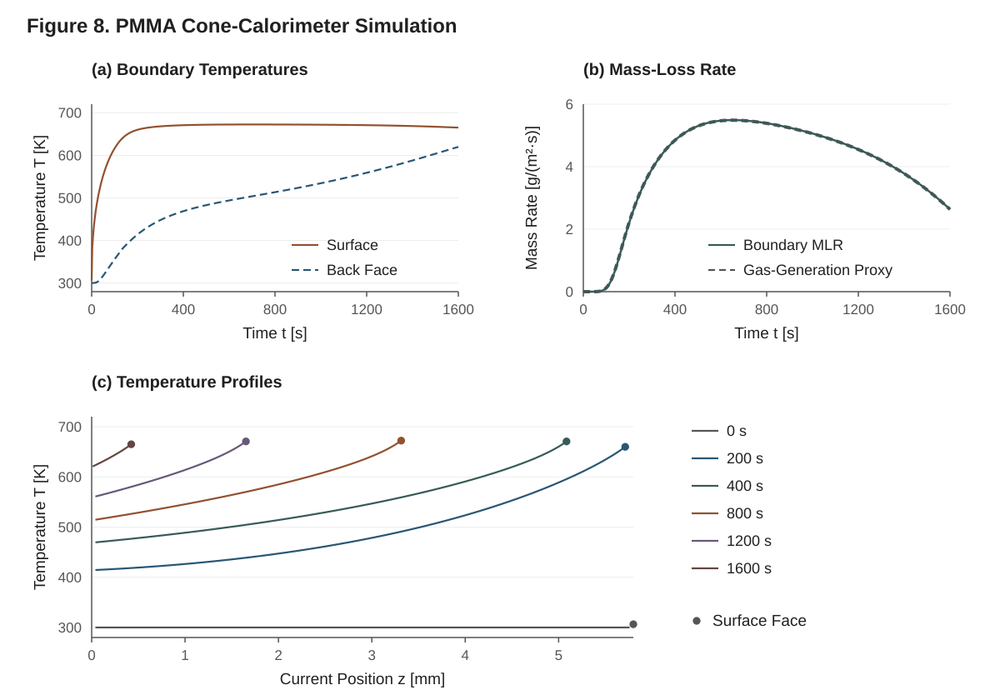

**Figure 8. Results of the complete tutorial in §2.10.** The 72-cell moving-mesh solve reaches 1,600 s successfully at an incident flux of 24.5325 kW/m². The solid green trace is the actual `solution.mass_loss_rate`; the dashed gas-generation trace is a reaction-rate proxy and can differ because gas is stored before it escapes. Both are displayed in g/(m²·s); this deck has constant cross section. Profiles use `solution.cell_centers[:, k]` at each saved time, and dots mark the current exposed-face temperature and position. The peak actual MLR is approximately 5.49 g/(m²·s). The editable Julia generator and the underlying CSV data are described in the Development page.

With `Plots` loaded, the package's recipe gives you quick standard views off the
solution directly:

```julia
using Plots

plot(solution)                      # surface-temperature trace (the default)
plot(solution; kind = :mlr)         # mass-loss-rate curve [kg/(m²·s)]
plot(solution; kind = :heatmap)     # T(cell, t) field as a heatmap
```

The recognised `kind` values are `:surface_T` (default), `:mlr`, and `:heatmap`
(time against cell index); any other value raises an informative error.

For a publication-style multi-panel figure you build the series yourself from the
fields. A typical cone summary — an MLR/gas-generation proxy, the surface and
back temperatures, and temperature profiles at several times:

```julia
# Panel 1: gas-generation-rate proxy for HRR/MLR
p1 = plot(times, gen_rate;
    xlabel = "Time [s]", ylabel = "Gas generation [g/(m²·s)]",
    title = "Gas generation (MLR proxy)", lw = 2, label = "Pyrolysis.jl")

# Panel 2: surface and back temperatures
p2 = plot(times, T_surface;
    xlabel = "Time [s]", ylabel = "Temperature [K]",
    title = "Surface & back temperature", lw = 2, label = "Surface (z = L)")
plot!(p2, times, T_back; lw = 2, label = "Back (z = 0)")

# Panel 3: through-thickness temperature profiles at selected times
p3 = plot(xlabel = "z [mm] (0 = back face)", ylabel = "Temperature [K]",
          title = "Temperature profiles")
for t_target in (30, 120, 300, 600, 1200)
    k = argmin(abs.(times .- t_target))
    z_k  = get_cell_positions(solution; at = k)
    live = .!isnan.(z_k)                             # deactivated cells read NaN
    count(live) > 1 || continue                      # skip if one live cell remains
    plot!(p3, z_k[live] .* 1000, solution.T[live, k];
          lw = 1.5, label = "t = $(round(Int, times[k])) s")
end

fig = plot(p1, p2, p3; layout = (1, 3), size = (1200, 380))
savefig(fig, "cone_quickstart.png")
```

> **Note — true HRR needs a combustion-efficiency factor.** The cone HRR is
> usually `HRR = MLR × Δh_c,eff`, where the effective heat of combustion
> `Δh_c,eff` is the complete heat of combustion times the combustion
> efficiency. Pyrolysis.jl is a *condensed-phase* solver and outputs the
> mass-loss rate (and a gas-generation proxy); it does not model the gas-phase
> flame, so multiply by your `Δh_c,eff` to get an HRR estimate. See Technical
> Reference §1 for the scope boundary.

---

## 2.10 Complete script

The full tutorial in one runnable block. Apart from the solids' `λ` and the
explicit `radiation_model` (which does not change the solve), this is the deck
of `examples/06_cone_calorimeter.jl`; the example adds a ThermaKin overlay and a
longer analysis of the results.

```julia
using Pyrolysis
using Plots

# ---- Step 1: material -------------------------------------------------------
pmma_cp = CallableProperty(
    T -> T < 378.0 ? (-2290.0 + 11.2 * max(T, 300.0)) : (1040.0 + 3.08 * T),
)
pmma_k = CallableProperty(T -> T < 378.0 ? 0.15 : (0.34 - 3.9e-4 * min(T, 700.0)))

virgin = SolidComponent(:virgin, ρ = 1210.0, c = pmma_cp, k = pmma_k, ε = 0.96, α = 1.47,
                        λ = 1e-6)
char   = SolidComponent(:char,   ρ = 1210.0, c = pmma_cp, k = pmma_k, ε = 0.96, α = 1.47,
                        λ = 1e-6)
mma    = GaseousComponent(:MMA,  M = 0.10012, c = 1500.0, k = 0.02, λ = 1e-5)

decomp = Reaction(:decomposition, 1 => (2, 3);
                  A = 1.5e14, E = 2.03e5, h = 820e3, n = 1.0, yields = (0.002, 0.998))

pmma = Material(
    name = :PMMA,
    components = (virgin, char, mma),
    reactions  = (decomp,),
    mixing = MaterialMixing(k = MixingSpec(WEIGHTED, 0.5), λ = MixingSpec(PARALLEL)),
)

# ---- Step 2: boundary conditions -------------------------------------------
q_external = 0.9813 * 25e3
h_conv     = 7.2
T_ambient  = 300.0

top_thermal =
    RadiativeFluxBC(flux = q_external, absorptivity = 0.96) +
    RadiativeBC(ε = 0.96, T_inf = 330.0) +
    ConvectiveBC(h = h_conv, T_inf = 330.0)
bottom_thermal =
    RadiativeBC(ε = 0.95, T_inf = 307.0) +
    ConvectiveBC(h = 4.0, T_inf = 307.0)

top_mass    = ConvectiveMassBC(h_m = 0.05, ξ_inf = 0.0)
bottom_mass = ImpermeableBC()

bc_set = BoundaryConditionSet(
    thermal = (top = top_thermal, bottom = bottom_thermal),
    mass    = (top = top_mass,    bottom = bottom_mass),
)

# ---- Step 3: mesh -----------------------------------------------------------
sample_thickness = 5.8e-3
n_cells          = 72
mesh = create_uniform_mesh(sample_thickness, n_cells)

# ---- Step 4: problem --------------------------------------------------------
t_final = 1600.0
problem = PyrolysisProblem(
    mesh = mesh, material = pmma, bc_set = bc_set,
    T_initial = z -> T_ambient,
    ξ_initial = [z -> 1210.0, z -> 0.0, z -> 0.0],
    tspan = (0.0, t_final),
    dt_initial = 1e-3,
    output_times = collect(range(0.0, t_final, length = 601)),
)

# ---- Step 5: solve ----------------------------------------------------------
solution = solve(problem;
    abstol = 1e-8, reltol = 1e-6, dtmin = 1e-14,
    use_ale = true,
    radiation_model = SURFACE_ABSORPTION,
    min_thickness = 0.01e-3,
    deactivation = true,
    progress = true,
)

# ---- Step 6: extract --------------------------------------------------------
times     = solution.t
T_surface = solution.surface_T
mlr       = solution.mass_loss_rate .* 1000
gen_rate  = solution.extras.gas_generation_rate .* 1000
println("retcode = ", solution.retcode, ", outcome = ", solution.outcome)
println("peak T_s = ", round(maximum(T_surface), digits = 1), " K")
println("peak MLR = ", round(maximum(mlr), digits = 2), " g/(m²·s)")

# ---- Step 7: plot -----------------------------------------------------------
plot(solution; kind = :mlr)
```

---

## 2.11 What to do next

- **Switch to in-depth radiation.** Set `radiation_model = BEER_LAMBERT` (the
  solids already carry `α = 1.47` m²/kg) to model a semi-transparent polymer.
  Compare the surface-temperature trace to the surface-absorption run above.
  (Technical Reference §8.)
- **Add pressure-driven transport.** Give a component a permeability `κ > 0` to
  switch the solver into Darcy–Fick mode for pressure-treated wood or charring
  systems. (UG 7; Technical Reference §9.)
- **Vary the cone flux.** Replace the scalar `q_external` with a function of
  time, `RadiativeFluxBC(flux = t -> ramp(t), absorptivity = 0.96)`; the solver
  re-samples the flux at every right-hand-side evaluation.
- **Run to burnout.** Extend `t_final` and read `solution.events`,
  `solution.extras.live_cells` and `solution.outcome`; UG 10 explains the
  threshold, the band, the mesh correction, and the envelope in which burnout is
  verified.
- **Sweep parameters.** Use `parameter_sweep` to run a grid of heat fluxes or
  kinetic parameters (UG 12), or finite differences of the same solves to
  estimate derivatives of an output with respect to `A`, `E`, `h`, or material
  properties (UG 13).
- **Audit the conservation.** Re-run with `rec = ConservationRecorder()` passed
  as `callback = rec`, then call `conservation_audit(solution, rec)` for the
  mass and energy closures over the solve (UG 9; Technical Reference §16).

You now have the full pipeline — material, boundary conditions, mesh, problem,
solve, solution — and can recombine these pieces for any of the worked cases in
UG 14.

---

# 3. Defining Materials, Components, and Properties

A `Material` is the physical heart of every Pyrolysis.jl simulation: it bundles the
condensed-phase and gaseous **components** that make up your sample, the
**reactions** that convert them into one another, the **property functions** that
give each component its temperature- (and optionally composition-) dependent
thermophysical behaviour, and the **mixing rules** that homogenize those component
properties into the effective bulk properties the solver actually integrates. This
chapter shows how to build each of these pieces with the real constructors, what
every field and default means, and how to assemble and validate a complete
material. The physics and derivations behind these objects live in the Technical
Reference (see Technical Reference §4 *Materials & Property Functions* and §5
*Effective Properties & Mixing Rules*); here the focus is on *how to specify* them
correctly.

Throughout, the spatial coordinate is `z` (through-thickness): `z = 0` is the
bottom/substrate, `z = L` is the top/exposed surface (see Technical Reference §1).
The primary species state variable is the **mass concentration** `ξ_j` in kg·m⁻³
(not mass fraction). All inputs are SI: densities in kg·m⁻³, heat capacities in
J·kg⁻¹·K⁻¹, conductivities in W·m⁻¹·K⁻¹, activation energies in J·mol⁻¹.

---

## 3.1 Overview: the component → material hierarchy

The build order is always the same:

1. **Components** (`SolidComponent`, `LiquidComponent`, `GaseousComponent`) — each
   carries its phase as a *type*, so the solver dispatches on phase at compile
   time. Solids and liquids form the matrix; gases flow through it.
2. **Property functions** — every per-component thermophysical property (`ρ`, `c`,
   `k`, `λ`, `κ`, intrinsic density) is a callable of temperature. You may pass a
   bare number, a `(a, b)` tuple, a function, or an explicit property-function
   object; the constructors convert for you.
3. **Reactions** (`Reaction`) — single-reactant Arrhenius decomposition steps with
   product yields, activation energy, and heat of reaction. Components may be
   referenced by **symbol** (resolved automatically) or by integer index.
4. **Mixing rules** (`MixingSpec`, `MaterialMixing`) — pick how component thermal
   conductivity `k`, gas-transfer coefficient `λ`, and permeability `κ` are
   homogenized.
5. **Material** (`Material`) — the assembled object, validated together with the
   rest of the problem by `solve` (see §3.7).

A minimal end-to-end example (one solid, one gas, one reaction) appears in the
package's top-level docstring and in Chapter 2; this chapter expands every option.

> **A note on what is exported.** `using Pyrolysis` brings the *constructors* into
> scope: `SolidComponent`, `LiquidComponent`, `GaseousComponent`, `Material`,
> `Reaction`, `DepletionLimiter`, all property-function types, the `MixingRule` enum
> values, `MixingSpec`, and `MaterialMixing`. The various **helper and inspection
> functions** used in this chapter are *not* part of the curated top-level surface,
> so you reach them by qualifying through the submodule that defines them. This works
> the same way whether or not the function is exported from that submodule — Julia's
> `Module.name` syntax resolves any name defined in the module:
>
> - From the `Materials` submodule: `Pyrolysis.Materials.n_components`,
>   `Pyrolysis.Materials.n_reactions`, `Pyrolysis.Materials.dry_pyrolysis_gas_indices`,
>   and `Pyrolysis.Materials.has_darcy_flow` are *exported* from `Materials`; the
>   stoichiometry helpers `Pyrolysis.Materials.verify_stoichiometry` and
>   `Pyrolysis.Materials.mass_balance_error` are *internal* (not exported, not part
>   of the stable public API) but are still callable through the same qualified
>   path.
> - From the `Properties` submodule: the effective-property functions
>   (`Pyrolysis.Properties.mixture_density`, `effective_conductivity`,
>   `mixture_emissivity`, `mixture_absorptivity`, `effective_permeability`,
>   `skeletal_volume_fraction`, …; §3.5.4).
> - From the `Physics` submodule: `reaction_rate` and `one_sided_factor`
>   (Chapter 4).
>
> For convenience you may `using Pyrolysis.Internal`, which re-exports the union of
> every submodule's *exports* and so brings the exported helpers
> (`n_components`, `dry_pyrolysis_gas_indices`, `has_darcy_flow`, …) into scope
> unqualified — but **not** the internal stoichiometry helpers above, which still
> require the `Pyrolysis.Materials.` prefix. `Internal` is not the stable public
> surface; prefer qualified access in production code. Material validation happens
> at the problem level: build a `PyrolysisProblem` and let `solve` validate it (the
> default, `validate = true`); see §3.7.

---

## 3.2 Defining components

### 3.2.1 `SolidComponent`

A solid is the canonical matrix-forming component. The keyword constructor is:

```julia
SolidComponent(name::Symbol;
               ρ, c, k,
               ε = 0.9, absorptivity = nothing, α = 0.0, γ = 1.0,
               λ = 0.0, κ = 0.0,
               ρ_intrinsic = nothing, φ = nothing,
               validate_properties = true)
```

| Keyword | Symbol | Meaning | Units | Default |
|---|---|---|---|---|
| `name` | — | Component identifier (positional, a `Symbol`) | — | required |
| `ρ` | `ρ_j` | **Bulk** (pure-phase) density | kg·m⁻³ | required |
| `c` | `c_{p,j}` | Specific heat capacity | J·kg⁻¹·K⁻¹ | required |
| `k` | `k_j` | Thermal conductivity | W·m⁻¹·K⁻¹ | required |
| `ε` | `ε_j(T)` | Surface emissivity (number or property function of `T`) | – | `0.9` |
| `absorptivity` | `a_j` | Surface absorptivity for incident radiation (`nothing` = Kirchhoff, `a_j = ε_j(T)`) | – | `nothing` |
| `α` | `α_j` | Mass-basis absorption coefficient | m²·kg⁻¹ | `0.0` |
| `γ` | `γ_j` | Swelling factor (volume-change participation) | – | `1.0` |
| `λ` | `λ_j` | Gas-transfer (diffusion) coefficient contribution | m²·s⁻¹ | `0.0` |
| `κ` | `κ_j` | Darcy permeability | m² | `0.0` |
| `ρ_intrinsic` | `ρ_{i,j}` | Skeletal/intrinsic density (porosity only) | kg·m⁻³ | `= ρ` |
| `φ` | — | Pure-phase porosity (alternative to `ρ_intrinsic`) | – | `nothing` |
| `validate_properties` | — | Check the property laws on the property bracket (§3.7) | – | `true` |

```julia
using Pyrolysis

# Virgin wood: temperature-rising heat capacity, opaque, tight matrix
virgin = SolidComponent(:virgin,
    ρ = 530.0,            # bulk density [kg/m³]
    c = (1500.0, 1.0),    # LinearProperty: cp(T) = 1500 + 1.0·T  [J/(kg·K)]
    k = 0.12,             # ConstantProperty 0.12 W/(m·K)
    ε = 0.88,             # emissivity
    λ = 2e-5,             # contributes to mixture gas-transfer coefficient
    κ = 1e-15)            # very low permeability (tight cellular structure)

# Char: lighter, more conductive, more emissive, absorbing, porous
char = SolidComponent(:char,
    ρ = 150.0, c = 1000.0, k = 0.10,
    ε = 0.95,
    α = 5.0,              # mass absorption coeff (used only by in-depth radiation)
    λ = 2e-5,
    κ = 1e-12)            # open, porous char conducts gas readily
```

Notes on the less-obvious fields:

- **`ε` accepts the same forms as `k`** — a number, a `(p0, p1)` linear tuple, a
  function of `T`, or a property function — and is evaluated at the cell
  temperature in the mixing rule `ε_eff = Σ_j v_j ε_j(T)` (TR §5.8). The
  Jacobian carries the resulting `dε/dT` automatically. `α` and `absorptivity` are plain constants.
- **`absorptivity` decouples the absorbed heater flux from the emission.** Leave it
  `nothing` for Kirchhoff's law (`a_j = ε_j(T)`); set the spectrum-specific value
  when the heater's spectrum differs from a blackbody at the surface temperature
  (integrating-sphere data typically give it). A `RadiativeFluxBC` with
  `absorptivity = nothing` then absorbs `Σ_j v_j a_j · Φ` while the surface still
  re-radiates at `ε_eff` — no need to split the incident flux into two BC terms.
- **`α` (absorption) is read only by in-depth radiation.** With
  `radiation_model = SURFACE_ABSORPTION` (or `NO_RADIATION`) the absorbed part of
  the incident flux is applied at the surface through the boundary energy balance
  and the component `α` values are not read. Choose `BEER_LAMBERT` to make `α`
  matter (Chapter 5 §5.6, Technical Reference §8).
- **`λ` on a solid** does not transport the solid (solids are stationary); it is the
  solid's *contribution* to the effective mixture gas-transfer coefficient through
  the mixing rule (see §3.5). ThermaKin-style setups typically use `λ ≈ 2e-5`.
  Leaving it at the default `0.0` in a gas-producing material with Fickian
  transport stops gas transport in every cell that holds no gas: the gas field
  ends in a sharp front, and the integrator rejects step after step on it.
  `solve` warns in that configuration; a small value such as `λ = 1e-6` removes
  the degeneracy (Technical Reference §5.6).
- **`κ = 0.0` (default) means impermeable.** A solid or liquid component whose
  permeability law is not identically zero (a non-zero constant, or any law given
  as a function) switches the whole problem into Darcy–Fick (pressure-driven) gas
  transport (§3.6.2 and Technical Reference §9).
- **Swelling factor `γ`** is the fraction of the component's volume that counts as
  bulk (matrix) volume, with **one meaning everywhere**: the dilation rate θ, the
  mixture density, and the conductivity/emissivity volume weights all use the same
  `γ_j·ξ_j/ρ_j` weighting. `γ = 1.0` (default for solids) means the solid shrinks as
  it is consumed; `γ = 0.0` makes the component consistently *volumeless* — no volume
  change, no volume in the bulk density, and **no weight in conductivity/emissivity
  mixing** (use with care for a "rigid char"); intermediate values are for
  intumescent/partial-expansion cases. Values outside [0, 1] are rejected at
  construction. See Technical Reference §5.1–5.2 and §10.

### 3.2.2 `LiquidComponent`

Liquids are matrix-forming like solids (same field set) and are the standard way to
represent **bound/free moisture** in hygroscopic materials. The defaults differ from
solids: a liquid by default is strongly emissive (ε = 0.95, near water's ≈ 0.96),
non-swelling, and blocks gas flow. (For the default γ = 0 the emissivity carries no
weight in the mixture anyway — a γ = 0 liquid is volumeless in the emissivity mixing;
the 0.95 matters as soon as you give the liquid γ > 0.)

```julia
LiquidComponent(name::Symbol;
                ρ, c, k,
                λ = 2e-5, κ = 0.0,
                ε = 0.95, absorptivity = nothing, α = 0.0, γ = 0.0,
                ρ_intrinsic = nothing, φ = nothing)
```

| Keyword | Meaning | Units | Default |
|---|---|---|---|
| `ρ`, `c`, `k` | bulk density, heat capacity, conductivity | (as solid) | required |
| `λ` | gas-transfer contribution | m²·s⁻¹ | `2e-5` |
| `κ` | permeability | m² | `0.0` (liquid blocks pores) |
| `ε` | emissivity (number or `ε(T)`) | – | `0.95` (water ≈ 0.96) |
| `absorptivity` | surface absorptivity for incident radiation (`nothing` = Kirchhoff) | – | `nothing` |
| `α` | mass absorption | m²·kg⁻¹ | `0.0` |
| `γ` | swelling factor | – | `0.0` |
| `ρ_intrinsic` / `φ` | skeletal density / pure-phase porosity | kg·m⁻³ / – | `= ρ` / `nothing` |

```julia
# Liquid water (moisture) in wood
moisture = LiquidComponent(:moisture,
    ρ = 1000.0, c = 4180.0, k = 0.60)   # λ defaults to 2e-5, κ=0 (blocks flow)
```

The default `γ = 0.0` for liquids means moisture evaporation does **not** by itself
drive bulk shrinkage; set `γ = 1.0` if you want liquid loss to shrink the matrix.

### 3.2.3 `GaseousComponent`

Gases flow *through* the matrix; they are the products of decomposition reactions.
A gaseous component has **no permeability field** (`get_permeability` returns 0 for
gases) and carries a **molar mass** instead, which feeds the ideal-gas density and
the pore-pressure closure `P = Σ_g ξ_g R_g T/(M_g φ)`.

```julia
GaseousComponent(name::Symbol;
                 M, c, k, λ,
                 ε = 0.0, α = 0.0, γ = 0.0,
                 validate_properties = true)
```

`M` must be positive (a gas with `M ≤ 0` would be transported but exert no
pressure, so the constructor throws an `ArgumentError`).

| Keyword | Symbol | Meaning | Units | Default |
|---|---|---|---|---|
| `M` | `M_j` | Molar mass | kg·mol⁻¹ | required |
| `c` | `c_{p,j}` | Heat capacity | J·kg⁻¹·K⁻¹ | required |
| `k` | `k_j` | Thermal conductivity | W·m⁻¹·K⁻¹ | required |
| `λ` | `λ_j` | Gas-transfer (diffusion) coefficient | m²·s⁻¹ | required |
| `ε` | `ε_j(T)` | Emissivity (number or property function; no `absorptivity` — gases always follow Kirchhoff) | – | `0.0` |
| `α` | `α_j` | Mass absorption | m²·kg⁻¹ | `0.0` |
| `γ` | `γ_j` | Swelling factor | – | `0.0` |

```julia
# Pyrolysis gas (modelled as a CO₂-like vapour) and water vapour
gas   = GaseousComponent(:gas, M = 0.044, c = 1800.0, k = 0.03, λ = 1e-4)
vapor = GaseousComponent(:H2O, M = 0.018, c = 2000.0, k = 0.025, λ = 2e-5)
```

**Density is automatic.** Unlike solids/liquids, you do *not* pass `ρ` to a gas. The
constructor installs the ideal-gas law

```
ρ_g(T) = P_ref · M / (R_g · T)
```

with `P_ref = 101325 Pa` and `R_g = 8.31446261815324 J·mol⁻¹·K⁻¹`. For example a
`M = 0.044` gas gives `ρ_g(300) ≈ 1.787 kg·m⁻³`. The ideal-gas default is correct for
almost all pyrolysis applications. See Technical Reference §4.3.

**Naming and water vapour.** Components named so that the name contains `H2O` or
`water` (case-insensitive, e.g. `:H2O`, `:water_vapor`) are treated as *moisture*
gases and are **excluded** from the dry-pyrolysis-gas set that drives lateral
shrinkage `χ` (Technical Reference §10.3). Name your dry-pyrolysis gas anything else
(`:gas`, `:MMA`, `:volatiles`). You can inspect the classification:

```julia
Pyrolysis.Materials.dry_pyrolysis_gas_indices(material)    # gas indices, excluding :H2O / :water*
```

### 3.2.4 Bulk vs. intrinsic density and porosity

Two densities coexist, and getting them right matters for porous-media physics:

- **Bulk density `ρ_j`** is the pure-phase density used by *mixing rules*, *mixture
  density*, and *volume-change* kernels. This is what you pass as `ρ`.
- **Intrinsic (skeletal) density `ρ_{i,j}`** is the density of the cell-wall
  material itself, ignoring pores within that component. It is used **only** by the
  porosity formula

  ```
  φ = 1 − Σ_{j∈solid,liquid} ξ_j / ρ_{i,j}      (= 1 − skeletal_volume_fraction)
  ```

  and, through `φ`, by the gas-pressure closure `P = N/φ` and the Carman–Kozeny
  permeability model (Technical Reference §5.3, §9.4). The pore fraction is
  computed without a clamp; the solver floors it smoothly (at 1e-12) where the
  pressure divides by it, and under Darcy–Fick transport its integrator refuses a
  step whose porosity leaves `[0, 1]`.

If you never supply an intrinsic density, it **defaults to the bulk density**, which
makes the pure phase pore-free and gives `φ = 0` for a fully solid cell. To model a
genuinely porous solid you must supply *either* `ρ_intrinsic` *or* `φ` (not both —
passing both raises an `ArgumentError`):

```julia
# Option A: give the skeletal density directly
porous_char = SolidComponent(:char, ρ = 150.0, c = 1000.0, k = 0.10,
                             ρ_intrinsic = 1450.0)   # cell-wall density of carbon

# Option B: give the pure-phase porosity (only valid with a constant bulk ρ)
porous = SolidComponent(:porous, ρ = 400.0, c = 1000.0, k = 0.10, φ = 0.5)
# → intrinsic_density = ρ / (1 − φ) = 400 / 0.5 = 800 kg/m³
```

The `φ` shortcut requires a **constant** bulk `ρ`; for a temperature-dependent bulk
density you must pass `ρ_intrinsic` explicitly. `φ` must satisfy `0 ≤ φ < 1`.

> **Practical implication.** If you intend to use Carman–Kozeny permeability or the
> gas-pressure formula and you leave intrinsic density at its default, porosity will
> be ~0 and those closures will behave degenerately. Always set `ρ_intrinsic`/`φ`
> on the solids when porosity matters. A Darcy–Fick problem in which a cell starts
> with a pore fraction below 1e-6 and a non-zero permeability is refused by problem
> validation (§3.7), and the pore gas is best initialized at ambient pressure with
> `background_gas_concentration` (Chapter 5 §5.10).

### 3.2.5 Inspecting a component

Phase predicates and accessors dispatch statically on the component type:

```julia
is_solid(virgin)        # true
is_gas(gas)             # true
is_liquid(moisture)     # true
phase(virgin)           # SOLID  (a Phase enum value)
molar_mass(gas)         # 0.044  (0.0 for solids/liquids)

# Density / property accessors (qualify through Materials):
virgin.density(300.0)                                     # bulk ρ at T (property field)
Pyrolysis.Materials.get_intrinsic_density(porous, 300.0)  # skeletal ρ
Pyrolysis.Materials.get_permeability(char, 500.0)         # κ at T (0 for gases)
Pyrolysis.Materials.get_emissivity(char, 800.0)           # ε_j(T)
Pyrolysis.Materials.get_absorptivity(char, 800.0)         # a_j: absorptivity, else ε_j(T)
```

---

## 3.3 Property functions

Every per-component thermophysical property is an `AbstractPropertyFunction`: a
callable `p(T)` (and, for some, `p(T, ξ)`). You rarely construct these directly —
the component constructors call `to_property` on whatever you pass — but knowing the
types lets you express any temperature dependence you need.

### 3.3.1 Shorthand conversions (`to_property`)

`to_property` (internal: `Pyrolysis.Materials.to_property`) maps convenient inputs to
property objects, and the component/reaction constructors apply it automatically to
`ρ`, `c`, `k`, `λ`, `κ`, `ρ_intrinsic`, and `h`:

| You pass | You get | Meaning |
|---|---|---|
| a `Real` number, e.g. `0.21` | `ConstantProperty(0.21)` | constant in `T` |
| a 2-tuple `(a, b)` | `LinearProperty(a, b)` | `a + b·T` |
| a 1-arg function `T -> …` | `CallableProperty` | arbitrary `f(T)` |
| an `AbstractPropertyFunction` | passes through unchanged | explicit object |

So `k = 0.21`, `k = (0.20, 1e-4)`, `k = T -> 0.20 + 1e-4*T`, and
`k = LinearProperty(0.20, 1e-4)` are four equivalent ways to specify a conductivity.

### 3.3.2 The property-function types

All are exported by `using Pyrolysis`.

**`ConstantProperty(value)`** — `p(T) = value`.

```julia
k = ConstantProperty(0.21)
```

**`LinearProperty(a, b)`** — `p(T) = a + b·T`. Equivalent to the `(a, b)` shorthand.

```julia
cp = LinearProperty(1420.0, 2.5)   # cp(T) = 1420 + 2.5·T
```

**`PolynomialProperty(coeffs::NTuple)`** — `p(T) = c₀ + c₁T + c₂T² + …`, evaluated
with `evalpoly` (numerically stable, Horner form). Pass the coefficients
low-order-first as a tuple:

```julia
cp = PolynomialProperty((1000.0, 2.0, 0.001))   # 1000 + 2T + 0.001T²
cp(300.0)   # = 1690.0
```

**`SutherlandProperty(μ_ref, T_ref, S)`** — Sutherland's law
`μ_ref (T/T_ref)^{3/2} (T_ref + S)/(T + S)`; `SutherlandProperty()` is air
(1.716e-5 Pa·s at 273.15 K, `S = 110.4` K, so `μ(300 K) ≈ 1.846e-5` Pa·s), the
default pore-gas viscosity of a `Material` (§3.6.1).

**`ArrheniusProperty(A, E[, T_ref])`** — `p(T) = A · exp(−E / (R_g·T))`, `E` in
J·mol⁻¹. `T_ref` defaults to 298.15 K. Mostly used for rate-constant-shaped
properties; reaction kinetics themselves are specified on the `Reaction` (§3.4), not
as an `ArrheniusProperty`.

```julia
p = ArrheniusProperty(8.5e12, 188e3)   # T_ref defaults to T_REF = 298.15
```

**`TableProperty(temperatures, values)`** — tabulated `(Tᵢ, vᵢ)` with linear
interpolation. Both arguments are tuples; **temperatures must be strictly
increasing** (the constructor errors otherwise). Queries outside the table
**extrapolate flat** (clamp to the nearest endpoint value). A binary search is used
for tables with more than 8 entries.

```julia
k = TableProperty((300.0, 400.0, 500.0), (0.20, 0.22, 0.25))
k(350.0)   # = 0.21  (linear interpolation between 0.20 and 0.22)
k(250.0)   # = 0.20  (flat extrapolation below the table)
```

**`CallableProperty(func)`** — wraps any `f(T) -> value`. Use for closed-form
dependences not covered by the other types:

```julia
k = CallableProperty(T -> 0.10 + 3.0e-4 * (T - 300.0))
```

**`StateDependentProperty(func)`** — a property that depends on both temperature and
the full cell concentration vector, `f(T, ξ) -> value`. This is the mechanism for
**composition-dependent heats of reaction**, most importantly the moisture heat of
sorption, where the sorption enthalpy rises as moisture content falls.

```julia
# Heat of sorption as a function of moisture content (%); ξ is the full
# mass-concentration tuple, so you index the moisture component yourself.
MOISTURE_IDX = 3
heat_sorption = StateDependentProperty((T, ξ) -> begin
    ξ_solid = ξ[1] + ξ[2]                              # dry-solid concentration
    MC = 100.0 * ξ[MOISTURE_IDX] / max(ξ_solid, 1.0)   # moisture content [%]
    (2275.0 + 860.0 * exp(-0.120 * MC)) * 1e3          # [J/kg], endothermic (h > 0)
end)
```

A `StateDependentProperty` **must** be called with state: `p(T, ξ)`. Calling it with
only `T` raises an error. When used as a reaction heat, the kinetics evaluation
passes `ξ` automatically. See §3.4.5 and Technical Reference §6.6.

### 3.3.3 Derivatives (for the implicit Jacobian)

You never supply derivatives. The Jacobian is colored sparse forward-mode
automatic differentiation of the residual (Chapter 11), so every property law is
evaluated with dual-number arguments and its exact derivative comes out of the
same evaluation: the slope of the piecewise-linear interpolant for a
`TableProperty`, the derivative of your function for a `CallableProperty`, and
both `dp/dT` and `∂p/∂ξ_j` for a `StateDependentProperty`. A callable must
therefore be generic Julia code — do not restrict its arguments to `Float64`.
Every law evaluates on the property bracket
`[200, 3000]` K (its argument is clamped to it, so a nonphysical Newton trial
temperature cannot reach a fractional power), and the derivatives are zero
outside the bracket. The kernels hand the laws the cell's trial temperature, the
cell temperature smoothly clamped into the bracket with 1 K transitions, which is
the cell temperature itself on every physical state. See Technical Reference
§4.4–§4.5.

**Heat capacity and the sensible enthalpy.** The energy rows also use each
component's sensible enthalpy `h_j(T) = ∫_{T_ref}^{T} c_{p,j} dT′`
(`T_ref = 298.15` K): in the enthalpy carried by the gas flux and, with
`energy_state = :enthalpy`, in the energy state itself. Constant, linear,
polynomial and tabulated heat capacities are integrated in closed form; any other
law (a function, an Arrhenius or Sutherland law) is integrated once when the
problem is set up, on a 1 K grid over the bracket, and interpolated by cubic
Hermite polynomials, so its derivative is exact to that interpolant.

---

## 3.4 Defining reactions

Reactions convert one reactant component into one or two product components by
Arrhenius kinetics. They are usually attached to a material when you build it. The
full physics — smooth temperature gates, the depletion limiter, species sources — is
in **Chapter 4** and Technical Reference §6; here we cover the constructor surface
enough to build a material.

### 3.4.1 Constructor forms

There are four `Reaction` constructors. They differ only in how reactant/product are
named (integer index vs. symbol) and whether there are one or two products.

```julia
# (a) integer index, single product
Reaction(name, reactant::Int => product::Int;
         A, E, h, n = 1.0, T_min = 0.0, T_max = Inf, gate_width = 1.0,
         validate_mass = true)

# (b) symbol, single product (resolved by Material)
Reaction(name, :reactant => :product;
         A, E, h, n = 1.0, T_min = 0.0, T_max = Inf, gate_width = 1.0,
         validate_mass = true)

# (c) integer index, two products
Reaction(name, reactant::Int => (p1::Int, p2::Int);
         A, E, h, yields, n = 1.0, T_min = 0.0, T_max = Inf, gate_width = 1.0,
         validate_mass = true)

# (d) symbol, two products (resolved by Material)
Reaction(name, :reactant => (:p1, :p2);
         A, E, h, yields = (y1, y2), n = 1.0, T_min = 0.0, T_max = Inf,
         gate_width = 1.0, validate_mass = true)
```

| Argument | Symbol | Meaning | Units | Default |
|---|---|---|---|---|
| `name` | — | reaction identifier (`Symbol`, positional) | — | required |
| `A` | `A_i` | Arrhenius pre-exponential | s⁻¹ | required |
| `E` | `E_i` | activation energy | J·mol⁻¹ | required |
| `h` | `h` | heat of reaction (number or property fn) | J·kg⁻¹ | required |
| `yields` | `ν_{i,j}` | per-product mass yields (two-product forms) | – | required for (c)/(d) |
| `n` | `n_{i,j}` | reaction order in the reactant (must be ≥ 0) | – | `1.0` |
| `T_min` | `T_min,i` | lower temperature gate | K | `0.0` |
| `T_max` | `T_max,i` | upper temperature gate | K | `Inf` |
| `gate_width` | `w_gate` | tanh ramp width of both temperature gates (must be > 0 and finite) | K | `1.0` |
| `validate_mass` | — | enforce `Σ yields = 1` at construction | – | `true` |

Yields must each be ≥ 0 and the order must satisfy `n ≥ 0` — both are enforced
unconditionally at construction; `validate_mass = false` disables only the
`Σ yields = 1` sum check.

The temperature gates are smooth tanh ramps,
`0.5·(1 + tanh((T − T_min)/gate_width))` (mirrored for `T_max`), so the rate
and its Jacobian stay differentiable across the gate. The default 1 K width
suits kinetics that turn on over tens of kelvin; for gates that must act
nearly as hard switches (melting fronts, phase-change surrogates) use a
narrower width (e.g. `gate_width = 0.1`) and expect a stiffer Jacobian near
the gate. On a driving ΔT of only a few kelvin, a 1 K ramp visibly shifts
the effective switching temperature — narrow the gate accordingly.

### 3.4.2 Symbolic vs. index references

The **symbol** forms ((b), (d)) are the recommended style: you name components, and
the `Material` constructor resolves the names to indices using the `components`
tuple, so you never track integer positions by hand. Internally a symbolic reaction
is stored as a `PendingReaction` until `Material(...)` resolves it.

```julia
pyrolysis = Reaction(:pyrolysis, :virgin => (:char, :gas),
                     A = 1e10, E = 140e3, h = 500e3,   # h > 0: endothermic
                     yields = (0.25, 0.75),            # 25% char + 75% gas
                     T_min = 450.0)                    # gate below 450 K
```

The **index** forms ((a), (c)) reference components by their 1-based position in the
material's `components` tuple. They are handy in programmatically generated schemes:

```julia
rxn = Reaction(:decomp, 1 => 2, A = 8.5e12, E = 188e3, h = 870e3)
# component 1 → component 2, single product, default order/gates
```

### 3.4.3 Heat-of-reaction sign convention

Pyrolysis.jl uses the **storage convention `h > 0 = endothermic`** (cools the
material). The volumetric source is `Q_rxn = −Σ h_r r_r`, so an endothermic reaction
produces `Q_rxn < 0`. This is the *opposite* of the ThermaKin publication
convention (`h > 0 = exothermic`); when you transcribe ThermaKin parameters, flip
the sign (Gpyro and FDS use the convention of this package). Examples:

```julia
endo = Reaction(:pyrolysis, :virgin => :gas, A = 1e10, E = 140e3, h =  500e3)  # cools
exo  = Reaction(:char_ox,   :char   => :ash, A = 1e6,  E = 120e3, h = -300e3)  # heats
```

See the overload note H1 in the nomenclature and Technical Reference §6.6.

### 3.4.4 Yields and mass balance

For single-product reactions the product yield is fixed at `1.0` (one unit of
reactant → one unit of product). For two-product reactions you supply
`yields = (y1, y2)`, and **mass conservation requires `y1 + y2 = 1.0`**. With the
default `validate_mass = true`, the constructor enforces this and errors on a
violation; you can bypass the check with `validate_mass = false` (not recommended).

```julia
# Charring: 1 kg virgin → 0.20 kg char + 0.80 kg gas
Reaction(:charring, :virgin => (:char, :gas),
         A = 1e15, E = 200e3, h = 500e3, yields = (0.20, 0.80))
```

Only **single-reactant** reactions are supported (the reactant is consumed with mass
stoichiometry 1.0). Multi-step schemes are modelled as *sequences* of single-reactant
reactions sharing intermediate components — see Chapter 4.

### 3.4.5 State-dependent heat (moisture sorption)

Pass a `StateDependentProperty` (§3.3.2) as `h` to make the heat depend on local
composition. This is the standard way to model the moisture heat of sorption:

```julia
heat_sorption = StateDependentProperty((T, ξ) -> begin
    MC = 100.0 * ξ[3] / max(ξ[1] + ξ[2], 1.0)
    (2275.0 + 860.0 * exp(-0.120 * MC)) * 1e3
end)

drying = Reaction(:drying, :moisture => :H2O,
                  A = 5.6e8, E = 43e3, h = heat_sorption)
```

### 3.4.6 Verifying reactions

The `Reaction` constructor already enforces mass balance (the product yields must
sum to the reactant mass 1.0) and throws on an imbalance unless you pass
`validate_mass = false`. To re-check a reaction after the fact, use the internal
helper (not exported; qualify through `Materials`):

```julia
Pyrolysis.Materials.verify_stoichiometry(rxn)   # Bool, warns on failure
```

It compares the reactant mass (1.0) against the sum of product yields within a
tolerance of `1e-10` and emits a warning (returning `false`) on imbalance.
`validate_problem(problem; strict = true)` runs it on every reaction of the
material (§3.7).

---

## 3.5 Mixing rules: from component to effective properties

The solver integrates **effective** (homogenized) bulk properties, not individual
component properties. Three properties are mixed per material — thermal conductivity
`k`, gas-transfer coefficient `λ`, and permeability `κ` — and **each may use a
different rule**. Heat capacity, mixture density, emissivity, and absorption are not
configurable: they always use fixed weighting rules (concentration- or
volume-weighted; see Technical Reference §5).

### 3.5.1 `MixingRule` and `MixingSpec`

The available rules are the `MixingRule` enum values (all exported):

| Rule | Formula | Valid channels |
|---|---|---|
| `PARALLEL` | `k = Σ_j v_j k_j` (volume-weighted, upper bound) | k, λ, κ |
| `SERIES` | `1/k = Σ_j v_j/k_j` (harmonic, lower bound) | k, λ, κ |
| `WEIGHTED` | `k = β·k_∥ + (1−β)·k_series` | k, λ, κ |
| `BRUGGEMAN` | EMT: `Σ_j v_j (k_j−k)/(k_j+2k) = 0` | **k only** |
| `CARMAN_KOZENY` | `κ = min(ℓ²φ³ / (180(1−φ)²), ℓ²)` (porosity-based) | **κ only** |

A `MixingSpec` bundles a rule with its parameters:

```julia
MixingSpec(rule::MixingRule, β::Real = 0.5; length_scale::Real = NaN)
```

- `β` is the blend weight, used **only** by `WEIGHTED`, and must lie in `[0, 1]`
  (default `0.5`). It is harmlessly carried for other rules.
- `length_scale` (`ℓ`, the characteristic particle/pore diameter in metres) is used
  **only** by `CARMAN_KOZENY` and is **required** for it — the constructor errors if
  you request `CARMAN_KOZENY` without a positive, finite `length_scale`.

```julia
MixingSpec(WEIGHTED, 0.6)                       # 60% parallel / 40% series for k
MixingSpec(PARALLEL)                            # β ignored
MixingSpec(CARMAN_KOZENY; length_scale = 5e-5)  # ℓ = 50 µm
MixingSpec(BRUGGEMAN)                            # EMT (k channel only)
```

### 3.5.2 `MaterialMixing`

`MaterialMixing` builds the `(k, λ, κ)` NamedTuple that `Material` expects. Each
channel accepts either a `MixingSpec` or a bare `MixingRule` (β defaults to 0.5 for
the bare form). The **defaults** are:

```julia
MaterialMixing(; k = MixingSpec(WEIGHTED, 0.5),   # conductivity
                 λ = MixingSpec(PARALLEL, 0.5),   # gas transfer
                 κ = MixingSpec(WEIGHTED, 0.5))   # permeability
```

```julia
mixing = MaterialMixing(
    k = MixingSpec(WEIGHTED, 0.5),                       # blended bounds
    λ = MixingSpec(PARALLEL),                            # parallel
    κ = MixingSpec(CARMAN_KOZENY; length_scale = 5e-5),  # porosity-based κ
)

# bare-rule shorthand (β = 0.5):
mixing2 = MaterialMixing(k = WEIGHTED, λ = PARALLEL, κ = SERIES)
```

If you omit `mixing` from `Material(...)`, the defaults above are used.

### 3.5.3 Choosing rules — guidance

- **Thermal conductivity `k`.** The default `WEIGHTED` with `β = 0.5` (midway between
  the parallel upper bound and series lower bound) is a sensible neutral choice. Use
  `BRUGGEMAN` for char-forming materials where the microstructure is random/
  self-similar — it captures percolation-like drops as a continuous phase breaks up
  (Technical Reference §5.5). `BRUGGEMAN` is solved by a Newton
  iteration and is valid **only for `k`**; requesting it for `λ` or `κ` raises an
  error at evaluation time.
- **Gas transfer `λ`.** `PARALLEL` (the default) is appropriate; EMT (`BRUGGEMAN`)
  is rejected for diffusivities because there is no physical EMT closure for them.
- **Permeability `κ`.** Two mutually exclusive approaches:
  1. **Component-based** (`PARALLEL`/`SERIES`/`WEIGHTED`): mix the per-component `κ`
     values you set on the solids/liquids.
  2. **Carman–Kozeny** (`CARMAN_KOZENY`): ignore component `κ` and compute
     permeability from **porosity** via `κ = min(ℓ²φ³/(180(1−φ)²), ℓ²)` — the
     packed-bed law capped at the free-flow scale `ℓ²` for very open structures
     (`φ ≳ 0.93`). This captures the steep rise in permeability as virgin → char
     raises porosity.

> **Important caveat for Carman–Kozeny.** Whether the solver runs in Darcy–Fick
> (pressure-driven) mode is decided by `has_darcy_flow(material)`, which checks
> whether any *component* carries `κ > 0` — it does **not** look at the κ mixing
> rule. So choosing `CARMAN_KOZENY` alone does **not** turn on Darcy transport: with
> all component `κ = 0`, `has_darcy_flow` returns `false` and gas transport stays
> Fickian. If you want pressure-driven flow *and* a Carman–Kozeny effective
> permeability, set a non-zero component `κ` (to trip `has_darcy_flow`) while using
> the `CARMAN_KOZENY` rule for the effective value, or use component-based κ mixing.
> Also remember that Carman–Kozeny needs a real porosity, so set `ρ_intrinsic`/`φ`
> on the solids (§3.2.4) — otherwise `φ ≈ 0` and `κ ≈ 0`. The solver evaluates
> the Carman–Kozeny law at the smoothly floored pore fraction.

### 3.5.4 Inspecting effective properties

The effective-property functions live in the `Properties` submodule (qualify them,
or `using Pyrolysis.Internal`). They take `(ξ, T, material)` where `ξ` is the
mass-concentration tuple; `material` below is any three-component material
(virgin, char, gas), such as the one of §3.6.2 without its moisture:

```julia
using Pyrolysis
P = Pyrolysis.Properties

ξ = (300.0, 50.0, 0.5)   # (virgin, char, gas) concentrations [kg/m³]
T = 600.0

P.mixture_density(ξ, T, material)          # ρ with swelling
P.effective_conductivity(ξ, T, material)   # k_eff
P.effective_gas_transfer(ξ, T, material)   # λ_eff
φ = 1 - P.skeletal_volume_fraction(ξ, T, material)   # pore fraction (porosity)
P.effective_permeability(ξ, T, material, φ)          # κ_eff (CARMAN_KOZENY reads φ)
P.mixture_emissivity(ξ, T, material)       # ε_eff
P.mixture_absorptivity(ξ, T, material)     # a_eff (= ε_eff by Kirchhoff unless set)
P.effective_absorption(ξ, material)        # α_eff [1/m] (note: no T argument)

# Volumetric heat capacity ρc_p = Σ_j ξ_j c_p,j(T): every component, gas included
sum(ξ[j] * material.components[j].heat_capacity(T) for j in eachindex(ξ))
```

What the solver evaluates is the same functions, called by its state mapping at
each cell's trial temperature and at the positive part of each concentration
(a smooth one-sided guard that is exactly the concentration on physical states),
with smooth floors where a trial state could make them vanish: the conductivity
at 1e-6 W·m⁻¹·K⁻¹, the pore fraction at 1e-12, the gas viscosity at `MU_FLOOR`
(§3.6.1), and the cell's heat capacity `Σ_j m_j c_{p,j}(T)` at `RHO_CP_FLOOR`
(1e3 J·m⁻³·K⁻¹) times the cell's initial volume.

Two physics notes worth remembering (both in Technical Reference §5):

- **Heat capacity includes the pore gas.** The cell's heat capacity sums every
  component: `ρc_p^eff = Σ_j ξ_j c_{p,j}(T)`. The gas is at the matrix
  temperature and stores sensible heat like every other phase; the enthalpy its
  flux carries enters as the gas enthalpy flux `Σ_j J_j h_j` through each face
  (Technical Reference §7).
- **Conductivity and emissivity use the swelling-weighted (matrix) volume
  fractions** — γ = 0 components (canonical gases) carry no weight in these
  surface/matrix properties, matching the ThermaKin convention; as a cell's
  matrix volume fraction drops through `1e-3 … 1e-4` the weights blend smoothly
  into the all-phase occupancy, so an emptied cell degrades to the gas-mixture
  conductivity instead of 0. **Gas transfer uses the all-phase volume fractions**
  (gas included) — diffusion happens through the pore space the matrix basis
  excludes. The emissivity and absorptivity are convex combinations of component
  values in `[0, 1]`, so they stay in `[0, 1]` without a clamp. Component-based permeability mixes on the matrix basis. Absorption uses
  concentration weighting; mixture density uses mass fractions with the swelling
  factor.

---

## 3.6 Assembling a `Material`

### 3.6.1 The constructor

```julia
Material(; name::Symbol,
           components::Tuple,
           reactions::Tuple = (),
           mixing = MaterialMixing(),
           lateral_shrinkage_law = nothing,
           depletion_limiter = DepletionLimiter(),
           gas_viscosity = SutherlandProperty())
```

| Keyword | Meaning | Default |
|---|---|---|
| `name` | material identifier (`Symbol`) | required |
| `components` | tuple of components | required |
| `reactions` | tuple of reactions (may be empty `()`) | `()` |
| `mixing` | `(k, λ, κ)` NamedTuple from `MaterialMixing` | `MaterialMixing()` |
| `lateral_shrinkage_law` | `A(t)/A_0 = law(χ̄)` or `nothing` (identity) | `nothing` |
| `depletion_limiter` | `DepletionLimiter` applied to every reaction-rate evaluation (a C¹ rate factor that is zero at and below zero concentration and joins `tanh(ξ/threshold)` above it; §4.10) | `DepletionLimiter()` (`threshold = 1.0` kg·m⁻³, `join = 1.0`, `base_scale = 1e-8` kg·m⁻³, enabled) |
| `gas_viscosity` | pore-gas dynamic viscosity μ(T) [Pa·s]; number, `(p0, p1)` tuple, `Function`, or property function | `SutherlandProperty()` (air) |

- **Component order defines the index space.** The first component is index 1, the
  second is 2, etc. The per-cell component masses of the state follow this order,
  and integer reaction references (§3.4.2) use it. Component names must be unique.
- **Symbolic reactions are resolved here.** Any `PendingReaction` built with symbol
  references is matched against the `components` tuple's name→index map. An unknown
  symbol raises a clear error naming the offending reaction and component.
- **`lateral_shrinkage_law`** is the variable-cross-section (intumescence/shrink)
  hook; it must be a `Function` of the column-average pyrolysis progress `χ̄`, or
  `nothing`. Most simulations leave it `nothing`. A material that carries a law
  must be solved on a moving mesh (`use_ale = true`) in planar coordinates; `setup`
  refuses it otherwise. See Technical Reference §10.5 and Chapters 6 and 7.
- **`gas_viscosity`** matters only in Darcy–Fick mode, where it enters as the
  mobility `κ/μ` — so getting μ wrong by a factor is exactly the same as getting
  permeability wrong by the reciprocal factor. The default is air, which is fine
  for an N₂-swept pore space but overstates the viscosity of wood pyrolyzates by
  roughly 1.7× at 300 K falling to 1.3× at 1000 K. Supply the blend correlation
  for the gas your material actually produces:

  ```julia
  # Cantera mixture-averaged fit, ascending coefficients, valid 280–1200 K
  Material(name = :WhitePine, components = (...), reactions = (...),
           gas_viscosity = PolynomialProperty(mu_coeffs))
  ```

  It is **one curve per material**, so it averages over the pore gas shifting
  from background air to volatiles as pyrolysis proceeds; it cannot resolve that
  transition. The constructor rejects a curve that is non-positive or non-finite
  at any of 200, 300, 500, 800, 1200 and 1800 K, and the solver floors μ smoothly
  at `Pyrolysis.Properties.MU_FLOOR` (1e-12 Pa·s) as the backstop for trial
  states — both because a μ that reaches zero reverses the gas velocity rather
  than merely degrading it. Like every property law it is evaluated at the
  temperature clamped to `[200, 3000]` K. See Technical Reference §5.9.

### 3.6.2 Worked example: charring wood with moisture

A wood with virgin solid, char solid, liquid moisture, a dry pyrolysis gas, and water
vapour. The solids carry permeabilities, so the material will run in Darcy–Fick mode;
it uses `WEIGHTED` conductivity and `CARMAN_KOZENY` permeability, with porosity set
on the solids via `φ`.

```julia
using Pyrolysis

# --- Components -----------------------------------------------------------
virgin = SolidComponent(:virgin,
    ρ = 530.0, c = (1500.0, 1.0), k = 0.12,
    ε = 0.88, λ = 2e-5,
    κ = 1e-15,           # tight virgin matrix (trips Darcy mode)
    φ = 0.55)            # pure-phase porosity → intrinsic density set internally

char = SolidComponent(:char,
    ρ = 150.0, c = 1000.0, k = 0.10,
    ε = 0.95, α = 5.0, λ = 2e-5,
    κ = 1e-12,           # open, porous char
    φ = 0.85)

moisture = LiquidComponent(:moisture, ρ = 1000.0, c = 4180.0, k = 0.60)

gas   = GaseousComponent(:gas, M = 0.044, c = 1800.0, k = 0.03, λ = 1e-4)
vapor = GaseousComponent(:H2O, M = 0.018, c = 2000.0, k = 0.025, λ = 2e-5)

# --- Reactions ------------------------------------------------------------
pyrolysis = Reaction(:pyrolysis, :virgin => (:char, :gas),
                     A = 1e10, E = 140e3, h = 500e3,     # endothermic
                     yields = (0.25, 0.75), T_min = 450.0)

# Moisture evaporation with state-dependent heat of sorption
heat_sorption = StateDependentProperty((T, ξ) -> begin
    MC = 100.0 * ξ[3] / max(ξ[1] + ξ[2], 1.0)
    (2275.0 + 860.0 * exp(-0.120 * MC)) * 1e3
end)
drying = Reaction(:drying, :moisture => :H2O,
                  A = 5.6e8, E = 43e3, h = heat_sorption)

# --- Material -------------------------------------------------------------
wood = Material(
    name = :CharringWood,
    components = (virgin, char, moisture, gas, vapor),   # indices 1..5
    reactions  = (pyrolysis, drying),
    mixing = MaterialMixing(
        k = MixingSpec(WEIGHTED, 0.5),
        λ = MixingSpec(PARALLEL),
        κ = MixingSpec(CARMAN_KOZENY; length_scale = 5e-5),
    ),
)

# --- Inspect ---------------------------------------------------------------
# All reached via the Materials submodule (none are top-level Pyrolysis exports).
Pyrolysis.Materials.n_components(wood)              # 5
Pyrolysis.Materials.n_reactions(wood)               # 2
Pyrolysis.Materials.has_darcy_flow(wood)            # true (virgin/char κ > 0)
Pyrolysis.Materials.dry_pyrolysis_gas_indices(wood) # (4,)  — :H2O (5) excluded
```

### 3.6.3 Worked example: a simple polymer (PMMA)

A non-charring polymer needs only a virgin solid and a single gas, one decomposition
reaction, and no permeability (so transport stays Fickian). The solid carries a
small gas-transfer coefficient, `λ = 1e-6`, so Fickian transport does not
degenerate where the cell holds no gas (§3.2.1); without it `solve` warns. Note the positive `h`:
PMMA depolymerization is endothermic (≈ 870 kJ·kg⁻¹ absorbed), so under the
`h > 0 = endothermic` convention it takes a positive value.

```julia
using Pyrolysis

pmma = Material(
    name = :PMMA,
    components = (
        SolidComponent(:virgin, ρ = 1190.0, c = 1420.0, k = 0.21, ε = 0.86, λ = 1e-6),
        GaseousComponent(:MMA, M = 0.100, c = 1500.0, k = 0.02, λ = 1e-5),
    ),
    reactions = (
        Reaction(:depolymerization, :virgin => :MMA,
                 A = 8.5e12, E = 188e3, h = 870e3),   # h > 0 = endothermic
    ),
    mixing = MaterialMixing(k = MixingSpec(WEIGHTED, 0.5)),
)
```

With `κ = 0` on every component, `has_darcy_flow(pmma)` is `false` and gas leaves by
Fickian diffusion only — the default transport mode. To make MMA absorb in depth you
would set `α` on the solid and choose `radiation_model = BEER_LAMBERT` at solve time.

---

## 3.7 Validating a material

A material is checked in two places: its components and reactions validate
themselves when they are constructed, and the assembled material is validated as
part of the problem.

Each two-product `Reaction` constructor enforces `Σ yields = 1.0` at construction
time (unless `validate_mass = false`), and a symbolic component reference that
names no component of the material throws when the `Material` is built.

Property laws are checked when the **component** is built: every temperature-
dependent `ρ`, `c`, `k`, `λ`, `κ` and `ε` is sampled on the property bracket
`[200, 3000]` K at 1 K steps, and the constructor throws if a density, heat
capacity or conductivity is not positive there (a gas may have `c = 0`), if
`λ` or `κ` is negative, or if `ε` leaves `[0, 1]`. The message names the first
offending temperature — a linear fit `k = 0.3 − 4.2e-4·T` is rejected at
715 K, where it would make a cell a perfect insulator. Hold a fit constant
outside its measured range (`T -> law(clamp(T, T_lo, T_hi))`), or pass
`validate_properties = false` when the law comes from an optimizer's search
parameters and an unphysical value should reach the objective instead of
throwing.

The problem-level check runs when `solve` starts (`validate = true`, the default)
or when you call `Pyrolysis.Problem.validate_problem(problem)` yourself. For the
material it checks that there is at least one component and that every
reaction's reactant/product indices are in range `1:NC`; it also warns when a
gas-producing Fickian material has a condensed component with `λ = 0`. For the
rest of the problem it checks the mesh's node positions, that the mesh has the
`:top` and `:bottom` tags and a thermal condition for each of its tags, the
length of a per-species `ξ_inf` tuple, the time span and initial step, the
number of initial-concentration functions, and, under Darcy–Fick transport,
that no cell starts with a pore fraction below 1e-6 while its effective
permeability is non-zero. `validate_problem(problem; strict = true)`
additionally re-checks every reaction's mass balance with
`verify_stoichiometry`, calls the initial-condition functions at the first cell
centre, and checks that every cell volume is positive. Errors are collected and
thrown together in one message.

---

## 3.8 Quick reference

**Component defaults** (the values you get if you omit the keyword):

| Field | Solid | Liquid | Gas |
|---|---|---|---|
| `ε` (emissivity) | `0.9` | `0.95` | `0.0` |
| `absorptivity` (surface absorptivity) | `nothing` (Kirchhoff) | `nothing` (Kirchhoff) | n/a |
| `α` (absorption) | `0.0` | `0.0` | `0.0` |
| `γ` (swelling) | `1.0` | `0.0` | `0.0` |
| `λ` (gas transfer) | `0.0` | `2e-5` | required |
| `κ` (permeability) | `0.0` | `0.0` | n/a (no field) |
| `ρ_intrinsic` | `= ρ` | `= ρ` | n/a |
| density | required `ρ` | required `ρ` | ideal gas from `M` |

**Reaction defaults:** `n = 1.0`, `T_min = 0.0`, `T_max = Inf`,
`gate_width = 1.0` K, `validate_mass = true`; single-product yield fixed at `1.0`, two-product `yields`
must sum to `1.0`. Sign: `h > 0` endothermic.

**Mixing defaults:** `k = WEIGHTED (β=0.5)`, `λ = PARALLEL (β=0.5)`,
`κ = WEIGHTED (β=0.5)`. `BRUGGEMAN` is k-only; `CARMAN_KOZENY` is κ-only and requires
`length_scale`.

**Physical constants used by the constructors:** `R_g = 8.31446261815324
J·mol⁻¹·K⁻¹`, `P_ref = 101325 Pa`, `T_ref = 298.15 K`, `σ = 5.670374419e-8
W·m⁻²·K⁻⁴`, exported by the `Materials` submodule as `R_GAS`, `P_REF`, `T_REF`,
`STEFAN_BOLTZMANN` (with the property bracket `T_PROPERTY_MIN = 200` K,
`T_PROPERTY_MAX = 3000` K): `Pyrolysis.Materials.R_GAS`, or unqualified after
`using Pyrolysis.Internal`.

**Limiter defaults:** `DepletionLimiter(threshold = 1.0, join = 1.0,
base_scale = 1e-8, enabled = true)`.

**Where to go next:** reactions in depth and TGA parameter recovery → Chapter 4;
boundary and initial conditions → Chapter 5; meshes → Chapter 6; building and
running the problem → Chapters 7–8. The physics behind everything here is in
Technical Reference §4 (materials & property functions), §5 (effective properties &
mixing), §6 (kinetics), and §10 (volume change & swelling).

---

# 4. Defining Reactions

Reactions tell Pyrolysis.jl how the solid (and any liquid) phases of a material
decompose into char, intermediates, and gases as the temperature rises. Each
reaction is an Arrhenius rate law with a stoichiometry, a heat of reaction, and
an optional temperature window. This chapter shows how to build reactions with
the `Reaction` constructor, how to specify products and yields, how the heat-of-
reaction sign convention works, how to model multi-step schemes (the single-
reactant restriction), how the depletion limiter affects rates near zero
concentration, and how to validate your stoichiometry. The physics and
derivations behind every formula here are in Technical Reference §6 (Reaction
Kinetics and Stoichiometry).

In this chapter the index `i` denotes a reaction and `j` denotes a component, per
the kinetics convention in the nomenclature.

---

## 4.1 The reaction rate law

Every reaction in Pyrolysis.jl evaluates the same volumetric rate (kg·m⁻³·s⁻¹):

```
r_i = A_i · exp(−E_i / (R_g · T)) · Π_j b(ξ_j)^{n_{i,j}} · g(ξ_j/ξ_th) · gate(T)
```

where

- `A_i` is the Arrhenius pre-exponential factor (units depend on order; see §4.4),
- `E_i` is the activation energy (J·mol⁻¹),
- `R_g = 8.31446261815324` J·mol⁻¹·K⁻¹ is the universal gas constant,
- `T` is the cell's trial temperature (K): the cell temperature smoothly
  clamped into the property bracket `[200, 3000]` K with 1 K transitions, which
  is the cell temperature on every physical state,
- `ξ_j` is the mass concentration of reactant `j` (kg·m⁻³) — note
  **mass concentration**, not mole fraction or mass fraction,
- `n_{i,j}` is the reaction order with respect to reactant `j` (must be ≥ 0;
  negative orders are rejected at construction),
- `b(ξ_j)` is the finite power base of the depletion limiter (equal to `ξ_j`
  to within `10⁻⁸` kg·m⁻³) and `g(ξ_j/ξ_th)` its one-sided onset, exactly zero
  at and below zero concentration (§4.10), and
- `gate(T)` is a smooth temperature window built from `T_min` / `T_max` (§4.6).

The rate is on a **mass-concentration** basis, which is what makes the species
sources directly additive into the finite-volume residual. See Technical
Reference §6.1 for the derivation.

---

## 4.2 The `Reaction` constructor

`Reaction` is exported by `using Pyrolysis`. There are four call forms,
distinguished by whether you name components by **symbol** or by **integer index**,
and whether the reaction has **one product** or **two products**.

### Symbolic vs. numeric component references

You can refer to components either by the `Symbol` you gave them in their
constructor, or by their 1-based position in the material's `components` tuple.

```julia
using Pyrolysis

# Symbolic — components are referenced by name; resolved when the Material is built.
Reaction(:decomposition, :virgin => :MMA; A = 8.5e12, E = 188e3, h = 870e3)

# Numeric — :virgin is component 1, :MMA is component 2 in the components tuple.
Reaction(:decomposition, 1 => 2; A = 8.5e12, E = 188e3, h = 870e3)
```

The symbolic form returns a lightweight `PendingReaction`; `Material(...)`
resolves the names to indices automatically using the `components` tuple, so you
never construct a `PendingReaction` yourself. If a reaction references a name that
is not in the components tuple, `Material(...)` raises a clear error. Prefer the
**symbolic** form: it is self-documenting and immune to component reordering.

### Single-product form

```
Reaction(name, reactant => product; A, E, h, n=1.0, T_min=0.0, T_max=Inf, gate_width=1.0, validate_mass=true)
```

The product receives the full mass yield of 1.0 automatically; you do not pass
`yields`.

```julia
# virgin PMMA fully volatilizes to MMA gas, endothermic.
Reaction(:decomposition, :virgin => :MMA; A = 8.5e12, E = 188e3, h = 870e3, n = 1.0)
```

### Two-product form

```
Reaction(name, reactant => (product1, product2); A, E, h, yields, n=1.0, T_min=0.0, T_max=Inf, gate_width=1.0, validate_mass=true)
```

Here `yields = (y1, y2)` gives the mass split between the two products and **must
sum to 1.0** (see §4.3).

```julia
# Charring: 1 kg virgin → 0.2 kg char + 0.8 kg gas, endothermic.
Reaction(:charring, :virgin => (:char, :gas); A = 1e15, E = 200e3, h = 500e3,
         yields = (0.2, 0.8))
```

### Keyword arguments and defaults

| Keyword | Meaning | Units | Default |
|---|---|---|---|
| `A` | Arrhenius pre-exponential factor (required) | s⁻¹ (first order) | — |
| `E` | Activation energy (required) | J·mol⁻¹ | — |
| `h` | Heat of reaction (required; number, `(a,b)` tuple, or property function) | J·kg⁻¹ | — |
| `yields` | Mass split for the two-product form (required there) | – | — |
| `n` | Reaction order w.r.t. the reactant | – | `1.0` |
| `T_min` | Lower temperature gate | K | `0.0` |
| `T_max` | Upper temperature gate | K | `Inf` |
| `gate_width` | Width of the tanh ramp of both gates (finite, > 0) | K | `1.0` |
| `validate_mass` | Enforce mass balance at construction | – | `true` |

`A`, `E`, and `h` are **required** keyword arguments — there are no defaults, and
omitting any of them is an error. `yields` is required only for the two-product
form. All arguments after the component pair are keyword arguments (note the `;`
in the signatures above), though the examples also work with `,` because Julia
accepts trailing keyword arguments either way.

---

## 4.3 Products, yields, and mass balance

Pyrolysis.jl uses a **single-reactant** convention (see §4.7). Per unit reaction
extent, the one reactant is consumed with mass stoichiometry `−1.0` (this is
implicit — you never type it), and the products are generated with the mass
stoichiometries you supply. Mass is conserved when the product yields sum to one:

```
Σ_products ν_{i,j} = 1.0
```

For the single-product form, the lone product automatically gets yield `1.0`, so
mass balance is trivially satisfied. For the two-product form, your `yields`
tuple must sum to `1.0`:

```julia
yields = (0.2, 0.8)   # 0.2 + 0.8 = 1.0  ✓  (mass conserved)
yields = (0.2, 0.7)   # 0.2 + 0.7 = 0.9  ✗  (validate_mass throws an error)
```

When `validate_mass = true` (the default), the constructor runs an internal
stoichiometry check and **throws an error at construction time** if the masses do
not balance. This catches typos before you ever solve. You can pass
`validate_mass = false` to skip the check (not recommended — it lets mass
conservation silently break).

The species source assembled per cell is the stoichiometric sum
`S_j = Σ_i ν_{i,j} r_i` (kg·m⁻³·s⁻¹), with the reactant carrying `−r_i` and each
product carrying `+yield · r_i`. See Technical Reference §6.5.

---

## 4.4 The Arrhenius parameters `A` and `E`

- `A` (pre-exponential factor) and `E` (activation energy, J·mol⁻¹) are stored as
  plain scalars (`Float64`). They are **temperature-independent**: a
  temperature-dependent `A(T)` is not supported directly (see §4.14).
- The units of `A` depend on the reaction order. For the standard first-order
  case (`n = 1.0`) the rate constant `A·exp(−E/R_gT)` has units s⁻¹ and the rate
  `r` comes out in kg·m⁻³·s⁻¹ because it is multiplied by a concentration. For a
  bimolecular convention `A` would be m³·kg⁻¹·s⁻¹. **The constructor does not
  check these units** — getting them right is your responsibility.

```julia
Reaction(:pyrolysis, :virgin => (:char, :gas);
         A = 1.0e13,    # s⁻¹
         E = 150e3,     # J/mol
         h = 300e3,     # J/kg
         yields = (0.20, 0.80))
```

§4.9 gives a practical recipe for recovering `A` and `E` from a TGA reference
temperature and peak rate, FDS-style.

---

## 4.5 Reaction order `n`

The keyword `n` sets the order with respect to the reactant concentration: the
rate carries the factor `ξ_reactant^n`. The default is first order (`n = 1.0`),
which is the usual choice for solid-state thermal decomposition. Non-integer
orders are allowed.

```julia
# Half-order decomposition
Reaction(:decomp, :virgin => :gas; A = 1e12, E = 180e3, h = 500e3, n = 0.5)
```

The rate evaluation has a fast path for orders 0 and 1 (avoiding a general
power), so first-order reactions are both the most common and the cheapest.

---

## 4.6 Temperature gates `T_min` and `T_max`

`T_min` and `T_max` define the temperature window in which the reaction is active.
They are **not hard cutoffs**: instead of step functions, Pyrolysis.jl multiplies
the rate by smooth `tanh` ramps,

```
r ← r · ½(1 + tanh((T − T_min)/w_gate)) · ½(1 + tanh((T_max − T)/w_gate))
```

with `w_gate = gate_width` (default 1 K), so the reaction turns on and off
smoothly. A narrower width approaches the hard step at the cost of a stiffer
Jacobian near the gate. The smoothness is deliberate — hard
steps create discontinuities in the Jacobian that break automatic differentiation
and Newton convergence (Technical Reference §6.2).

```julia
Reaction(:pyrolysis, :virgin => (:char, :gas);
         A = 1.0e13, E = 150e3, h = 300e3, yields = (0.20, 0.80),
         T_min = 400.0,    # ramps on near 400 K
         T_max = 1500.0)   # ramps off near 1500 K
```

Defaults are `T_min = 0.0` and `T_max = Inf`. The lower gate is applied only when
`T_min` is finite **and** strictly positive, and the upper gate only when `T_max`
is finite; with the defaults, neither gate fires and the bare Arrhenius rate is
used at all temperatures.

> **Caveat — gate leakage.** The ramp `tanh((T − T_min)/w_gate)` is sharp on the
> scale of the gate width but not instantaneous: the reaction is "weakly active"
> within roughly ±10 gate widths of each bound (±10 K at the default width). If you need a
> hard kinetic threshold, the gates are an approximation; for the AD- and
> Newton-stability reasons above, they are intentional. See Technical Reference
> §6.2.

---

## 4.7 The single-reactant restriction and multi-step schemes

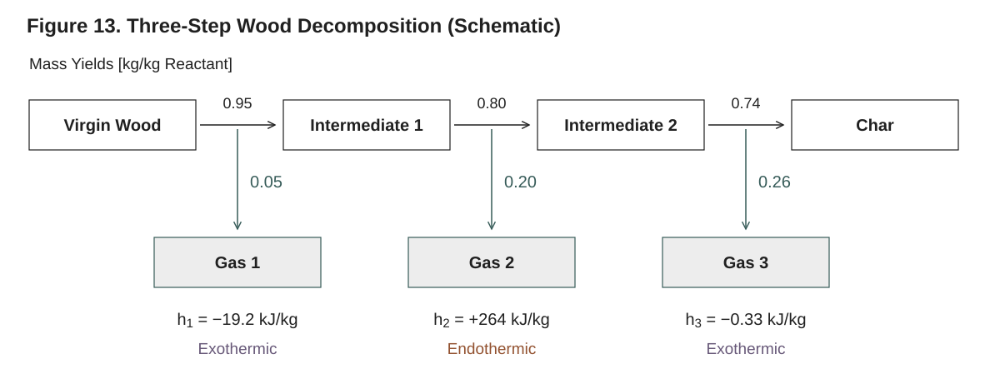

**Figure 13. The three-step wood example (schematic).** This is the reaction tuple immediately below: each arrow consumes exactly one component and its two product yields sum to one. Yields are per kilogram of the current step’s reactant, so complete conversion gives 0.5624 kg of char and 0.4376 kg of gases per kilogram of virgin wood. The package convention is $h>0$ for endothermic consumption and $h<0$ for exothermic release. Intermediate components are explicit state inventories, not additional reactants to a single reaction.

The current implementation supports **single-reactant reactions only**
(`NRin == 1`). Each `Reaction` consumes exactly one component. Attempting to apply
a multi-reactant reaction is rejected by problem validation. This means you cannot
write a bimolecular reaction such as `char + O₂ → ...` as a single `Reaction` with
two reactants.

The way to model realistic decomposition is a **sequence of single-reactant
reactions**, each consuming one component and producing intermediates plus gases.
This is exactly how the shipped wood and pressure-treated-wood models work: a
chain `virgin → int1 → int2 → ... → char`, with a gas split released at every
step. Below is a three-step charring chain (symbolic names; numeric indices would
read identically):

```julia
using Pyrolysis

virgin = SolidComponent(:virgin, ρ = 530.0, c = 1500.0, k = 0.12)
int1   = SolidComponent(:int1,   ρ = 400.0, c = 1400.0, k = 0.11)
int2   = SolidComponent(:int2,   ρ = 250.0, c = 1300.0, k = 0.12)
char   = SolidComponent(:char,   ρ = 130.0, c = 1100.0, k = 0.10, ε = 0.95)
gas1   = GaseousComponent(:gas1, M = 0.030, c = 1500.0, k = 0.03, λ = 1e-5)
gas2   = GaseousComponent(:gas2, M = 0.040, c = 1500.0, k = 0.03, λ = 1e-5)
gas3   = GaseousComponent(:gas3, M = 0.050, c = 1500.0, k = 0.03, λ = 1e-5)

material = Material(
    name = :CharringWood,
    components = (virgin, int1, int2, char, gas1, gas2, gas3),
    reactions = (
        Reaction(:step1, :virgin => (:int1, :gas1);
                 A = 7.48e4,  E = 71.6e3,  h = -1.92e4, yields = (0.95, 0.05)),
        Reaction(:step2, :int1   => (:int2, :gas2);
                 A = 2.36e10, E = 140.9e3, h =  2.64e5, yields = (0.80, 0.20)),
        Reaction(:step3, :int2   => (:char, :gas3);
                 A = 6.40e0,  E = 56.0e3,  h = -3.3e2,  yields = (0.74, 0.26)),
    ),
)
```

Each step is mass-balanced on its own (every `yields` sums to 1.0), and the chain
as a whole conserves solid + gas mass.

> **Note.** O₂-dependent char oxidation (an exothermic surface reaction common in
> flaming-combustion models) cannot currently be expressed as a true bimolecular
> reaction. You can approximate it with a single-reactant exothermic char-→-ash
> step gated by temperature (§4.8), but the explicit oxygen dependence is a
> documented limitation (Technical Reference §6.10).

---

## 4.8 Heat of reaction `h` and its sign convention

The heat of reaction is supplied through the `h` keyword in J·kg⁻¹ (per kg of the
reactant). Pyrolysis.jl uses the **storage (enthalpy) sign convention**:

- **`h > 0` is endothermic** — the reaction absorbs heat and **cools** the
  material.
- **`h < 0` is exothermic** — the reaction releases heat and **heats** the
  material.

The volumetric heat source assembled into the energy equation is
`Q_rxn = −Σ_i h_i r_i` (W·m⁻³), so the minus sign converts the stored enthalpy
into a source: an endothermic reaction (`h > 0`) gives `Q_rxn < 0` (cooling), and
an exothermic reaction (`h < 0`) gives `Q_rxn > 0` (heating). See Technical
Reference §6.6.

> **Important — opposite to ThermaKin.** ThermaKin2Ds publishes heats of
> reaction with the *opposite* sign (there `h > 0` is exothermic; Gpyro and FDS
> use the sign of this package). When you port parameters from a ThermaKin input file,
> **flip the sign of every heat of reaction.** The shipped examples annotate this
> conversion explicitly; e.g. a ThermaKin "+2.78E6 J/kg" (exothermic there)
> becomes `h = -2.78e6` here (exothermic in this convention) — and a ThermaKin
> "−2.78E6 J/kg" (endothermic there) becomes `h = 2.78e6` here (endothermic in
> this convention). In both cases the rule is the same: flip the sign.

### Constant heat (the common case)

Pass a plain number; it is wrapped as a `ConstantProperty`:

```julia
# Endothermic pyrolysis (absorbs heat).
Reaction(:decomposition, :virgin => :gas; A = 1.5e14, E = 2.03e5, h = 820e3)

# Exothermic char-forming step (releases heat) — note the negative h.
Reaction(:exo_step, :int4 => (:char, :gas);
         A = 6.4e0, E = 56e3, h = -3.26e2, yields = (0.74, 0.26))
```

### Temperature-dependent heat

Pass a two-tuple `(a, b)` for an affine `h(T) = a + b·T` (a `LinearProperty`), or
any of the property-function types from Chapter 3:

```julia
# h(T) = 870e3 + 100*T  J/kg  (h > 0 = endothermic)
Reaction(:decomp, :virgin => :gas; A = 8.5e12, E = 188e3, h = (870e3, 100.0))
```

### State-dependent heat (moisture sorption)

For moisture evaporation, the heat of sorption depends on the current moisture
content, not only on temperature. Use a `StateDependentProperty`, whose closure
receives both the temperature `T` and the full concentration tuple `ξ`. The
kinetics evaluator automatically passes `ξ` when the heat is state-dependent.

```julia
const MOISTURE_IDX = 7        # index of moisture in the components tuple
const ρ_DRY_BASIS  = 530.0    # dry-wood density for the moisture-content ratio [kg/m³]

# HoS(MC) = 2450.4 + 875.6 * exp(-0.1122 * MC) [kJ/kg], MC = moisture content (% dry basis)
heat_of_sorption = StateDependentProperty(
    (T, ξ) -> begin
        MC = 100.0 * ξ[MOISTURE_IDX] / ρ_DRY_BASIS          # moisture content, % dry basis
        return (2450.420909987441 + 875.6441221735336 *
                exp(-0.1121684273316275 * MC)) * 1e3          # J/kg (endothermic, h > 0)
    end,
)

Reaction(:moisture_evaporation, :moisture => :water_vapor;
         A = 2.997e5, E = 5.0e4, h = heat_of_sorption, n = 1.0)
```

The closure indexes `ξ` by component position, so `MOISTURE_IDX` must match the
moisture component's slot in the `components` tuple. Evaporation is endothermic,
so the returned value is positive. See Technical Reference §6.6 and Chapter 3 for
the property-function types.

---

## 4.9 Recovering `A` and `E` from TGA data (FDS-style recipe)

A common practical task is fitting Arrhenius parameters to a single-step
thermogravimetric analysis (TGA) curve. The FDS approach uses two readouts from a
constant-heating-rate TGA run: the **peak-rate temperature** `T_p` (K, where the
mass-loss rate is maximal) and the **peak reaction rate** `r_p` (s⁻¹, the
maximum of the normalized mass-loss rate `−(1/m_0) dm/dt`; a curve reported per
kelvin is multiplied by the heating rate `β_h` in K·s⁻¹). For a first-order
reaction of a pure material the standard estimates are

```
E ≈ e · r_p · R_g · T_p² / β_h
A ≈ e · r_p · exp(E / (R_g · T_p))
```

where `e ≈ 2.71828` is Euler's number and `R_g = 8.314462618` J·mol⁻¹·K⁻¹
(Technical Reference §6.9.3 gives the general form with the initial mass
fraction). As a
runnable example, suppose the TGA peak is at `T_p = 640 K` with a heating rate of
10 K·min⁻¹ and a peak fractional mass-loss rate of 0.012 K⁻¹:

```julia
const R_g = 8.314462618    # J/(mol·K)

β_h = 10.0 / 60.0          # heating rate, K/s  (10 K/min)
T_p = 640.0                # peak-rate temperature, K
r_p = 0.012 * β_h          # peak reaction rate, s⁻¹  (0.012 K⁻¹ × β_h)

E = exp(1) * r_p * R_g * T_p^2 / β_h   # J/mol  (≈ 111.1 kJ/mol)
A = exp(1) * r_p * exp(E / (R_g * T_p)) # s⁻¹    (≈ 6.3e6 s⁻¹)

rxn = Reaction(:decomposition, :virgin => :gas; A = A, E = E, h = 500e3)
```

These are first-pass estimates (a first-order TGA integrated with these values
peaks at 640 K with a peak rate about 9 % above `r_p`, the error of the
approximation behind the formulas); for production fits, refine `A`, `E`, and `h`
against the measured curve using the sensitivity / inverse-analysis tooling (User
Guide Chapter 13). See Technical Reference §6.9 for the relationship to the FDS,
ThermaKin, and Gpyro kinetic formulations.

---

## 4.10 The depletion limiter

As a reactant concentration approaches zero, a bare Arrhenius rate can still try
to react at a finite speed, which makes implicit solvers stiff — and for a
zero-order fit it would keep consuming reactant straight through zero. An
implicit solver also evaluates trial states on which a concentration is
slightly negative. Pyrolysis.jl therefore multiplies the rate, per reactant, by
a one-sided factor and evaluates the order's power on a finite base:

```
r ∝ b(ξ)^n · g(ξ / threshold)

g(x) = 0                                   for x ≤ 0
g(x) = (s − 2y) t³ + (3y − s) t²           for 0 < x < join,  t = x/join,
                                           y = tanh(join), s = join·sech²(join)
g(x) = tanh(x)                             for x ≥ join

b(ξ) = base_scale · ln(1 + e^{ξ/base_scale})
```

The onset `g` has zero value and zero slope at `x = 0` and matches `tanh` and
its slope at `x = join`, so it is C¹ everywhere. The rate and every derivative
of it are exactly zero at and below zero concentration, for every order
`n ≥ 0`, including zero order: an absent or negative trial concentration is
never consumed. The base `b(ξ)` equals `ξ` to within `base_scale · ln 2` and is
finite for every real `ξ`, so the derivative of `ξⁿ` stays finite at
depletion for fractional orders. Far above the threshold the factor rounds to
one and the bare Arrhenius rate is recovered: the relative deficit is
`2 e^{−2ξ/threshold}`, below 4 % at `2·threshold` and below 5e-9 at
`10·threshold`, and the factor is exactly 1 from `20·threshold`.

The limiter is configured by the `DepletionLimiter` type (exported at the top
level, and by the `Physics` and `Materials` submodules):

```julia
DepletionLimiter(; threshold = 1.0, join = 1.0, base_scale = 1e-8, enabled = true)
```

| Field | Meaning | Units | Default |
|---|---|---|---|
| `threshold` | Concentration scale of the roll-off | kg·m⁻³ | `1.0` |
| `join` | Where the onset joins `tanh`, in units of `threshold` | – | `1.0` |
| `base_scale` | Scale of the finite power base | kg·m⁻³ | `1e-8` |
| `enabled` | Apply the onset factor | – | `true` |

`threshold`, `join` and `base_scale` must be positive (an `ArgumentError`
otherwise). With `enabled = false` the onset factor is one and only the finite
base remains: an order-zero reaction then runs at its full rate at any
concentration, and an absent reactant reacts at the rate of a `base_scale`
concentration; the integrator's admissibility check is then the only guard.

The limiter is a property of the **material**, not of individual reactions or
of `solve`: the default `DepletionLimiter()` is applied to every rate the
solver evaluates, and a custom one is passed with the `Material` constructor's
`depletion_limiter` keyword,

```julia
material = Material(name = …, components = …, reactions = …,
                    depletion_limiter = DepletionLimiter(threshold = 0.1))
```

The reaction kernel reads `material.depletion_limiter` for every rate
evaluation, and with an enabled limiter it skips a cell in which every reaction
lacks its reactant (that cell's rates and their derivatives are exactly zero).
**When to tune:** the default `threshold = 1.0` kg·m⁻³ is appropriate for most
condensed-phase materials, whose concentrations are hundreds to thousands of
kg·m⁻³. A lower threshold keeps the kinetics closer to the bare rate law near
depletion, which matters for genuinely dilute species (e.g. trace moisture at a
few kg·m⁻³); a higher one damps the stiffness of a vanishing reactant. See
Technical Reference §6.3.

You can evaluate a single rate with a custom or disabled limiter for testing,
and the onset itself with `one_sided_factor`:

```julia
using Pyrolysis
using Pyrolysis.Physics: reaction_rate, one_sided_factor   # exported by Physics only

rxn = Reaction(:decomp, 1 => 2; A = 1e10, E = 150e3, h = 5e5)
r      = reaction_rate(rxn, (0.5, 0.0), 700.0)   # the default limiter
r_bare = reaction_rate(rxn, (0.5, 0.0), 700.0; limiter = DepletionLimiter(enabled = false))
one_sided_factor(2.0, 1.0)                        # g(2) = tanh(2) ≈ 0.964
```

`reaction_rate(rxn, ξ, T; limiter)` takes a resolved (index-form) reaction, the
concentration `NTuple` of the cell and its temperature; without `limiter` it
uses `DepletionLimiter()`, not the material's.

---

## 4.11 Assembling reactions into a material

Reactions are passed to `Material(...)` as a tuple via the `reactions` keyword.
The components tuple comes first (so symbolic names can be resolved), and the
reaction tuple may mix heterogeneous reaction types (different orders, product
counts, heat-property types) without penalty:

```julia
using Pyrolysis

material = Material(
    name = :PMMA,
    components = (
        SolidComponent(:virgin, ρ = 1190, c = 1420, k = 0.21, ε = 0.86),
        SolidComponent(:char,   ρ = 5.0,  c = 1000, k = 0.10, ε = 0.95),
        GaseousComponent(:MMA,  M = 0.10012, c = 1500, k = 0.02, λ = 1e-5),
    ),
    reactions = (
        Reaction(:decomposition, :virgin => (:char, :MMA);
                 A = 1.5e14, E = 2.03e5, h = 820e3, n = 1.0,
                 yields = (0.002, 0.998)),   # 0.2% char, 99.8% gas
    ),
)
```

A material can also have **no reactions** — pass `reactions = ()` (the default) for
a pure heat-conduction problem. `Material(...)` resolves symbolic reactions (a
name that matches no component throws) into `Reaction`s, whose constructor
checks the mass balance; integer component indices are range-checked when
`solve` validates the problem (§3.7). Chapter 3 covers the rest of the
`Material` constructor (components, mixing rules, lateral-shrinkage law).

---

## 4.12 Validating reactions

One helper lets you check mass balance explicitly, beyond the automatic
check at construction. It is **not** part of the top-level `Pyrolysis`
exports — reach it through its submodule as
`Pyrolysis.Materials.verify_stoichiometry`, or bring it into scope with
`using Pyrolysis.Materials: verify_stoichiometry`.

**`verify_stoichiometry(rxn; tol=1e-10) -> Bool`** confirms that a single
reaction's product yields sum to 1.0 (within `tol`). It returns `true` when
balanced and issues a warning and returns `false` otherwise:

```julia
using Pyrolysis.Materials: verify_stoichiometry

rxn = Reaction(:charring, 1 => (2, 3);
               A = 1e15, E = 200e3, h = 500e3, yields = (0.25, 0.75))
verify_stoichiometry(rxn)   # true: 0.25 + 0.75 = 1.0

all(verify_stoichiometry, material.reactions)   # every reaction of a material
```

It takes a resolved `Reaction`: a reaction built with symbols is a
`PendingReaction` until `Material(...)` resolves it, so check the material's
`reactions` (or use the index form) rather than the symbolic object itself.

It is a diagnostic: mass conservation is enforced by the single-reactant
construction convention (§4.3), not by a projection during the solve, so the
check is for catching setup mistakes. See Technical Reference §6.8.

---

## 4.13 Worked example: a single-step endothermic decomposition

Putting it together — a one-reaction PMMA-like material, evaluated at a single
cell state to show the rate, heat source, and species sources:

```julia
using Pyrolysis
# `reaction_rate` lives in the Physics submodule and is exported from it, but is
# not re-exported at the top level — bring it into scope explicitly.
using Pyrolysis.Physics: reaction_rate
# `verify_stoichiometry` is not exported at all; reach it through the Materials
# submodule.
using Pyrolysis.Materials: verify_stoichiometry

# Three components: virgin solid, char residue, gas product.
virgin = SolidComponent(:virgin, ρ = 1190, c = 1420, k = 0.21, ε = 0.86)
char   = SolidComponent(:char,   ρ = 5.0,  c = 1000, k = 0.10, ε = 0.95)
gas    = GaseousComponent(:MMA,  M = 0.10012, c = 1500, k = 0.02, λ = 1e-5)

rxn_spec = Reaction(:decomposition, :virgin => (:char, :MMA);
               A = 1.5e14,     # s⁻¹
               E = 2.03e5,     # J/mol
               h = 820e3,      # J/kg  (positive ⇒ endothermic ⇒ cools)
               n = 1.0,
               yields = (0.002, 0.998))

material = Material(name = :PMMA, components = (virgin, char, gas), reactions = (rxn_spec,))
rxn = material.reactions[1]                          # the resolved reaction

# Verify mass balance.
@assert verify_stoichiometry(rxn)                  # 0.002 + 0.998 = 1.0
@assert all(verify_stoichiometry, material.reactions)

# Evaluate the rate at one cell state (concentrations in kg/m³, T in K).
T_cell = 700.0
ξ_cell = (1000.0, 0.0, 0.0)                         # (virgin, char, MMA)
r = reaction_rate(rxn, ξ_cell, T_cell; limiter = material.depletion_limiter)  # kg·m⁻³·s⁻¹ (≈ 106.7)

Q_rxn = -rxn.heat(T_cell, ξ_cell) * r              # W·m⁻³  (= -h·r); endothermic ⇒ < 0
S = (-r, 0.002 * r, 0.998 * r)                     # species sources (virgin, char, gas)
@assert isapprox(S[2] + S[3], r; rtol = 1e-12)     # product mass = consumed mass
```

`r` is the volumetric reaction rate, `Q_rxn = −h·r` is the volumetric heat source
(negative here because the reaction is endothermic), and the species sources `S`
conserve mass (the products' generation balances the reactant's consumption).
The solver performs this computation in every cell with the material's
limiter at the cell's trial temperature and multiplies the sources by the cell
volume, since the component masses are the states; see Technical Reference §6.7.

---

## 4.14 Summary and limitations

- A `Reaction` is `A·exp(−E/R_gT)·ξ^n`, times the limiter's onset, with smooth
  `T_min`/`T_max` gates of width `gate_width` and a heat of reaction `h`.
- Reference components by **symbol** (recommended) or integer index; product
  `yields` must sum to **1.0**, enforced at construction unless
  `validate_mass = false`.
- **Sign convention: `h > 0` is endothermic, `h < 0` is exothermic** — opposite
  to ThermaKin; flip the sign when porting ThermaKin parameters.
- Only **single-reactant** reactions are supported; build multi-step schemes as
  chains of single-reactant reactions. Multi-reactant (e.g. O₂-dependent)
  kinetics, temperature-dependent `A`, and pressure-dependent rates are not
  supported (Technical Reference §6.10).
- The **depletion limiter** (default `threshold = 1.0` kg·m⁻³) is applied
  automatically: each reactant's rate factor is exactly zero at and below zero
  concentration and joins `tanh(ξ/threshold)` above it. It is rarely tuned;
  lower it only for genuinely dilute species and raise it only to relieve
  stiffness near full conversion.
- Re-check a reaction's mass balance with `verify_stoichiometry`.

For the mathematics behind the rate law, the smooth gates, the depletion limiter,
the stoichiometric sources, and the heat-source assembly, see Technical Reference
§6 (Reaction Kinetics and Stoichiometry). For defining the components a reaction
acts on, see Chapter 3 (Defining Materials, Components, and Properties).

---

# 5. Boundary and Initial Conditions

Boundary conditions (BCs) tell the solver how heat and gas enter and leave the
1-D column; initial conditions set the temperature and composition at `t = 0`.
This chapter shows how to build a `BoundaryConditionSet`, the complete catalogue
of thermal, mass, and pressure BCs with every field and default,
how the surface energy balance is solved, and how to specify initial
temperature and concentration profiles. The physics and derivations behind each
BC live in the Technical Reference §12 (and the radiation models in §8); this
chapter is about *how to specify them correctly*.

> **Coordinate and sign reminders** (see Technical Reference §2). The axial
> coordinate is `z`. `z = 0` is the **bottom / substrate** (tag `:bottom`);
> `z = L` is the **top / exposed surface** (tag `:top`). Heat normally enters from the top. For *all* BCs in this package the
> sign convention is: **positive flux = into the domain** (heating, or mass
> entering). A gas escaping out of the top therefore has a *negative* boundary
> mass flux in the BC's own convention.

---

## 5.1 The `BoundaryConditionSet`

All boundary conditions are bundled in a single tag-keyed container,
`BoundaryConditionSet`. It holds exactly two kinds of BC — **thermal** and
**mass** — each as a `NamedTuple` keyed by boundary tag (`:top`, `:bottom` in
1-D):

```julia
using Pyrolysis

bc_set = BoundaryConditionSet(
    thermal = (top    = HeatFluxBC(50e3) + RadiativeBC(ε = 0.9, T_inf = 300.0),
               bottom = AdiabaticBC()),
    mass    = (top    = DiffusiveMassBC(0.01),
               bottom = ImpermeableBC()),
)
```

Both keyword arguments default to fully-insulated, impermeable boundaries:

```julia
# Equivalent to the explicit defaults below
bc_set = BoundaryConditionSet()
#   thermal = (top = AdiabaticBC(),   bottom = AdiabaticBC())
#   mass    = (top = ImpermeableBC(), bottom = ImpermeableBC())
```

Key facts about the constructor:

- **Partial specification is allowed.** Whatever you supply is merged over the
  defaults, so `BoundaryConditionSet(thermal = (top = HeatFluxBC(50e3),))`
  leaves the bottom adiabatic and both mass faces impermeable. (Note the
  trailing comma — a one-element `NamedTuple` needs it.)
- **Type checking is enforced at construction.** Passing a mass BC into a
  thermal slot (or vice-versa) throws an `ArgumentError` immediately.
- **It is type-stable.** Each tag's condition is a concrete type, so the
  residual specializes on it statically.
- **The tags are the mesh's.** A line mesh has `:top` and `:bottom`; validation
  requires a thermal condition for every tag of the mesh (the merged defaults
  supply them), and `setup` refuses a set that names a tag the mesh does not have
  with an `ArgumentError`.

The set is then handed to `PyrolysisProblem` via the `bc_set` keyword:

```julia
problem = PyrolysisProblem(
    mesh = mesh,
    material = material,
    bc_set = bc_set,
    T_initial = z -> 300.0,
    ξ_initial = [z -> 1190.0, z -> 0.0],
    tspan = (0.0, 100.0),
)
```

> **Note on mesh motion and radiation.** The `BoundaryConditionSet` has *only*
> `thermal` and `mass` fields. Mesh motion needs no BC at all — it follows from
> the physics (§5.7) — and there is no radiation BC type: external incident
> radiation (cone heater, panel) is specified as a **thermal** BC
> (`RadiativeFluxBC`, §5.2.6), and the radiation model chooses where it is
> absorbed (§5.6).

---

## 5.2 Thermal boundary conditions

Thermal BCs are subtypes of `AbstractThermalBC`. They are the heat-side input to
the **surface energy balance** that the solver closes by a Newton iteration for
the surface temperature `T_s` (§5.4). Every flux is reported with the **positive
= into domain** convention.

| BC type | Physical flux `q_BC` | Key parameters (defaults) |
|---|---|---|
| `AdiabaticBC` | `0` | — |
| `HeatFluxBC` | `q(t)` (prescribed) | `flux` |
| `ConvectiveBC` | `h·(T_∞ − T_s)` | `h`, `T_inf` |
| `RadiativeBC` | `F·ε_eff·σ·(T_∞⁴ − T_s⁴)` | `ε` (`nothing`), `T_inf`, `F` (`1.0`) |
| `RadiativeFluxBC` | `a·q_inc` (model-dependent) | `flux`, `absorptivity` (`nothing` ⇒ `a_eff`) |
| `DirichletThermalBC` | enforces `T_s = T` | `T` |
| `CombinedThermalBC` | `Σ_i q_BC,i` | built via `+` |

All exported by `using Pyrolysis`.

### 5.2.1 `AdiabaticBC` — perfect insulation

```julia
bc = AdiabaticBC()
```

Zero heat flux. This is the default for both faces and the usual choice for the
substrate (back face) in a cone-calorimeter idealization where the sample is
mounted on insulation.

### 5.2.2 `HeatFluxBC` — prescribed flux

```julia
bc = HeatFluxBC(50e3)                            # constant 50 kW/m² into the surface
bc = HeatFluxBC(t -> 50e3 * (1 - exp(-t / 10)))  # ramp-up over ~10 s
```

The single field, `flux`, is the heat flux `q_BC` in W/m², **positive into the
domain**. It may be a constant (`Real`) or a function of time `t`. Use this for
direct-contact heating or for an opaque surface where you want to inject a flux
directly (rather than via the radiation models, see `RadiativeFluxBC`).
`dq_BC/dT_s = 0`, so it does not couple to the surface temperature: alone on a
face it is applied in closed form, without the surface Newton of §5.4 (the
recorded face temperature is `T_cell + q·d/k`).

### 5.2.3 `ConvectiveBC` — Newton cooling

```julia
bc = ConvectiveBC(h = 10.0, T_inf = 300.0)
bc = ConvectiveBC(h = 10.0, T_inf = t -> 300 + 0.1 * t)   # warming ambient
```

Newton's cooling law `q_BC = h·(T_∞ − T_s)`. Fields:

- `h` — convective heat-transfer coefficient `h_conv` in W·m⁻²·K⁻¹. Constant or
  `h(t)`. Validated to be non-negative.
- `T_inf` — ambient temperature `T_∞` in K. Constant or `T_∞(t)`. Validated to
  be positive.

The flux is positive (heating) when `T_∞ > T_s` and negative (cooling) when the
surface is hotter than the surroundings — the usual re-radiation/convection loss
direction during pyrolysis. Its temperature derivative `dq_BC/dT_s = −h` makes
the Newton solve converge quickly.

**Blowing.** Strong outgassing thickens the boundary layer and suppresses
convective exchange, and a gas denser than the free stream can pool on the
face. How a `ConvectiveBC` responds is its `blowing` model, `NoBlowing()` by
default (the coefficient stays `h` whatever leaves the face). The surface
balance hands the model the outward mass flux of every gas component at the
face at each iterate, so the back face is unaffected automatically (no
outflow). Four models ship:

```julia
ConvectiveBC(h = 15.0, T_inf = 300.0, blowing = CouetteFilm())        # h·B/(e^B − 1), B = ṁ″·c_p,g/h
ConvectiveBC(h = 11.2, T_inf = 360.0, blowing = CouetteFilm(0.31))    # film law with a fitted constant
ConvectiveBC(h = 11.2, T_inf = 360.0, blowing = PropertyRatioFilm(NITROGEN))
ConvectiveBC(h = 11.2, T_inf = 360.0, blowing = PoolingFilm(NITROGEN; volatiles = pyrolysate))
ConvectiveBC(h = 11.2, T_inf = 360.0,
             blowing = FunctionBlowing((face, h, T_inf) -> exp(-1500.0 * sum(face.ṁ) / h)))
```

- `CouetteFilm(λ = 0.5)`: the classical film law `h → h·R_b` with the
  blowing ratio `R_b = B_λ/(e^{B_λ} − 1)` and the film parameter
  `B_λ = 2λ·ṁ″·c_p,g/h`, `c_p,g` the heat capacity of the gas leaving the face.
  `λ = 0.5` is the Couette film (`B_λ = B`). At a wood-like peak
  `ṁ″ ≈ 10 g·m⁻²·s⁻¹` against `h ≈ 10` this is a 35–50 % reduction of `h`;
  at PMMA-like peaks (`B ≈ 4`) convective cooling is essentially
  extinguished. A smaller `λ` fitted to a resolved flow holds for that gas
  only.
- `PropertyRatioFilm(free_stream; n_Γ = 0.6)`: the film law for any light
  gas, `R_b = B_Γ/(e^{B_Γ} − 1)` with the film parameter
  `B_Γ = (ṁ″·c_p,∞/h)·(Γ_∞/Γ_g)^n_Γ`, `Γ = k/c_p` of the free stream
  and of the leaving mixture (heat capacity by mass fraction, conductivity by
  Wilke's rule). No constant is refitted for a new gas.
- `PoolingFilm(free_stream; n_Γ, n_D, ψ0, Λc, Λw)`: the same `B_Γ` with a
  pooling factor `ψ`, `R_b = B_Γ/(e^{B_Γ/ψ} − 1)`, that falls from 1 to the
  floor `ψ_0` (keyword `ψ0`) when the gas at the face is denser than the free
  stream, switching over a logistic in the face buoyancy `Λ` centred at `Λ_c`
  with width `Λ_w` (keywords `Λc`, `Λw`). The face
  composition comes from a species-by-species film balance with the binary
  diffusivities into the free stream. The three switch constants belong to
  the apparatus flow (the defaults are the CAPA chamber's); the gas enters
  through its properties. Describe the volatiles either through the
  material's gas components, with Fuller diffusion volumes
  `diffusion_volume = (name = V, ...)`, or as one lumped `GasSpecies`
  (`volatiles = ...`).
- `FunctionBlowing(f)`: your own blowing ratio `R_b = f(face, h, T_inf)` from the
  `BlowingFace` (outward species fluxes `face.ṁ`, surface temperature
  `face.T_s`, `face.material`). `f` must return 1 at zero outflow, be smooth and
  accept dual numbers (branch only on `ForwardDiff.value`).

The free stream is a `GasSpecies` (molar mass, `c_p(T)`, `k(T)`, Fuller
diffusion volume, optional viscosity); `NITROGEN` ships, and
`nasa7_heat_capacity` builds a heat capacity from NASA-7 coefficients. Each
convective member of a combined BC applies its own model. The solution
records the applied ratio `R_b` and, for the pooling model, `ψ`, the face fraction
and the face buoyancy in `extras.surface_blowing_ratio`,
`surface_pooling_factor`, `surface_face_fraction` and
`surface_face_buoyancy`. The shipped examples were calibrated with the bare
coefficient (and without flame feedback — the two partially cancel; see Technical
Reference §1.8.1 before recalibrating).

### 5.2.4 `RadiativeBC` — surface re-radiation

```julia
bc = RadiativeBC(T_inf = 300.0)                  # uses material's effective emissivity
bc = RadiativeBC(ε = 0.9, T_inf = 300.0)         # fixed emissivity
bc = RadiativeBC(T_inf = 300.0, F = 0.7)         # partially enclosed surface
bc = RadiativeBC(ε = T -> 0.85 + 0.1*(T-300)/700, T_inf = 300.0)  # T-dependent ε
```

Gray-body radiative exchange with the surroundings,
`q_BC = F·ε_eff·σ·(T_∞⁴ − T_s⁴)`, where `σ = 5.670374419×10⁻⁸` W·m⁻²·K⁻⁴.
Fields:

- `ε` — surface emissivity. Default `nothing`, which means **use the effective
  emissivity** `ε_eff = Σ_j v_j ε_j(T)` (volume-weighted, each component
  emissivity evaluated at the boundary-cell temperature) computed from the live
  composition. This is the recommended setting: it automatically tracks the
  change from virgin polymer to char as the material decomposes, and any
  temperature dependence you gave the component `ε`. You can also pass a
  constant in `[0, 1]` or a function `ε(T)`.
- `T_inf` — surroundings temperature `T_∞` in K (constant or `T_∞(t)`).
- `F` — view factor in `[0, 1]`, default `1.0` (surface fully sees the
  surroundings). Use `F < 1` for partially enclosed geometries.

Its temperature derivative is `dq_BC/dT_s = −4·F·ε_eff·σ·T_s³`. When `ε` is a
function of temperature, the solver **neglects** the `dε/dT` term in this
derivative; this slightly slows Newton convergence but does not change the
converged root (see Technical Reference §12.2).

### 5.2.5 `DirichletThermalBC` — prescribed temperature

```julia
bc = DirichletThermalBC(500.0)            # hold this face at 500 K
bc = DirichletThermalBC(t -> 300 + 5*t)   # ramped wall temperature
```

Forces the surface to a prescribed temperature `T_s = T`. Alone on a face it is
applied in closed form, without the surface Newton of §5.4: the face temperature
is `T` and the flux conducted into the cell is `k_eff (T − T_cell)/d`, which the
solution reports as `extras.surface_heat_flux_net`. Inside a
`CombinedThermalBC` it enters the surface balance as a large conductance
(`1e8` W·m⁻²·K⁻¹) to `T`, so the face then holds `T` only approximately. Use it for verification problems or when an experiment fixes the
surface temperature directly. The single field `T` may be constant or `T(t)`.

### 5.2.6 `RadiativeFluxBC` — external incident radiation

This is the BC for a **cone heater, furnace, or radiant panel** — an external
radiation source heating the surface. It is distinct from `RadiativeBC` (which
is the surface's *own* re-radiation loss) and from `HeatFluxBC` (which injects a
bare flux with no absorptivity or in-depth treatment).

```julia
bc = RadiativeFluxBC(flux = 25e3)                          # incident 25 kW/m², a = a_eff
bc = RadiativeFluxBC(flux = 50e3, absorptivity = 0.9)      # fixed absorptivity
bc = RadiativeFluxBC(flux = t -> 25e3*(1 - exp(-t/10)))    # time-varying flux
```

Fields:

- `flux` — incident radiative flux `q_inc` in W/m² (constant or `q_inc(t)`).
- `absorptivity` — surface absorptivity `a` in `[0, 1]`. Default `nothing`,
  which uses the material's effective surface absorptivity
  `a_eff = Σ_j v_j a_j`: each component's own `absorptivity` when set, else its
  emissivity `ε_j(T)` (Kirchhoff's law). With no component absorptivity set this
  is exactly `ε_eff`; setting one lets the absorbed heater flux differ from the
  re-radiation without splitting the BC. Either way it tracks composition and
  temperature automatically. You can override with a constant or `a(t)`.

**Its behavior depends on the `radiation_model` keyword passed to `solve()`**
(see §7.4 and Technical Reference §8):

| `radiation_model` (in `solve`) | What `RadiativeFluxBC` does |
|---|---|
| `NO_RADIATION` | Absorbed flux `a·q_inc` deposited as a surface boundary heat flux |
| `SURFACE_ABSORPTION` | Same — absorbed at the surface (opaque material) |
| `BEER_LAMBERT` | Boundary flux is **zero**; the absorbed `a·q_inc` enters the first live cell as the intensity of its exposed face and is absorbed in depth (`extras.volumetric_absorption`); what leaves the last face is transmitted (`extras.radiation_transmitted`) |

Under `BEER_LAMBERT` the incident radiation enters through the `:top` face only:
a `RadiativeFluxBC` on any other tag is refused with an `ArgumentError`. With
`absorptivity = nothing` the absorbed fraction is the effective absorptivity of
the first live cell.

The boundary flux from this BC has `dq_BC/dT_s = 0` (it is the *incoming* source
and does not depend on the surface temperature).

> **Do not double-count radiation.** Do not combine `RadiativeFluxBC` and
> `HeatFluxBC` for the *same* radiation source — that adds the energy twice.
> `RadiativeFluxBC` is the correct, absorptivity-aware choice for a radiant
> source.

### 5.2.7 `CombinedThermalBC` — adding BCs with `+`

A real exposed surface usually has several simultaneous heat exchanges:
incoming radiation, re-radiation loss, and convective loss. Add them with `+`:

```julia
top_thermal =
    RadiativeFluxBC(flux = 50e3, absorptivity = 0.96) +  # cone heater (incoming)
    RadiativeBC(ε = 0.96, T_inf = 330.0) +               # re-radiation loss
    ConvectiveBC(h = 10.0, T_inf = 330.0)                # convective loss
```

The combined flux is the sum of the component fluxes,
`q_BC = Σ_i q_BC,i(T_s, t)`, and the derivative is summed likewise — assembled
by a generated function for type stability. You can chain any number of thermal
BCs. Each term keeps its own `T_inf` (§5.8).

A canonical cone-calorimeter top face:

```julia
bc_set = BoundaryConditionSet(
    thermal = (
        top = RadiativeFluxBC(flux = 50e3, absorptivity = 0.96) +
              RadiativeBC(ε = 0.96, T_inf = 330.0) +
              ConvectiveBC(h = 10.0, T_inf = 330.0),
        bottom = AdiabaticBC(),
    ),
    mass = (
        top    = ConvectiveMassBC(h_m = 0.05, ξ_inf = 0.0),
        bottom = ImpermeableBC(),
    ),
)
# Pair with:  solve(problem; radiation_model = SURFACE_ABSORPTION)
```

---

## 5.3 Mass boundary conditions

Mass BCs (subtypes of `AbstractMassBC`) control how **gas** escapes (or enters)
through a boundary. Solid and liquid components never transport across the
boundary; only gaseous components do. The sign convention is **positive = mass
into the domain**, so gas escaping at the top has a negative flux in the BC's
own convention (the solver applies the correct face orientation internally).

| BC type | Physical flux `J_j` | Key parameters (defaults) |
|---|---|---|
| `ImpermeableBC` | `0` | — |
| `MassFluxBC` | `J(t)` (prescribed) | `flux` |
| `ConvectiveMassBC` | `h_m·(ξ_∞ − ξ_s)` | `h_m`, `ξ_inf` (`0.0`) |
| `DiffusiveMassBC` | combined internal + external resistance | `h_m` (`Inf`) |
| `CombinedMassBC` | `Σ_i J_j,i` | built via `+` |

Pressure BCs (§5.5) are also `AbstractMassBC` subtypes but only act in Darcy
mode. All of these types (and the pressure BCs) are exported by
`using Pyrolysis`; `CombinedMassBC` is produced by the `+` operator rather than
called directly. Mass conditions act only when the problem has gas transport:
a material with a gas component whose components carry a gas-transfer
coefficient, or a mass condition that passes mass (Chapter 7).

### 5.3.1 `ImpermeableBC` — no gas escape

```julia
bc = ImpermeableBC()
```

Zero mass flux for every component. This is the default for both faces and the
usual choice for the substrate.

### 5.3.2 `MassFluxBC` — prescribed mass flux

```julia
bc = MassFluxBC(0.0)             # constant prescribed flux [kg/(m²·s)]
bc = MassFluxBC(t -> 1e-3)       # time-varying
```

Prescribes the boundary mass flux `J` directly (positive = into domain), as a
constant or `J(t)`. The same value applies to all gas components.

### 5.3.3 `ConvectiveMassBC` — external convective transfer

```julia
bc = ConvectiveMassBC(h_m = 0.05, ξ_inf = 0.0)   # gas swept away to clean atmosphere
```

External convective mass transfer, `J_j = h_m·(ξ_{j,∞} − ξ_{j,s})`. Fields:

- `h_m` — external (film) mass-transfer coefficient `h_m` in **m/s**
  (velocity-based). Constant or `h_m(t)`; validated non-negative. Typical
  values: natural convection 0.01–0.05 m/s, forced convection 0.05–0.5 m/s. As
  a rule of thumb from the heat–mass analogy,
  `h_m ≈ h_conv / (ρ_air · c_{p,air})`; for `h_conv ≈ 10` W·m⁻²·K⁻¹ this gives
  `h_m ≈ 0.008` m/s.
- `ξ_inf` — ambient mass concentration `ξ_∞` in kg/m³, default `0.0` (gas
  escapes into clean surroundings). Accepts a scalar (broadcast to every gas
  species), a function of time `t -> ξ_∞(t)`, or an `NTuple` with one entry
  per component (`ξ_inf = (0.0, 0.0, 0.27)` — e.g. ambient air ingress for a
  background-air species without injecting pyrolyzate). Entries are validated
  non-negative; a tuple's length must equal the material's component count.

### 5.3.4 `DiffusiveMassBC` — internal diffusion with optional external resistance

```julia
bc = DiffusiveMassBC()            # pure internal diffusion (h_m = Inf, default)
bc = DiffusiveMassBC(0.01)        # add a finite external film resistance, h_m = 0.01 m/s
```

Couples the **internal** Fickian diffusion gradient in the surface cell to an
optional **external** film resistance. The single field is:

- `h_m` — external mass-transfer coefficient in m/s. Default `Inf` (the
  no-argument constructor `DiffusiveMassBC()` sets `h_m = Inf`), meaning *no*
  external resistance — the flux is the pure diffusive limit
  `J_j = −λ_eff ξ_{j,s}/d`, where `λ_eff` is the surface cell's effective
  gas-transfer coefficient and `d` the distance from its center to the boundary
  face. A finite `h_m` adds a series resistance:
  `J_j = −λ_eff h_m ξ_{j,s}/(λ_eff + h_m d)`.

This is the most physically consistent escape BC because it ties the surface
loss to the same internal transport law used everywhere else. Use it (with `Inf` or a
finite `h_m`) when you want gas escape governed by the material's own gas
transfer coefficient rather than an imposed convective coefficient.

### 5.3.5 `CombinedMassBC` — adding mass BCs with `+`

```julia
bc = DiffusiveMassBC(Inf) + ConvectiveMassBC(h_m = 0.01, ξ_inf = 0.0)
```

Sums component mass fluxes, `J_j = Σ_i J_{j,i}`, via the `+` operator (generated
function, type-stable). For most pyrolysis runs a single mass BC suffices;
combined mass BCs are for modeling competing transport mechanisms or
research/validation studies.

---

## 5.4 The surface energy balance (how thermal BCs are applied)

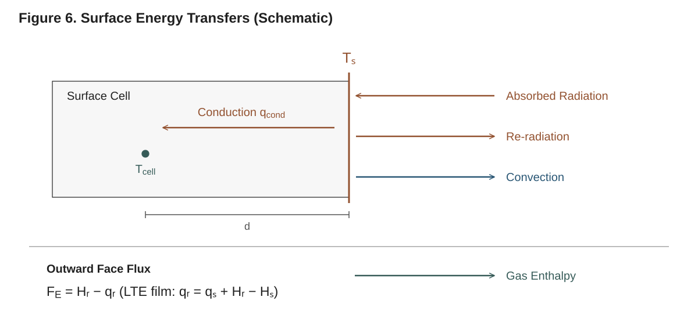

**Figure 6. Surface energy transfers (schematic, surface absorption).** Incoming radiation balances conduction into the solid and convective and radiative losses. The surface-temperature calculation uses $T_s$, the adjacent cell temperature and distance $d$. Gas outflow modifies convection through blowing; its sensible enthalpy enters the face energy flux separately, as shown below. The arrows depict losses from a hot surface; signed exchanges can reverse. Beer–Lambert absorption instead deposits radiation within the cells (Figure 7).

Thermal BCs are not applied as a raw flux in the cell; instead the solver finds
the **surface (face) temperature** `T_s` that makes the boundary energy balance
close, then conducts the resulting flux into the adjacent cell. The balance is

```
q_BC(T_s) = k_eff · (T_s − T_cell) / d
```

— the applied BC flux equals the heat conducted from the surface face into the
first cell center, with `k_eff` the cell's effective conductivity, `T_cell` its
trial temperature, and `d` the face-to-center distance. It is solved by a Newton
iteration on `T_s` (see Technical Reference §12.2). You do not call this
yourself — it runs inside the residual — but it explains a few user-visible
behaviors:

- **Closed-form faces skip it.** An `AdiabaticBC`, a lone `HeatFluxBC` and a
  lone `DirichletThermalBC` give the face flux directly; every other condition
  (and every `CombinedThermalBC`) goes through the Newton iteration.
- **It always has a root.** The Newton starts from the cell temperature clamped
  to the property bracket `[200, 3000]` K and evaluates the condition at the
  *trial clamp* of the iterate (the smooth clamp into the bracket with 1 K
  transitions), so the balance has a root for any cell temperature and the
  iterate itself is never clamped. A root outside the bracket belongs to a trial
  state that the integrator's error control rejects.
- **Convergence** is on the flux residual, relative tolerance `1e-10` of the
  larger of the applied and conducted fluxes (with a round-off floor), in at
  most 50 iterations; on the cone recipe of §5.11.1 (20 cells, 120 s, with a
  blowing model) it converged in 4 to 5 iterations at every accepted step. A
  balance that does not converge is not an error: the flux is taken at the last
  iterate, no warning is printed, and the per-face diagnostics record
  `converged` and `iterations`.
- **It is differentiated exactly.** The iteration carries dual numbers, so the
  Jacobian's derivatives with respect to the state flow through `T_s`.
- The converged surface temperature is available afterwards as
  `solution.surface_T` (and per tag in `solution.boundary_T`), and the flux
  decomposition (absorbed, re-radiation, convection, conducted, net) in
  `solution.extras` (§9.3).

The balance has **no surface gas-enthalpy term**. The gas leaving through the
face carries its sensible enthalpy at the face temperature, `Σ_j J_j h_j(T_s)`,
in the face's energy flux, added once the balance has fixed `T_s`; a surface
term `Σ_g ṁ_g Δh_g(T_s, T_∞)` in the balance would count that enthalpy a second
time. The outward gas flux enters the balance only through the blowing model of
a `ConvectiveBC` (§5.2.3).

---

## 5.5 Pressure boundary conditions (Darcy mode only)

When the material has a permeability (so the solver runs in Darcy–Fick transport
mode, see Technical Reference §9), gas transport is pressure-driven and you can
prescribe **pressure** at a boundary. Pressure BCs are `AbstractMassBC` subtypes,
so they go in the `mass` slot of the `BoundaryConditionSet`. They contribute no
film (diffusive) mass flux; instead they set the outward Darcy velocity `v` of
the boundary face from the boundary cell's pressure `P` and mobility `κ/μ`. An
outflow (`v > 0`) carries the cell's gas out at its intrinsic density `ξ_j/φ`;
an inflow carries none of the tracked gases (the ambient is taken to hold none
of them). A mass condition that is not a pressure condition drives no Darcy
velocity, so an `ImpermeableBC` face is sealed under Darcy–Fick as well. In
Fickian (non-Darcy) mode pressure BCs have no effect.

| BC type | Outward Darcy velocity | Parameters (defaults) |
|---|---|---|
| `DirichletPressureBC` | `v = (κ/μ)(P − P_bc)/d` | `P` (`101325.0`) |
| `NeumannPressureBC` | `v = −(κ/μ)·∂P/∂n` | `∂P∂n` (`0.0` = no flow) |
| `ConvectivePressureBC` | `v = h_P·(P − P_ext)` | `h_P`, `P_ext` |

All three are exported by `using Pyrolysis`. A pressure condition combines with
a film condition through `+`, e.g. `DiffusiveMassBC(0.01) +
DirichletPressureBC(101325.0)` (diffusive escape plus pressure-driven venting),
as `examples/08_darcy_fick_demo.jl` does.

### 5.5.1 `DirichletPressureBC` — fixed pressure

```julia
bc = DirichletPressureBC()           # default: atmospheric, 101325 Pa
bc = DirichletPressureBC(101325.0)   # explicit atmospheric
```

Holds the boundary at pressure `P` (Pa). The outward Darcy velocity is the
one-sided gradient between the interior cell and the boundary,
`v = (κ/μ)·(P_interior − P_bc)/d`. This is the natural exposed-surface
condition: the outer face sits at atmospheric pressure and gas flows out down the
pressure gradient built up by pyrolysis.

### 5.5.2 `NeumannPressureBC` — prescribed gradient

```julia
bc = NeumannPressureBC()         # default: zero gradient (no Darcy flow)
bc = NeumannPressureBC(0.0)      # same as above
bc = NeumannPressureBC(-1000.0)  # pressure falling outward at 1 kPa/m: an outflow
```

Sets the pressure gradient `∂P/∂n` (Pa/m) along the **outward** normal, default
`0.0`. A zero gradient is a no-flow (impermeable) back face for the pressure
field — the usual choice for a sealed substrate in Darcy mode. A positive
gradient (pressure rising outward) would drive an inflow, which carries no gas.

### 5.5.3 `ConvectivePressureBC` — Robin (resistive) outflow

```julia
bc = ConvectivePressureBC(1e-6, 101325.0)   # finite surface resistance, atmospheric exterior
```

A Robin-type condition, `v·n = h_P·(P_internal − P_external)`, for a surface
with finite resistance to gas flow (a char skin, a coating). Fields:

- `h_P` — pressure-transfer coefficient `h_P` in m·Pa⁻¹·s⁻¹.
- `P_ext` — external pressure `P_external` in Pa.

The velocity is gated to zero on an impermeable boundary cell. Limits:
`h_P → ∞` approaches `DirichletPressureBC`; `h_P → 0` approaches an impermeable
(zero-flow) boundary.

---

## 5.6 Radiation models and the boundary conditions

The three radiation models are selected by the `radiation_model` keyword of
`solve()` (default `NO_RADIATION`), not by a BC in the set, and there is no
radiation BC type: the incoming radiation is always a `RadiativeFluxBC` in the
thermal slot (§5.2.6), and the surface's own emission a `RadiativeBC` (§5.2.4).

| `radiation_model` | Where the absorbed incident flux goes | Requirements |
|---|---|---|
| `NO_RADIATION` (default) | the surface balance of the face carrying the `RadiativeFluxBC` | — |
| `SURFACE_ABSORPTION` | the same (opaque material) | — |
| `BEER_LAMBERT` | in depth, through algebraic face intensities attenuated cell by cell with the components' `α` | the `RadiativeFluxBC` on `:top` only; planar coordinates; `α > 0` on the absorbing components |

Under `BEER_LAMBERT` the face intensities are unknowns of the state, each tied to
its neighbour by the exact attenuation across one cell, so the Jacobian stays
banded (Technical Reference §8.3). An in-depth radiative transfer with
re-emission (a P1 model) is not implemented.

---

## 5.7 Mesh motion in ALE simulations (no boundary conditions needed)

Mesh motion is **not configured through boundary conditions** — there are no
mesh-motion BC types, and `BoundaryConditionSet` carries only `thermal` and
`mass` slots. With `solve(problem; use_ale = true)` the mesh's pinned node (on a
line the back node, `z = 0`) stays at rest and every other node moves with the
solid velocity plus a correction, `w = v_s + c`. The solid velocity follows from
the cells' volumetric strain rates through one algebraic balance row per cell,
so the top surface follows the material as it shrinks or swells. The correction
`c` is zero unless an equidistribution correction is installed, which `setup`
does where the mesh moves, cells are deactivated and a layer can vanish; it
moves the nodes inside a vanishing layer so that its cells thin together, and
keeps layer interfaces with the solid (Chapter 10; Technical Reference §11).

---

## 5.8 Choosing ambient temperatures

Two thermal BCs carry an ambient temperature `T_∞`: `ConvectiveBC` and
`RadiativeBC` each have their own `T_inf`, which enters only that BC's own flux.
BCs without an ambient (`HeatFluxBC`, `AdiabaticBC`, `RadiativeFluxBC`,
`DirichletThermalBC`) carry none. In a `CombinedThermalBC` each term keeps its
own `T_inf`: a top BC of `RadiativeBC(T_inf = 330)` plus
`ConvectiveBC(T_inf = 300)` re-radiates to 330 K and convects to 300 K. The
surface energy balance (§5.4) has no ambient reference temperature of its own.

Practical guidance: set `T_inf` consistently on the loss terms (`RadiativeBC`,
`ConvectiveBC`) to the experimental surroundings temperature. In a cone
calorimeter the cone shroud and chamber are warmer than room temperature; values
in the 300–360 K range are common and used in the shipped examples.

---

## 5.9 Time-dependent parameters

Any BC parameter shown above as "constant or function of `t`" accepts a
single-argument function. The solver evaluates it at the current time. Examples:

```julia
# Heat-flux ramp
HeatFluxBC(t -> 50e3 * min(t / 5.0, 1.0))           # linear ramp to 50 kW/m² over 5 s

# Time-varying incident radiation
RadiativeFluxBC(flux = t -> 25e3 * (1 - exp(-t / 10)))

# Warming ambient in a convective loss term
ConvectiveBC(h = 10.0, T_inf = t -> 300 + 0.5 * t)

# Pulsed mass extraction
MassFluxBC(t -> t < 50 ? 0.0 : -1e-3)
```

> **Note on time-varying radiation flux.** Every condition parameter is
> evaluated at the time of each residual evaluation — constant and time-varying
> alike, with no up-front constancy detection; under `BEER_LAMBERT` the
> exposed-face intensity row is `I_e = a·q_inc(t)` at that time. A ramped or modulated
> flux is therefore always tracked. You do not need to do anything special —
> just supply `flux = t -> …`.

---

## 5.10 Initial conditions

Initial conditions are supplied to `PyrolysisProblem` as functions of the spatial
coordinate `z` (in meters, with `z = 0` at the bottom, `z = L` at the top).
`setup` evaluates them at the cell centres of the mesh's reference positions:
the initial temperature of cell `i` is `T_initial(z_i)` and its initial mass of
component `j` is `m_ij = ξ_initial[j](z_i)·V_i`, since the component masses are
the states (a profile that varies inside a cell is sampled at its centre, not
averaged). Nothing is stored on the mesh. Two inputs:

- `T_initial` — a function `z -> T` returning the initial temperature in K.
  Default: `z -> 300.0`.
- `ξ_initial` — the initial mass concentrations `ξ_j(z)` in kg/m³, one entry per
  component. Accepts a `Vector` of functions (one per component), a single
  function (used for every component), or you may omit it for the auto-default.

To see the values a mesh gets, call `initial_fields` (exported by the `Problem`
submodule), which returns the cell-centre temperatures and the `NC × n`
concentration matrix:

```julia
T0, ξ0 = Pyrolysis.Problem.initial_fields(problem, problem.mesh)
```

The integrator refuses an initial state in which a component mass is more
negative than its tolerance or a cell is at or below absolute zero (an
`ArgumentError` from `solve`), so the profiles must be non-negative.

```julia
problem = PyrolysisProblem(
    mesh = mesh,
    material = material,            # NC = 2 here: virgin solid + gas
    bc_set = bc_set,
    T_initial = z -> 300.0,                  # uniform 300 K
    ξ_initial = [z -> 1190.0, z -> 0.0],     # full virgin density, no gas
    tspan = (0.0, 100.0),
)
```

### 5.10.1 Auto-defaults

If you omit `ξ_initial`, the constructor builds a sensible default: the **first
component, if it is a `SolidComponent`, is placed at its reference density** (its density
function evaluated at 300 K) and all other components are set to zero. This is
correct for the common "single virgin solid that decomposes into gas(es) and
char" setup, where component 1 is the virgin solid. Always double-check it
matches your component ordering; if not, pass `ξ_initial` explicitly.

`T_initial` defaults to a uniform 300 K.

### 5.10.2 Uniform vs. depth-varying profiles

A uniform value is just a constant-returning closure:

```julia
T_initial = z -> 300.0
ξ_initial = [z -> 1190.0, z -> 0.0]   # uniform composition
```

For a non-uniform start (e.g. a pre-charred surface layer, or a moisture
gradient) make the closures depend on `z`:

```julia
L = 0.02  # domain thickness [m]
# Warmer at the exposed top, cooler at the substrate
T_initial = z -> 300.0 + 50.0 * (z / L)

# A thin char layer near the surface (component 2 = char), virgin below
ξ_initial = [
    z -> z > 0.9 * L ? 200.0 : 1190.0,   # virgin: depleted near top
    z -> z > 0.9 * L ? 150.0 : 0.0,      # char: present near top
    z -> 0.0,                            # gas: none initially
]
```

The initial masses also set the per-cell **dry-solid mass**, the denominator of
the pyrolysis progress `χ` whose column average `χ̄` a lateral-shrinkage law
reads, `m_{dry,i} = V_i · Σ_{solid} ξ_{j,i}(0)` over the
`SolidComponent`s (see Technical Reference §12.8 and §10.3).

**Layered samples.** Put a material interface on a mesh node (for example with
`create_mesh_from_nodes`) and give the components a step there, so every cell
starts with one layer's composition. `setup` finds the layer interfaces from
which condensed components each cell starts with, and on a moving mesh with
deactivation it keeps those nodes with the solid (Chapter 10); the `lagrangian`
keyword of `solve` names them explicitly.

### 5.10.3 Profile helper functions

Convenience profile builders are available in the `Problem` submodule (not
top-level exported). Import them explicitly when you want them:

```julia
import Pyrolysis.Problem: step_profile, linear_profile, gaussian_profile, tanh_profile

z_int = 0.9 * L
# Sharp step: char above the interface, virgin below
ξ_char_initial = z -> step_profile(z; z_interface = z_int,
                                       value_left = 0.0, value_right = 150.0)

# Linear temperature ramp through the thickness
T_initial = z -> linear_profile(z; z_min = 0.0, z_max = L,
                                    value_min = 300.0, value_max = 350.0)

# Smooth (tanh) interface instead of a hard step
ξ_char_initial = z -> tanh_profile(z; z_center = z_int, width = 0.001,
                                      value_left = 0.0, value_right = 150.0)

# Gaussian bump (e.g. a localized moisture pocket)
ξ_moist_initial = z -> gaussian_profile(z; z_center = 0.5 * L, width = 0.002,
                                           amplitude = 100.0, baseline = 0.0)
```

Their signatures:

| Helper | Keyword arguments |
|---|---|
| `step_profile(z; z_interface, value_left, value_right)` | step at `z_interface` |
| `linear_profile(z; z_min, z_max, value_min, value_max)` | clamped linear ramp |
| `gaussian_profile(z; z_center, width, amplitude, baseline = 0.0)` | Gaussian bump |
| `tanh_profile(z; z_center, width, value_left, value_right)` | smooth step |

A smooth (`tanh`) interface spreads a composition change over several cells and
can soften the startup transient of a single-material gradient. For a layered
sample, prefer a step on a node: a smooth profile leaves every component present
in the transition cells, so the interface that `setup` detects moves to wherever
the profile's tail reaches exactly zero.

---

## 5.11 Common configurations (worked recipes)

### 5.11.1 Cone calorimeter (opaque charring solid)

External cone flux absorbed at the surface, with re-radiation and convective
losses; gas escapes by convective mass transfer; insulated, impermeable back
face:

```julia
bc_set = BoundaryConditionSet(
    thermal = (
        top = RadiativeFluxBC(flux = 50e3, absorptivity = 0.96) +
              RadiativeBC(ε = 0.96, T_inf = 330.0) +
              ConvectiveBC(h = 10.0, T_inf = 330.0),
        bottom = AdiabaticBC(),
    ),
    mass = (
        top    = ConvectiveMassBC(h_m = 0.05, ξ_inf = 0.0),
        bottom = ImpermeableBC(),
    ),
)
solution = solve(problem; radiation_model = SURFACE_ABSORPTION)
```

### 5.11.2 Semi-transparent polymer (in-depth absorption)

Same incoming radiation, but absorbed in depth via Beer–Lambert (requires
absorption coefficients on the components):

```julia
bc_set = BoundaryConditionSet(
    thermal = (
        top = RadiativeFluxBC(flux = 50e3) +          # a defaults to a_eff (= ε_eff by Kirchhoff)
              RadiativeBC(T_inf = 300.0) +
              ConvectiveBC(h = 10.0, T_inf = 300.0),
        bottom = AdiabaticBC(),
    ),
    mass = (top = DiffusiveMassBC(), bottom = ImpermeableBC()),
)
solution = solve(problem; radiation_model = BEER_LAMBERT)
```

### 5.11.3 Furnace temperature program on the exposed face

A prescribed heating program is most directly modeled by holding the surface
temperature with a time-dependent `DirichletThermalBC`:

```julia
β = 10.0 / 60.0   # 10 K/min in K/s
bc_set = BoundaryConditionSet(
    thermal = (top = DirichletThermalBC(t -> 300.0 + β * t),
               bottom = AdiabaticBC()),
    mass    = (top = DiffusiveMassBC(), bottom = ImpermeableBC()),
)
```

### 5.11.4 Pressure-driven char (Darcy mode)

With a permeable material, set atmospheric pressure on the exposed face and a
sealed (zero-gradient) back face. The transport mode switches to Darcy–Fick
automatically when the material has permeability:

```julia
bc_set = BoundaryConditionSet(
    thermal = (top = HeatFluxBC(50e3) + RadiativeBC(ε = 0.9, T_inf = 300.0),
               bottom = AdiabaticBC()),
    mass    = (top = DirichletPressureBC(101325.0),    # atmospheric exposed face
               bottom = NeumannPressureBC(0.0)),       # sealed substrate
)
```

---

## 5.12 Caveats and pitfalls

- **The escaping gas carries no surface enthalpy term.** The gas enthalpy flux
  `Σ_j J_j h_j` through every face, the boundary face included at the surface
  temperature, already carries the enthalpy of the escaping gas (Technical
  Reference §7, §12.2); a surface term `Σ_g ṁ_g Δh_g(T_s, T_∞)` on top of it
  would double-count that enthalpy, a spurious sink that under-predicts surface
  temperature and mass-loss rate. Parameter sets calibrated with a code that
  adds a surface gas-enthalpy term may need re-calibration.

- **`radiation_model` defaults to `NO_RADIATION`.** A `RadiativeFluxBC` only does
  something if you pass an appropriate `radiation_model` to `solve()`. With the
  default `NO_RADIATION`, an incident `RadiativeFluxBC` is still absorbed at the
  surface (the absorbed flux is applied as a boundary heat flux), but choose
  `SURFACE_ABSORPTION` (opaque) or `BEER_LAMBERT` (semi-transparent) explicitly
  to make the intent clear and to enable the in-depth distribution. Under
  `BEER_LAMBERT` the `RadiativeFluxBC` must sit on `:top`.

- **Only thermal and mass BCs go in the set.** `BoundaryConditionSet` accepts
  only `AbstractThermalBC` and `AbstractMassBC` payloads — a wrong-kind BC
  throws at construction. Mesh motion needs no BC at all (it is automatic
  with `use_ale = true`), and there is no radiation BC type.

- **Pressure BCs need Darcy mode.** `DirichletPressureBC`/`NeumannPressureBC`/
  `ConvectivePressureBC` only have an effect when the material has permeability
  (Darcy–Fick transport). In Fickian mode they contribute zero flux and are
  silently inert — use `ImpermeableBC`/`DiffusiveMassBC`/`ConvectiveMassBC` for
  diffusion-only gas escape. The pressure conditions vent outflow only; an
  inward Darcy velocity carries no gas.

- **Don't double-specify a radiation source.** Use `RadiativeFluxBC` (not also
  `HeatFluxBC`) for the cone/panel; use `RadiativeBC` for the surface's own
  re-radiation loss. They are different physical terms.

- **Match `ξ_initial` to your component order.** The auto-default only fills
  component 1 (if solid). For Darcy–Fick materials, initialize the pore gas at
  ambient pressure with `background_gas_concentration(material, :air, ξ_condensed, T)`
  (exported at the top level): a pore space started as a vacuum against a
  101325 Pa boundary draws early product gas inward. For multi-solid or moisture-bearing materials, supply
  `ξ_initial` explicitly so virgin solid, char, moisture, and gases start with
  the right concentrations.

For deeper background on the boundary physics, the surface Newton solve, and the
radiation models, see Technical Reference §12 (boundary and initial conditions),
§8 (thermal radiation), §7 (energy assembly and the gas enthalpy flux), and §9
(gas transport and pressure).

---

# 6. Meshes and Geometry

The mesh is the spatial backbone of every Pyrolysis.jl simulation: it discretizes the
through-thickness coordinate `z` into the finite-volume cells whose component masses and
energy the solver integrates. A full solve runs on a **line**: a one-dimensional mesh of
cells stacked along `z`, together with a coordinate system and a cross-section measure
that turn node positions into face areas and cell volumes. The mesh holds geometry and
nothing else. It carries no component count and no initial state: the problem's
`T_initial` and `ξ_initial` are evaluated at the cell centres when `setup` builds the
problem the integrator runs (Chapter 7). This chapter shows how to create meshes (uniform,
stretched and from a list of nodes), how to choose the resolution, what the coordinate
system and the cross section mean in a one-dimensional model, how a material's lateral
shrinkage law makes the cross section vary, how to inspect a mesh, where the mesh appears
in the solved state, and how the nodes move when the mesh moves with the solid. For the
finite-volume discretization see Technical Reference §13; for the moving-mesh (ALE)
formulation, Technical Reference §11.

> **Coordinate convention (read this first).** Throughout Pyrolysis.jl, `z = 0` is the
> **back** face (boundary tag `:bottom`, the substrate side) and `z = L` is the **exposed
> surface** (tag `:top`). Heat enters from the top; a receding material recedes toward the
> back, whose node is pinned. Cell indices increase from the back (cell 1, next to `z = 0`)
> to the surface (cell `n`, next to `z = L`). The normal of an interior face points toward
> increasing `z`, and the normal of a boundary face points out of the domain.

---

## 6.1 The mesh in one dimension

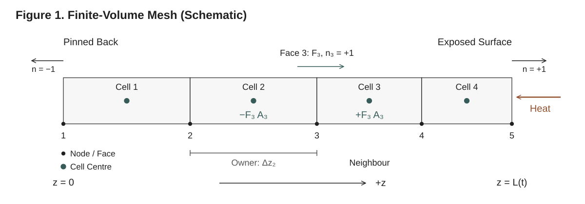

**Figure 1. Finite-volume mesh anatomy (schematic).** The pinned back is at `z = 0`; heat enters at the exposed face `z = L(t)`. In one dimension each node is a face. An interior flux is oriented from owner to neighbour and contributes equal and opposite extensive rates, so it cancels from the global balance. Widths are deliberately nonuniform. See Technical Reference §13.1 for the face convention and Figure 2 in §13.4 for the framework.

A line mesh consists of:

- **Nodes**, the points that bound the cells. A mesh of `n` cells has `n + 1` nodes at
  strictly increasing positions; node 1 sits at `z = 0`, node `n + 1` at `z = L`.
- **Cells**, the finite-volume control volumes. Cell `i` lies between nodes `i` and `i + 1`,
  and its centre is the midpoint of the two. The solver carries, per cell, the mass of every
  component and an energy state (the temperature by default); the concentrations
  `ξ_{j,i} = m_{j,i}/V_i` and the temperature are derived from them in each evaluation.
- **Faces**, the points through which fluxes pass. In one dimension a face sits at a node,
  so there are also `n + 1` faces, face `f` at node `f`. Each face records its two cells,
  `(owner, neighbour)`: interior face `f` has owner `f − 1` and neighbour `f`; boundary
  face 1 is owned by cell 1 and tagged `:bottom`; boundary face `n + 1` is owned by cell `n`
  and tagged `:top`. Conduction and gas fluxes are evaluated at the faces, the boundary
  conditions on the tagged faces.

The mesh type is `Mesh{1}`. It holds two things:

- `mesh.topology`, a `MeshTopology`: the faces and cells above, the node count, the
  boundary tags (tag → face ids), the coordinate system, the cross-section measure `A₀`,
  the **pinned** nodes (whose velocity is zero; node 1 on every mesh the constructors build)
  and the **Lagrangian** nodes (which always move with the solid; none by default);
- `mesh.positions`, the reference node positions (one `SVector{1}` per node): the positions
  at which the initial conditions are evaluated and from which a moving mesh starts.

Every metric (face areas, face normals, cell volumes, cell centres) is computed from the
node positions by `Pyrolysis.Meshes.geometry!`, according to the coordinate system (§6.4).
For the default planar coordinates the volume of cell `i` is

```
V_i = A · (z_{i+1} − z_i)
```

with `A` the cross section. You never construct `Mesh` directly; you call one of the three
constructors of §6.2. `solve` and `setup` never modify the mesh you pass: they build their
own topology with the nodes the solve moves (§6.7) and carry the positions in the state.
See Technical Reference §13 for the cell, face and node layout and the operators built on it.

---

## 6.2 Creating a mesh

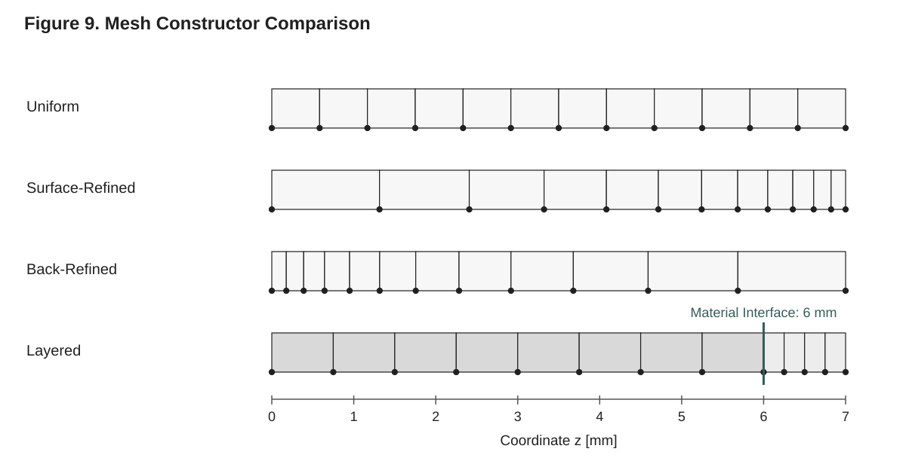

**Figure 9. Constructor comparison (actual coordinates).** Each mesh spans 7 mm with twelve cells. The stretched meshes use `stretch = 1.2` with opposite refined ends. The layered node list gives eight substrate cells over 6 mm and four coating cells over 1 mm, with a node exactly on the material interface. These modest cell counts make the geometry readable; they are not a resolution recommendation. The Julia generator saves the constructor coordinates as CSV.

Three mesh constructors are exported at the top level (`using Pyrolysis` makes them
available):

| Function | Purpose |
|---|---|
| `create_uniform_mesh(L, n_cells; ...)` | Equal cell sizes `Δz = L / n_cells`. |
| `create_stretched_mesh(L, n_cells, stretch; ...)` | Geometrically graded cells, finest at one end. |
| `create_mesh_from_nodes(z; ...)` | Nodes at positions you give, from zero. |

All three return a `Mesh{1}` with the tags `:bottom` (at `z = 0`) and `:top` (at the last
node), node 1 pinned and no Lagrangian nodes, and all three take the same two keywords:

| Keyword | Default | Meaning |
|---|---|---|
| `coordinates` | `Planar()` | The coordinate system: `Planar()`, `Cylindrical()` or `Spherical()` (§6.4.1). |
| `cross_section` | `1.0`, `1.0`, `4π` | The cross-section measure `A₀`: the face area of a planar column [m²], the axial length of a cylinder [m], the solid angle of a sphere [sr] (§6.4.2). Must be finite and positive. |

### 6.2.1 Uniform meshes

```julia
create_uniform_mesh(L::Real, n_cells::Integer;
                    coordinates = Planar(),
                    cross_section = <default for the coordinates>) -> Mesh{1}
```

Positional arguments:

- `L`, the thickness of the domain [m]: the nodes run from `z = 0` to `z = L`.
- `n_cells`, the number of cells, at least one.

A 1 cm slab with 100 cells:

```julia
using Pyrolysis

mesh = create_uniform_mesh(0.01, 100)    # L = 1 cm, 100 cells
```

A typical cone-calorimeter sample, 5.8 mm with 72 cells (0.08 mm per cell):

```julia
sample_thickness = 5.8e-3      # [m]
n_cells          = 72

mesh = create_uniform_mesh(sample_thickness, n_cells)
```

The node positions are `z_i = (i − 1)·Δz` with `Δz = L / n_cells`, so cell `i` occupies
`[(i − 1)Δz, iΔz]` and, in planar coordinates, every cell has the volume `V_i = A·Δz`. The
composition and temperature of the sample are not part of the mesh: they are the problem's
`ξ_initial` and `T_initial` (Chapter 7; Chapter 5, §5.10).

### 6.2.2 Stretched (graded) meshes

In a cone-calorimeter or fire-exposure problem the steepest temperature and reaction-rate
gradients are at the exposed surface, where the pyrolysis front lives. A graded mesh puts
small cells there and large cells deep in the cold substrate, giving the same accuracy for
fewer cells.

```julia
create_stretched_mesh(L::Real, n_cells::Integer, stretch::Real;
                      stretch_from::Symbol = :top,
                      coordinates = Planar(),
                      cross_section = <default for the coordinates>) -> Mesh{1}
```

The arguments beyond the uniform case:

| Argument | Default | Meaning |
|---|---|---|
| `stretch` (positional) | — | The ratio of successive cell sizes away from the refined end. `stretch = 1` is uniform (any value within `1e-10` of one is treated as exactly uniform); `stretch > 1` makes each cell that factor larger than its neighbour on the refined side. A value below one throws an `ArgumentError`: choose the refined end with `stretch_from`, never with `stretch < 1`. |
| `stretch_from` (keyword) | `:top` | The end that gets the finest cell: `:top`, the exposed surface at `z = L`, or `:bottom`, the back at `z = 0`. Any other value throws an `ArgumentError`. |

The cell sizes follow a geometric series from the refined end, the finest cell's size
chosen so that the cells sum exactly to `L`:

```
Δz_0 = L · (stretch − 1) / (stretch^n − 1),     Δz_k = Δz_0 · stretch^k
```

The end nodes are placed at exactly `0` and `L`. Fine cells at the exposed surface,
coarser toward the back:

```julia
# 50 cells over 1 cm, the finest (about 8.6 µm) at the exposed surface
mesh = create_stretched_mesh(0.01, 50, 1.1)

# the same grading with the finest cell at the back face
mesh_back = create_stretched_mesh(0.01, 50, 1.1; stretch_from = :bottom)
```

A modest ratio (`1.05` to `1.15`) is usually enough. Strong grading produces large
cell-to-cell size jumps, which degrade the accuracy of the face gradients; the conduction
and gas-transport face coefficients are distance-weighted harmonic means, which keeps graded
meshes consistent (Technical Reference §7 and §13), but they do not remove the truncation
error of a large jump. Note how small the surface cell becomes: at `stretch = 1.1` and 50
cells it is about a hundredth of the uniform cell.

> **Tip.** When in doubt, start uniform, run a convergence study (§6.3), and switch to a
> stretched mesh only if a uniform mesh with the same near-surface resolution is too
> expensive.

### 6.2.3 Meshes from a list of nodes

```julia
create_mesh_from_nodes(z::AbstractVector{<:Real};
                       coordinates = Planar(),
                       cross_section = <default for the coordinates>) -> Mesh{1}
```

builds a line with nodes at the positions `z` [m], which must start at zero, be finite and
increase strictly (at least two nodes); the cells lie between consecutive nodes and are
sized independently. Use it to put a node on every interface of a layered sample, or to
refine one region by hand. A 6 mm substrate under a 1 mm coating, with a node on the
interface at 6 mm:

```julia
z = [range(0.0, 6e-3; length = 25); range(6e-3, 7e-3; length = 11)[2:end]]
mesh = create_mesh_from_nodes(z)        # 24 substrate cells, 10 coating cells
```

The initial conditions then give each layer its composition; for a material whose first
component is the substrate and whose second is the coating,
`ξ_initial = [z -> z < 6e-3 ? 2000.0 : 0.0, z -> z < 6e-3 ? 0.0 : 900.0]`. Since they are
evaluated at the cell centres, a node on the interface keeps every cell within one layer. When the burnout correction moves a layered mesh, the interface nodes are held to the
solid (§6.7.2).

The constructors of this section are built on `Pyrolysis.Meshes.line_mesh(x; coordinates,
cross_section, bottom = :bottom, top = :top, fixed = false, lagrangian = Int[])`, which
accepts any strictly increasing positions (a hollow cylinder from an inner radius, for
instance) and lets you name the boundary tags, pin every node (`fixed`) or declare Lagrangian
nodes. A solve needs the tags `:top` and `:bottom` (§7.9).

---

## 6.3 Choosing `n_cells`: resolution versus cost

The number of cells controls both accuracy and run time. There is no universal correct
`n_cells`; it depends on how thin the reacting and thermal layers are relative to the
sample.

- **Resolve the thermal and reaction front.** Under a high cone flux the front can be a
  fraction of a millimetre thick, and you want several cells across it. The cone example
  above uses 72 cells over 5.8 mm. The Douglas-fir convergence example
  (`examples/convergence_douglas_fir.jl`) solves its deck at 15 to 480 cells and tabulates
  the peak mass-loss rate, the ignition time and the solve time against the cell size, so
  you can see where the answer stops moving.
- **Cost grows with the state.** Each cell carries `NC + 1` unknowns (its `NC` component
  masses and its energy state); a moving mesh adds two per node (position and velocity),
  in-depth radiation one per face, a variable cross section two per cell and two for the
  column (§6.6, §7.8). The state is ordered so that the Jacobian is banded, its bandwidth
  set by the component count rather than the cell count (a variable cross section adds two
  dense rows), so the work of each step grows roughly in proportion to the cells. Time a
  short run at two resolutions rather than guessing.
- **Burnout needs its own resolution.** A solve that deactivates cells through a burnout is
  verified at stated cell counts across the vanishing layer; Chapter 10 gives them.
- **Run a convergence study.** Solve the same problem at increasing `n_cells` and watch a
  scalar output of interest (peak mass-loss rate, ignition time, back-face temperature)
  converge. Stop refining when successive results agree to your tolerance. This is the
  recommended way to pick a production resolution; Technical Reference §18 describes the
  verification and convergence methodology.

A complete convergence loop: the same problem at each resolution, two scalars per solve.

```julia
using Pyrolysis

virgin = SolidComponent(:virgin; ρ = 1190.0, c = 1500.0, k = 0.20, λ = 1e-6)
gas    = GaseousComponent(:MMA; M = 0.100, c = 1500.0, k = 0.02, λ = 1e-5)
pmma   = Material(name = :PMMA, components = (virgin, gas),
                  reactions = (Reaction(:pyrolysis, :virgin => :MMA;
                                        A = 8.5e12, E = 188e3, h = 870e3),))
bcs = BoundaryConditionSet(
    thermal = (top = HeatFluxBC(50e3) + RadiativeBC(ε = 0.9, T_inf = 300.0),
               bottom = AdiabaticBC()),
    mass    = (top = DiffusiveMassBC(0.01), bottom = ImpermeableBC()),
)

for n in (25, 50, 100, 200)
    problem = PyrolysisProblem(
        mesh      = create_uniform_mesh(0.01, n),
        material  = pmma,
        bc_set    = bcs,
        tspan     = (0.0, 200.0),
    )
    sol = solve(problem; use_ale = true)
    lost = 1 - sol.extras.total_mass[end] / sol.extras.total_mass[1]
    println("n = $n: peak MLR = $(maximum(sol.mass_loss_rate)) kg/(m²·s), ",
            "mass lost = $(round(100lost, digits = 3)) %, T_s = $(sol.surface_T[end]) K")
end
```

When successive lines agree to your target tolerance, you have enough cells.

---

## 6.4 Coordinate systems and the cross section

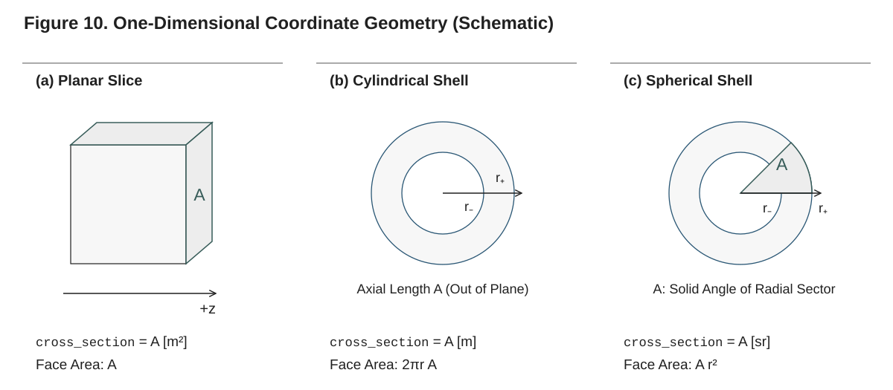

**Figure 10. Coordinate-system geometry (schematic).** These are one-dimensional models: only the through-thickness coordinate or radius is resolved. The drawings illustrate the symmetry used to integrate face area and cell volume; they do not imply a multidimensional simulation. `cross_section` means area in a slab, axial length in a cylinder, and solid angle in a sphere. The inner and outer shell faces use their own radii; radial meshes starting at the centre have zero inner-face area.

### 6.4.1 Coordinate systems

The coordinate system is a property of the mesh, chosen with the `coordinates` keyword of
the constructor. It decides how face areas and cell volumes follow from the node positions:

| `coordinates` | Position | Face area at `r` | Volume between `r₋` and `r₊` | `cross_section` | Default |
|---|---|---|---|---|---|
| `Planar()` | depth `z` | `A` | `A (r₊ − r₋)` | face area [m²] | `1.0` |
| `Cylindrical()` | radius `r` | `2π r A` | `π (r₊² − r₋²) A` | axial length [m] | `1.0` |
| `Spherical()` | radius `r` | `A r²` | `A (r₊³ − r₋³)/3` | solid angle [sr] | `4π` |

In cylindrical and spherical coordinates the positions are radii: a mesh from
`create_uniform_mesh(L, n; coordinates = Cylindrical())` runs from the axis (the `:bottom`
tag, a face of zero area) to the exposed surface at radius `L` (`:top`), so the cylinder or
sphere is heated from outside and recedes toward its axis or centre.

```julia
rod  = create_uniform_mesh(0.01, 40; coordinates = Cylindrical(), cross_section = 0.1)
ball = create_uniform_mesh(0.01, 40; coordinates = Spherical())   # the whole sphere, 4π
```

Conduction, reactions, gas transport, surface absorption and the moving mesh are
implemented in every coordinate system. Deactivation is not refused on a radial mesh, but
the burnout path of Chapter 10 is verified on planar decks only. Two models need planar
coordinates and are refused with an `ArgumentError` otherwise: in-depth radiation
(`radiation_model = BEER_LAMBERT`) and the variable cross section (§6.4.3).

### 6.4.2 The cross-section measure `A₀`

A planar one-dimensional model has no real lateral extent, so its cross-sectional area is a
**gauge constant** rather than a physical width. It enters only through the face areas and
cell volumes:

```
V_i = A (z_{i+1} − z_i)          A_face = A   (the same on every face)
```

Because the balances are written per unit volume and the fluxes per unit area, `A` cancels
from the intensive results (temperature profiles, mass-loss rate per unit area, surface
temperature, the per-area surface fluxes). The default `cross_section = 1.0` m² is the
natural choice for almost every planar simulation. The extensive outputs scale with it: the
cell masses `sol.m` [kg], the live inventories `sol.extras.live_mass` [kg] and
`sol.extras.live_energy` [J], and the conservation audit's terms. Set a different area only
when you want those in the units of a physical sample:

```julia
# A 100 cm² sample face; the per-area results are unchanged
mesh = create_uniform_mesh(0.01, 100; cross_section = 1e-2)
```

In cylindrical and spherical coordinates the measure is not a gauge in the same sense: the
face area varies with the radius, and `A` is the axial length or the solid angle that scales
it. The per-area outputs divide by the current area of the `:top` faces.

### 6.4.3 The variable cross section (lateral shrinkage)

A charring sample in a cone calorimeter shrinks (or, if intumescent, swells) laterally as well
as through its thickness. A one-dimensional model represents this with a **variable cross
section**: the area follows the column's pyrolysis progress,

```
A(t) = A₀ · law(χ̄),          χ̄ = Σ_i G_i / Σ_i M_i
```

with `A₀` the mesh's `cross_section`, `G_i` the cumulative dry pyrolysis gas cell `i` has
produced (every gas the reactions make except water vapour) and `M_i` the cell's initial dry
solid mass. The law is not a mesh setting: it is the material's `lateral_shrinkage_law`
(Chapter 7, §7.6), and `setup` adds the cross-section rows whenever the material carries one.
The law must be a smooth function (its derivative is taken by automatic differentiation),
positive and finite on `[−0.001, 1.001]`, and equal to one at zero conversion; a variable
cross section needs a moving, planar mesh (`use_ale = true`).

The area history is reported in `sol.extras.cross_section_area_history` [m²]. With a
variable area, `sol.mass_loss_rate` is per unit **current** area of the `:top` faces and
`sol.extras.MLR_gauge` per unit **initial** area, which keeps the latter comparable with a
fixed-area run and with a load-cell measurement on the original sample face. See Technical
Reference §10 for the model.

---

## 6.5 Inspecting a mesh

The mesh constructors are exported at the top level; the mesh's own functions live in the
`Pyrolysis.Meshes` submodule and are not part of the curated top-level surface. Import
them by name from `Pyrolysis.Meshes`, or bring in every submodule's exports with
`using Pyrolysis.Internal` (Chapter 1, §1.9). They take the topology, `mesh.topology`.

### 6.5.1 Size and tags

| Call | Returns |
|---|---|
| `n_cells(topo)` | Number of cells `n`. |
| `n_nodes(topo)` | Number of nodes (`n + 1`). |
| `n_faces(topo)` | Number of faces (`n + 1`). |
| `boundary_tags(topo)` | The boundary tags, sorted: `[:bottom, :top]`. |
| `boundary_faces(topo, tag)` | The face ids carrying `tag` (an `ArgumentError` for an unknown tag). |
| `is_fixed(topo)` | Whether every node is pinned. |

```julia
using Pyrolysis
using Pyrolysis.Meshes: n_cells, n_nodes, n_faces, boundary_tags, boundary_faces

mesh = create_uniform_mesh(0.01, 100)
topo = mesh.topology
n_cells(topo), n_nodes(topo), n_faces(topo)    # (100, 101, 101)
boundary_tags(topo)                            # [:bottom, :top]
boundary_faces(topo, :top)                     # [101], the face at z = L
boundary_faces(topo, :bottom)                  # [1], the face at z = 0
topo.coordinates, topo.cross_section           # (Planar(), 1.0)
topo.pinned                                    # [1], the back node
```

The boundary conditions are keyed by these tags (Chapter 5): the `top` entries of a
`BoundaryConditionSet` apply on the faces tagged `:top`, the `bottom` entries on `:bottom`.

### 6.5.2 Node positions, cell centres and volumes

```julia
using Pyrolysis.Problem: cell_centers, cell_volumes

z  = first.(mesh.positions)      # node positions [m]: z[1] = 0.0, z[end] = 0.01
xc = cell_centers(mesh)          # cell centres [m]: 5.0e-5 … 0.00995
V  = cell_volumes(mesh)          # cell volumes [m³]; sum(V) == 0.01 × 1.0
```

`cell_centers` returns the points at which the problem's initial conditions are evaluated:
the midpoints of the cells at the reference positions.

### 6.5.3 Every metric: `MeshGeometry`

The full set of metrics at one set of node positions is a `MeshGeometry`, filled by
`geometry!` (the only function that writes one):

```julia
using Pyrolysis.Meshes: MeshGeometry, geometry!

g = MeshGeometry{Float64}(topo)
geometry!(g, first.(mesh.positions), topo.cross_section, topo)

g.cell_volume       # V_i [m³]
g.cell_center       # cell centres, one SVector{1} per cell [m]
g.face_area         # face areas [m²]
g.face_normal       # unit normals: −1 on the bottom face, +1 elsewhere
g.face_center       # face positions [m]
```

The element type follows the positions, so the same function evaluates the geometry of a
dual-number state; this is how the Jacobian differentiates through a moving mesh. To get
depth profiles from a solution, use the solution's own positions instead (§6.7.3), which
are those of the solve at each saved time.

---

## 6.6 Where the mesh lives in the state

Most users never touch the raw state vector: `solve` returns a `PyrolysisSolution` with
named fields (Chapter 9). For a custom loop over `setup` and `integrate`, or a callback that
reads the integrator's state, it helps to know how the mesh enters the state. The state is a
sequence of node blocks and cell blocks: on a line, node 1, cell 1, node 2, cell 2, …,
cell `n`, node `n + 1`, so every row couples only to its neighbours and the Jacobian is
banded.

| Block | Holds | Present when |
|---|---|---|
| node `k` | position `x_k` [m], velocity `w_k` [m/s] | moving mesh (`use_ale = true`) |
| node `k` | intensity `I_k` of the face at that node [W/m²] | `radiation_model = BEER_LAMBERT` |
| cell `i` | masses `m_{i,1} … m_{i,NC}` [kg], energy state (`T_i` [K] or `H_i` [J]) | always |
| cell `i` | conversion history `G_i`, `M_i` [kg] | variable cross section |
| global | cross section `A` [m²], lateral strain rate `θ_A` [1/s] | variable cross section |

The node velocities, the face intensities, `A` and `θ_A` are algebraic unknowns (rows of the
system without a time derivative); the others are differential. A fixed mesh carries no node
unknowns at all: its geometry is constant. Never compute an index by hand; the layout of a
set-up problem gives every index through functions of `Pyrolysis.States` (reachable through
`Pyrolysis.Internal`):

```julia
using Pyrolysis.Internal: mass_index, energy_index, position_index, velocity_index,
                          state_length

cp = setup(problem; use_ale = true)          # `problem` as in §6.3, 50 cells
layout = cp.def.layout
state_length(layout)                         # 252 = 50 × (2 + 1) + 51 × 2
cp.u0[energy_index(layout, 50)]              # temperature of the surface cell [K]
cp.u0[mass_index(layout, 50, 1)]             # its mass of component 1 [kg]
cp.u0[position_index(layout, 51)]            # the surface node's position [m]
cp.u0[velocity_index(layout, 51)]            # and its velocity [m/s]
```

Chapter 11 describes the layout, the residual and the other building blocks `Internal`
exposes; Technical Reference §13 the state mapping from these unknowns to concentrations,
temperatures and volumes.

---

## 6.7 Fixed and moving meshes

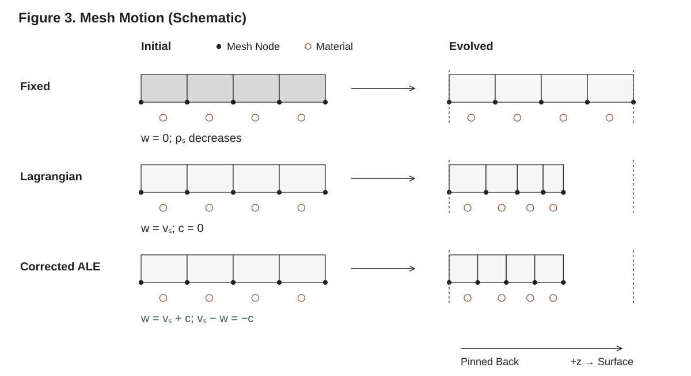

**Figure 3. Three mesh descriptions (schematic).** All panels share the same initial length and pinned back. A fixed mesh represents conversion as condensed-density loss in unchanged volumes, shown by lighter shading. With `c = 0`, nodes follow the solid. Corrected ALE lets interior nodes move relative to the same material motion: $w=v_s+c$ and the inventory transport velocity relative to the mesh is $v_s-w=-c$. The hollow material markers are separate from the filled mesh nodes; their redistribution is illustrative, not a computed trajectory.

The `use_ale` keyword of `solve` (default `false`) decides whether the nodes move.

### 6.7.1 Fixed mesh: the default

With `use_ale = false`, every node is pinned for the whole solve. The geometry (cell
centres, volumes, face positions) is constant, and the state holds only the cell blocks (and
the face intensities under `BEER_LAMBERT`). This is the right choice for problems whose
thickness does not change appreciably: TGA-like idealizations, inert or weakly reacting
slabs, and conduction studies. On a fixed mesh a reacting material that loses mass becomes
less dense in place; its surface does not recede.

```julia
sol = solve(problem)                         # fixed mesh (use_ale = false)
```

A fixed mesh can deactivate burned-out cells (`deactivation = true`, Chapter 10): from the
exposed side, each cell whose condensed mass falls below the threshold goes, its condensed
inventories pass to the live cell beneath it, and the gas it held is vented and recorded in
the deactivation event, since the receiver's pores could hold it only at a higher pressure.
A cell below the threshold beneath a live cell ends the solve with outcome `:interior`. A
material that regresses belongs on the moving mesh.

### 6.7.2 Moving mesh: `use_ale = true`

With `use_ale = true`, the node positions and velocities become part of the solved state.
The back node stays pinned at rest, and every other node moves with the velocity

```
w = v_s + c
```

the solid velocity `v_s` plus a correction `c`. The solid velocity comes from the cells'
volume balances: one algebraic row per cell, on the velocity of its node farther from the
pinned node, states that the solid velocity across the cell's faces accounts for the volume
change of its reactions (the strain rate `θ`, Technical Reference §10), so the rows are
swept from the back node outward. The positions follow `dx_k/dt = w_k`, and the cell volumes
are always computed from the positions, so the discrete geometric conservation law holds by
construction (Technical Reference §11). The velocities are consistent with the rows at the
start of the solve and after every deactivation event.

Without a correction (`c = 0`) the mesh moves with the solid: every component, pore gas
included, rides the mesh, and the gas moves relative to it only through its transport flux.
The mesh contracts as a pyrolyzing solid shrinks and expands for a swelling or intumescent
one. A correction moves the mesh relative to the solid, and the inventories then cross the
faces at the relative velocity `−c`. The correction a solve uses is decided by `setup`: on a
moving mesh with `deactivation = true` and a layer that can burn out, the equidistribution
correction, which thins a vanishing layer's cells together so that the layer leaves in one
deactivation event; otherwise none (§7.3.3, Chapter 10). Under the equidistribution
correction the interior nodes between cells that start with different condensed components,
the layer interfaces, are Lagrangian nodes that always move with the solid; the `lagrangian`
keyword of `solve` names them explicitly.

```julia
sol = solve(problem; use_ale = true)         # the mesh follows the solid
```

The solve ends with return code `:Terminated` and outcome `:min_thickness` when the
thickness, from the back node to the outermost live node, falls below `min_thickness`
(default `1e-6` m). Use a moving mesh when surface regression or volume change is an output
you want resolved geometrically, and whenever a material recedes; a variable cross section
requires it (§6.4.3).

### 6.7.3 Node positions in the solution

A moving-mesh solution records the geometry at every saved time:

| Field or accessor | Contents |
|---|---|
| `sol.z` | Node positions, `n_nodes × n_times` [m]; `NaN` beyond the outermost live node. `0 × 0` on a fixed mesh. |
| `get_profile(sol, :z, k)` | The node positions at saved time `k`; on a fixed mesh the mesh's positions. |
| `sol.cell_centers` | Cell centres, `n_cells × n_times` [m]; `NaN` in a deactivated cell. |
| `get_cell_positions(sol; at = k)` | The cell centres at saved time `k` (default the last); `at = 1` gives the initial centres. |
| `sol.correction_velocity` | The node corrections `c = w − v_s`, `n_nodes × n_times` [m/s]; zero without a correction, `0 × 0` on a fixed mesh. |
| `sol.extras.thickness_history` | The distance from the first node to the outermost live one [m]. |
| `sol.extras.min_cell_thickness` | The thickness of the thinnest live cell [m]. |

```julia
sol = solve(problem; use_ale = true)
z_end  = sol.z[:, end]                    # node positions at the last saved time [m]
x_end  = get_cell_positions(sol)          # cell centres there, for a T(z) profile
x_0    = get_cell_positions(sol; at = 1)  # the initial centres
L_t    = sol.extras.thickness_history     # the sample thickness over time [m]
fields = sol(50.0)                        # the fields at t = 50 s, positions included
fields.z[end]                             # the surface position at 50 s [m]
```

Plot a temperature profile against `get_cell_positions(sol; at = k)` with `sol.T[:, k]`, so
the depth axis spans the thickness the sample had at that time. Chapter 9 describes the
solution object and its interpolation.

---

## 6.8 Meshes of more than one dimension

`Pyrolysis.Meshes` also builds planar meshes of quadrilaterals and hexahedra:
`box_mesh(xs, ys[, zs]; transform, pinned = (:bottom,), fixed, lagrangian)` on the tensor
product of strictly increasing node coordinates, each node optionally moved by
`transform(x::SVector) -> SVector`, with the sides tagged `:left`/`:right` along x,
`:bottom`/`:top` along the last axis and, in 3D, `:front`/`:back` along y; and
`cell_mesh(positions, cells; tag, pinned, fixed, lagrangian)` from node positions and each
cell's corner nodes, the faces found by matching node sets. They return a `Mesh{2}` or
`Mesh{3}` whose metrics `geometry!` computes exactly for the multilinear cells.

```julia
using Pyrolysis.Meshes: box_mesh, boundary_tags

slab = box_mesh(range(0.0, 0.02; length = 5), range(0.0, 0.01; length = 4))
boundary_tags(slab.topology)        # [:bottom, :left, :right, :top]
```

These meshes are building blocks at the level of the residual, not a supported path for
full solves. `setup` accepts them for conduction (with an anisotropic conductivity tensor),
reactions and per-tag thermal conditions (a `BoundaryConditionSet` with a thermal entry for
every tag), on a fixed mesh or a moving one closed by one multiplier per cell (or, for a
single column of cells, by the balance rows); cells leave such a mesh by element death
(`Pyrolysis.Deactivation.element_death!`) applied to the set-up layout. `setup` refuses what
is a line's alone: gas transport, in-depth radiation, the variable cross section, the
equidistribution correction and threshold deactivation. A full simulation runs on a line mesh
from §6.2. Technical Reference §13 describes the multi-dimensional geometry and the closure.

---

## 6.9 Summary and cross-references

- Build meshes with `create_uniform_mesh(L, n_cells; ...)`,
  `create_stretched_mesh(L, n_cells, stretch; stretch_from = :top, ...)` or
  `create_mesh_from_nodes(z; ...)`. Each returns a `Mesh{1}`: a topology and the reference
  node positions, with no component count and no initial state.
- `z = 0` is the back face (`:bottom`, node 1, pinned), `z = L` the exposed surface
  (`:top`); cells number from the back to the surface.
- Choose `n_cells` by resolving the near-surface front and confirm with a convergence study
  (§6.3; `examples/convergence_douglas_fir.jl`; Technical Reference §18). Stretch toward
  `:top` to concentrate cells at the exposed surface.
- `coordinates` (`Planar()`, `Cylindrical()`, `Spherical()`) and `cross_section` (`A₀`,
  default `1.0`, `1.0`, `4π`) are mesh properties. In planar geometry `A₀` is a gauge that
  cancels from intensive results; a material's lateral shrinkage law makes it vary as
  `A₀·law(χ̄)` on a moving planar mesh.
- Inspect a mesh through `mesh.topology` with the functions of `Pyrolysis.Meshes`
  (`n_cells`, `n_nodes`, `n_faces`, `boundary_tags`, `boundary_faces`), its positions through
  `mesh.positions`, and its metrics with `MeshGeometry` and `geometry!`.
- The state interleaves node and cell blocks; a moving mesh adds each node's position and
  velocity. Read it through the layout's index functions (Chapter 11).
- `use_ale = false` (default) keeps every node pinned; `use_ale = true` moves the nodes with
  `w = v_s + c`, the correction installed by `setup` for burnout (§7.3.3, Chapter 10).
- Meshes of quadrilaterals and hexahedra exist at the residual level only.

For the finite-volume discretization built on the mesh, see Technical Reference §13; for the
moving mesh and the geometric conservation law, Technical Reference §11; for how the mesh
enters a problem and what `setup` decides, Chapter 7; for the boundary conditions on the
tagged faces, Chapter 5; for deactivation and the correction, Chapter 10.

---

# 7. Building a Problem: Simulation Modes

By this point you can build the three ingredients of a simulation: a mesh (Chapter 6), a
material with components, reactions and properties (Chapters 3–4), and a
`BoundaryConditionSet` (Chapter 5). This chapter shows how to assemble them into a
`PyrolysisProblem` and how the *physics* the solver integrates is selected. Pyrolysis.jl is
a generalized model with optional physics: one problem can be solved on a fixed or a moving
mesh, with one of three radiation models, with no gas transport, Fickian transport or
pressure-driven Darcy–Fick transport, with a fixed or a variable cross section, and with the
temperature or the enthalpy inventory as the energy state. Some of these choices are `solve`
keywords; the others follow from the material and the boundary conditions. `setup`, which
`solve` calls first, reads them all and builds the state and the residual they need. This
chapter explains every choice, its default, and what `setup` decides from it. The physics and
the derivations live in the Technical Reference; here the focus is on configuring a run
correctly.

---

## 7.1 The `PyrolysisProblem` object

A `PyrolysisProblem` couples a mesh, a material, boundary conditions, initial conditions and
the time span. It is the only thing you pass to `solve`.

### 7.1.1 Constructor

The keyword constructor is:

```julia
PyrolysisProblem(;
    mesh,                       # a Mesh{1} from create_uniform_mesh and its siblings
    material,                   # Material with components and reactions
    bc_set::BoundaryConditionSet,
    T_initial = z -> 300.0,     # initial temperature, z -> T [K]
    ξ_initial = nothing,        # initial concentrations; defaulted when nothing
    tspan,                      # (t_start, t_end) [s], required
    dt_initial = 1e-4,          # the first step [s]
    output_times = Float64[],   # saved times [s]; generated when empty
)
```

The positional form `PyrolysisProblem(mesh, material, bc_set, tspan; kwargs...)` takes the
same keywords. A complete, minimal example (one solid that decomposes into a gas, a constant
heat flux on the exposed surface, an adiabatic and impermeable back):

```julia
using Pyrolysis

# --- Material: one solid that decomposes into a gas ---
virgin = SolidComponent(:virgin; ρ = 1190.0, c = 1500.0, k = 0.20, λ = 1e-6)
gas    = GaseousComponent(:MMA;  M = 0.100, c = 1500.0, k = 0.02, λ = 1e-5)

decomp = Reaction(:pyrolysis, :virgin => :MMA;
                  A = 8.5e12, E = 188e3, h = 870e3)   # h > 0 = endothermic

pmma = Material(name = :PMMA,
                components = (virgin, gas),
                reactions  = (decomp,))

# --- Mesh: 1 cm thick, 100 cells ---
mesh = create_uniform_mesh(0.01, 100)

# --- Boundary conditions ---
bc_set = BoundaryConditionSet(
    thermal = (top    = HeatFluxBC(50e3) + RadiativeBC(ε = 0.9, T_inf = 300.0),
               bottom = AdiabaticBC()),
    mass    = (top    = DiffusiveMassBC(0.01),   # gas escapes to the atmosphere
               bottom = ImpermeableBC()),
)

# --- Problem ---
problem = PyrolysisProblem(
    mesh      = mesh,
    material  = pmma,
    bc_set    = bc_set,
    T_initial = z -> 300.0,
    tspan     = (0.0, 100.0),
)

sol = solve(problem)
```

The mesh knows nothing about the material: the component count comes from the material
alone, and the validator (§7.9) checks that `ξ_initial` has one closure per component. The
small gas-transfer coefficient on the solid (`λ = 1e-6`) keeps Fickian gas transport from
degenerating where the solid holds no gas (§7.5, §7.9).

### 7.1.2 Initial conditions

`T_initial` and `ξ_initial` are functions of the position. `setup` evaluates them at the
centre `x_i` of every cell of the mesh, at its reference positions: `T0[i] = T_initial(x_i)`
and `ξ0[j, i] = ξ_initial[j](x_i)` (`Pyrolysis.Problem.initial_fields(problem, mesh)` returns
both). The initial state then holds the masses `m_{i,j} = ξ0[j, i]·V_i` and the energy state
from `T0[i]`.

- `T_initial :: z -> T` returns the initial temperature [K]. Default `z -> 300.0`.
- `ξ_initial` holds one function per component, each returning the initial mass
  concentration `ξ_j` [kg/m³]. You may pass:
  - `nothing` (default): the constructor fills the first component, **if it is a solid**, at
    its reference density `ρ(300 K)`, and sets every other component to zero;
  - a single function, used for every component;
  - an explicit `Vector` of functions, one per component.

```julia
# Explicit, per-component initial concentrations:
problem = PyrolysisProblem(
    mesh = mesh, material = pmma, bc_set = bc_set,
    T_initial = z -> 300.0,
    ξ_initial = [z -> 1190.0,   # virgin at full density
                 z -> 0.0],     # gas starts empty
    tspan = (0.0, 100.0),
)
```

The `Problem` submodule exports profile helpers for non-uniform initial states (§5.10.3):
`step_profile`, `linear_profile`, `gaussian_profile` and `tanh_profile`. A sample preheated
toward the exposed surface (`z = L`):

```julia
using Pyrolysis.Problem: linear_profile

problem = PyrolysisProblem(
    mesh = mesh, material = pmma, bc_set = bc_set,
    T_initial = z -> linear_profile(z; z_min = 0.0, z_max = 0.01,
                                       value_min = 300.0, value_max = 400.0),
    tspan = (0.0, 100.0),
)
```

Under a lateral shrinkage law (§7.6) the initial state also holds each cell's conversion
history, `G_i = 0` and `M_i` the cell's initial solid mass, the denominator of the column
conversion `χ̄`. A Darcy–Fick material's pore gas is initialized through `ξ_initial` as well
(§7.5.1). See Technical Reference §12 for the initial and boundary conditions.

### 7.1.3 Time span and output times

- `tspan = (t_start, t_end)` in seconds. The validator requires `t_start < t_end` and
  `t_start ≥ 0`.
- `dt_initial` [s] is the first step the integrator tries (the default of `solve`'s `dt`
  keyword) and, on a moving mesh, the time scale of the node-velocity tolerances (default
  `1e-4` s). It must be positive and no larger than the time span.
- `output_times` is the vector of times at which the solution is saved. Left empty (the
  default), the constructor generates between 11 and 101 evenly spaced times over `tspan`. To
  control the output explicitly:

```julia
problem = PyrolysisProblem(
    mesh = mesh, material = pmma, bc_set = bc_set,
    tspan = (0.0, 120.0),
    output_times = collect(0.0:10.0:120.0),   # every 10 s
)
```

`solve` saves at these times by default (they are its `saveat`), and always saves the state
it ends on; the `saveat` keyword of `solve` overrides them (Chapter 8).

---

## 7.2 What `setup` decides

`solve(problem; kwargs...)` validates the problem, calls `setup(problem; ...)` to build the
problem the integrator runs (a `CoreProblem`), and integrates it (Chapter 8). `setup` reads
every modelling choice once and builds the state layout and the residual's kernels to match;
nothing is dispatched on during the integration. The choices:

| Choice | Selected by | Values | Default |
|---|---|---|---|
| Mesh motion | `use_ale` keyword | fixed (`false`), moving (`true`) | fixed |
| Radiation | `radiation_model` keyword | `NO_RADIATION`, `SURFACE_ABSORPTION`, `BEER_LAMBERT` | `NO_RADIATION` |
| Gas transport | the material and the mass conditions | none, Fickian, Darcy–Fick | from the problem |
| Cross section | the material's `lateral_shrinkage_law` | fixed, variable | fixed |
| Energy state | `energy_state` keyword | `:temperature`, `:enthalpy` | `:temperature` |
| Deactivation | `deactivation` keyword | off, on | off |
| Mesh correction | `correction` keyword, or installed | none, equidistribution | from the problem |

Three choices are made at solve time (mesh motion, radiation, energy state), two follow from
the problem (gas transport, cross section), and deactivation and the correction combine
both: you turn deactivation on, and `setup` installs the correction where the mesh moves and a
layer can burn out (§7.3.3). The coordinate system and the cross-section measure are the
mesh's (§6.4). A combination the implementation does not support is refused with an
`ArgumentError` before anything is integrated (§7.9.1). §7.8 shows how the choices shape the
state and the residual, and how to inspect what `setup` built.

---

## 7.3 Mesh motion: fixed or moving (`use_ale`)

### 7.3.1 What it controls

- **Fixed** (`use_ale = false`, default): every node is pinned. The node positions are not
  part of the state, the geometry is constant, and a cell carries its component masses and
  its energy state.
- **Moving** (`use_ale = true`): the node positions and velocities are part of the state. The
  back node is pinned; every other node moves with `w = v_s + c`, the solid velocity that the
  cells' reaction strain rates `θ` give through one volume-balance row per cell, plus the
  correction `c` (zero unless one is installed, §7.3.3). This lets the domain shrink as the
  solid is consumed (charring, ablation) or expand (swelling, intumescence) without a
  moving-boundary equation. Every component, pore gas included, rides the mesh; the gas
  moves relative to it through its transport flux.

```julia
# Fixed mesh (default)
sol = solve(problem)

# Moving mesh that tracks recession and expansion
sol = solve(problem; use_ale = true)
```

### 7.3.2 When to use a moving mesh

Use a moving mesh whenever the through-thickness extent of the material changes
appreciably: charring wood, ablating or gasifying polymers, intumescent coatings, any case in
which surface recession matters for the surface temperature and the mass-loss rate, and every
solve that burns cells out at the surface. For a TGA-like or thin-film case whose geometry
change does not matter, the fixed mesh is cheaper: it has no node unknowns (§7.8).

On a moving mesh the cell volumes follow from the node positions at every evaluation, so the
geometric conservation law holds by construction; the solve ends with outcome
`:min_thickness` when the thickness falls below `min_thickness` (default `1e-6` m). See
Chapter 6 for the node positions in the solution (§6.7) and for meshes stretched toward the
surface (§6.2.2), which pair well with it, and Technical Reference §11 for the moving-mesh
formulation.

### 7.3.3 Deactivation and the correction

`deactivation = true` deactivates, during the solve, every cell whose condensed mass falls
below `threshold` (default `1e-2`) of its initial condensed mass, from the exposed side, in
an event located inside the step; its inventories go to the live cell beneath it. Chapter 10
describes the burnout path, its parameters and the envelope in which it is verified.

On a moving mesh with deactivation on, `setup` installs the **equidistribution correction**
(`EquidistributionCorrection()`, its layer time set at each layer's first activation,
`ActivationTime()`) when some layer can vanish: its components, converted completely, leave
less condensed mass than `threshold` of what it started with (`Pyrolysis.Closures.residues`
gives the fraction each component leaves). The correction moves the mesh relative to the
solid, thinning a vanishing layer's cells together so that the layer leaves in one event;
the near-threshold band then defaults to `0.1`. Otherwise (a fixed mesh, deactivation off,
or a charring layer whose residue stays above the threshold) the solve has no correction and
a moving mesh moves with the solid.

| Keyword | Effect |
|---|---|
| `correction = NoCorrection()` | Keeps the mesh with the solid whatever `setup` would install. |
| `correction = EquidistributionCorrection(; ...)` | Configures the correction (Chapter 10); needs `use_ale = true`. |
| `lagrangian = [nodes...]` | Nodes that always move with the solid. Under the equidistribution correction every interior node between cells that start with different condensed components must be among them, and by default they are exactly those nodes. |
| `band` | The near-threshold band of a moving mesh, in `[threshold, 1)`. |

---

## 7.4 Radiation model (`radiation_model`)

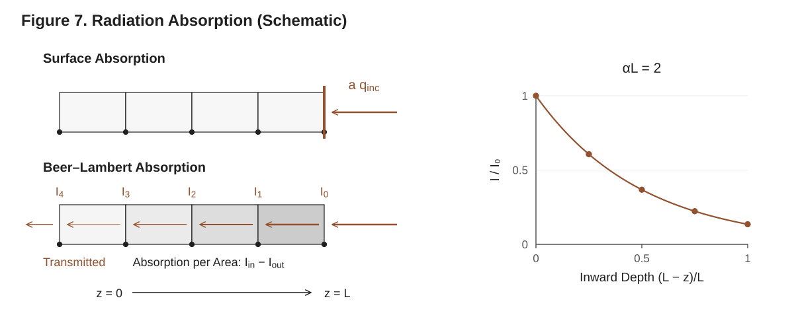

**Figure 7. Where applied radiation is absorbed (schematic).** `NO_RADIATION` and `SURFACE_ABSORPTION` both apply `RadiativeFluxBC` at the surface; the former does **not** disable that boundary condition. Beer–Lambert introduces face-intensity unknowns and deposits the entering-minus-leaving radiant power in each cell. The exponential inset illustrates uniform optical thickness $\alpha L=2$; its depth coordinate $L-z$ increases inward, opposite to the common $+z$ direction. Radiation remaining at the back face is transmitted rather than absorbed.

Where the incident radiation is absorbed is selected by the `radiation_model` keyword, which
takes a `RadiationModel` value:

| Value | Meaning | Unknowns added |
|---|---|---|
| `NO_RADIATION` (default) | No volumetric absorption. A `RadiativeFluxBC` is absorbed at the exposed surface. | none |
| `SURFACE_ABSORPTION` | The incident flux is absorbed at the exposed surface, through the surface energy balance (opaque material). Component `α` values are not read. | none |
| `BEER_LAMBERT` | In-depth exponential absorption, `I(z) = I_e exp(−∫ α_eff dz)`, with `α_eff = Σ_j ξ_j α_j` from the components' mass absorption coefficients `α` [m²/kg]. | one intensity per face, algebraic |

```julia
# Opaque material: absorb the cone flux at the surface
sol = solve(problem; radiation_model = SURFACE_ABSORPTION)

# Semi-transparent material: absorb in depth (needs α on the components)
sol = solve(problem; radiation_model = BEER_LAMBERT)
```

### 7.4.1 How radiation enters the energy equation

The *incident* radiative flux comes from a `RadiativeFluxBC` in the thermal entry of the
`:top` tag (a cone heater, for instance). The `radiation_model` keyword decides where that
flux is deposited:

- With `SURFACE_ABSORPTION`, the absorbed flux `a·q_inc` enters the surface energy balance at
  the exposed face, raising `T_s`; `a` is the condition's own `absorptivity` when it gives
  one, otherwise the exposed cell's effective absorptivity (Kirchhoff's law, the emissivity,
  unless a component sets its own `absorptivity`). Nothing is deposited in depth.
- With `NO_RADIATION`, the same: a `RadiativeFluxBC` is absorbed at the surface exactly as
  under `SURFACE_ABSORPTION`, and no volumetric source exists. The two values describe the
  same model; name the one that says what you mean.
- With `BEER_LAMBERT`, the exposed face's intensity is `I_e = a·q_inc(t)` and every other
  face's intensity is the one above it attenuated across the cell, `exp(−α_eff Δz)`; each
  cell absorbs the difference between the intensity entering and leaving it, the exact cell
  average of the attenuated beam, and the intensity leaving the back face is transmitted out
  of the domain (`sol.extras.radiation_transmitted`). The face intensities are algebraic rows
  of the state, so the Jacobian stays banded. The `RadiativeFluxBC` then contributes nothing
  to the surface balance.

Under every model `RadiativeBC` (re-radiation, `Fεσ(T_∞⁴ − T_s⁴)`) and `ConvectiveBC` act at
the boundary, and a time-varying incident flux is evaluated at the time of every residual
evaluation, so a ramped or stepped cone flux is tracked exactly.

### 7.4.2 Restrictions and choosing a model

- `BEER_LAMBERT` needs planar coordinates, and the incident flux enters through the `:top`
  faces only: a `RadiativeFluxBC` on another tag is refused with an `ArgumentError`.
- `BEER_LAMBERT` with `α = 0` on every component absorbs nothing in depth: the whole absorbed
  share of the incident flux passes through and leaves through the back face. No warning is
  given; check `sol.extras.volumetric_absorption` and `sol.extras.radiation_transmitted`.
- `SURFACE_ABSORPTION` ignores the components' `α`, without a warning.

Choose the model by the optical thickness `τ = α_eff·L`: `SURFACE_ABSORPTION` for opaque
chars (`τ ≫ 1`), `BEER_LAMBERT` for semi-transparent polymers and foams, and `NO_RADIATION`
for transparent samples or when the heating is purely conductive or convective. See
Technical Reference §8 for the models.

---

## 7.5 Gas transport: none, Fickian or Darcy–Fick (automatic)

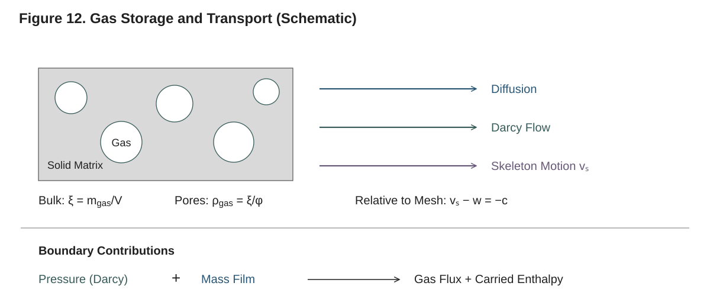

**Figure 12. Gas storage and transport (schematic).** Bulk concentration $\xi$ uses total cell volume; pore density $\xi/\phi$ uses pore volume. Diffusion and Darcy flow are relative to the skeleton; skeleton transport relative to the mesh is $-c\xi$. At a boundary, pressure-driven venting and the mass-film contribution add, and the resulting gas flux carries sensible enthalpy. Arrows show representative directions; gradients can reverse them.

The gas-transport model is not a `solve` keyword: `setup` infers it from the material and
the mass boundary conditions.

| Model | Selected when | Gas flux |
|---|---|---|
| none | the material has no gas component, or no component has a gas-transfer coefficient `λ` and every mass condition is `ImpermeableBC` | no gas moves |
| Fickian | gas can move and no condensed component is permeable (every `κ = 0`) | diffusive: `J = −(λ_f/T_f)(ξ_nb T_nb − ξ_o T_o)/d` |
| Darcy–Fick | some solid or liquid component has `κ > 0` (`has_darcy_flow(material)`) | diffusive plus advective: `J = J_diff + v ξ_up/φ_f`, with the superficial velocity `v = −(κ/μ)∇P` |

In the Fickian flux `λ_f` is the face mean of the cells' gas-transfer coefficients and `d`
the distance between the cell centres; in the Darcy–Fick flux `ξ_up` is the concentration
upwind of `v` and `φ_f` the face porosity, so that the advected quantity is the intrinsic
gas density `ξ/φ` (`ξ` is per bulk volume, `v` superficial). The pressure `P` is the
ideal-gas pressure of the pore gas, and it and the Darcy velocity are evaluated only under
Darcy–Fick transport, so a Fickian material carries no pressure computation. See Technical
Reference §9 for the transport model.

Under Fickian transport the cell coefficient is the volume-fraction mix of the component
values, so a condensed component with `λ = 0` stops all transport in a cell that holds no gas.
The validator warns about it (§7.9); give the condensed components a small `λ` (for example
`1e-6` m²/s).

### 7.5.1 Enabling Darcy–Fick

Put a permeability on the relevant solid and liquid components:

```julia
# Diffusion only (Fickian): no κ, all gas transport is diffusive
virgin = SolidComponent(:virgin; ρ = 500.0, c = 2000.0, k = 0.15, λ = 1e-6)

# Darcy–Fick: a permeability selects it
virgin = SolidComponent(:virgin; ρ = 500.0, c = 2000.0, k = 0.15, κ = 1e-15,
                        ρ_intrinsic = 1500.0)  # skeletal density: a real pore volume
char   = SolidComponent(:char;   ρ = 150.0, c = 1500.0, k = 0.10, κ = 1e-12,
                        ρ_intrinsic = 1950.0)
gas    = GaseousComponent(:volatiles; M = 0.030, c = 1100.0, k = 0.02, λ = 1e-5)
air    = GaseousComponent(:air; M = 0.02897, c = 1006.0, k = 0.026, λ = 2e-5)

decomp = Reaction(:pyrolysis, :virgin => (:char, :volatiles);
                  A = 1e10, E = 150e3, h = 300e3, yields = (0.25, 0.75))

wood = Material(name = :CharringWood,
                components = (virgin, char, gas, air),
                reactions  = (decomp,),
                mixing = MaterialMixing(k = MixingSpec(PARALLEL, 0.5),
                                        κ = MixingSpec(WEIGHTED, 0.5)))
```

> **Initialize the pore gas.** A Darcy–Fick problem needs (i) skeletal densities on the
> condensed components (`ρ_intrinsic`, or the `φ` keyword, §3.2.4) so that a real pore volume
> exists, and (ii) an inert background air component initialized at ambient pressure with
> `background_gas_concentration(material, :air, ξ_condensed₀, T₀)`; otherwise the pore space
> starts as a vacuum against the 1 atm boundary and early product gas is spuriously advected
> inward. A permeable cell with no pore space is refused by the validator (§7.9). See
> Technical Reference §9.5.4 and `examples/08_darcy_fick_demo.jl`.

```julia
# Pore air at 1 atm in the virgin solid at 300 K
ξ_air = background_gas_concentration(wood, :air, (500.0, 0.0, 0.0, 0.0), 300.0)
ξ_initial = [z -> 500.0, z -> 0.0, z -> 0.0, z -> ξ_air]
```

The effective permeability is computed from the component values with the `κ` mixing rule
(§3.5). As virgin converts to char, `κ` rises and the bulk gas flow gains weight. Gas
components carry no permeability (the gas flows *through* the matrix); only solids and
liquids contribute.

### 7.5.2 Pressure boundary conditions

Darcy flow is driven by the gradient of the ideal-gas pore pressure. To control the pressure
at a boundary, attach a pressure condition to the **mass** entry of that tag with the `+`
operator. Pressure conditions are not a separate field of `BoundaryConditionSet`; they ride
along with the mass condition:

```julia
# Top surface: gas diffuses out AND is held at atmospheric pressure
top_mass = DiffusiveMassBC(0.05) + DirichletPressureBC(101325.0)

bc_set = BoundaryConditionSet(
    thermal = (top = HeatFluxBC(75e3) + RadiativeBC(ε = 0.9, T_inf = 300.0),
               bottom = AdiabaticBC()),
    mass    = (top = top_mass, bottom = ImpermeableBC()),
)
```

The pressure conditions are `DirichletPressureBC(P)` (fixed pressure),
`NeumannPressureBC(∂P/∂n)` (prescribed gradient) and `ConvectivePressureBC` (a resistive
outflow law). Each sets the outward Darcy velocity of its boundary face, which vents gas
advectively against an ambient that carries none of the tracked gases; they contribute no
diffusive film flux of their own: that comes from the mass condition they are combined with,
and the two add. Under Fickian transport a pressure condition drives nothing. See §5.5,
Technical Reference §9.5.3 for the venting flux and §12.5 for the pressure conditions.

> The shipped Darcy–Fick examples (`08_darcy_fick_demo.jl`, `07_douglas_fir_cone.jl`,
> `08_pressure_treated_wood_cone.jl`) run on a moving mesh, since pressure-driven outflow
> accompanies recession.

---

## 7.6 Variable cross section (automatic)

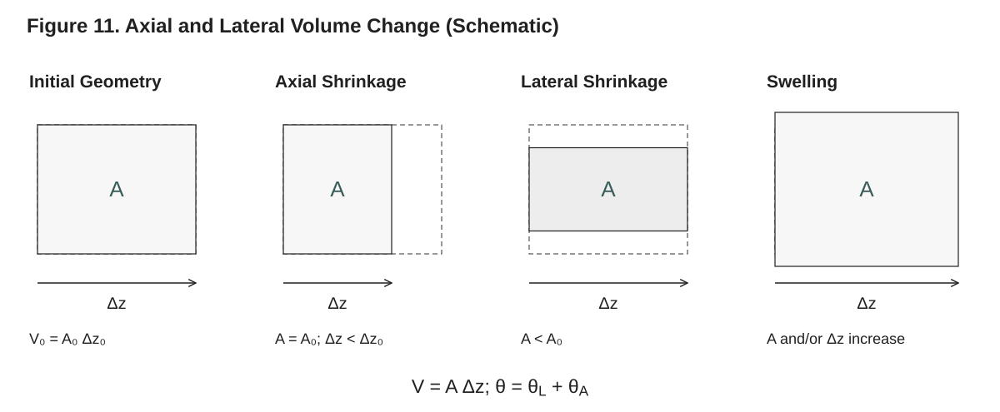

**Figure 11. Axial versus lateral volume change (schematic).** A planar cell has $V=A\Delta z$ and total strain rate $\theta=\theta_L+\theta_A$. The axial balance uses $\theta-\theta_A$, so lateral volume change is counted once. The drawn height stands for cross-sectional area, not a resolved lateral mesh. For the same total outward mass rate, `mass_loss_rate` divides by the current exposed area and `extras.MLR_gauge` by its initial area. Shrinking area makes the former larger than the latter.

The cross section also follows from the material. If the material's
`lateral_shrinkage_law` is `nothing` (the default), the column's cross section is fixed at
the mesh's `A₀`. If you supply a law, a function of the column conversion `χ̄`, the area
varies as `A(t) = A₀ · law(χ̄)` (§6.4.3).

### 7.6.1 Defining a shrinkage or swelling law

```julia
# Linear lateral shrinkage: the area shrinks to 80% as pyrolysis completes
shrink_law = χ̄ -> 1.0 - 0.2 * χ̄

# Linear lateral swelling (intumescence): the area grows by 50%
swell_law  = χ̄ -> 1.0 + 0.5 * χ̄

pmma_shrinking = Material(name = :PMMA,
                          components = (virgin, gas),
                          reactions  = (decomp,),
                          lateral_shrinkage_law = shrink_law)
```

The column conversion is `χ̄ = Σ_i G_i / Σ_i M_i`, with `G_i` the cumulative dry pyrolysis
gas cell `i` has produced and `M_i` its initial solid mass; only "dry" gases contribute, every
gas component except water vapour (a component whose name contains `H2O` or `water`, in any
case). The law must be smooth (its derivative is taken by automatic differentiation, so a
piecewise law with a kink gives an ill-defined lateral rate), positive and finite on
`[−0.001, 1.001]`, and equal to one at `χ̄ = 0`; `setup` checks the last two and refuses a law
that fails them. Without a law, no cross-section unknowns enter the state.

### 7.6.2 Interaction with the moving mesh

A variable cross section requires `use_ale = true` and planar coordinates: `setup` refuses a
lateral shrinkage law on a fixed mesh with an `ArgumentError` naming the fix. With the law,
`setup` adds to the state each cell's conversion-history pair `(G_i, M_i)`, carried with the
solid, and two algebraic rows for the column: the area `A = A₀·law(χ̄)` and its lateral strain
rate `θ_A = d ln law(χ̄)/dt`. Each cell's volume balance uses the axial strain `θ_i − θ_A`, so
the lateral and the axial channels share the volume change without counting it twice.

```julia
problem = PyrolysisProblem(mesh = mesh, material = pmma_shrinking, bc_set = bc_set,
                           tspan = (0.0, 100.0))

sol = solve(problem; use_ale = true)

sol.extras.cross_section_area_history     # A(t) at the saved times [m²]
sol.extras.MLR_gauge                      # mass-loss rate per unit initial area
```

See Technical Reference §10 for volume change, swelling and the lateral shrinkage law, and
§11 for how `θ_A` enters the mesh motion.

---

## 7.7 The energy equation and the energy state

The energy equation is the same in every mode; the choices above change how its terms are
evaluated, not which terms appear:

```
ρc_p ∂T/∂t = −∇·q − Σ_g J_g·∇h_g + Q_rad + Q_rxn
```

Here `ρc_p = Σ_j ξ_j c_p,j` sums every component, pore gas included; `q = −k∇T` is the
conducted flux; `J_g` are the gas mass fluxes relative to the mesh and `h_g` the gas sensible
enthalpies, so the second term is the sensible heat the moving gas exchanges with the matrix
it crosses (`−Σ_g c_p,g J_g·∇T`); `Q_rad` is the in-depth radiation source (`BEER_LAMBERT`
only); and `Q_rxn = −Σ_r h_r r_r` is the reaction heat (`h_r > 0` endothermic).

The solver assembles it in flux form. Every face carries the conducted heat and the sensible
enthalpy `Σ_j J_j h_j(T_f)` of the gas crossing it at the face temperature; every cell's row
subtracts the enthalpy `Σ_j h_j(T_i)·Ṁ_{i,j}` that its net gas inflow brings at the cell's own
temperature, which leaves exactly the exchange term above. The gas that leaves through a
boundary face carries its enthalpy at the surface temperature. On a moving mesh under a
correction the mass and enthalpy inventories also cross the faces at the relative velocity
`−c`. This is the ThermaKin convention (Technical Reference §3 and §7).

**Reaction heats are DSC-style.** A heat `h` measured by DSC, or calibrated in ThermaKin or
Gpyro, is quoted at the reaction temperature, so it already contains the gas products'
sensible enthalpy at that temperature; the reaction kernel evaluates it at the cell's
temperature. The energy equation therefore has no separate gas-generation enthalpy term. Such
a term, `−Σ_g Δh_g(T, T_ref)(∇·J_g)`, belongs only with heats referenced to the
`T_ref ≈ 298.15 K` ambient datum (formation-enthalpy style); with DSC-style heats it would
subtract the gas products' sensible enthalpy a second time (≈0.7–1.2 MJ per kg of volatiles
at 900 K, comparable to the heat of pyrolysis itself). If your heats are referenced to the
ambient datum, convert them to the reaction temperature before use (Technical Reference §6).

### 7.7.1 No surface gas-enthalpy term

The surface energy balance contains no gas-enthalpy term: the flux the boundary condition
applies equals the conducted flux (§5.4), and the enthalpy of the escaping gas leaves through
the face's energy flux at the surface temperature, as above. A surface term
`Σ_g ṁ_g Δh_g(T_s, T_∞)` would remove that enthalpy a second time, a spurious sink that
under-predicts the surface temperature and the mass-loss rate. Use a plain convective and
radiative boundary condition; the escaping gas influences the boundary balance only through
the blowing model of a `ConvectiveBC` (§5.2.3). See Technical Reference §7 and §16 for the
energy accounting.

### 7.7.2 The energy state (`energy_state`)

The integrator carries one energy unknown per cell, chosen with the `energy_state` keyword:

| `energy_state` | Unknown | Row | Conservation |
|---|---|---|---|
| `:temperature` (default) | the cell temperature `T_i` [K] | `(Σ_j m_{i,j} c_p,j) dT_i/dt = E_i − Σ_j h_j(T_i) Ṁ_{i,j}` | energy to the integrator's order |
| `:enthalpy` | the sensible-enthalpy inventory `H_i = Σ_j m_{i,j} h_j(T_i)` [J] | `dH_i/dt = E_i + Σ_j ω_{i,j} V_i h_j(T_i)` | the summed inventory, a linear invariant, to round-off |

`E_i` is the cell's energy sources plus the energy its faces bring in, `Ṁ_{i,j}` the face
part of its mass rate and `ω_{i,j}` its reaction mass rates. In the inventory form the
temperature is recovered from `H_i` and the masses by a regularized inversion of the caloric
laws at every evaluation. Both forms run on every path (fixed and moving meshes,
deactivation), and the burnout envelope of Chapter 10 holds for either. On the problem of
§7.1.1 at the default tolerances the two forms' temperatures differ by at most 0.016 K over
the 100 s (measured by solving it in both forms). Any other value is refused with an
`ArgumentError`.

```julia
sol = solve(problem; energy_state = :enthalpy)
```

---

## 7.8 How the choices shape the state and the residual

The choices of §7.2 determine which unknowns the state holds and which kernels the residual
runs. The rows of the state:

| Rows | Present when | Kind |
|---|---|---|
| component masses `m_{i,1} … m_{i,NC}`, per cell | always | differential |
| energy state (`T_i` or `H_i`), per cell | always | differential |
| node position `x_k`, per node | moving mesh | differential |
| node velocity `w_k`, per node | moving mesh | algebraic (the volume-balance rows) |
| face intensity `I_f`, per face | `BEER_LAMBERT` | algebraic (the attenuation rows) |
| conversion history `G_i`, `M_i`, per cell | lateral shrinkage law | differential |
| cross section `A` and lateral rate `θ_A`, one each | lateral shrinkage law | algebraic |

With `n` cells and `NC` components the state has `n(NC + 1)` rows, plus `2(n + 1)` on a
moving mesh, `n + 1` under `BEER_LAMBERT` and `2n + 2` under a lateral shrinkage law. The
system is a mass-matrix differential-algebraic system `M du/dt = f(u, t)`, the algebraic rows
having no time derivative, and `setup` makes the algebraic unknowns consistent with their rows
before the solve starts (Chapter 8, Technical Reference §15). Because the masses are the
states, mass is conserved exactly.

The residual runs its kernels in a fixed order, each present only when the problem needs it:
the reactions (when the material has reactions), the gas transport (Fickian or Darcy–Fick),
the in-depth radiation (`BEER_LAMBERT`), the conduction, the thermal boundary conditions,
and, under a correction, the relative fluxes of the inventories across the moving faces;
then, on a moving mesh, the volume-balance rows. You do not choose a path through the code;
you make the choices and `setup` builds the residual that implements them. To see what it
built:

```julia
cp = setup(problem; use_ale = true)
cp.def.setup.gas                            # FickTransport(): the gas transport chosen
map(k -> nameof(typeof(k)), cp.def.kernels) # the kernels, in order
length(cp.u0)                               # 502 for the problem of §7.1.1
```

`setup` takes the keywords of `solve` that shape the problem (`energy_state`, `reltol`,
`abstol`, `threshold`, `use_ale`, `radiation_model`, `deactivation`, `band`, `correction`,
`lagrangian`, `w_override`, `sources`); `integrate(cp; ...)` then runs it with the
integrator's keywords. Chapter 11 covers this custom-loop path, and Technical Reference §13
and §15 the assembly and the integration.

---

## 7.9 Validating a problem (`validate_problem`)

Before solving, run the validator to catch structural mistakes early:

```julia
using Pyrolysis.Problem: validate_problem, is_valid_problem

validate_problem(problem)                 # throws on any error, returns true if OK
validate_problem(problem; strict = true)  # adds the checks below
is_valid_problem(problem)                 # a Bool, never throws
```

`solve` calls `validate_problem(problem; strict = false)` unless you pass `validate = false`.
The default checks are:

- the mesh has one finite position per node;
- the material has at least one component, and every reaction references valid component
  indices;
- the mesh carries the boundary tags `:top` (the exposed surface) and `:bottom`, every
  boundary tag of the mesh has a thermal condition, and a per-species `ξ_inf` tuple on a
  `ConvectiveMassBC` has one entry per component;
- the time span is valid (`t_start < t_end`, `t_start ≥ 0`, a positive `dt_initial` no larger
  than the span);
- the number of initial concentration functions equals the component count;
- a Darcy–Fick material does not start with (near-)zero porosity, the pore fraction
  `1 − skeletal_volume_fraction` evaluated at the cell centres, in a cell whose effective
  permeability is nonzero (§7.5.1).

It also warns, without failing, when a gas-producing Fickian material has a condensed
component with gas-transfer coefficient `λ = 0`: gas transport then vanishes where the gas
fraction vanishes, the gas field forms a sharp front, and the integrator rejects step
after step on it. Give such components a small `λ`, for example `1e-6` m²/s. Errors are
collected and thrown together in one message.

`strict = true` additionally verifies the reactions' stoichiometric mass balance (product
yields summing to one), that the initial-condition functions evaluate at the first cell
centre, and that every cell volume is positive.

### 7.9.1 What `setup` refuses

Some combinations pass validation but are not implemented; `setup` refuses them with an
`ArgumentError` before anything is integrated, whether or not `solve` validated:

- a lateral shrinkage law without `use_ale = true`, on a non-planar mesh, or a law that is
  not positive and finite on `[−0.001, 1.001]` or not one at zero conversion;
- `BEER_LAMBERT` on a cylindrical or spherical mesh, or with a `RadiativeFluxBC` on a tag
  other than `:top`;
- a `correction` other than `NoCorrection()` without `use_ale = true`;
- a `w_override` (a prescribed mesh velocity, for verification) without `use_ale = true`,
  with a reacting material, with `deactivation`, or together with a correction;
- under the equidistribution correction, a `lagrangian` list that leaves out an interior node
  between cells that start with different condensed components;
- a `band` outside `[threshold, 1)`, and an `energy_state` other than `:temperature` or
  `:enthalpy`.

`solve` itself refuses an unknown keyword and a non-positive `min_thickness`, also with an
`ArgumentError`.

---

## 7.10 Choosing modes for common scenarios

The table below is a quick recipe lookup. "auto" marks a choice that follows from the
material, not from a `solve` keyword.

| Scenario | `use_ale` | `radiation_model` | gas transport (auto) | cross section (auto) | `deactivation` |
|---|---|---|---|---|---|
| TGA-like thin sample, no recession | `false` | `NO_RADIATION` | Fickian | fixed | `false` |
| Cone calorimeter, opaque charring solid | `true` | `SURFACE_ABSORPTION` | Fickian or Darcy–Fick | fixed or variable | `false` |
| Cone calorimeter, semi-transparent polymer to burnout | `true` | `BEER_LAMBERT` (set `α`) | Fickian | fixed | `true` |
| Intumescent coating (swelling) | `true` | `SURFACE_ABSORPTION` | Darcy–Fick (`κ > 0`) | variable (swelling law) | `false` |
| Pressure-driven char, pressure-treated wood | `true` | `SURFACE_ABSORPTION` | Darcy–Fick (`κ > 0`) | fixed or variable | `false` |

### 7.10.1 Worked example: TGA-like, minimal mode

A thin sample whose two faces follow a furnace program of 10 K/min, with no radiation and
diffusion-only gas escape through the top, on a fixed mesh:

```julia
using Pyrolysis

virgin = SolidComponent(:virgin; ρ = 1190.0, c = 1500.0, k = 0.20, λ = 1e-6)
gas    = GaseousComponent(:MMA;  M = 0.100, c = 1500.0, k = 0.02, λ = 1e-5)
decomp = Reaction(:pyrolysis, :virgin => :MMA; A = 8.5e12, E = 188e3, h = 870e3)
pmma   = Material(name = :PMMA, components = (virgin, gas), reactions = (decomp,))

mesh = create_uniform_mesh(1e-4, 10)                  # 0.1 mm, 10 cells

heating = t -> 300.0 + t / 6                          # 10 K/min
bc_set = BoundaryConditionSet(
    thermal = (top = DirichletThermalBC(heating), bottom = DirichletThermalBC(heating)),
    mass    = (top = DiffusiveMassBC(0.01), bottom = ImpermeableBC()),
)

problem = PyrolysisProblem(mesh = mesh, material = pmma, bc_set = bc_set,
                           tspan = (0.0, 2400.0))

sol = solve(problem)        # fixed mesh, NO_RADIATION, Fickian, fixed cross section

# Mass-loss fraction against the furnace temperature
loss = 1 .- sol.extras.total_mass ./ sol.extras.total_mass[1]
T_furnace = heating.(sol.t)
```

### 7.10.2 Worked example: cone calorimeter, opaque, recession and Darcy flow

A charring wood under a cone heater, with surface absorption, a moving mesh and
pressure-driven gas escape (Darcy–Fick selected by the component permeabilities), its pore
space filled with air at 1 atm:

```julia
using Pyrolysis

virgin = SolidComponent(:virgin; ρ = 500.0, c = 2000.0, k = 0.15, κ = 1e-15,
                        ρ_intrinsic = 1500.0)
char   = SolidComponent(:char;   ρ = 150.0, c = 1500.0, k = 0.10, κ = 1e-12,
                        ρ_intrinsic = 1950.0)
gas    = GaseousComponent(:volatiles; M = 0.030, c = 1100.0, k = 0.02, λ = 1e-5)
air    = GaseousComponent(:air; M = 0.02897, c = 1006.0, k = 0.026, λ = 2e-5)
decomp = Reaction(:pyrolysis, :virgin => (:char, :volatiles);
                  A = 1e10, E = 150e3, h = 300e3, yields = (0.25, 0.75))

wood = Material(name = :CharringWood,
                components = (virgin, char, gas, air),
                reactions  = (decomp,),
                mixing = MaterialMixing(k = MixingSpec(PARALLEL, 0.5),
                                        κ = MixingSpec(WEIGHTED, 0.5)))

# Pore air at 1 atm in the virgin solid
ξ_air = background_gas_concentration(wood, :air, (500.0, 0.0, 0.0, 0.0), 300.0)

mesh = create_uniform_mesh(0.02, 80)                  # 2 cm, 80 cells

# Top: incident cone flux (absorbed at the surface), re-radiation, convection.
# Mass: diffusive escape and atmospheric pressure (drives the Darcy outflow).
bc_set = BoundaryConditionSet(
    thermal = (top = RadiativeFluxBC(flux = 50e3, absorptivity = 0.9) +
                     RadiativeBC(ε = 0.9, T_inf = 300.0) +
                     ConvectiveBC(h = 10.0, T_inf = 300.0),
               bottom = AdiabaticBC()),
    mass    = (top = DiffusiveMassBC(0.05) + DirichletPressureBC(101325.0),
               bottom = ImpermeableBC()),
)

problem = PyrolysisProblem(mesh = mesh, material = wood, bc_set = bc_set,
                           ξ_initial = [z -> 500.0, z -> 0.0, z -> 0.0, z -> ξ_air],
                           tspan = (0.0, 120.0))

sol = solve(problem;
            use_ale         = true,                 # the mesh follows the solid
            radiation_model = SURFACE_ABSORPTION)   # opaque: absorb at the surface
# gas transport = Darcy–Fick (from κ); cross section fixed (no law)
```

To add lateral intumescent swelling, give `wood` a `lateral_shrinkage_law`
(`χ̄ -> 1.0 + 0.5 * χ̄`, say): the cross section becomes variable and the `solve` call stays
the same, since it already moves the mesh. This char keeps a quarter of the virgin mass, more
than the deactivation threshold, so a burnout solve of it would get no correction (§7.3.3).

---

## 7.11 Summary

- A `PyrolysisProblem` bundles the mesh, the material, `bc_set`, the initial conditions and
  `tspan`/`output_times`. The mesh carries no component count; the initial conditions,
  evaluated at the cell centres by `setup`, must give one function per component.
- The active physics is a set of choices that `setup` reads once:
  - *mesh motion* (`use_ale`, default `false`), *radiation* (`radiation_model`, default
    `NO_RADIATION`) and the *energy state* (`energy_state`, default `:temperature`) are
    chosen at solve time;
  - *gas transport* (none, Fickian or Darcy–Fick) and the *cross section* (fixed or
    variable) follow from the material: its gas components and transfer coefficients, the
    mass conditions, the component permeabilities `κ`, and its `lateral_shrinkage_law`;
  - *deactivation* is a keyword, and on a moving mesh `setup` installs the equidistribution
    correction when a layer can burn out.
- The choices fix the rows of the state (masses and energy per cell; positions and
  velocities on a moving mesh; face intensities under `BEER_LAMBERT`; the conversion history
  and the cross section under a lateral law) and the kernels of the residual.
- There is one energy equation, assembled in flux form with the gas enthalpy carried across
  the faces and DSC-style reaction heats; the surface balance has no gas-enthalpy term, which
  would count the escaping gas's enthalpy twice.
- `validate_problem` (run by `solve` unless `validate = false`) catches structural errors,
  and `setup` refuses unsupported combinations, before integration.

The next chapter, "Running the Solver", covers the rest of the `solve` keyword surface: the
integrator policies and linear solvers, tolerances and step limits, deactivation, callbacks
and the progress bar, output control and the return codes and outcomes.

---

# 8. Running the Solver

Once you have a `PyrolysisProblem` (Chapters 5–7), the single function that
integrates it forward in time is `solve`. This chapter is the complete option
reference for `solve(problem; ...)`: how to pick the integrator policy and the
linear solver, how the tolerances reach every row of the state, what the
Jacobian is, how to choose the energy state, how to switch on the optional
physics (a moving mesh, radiation, cell deactivation), how callbacks and the
conservation recorder are wired in, how output is saved, and how to read the
return code and the outcome. Every keyword shown here is a real `solve`
keyword: `solve` refuses an unknown keyword with an `ArgumentError`, so a typo
never passes silently. The physics behind these options is derived in the
Technical Reference; this chapter tells you which knob to turn and what each
one does. The temporal integration, the differential-algebraic system and the
Jacobian are derived in Technical Reference §15.

---

## 8.1 The `solve` entry point

`solve` takes the problem as a positional argument and everything else as
keywords:

```julia
using Pyrolysis

solution = solve(problem)   # all defaults: Rodas5P, StructuredKLU, fixed mesh, no radiation
```

That call validates the problem (`validate_problem`), builds the problem the
integrator runs (`setup`: the initial inventories at the cell centres, the
kernels, the per-row tolerances and the colored Jacobian), integrates it
(`integrate`) and reconstructs a `PyrolysisSolution` at the saved times. The
two halves are exported, so a script can set a problem up once and integrate
it several times (§8.11). `solve` leaves `problem` unchanged: the mesh is never
modified, every node position the solve moves lives in the state vector, and
the solution holds the geometry at each saved time (`solution.z`,
`solution.cell_centers`). The same problem can therefore be solved again, or
shared by the points of a parameter sweep, and always starts from the mesh you
built. The problem is kept as `solution.problem`.

`solve` is a method of the SciML ecosystem's common `solve` function, so
`using Pyrolysis` together with `using OrdinaryDiffEq` names one function and
raises no ambiguity.

The full keyword set, with defaults, is:

| Keyword | Default | What it controls |
|---|---|---|
| `integrator_policy` | `nothing` → `default_policy(linear_solver)` (`Rodas5P`) | Integrator with its restart and flag rules; §8.2 |
| `linear_solver` | `nothing` → `StructuredKLU()` | Linear solve of the default policy; §8.4 |
| `abstol` | `1e-8` | Temperature tolerance [K]; the other rows derive theirs (§8.3) |
| `reltol` | `1e-6` | Relative tolerance of every row; §8.3 |
| `threshold` | `1e-2` | `ε_m`, the deactivation threshold as a fraction of a cell's initial condensed mass; also scales the mass, position and velocity tolerances; §8.3, §8.9 |
| `maxiters` | `1_000_000` | Maximum number of integrator steps; §8.3 |
| `dt` | `problem.dt_initial` | First step [s] (the fixed step with `adaptive = false`); also the time scale of the node-velocity tolerances; §8.3 |
| `adaptive` | `true` | Adaptive step-size control; §8.3 |
| `dtmin` | `1e-12` | Minimum step [s]; §8.3 |
| `dtmax` | `Inf` | Maximum step [s]; §8.3 |
| `energy_state` | `:temperature` | Energy variable per cell, `:temperature` or `:enthalpy`; §8.6 |
| `use_ale` | `false` | Moving mesh; §8.7 |
| `min_thickness` | `1e-6` | End a moving-mesh solve when the live thickness falls below it [m]; §8.7, §8.9 |
| `correction` | `nothing` → by rule | Mesh correction (`NoCorrection()`, `EquidistributionCorrection(...)`); §8.7, Chapter 10 |
| `lagrangian` | `nothing` → the layer interfaces | Node ids that always move with the solid; §8.7 |
| `w_override` | `nothing` | Prescribed mesh velocity `w(x, t)` over a solid at rest (verification); §8.7 |
| `radiation_model` | `NO_RADIATION` | `NO_RADIATION`, `SURFACE_ABSORPTION` or `BEER_LAMBERT`; §8.8 |
| `deactivation` | `false` | Deactivate burned-out cells during the solve; §8.9 |
| `band` | `nothing` → 0.1 under a moving correction, else `threshold` | `ε_band`, the near-threshold band; §8.9 |
| `located_events` | `true` | Locate each deactivation inside the step; §8.9 |
| `callback` | `nothing` | Your callbacks and `ConservationRecorder`s; §8.10 |
| `progress` | `false` | Draw a progress bar; §8.10 |
| `saveat` | `problem.output_times` | Saved times (a vector, or a spacing); §8.12 |
| `validate` | `true` | Run `validate_problem` before solving; §8.11 |
| `sources` | `NoSources()` | External volumetric sources (verification); §8.11 |

The authoritative list is `Pyrolysis.Integration._SOLVE_KEYWORDS`; anything
else is refused before any work is done:

```julia
solve(problem; jacobian = 1)
# ERROR: ArgumentError: solve(): unknown keyword `jacobian`
```

`solve` always returns a `PyrolysisSolution`; see Chapter 9 for its fields and
accessors.

---

## 8.2 Choosing the integrator policy

Pyrolysis problems are **stiff**: Arrhenius rates change by orders of magnitude
across a narrow temperature band, and conduction over fine cells imposes a
small explicit stability limit. With a moving mesh or in-depth radiation they
are also differential-algebraic: the node velocities and the face intensities
are algebraic rows of the state, so the integrator receives a mass-matrix
system. `solve` hands the integrator that system together with the colored
Jacobian (§8.5), the per-row absolute tolerances (§8.3), a state whose
algebraic rows are already consistent (so the integrator runs no
initialization of its own) and the domain test (§8.3).

The integrator is chosen through an **integrator policy**: the
OrdinaryDiffEq algorithm together with two rules that belong to its contract.

- **The restart rule** fixes the step proposed after an event that modifies the
  state (a deactivation, §8.9): `:solver_chosen` keeps the integrator's own
  proposal, `:forced_dt` proposes `DT_AFTER_EVENT = 1e-6` s, and `:heuristic`
  proposes the integrator's initial-step estimate at the state the event left
  (two right-hand-side evaluations).
- **The observer-flag rule** fixes what happens to the integrator's
  derivative-discontinuity flag, which the callback machinery raises before
  every callback: `:keep` leaves it raised, `:clear` clears it. Under either
  rule a read-only observer (the progress bar, the conservation recorder, a
  discrete callback of yours) leaves the steps unchanged (§8.10).

Four policy constructors are exported. Each takes the linear solver as its
argument:

| Constructor | Method | Restart | Observer flag |
|---|---|---|---|
| `default_policy(ls)` | `rodas5p_policy(ls)` | `:heuristic` | `:clear` |
| `rodas5p_policy(ls; restart = :heuristic)` | `Rodas5P`, a Rosenbrock method | any of the three | `:clear` |
| `fbdf_policy(ls)` | `FBDF`, variable-order backward differentiation | `:forced_dt` | `:clear` |
| `kencarp4_policy(ls)` | `KenCarp4`, an ESDIRK method, raw error estimate | `:solver_chosen` | `:keep` |

```julia
solve(problem)                                                     # default_policy(StructuredKLU())
solve(problem; integrator_policy = fbdf_policy(StructuredKLU()))
solve(problem; integrator_policy = kencarp4_policy(StructuredKLU()))
solve(problem; integrator_policy = rodas5p_policy(StructuredKLU(); restart = :forced_dt))
```

The policies are exported by `using Pyrolysis`; no `using OrdinaryDiffEq` is
needed to select one.

How the methods differ in use:

- **`Rodas5P`** (the default) is linearly implicit: it evaluates the colored
  Jacobian at every step and solves linear systems, with no Newton iteration
  and therefore no Newton failures. Its heuristic restart rejects fewer steps
  after an event than keeping the step and keeps the mass ledger closer than
  either other restart. The verification suite runs on it, and the precompile
  workloads compile it, so it is also the policy with the shortest time to
  first solve.
- **`FBDF`** reuses its Jacobian across steps and iterates Newton on each. It
  restarts at order one after an event, hence its forced small restart step;
  with the flag raised it would restart at order one on every step, hence the
  flag is cleared.
- **`KenCarp4`** iterates Newton on each stage, so the Newton-failure step cap
  of §8.3 applies to it, as it does to `FBDF`.

In every policy the time derivative of the right-hand side, where the method
needs one, is a finite difference; the Jacobian with respect to the state is
the colored one. A policy other than the default compiles its integrator on
first use in a session. Chapter 11 describes building an `IntegratorPolicy`
around another OrdinaryDiffEq algorithm, and Technical Reference §15 the
methods and the matrix `W` they factor.

---

## 8.3 Tolerances and step control

The integrator adapts its step to keep the local error estimate of every row
within `abstol_row + reltol · |u_row|`. `reltol` applies to every row; the
absolute tolerances are set **per row** by `setup` from `abstol`, `reltol`,
`threshold` and each cell's initial condensed mass `m_s,i(0)`:

| Row | Absolute tolerance |
|---|---|
| Temperature (temperature form) | `abstol` [K] |
| Enthalpy inventory (enthalpy form) | `threshold · m_s,i(0) · c_p,ref · abstol` [J], so a cell at the threshold resolves its temperature to `abstol` |
| Component mass of cell `i` | `reltol · threshold · m_s,i(0)` [kg] (every component of the cell, a product included) |
| Node position (moving mesh) | `reltol · threshold · h_n`, `h_n` the smallest initial size of the cells around node `n` |
| Node velocity (moving mesh) | the position tolerance over the time scale `dt` |
| Face intensity (`BEER_LAMBERT`) | `reltol` times the largest incident intensity over the time span |
| Cross-section area and its lateral rate (lateral shrinkage) | `reltol · A₀`; the velocity tolerance over the initial thickness |

A cell that starts with no condensed mass takes its total initial mass for
`m_s,i(0)`, or 1 kg/m³ times its volume when it starts empty. Three
consequences follow:

- **`abstol` is a temperature tolerance in kelvin.** It is never compared with
  a concentration or a mass; those rows take their tolerances from `reltol`
  and `threshold`.
- **The mass tolerances follow `reltol` and `threshold`.** A cell keeps its
  masses resolved to the relative accuracy `reltol` of what it holds at the
  deactivation threshold, so tightening `reltol` tightens the mass rows too.
  Changing `threshold` changes the tolerances even when `deactivation` is off.
- **`dt` scales the node-velocity tolerances** on a moving mesh, besides being
  the first step.

The defaults are:

```julia
solve(problem; abstol = 1e-8, reltol = 1e-6)
```

Guidance:

- **Loosen** `reltol` (to `1e-5` or `1e-4`) for exploratory runs and parameter
  sweeps where you need trends.
- **Tighten** (`reltol = 1e-7`, `abstol = 1e-9`) for convergence studies and
  comparisons against reference codes or exact solutions. The Douglas-fir
  example (`examples/07_douglas_fir_cone.jl`) uses `abstol = 1e-9,
  reltol = 1e-7`.
- Drive accuracy through `reltol`. On a temperature row the error allowance is
  `abstol + reltol · T`, and at pyrolysis temperatures `reltol · T` (3e-4 K at
  300 K with the default `reltol`) dominates the default `abstol`.

### Step-size limits

```julia
solve(problem;
      dt       = 1e-4,        # first step [s] (default problem.dt_initial)
      dtmin    = 1e-14,       # allow tiny steps through a rapid reaction front
      dtmax    = Inf,         # no upper cap (default)
      maxiters = 2_000_000)
```

If a solve stops with `retcode == :DtLessThanMin`, read the warning `solve`
prints with it (below) before lowering `dtmin`. If it stops with `:MaxIters`,
raise `maxiters` or loosen the tolerances. `dtmax` caps the step; use it when
a boundary condition changes abruptly (a step or a short pulse in a flux
function), which an adaptive integrator can otherwise step over.

With `adaptive = false` the solve takes fixed steps of `dt`. The domain test
below does not run on fixed steps; instead the solve ends with return code
`:Failure` at the first accepted state that leaves the physical domain.

### The domain test

Besides its error test, the integrator applies a **domain test**
(`DomainCheck`) to every proposal its error test accepts. A proposal is
rejected, and the step cut by the controller's smallest factor, when

- it is inadmissible: a live component mass more negative than its absolute
  tolerance, a live cell at or below absolute zero, or on a moving mesh
  crossed nodes (a non-positive cell volume) or a non-positive cross-section
  area;
- under Darcy–Fick transport a live cell's porosity leaves `[0, 1]` by more
  than the skeletal volume of its mass tolerances;
- an algebraic row (a node velocity, a face intensity, the cross-section area
  or its lateral rate) misses its own equation by more than `reltol` times the
  equation's scale plus the unknown's absolute tolerance.

The test is part of every policy and has no keyword. Its counters are in
`solution.statistics`: `domain_rejections` (the proposals it rejected) and
`largest_constraint_residual` (the largest scaled algebraic-row residual of the
accepted states, where one or below passes; zero for a fixed-step solve). After
more than `MAX_CONSTRAINT_REJECTIONS = 50` consecutive rejections on an
algebraic row the solve ends with return code `:Failure` and a warning naming
the residual. When a solve stops while its last proposal took a cell to or
below absolute zero, `solve` warns

```
solve(): stopped at t = …: the last proposed state, at t = …, takes cell 12 to or below absolute zero
```

which names the cell whose energy balance the step could not keep positive;
Chapter 15 discusses the causes.

### The Newton-failure step cap

Policies that solve their stages by Newton iteration (`FBDF`, `KenCarp4`) carry
a step cap: when an accepted step needed Newton retries, the next
`FAILURE_MEMORY_STEPS = 20` accepted steps are held at or below
`FAILURE_MEMORY_GROWTH = 1.25` times that step, so the controller cannot regrow
the step straight back into the range where Newton failed. A run without
Newton failures is unaffected, and `Rodas5P` has none. Compare
`solution.statistics.nonlinear_failures` with `solution.statistics.accepted`
to see how often Newton fails.

---

## 8.4 The linear solver

Each implicit step solves sparse linear systems in the matrix `W = J − M/(γΔt)`
built from the Jacobian `J` and the mass matrix `M`. The default linear solver
of every policy is `StructuredKLU()`: KLU on the entries of `W` that have been
nonzero at some step of the solve. The Jacobian's prototype holds every entry
the residual's connectivity allows, most of which are zero at any one step;
`StructuredKLU` keeps the union of the entries that have been nonzero so far,
copies each fresh `W` into a matrix of that structure, and refactors it
numerically, analysing the structure afresh only when the union grows. The
union only grows, so the analyses stop once every entry the solve reaches has
appeared.

Two other sparse direct factorizations from LinearSolve.jl are accepted and
tested: `UMFPACKFactorization()` and `KLUFactorization()` (plain KLU on `W`'s
own structure). Pass one either through `linear_solver`, which configures the
default policy, or as the argument of a policy constructor:

```julia
using LinearSolve: UMFPACKFactorization

solve(problem; linear_solver = UMFPACKFactorization())                     # default policy
solve(problem; integrator_policy = fbdf_policy(UMFPACKFactorization()))   # another policy
```

A policy carries its own linear solver, so `linear_solver` is read only when
`integrator_policy` is not given. `StructuredKLU` is exported by
`using Pyrolysis`; the LinearSolve factorizations are imported from
LinearSolve. Under each of the three, repeating a solve gives bit-identical
results.

---

## 8.5 The Jacobian

The Jacobian of the residual is assembled by **colored sparse forward-mode
automatic differentiation** on a sparsity pattern built from the mesh
connectivity (`ColoredJacobian`): every row reads its cell, its faces and the
neighbours they touch, the pattern holds exactly those entries, a greedy
column coloring groups columns that have no row in common, and one
dual-number evaluation of the residual per batch of up to 24 colors fills the
matrix (the two dense rows of a variable cross section are assembled from
column sums afterwards). It covers every configuration
exactly, to round-off: the reactions, conduction, gas transport, the boundary
balances, the node velocities and the correction on a moving mesh, the face
intensities under `BEER_LAMBERT`, the cross-section rows under a lateral
shrinkage law, and the identity rows of deactivated cells. There is no Jacobian
keyword and no strategy to choose; every policy receives this Jacobian, and
`Rodas5P` evaluates it at every step.

The test suite holds the colored Jacobian against a dense forward-mode
reference (`dense_jacobian`). You can run the same check on your own problem at
its initial state through `Pyrolysis.Internal`:

```julia
using Pyrolysis.Internal: jac_prototype, jacobian!, dense_jacobian, compare_entries

cp = setup(problem; use_ale = true, radiation_model = BEER_LAMBERT)  # the solve's set-up keywords
t0 = cp.problem.tspan[1]
J = jac_prototype(cp.jacobian)
jacobian!(J, cp.jacobian, cp.u0, t0)
J_ref = dense_jacobian(cp.def, cp.ws, cp.u0, t0)
compare_entries(J, J_ref)    # (passed = true, max_abs_dev = …, worst_ratio = …, worst_index = …)
```

`compare_entries` tests each entry against a floor of its row's largest
magnitude, so a missing small block cannot hide behind a large one. Chapter 11
describes these building blocks; Technical Reference §15 derives the pattern
and the coloring.

---

## 8.6 The energy state

Each cell carries its component masses and one energy variable. The keyword
`energy_state` selects which:

```julia
solve(problem)                            # energy_state = :temperature (default)
solve(problem; energy_state = :enthalpy)  # the sensible-enthalpy inventory
```

| `energy_state` | Per-cell unknown | Conservation |
|---|---|---|
| `:temperature` | the cell temperature `Tᵢ` | energy conserved to the integrator's order |
| `:enthalpy` | the sensible-enthalpy inventory `Hᵢ = Σⱼ mᵢⱼ hⱼ(Tᵢ)` | a linear invariant every Runge–Kutta step conserves to round-off; `Tᵢ` recovered by a regularized caloric inversion |

Both forms solve the same equations and agree within the tolerances; the
solution reports temperatures either way. The temperature form is the default
and the one most configurations are precompiled for; the enthalpy form suits
energy-ledger studies where the energy closure must not depend on the
tolerance. Any other symbol is refused:

```julia
solve(problem; energy_state = :energy)
# ERROR: ArgumentError: energy_state must be :temperature or :enthalpy, got :energy
```

The energy equation behind both forms is described in Chapter 7 and derived in
Technical Reference §3 and §7.

---

## 8.7 Moving-mesh integration

By default every node is pinned and the mesh never moves. For charring,
ablating, swelling or intumescent materials whose surface recedes or expands,
`use_ale = true` moves the mesh with the material:

```julia
solve(problem; use_ale = true)
```

With `use_ale = true`:

- The node positions join the state, and the node velocities with them as
  algebraic rows (the balance rows): the back node (`z = 0`) stays at rest,
  and every other node moves with the solid velocity plus a correction,
  `w = v_s + c`. The solution reports the node positions in `solution.z`, the
  corrections `c` in `solution.correction_velocity` and the live thickness in
  `solution.extras.thickness_history`.
- The solve ends with return code `:Terminated` and outcome `:min_thickness`
  when the live thickness (from the back node to the outermost live node)
  falls below `min_thickness` (default `1e-6` m). Set it to your physical
  stopping criterion, for example `min_thickness = 0.5e-3`. It must be
  positive, and it is read on a moving mesh only.
- If the material carries a lateral-shrinkage law, the conversion-history pair
  and the cross-section area with its lateral rate join the state, and the
  area `A(t)` varies (§8.12, Technical Reference §10). A lateral-shrinkage law
  requires `use_ale = true` and planar coordinates; `solve` refuses it
  otherwise.

A typical opaque charring cone run:

```julia
solve(problem;
      use_ale         = true,
      radiation_model = SURFACE_ABSORPTION,
      min_thickness   = 0.5e-3)          # stop below 0.5 mm
```

Three keywords shape the motion:

- **`correction`** sets how the mesh moves relative to the solid. With the
  default `nothing`, `setup` installs the equidistribution correction
  (`EquidistributionCorrection()`) where the mesh moves, `deactivation` is on
  and some cell can vanish (its components, converted completely, leave less
  condensed mass than `threshold` of it), and `NoCorrection()` (the mesh moves
  with the solid, `c = 0`) otherwise. Pass either explicitly to override the
  rule. The correction exists to make a burning layer's cells thin together
  and leave together; Chapter 10 describes it and its parameters. A
  correction other than `NoCorrection()` requires `use_ale = true`.
- **`lagrangian`** lists node ids that always move with the solid, beside the
  mesh's own. Under an equidistribution correction every interior node
  between cells that start with different condensed components (a layer
  interface) must be among them, and by default they are exactly those nodes;
  a list that leaves one out is refused with an `ArgumentError` naming it.
- **`w_override`**, a function `w(x, t)` [m/s] of the node position and time,
  prescribes every node's velocity instead, moving the mesh over a solid at
  rest. It is a verification hook: the material must not react, no other
  correction may be given, and cells are not deactivated under it.

For fixed-mesh problems (`use_ale = false`) the thickness is constant until
cells are deactivated, and `solution.z` is a `0 × 0` matrix. Mesh-motion
theory and the geometric conservation law are in Technical Reference §11.

---

## 8.8 Radiation model selection

The `radiation_model` keyword selects where the incident radiant flux of a
`RadiativeFluxBC` (Chapter 5) is absorbed:

| Value | Physics | State and Jacobian |
|---|---|---|
| `NO_RADIATION` (default) | The absorbed incident flux enters the surface energy balance; no in-depth absorption | no extra rows |
| `SURFACE_ABSORPTION` | The same: the absorbed flux `a·q` enters the surface balance (opaque materials); component absorption coefficients are not read | no extra rows |
| `BEER_LAMBERT` | Exponential in-depth absorption through the cells' absorption coefficients (semi-transparent materials) | one algebraic intensity row per face; the Jacobian stays banded |

```julia
solve(problem; radiation_model = SURFACE_ABSORPTION)   # opaque char, wood
solve(problem; radiation_model = BEER_LAMBERT)         # semi-transparent polymer
```

`NO_RADIATION` and `SURFACE_ABSORPTION` treat a `RadiativeFluxBC` the same way;
name `SURFACE_ABSORPTION` when the incident flux is the physics you mean. The
absorptivity `a` is the condition's own `absorptivity` when given, otherwise
the effective absorptivity of the exposed cell (Kirchhoff's law unless a
component sets its own).

Under `BEER_LAMBERT`:

- The intensity entering the exposed face is `a·q(t)`; each cell absorbs the
  exact cell average of the attenuated beam, with the attenuation from the
  cells' absorption coefficients `α` (m²/kg, at the cell's concentrations).
  What leaves through the back face is reported in
  `solution.extras.radiation_transmitted`, what the cells absorbed in
  `solution.extras.volumetric_absorption`. A material with no absorption
  coefficient lets the beam cross the slab unabsorbed.
- The incident flux enters through the `:top` faces only. A
  `RadiativeFluxBC` on any other boundary is refused:
  `ArgumentError: in-depth radiation enters through the :top faces only; the
  condition on :bottom carries an incident radiative flux`. Use
  `SURFACE_ABSORPTION` or a `HeatFluxBC` for radiant heating of the back face.
- The model needs planar coordinates; on a cylindrical or spherical mesh it is
  refused.
- After surface cells are deactivated, the beam enters the first live cell
  through its upstream face.

### Time-varying radiation flux is always tracked

The incident flux `q(t)` of a `RadiativeFluxBC` is evaluated at every
right-hand-side evaluation, so a ramped, delayed or modulated cone flux is
tracked whenever it starts varying. Make the `flux` a function of `t` for a
time-dependent source:

```julia
top_bc = RadiativeFluxBC(flux = t -> 25e3 + 250.0 * t, absorptivity = 0.9) +
         RadiativeBC(ε = 0.9, T_inf = 300) +
         ConvectiveBC(h = 10, T_inf = 300)
```

Under `BEER_LAMBERT` the face-intensity tolerances scale with the largest
incident intensity over the time span (§8.3). Re-radiation losses
(`RadiativeBC`) and convective losses (`ConvectiveBC`) are ordinary thermal
boundary conditions, applied under every `radiation_model`. The radiation
physics and the surface energy balance are derived in Technical Reference §8
and §12.

---

## 8.9 Deactivation and termination

When a layer burns out, its cells empty (and on a moving mesh, thin) toward a
state whose equations the integrator cannot resolve. **Deactivation** removes
such a cell from the live mesh: when its condensed mass falls below the
fraction `threshold` (`ε_m`) of its initial condensed mass, it goes, its
inventories pass to the live cell beneath it, its rows become identity rows,
and the boundary conditions move to the face of the outermost live cell. The
state length and the Jacobian's pattern never change.

```julia
solve(problem;
      use_ale       = true,
      deactivation  = true,      # deactivate burned-out surface cells
      threshold     = 1e-2,      # ε_m: 1 % of the cell's initial condensed mass (default)
      min_thickness = 0.01e-3)   # end when the live thickness < 0.01 mm
```

The keywords:

| Keyword | Default | Effect |
|---|---|---|
| `deactivation` | `false` | Deactivate cells during the solve |
| `threshold` | `1e-2` | `ε_m`; a cell that starts with no condensed mass never deactivates |
| `band` | `max(threshold, 0.1)` when the equidistribution correction moves a layer, else `threshold` | `ε_band` in `[threshold, 1)`: on a moving mesh, the run of cells from the exposed side whose condensed mass is below this fraction goes together with a cell that crosses `ε_m` |
| `located_events` | `true` | Locate each event inside the step at the first time a live cell reaches its threshold, and apply it at the interpolated state there; at the end of every step, cells below the threshold go in one event as a safety net (the only events with `located_events = false`) |
| `correction` | by rule (§8.7) | On a moving mesh with `deactivation`, the equidistribution correction makes a layer's cells thin together and leave in one event |

How the two meshes differ:

- **Moving mesh.** The run of cells goes in one merge into the live cell
  beneath it, which also absorbs their volume; mass and sensible enthalpy are
  transferred, and nothing is lost.
- **Fixed mesh.** The outermost live cell goes while it is below the threshold.
  The receiver keeps its volume and takes the condensed inventories; the dead
  cell's gas is vented, and its masses and sensible enthalpy are recorded on
  the event as lost (`solution.events`, Chapter 9), so the conservation audit
  still closes (§9.8). A material that recedes belongs on the moving mesh.

The ways a deactivating solve ends:

| Outcome (`solution.outcome`) | Return code | Meaning |
|---|---|---|
| `:running` | `:Success` | Reached the end of the time span; cells may have been deactivated on the way |
| `:burned_out` | `:Terminated` | The last live cell went |
| `:min_thickness` | `:Terminated` | A moving mesh thinned below `min_thickness` |
| `:interior` | `:Terminated` | A cell below the threshold lies inward of a live cell; `solve` warns, naming the cell |

The interior case is the material gasifying from within (for example a slab
heated from its back face): deactivation removes cells from the exposed side
only, so `solve` stops with the warning
`solve(): cell 1 is below its threshold inward of a live cell at t = …; the
solve ends with outcome :interior`. A band narrower than what the slowest cell
of a layer keeps when the first reaches the threshold also ends a solve this
way; Chapter 10 states the band the verified decks need.

An event can also end the solve with return code `:Failure`, with a warning:
when the state after the merge is inadmissible (the receiver held to its own
mass tolerances, as the domain test holds every later proposal), or when no
consistent node velocities exist after it.

Deactivated cells read `NaN` in `solution.T`, `solution.ξ`,
`solution.cell_centers`, and beyond the outermost live node in `solution.z`;
`solution.extras.live_cells` gives the live count at each saved time,
`solution.extras.deactivation_times` the time of each deactivated cell, and
`solution.events` the full record of every event.

`examples/06_cone_calorimeter.jl` uses `deactivation = true` with the default
threshold. `examples/07_douglas_fir_cone.jl` leaves deactivation off and stops
on `min_thickness`. Chapter 10 is the full treatment: the threshold, the band,
the correction and its layer time, event location, the outcomes and the
supported envelope of the burnout path. Technical Reference §14 derives the
transfer and the event.

---

## 8.10 Callbacks and observers

`solve` assembles its own callback set: a per-step observer (it records the
domain test's residuals, ends the solve when the domain test gave up, applies
the Newton-failure step cap and the policy's flag rule), the deactivation
events (`deactivation`), the layer-time event of the equidistribution
correction (moving mesh), the thickness stop (moving mesh), the readers of any
conservation recorders, the progress bar (`progress = true`), your callback,
and last a recorder of the accepted state. You supply only the last two kinds
of input, through `callback` and `progress`.

### Your callback

`callback` accepts any OrdinaryDiffEq callback (a `DiscreteCallback`, a
`ContinuousCallback` or a `CallbackSet`), a `ConservationRecorder`, or a tuple
of recorders and callbacks.

- **A discrete callback is a read-only observer.** It may read the integrator
  (`integrator.u`, `integrator.t`, `integrator.dt`), record what it sees, and
  call `terminate!`; it must not modify the state. `solve` applies the policy's
  flag rule after its `affect!`, so adding it leaves the trajectory unchanged
  under every policy: the steps, the saved states and the statistics are
  identical with and without it.
- **A continuous callback is an event.** Its root is located inside the step
  and its `affect!` runs there; the integrator re-evaluates its derivative at
  the event as at any event, so the steps after it differ from a solve without
  it.

Recording the accepted step sizes, a read-only observer:

```julia
using OrdinaryDiffEq: DiscreteCallback, terminate!   # the callback types

dts = Float64[]
record_dt = DiscreteCallback((u, t, integrator) -> true,
                             integrator -> push!(dts, integrator.dt);
                             save_positions = (false, false))
solve(problem; callback = record_dt)
```

Stopping a run after a wall-clock budget, for example in a sweep:

```julia
started = time()
budget = DiscreteCallback((u, t, integrator) -> time() - started > 600, terminate!)
solution = solve(problem; callback = budget)
```

A solve your callback terminates returns `:Terminated` with outcome
`:running`, and `succeeded(solution)` is `false` for it (§8.14), so a
termination of yours is never read as a burnout. A callback that tests a
condition on a cell needs the state's layout; §8.11 shows how to reach it.

### The conservation recorder

`ConservationRecorder()` is a read-only observer that integrates the live
region's boundary mass outflow and enthalpy rate over each accepted step
(three-point Gauss–Legendre quadrature on the step's interpolant, up to the
time where an event ends the step early) and records the live inventories at
the start and after every step. Pass it as the callback, alone or with others,
and close the ledger afterwards with `conservation_audit`:

```julia
recorder = ConservationRecorder()
solution = solve(problem; use_ale = true, deactivation = true,
                 callback = (recorder, record_dt))
audit = conservation_audit(solution, recorder)
audit.mass.relative, audit.energy.relative      # the closures' relative defects
```

A step a callback of yours ends early is one the recorder cannot account for;
its integrals become `NaN`. §9.8 explains the audit and its fields.

### Progress bar

`progress = true` draws a percent-of-time-span progress bar, advanced after
accepted steps; it is a read-only observer and leaves the steps unchanged. It
is off by default. Leave it off for batch runs and parameter sweeps.

---

## 8.11 Setting up once: `setup` and `integrate`

`solve(problem; kwargs...)` is `validate_problem`, then `setup`, then
`integrate`. The two halves are exported for scripts that integrate one set-up
problem several times, or that need the state layout:

```julia
cp = setup(problem; use_ale = true, radiation_model = SURFACE_ABSORPTION)  # a CoreProblem
sol1 = integrate(cp; saveat = collect(0.0:1.0:300.0))
sol2 = integrate(cp; saveat = collect(0.0:1.0:300.0))   # bit-identical to sol1
```

`setup` takes the keywords that define the problem the integrator runs
(`energy_state`, `reltol`, `abstol`, `threshold`, `use_ale`, `radiation_model`,
`correction`, `lagrangian`, `w_override`, `deactivation`, `band`, `sources`,
and `time_scale`, the time scale of the velocity tolerances that `solve` sets
from `dt`); `integrate` takes those of the integration (`maxiters`, `dt`,
`adaptive`, `dtmin`, `dtmax`, `saveat`, `callback`, `min_thickness`,
`linear_solver`, `integrator_policy`, `located_events`, `progress`, and an
initial state `u0`, by default the set-up one). Every call of `integrate`
starts with every cell live and from the set-up temperatures, so repeated
integrations of one problem are bit-identical. An initial state `u0` of your
own must have consistent algebraic rows; an inadmissible one is refused.

The set-up problem exposes the layout of the state, which a callback testing a
cell's value needs. In the temperature form the energy row of a cell is its
temperature; this stops the integration when the back cell reaches 500 K:

```julia
using OrdinaryDiffEq: ContinuousCallback, terminate!
using Pyrolysis.Internal: energy_index

cp = setup(problem; use_ale = true, radiation_model = SURFACE_ABSORPTION)
k = energy_index(cp.def.layout, 1)                    # cell 1, at the back face
stop = ContinuousCallback((u, t, integrator) -> u[k] - 500.0, terminate!)
sol = integrate(cp; callback = stop)                  # ends where T₁ = 500 K
```

Two further `solve` keywords belong here:

- **`validate`** (default `true`) runs `validate_problem(problem)` first, which
  refuses an inconsistent problem with a list of its errors and warns about
  degenerate gas transport (Chapter 7). `validate = false` skips it; `setup`
  and `integrate` never validate.
- **`sources`** is the external-source hook for verification by manufactured
  solutions: `VolumetricSources(mass, energy)` (from `Pyrolysis.Internal`),
  with `mass(z, t)` returning a tuple of volumetric mass sources per component
  [kg/(m³·s)] and `energy(z, t)` a temperature-rate source [K/s], either
  `nothing`, evaluated at the cell centres. The default `NoSources()` leaves
  the physics alone.

Chapter 11 describes `setup`, `integrate` and the building blocks
`Pyrolysis.Internal` exposes (the residual, the Jacobian cache, the layout).

---

## 8.12 Output times, saving, and MLR for variable cross-section

By default `solve` saves the solution at `problem.output_times` (set when you
built the problem; generated over the time span when you gave none). Override
with `saveat`:

```julia
solve(problem; saveat = collect(0.0:1.0:600.0))   # every second over a 600 s run
solve(problem; saveat = 5.0)                      # every 5 s from the start
```

`saveat` accepts a vector of times or a spacing. The state a solve ends on is
always saved, whether or not `saveat` names its time, so a terminated solve's
last saved time is its termination time. A vector `saveat` saves the start
time only if it lists it. `saveat = Float64[]` saves every accepted step.
Each saved state costs one residual evaluation when the solution is
reconstructed, and its fields' memory; for values between saved times, use
`solution(t)` (Chapter 9).

### Mass-loss-rate gauge normalization

The mass-loss rate is reported two ways:

- `solution.mass_loss_rate[i]`: the mass leaving through every boundary face,
  per unit **current** area `A(t)` of the `:top` faces, in kg·m⁻²·s⁻¹ (the back
  face's share is zero for the default impermeable holder).
- `solution.extras.MLR_gauge[i]`: the same mass per unit **initial** area
  `A₀`, that is `mass_loss_rate × A(t)/A₀`. This is the cone-calorimeter
  convention, since a cone gauge measures mass loss per fixed sample
  footprint.

Without a lateral-shrinkage law the two coincide, because `A(t) = A₀`. Use
`MLR_gauge` when comparing to cone-calorimeter data on a shrinking or swelling
sample. The total mass in `solution.extras.total_mass` is likewise per unit
initial area, and `solution.extras.cross_section_area_history` reports `A(t)`.
See Technical Reference §10 for the gauge convention.

---

## 8.13 Performance tips

A short checklist for fast, reliable solves:

1. **Keep the default policy and linear solver.** `Rodas5P` with
   `StructuredKLU` is what the precompile workloads compile, so it starts
   fastest, and it is what the verification suite exercises (§8.2, §8.4).
2. **Right-size the mesh.** Smaller cells force smaller diffusion-limited
   steps, so cost grows faster than the cell count. Use a mesh graded toward
   the surface (`create_stretched_mesh(L, n, 1.1)`, finest cells at the
   exposed top by default) instead of a uniformly fine mesh; see Chapter 6 and
   the `convergence_douglas_fir` example.
3. **Loosen `reltol` for sweeps** and exploratory runs, and confirm the trend at
   the default tolerance before you rely on it.
4. **Save only what you need.** Fewer saved times mean fewer reconstructions
   (§8.12); a `ConservationRecorder` gives an accurate ledger without dense
   saving (§9.8).
5. **Disable the progress bar** (`progress = false`, the default) and keep the
   `extract` closures small in parameter sweeps (Chapter 12).

Chapter 15 covers slow and failing solves in more depth.

---

## 8.14 Return codes and outcomes

`solve` always returns a `PyrolysisSolution`. Two fields say how it ended:
`solution.retcode`, the integrator's return code, and `solution.outcome`, what
the deactivation or the thickness stop made of it. `succeeded` and `completed`
combine them:

```julia
solution = solve(problem; use_ale = true, deactivation = true)
solution.retcode        # e.g. :Terminated
solution.outcome        # e.g. :burned_out
succeeded(solution)     # true: :Success, or a burnout / min_thickness termination
completed(solution)     # false: true only for :Success
```

Common return codes:

| `retcode` | Meaning | Typical response |
|---|---|---|
| `:Success` | Integrated to `tspan[2]` | — |
| `:Terminated` | Stopped by the deactivation (`:burned_out`, `:interior`), the thickness stop (`:min_thickness`) or a callback of yours (`:running`) | Read `solution.outcome`; widen `min_thickness` if the stop is premature |
| `:Failure` | The domain test gave up (§8.3), a fixed step left the physical domain, or a deactivation event left an inadmissible or inconsistent state (§8.9); `solve` warns with the reason | Read the warning; see Chapter 15 |
| `:MaxIters` | Hit `maxiters` before the end | Raise `maxiters` or loosen the tolerances |
| `:DtLessThanMin` | The step fell below `dtmin` | Read the warning that names the cell; check the problem before lowering `dtmin` |

`succeeded(solution)` is `true` for `:Success` and for `:Terminated` with the
outcome `:burned_out` or `:min_thickness`; it is `false` for `:interior`, for
`:Failure`, and for a termination by your own callback. `completed(solution)`
is the strict test, `:Success` only. A failed solve ends on the last state it
accepted, which is saved.

`solution.statistics` holds the solve's counters: `accepted` and `rejected`
steps, `rhs_evaluations`, `jacobians`, `linear_solves`, `nonlinear_failures`,
`domain_rejections`, `largest_constraint_residual` and `invocations` (the
deactivation callback's invocations that deactivated cells).
`solution.solve_time` is the wall time in seconds. For `:Failure`,
`:MaxIters` or `:DtLessThanMin`, see the troubleshooting guidance in
Chapter 15.

---

## 8.15 A complete annotated `solve` call

Putting the pieces together, here is a fully specified solve for an opaque,
receding cone-calorimeter sample whose surface cells deactivate as they burn
out, with the conservation ledger recorded:

```julia
using Pyrolysis

recorder = ConservationRecorder()
solution = solve(
    problem;
    # accuracy
    abstol    = 1e-8,                     # temperature tolerance [K]
    reltol    = 1e-6,
    threshold = 1e-2,                     # ε_m; also scales the mass tolerances
    dtmin     = 1e-14,                    # allow tiny steps through the reaction front
    # integrator and linear solver (the defaults, spelled out)
    integrator_policy = default_policy(StructuredKLU()),
    # physics
    use_ale         = true,               # moving mesh: the surface recedes
    radiation_model = SURFACE_ABSORPTION, # opaque: absorb the incident flux at the surface
    deactivation    = true,               # burned-out surface cells leave the live mesh
    min_thickness   = 0.01e-3,            # stop when the live thickness is < 0.01 mm
    # observers and output
    callback = recorder,                  # conservation ledger over the accepted steps
    saveat   = collect(0.0:1.0:600.0),    # save once per second
    progress = true,
)

@assert succeeded(solution)
audit = conservation_audit(solution, recorder)
```

From here, Chapter 9 covers the `PyrolysisSolution` object: profiles, surface
and back-face temperatures, the mass-loss rate, the conservation audit and
plotting.

---

# 9. The Solution Object and Plotting

Every call to `solve` returns a single `PyrolysisSolution`. This chapter is a complete
reference for that object: the fields it always carries, the `extras` series, the
deactivation events and the solver statistics, the accessor functions for pulling out
profiles and reconstructing the fields at arbitrary times, the conservation recorder and
audit, and the `Plots.jl` recipes shipped with the package. It closes with practical
post-processing recipes: surface temperature and mass-loss rate, moving meshes, and
curves for comparison against cone-calorimeter or TGA data. The numerics that produce
these quantities are derived in the Technical Reference (energy assembly in Technical
Reference §7, the surface energy balance in §12, deactivation in §14, the conservation
ledgers and the audit in §16).

A note on coordinates that governs every array below: `z = 0` is the **bottom /
substrate** (the face tagged `:bottom`) and `z = L` is the **top / exposed surface** (the
face tagged `:top`). Heat enters from the top and the material recedes downward.
"Surface" always means the top, exposed face; "back face" means the bottom.

---

## 9.1 What `solve` returns

`solve(problem; ...) -> PyrolysisSolution`. The return type is an immutable struct defined
in `src/Outputs/solution.jl`. You never construct it yourself: after the integration,
`solve` reconstructs the fields at every saved time from the saved states (one residual
evaluation per saved state, under the deactivation mask of that time) and hands the
result back.

The examples in this chapter use a 2 mm PMMA layer on 20 cells under 50 kW/m², on a
moving mesh with deactivation and a conservation recorder:

```julia
using Pyrolysis

pmma = Material(
    name = :PMMA,
    components = (
        SolidComponent(:virgin, ρ = 1190.0, c = 1420.0, k = 0.19, ε = 0.95, λ = 1e-6),
        GaseousComponent(:MMA, M = 0.100, c = 1500.0, k = 0.02, λ = 1e-5),
    ),
    reactions = (Reaction(:decomposition, 1 => 2, A = 8.5e12, E = 188e3, h = 870e3),),
)
problem = PyrolysisProblem(
    mesh = create_uniform_mesh(2e-3, 20),
    material = pmma,
    bc_set = BoundaryConditionSet(
        thermal = (
            top = RadiativeFluxBC(flux = 50e3) + RadiativeBC(ε = 0.95, T_inf = 300.0) +
                  ConvectiveBC(h = 10.0, T_inf = 300.0),
            bottom = AdiabaticBC(),
        ),
        mass = (top = ConvectiveMassBC(h_m = 0.05, ξ_inf = 0.0), bottom = ImpermeableBC()),
    ),
    T_initial = z -> 300.0,
    ξ_initial = [z -> 1190.0, z -> 0.0],
    tspan = (0.0, 300.0),
    output_times = collect(0.0:2.0:300.0),
)

recorder = ConservationRecorder()
solution = solve(problem; use_ale = true, deactivation = true,
                 radiation_model = SURFACE_ABSORPTION, callback = recorder)
```

Its summary, printed at the REPL:

```julia
solution
# PyrolysisSolution(:Terminated, outcome :min_thickness, 55 saved times, 12.774 s)

display(solution)
# PyrolysisSolution
#   Return code: Terminated
#   Outcome: min_thickness
#   Saved times: 55
#   Time range: [0.0, 107.92160864026599] s
#   Live cells: 1 of 20
#   Invocations: 1
#   Accepted steps: 325
#   Solve time: 12.774 s
```

The layer burned through in about 108 s: one deactivation invocation removed 19 of the 20
cells together, and the thickness stop ended the solve when the last cell thinned below
the default `min_thickness`. The solve time depends on the machine.

`PyrolysisProblem`, `PyrolysisSolution`, `solve`, every accessor of §9.4 and the
conservation recorder and audit of §9.8 are exported by `using Pyrolysis`.

---

## 9.2 Core fields

Every field is present after every solve. The time-indexed arrays are filled at every
saved time (`solution.t`), so an index `i` into the time vector selects a consistent
snapshot across all of them. `n_t` is the number of saved times, `NC` the number of
components.

| Field | Type | Shape | Meaning / units |
|---|---|---|---|
| `problem` | `PyrolysisProblem` | — | The problem that was solved; its mesh is the mesh you built, unchanged |
| `t` | `Vector{Float64}` | `(n_t,)` | Saved times [s] |
| `T` | `Matrix{Float64}` | `(n_cells, n_t)` | Cell temperatures [K]; `NaN` in a deactivated cell |
| `ξ` | `Array{Float64,3}` | `(NC, n_cells, n_t)` | Concentrations `ξ_j` [kg·m⁻³]; `NaN` in a deactivated cell |
| `m` | `Array{Float64,3}` | `(NC, n_cells, n_t)` | Component masses per cell [kg]; zero in a deactivated cell |
| `z` | `Matrix{Float64}` | `(n_nodes, n_t)`; `0×0` on a fixed mesh | Node positions [m]; `NaN` beyond the outermost live node |
| `correction_velocity` | `Matrix{Float64}` | `(n_nodes, n_t)`; `0×0` on a fixed mesh | Node corrections `c = w − v_s`, the mesh velocity relative to the solid's [m/s]; zero without a correction; `NaN` beyond the outermost live node |
| `cell_centers` | `Matrix{Float64}` | `(n_cells, n_t)` | Cell-centre positions [m]; `NaN` in a deactivated cell |
| `boundary_T` | `Dict{Symbol,Vector{Float64}}` | per tag, `(n_t,)` | Area-weighted surface temperature of each boundary tag's faces [K]; after cells beyond a tag's faces are deactivated, of the face bounding the live cells on that side |
| `surface_T` | `Vector{Float64}` | `(n_t,)` | Surface temperature of the `:top` faces, `T_s` [K] |
| `mass_loss_rate` | `Vector{Float64}` | `(n_t,)` | Mass leaving through every boundary face, per unit current area of the `:top` faces [kg·m⁻²·s⁻¹] |
| `boundary_mass_flux` | `Dict{Symbol,Vector{Float64}}` | per tag, `(n_t,)` | Outward mass flux of every component summed, area-weighted over the tag's faces [kg·m⁻²·s⁻¹] |
| `boundary_blowing_ratio` | `Dict{Symbol,Vector{Float64}}` | per tag, `(n_t,)` | Area-weighted ratio `h/h₀` the tag's convective condition applied (1 without outflow or without a blowing model) |
| `extras` | `SolutionExtras` | — | Secondary series (§9.3) |
| `events` | `Vector{DeactivationEvent}` | — | The deactivation events, in order (§9.3) |
| `outcome` | `Symbol` | — | `:running` unless the deactivation or the thickness stop ended the solve: `:burned_out`, `:interior` or `:min_thickness` |
| `retcode` | `Symbol` | — | The integrator's return code |
| `solve_time` | `Float64` | — | Wall time of the solve [s] |
| `statistics` | `SolverStatistics` | — | The solver's counters (§9.3) |
| `raw_solution` | ODE solution | — | The integrator's solution: the raw states and the interpolant |
| `definition` | `CoreDefinition` | — | The definition of the solve, through which `solution(t)` reconstructs the fields |

A few points worth internalizing:

- **`T`, `ξ` and `m` are cell-centred.** Row `j` is cell `j`, counting from the bottom
  (`z = 0`) toward the top (`z = L`), so `solution.T[1, i]` is the cell at the substrate.
  The cell at the exposed surface is the outermost live one,
  `solution.T[solution.extras.live_cells[i], i]`; while every cell is live that is
  `solution.T[end, i]`. The *surface* temperature on the exposed face, as opposed to the
  adjacent cell centre, is the separately solved `solution.surface_T[i]` (§9.4).

- **`ξ` and `m` are component-major in their first index.** `solution.ξ[k, j, i]` is the
  concentration of component `k` in cell `j` at saved time `i`, in the order you listed the
  components in the `Material` constructor. These are *mass concentrations*
  `ξ_j = Y_j ρ` in kg·m⁻³, not mass fractions (Technical Reference §3, §4). The masses
  `m = ξ V` are the solver's states, per cell, for the mesh's cross section (1 m² by
  default for a planar mesh, so then they are also per unit area).

- **`z` is empty on a fixed mesh.** Without `use_ale = true` no node moves and
  `solution.z` is a `0×0` matrix; `solution.cell_centers` (or `get_cell_positions`,
  §9.4) gives the cell centres on either mesh.

- **Deactivated cells read `NaN`.** With `deactivation = true`, a deactivated cell reads
  `NaN` in `T`, `ξ` and `cell_centers` from the time it goes, and the nodes beyond the
  outermost live node read `NaN` in `z` and `correction_velocity`;
  `extras.live_cells` gives the live count (§9.7, Chapter 10).

- **`retcode` and `outcome` together say how the solve ended** (§8.14); `succeeded` and
  `completed` (§9.4) combine them.

### Direct field access and accessors

The fields are part of the solution's fixed schema, so reading them directly is always
safe:

```julia
times      = solution.t                 # Vector{Float64}
T_field    = solution.T                 # (n_cells, n_t)
T_at_t5    = solution.T[:, 5]           # profile at saved time index 5
T_surface  = solution.surface_T         # Vector{Float64}
mlr        = solution.mass_loss_rate    # Vector{Float64}
xi_virgin  = solution.ξ[1, :, end]      # component 1 profile at the last saved time
```

The accessor functions of §9.4 return the same arrays, or slices of them, and add the
reconstruction between saved times.

---

## 9.3 The `extras` series, the events and the statistics

`solution.extras` is a `SolutionExtras`, a typed NamedTuple whose keys are always all
present. Each series holds one value per saved time, indexed like the core fields, unless
noted. Quantities of the `:top` (surface) or `:bottom` (back) faces are `NaN` without that
tag, or once no live cell borders it (after a complete burnout, for example). Per-area
quantities divide by the current area of the faces they name unless noted.

| `extras` key | Units | Meaning |
|---|---|---|
| `gas_generation_rate` | kg·m⁻²·s⁻¹ | Gas the reactions of the live cells produce, per unit initial area of the `:top` faces |
| `back_temperature` | K | Temperature of the `:bottom` faces (`== boundary_T[:bottom]`) |
| `total_mass` | kg·m⁻² | The summed component masses, per unit initial area of the `:top` faces |
| `thickness_history` | m | Distance from the first node to the outermost live node |
| `min_cell_thickness` | m | Thickness of the thinnest live cell |
| `surface_mass_flux` | kg·m⁻²·s⁻¹ | Outward mass flux of the `:top` faces only (cf. `mass_loss_rate`) |
| `surface_heat_flux_net` | W·m⁻² | Heat flux the `:top` condition applies at the face, positive into the domain (under a prescribed temperature, the conducted flux); under `BEER_LAMBERT` the incident flux enters in depth and is not part of it |
| `surface_heat_flux_absorbed` | W·m⁻² | Incident radiation absorbed at the face |
| `surface_heat_flux_reradiation` | W·m⁻² | Re-radiative loss, positive leaving |
| `surface_heat_flux_convection` | W·m⁻² | Convective loss, positive leaving |
| `surface_heat_flux_conduction` | W·m⁻² | Flux conducted from the `:top` faces into their cells, `k (T_s − T_cell)/d` |
| `surface_blowing_ratio`, `surface_pooling_factor`, `surface_face_fraction`, `surface_face_buoyancy` | – | Blowing diagnostics of the `:top` surface balance (1, 1, 0 and 1 without outflow or without a blowing model; §5.2.3) |
| `volumetric_absorption` | W·m⁻² | Intensity the cells absorbed in depth, per unit exposed area; zero unless `radiation_model = BEER_LAMBERT` |
| `radiation_transmitted` | W·m⁻² | Intensity leaving through the last face of the in-depth beam, per unit exposed area; zero unless `BEER_LAMBERT` |
| `surface_emissivity` | – | Emissivity of the cell under the `:top` faces |
| `surface_conductivity` | W·m⁻¹·K⁻¹ | Conductivity of the cell under the `:top` faces |
| `back_heat_flux` | W·m⁻² | Heat flux the `:bottom` condition applies, positive into the domain |
| `MLR_gauge` | kg·m⁻²·s⁻¹ | Mass-loss rate per unit initial area of the `:top` faces (cone gauge convention) |
| `cross_section_area_history` | m² | The cross-section measure, `A(t)` (varies only under a lateral-shrinkage law) |
| `live_cells` | – | Number of live cells |
| `deactivation_times` | s | Time of every deactivation, one entry per deactivated cell, in order; not indexed by saved time |
| `live_mass` | kg | Mass of the live cells |
| `live_energy` | J | Energy of the live cells (§9.8) |
| `mass_outflow` | kg·s⁻¹ | Mass outflow of the live region through its boundary faces |
| `energy_rate` | W | Enthalpy rate of the live region (§9.8) |

For a top condition of incident radiation, re-radiation and convection, the surface
decomposition closes as `net = absorbed − reradiation − convection`, and the surface
balance makes `net` equal `surface_heat_flux_conduction` at convergence. Under
`BEER_LAMBERT`, `volumetric_absorption + radiation_transmitted` is the absorbed share
`a·q` of the incident flux.

```julia
gen_rate  = solution.extras.gas_generation_rate    # kg/(m²·s)
T_back    = solution.extras.back_temperature       # K
mass_m2   = solution.extras.total_mass             # kg/m²
thickness = solution.extras.thickness_history      # m
q_net     = solution.extras.surface_heat_flux_net  # W/m²
```

`get_gas_generation_rate(solution)` returns `solution.extras.gas_generation_rate`. Mind
its meaning: it is the *volumetric* production of the live cells, **not** the mass-loss
rate through the surface. The mass leaving the sample is `solution.mass_loss_rate` (per
current area) and `extras.MLR_gauge` (per initial area); §9.5 says which to use.

### The deactivation events

`solution.events` lists one `DeactivationEvent` per deactivated cell, in order (the type
is reachable through `Pyrolysis.Internal`). Its fields:

| Field | Meaning |
|---|---|
| `t` | Time of the event [s] |
| `invocation` | The deactivation callback's invocation it belongs to, numbered from one over the solve and shared by every cell one invocation deactivates |
| `cell` | The deactivated cell |
| `receiver` | The live cell that took its inventories (zero when none was left, the inventories then lost) |
| `fraction` | The cell's condensed mass as a fraction of its initial condensed mass when it went |
| `rows` | The state rows masked |
| `created_volume` | Volume the merge created to keep the pore space [m³] |
| `lost_mass` | Masses lost per component [kg] (the vented gas on a fixed mesh) |
| `lost_enthalpy` | Sensible enthalpy lost [J] |
| `regularization` | Caloric regularization the cells held that the receiver does not [J] |

A merge of several cells into one receiver records one event per dead cell, the outermost
first; the merge's created volume, losses and regularization are written to that first
event, so the sums over the events are the merges'. In the example of §9.1 the 19 events
share invocation 1:

```julia
length(solution.events)                    # 19
solution.statistics.invocations            # 1
unique(e.invocation for e in solution.events)
```

### The solver statistics

`solution.statistics` is a `SolverStatistics` with the fields `accepted`, `rejected`
(steps), `rhs_evaluations`, `jacobians`, `linear_solves`, `nonlinear_failures`,
`domain_rejections` (proposals the domain test rejected), `largest_constraint_residual`
(the largest scaled algebraic-row residual of the accepted states, one or below passing;
zero for a fixed-step solve) and `invocations` (deactivation invocations that deactivated
cells). §8.3 explains the domain test behind two of them.

---

## 9.4 Accessor functions and reconstruction

All accessors are exported by `using Pyrolysis`:

| Function | Returns |
|---|---|
| `get_times(sol)` | `sol.t` |
| `get_temperatures(sol)` | `sol.T` |
| `get_concentrations(sol)` | `sol.ξ` |
| `get_gas_generation_rate(sol)` | `sol.extras.gas_generation_rate` |
| `n_timesteps(sol)` | `length(sol.t)` |
| `get_cell_positions(sol; at = lastindex(sol.t))` | The cell centres at saved time `at` |
| `get_profile(sol, field, i)` | One field at saved time `i` |
| `sol(t)`, `interpolate_solution(sol, t)` | The fields reconstructed at any time `t` |
| `succeeded(sol)`, `completed(sol)` | How the solve ended |
| `conservation_audit(sol[, recorder])` | The mass and energy closures (§9.8) |

### `get_profile(solution, field, i)`

Pulls a single field at one saved time index. `field` is `:T` (the cell temperatures),
`:ξ` (the concentrations, `NC × n_cells`) or `:ξj` / `:xij` for component `j`, `:m` (the
component masses, `NC × n_cells`) or `:mj`, or `:z` (the node positions; on a fixed mesh
the mesh's). Deactivated cells are `NaN`, the masses included, and so are the nodes beyond
the outermost live one. Any other symbol raises an `ArgumentError`.

```julia
T_prof   = get_profile(solution, :T, 10)     # == solution.T[:, 10]
xi_all   = get_profile(solution, :ξ, 10)     # == solution.ξ[:, :, 10]   (NC × n_cells)
xi_gas   = get_profile(solution, :ξ2, 10)    # == solution.ξ[2, :, 10]
m_virgin = get_profile(solution, :m1, 10)    # component-1 masses [kg], NaN where dead
z_nodes  = get_profile(solution, :z, 10)     # node positions [m]
```

`i` is an index into `solution.t`, not a time in seconds. To find the index nearest a
target time, use `argmin(abs.(solution.t .- t_target))`.

### `get_cell_positions(solution; at)`

Returns the cell-centre positions at the saved time `solution.t[at]` [m], `NaN` for a
deactivated cell (and so for every cell beyond the outermost live node). The default is
the last saved time; the initial positions are `get_cell_positions(solution; at = 1)`
when the first saved time is the start of the time span. This is the depth axis for
plotting a profile on either mesh, fixed or moving.

```julia
z_end   = get_cell_positions(solution)            # at the last saved time
z_start = get_cell_positions(solution; at = 1)    # the initial cell centres
```

### `solution(t)` and `interpolate_solution(solution, t)`

Both return the fields at an arbitrary time `t` within the solution's span, as one saved
time of the solution holds them: a NamedTuple `(; t, T, ξ, m, z, cell_centers)`. They are
reconstructed from the integrator's interpolant between the saved states, through the
same state mapping the solver uses, with the deactivation mask of the last event at or
before `t` applied; `z` is empty on a fixed mesh. At a saved time they return exactly the
saved fields.

```julia
f = solution(42.7)                     # == interpolate_solution(solution, 42.7)
f.T                                    # cell temperatures at t = 42.7 s [K]
f.ξ[1, :]                              # component-1 concentrations [kg/m³]
f.z                                    # node positions [m] (moving mesh)
```

The interpolant between two saved states that a deactivation event separates is not the
trajectory, since the event changed the state inside that interval. A `t` strictly inside
such an interval is refused with an error naming the event:

```
ArgumentError: t = 0.125 lies between the saved states at 0.1 and 0.15 s, which the
deactivation of cell 12 at t = 0.14432365151720558 s (invocation 1) separates: the
interpolant there is not the trajectory
```

A `t` outside the span is refused as well. When you need values near an event, save at
the times you need (`output_times` or `saveat`, §8.12); every other interval interpolates
freely.

### Surface and back-face temperatures

The temperature of each boundary is solved at every saved time from that boundary's
surface energy balance: `solution.surface_T` for the top, and `solution.boundary_T` per
tag for every boundary (`solution.boundary_T[:bottom] == solution.extras.back_temperature`).
After surface cells are deactivated, `surface_T` is the temperature of the face bounding
the outermost live cell.

```julia
T_s_history    = solution.surface_T              # top face [K]
T_back_history = solution.boundary_T[:bottom]    # bottom face [K]
```

### `succeeded` and `completed`

`succeeded(solution)` is `true` when the solve finished: return code `:Success`, or
`:Terminated` by a complete burnout (outcome `:burned_out`) or the `min_thickness` stop
(outcome `:min_thickness`). An interior void (`:interior`), a `:Failure`, and a
termination by a callback of your own are not. `completed(solution)` is the strict test:
return code `:Success`, the end of the time span reached. The solve of §9.1 is
`succeeded` but not `completed`.

---

## 9.5 Mass-loss rate (MLR) and gas generation

Three related but distinct quantities are available. Choosing correctly matters when the
cross section changes (a lateral-shrinkage law) or for cone-gauge comparison.

1. **`solution.mass_loss_rate`**: the mass leaving through every boundary face, per unit
   *current* area `A(t)` of the `:top` faces [kg·m⁻²·s⁻¹]. The back face contributes only
   when its mass condition passes gas (zero for the default impermeable holder); the
   strictly top-face flux is `solution.extras.surface_mass_flux`. With a constant cross
   section this is the MLR.

2. **`solution.extras.MLR_gauge`**: the same mass per unit *initial* area `A₀`, the
   cone-calorimeter "gauge" convention: `MLR_gauge = mass_loss_rate · A(t)/A₀`. Under a
   lateral-shrinkage law this differs from the local MLR; with a constant area the two
   coincide. **For cone-calorimeter comparison, use `MLR_gauge`** (the lab measures mass
   per fixed sample-holder area).

3. **`solution.extras.gas_generation_rate`**: the gas the reactions of the live cells
   produce, per unit initial area [kg·m⁻²·s⁻¹]. This is the total gas being *created*, not
   the gas crossing the surface. It differs transiently from the surface flux because gas
   takes time to diffuse or flow out and can accumulate in the pore space. Use it to see
   where in the reaction the production peaks; use the surface quantities for what leaves
   the sample.

After a complete burnout no live cell borders the top, and the three read `NaN` from then
on; filter with `isfinite` before reducing.

```julia
times     = solution.t
mlr_local = solution.mass_loss_rate          # per A(t)
mlr_gauge = solution.extras.MLR_gauge        # per A₀ (cone convention)
gen_rate  = solution.extras.gas_generation_rate

# Peak MLR and the time it occurs:
i_peak   = argmax(x -> isfinite(mlr_gauge[x]) ? mlr_gauge[x] : -Inf, eachindex(mlr_gauge))
t_peak   = times[i_peak]
peak_mlr = mlr_gauge[i_peak]
```

### An HRR proxy

The package does not compute a heat-release rate: that requires a gas-phase combustion
model, which the condensed-phase solver omits (Technical Reference §1). The standard
*proxy* is the mass-loss rate scaled by an assumed effective heat of combustion `ΔH_c`:

```julia
ΔH_c      = 25e6                                 # J/kg, effective heat of combustion (assumed)
hrr_proxy = solution.extras.MLR_gauge .* ΔH_c    # W/m²
```

State this assumption plainly in any comparison; the proxy is only as good as `ΔH_c`.

---

## 9.6 Plotting with the `Plots.jl` recipes

The `PyrolysisPlotsExt` extension attaches a `Plots.jl` recipe for `PyrolysisSolution`. It
loads automatically when both `Pyrolysis` and `Plots` (or `RecipesBase`) are present in
your environment; no explicit `using PyrolysisPlotsExt` is needed. The recipe reads a
`kind` keyword to route to one of three plot types; the default is the
surface-temperature trace.

```julia
using Pyrolysis, Plots

plot(solution)                      # default: surface temperature vs time
plot(solution; kind = :surface_T)   # surface temperature vs time (explicit)
plot(solution; kind = :mlr)         # mass-loss rate vs time
plot(solution; kind = :heatmap)     # temperature field T(cell, t) as a heatmap
```

| `kind` | x | y | source field |
|---|---|---|---|
| `:surface_T` (default) | `t` [s] | surface T [K] | `sol.t`, `sol.surface_T` |
| `:mlr` | `t` [s] | MLR [kg·m⁻²·s⁻¹] | `sol.t`, `sol.mass_loss_rate` |
| `:heatmap` | `t` [s] | cell index (depth) | `sol.t`, `axes(sol.T, 1)`, `sol.T` |

Any other `kind` raises an `ArgumentError` listing the valid options.

Notes that follow from the recipe:

- The recipes read only `t`, `T`, `surface_T` and `mass_loss_rate`.
- `:mlr` plots `mass_loss_rate` (per current area). For the cone-gauge curve, plot
  `extras.MLR_gauge` yourself (§9.5).
- `:heatmap` puts the **cell index** on the y axis, not the physical depth; deactivated
  cells (`NaN`) are left blank. For a depth axis in metres, plot profiles against
  `get_cell_positions` (below).

Because these are standard recipes, the usual `Plots.jl` attributes pass through:

```julia
plot(solution; kind = :mlr, label = "50 kW/m²", lw = 2, color = :firebrick)
plot!(solution2; kind = :mlr, label = "25 kW/m²")   # overlay a second run
savefig("mlr_comparison.png")
```

### Plotting depth profiles by hand

There is no built-in recipe for "temperature versus depth at a fixed time", but it takes
a few lines. `get_cell_positions(solution; at = i)` gives the cell centres at saved time
`i` on a fixed or a moving mesh, with `NaN` for deactivated cells, which `Plots` skips:

```julia
using Pyrolysis, Plots

plt = plot(xguide = "z [mm]", yguide = "T [K]", title = "Temperature profiles")
for t_target in (10.0, 30.0, 60.0)
    i = argmin(abs.(solution.t .- t_target))
    z = get_cell_positions(solution; at = i)     # cell centres at that time [m]
    plot!(plt, z .* 1e3, solution.T[:, i]; label = "t = $(solution.t[i]) s")
end
plt
```

To plot a species field instead, swap `solution.T[:, i]` for `solution.ξ[k, :, i]`
(component `k`).

---

## 9.7 Moving meshes: post-processing ALE solutions

When you solve with `use_ale = true`, the node positions are part of the state and the
mesh recedes or expands in time (Technical Reference §11). This changes how you read
profiles:

- **`solution.z`** is `(n_nodes, n_t)`: the node positions in metres at each saved time,
  with `n_nodes = n_cells + 1`, `NaN` beyond the outermost live node.
- **`solution.cell_centers`** is `(n_cells, n_t)`, `NaN` in deactivated cells.
- **`solution.extras.thickness_history`** is the live thickness, from the first node to
  the outermost live node. On a fixed mesh it is the domain length until cells are
  deactivated, then the live span.
- **`solution.extras.min_cell_thickness`** is the thinnest live cell, and
  **`solution.correction_velocity`** the mesh's velocity relative to the solid at every
  node (zero without a correction; Chapter 10).
- With **deactivation** (`deactivation = true`) the live cell count drops over the run.
  The arrays keep the full cell count and the rows of deactivated cells read `NaN`.
  Filter `NaN` (`isfinite`) before reducing a moving-mesh profile.
- **`solution.extras.cross_section_area_history`** carries `A(t)` under a
  lateral-shrinkage law; otherwise it stays at `A₀`.

A depth profile at a fixed time uses the cell centres of that time:

```julia
using Pyrolysis, Plots

i = argmin(abs.(solution.t .- 30.0))         # nearest saved time to 30 s
z = get_cell_positions(solution; at = i)     # cell centres at this time [m]
T = solution.T[:, i]
live = isfinite.(T)                          # drop deactivated cells
plot(z[live] .* 1e3, T[live];
     xguide = "z [mm]", yguide = "T [K]", legend = false,
     title = "Temperature profile at t = $(round(solution.t[i], digits = 1)) s")
```

Surface recession over the whole run:

```julia
plot(solution.t, solution.extras.thickness_history .* 1e3;
     xguide = "time [s]", yguide = "thickness [mm]", legend = false,
     title = "Sample thinning")
```

To visualize the moving mesh itself, plot each node's trajectory (every column of
`solution.z` is the node set at one time):

```julia
plt = plot(xguide = "time [s]", yguide = "node position z [m]", legend = false)
for j in axes(solution.z, 1)
    plot!(plt, solution.t, solution.z[j, :])   # a node beyond the live mesh breaks off (NaN)
end
plt
```

On the deck of §9.1 the node trajectories show the equidistribution correction at work:
the nodes of the burning layer draw together evenly as it thins, and the layer leaves in
one deactivation invocation instead of cell by cell.

If the sample thins below `min_thickness`, or its last cell deactivates, the run ends
early with `solution.retcode == :Terminated` and `solution.outcome` set to
`:min_thickness` or `:burned_out`; `solution.t[end]` is then the burn-through time, not
`tspan[2]`, because the state a solve ends on is always saved.

---

## 9.8 The conservation recorder and audit

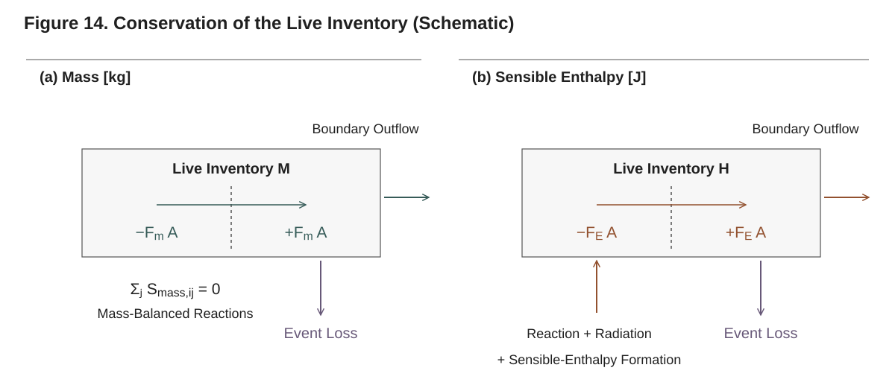

**Figure 14. Conservation of the live inventory (schematic).** Shown for mass-balanced reactions without external mass sources. Internal face fluxes and conservative receiver transfers cancel over live cells. Boundary outflow and recorded event losses leave that inventory. Reactions conserve total mass; energy sources include reaction heat, in-depth radiation and sensible-enthalpy formation $\sum_{i,j}h_j(T_i)S_{\mathrm{mass},ij}$. Event energy losses include enthalpy and caloric regularization. The audit compares inventory change with integrated transport, sources and event losses.

`conservation_audit` closes the mass and energy ledgers of the live region: the change in
its inventories against the time integral of what entered it and what the deactivation
events took out. It reads its integrals from a `ConservationRecorder` that observed the
solve, or, without one, from the series the solution saves.

```julia
recorder = ConservationRecorder()
solution = solve(problem; use_ale = true, deactivation = true,
                 radiation_model = SURFACE_ABSORPTION, callback = recorder)

audit = conservation_audit(solution, recorder)
audit.method            # :recorder
audit.mass.relative     # relative mass defect
audit.energy.relative   # relative energy defect

rough = conservation_audit(solution)   # no recorder: the trapezoid over the saved states
rough.method            # :trapezoid
```

The result is `(; method, mass, energy)`, with `mass` and `energy` each a NamedTuple:

| Field | Meaning (mass in kg, energy in J) |
|---|---|
| `initial`, `final` | The live inventories at the start and at the end |
| `change` | `final − initial` |
| `inflow` | Time integral of the rate entering the live region: the negated mass outflow; the enthalpy rate |
| `lost` | What the deactivation events took out: their lost masses; their lost enthalpy and caloric regularization |
| `defect` | `change − inflow + lost`, zero for an exact ledger |
| `relative` | `defect` over the largest of `\|change\|`, `\|inflow\|` and `\|lost\|` |

The enthalpy rate is the energy entering through the boundary faces of the live cells,
by conduction or the boundary condition and with the enthalpy their mass fluxes carry,
plus the live cells' reaction heats. The live energy is the enthalpy inventory in the
enthalpy form, and in the temperature form the cells' energy at their temperatures, which
equals their sensible enthalpy `Σⱼ mⱼ hⱼ(T)` away from empty cells and is what a
deactivation event conserves. On a moving mesh a merge loses nothing; on a fixed mesh the
vented gas and its enthalpy are the `lost` terms, so the ledger still closes.

**With a recorder** (`method = :recorder`), the integrals come from three-point
Gauss–Legendre quadrature on every accepted step's interpolant, up to the time where an
event ends a step early, and the inventories are recorded at the start and after every
step; the defect is then the integrator's error and falls with the tolerance. On the deck
of §9.1 at the default tolerances it closes mass to 4e-7 and energy to 5e-5 relative
(measured on that run). The recorder's own fields are `mass_outflow` [kg],
`energy_inflow` [J], `initial` and `final` (each `(energy, mass)`) and `steps` (the
accepted steps it saw). A step a callback of your own ends early is one it cannot account
for; its integrals, and with them the audit, become `NaN`.

**Without a recorder** (`method = :trapezoid`), the integrals are the trapezoid rule over
the saved series `extras.mass_outflow` and `extras.energy_rate`, from the first to the last
saved state, and the inventories are `extras.live_mass` and `extras.live_energy`. Its
error is the saving interval's: on a 12-cell ablating test column saved every 0.05 s,
the trapezoid's relative mass defect was 2e-2 against the recorder's 2e-6 on the same
solve. Use it for a quick look; pass a recorder whenever the closure matters.

The series behind the trapezoid are available for your own reductions:

```julia
ts   = solution.t
M    = solution.extras.live_mass      # kg
E    = solution.extras.live_energy    # J
mdot = solution.extras.mass_outflow   # kg/s
Edot = solution.extras.energy_rate    # W
```

The ledger equations, the energy convention they book (the gas enthalpy carried across
the faces by the mass fluxes, DSC-style reaction heats, no surface gas-enthalpy term in
the boundary balance) and the event records are derived in Technical Reference §16.

---

## 9.9 Post-processing for cone / TGA comparison

Putting the pieces together, here is a typical reduction of a cone-calorimeter run to the
curves you would overlay on experimental data. The setup (material, BCs, mesh) is shown
in full in the worked-examples chapter; here the focus is the *output* side.

```julia
using Pyrolysis, Plots

solution = solve(problem;
                 abstol = 1e-8, reltol = 1e-6,
                 use_ale = true, deactivation = true,
                 min_thickness = 0.01e-3)

@assert succeeded(solution)

times      = solution.t
T_surface  = solution.surface_T                 # K, exposed-face temperature
T_back     = solution.extras.back_temperature   # K, substrate-face temperature
mlr_gauge  = solution.extras.MLR_gauge          # kg/(m²·s), cone-gauge normalized
mass_m2    = solution.extras.total_mass         # kg/m², remaining mass per initial area

# Mass-loss fraction relative to the initial mass:
mass_frac  = mass_m2 ./ mass_m2[1]

# Surface and back temperature, then MLR, stacked:
p1 = plot(times, T_surface; label = "T_surface",
          xguide = "time [s]", yguide = "T [K]")
plot!(p1, times, T_back; label = "T_back")
p2 = plot(times, mlr_gauge; legend = false,
          xguide = "time [s]", yguide = "MLR [kg/(m²·s)]")
plot(p1, p2; layout = (2, 1), size = (700, 600))
```

For a **TGA-style** idealization (a thin, near-isothermal sample), the natural output is
the remaining mass fraction versus temperature. Because the package solves a spatially
resolved slab, take the column total mass and pair it with a representative temperature
(the surface, or a mean over the live cells):

```julia
mass_frac = solution.extras.total_mass ./ solution.extras.total_mass[1]
T_repr    = solution.surface_T     # or [sum(filter(isfinite, c)) / count(isfinite, c) for c in eachcol(solution.T)]
plot(T_repr, mass_frac; xguide = "T [K]", yguide = "m/m₀", legend = false,
     title = "Mass-loss curve")
```

For overlaying simulated and measured curves on a common time base, make the solver save
exactly where you want to compare: set `output_times` on the problem (or `saveat` on
`solve`) to the experiment's times, which avoids relying on the interpolant (and on
`solution(t)`'s refusal across an event's interval, §9.4):

```julia
problem = PyrolysisProblem(; mesh, material, bc_set,
                           tspan = (0.0, t_final),
                           output_times = exp_times)
solution = solve(problem)
# solution.extras.MLR_gauge is aligned 1:1 with exp_times (plus the end of a
# terminated solve, which is always saved).
```

---

## 9.10 Quick reference

```julia
# Core fields (always present; index i selects a saved time):
solution.t                      # times [s]
solution.T[:, i]                # cell temperatures at time i [K]   (bottom→top; NaN where dead)
solution.ξ[k, :, i]             # component k concentration profile [kg/m³]
solution.m[k, :, i]             # component k masses per cell [kg]
solution.z[:, i]                # node positions [m] (moving mesh; 0×0 on a fixed one)
solution.cell_centers[:, i]     # cell centres [m]
solution.surface_T[i]           # exposed-face surface temperature [K]
solution.boundary_T[:bottom][i] # back-face temperature [K]
solution.mass_loss_rate[i]      # MLR per current area (every boundary face) [kg/(m²·s)]
solution.events                 # deactivation events
solution.retcode                # :Success / :Terminated / :Failure / ...
solution.outcome                # :running / :burned_out / :interior / :min_thickness
solution.statistics             # accepted, rejected, jacobians, ..., invocations
solution.solve_time             # wall-clock [s]

# extras (always-present keys):
solution.extras.MLR_gauge                 # MLR per initial area (cone gauge)
solution.extras.back_temperature          # back-face T [K]
solution.extras.total_mass                # mass per A₀ [kg/m²]
solution.extras.thickness_history         # live thickness [m]
solution.extras.live_cells                # live cell count
solution.extras.deactivation_times        # one time per deactivated cell [s]
solution.extras.gas_generation_rate       # volumetric gas production [kg/(m²·s)]
solution.extras.surface_heat_flux_net     # net surface flux [W/m²]

# Accessors (exported by `using Pyrolysis`):
get_profile(solution, :T, i)              # field at one time index (:T, :ξ, :ξj, :m, :mj, :z)
get_cell_positions(solution; at = i)      # cell centres at time index i [m] (default: last)
solution(t)                               # fields at continuous t (== interpolate_solution(solution, t))
succeeded(solution), completed(solution)  # finished / reached tspan[2]
conservation_audit(solution, recorder)    # mass and energy closures

# Plotting recipes (need `using Plots`):
plot(solution)                  # :surface_T (default)
plot(solution; kind = :mlr)     # mass-loss rate
plot(solution; kind = :heatmap) # T(cell, t) by cell index
```

See the Technical Reference for the physics behind these outputs: energy assembly (§7),
the surface energy balance that produces `surface_T` (§12), mesh motion behind `z` and
`thickness_history` (§10, §11), deactivation and its events (§14), and the ledgers behind
the conservation audit (§16).

---

# 10. Burnout and the Correction

When a layer of solid gasifies completely, its cells empty. `solve` carries a
layer through burnout by **cell deactivation**: a cell whose condensed mass
falls below a small fraction of what it started with leaves the system, its
inventories go to the live cell beneath it, its rows become identity rows,
and the boundary conditions move to the face of the outermost live cell. On
a moving mesh (`use_ale = true`) the cells of a vanishing layer are kept
thinning together by the **equidistribution correction**, a mesh velocity
relative to the solid, so that the layer leaves in as few events as possible.
This chapter shows how to turn deactivation on, what every numerical
parameter means and defaults to, how to read what happened, and inside which
envelope the burnout path is verified. For the underlying theory (the
block-and-band rule, the conservative transfer, the masks, event location)
see Technical Reference §14; for the correction and the mesh motion,
Technical Reference §11.

> **Coordinate reminder.** `z = 0` is the back face (boundary tag
> `:bottom`); `z = L` is the exposed surface (tag `:top`). Heat enters from
> the top and the material recedes downward, so the surface cell is the
> outermost (highest-`z`) live cell and cells die from the exposed side. See
> Chapter 6 (Meshes and Geometry).

---

## 10.1 When to turn deactivation on

Deactivation is off by default. Turn it on when some cell can actually
empty, and size the mesh up front for everything else:

| Situation | Symptom without deactivation | What to do |
|---|---|---|
| A layer that gasifies completely (an ablating polymer, a layer on an inert substrate) | On a moving mesh the cells thin toward zero thickness, the domain test rejects many proposals, and the step count rises steeply | `deactivation = true` (§10.2) |
| A charring layer whose residue stays above the threshold | none: its cells keep their char and never reach the threshold | nothing; deactivation would remove no cell |
| The whole sample is consumed | the live thickness approaches zero | the thickness stop, `min_thickness` (§10.3), and the `:burned_out` outcome (§10.7) |
| A steep thermal or reaction front | the front is under-resolved | more cells or a mesh graded toward the surface (Chapter 6) |

What deactivation can remove follows from the reactions: a cell vanishes
when converting its components completely would leave less condensed mass
than the threshold of what it started with (§10.5.1). A wood whose
pyrolysis leaves 20 % char never reaches a 1 % threshold, whatever the
heating; it needs a char-oxidation reaction to gasify the residue before
deactivation has anything to do.

As a measure of the cost of leaving it off: the moving-mesh example of
§10.2.1, run without deactivation over the same 600 s, collapses its 30 PMMA
cells to zero thickness and takes 7,861 accepted steps with 1,603 domain
rejections, against 449 accepted steps when the layer is deactivated (both
with the default integrator and tolerances, measured on that deck).

---

## 10.2 Deactivation

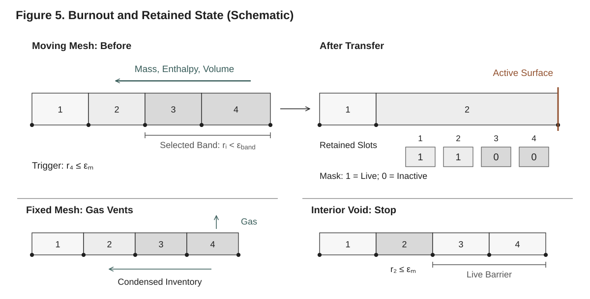

**Figure 5. Burnout and retained state (schematic).** Here $r_i$ is the remaining condensed-mass ratio. A threshold crossing selects a surface-connected band; on a moving mesh its inventories and volume transfer to the inward receiver. Dead nodes coincide at the merged face, while state slots and topology remain allocated. The insets show fixed-mesh gas venting and an interior void blocked by live material. A callback can re-test the receiver and emit multiple per-cell records; gas venting and a final cell without a receiver enter the loss ledger.

A deactivated cell keeps its slots: nothing changes size. The state vector,
the mesh arrays and the Jacobian's pattern keep their allocation for the
whole solve; a dead cell's rows are masked (identity rows of the Newton
matrix, their derivatives zero), and every kernel runs over the live cells,
with the boundary conditions applied at the face of the outermost live cell.

### 10.2.1 Turning it on through `solve`

Pass `deactivation = true`, on a moving or a fixed mesh. The complete script
below burns a 5.9 mm PMMA layer off 12 mm of Kaowool under 50 kW/m² absorbed
in depth, the configuration of the V-BO verification cases with constant
properties:

```julia
using Pyrolysis

pmma    = SolidComponent(:PMMA;    ρ = 1210.0, c = 1600.0, k = 0.2,   ε = 0.96, λ = 2e-5, α = 2.37)
kaowool = SolidComponent(:KAOWOOL; ρ = 256.0,  c = 1100.0, k = 0.058, ε = 1.0,  λ = 2e-5, α = 3.1e4)
mma     = GaseousComponent(:MMA;   M = 0.1, c = 1500.0, k = 0.02, λ = 2e-2)
material = Material(
    name = :PMMA_on_Kaowool,
    components = (pmma, kaowool, mma),
    reactions = (Reaction(:gasification, 1 => 3; A = 1.35e11, E = 164e3, h = 8.7e5),),
)

# 30 cells across the PMMA, the Kaowool at the same pitch; the PMMA–Kaowool
# interface falls on a node.
L_pmma, L_kw, n_pmma = 5.9e-3, 12e-3, 30
dz = L_pmma / n_pmma
n_kw = round(Int, L_kw / dz)
mesh = create_uniform_mesh((n_pmma + n_kw) * dz, n_pmma + n_kw)
z_if = n_kw * dz

bcs = BoundaryConditionSet(
    thermal = (
        top = RadiativeFluxBC(flux = 50e3, absorptivity = 0.96) +
              RadiativeBC(ε = 0.96, T_inf = 298.0) +
              ConvectiveBC(h = 8.2, T_inf = 298.0),
        bottom = RadiativeBC(ε = 1.0, T_inf = 298.0),
    ),
    mass = (top = DiffusiveMassBC(), bottom = ImpermeableBC()),
)
problem = PyrolysisProblem(
    mesh = mesh,
    material = material,
    bc_set = bcs,
    T_initial = z -> 300.0,
    ξ_initial = [z -> z > z_if ? 1210.0 : 0.0, z -> z > z_if ? 0.0 : 256.0, z -> 0.0],
    tspan = (0.0, 600.0),
    output_times = collect(0.0:1.0:600.0),
)

sol = solve(problem;
    use_ale         = true,          # the mesh moves with the solid
    deactivation    = true,          # cells below the threshold leave the system
    radiation_model = BEER_LAMBERT,
    min_thickness   = 1e-3,          # [m] stop if the live column ever thins this far
)

sol.retcode                          # :Success
sol.statistics.invocations           # 1: the PMMA layer left in one event
sol.extras.live_cells[end]           # 61: the Kaowool cells
sol.extras.thickness_history[end]    # ≈ 0.012 m: the bare substrate
```

On this deck the 30 PMMA cells leave together at t ≈ 315.6 s into the top
Kaowool cell, and the solve runs on to 600 s heating the bare substrate.

| Keyword | Default | Meaning |
|---|---|---|
| `deactivation` | `false` | Deactivate cells during the solve. |
| `threshold` | `1e-2` | `ε_m`: a live cell deactivates when its condensed (solid and liquid) mass falls below this fraction of its own initial condensed mass (§10.4). Also scales the mass rows' absolute tolerances. |
| `band` | `nothing` | `ε_band`, in `[threshold, 1)`: on a moving mesh, the cells next to the exposed side below this fraction of their initial condensed mass go with a cell that crosses the threshold (§10.4). `nothing` gives `max(threshold, 0.1)` when the equidistribution correction moves some layer, `threshold` otherwise. |
| `correction` | `nothing` | The mesh velocity relative to the solid on a moving mesh (§10.5). `nothing` installs the equidistribution correction by the rule of §10.5.1. |
| `lagrangian` | `nothing` | Node ids that always move with the solid, the layer interfaces. `nothing` gives, under an equidistribution correction, every interior node between cells that start with different condensed components. |
| `located_events` | `true` | Locate each event inside the step at the threshold crossing (§10.6). |
| `use_ale` | `false` | Move the mesh with the solid (node positions and velocities enter the state). |
| `min_thickness` | `1e-6` | [m] On a moving mesh, end the solve when the live thickness falls below this (§10.3). Must be positive. |

Choose the mesh mode by the material, not by cost. A fixed mesh keeps every
cell's volume, so a gasifying layer thins in *density*, and only the
outermost live cell can go (§10.8). The layer then burns top down when the
surface cell is the hottest, as under surface absorption. Under in-depth
absorption the surface cell of a regressing polymer is the coldest: it stays
in place as a low-density skin while the cells beneath it empty, and the
model carries no heat across the void they would leave. A fixed-mesh solve
therefore ends at the first cell below the surface that reaches the
threshold, warns, and returns outcome `:interior` (§10.7). The same deck as
above on a fixed mesh stops this way at t ≈ 236 s, before any deactivation.
A fixed mesh with deactivation suits a layer that burns top down; use
`use_ale = true` for materials that regress.

Deactivation is a line's: on a mesh of more than one dimension `setup`
refuses it (cells there leave by element death, a residual-level building
block, Technical Reference §14).

### 10.2.2 What `setup` and `solve` install

With `deactivation = true`, `setup` builds the deactivation state
(`cp.deactivation`, a `CellDeactivation` holding the threshold, the band,
each cell's initial condensed mass and the events) and, on a moving mesh,
decides the correction (§10.5.1). `solve` then adds to the integrator's
callbacks:

1. a **located deactivation event** (with `located_events = true`), a
   continuous callback on the smallest threshold margin of the live cells
   (§10.6);
2. an **end-of-step event**, which deactivates every cell below the threshold
   at the end of an accepted step: the only event without `located_events`,
   and with it the safety net for a crossing the location does not see;
3. on a moving mesh under the equidistribution correction, the **layer-time
   event**, which sets each layer's equidistribution time at its first
   activation (§10.5.3);
4. on a moving mesh, the **thickness stop** (§10.3).

After each deactivation the algebraic rows are swept to consistency (the face
intensities under `BEER_LAMBERT`, the node velocities on a moving mesh), the
result is tested for admissibility, and the integrator restarts with the
step its policy names (Chapter 11). None of these callbacks is a keyword of
its own; they are wired by `solve` and `integrate` from the keywords above.

### 10.2.3 The merge conserves mass and energy

Every component mass of the dead cells goes to the receiver, the live cell
beneath them, so the masses are conserved exactly; on a fixed mesh the
receiver takes the condensed masses only, and the dead cell's gas is vented
and recorded (§10.8).

The receiver's temperature follows from the **summed sensible enthalpy** of
everything it takes, not from a volume average: with `m_j` the merged masses,

```
Σ_j m_j h_j(T_merged)  =  H_receiver + Σ_dead H_dead,     h_j(T) = ∫_{T_ref}^{T} c_p,j(T′) dT′
```

solved by the caloric inversion, exact for any temperature-dependent
`c_p,j(T)`, and with every component included, gas and condensed alike,
the same heat capacity the energy rows store. The energy state (the
temperature, or the enthalpy inventory under `energy_state = :enthalpy`) is
set from it. The small regularization the caloric extension carries in a
cell far below its heat-capacity floor is not transferred; what the merged
cells held of it beyond the receiver's is written to the event.

On a moving mesh the receiver also absorbs the dead cells' volume: its far
face moves out to enclose the merged volume, and every node of the dead
cells collapses onto it. The merge never destroys pore space: the merged
volume is the larger of the summed volumes and the merged skeletal volume
plus the summed pore volumes, the difference written to the event as
created volume. The conversion-history pair of a variable-cross-section
material goes to the receiver with the masses.

A receiver keeps its own initial condensed mass as its reference, so a
merged cell deactivates only once its whole merged inventory is below `ε_m`
of what it started with. The Kaowool cell of §10.2.1, holding the PMMA
residue, never does.

### 10.2.4 Inspecting what happened

Dead cells read as `NaN` in `sol.T`, `sol.ξ` and `sol.cell_centers`, and the
nodes beyond the outermost live one read `NaN` in `sol.z` and
`sol.correction_velocity`; `sol.m` holds zeros there. A state saved at an
event's own time is the one after the event. The events and the series:

| Where | What |
|---|---|
| `sol.events` | One `DeactivationEvent` per dead cell, in order: `t`, `invocation` (shared by the cells one event deactivates, numbered from one), `cell`, `receiver` (zero when none was left), `fraction` (its condensed mass over its reference when it went), `rows`, `created_volume` [m³], `lost_mass` [kg, per component], `lost_enthalpy` [J], `regularization` [J]. A merge of several cells records the outermost first, with the merge's created volume and losses on that first event. |
| `sol.statistics.invocations` | The events that deactivated cells. |
| `sol.outcome` | How deactivation or the thickness stop ended the solve (§10.7). |
| `sol.extras.deactivation_times` | The time of every deactivation, one entry per dead cell [s]. |
| `sol.extras.live_cells` | The live cells at every saved time. |
| `sol.extras.thickness_history` | The distance from the first node to the outermost live node [m]. |
| `sol.extras.min_cell_thickness` | The thinnest live cell [m]. |
| `sol.correction_velocity` | The node corrections `c = w − v_s` [m/s], `n_nodes × n_times`, on a moving mesh. |

```julia
for k in unique(e.invocation for e in sol.events)
    es = filter(e -> e.invocation == k, sol.events)
    println("invocation $k at t = $(first(es).t) s: $(length(es)) cells into cell ",
            first(es).receiver, ", largest fraction ", maximum(e.fraction for e in es))
end
# invocation 1 at t = 315.6… s: 30 cells into cell 61, largest fraction 0.0339…
```

The largest fraction says how much of its mass the slowest cell of the layer
still held when the first crossed the threshold; the band must exceed it
(§10.4). That residue goes to the receiver, which gasifies it at once, so
the mass-loss rate shows a short burst just after the event, whose
convergence under refinement is part of the envelope (§10.9).

`sol(t)` and `interpolate_solution(sol, t)` reconstruct the fields at `t`
with the mask of the last event at or before `t`, and refuse a `t` strictly
inside a saving interval that an event separates, since the integrator's
interpolant there is not the trajectory; read the saved states on either
side instead (Chapter 9).

The mass and energy ledgers count what the events took out:
`conservation_audit(sol)` closes the live inventories against the boundary
fluxes and the events' lost masses, lost enthalpy and regularization, by the
trapezoid over the saved series; with a `ConservationRecorder` passed as
`callback`, `conservation_audit(sol, rec)` integrates the fluxes over every
accepted step up to the located event's time (Chapter 9, Technical
Reference §16):

```julia
rec = ConservationRecorder()
sol = solve(problem; use_ale = true, deactivation = true,
            radiation_model = BEER_LAMBERT, min_thickness = 1e-3, callback = rec)
audit = conservation_audit(sol, rec)
audit.mass.relative, audit.energy.relative
```

### 10.2.5 Deactivation and the Jacobian

Deactivation keeps the state size and the Jacobian's pattern: a dead row
keeps its entries in the pattern, and its derivative is zero (a differential
row) or its own unknown (an algebraic row), so it is an identity row of the
Newton matrix. The colored Jacobian and the linear solver run unchanged
through burnout, and the structure the `StructuredKLU` factorization has
seen only grows (Chapter 11). There is nothing to configure.

A deactivation is a discrete rewrite of the state, but its time is a smooth
function of the parameters: a located event happens at the first root of the
threshold margin. Finite-difference sensitivities through a burnout are
therefore well defined, with a step and tolerance chosen by the convergence
check of §13.4.1.

---

## 10.3 The thickness stop

On a moving mesh `solve` ends the solve cleanly once the live thickness, the
distance from the first node to the outermost live node, falls below
`min_thickness` (default `1e-6` m), with return code `:Terminated` and
outcome `:min_thickness`:

```julia
sol = solve(problem; use_ale = true, deactivation = true,
            radiation_model = BEER_LAMBERT, min_thickness = 15e-3)  # stop at 15 mm
sol.retcode, sol.outcome     # (:Terminated, :min_thickness)
succeeded(sol)               # true: a stop the caller asked for
```

The stop is a located event, so the solve ends at the crossing and the state
there is saved. On a fixed mesh the thickness does not change and there is no
stop. A layer on a substrate, as in §10.2.1, never thins below the substrate's
thickness (12 mm there), so the default `min_thickness` never fires; the
solve ends on the bare substrate instead.

---

## 10.4 The threshold and the near-threshold band

**The threshold** `ε_m` (`threshold`, default `1e-2`) is a fraction of each
cell's own initial condensed mass: a live cell is below it when its solid and
liquid masses sum to less than `ε_m` times what they summed to at the start.
A cell that started with no condensed mass never deactivates. The threshold
also sets the mass rows' absolute tolerances (`reltol · ε_m` times the cell's
initial condensed mass) and, on a moving mesh, the position and velocity
tolerances, so a smaller threshold also tightens the integration (Chapter 8).

**The band** `ε_band` (`band`) is read on a moving mesh only. When a live
cell crosses the threshold, the contiguous run of live cells from the
outermost one inward whose condensed mass is below `ε_band` of their
reference goes with it, in one merge into the live cell beneath the run:

- the run must hold a cell below `ε_m`; a run that does not, or an outermost
  cell above the band, leaves the cells where they are;
- a run that reaches the innermost cell leaves that cell, holding the run's
  inventories, as the survivor;
- after a merge the receiver, holding the run's inventories against its own
  reference, is tested in turn, and a run below the band with a cell below
  `ε_m` that starts there merges on in the same invocation;
- the last live cell, once below `ε_m`, goes with no receiver, its
  inventories written to the event as lost, and the solve ends with outcome
  `:burned_out` (§10.7).

The band exists because the cells of a vanishing layer never reach the
threshold at exactly the same time. Under the equidistribution correction
they thin together, but when the first crosses `ε_m` the slowest still holds
a few percent of its mass (3.4 % on the deck of §10.2.1). Without a band the
layer would leave one cell at a time, each event a restart; worse, a cell
beneath the surface can cross first, and a cell below the threshold inward of
a live one ends the solve with outcome `:interior`. The band must therefore
exceed what the slowest cell of a layer keeps when the first reaches the
threshold: on the verification decks 0.4 to 3.9 % at `ε_m = 3e-3` and 1.4 to
9.9 % at `ε_m = 1e-2` (§10.9). The default, `0.1`, covers them; the deck of
§10.2.1 run with `band = 1e-2` (the threshold, so no band) ends with outcome
`:interior` after its first event.

| Keyword | Default | Constraint |
|---|---|---|
| `threshold` | `1e-2` | the mass fraction `ε_m` |
| `band` | `max(threshold, 0.1)` with a moving correction, `threshold` otherwise | `threshold ≤ band < 1`, refused otherwise |

On a fixed mesh the band is not read: the outermost live cell goes while it
is below `ε_m` (§10.8).

---

## 10.5 The equidistribution correction

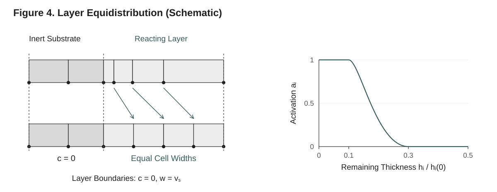

**Figure 4. Equidistribution within a vanishing layer.** The left schematic isolates redistribution toward equal cell widths. Correction is zero in the inert substrate and at layer boundaries; those boundaries can still move with the solid. The curve evaluates the implemented thickness-activation switch. Its input is remaining **thickness**, distinct from the **condensed-mass** criterion for burnout in Figure 5.

On a moving mesh the nodes move with the solid velocity plus a correction,
`w = v_s + c`. With `c = 0` (`NoCorrection()`) the mesh is Lagrangian: each
cell keeps its solid, and the cells of a layer thin at their own rates, the
hottest first. The **equidistribution correction** moves the interior nodes
of a vanishing layer relative to the solid, toward the thicker (or heavier)
cell, so that the layer's cells thin together and reach the threshold close
together; the inventories then cross the faces at the relative velocity
`−c`, by an upwind flux with a limited reconstruction (Technical
Reference §11). The balance rows hold the solid velocity `w − c` to each
cell's volume balance, so the solid's motion is unchanged; only the mesh
slides through it.

At an interior node `n` of a layer of `n_layer` cells, between cell `n − 1`
(inward) and cell `n`,

```
c_n = ā_n n_layer² (𝓜̃_n Δz_n − 𝓜̃_{n−1} Δz_{n−1}) / τ_eq
```

which relaxes `𝓜̃ Δz` toward a common value over the layer in about
`τ_eq/π²`, whatever `n_layer`. `Δz_i` is the thickness of cell `i`, `𝓜̃_i` its
normalized monitor (one by default, §10.5.4), `ā_n` the node's activation
(§10.5.2) and `τ_eq` the layer's equidistribution time (§10.5.3).

### 10.5.1 The installation rule

A solve that names no `correction` gets `EquidistributionCorrection()` when
three things hold: the mesh moves (`use_ale = true`), cells are deactivated
(`deactivation = true`), and deactivation can remove some cell, that is, some
cell's components, converted completely, would leave less condensed mass
than `threshold` of what it holds. Otherwise it gets `NoCorrection()`.

What a component leaves is its **residue**: the condensed yields of a
reaction that consumes it, each weighted by that product's own residue, the
largest over the reactions that consume it (competing reactions: the least
gasifying one bounds what is left). It is zero for a component every
consuming reaction gasifies and one for an inert component. The function is
reachable through `Internal`:

```julia
using Pyrolysis.Internal: residues
residues(material)       # (0.0, 1.0, 0.0): PMMA gasifies, Kaowool is inert, MMA is a gas
```

Under the installed correction only the layers deactivation can remove move
(`layers = :vanishing`); a layer that cannot vanish, the Kaowool here, keeps
its mesh with the solid, its correction exactly zero. A layer is bounded by
the back node, the Lagrangian nodes and the end nodes; by default the
Lagrangian nodes are the layer interfaces, every interior node between cells
that start with different condensed components (node 62 of the deck of
§10.2.1, at `z_if`). A `lagrangian` list given explicitly must contain every
such interface, or `setup` refuses it: the correction would otherwise move
the mesh across a change of composition and mix the layers.

### 10.5.2 The activation thresholds

The correction acts only where a layer has begun to vanish. Each cell has a
switch

```
a_i = 𝒮((ln r_hi − ln(Δz_i/Δz_i(0))) / (ln r_hi − ln r_lo)),     𝒮(x) = x²(3 − 2x), clamped to [0, 1]
```

zero while the cell keeps at least `r_hi` of its initial thickness, one at
and below `r_lo`, continuously differentiable in `ln Δz` between. Node `n`'s
activation is the smooth "or" of the switches of its two cells,
`ā_n = 1 − (1 − a_{n−1})(1 − a_n)`.
The default `activation = (r_hi, r_lo) = (0.3, 0.1)`: a node starts to move
once one of its cells has lost 70 % of its thickness. The correction is also
zero at every bounding node of a layer and beside a dead cell.

### 10.5.3 The layer time

The equidistribution time `τ_eq` of a layer is set once, when its first cell
activates (falls below `r_hi` of its initial thickness), from the layer's
thickness `L_layer` and its thinning rate `L̇_layer` at that moment
(`ActivationTime()`):

```
τ_eq = λ_τ L_layer / |L̇_layer|,     λ_τ = 1.8 (the keyword λ)
```

so the layer synchronizes (in about `τ_eq/π²`) within about a fifth of its
estimated life `L_layer/|L̇_layer|`.
The rate scales with the physical rates and `λ_τ` is a pure number, so a deck
whose rates are all multiplied by `s` gets `τ_eq/s`, and the correction scales
with it; one fixed `τ` for every deck does not. Before its activation a
layer's correction is zero anyway, and its time reads the fallback, 720 s. A
layer thinning more slowly than its initial thickness over the solve's
horizon keeps the fallback until a cell crosses `r_lo`, where the estimate is
taken once more; a layer that thickens keeps the fallback. Each layer is
estimated once; a cell that re-activates later changes nothing.

The activation is a located event of its own, so `τ_eq` is taken at the
crossing, not at the end of a step. After the solve, the bound correction
holds every layer's time and the time it was set at:

```julia
c = sol.definition.closure.correction    # the correction bound to the mesh
c.time, c.set_at                         # ([617.88…], [97.07…]) on the deck of §10.2.1
```

| `ActivationTime` keyword | Default | Meaning |
|---|---|---|
| `λ` | `1.8` (`ACTIVATION_TIME_FACTOR`) | `λ_τ` in `τ_eq = λ_τ L_layer/\|L̇_layer\|` at the first activation |
| `fallback` | `720.0` s (`EQUIDISTRIBUTION_TIME`) | the time before the estimate, and of a layer that thins too slowly or thickens |
| `floor` | `1.0` | the slowest thinning that gives an estimate, in initial thicknesses over the horizon |

### 10.5.4 The monitor and the layers

`EquidistributionCorrection(; monitor = (α_M, β_M))` sets the monitor
`𝓜 = α_M + β_M ρ_c/ρ_ref`, with `ρ_c` a cell's condensed mass per volume and `ρ_ref`
the largest initial one over the mesh, divided by its mean over the layer's
cells at the start; the default `(1.0, 0.0)` equidistributes thickness alone.
A positive `β_M` weights the heavier cells, for a layer whose density varies
across it. `layers = :all` moves every layer, including those that cannot
vanish, for decks that exercise the correction itself.

### 10.5.5 Choosing a correction yourself

Pass `correction` to override the rule:

```julia
# The installed correction, written out:
sol = solve(problem; use_ale = true, deactivation = true, radiation_model = BEER_LAMBERT,
            correction = EquidistributionCorrection(
                τ = ActivationTime(λ = 1.8),   # or a number [s]: one time for every layer
                activation = (0.3, 0.1),       # (r_hi, r_lo)
                monitor = (1.0, 0.0),          # (α_M, β_M)
                layers = :vanishing))

# The Lagrangian mesh: each cell keeps its solid.
sol = solve(problem; use_ale = true, deactivation = true, radiation_model = BEER_LAMBERT,
            correction = NoCorrection())
```

`EquidistributionCorrection` refuses a non-positive `τ`, an activation
without `0 < r_lo < r_hi`, and a monitor without `α_M > 0` and `β_M ≥ 0`; any
correction other than `NoCorrection()` needs `use_ale = true`. Under
`NoCorrection()` the band defaults to the threshold, so only the cells
already below the threshold go in an event. Under in-depth absorption, where a cell beneath the surface is the
hottest, the Lagrangian mesh empties that cell first: the deck of §10.2.1
with `correction = NoCorrection()` ends with outcome `:interior` at
t ≈ 236 s. The correction is what carries such a layer through burnout.

`w_override = (x, t) -> w` prescribes every node's velocity instead, moving
the mesh over a solid at rest; it is a verification device (the material
must not react) and cannot be combined with deactivation.

---

## 10.6 Located events

With `located_events = true` (the default) a deactivation event is located
inside the step: a continuous callback watches the smallest margin of a live
cell's condensed mass over its threshold, `(m − ε_m m_ref)/(ε_m m_ref)`, and
the event is applied at the interpolated state at its first downward root.
There the crossing cell holds exactly its threshold, so the tests of §10.4
are widened by the relative tolerance (`1 + reltol` times `ε_m` and
`ε_band`): the crossing cell goes, and with it the cells of its run within
the tolerance of their thresholds, whose crossings the solve does not
resolve from the located one. A cell within `reltol` of its threshold inward
of a cell above the band stays.

Location makes the event time converge with the tolerance and puts the
event on the trajectory, which is what makes a deactivation time a smooth
function of the parameters (§10.2.5). The end-of-step event remains as a
safety net: it catches a cell that dips below the threshold and recovers
inside one step, which the downward-root search does not see.

`located_events = false` keeps only the end-of-step event: the cells below
the threshold at the end of an accepted step go there. The event then lags
the crossing by up to a step (on the deck of §10.2.1, 315.94 s against
315.64 s located).

After every event the integrator restarts with the step its policy names:
the default Rodas5P policy proposes its initial-step estimate at the state
the event left, the FBDF policy a forced step of 1e-6 s, the KenCarp4 policy
its own proposal (Chapter 11).

---

## 10.7 Outcomes and the interior void

`sol.outcome` says how deactivation or the thickness stop ended the solve;
`sol.retcode` is the integrator's return code. `succeeded(sol)` accepts a
complete run and the two terminations the model intends; `completed(sol)` is
the strict test, `:Success` only.

| `retcode` | `outcome` | `succeeded` | Meaning |
|---|---|---|---|
| `:Success` | `:running` | `true` | The solve reached the end of `tspan`, with or without deactivations. |
| `:Terminated` | `:burned_out` | `true` | The last live cell went; its inventories are written to the last event as lost. |
| `:Terminated` | `:min_thickness` | `true` | The live thickness of a moving mesh fell below `min_thickness` (§10.3). |
| `:Terminated` | `:interior` | `false` | A cell below the threshold lies inward of a live cell that deactivation leaves; the solve warns and ends. |
| `:Failure` | `:running` | `false` | The state after an event was inadmissible (a receiver outside its own mass tolerances, crossed nodes, a cell at or below absolute zero, under Darcy–Fick transport a porosity outside `[0, 1]`), or no consistent node velocities exist after it; the solve warns naming the event's time. |

The state a solve ends on is always saved, whether or not `saveat` names its
time.

**The interior void.** Cells die from the exposed side only, so the live
cells are always `1:top_live_cell`. A cell that reaches the threshold
beneath a live cell, with no run of the band connecting it to the surface,
cannot be removed: it would leave a void that the model has no way to carry
heat across. The solve warns once,

```
┌ Warning: solve(): cell 85 is below its threshold inward of a live cell at t = 236.1…; the solve ends with outcome :interior
```

and ends with `:Terminated`. On a fixed mesh this is the regressing polymer
under in-depth absorption (§10.2.1; the V-BO-05 case asserts the stop). On a
moving mesh it means the band is too narrow for the layer (§10.4), or the
correction is off where a cell beneath the surface heats fastest (§10.5.5).
The remedy is the moving mesh with the installed correction and the default
band, or a wider band.

---

## 10.8 Fixed-mesh deactivation: the gas is vented

On a fixed mesh (`use_ale = false`) no node moves, so there is no correction
and no band. The outermost live cell goes while it is below `ε_m`, into the
cell beneath it, each merge re-testing the receiver with the dead cell's
condensed inventories added; several cells can go in one invocation that
way.

The receiver keeps its volume and takes the dead cell's **condensed**
inventories only. Its pores could hold the dead cell's gas only at a higher
pressure, so that gas is vented: its masses and sensible enthalpy are written
to the event as `lost_mass` and `lost_enthalpy`, and the conservation audit
counts them as having left the live region. The receiver's temperature
follows from the summed sensible enthalpy of what it takes (§10.2.3).

```julia
sol = solve(problem; deactivation = true, radiation_model = SURFACE_ABSORPTION)
sol.statistics.invocations                       # one cell per event here: the layer burns top down
vented = sum(sum(e.lost_mass) for e in sol.events)
```

Under surface absorption the surface cell is the hottest and empties first,
so the layer of §10.2.1 burns top down, one cell per event, with no interior
void (the V-BO-02 case). Under in-depth absorption it does not (§10.7).

---

## 10.9 The supported envelope

The burnout path (the equidistribution correction with its layer time set at
activation, the near-threshold band, located deactivation events) is
verified under joint refinement of the mesh and the tolerance on five decks:
a 5.9 mm PMMA layer on Kaowool under 50 kW/m² on a uniform mesh (V-BO-01) and
on a mesh graded threefold toward the surface (V-BO-06); the same layer with
a second, slower solid mixed in, graded from none at the substrate to half at
the surface (V-BO-07); a 1 mm layer (V-BO-08); and the 5.9 mm layer with a
convective loss in place of re-radiation and an adiabatic back. The V-BO
cases are listed in Technical Reference §18.

### 10.9.1 The numerical parameters

| Parameter | Keyword | Default | Verified |
|---|---|---|---|
| threshold `ε_m` | `threshold` | `1e-2` | `3e-3`, `1e-2` |
| band `ε_band` | `band` | `0.1` under the correction | `0.1` (narrower bands fail, below) |
| activation `(r_hi, r_lo)` | `EquidistributionCorrection(activation = …)` | `(0.3, 0.1)` | `(0.3, 0.1)`, `(0.7, 0.3)` |
| layer time `τ` | `EquidistributionCorrection(τ = …)` | `ActivationTime()`, `λ = 1.8` | the default |
| event location | `located_events` | `true` | the default |
| tolerance | `reltol` (`abstol` the case's) | `1e-6` | `1e-6`, `1e-7` |
| energy form | `energy_state` | `:temperature` | both |
| cells across the layer | the mesh | — | 30 to 240 (10 to 80 on the 1 mm layer) |

### 10.9.2 Inside the envelope

Inside the envelope every quantity of interest (complete burnout, the mass
lost, the peak mass-loss rate and its time, the burnout time, the mass
ledger) is within its case's tolerance at every resolution, and the
end-of-layer burst converges: the largest per-step excess of N cells over 2N
and the successive L1 differences fall at least 1.5× per doubling. On
V-BO-01 the tolerances are 0.01 mm on the final thickness, 0.3 percentage
points on the mass loss, 3 % on the peak and its time, 1 % on the burnout
time and 3e-5 on the mass ledger's relative closure.

- `ε_m = 3e-3` with `ε_band = 0.1` is inside on all five decks from 30
  cells across the layer (10 on the 1 mm layer).
- `ε_m = 1e-2` with `ε_band = 0.1`, the default, is inside on the
  single-solid layers from 30 cells, from 60 on the convective-loss deck, and
  not on the mixed layer, whose burst stops converging between 120 and 240
  cells.

Both hold at reltol 1e-6 and 1e-7, in either energy form, and under either
activation, `(0.3, 0.1)` or `(0.7, 0.3)`. For a layer of mixed composition,
or wherever the end-of-layer burst matters, solve with `threshold = 3e-3`.

The band must exceed what the slowest cell of a layer keeps when the first
reaches the threshold (on these decks 0.4 to 3.9 % at `ε_m = 3e-3` and 1.4
to 9.9 % at `1e-2`): a narrower band, or none, ends the solve with outcome
`:interior`.

The number of deactivation invocations is reported, not a criterion: it is
one on every deck inside the envelope except the convective-loss deck at
`ε_m = 1e-2`, which takes two from 60 cells. At 30 cells the largest
per-step rate just after a layer's deactivation can exceed the main peak, up
to threefold on the graded mesh; it falls below the main peak by 60 to 120
cells, and the peak sampled at the output times is within tolerance from 30
cells.

### 10.9.3 The material parameters

Material parameters outside these decks (other materials, thicker or
charring layers, higher heating) are outside the verified envelope. A
refinement ladder adds V-BO-01 at 25 and 100 kW/m², at half and twice its
pre-exponential factor, and with its flux stepped after activation, at 30 to
120 cells, all within tolerance at every resolution, the hot decks with two
invocations. Outside these, run the same check on your own deck: solve at
two or three resolutions and two tolerances, and read the burnout quantities
you care about, `sol.statistics.invocations` and the events' largest
fraction against the band.

---

## 10.10 Summary of options and defaults

| Option | Where | Default | Section |
|---|---|---|---|
| `deactivation` | `solve`, `setup` | `false` | 10.2 |
| `threshold` | `solve`, `setup` | `1e-2` | 10.4 |
| `band` | `solve`, `setup` | `max(threshold, 0.1)` with a moving correction, else `threshold` | 10.4 |
| `use_ale` | `solve`, `setup` | `false` | 10.2.1 |
| `correction` | `solve`, `setup` | installed by rule | 10.5.1 |
| `lagrangian` | `solve`, `setup` | the layer interfaces | 10.5.1 |
| `located_events` | `solve`, `integrate` | `true` | 10.6 |
| `min_thickness` | `solve`, `integrate` | `1e-6` m | 10.3 |
| `EquidistributionCorrection(; τ, activation, monitor, layers)` | exported | `ActivationTime()`, `(0.3, 0.1)`, `(1.0, 0.0)`, `:vanishing` | 10.5 |
| `ActivationTime(; λ, fallback, floor)` | exported | `1.8`, `720.0` s, `1.0` | 10.5.3 |
| `NoCorrection()` | exported | — | 10.5.5 |

**Key correctness reminders.** Deactivation conserves every component mass
exactly (on a fixed mesh the dead cell's gas is vented and recorded) and the
sensible enthalpy of everything the receiver takes; the state size and the
Jacobian's pattern never change; cells die from the exposed side only, and a
cell below the threshold beneath a live one ends the solve with outcome
`:interior`; the band must exceed the residue of a layer's slowest cell; and
the verified envelope is that of §10.9. For the theory behind these
operations, see Technical Reference §11 (the mesh motion and the correction),
§14 (deactivation), §15 (the integrator and the Jacobian) and §16 (the
conservation ledgers).

---

# 11. Solver and Jacobian Configuration; Extensions

This chapter is the reference for *how* Pyrolysis.jl solves a problem, as
opposed to *what* problem it solves (Chapters 3–7) or *how to read the
result* (Chapter 9). It covers the Jacobian (colored sparse forward-mode
automatic differentiation, with nothing to configure), the integrator
policies and their restart and flag rules, the linear solve of the
integrator's Newton matrix (`StructuredKLU`), the plotting extension,
checking the Jacobian against its dense reference, driving the integration
yourself through `setup` and `integrate`, and what `Pyrolysis.Internal`
exposes (the residual, the Jacobian cache, the state layout). The
mathematics behind the system the integrator solves, its Jacobian and the
Newton matrix is derived in Technical Reference §15; this chapter is about
the knobs.

Three pieces of the solve are separate, and keeping them apart is the key to
this chapter:

1. **The Jacobian** `J = ∂f/∂u` of the residual. `setup` builds it once per
   problem from the mesh connectivity; there is one Jacobian, no keyword and
   no strategy to choose.
2. **The integrator policy** (`integrator_policy = ...`): the time-stepping
   method together with its rule for the step after an event and its rule
   for the derivative-discontinuity flag after a read-only observer.
3. **The linear solver** (`linear_solver = ...`): how the integrator's
   Newton matrix `W = J − M/(γΔt)` is factored, `StructuredKLU()` by default.

The defaults work for every configuration the package supports, and you can
ignore this chapter until a solve is too slow, fails, or needs to be driven
from your own loop.

---

## 11.1 What the defaults do

`solve(problem)` hands the integrator a mass-matrix system

```
M du/dt = f(u, t)
```

with `M` diagonal: one on the differential rows (the component masses, the
energy state, the node positions, the conversion-history pair), zero on the
algebraic rows (the node velocities of a moving mesh, the face intensities
under `BEER_LAMBERT`, the cross-section area and its lateral rate). On a
fixed mesh without in-depth radiation every row is differential and `M = I`.
With it go (see `src/Integration/solve.jl`):

- the **colored Jacobian** and its sparsity prototype (§11.2);
- the **policy** `default_policy(StructuredKLU())`, which is
  `rodas5p_policy(StructuredKLU())`: `Rodas5P`, a Rosenbrock method that
  evaluates the exact Jacobian at every step, with the heuristic restart
  after an event (§11.3);
- per-row **absolute tolerances**, `abstol = 1e-8` [K] on the temperature
  rows and tolerances derived from each cell's initial condensed mass and
  the deactivation `threshold` on the others, with `reltol = 1e-6` (§11.5);
- the **domain test** `DomainCheck`, which rejects a proposal the error test
  accepts when it is inadmissible or its algebraic rows' constraint residuals
  are above their tolerance (§11.5);
- no initialization of the integrator's own: `setup` makes the algebraic
  rows of the initial state consistent.

```julia
using Pyrolysis

sol = solve(problem)                                            # the defaults
sol = solve(problem; integrator_policy = default_policy(StructuredKLU()))  # the same, written out
```

> Defaults at a glance: `integrator_policy = nothing` →
> `rodas5p_policy(linear_solver)`, `linear_solver = nothing` →
> `StructuredKLU()`, `abstol = 1e-8`, `reltol = 1e-6`, `dtmin = 1e-12`,
> `dtmax = Inf`, `maxiters = 1_000_000`. The Jacobian is always the colored
> one.

The integrator never sees the problem's own types: the residual and the
Jacobian reach it behind problem-independent function wrappers (`ErasedRHS`,
`ErasedJacobian`), and so do the callbacks. The integrator therefore compiles
once per solver configuration (fixed or moving mesh, a mass matrix or not,
deactivation or not), and a second problem of the same configuration reuses
it; the package's precompile workloads cover the common configurations
(Chapter 15).

---

## 11.2 The Jacobian: colored sparse forward-mode differentiation

The Jacobian is computed by forward-mode automatic differentiation of the
residual itself, on a sparsity pattern built from the mesh connectivity, with
the columns grouped by a coloring so that one dual-number evaluation of the
residual yields many columns at once. It is exact to round-off (the test
suite holds it to the dense reference at a relative `1e-12`, §11.7), it
covers every coupling the residual has, including the moving-mesh and
in-depth-radiation couplings, and nothing about it is configurable: `solve`
has no Jacobian keyword, and an unknown keyword raises an `ArgumentError`.

### 11.2.1 The pattern

`setup` builds the pattern once from the connectivity alone
(`jacobian_pattern(cp.def)`): a cell's rows reach the masses, energy and
history of the cells within one face of it (two where a kernel reads a
neighbour's neighbour: the relative fluxes of the equidistribution
correction, whose face states are reconstructed from two cells upwind) and,
on a moving mesh, the positions of their nodes; a node's velocity row reaches
its cell's other node, the cell's masses and energy (through the strain
rate) and, under the correction, what the corrections of the cell's nodes
read; a face-intensity row reaches the neighbouring intensities and the
cells on either side of its face. Every row holds its diagonal. The pattern
is fixed for the solve: deactivation masks rows without changing it
(Chapter 10).

### 11.2.2 The coloring and the evaluation

The columns are colored greedily, keeping the best of four vertex orders,
and the colors are evaluated in batches of at most 24 per dual-number
residual (`MAX_CHUNK`), so a Jacobian costs a few residual evaluations
whatever the mesh size. The preparation runs once, in `setup`; each
evaluation then reuses it at any state and time. For scale: the
PMMA-on-Kaowool deck of Chapter 10 at 15 PMMA cells (46 cells, 3
components) takes 12 colors on a fixed mesh (184 unknowns), and 28 on a
moving mesh with in-depth radiation and the correction (325 unknowns).

Because the derivatives of the material properties enter through dual
numbers, every property function is evaluated at dual-number arguments: a
property given as a function (`CallableProperty`, `StateDependentProperty`)
must be written generically, without restricting its argument to `Float64`
(Chapter 3, Technical Reference §4).

Under a variable cross section the area and lateral-rate rows depend on every
cell; they are colored by their diagonal alone, and their entries are
assembled after the colored pass from column sums of the history rows, which
the colored pass gets exactly.

### 11.2.3 How the integrator uses it

`Rodas5P` evaluates the Jacobian at every step; `FBDF` and `KenCarp4` reuse
it across steps as their Newton iterations allow. Where a method needs the
time derivative of the right-hand side, it is a finite difference
(`AutoFiniteDiff()` in every policy); the Jacobian itself is never a finite
difference. The integrator's Jacobian must be allocated from the prototype
(`jac_prototype`), which the integrator does from what `solve` hands it.

---

## 11.3 Integrator policies

A policy, an `IntegratorPolicy`, is a method together with the two rules that
are part of its contract with the package's callbacks:

| Constructor | Method | Restart after an event | Observer flag |
|---|---|---|---|
| `rodas5p_policy(ls; restart = :heuristic)` (the default) | `Rodas5P`, Rosenbrock, the exact Jacobian every step | `:heuristic` (or `:forced_dt`, `:solver_chosen`) | `:clear` |
| `fbdf_policy(ls)` | `FBDF`, variable-order backward differentiation | `:forced_dt` | `:clear` |
| `kencarp4_policy(ls)` | `KenCarp4`, singly diagonally implicit Runge–Kutta, raw error estimate | `:solver_chosen` | `:keep` |

`ls` is the linear solver (§11.4). All three run with the colored Jacobian and
`AutoFiniteDiff()` for the time derivative; the test suite runs each on a
moving mesh in both energy forms and through deactivation events.

```julia
sol = solve(problem; integrator_policy = fbdf_policy(StructuredKLU()))
sol = solve(problem; integrator_policy = kencarp4_policy(StructuredKLU()))
sol = solve(problem; integrator_policy = rodas5p_policy(StructuredKLU(); restart = :forced_dt))
```

### 11.3.1 The restart rule

An event that modifies the state (a deactivation, Chapter 10) leaves the
integrator at a state its last step size knows nothing about. The policy
names the step it proposes there:

- `:heuristic` proposes the integrator's own initial-step estimate at the
  state the event left (two right-hand-side evaluations). It rejects fewer
  steps after an event than keeping the step, and keeps the mass ledger
  closer than either other rule; it is the default policy's.
- `:forced_dt` proposes `DT_AFTER_EVENT` (1e-6 s), the FBDF policy's, since
  FBDF restarts at order one after an event.
- `:solver_chosen` keeps the integrator's own proposal, the KenCarp4
  policy's.

### 11.3.2 The observer-flag rule

The callback machinery raises the integrator's derivative-discontinuity flag
before every callback. A per-step observer (the progress bar, the
conservation recorder, a `DiscreteCallback` of yours passed as `callback`)
changes nothing, so the policy decides what the flag means after it:

- `:clear` clears it, so a read-only observer is numerically inert. FBDF
  with the flag raised would restart at order one on every step; Rodas5P
  rebuilds its Jacobian every step, so the flag changes nothing for it and
  the policy clears it.
- `:keep` leaves it raised: the integrator re-evaluates the derivative at the
  accepted state, which is the KenCarp4 policy's contract.

`solve` applies the rule inside each discrete callback you pass, after its
`affect!`, so a read-only callback leaves the trajectory unchanged under
every policy (a test asserts identical step sequences with and without one).
A callback must therefore not modify `integrator.u`: observers are read-only
(Chapter 8). A continuous callback's event raises the flag as any event does.

### 11.3.3 The Newton-failure step cap

For the Newton-based policies (FBDF, KenCarp4), after an accepted step whose
nonlinear solves needed retries, the proposed step stays at or below
`FAILURE_MEMORY_GROWTH` (1.25) times that step for the next
`FAILURE_MEMORY_STEPS` (20) accepted steps. A Rosenbrock method has no
nonlinear iteration, so the cap never engages under the default policy.

### 11.3.4 Choosing a policy

Leave the default unless you have a reason. `fbdf_policy` and
`kencarp4_policy` are there for comparison and for problems where a
multistep or an SDIRK method is preferred; on the 46-cell fixed-mesh deck of
§11.2.2 under surface absorption over 300 s, at the default tolerances, the
three policies agree on the final temperatures within 1e-3 K (measured for
this chapter). An `IntegratorPolicy` of your
own is built as `Pyrolysis.Integration.IntegratorPolicy(alg, restart,
observer_flag, restart_dt)`, with any OrdinaryDiffEq method that accepts a
mass matrix and a user Jacobian; only the three constructors above are
tested.

---

## 11.4 The linear solver

The integrator solves its Newton (Rosenbrock stage) systems with
`W = J − M/(γΔt)`; the `linear_solver` keyword names the factorization.

### 11.4.1 `StructuredKLU`, the default

`StructuredKLU(inner = KLUFactorization())` is KLU on the entries of `W` that
have been nonzero at some step of the solve. The Jacobian's prototype holds
every entry the connectivity allows, most of which are zero at any one step,
and KLU factors a stored zero like any other entry. With a mass matrix that
is not a multiple of the identity, OrdinaryDiffEq forms `W` by a sparse
broadcast that stores only the entries that compute to nonzero, so `W`'s own
structure changes whenever an entry passes through zero, and a plain KLU on
that structure would analyse afresh at every such step. `StructuredKLU` keeps
the union of the prototype's entries that have been nonzero in the solve,
with the diagonal, copies each fresh `W` into a matrix of that structure and
refactors it numerically; a nonzero outside the union grows it and triggers
one fresh analysis. The union only grows, so the analyses stop once every
entry the solve reaches has appeared.

### 11.4.2 Other factorizations

Any LinearSolve factorization of a `SparseMatrixCSC` is passed directly; no
extension is involved. `UMFPACKFactorization()` and plain
`KLUFactorization()` are the ones the test suite runs (repeated solves under
each are bit-identical, and a deactivating solve under UMFPACK deactivates
the same cells at the same times to `1e-6`):

```julia
using LinearSolve: UMFPACKFactorization, KLUFactorization

sol = solve(problem; linear_solver = UMFPACKFactorization())
```

> **Pairing rule.** `linear_solver` is used only when `integrator_policy` is
> left at its default. With an explicit policy, pass the linear solver to the
> policy's constructor instead:
> `solve(problem; integrator_policy = rodas5p_policy(UMFPACKFactorization()))`.
> A `linear_solver` given beside an `integrator_policy` is ignored.

### 11.4.3 Linear solve and deactivation

Deactivation keeps the state size and the pattern, and a dead row is an
identity row (Chapter 10), so nothing about the linear solve changes through
burnout: the `StructuredKLU` union keeps its entries, and the factorization
its structure.

---

## 11.5 Tolerances, step limits and the domain test

The tolerances and step limits are independent of the policy and the linear
solver:

| Keyword | Default | Meaning |
|---|---|---|
| `abstol` | `1e-8` | The temperature rows' absolute tolerance [K]; the other rows take theirs from it, `reltol` and `threshold`. |
| `reltol` | `1e-6` | Relative tolerance, every row. |
| `threshold` | `1e-2` | The deactivation threshold, which also scales the mass tolerances. |
| `maxiters` | `1_000_000` | Maximum integration steps. |
| `dt` | `problem.dt_initial` | The first step [s]; the fixed step with `adaptive = false`. Also scales the velocity tolerances. |
| `adaptive` | `true` | Adaptive stepping. |
| `dtmin` | `1e-12` | Minimum step [s]. |
| `dtmax` | `Inf` | Maximum step [s]. |

The absolute tolerances are per row: a mass row `reltol · threshold` times
the cell's initial condensed mass; a temperature row `abstol`; an enthalpy
row (`energy_state = :enthalpy`) `threshold` times the cell's initial
condensed mass, a reference heat capacity and `abstol`, so a cell at the
threshold resolves its temperature as the temperature form does; a
face-intensity row `reltol` times the largest incident intensity; a node
position `reltol · threshold` times the smallest initial size of the cells
around it, and its velocity that over `dt`. `setup` builds the vector
(`cp.abstol`); Chapter 8 discusses the choice.

**The domain test.** `DomainCheck` is the integrator's `isoutofdomain`
test. It reads only the proposals the error test accepts, and rejects one,
cutting the step by the controller's smallest factor, when it is
inadmissible (a live component mass more negative than its tolerance, a live
cell at or below absolute zero, crossed nodes, a non-positive cross section),
when under Darcy–Fick transport a cell's porosity leaves `[0, 1]` by more
than its mass tolerances allow, or when an algebraic row's residual exceeds
`reltol` times its own equation's scale plus its unknown's absolute
tolerance. After more than 50 consecutive constraint rejections
(`MAX_CONSTRAINT_REJECTIONS`, the `max_constraint_rejections` keyword of
`integrate`) the solve ends with `:Failure` and a warning. The largest
scaled constraint residual of the accepted states is reported as
`sol.statistics.largest_constraint_residual` (one or below passes). A
fixed-step solve (`adaptive = false`) runs no domain test; its first accepted
state that is inadmissible ends it with `:Failure`.

Loosening tolerances (`reltol = 1e-4`) speeds up exploratory runs; tighten
them for convergence and validation studies (Technical Reference §18). The
mass is conserved exactly whatever the tolerance, since the masses are the
states; the energy closes to the integrator's tolerance in the temperature
form and to round-off in the enthalpy form (Technical Reference §16).

---

## 11.6 Loading and using extensions

Optional functionality is delivered through Julia's package-extension system.
One extension ships:

| Extension | Trigger (`using ...`) | Attaches | Optional dependency |
|---|---|---|---|
| `PyrolysisPlotsExt` | `Plots` (or `RecipesBase`) | `plot(sol; kind = ...)` recipes | `RecipesBase` |

```julia
using Pyrolysis, Plots

sol = solve(problem)
plot(sol)                      # the surface temperature (kind = :surface_T, the default)
plot(sol; kind = :mlr)         # the mass-loss rate, sol.mass_loss_rate
plot(sol; kind = :heatmap)     # T over time and cell index
```

Any other `kind` raises an `ArgumentError` naming the three. Chapter 9 shows
the plots and how to draw depth profiles by hand.

Linear solvers need no extension: `LinearSolve` is a dependency, so any of
its factorizations is passed as `linear_solver` or to a policy's constructor
(§11.4). Sensitivity analysis needs none either: Chapter 13 takes finite
differences of ordinary `solve` calls, and Technical Reference §17 covers the
theory.

---

## 11.7 Checking the Jacobian against the dense reference

The colored Jacobian has a reference: `dense_jacobian(def, ws, u, t)`
differentiates every column of the residual by dense forward-mode automatic
differentiation, without the pattern or the coloring. Two checks follow from
it, both through `Pyrolysis.Internal`: that the pattern contains every
structurally nonzero entry (`missing_entries`), and that the values agree
(`compare_entries`, per entry with a row-magnitude floor, so a missing
coupling in a small-magnitude row cannot hide behind the matrix maximum).
The test suite runs both on every configuration; you need them only for a
residual you have extended or a state you suspect.

```julia
using Pyrolysis, Pyrolysis.Internal

cp = setup(problem; use_ale = true, deactivation = true, radiation_model = BEER_LAMBERT)
sol = integrate(cp; min_thickness = 1e-3)

# A saved state after the burnout: the mask of its time first.
k = lastindex(sol.t)
u, t = sol.raw_solution.u[k], sol.t[k]
replay_events!(cp.deactivation, cp.def.layout, t)

J = jac_prototype(cp.jacobian)            # the pattern's structure, zero values
jacobian!(J, cp.jacobian, u, t)           # the colored Jacobian
J_ref = dense_jacobian(cp.def, cp.ws, u, t)

isempty(missing_entries(J_ref, jacobian_pattern(cp.def)))   # true
r = compare_entries(J, J_ref; rtol = 1e-12)  # (passed, max_abs_dev, worst_ratio, worst_index)
r.passed                                     # true
```

`compare_entries` reports; it does not throw. `replay_events!` sets the
layout's mask to the one a state saved at `t` had (every event at or before
`t` applied); a state from a solve without deactivation needs no mask. The
dense reference costs one dual-number pass per batch of columns over the
whole state, so keep it to small meshes.

---

## 11.8 Custom loops: `setup` and `integrate`

`solve(problem; kwargs...)` is three steps: `validate_problem(problem)`
(unless `validate = false`), `cp = setup(problem; ...)`, and
`integrate(cp; ...)`. The two halves are exported, so you can set a problem
up once and integrate it several times, or drive the integration yourself.

| `setup` (what the problem is) | `integrate` (how it is run) |
|---|---|
| `energy_state`, `reltol`, `abstol`, `threshold`, `use_ale`, `radiation_model`, `w_override`, `correction`, `lagrangian`, `deactivation`, `band`, `sources`, `time_scale` (the first step, `solve`'s `dt`) | `u0`, `maxiters`, `dt`, `adaptive`, `dtmin`, `dtmax`, `saveat`, `callback`, `progress`, `min_thickness`, `linear_solver`, `integrator_policy`, `located_events`, `max_constraint_rejections` |

`setup` returns a `CoreProblem`: the problem, the definition the residual
reads (`cp.def`), its buffers (`cp.ws`), the consistent initial state
(`cp.u0`), the relative tolerance and the absolute-tolerance vector, the
colored Jacobian (`cp.jacobian`), the initial temperatures and masses, and
the deactivation state (`cp.deactivation`, `nothing` without deactivation).
Building the colored Jacobian is the expensive part of `setup`, so a study
that integrates one problem several ways sets it up once:

```julia
cp = setup(problem; use_ale = true, deactivation = true, radiation_model = BEER_LAMBERT)
sol_rodas = integrate(cp; min_thickness = 1e-3)
sol_fbdf  = integrate(cp; min_thickness = 1e-3,
                      integrator_policy = fbdf_policy(StructuredKLU()))
```

Every call starts with every cell live, the layer times before their first
activation and the caloric inversion from the set-up temperatures, so
repeated integrations of one `CoreProblem` are bit-identical. `integrate(cp;
u0 = u)` starts from another state; its algebraic rows must be consistent,
which `consistent_state!(u, cp.def, cp.ws, t)` ensures, and an inadmissible
`u0` is refused with an `ArgumentError`.

**Driving OrdinaryDiffEq yourself.** The residual and the Jacobian are
plain functions of the state, reachable through `Internal`:
`residual!(du, u, cp.def, t, cp.ws)` and `jacobian!(J, cp.jacobian, u, t)`.
A hand-written integration wraps them in the `(du, u, p, t)` shape
OrdinaryDiffEq expects, with the layout's mass matrix:

```julia
using Pyrolysis, Pyrolysis.Internal
using OrdinaryDiffEq: ODEFunction, ODEProblem, Rodas5P, AutoFiniteDiff

cp = setup(problem; radiation_model = BEER_LAMBERT)      # a fixed mesh: no events, no motion
layout = cp.def.layout

rhs!(du, u, p, t) = residual!(du, u, cp.def, t, cp.ws)
jac!(J, u, p, t) = jacobian!(J, cp.jacobian, u, t)
f = ODEFunction(rhs!; mass_matrix = mass_matrix(layout),   # the intensity rows are algebraic
                jac = jac!, jac_prototype = jac_prototype(cp.jacobian))
ode = ODEProblem(f, copy(cp.u0), problem.tspan)
raw = solve(ode, Rodas5P(autodiff = AutoFiniteDiff(), linsolve = StructuredKLU());
            abstol = cp.abstol, reltol = cp.reltol)

T_end = [raw.u[end][energy_index(layout, i)] for i in 1:n_cells(layout)]
```

`solve` is the SciML ecosystem's common `solve` function, so `using
Pyrolysis` beside `using OrdinaryDiffEq` names one function. A loop of your
own has none of what `integrate` adds: no domain test, no deactivation
events, no thickness stop, no observers and no `PyrolysisSolution`; it suits
a fixed mesh without events, or experiments on the residual. The energy row
holds the temperature in the temperature form and the enthalpy inventory
under `energy_state = :enthalpy`; for the temperatures and every other
derived field, evaluate the residual and read `cp.ws.derived` (`T`, `ξ`, `m`,
`V`, `x`, …), or let `integrate` build the solution.

The residual is a pure function of `(u, t)` given the definition: it writes
only into the buffers of `cp.ws`. The definition is immutable apart from the
layout's mask (which events set) and the layer times of a bound correction
(which the layer-time event sets); `integrate` resets both at its start.

---

## 11.9 The `Internal` umbrella

### 11.9.1 What it re-exports

The top-level `Pyrolysis` namespace exports a curated surface (Chapter 16).
`Pyrolysis.Internal` re-exports every symbol the submodules export (Materials,
Properties, BoundaryConditions, Physics, Meshes, States, Kernels, Closures,
Assembly, Deactivation, ColoredJacobian, Problem, Outputs, Integration) in one
namespace; a name two submodules export as different objects is left out and
reached through its submodule (`Pyrolysis.Meshes.X`).

```julia
using Pyrolysis.Internal   # everything the submodules export, in one place
```

| Area | Names |
|---|---|
| The residual (Assembly) | `residual!`, `CoreDefinition`, `CoreWorkspace`, `buffers`, `NoSources`, `VolumetricSources` |
| The Jacobian (ColoredJacobian) | `ColoredJacobianCache`, `jac_prototype`, `jacobian!`, `jacobian_pattern`, `color_count`, `dense_jacobian`, `missing_entries`, `compare_entries` |
| The layout (States) | `StateLayout`, `state_length`, `mass_index`, `energy_index`, `history_index`, `position_index`, `velocity_index`, `intensity_index`, `area_index`, `lateral_rate_index`, `cell_rows`, `node_rows`, `is_differential`, `mass_matrix`, `DerivedState`, `derive!` |
| The integration (Integration) | `consistent_state!`, `inadmissible`, `DomainCheck`, `IntegratorPolicy`, `DT_AFTER_EVENT`, `FAILURE_MEMORY_GROWTH`, `FAILURE_MEMORY_STEPS`, `default_linear_solver`, `CORRECTION_BAND` |
| Deactivation | `CellDeactivation`, `DeactivationEvent`, `deactivate!`, `threshold_margin`, `top_live_cell`, `replay_events!` |
| The mesh motion (Closures) | `BalanceRowClosure`, `LayerCorrection`, `PrescribedCorrection`, `residues`, `vanishes`, `EQUIDISTRIBUTION_TIME`, `ACTIVATION_TIME_FACTOR` |
| Meshes | `line_mesh`, `box_mesh`, `cell_mesh`, `MeshTopology`, `MeshGeometry`, `live_face` |

Symbols reached through `Internal` are not part of the stable public API and
may move or change between minor releases; prefer the top-level exports in
production code. The meshes of two and three dimensions (`box_mesh`,
`cell_mesh`) and their closure (`PotentialClosure`) are residual-level
building blocks: `setup` accepts them, but a full solve on them is not a
supported user path, and gas transport, in-depth radiation, the variable
cross section, the correction and deactivation are refused there.

### 11.9.2 Reading a set-up problem

A `CoreProblem`'s definition `cp.def` holds the state layout (`layout`), the
state setup (`setup`: the mesh topology with its pinned and Lagrangian
nodes, the material, its caloric laws, the per-cell reference data, the
caloric extension and the gas transport `setup` chose from the material),
the kernels in assembler order (`kernels`), the mesh closure (`closure`,
`nothing` on a fixed mesh; its `correction` is the bound correction of
Chapter 10) and the external sources (`sources`).

The layout places every unknown. On a line the state is a sequence of node
and cell blocks, node 1, cell 1, node 2, …, cell N, node N + 1, so the
Jacobian is banded: a node block holds the node's position and velocity on a
moving mesh and the intensity of the face at that node under `BEER_LAMBERT`;
a cell block holds the component masses, the energy state and, under a
variable cross section, the conversion-history pair; the cross-section area
and its lateral rate close the vector. Read a raw state only through the
index functions:

```julia
layout = cp.def.layout
u = cp.u0
state_length(layout)                 # total unknowns
u[mass_index(layout, i, j)]          # mass of component j in cell i [kg]
u[energy_index(layout, i)]           # T [K] (or H [J] under energy_state = :enthalpy)
u[position_index(layout, n)]         # node n's position [m] (moving mesh)
u[velocity_index(layout, n)]         # node n's velocity [m/s] (moving mesh)
is_differential(layout)              # true on the rows with a time derivative
layout.mask                          # the live rows
```

Which configuration a problem gets follows from the problem and the
keywords, never from a mode argument: `use_ale` moves the mesh,
`radiation_model` adds the intensity rows, a permeable condensed component
selects Darcy–Fick gas transport, a `lateral_shrinkage_law` adds the
cross-section rows, and `energy_state` picks the energy unknown (Chapter 7).

---

## 11.10 Quick configuration recipes

```julia
using Pyrolysis
using LinearSolve: UMFPACKFactorization

# (a) The default: Rodas5P, the colored Jacobian, StructuredKLU.
sol = solve(problem)

# (b) Another integrator policy.
sol = solve(problem; integrator_policy = fbdf_policy(StructuredKLU()))
sol = solve(problem; integrator_policy = kencarp4_policy(StructuredKLU()))

# (c) Rodas5P with a forced restart step after each event.
sol = solve(problem; integrator_policy = rodas5p_policy(StructuredKLU(); restart = :forced_dt))

# (d) Another LinearSolve factorization, with the default policy or inside a policy.
sol = solve(problem; linear_solver = UMFPACKFactorization())
sol = solve(problem; integrator_policy = rodas5p_policy(UMFPACKFactorization()))

# (e) Burnout on a moving mesh (Chapter 10); nothing about the solver changes.
sol = solve(problem; use_ale = true, deactivation = true, radiation_model = BEER_LAMBERT)

# (f) Set up once, integrate twice.
cp = setup(problem; use_ale = true, deactivation = true, radiation_model = BEER_LAMBERT)
sol1 = integrate(cp)
sol2 = integrate(cp; integrator_policy = fbdf_policy(StructuredKLU()))
```

---

## 11.11 Cross-references

- The mass-matrix system, the policies and their rules, the domain test,
  `StructuredKLU`, the colored Jacobian and its pattern, and the dense
  reference: **Technical Reference §15**.
- Deactivation, the correction and their defaults: **Chapter 10** and
  **Technical Reference §14** and **§11**.
- Building a problem and the configurations `setup` derives from it:
  **Chapter 7**.
- The `solve` keyword reference, callbacks and return codes: **Chapter 8**;
  the solution and post-processing: **Chapter 9**.
- Sensitivity workflows (finite differences of whole solves): **Chapter 13**
  and **Technical Reference §17**.
- Failure modes and performance: **Chapter 15**; the complete API and
  default-value tables: **Chapter 16**.

---

# 12. Parameter Sweeps

A *parameter sweep* runs the same base problem many times, each time with one or
more inputs changed, and reduces every run to a small summary. Pyrolysis.jl ships
a single harness for this, `parameter_sweep(problem, grid; modify, extract)`,
which builds a fresh problem at each grid point, solves it with `solve`, and
collects the result. This chapter explains how to build the grid, write the
`modify` and `extract` closures correctly (Pyrolysis types are immutable, so you
*rebuild* rather than mutate), run the sweep in parallel with `Distributed.jl`,
sweep the mesh and the solver settings, and tabulate the output. Sweeps give you
discrete maps of how outputs respond to inputs; for *derivatives* of outputs with
respect to inputs, take finite differences of whole solves (Chapter 13). For the
theory behind global/variance-based (Sobol) sensitivity built on top of this
harness, see Technical Reference §17.

> **Coordinate and symbol conventions.** `z = 0` is the back face (tag
> `:bottom`), `z = L` the exposed surface (tag `:top`); heat enters from the top.
> Arrhenius parameters are the pre-exponential `A_i` [s⁻¹], the activation energy
> `E_i` [J·mol⁻¹], and the heat of reaction `h` [J·kg⁻¹] with the **`h > 0`
> endothermic** convention (see Technical Reference §2 and §6).

---

## 12.1 The `parameter_sweep` function

The public entry point is exported from `Pyrolysis` and has this signature:

```julia
parameter_sweep(
    problem,
    grid;
    modify,                       # (base_problem, point) -> problem; required
    extract = identity,           # solution -> summary
    parallel = nworkers() > 1,    # Distributed.pmap when true, map otherwise
    solve_kwargs...,              # forwarded to every solve() call
) -> Vector
```

The harness only orchestrates; you supply the two closures that define *what
changes* (`modify`) and *what you keep* (`extract`). Its body is, in effect:

```julia
work = point -> extract(solve(modify(problem, point); solve_kwargs...))
points = collect(grid)
return parallel ? pmap(work, points) : map(work, points)
```

Key facts that follow directly from this implementation:

| Aspect | Behavior |
|---|---|
| Return value | A `Vector`, one entry per grid point, in `collect(grid)` order. Each entry is whatever `extract` returns (the full `PyrolysisSolution` by default). |
| Base problem | Never mutated. Each grid point gets its own problem from `modify`; it may share the base problem's mesh, which a solve never changes. |
| Grid materialization | `collect(grid)` runs first, so lazy iterators (e.g. `Iterators.product`) are realized into a concrete collection before dispatch. |
| `solve_kwargs` | Forwarded verbatim to each `solve()`. This is where `abstol`, `reltol`, `use_ale`, `radiation_model`, `deactivation`, `min_thickness`, `dtmin`, etc. go (Chapter 8 lists every `solve` keyword). An unknown keyword is refused by `solve` with an `ArgumentError` at the first point. |
| `progress` | Not set by the harness: `solve`'s default (`progress = false`) applies, and `progress = true` in `solve_kwargs` draws one bar per point. |
| Failures | Not retried. A `solve` that throws propagates out of `map`/`pmap`; a solve that ends without throwing (for example with return code `:Failure`) is passed to `extract` like any other (§12.7). |

`modify` has no usable default: leaving it out throws

```text
ArgumentError: parameter_sweep needs `modify = (problem, point) -> problem`, which builds the problem of each grid point
```

The default `extract` is `identity`, i.e. each entry of the returned vector is the
entire `PyrolysisSolution`. For anything beyond a handful of points pass an
`extract` that returns a small `NamedTuple` (§12.4): full solutions hold every
saved field, the integrator's solution and the solve's definition, which is a lot
of memory and expensive to ship back from workers.

---

## 12.2 Building the grid

The `grid` argument is **any iterable of parameter points**. A "point" is whatever
your `modify` closure knows how to consume (a `NamedTuple`, a `Vector`, a `Dict`,
a scalar); the harness does not interpret it. Common shapes:

**1-D sweep (a vector of scalars).** Sweep a single quantity such as the incident
heat flux:

```julia
fluxes = [15e3, 25e3, 35e3, 50e3, 75e3]   # W/m², a Vector{Float64}
```

**N-D Cartesian grid (a matrix of `NamedTuple`s).** A comprehension over two axes
produces a `Matrix{NamedTuple}`; `collect`, `map` and `pmap` traverse it
column-major:

```julia
grid = [(A = a, E = e)
        for a in (1e12, 1e13, 1e14),   # rows
            e in (1.5e5, 2.0e5)]        # columns
# grid isa Matrix{@NamedTuple{A::Float64, E::Float64}}, size (3, 2)
```

**Lazy product (materialized by the harness).** For higher dimensions a
comprehension allocates the whole array up front; `Iterators.product` defers that
and is `collect`-ed internally:

```julia
grid = Iterators.product((1e12, 1e13, 1e14), (1.5e5, 2.0e5))
# each point is a Tuple (a, e); your modify must index it as point[1], point[2]
```

**Named axes via `Dict`.** Useful when `modify` looks up parameters by name and
not every point varies the same set:

```julia
grid = [Dict(:A => 1e13, :E => 1.8e5),
        Dict(:A => 5e13, :E => 1.9e5)]
```

Pick the shape that makes `modify` simplest to write. Because the result vector is
in `collect(grid)` order, keep the grid object around so you can pair each result
back with the input that produced it (§12.8).

---

## 12.3 The `modify` closure: rebuild, do not mutate

`modify(base_problem, point)` must **return a `PyrolysisProblem`** for the given
point. Pyrolysis's `Material`, `Reaction`, component and `PyrolysisProblem` types
are immutable `struct`s with no in-place setters and **no copy constructors**:
you rebuild the pieces you want to change and reuse the rest by reading the
struct's fields. The relevant fields:

- `PyrolysisProblem`: `mesh`, `material`, `bc_set`, `T_initial`, `ξ_initial`,
  `tspan`, `dt_initial`, `output_times`.
- `Material`: `name`, `components` (a tuple), `reactions` (a tuple), `mixing`,
  `lateral_shrinkage_law`, `depletion_limiter`, `gas_viscosity`.
- `Reaction`: `name`, `reactants`, `products`, `A`, `E`, `heat`, `T_min`,
  `T_max`, `gate_width`.

The constructors you rebuild with are the standard keyword constructors (Chapters
3–5):

- `PyrolysisProblem(; mesh, material, bc_set, T_initial, ξ_initial, tspan,
  dt_initial, output_times)`.
- `Material(; name, components, reactions, mixing, lateral_shrinkage_law,
  depletion_limiter, gas_viscosity)`. Pass every field you do not change
  explicitly: a field left out takes its default (for example the air viscosity
  curve `SutherlandProperty()` for `gas_viscosity`), not the base material's value.
- `Reaction(name, reactant => product; A, E, h, n, T_min, T_max, gate_width)` and
  `Reaction(name, reactant => (p1, p2); A, E, h, yields, n, T_min, T_max,
  gate_width)`.

Reusing `prob.mesh` in every point is safe, on a moving mesh included: `solve`
works on its own copy of the mesh, so each point starts from the base geometry.
A `modify` may also build a mesh of its own (§12.6). The initial fields
`T_initial` and `ξ_initial` are functions of position that `setup` evaluates at
the cell centres of whatever mesh the problem carries.

### 12.3.1 Sweeping Arrhenius parameters (A, E)

The cleanest pattern: rebuild the single reaction you are sweeping, splice it back
into a reactions tuple, rebuild the material, and rebuild the problem. The
example below assumes the swept reaction is the first one and reuses everything
else from the base material. Note the `Reaction` fields: `reactants` is a tuple of
`(component_idx, order)` pairs and `products` a tuple of
`(component_idx, mass_stoich)` pairs (Chapter 4):

```julia
function modify_AE(prob, point)
    mat = prob.material
    old_rxn = mat.reactions[1]               # the reaction we are sweeping

    # Rebuild reaction 1 with the swept A, E; reuse its other parameters.
    reactant_idx = old_rxn.reactants[1][1]   # (component_idx, order)
    order        = old_rxn.reactants[1][2]
    product_idx  = old_rxn.products[1][1]    # (component_idx, mass_stoich)
    new_rxn = Reaction(
        old_rxn.name,
        reactant_idx => product_idx;
        A          = point.A,                # swept pre-exponential [s⁻¹]
        E          = point.E,                # swept activation energy [J/mol]
        h          = old_rxn.heat,           # reuse the heat-of-reaction property
        n          = order,
        T_min      = old_rxn.T_min,
        T_max      = old_rxn.T_max,
        gate_width = old_rxn.gate_width,
    )

    # Splice the rebuilt reaction back into the tuple. Tuples are immutable, so
    # construct another one (here: replace index 1, keep the rest):
    new_reactions = (new_rxn, Base.tail(mat.reactions)...)

    new_mat = Material(
        name                  = mat.name,
        components            = mat.components,        # reused unchanged
        reactions             = new_reactions,
        mixing                = mat.mixing,
        lateral_shrinkage_law = mat.lateral_shrinkage_law,
        depletion_limiter     = mat.depletion_limiter,
        gas_viscosity         = mat.gas_viscosity,
    )

    return PyrolysisProblem(
        mesh         = prob.mesh,
        material     = new_mat,
        bc_set       = prob.bc_set,
        T_initial    = prob.T_initial,
        ξ_initial    = prob.ξ_initial,
        tspan        = prob.tspan,
        dt_initial   = prob.dt_initial,
        output_times = prob.output_times,
    )
end
```

A few notes:

- `old_rxn.heat` is already a property function (an `AbstractPropertyFunction`),
  so passing it straight back as `h` is fine: the `Reaction` constructor accepts
  either a number or a property function and runs `to_property` on it.
- If the reaction has **two products**, use the two-product `Reaction`
  constructor and pass the yields you read back from the old reaction:
  `reactant_idx => (old_rxn.products[1][1], old_rxn.products[2][1])` with
  `yields = (old_rxn.products[1][2], old_rxn.products[2][2])`.
- Mass balance is re-validated when the reaction is reconstructed
  (`validate_mass = true` by default), so a malformed point fails fast.

### 12.3.2 Sweeping the heat of reaction (h)

Heat of reaction is a property of the reaction, swept the same way. Remember the
sign convention: **`h > 0` is endothermic** (Technical Reference §6):

```julia
function modify_h(prob, point)
    mat = prob.material
    old = mat.reactions[1]
    new_rxn = Reaction(
        old.name,
        old.reactants[1][1] => old.products[1][1];
        A = old.A, E = old.E,
        h = point.h,                         # [J/kg], h > 0 endothermic
        n = old.reactants[1][2],
        T_min = old.T_min, T_max = old.T_max, gate_width = old.gate_width,
    )
    new_mat = Material(
        name = mat.name, components = mat.components,
        reactions = (new_rxn, Base.tail(mat.reactions)...),
        mixing = mat.mixing,
        lateral_shrinkage_law = mat.lateral_shrinkage_law,
        depletion_limiter = mat.depletion_limiter,
        gas_viscosity = mat.gas_viscosity,
    )
    return PyrolysisProblem(
        mesh = prob.mesh, material = new_mat, bc_set = prob.bc_set,
        T_initial = prob.T_initial, ξ_initial = prob.ξ_initial,
        tspan = prob.tspan, dt_initial = prob.dt_initial,
        output_times = prob.output_times,
    )
end
```

### 12.3.3 Sweeping a boundary condition (incident heat flux)

To sweep an *applied* quantity rather than a material property, rebuild only the
`bc_set`. A `BoundaryConditionSet` has two `NamedTuple` fields, `thermal` and
`mass`, each keyed by the mesh's boundary tags (`:top` and `:bottom` on a line).
The example below sweeps the incident radiant flux delivered by a
`RadiativeFluxBC` at the top surface (the cone-heater flux), keeping the bottom
thermal condition and both mass conditions unchanged:

```julia
function modify_flux(prob, q_incident)            # point is a scalar flux [W/m²]
    bcs = prob.bc_set
    new_top_thermal =
        RadiativeFluxBC(flux = q_incident, absorptivity = 0.96) +
        RadiativeBC(ε = 0.96, T_inf = 330.0) +
        ConvectiveBC(h = 7.2, T_inf = 330.0)

    new_bc_set = BoundaryConditionSet(
        thermal = (top = new_top_thermal, bottom = bcs.thermal.bottom),
        mass    = bcs.mass,
    )

    return PyrolysisProblem(
        mesh = prob.mesh, material = prob.material, bc_set = new_bc_set,
        T_initial = prob.T_initial, ξ_initial = prob.ξ_initial,
        tspan = prob.tspan, dt_initial = prob.dt_initial,
        output_times = prob.output_times,
    )
end
```

The `+` operator on thermal conditions builds a `CombinedThermalBC` (Chapter 5).
Each grid point therefore gets its own combined condition with the swept incident
flux while re-radiation and convection stay fixed. The incident flux of a
`RadiativeFluxBC` enters the surface balance under `NO_RADIATION` and
`SURFACE_ABSORPTION` and is absorbed in depth under `BEER_LAMBERT`; pass the
`radiation_model` you want in `solve_kwargs` (Chapter 8, Technical Reference §8).

> **Caveat: keep `modify` self-contained for parallel runs.** When you run with
> workers (§12.5) the closure body executes on a remote process. Anything it
> references (helper functions, constants) must be defined on the workers too
> (use `@everywhere`). Reading fields off the `base_problem` is safe because the
> base problem is shipped to each worker by `pmap`.

---

## 12.4 The `extract` closure: keep results small

`extract(solution)` reduces a `PyrolysisSolution` to whatever you want to keep.
The default is `identity` (the full solution). For real sweeps, return a small
`NamedTuple` of scalars or short vectors. The fields available on a
`PyrolysisSolution` (Chapter 9) include:

| Field | Meaning |
|---|---|
| `sol.t` | Saved times [s] |
| `sol.T` | Cell temperatures, `n_cells × n_times` [K], `NaN` in a deactivated cell |
| `sol.ξ` | Concentrations, `NC × n_cells × n_times` [kg/m³], `NaN` in a deactivated cell |
| `sol.surface_T` | Surface temperature of the `:top` faces at each saved time [K] |
| `sol.mass_loss_rate` | Mass leaving through every boundary face, per unit *current* area of the `:top` faces [kg/(m²·s)] |
| `sol.retcode` | Integrator return code (`:Success`, `:Terminated`, `:Failure`, …) |
| `sol.outcome` | `:running` unless deactivation or the thickness stop ended the solve (`:burned_out`, `:interior`, `:min_thickness`) |
| `sol.statistics` | Solver counters (`accepted`, `rejected`, `domain_rejections`, `invocations`, …) |
| `sol.solve_time` | Wall-clock solve time [s] |
| `sol.extras.total_mass` | Summed component masses per unit initial `:top` area [kg/m²] |
| `sol.extras.thickness_history` | Distance from the first node to the outermost live one [m] |
| `sol.extras.MLR_gauge` | Mass-loss rate per unit *initial* `:top` area [kg/(m²·s)] |
| `sol.extras.gas_generation_rate` | Gas the reactions of the live cells produce, per unit initial `:top` area [kg/(m²·s)] |
| `sol.extras.live_cells` | Number of live cells at each saved time |

A typical scalar-summary `extract`:

```julia
extract_summary(sol) = (
    retcode    = sol.retcode,
    ok         = succeeded(sol),
    peak_T     = isempty(sol.surface_T)      ? NaN : maximum(sol.surface_T),
    peak_MLR   = isempty(sol.mass_loss_rate) ? NaN : maximum(sol.mass_loss_rate),
    final_mass = isempty(sol.extras.total_mass) ? NaN : sol.extras.total_mass[end],
    solve_time = sol.solve_time,
)
```

If you need a *curve* (say the surface-temperature trace) but not the full field,
return just that vector plus its time base:

```julia
extract_curve(sol) = (t = copy(sol.t), surface_T = copy(sol.surface_T))
```

> Use `copy` when returning arrays from `extract` so the summary does not alias
> the solution's buffers, which then become garbage.

Always carry `sol.retcode` (or `succeeded(sol)`) into your summary so you can
detect grid points that did not finish: `succeeded(sol)` is true for `:Success`
and for a `:Terminated` solve whose outcome is a complete burnout
(`:burned_out`) or the `min_thickness` stop; `completed(sol)` is true for
`:Success` only. `:Failure` (among its causes an event that leaves the state
inadmissible or the node velocities inconsistent) and the outcome `:interior` (a
cell below the threshold inward of a live one) flag a solve that did not finish.

A per-point conservation check costs nothing extra: `conservation_audit(sol)`
closes mass and energy by the trapezoid over the saved series (Chapter 9), so an
`extract` can return `conservation_audit(sol).mass.relative` beside the
quantities of interest. A `ConservationRecorder` passed through `solve_kwargs`
would be shared by every point of the sweep, so audit through the saved series
inside `extract` instead.

---

## 12.5 Parallel execution with `Distributed.jl`

`parallel` defaults to `true` whenever more than one worker is available
(`nworkers() > 1`); otherwise the sweep runs sequentially with `map`. When
parallel, the harness uses `Distributed.pmap`, which load-balances grid points
across workers. No state is shared between points: every `solve` sets up its
own problem (the definition, the workspace, the state and the colored Jacobian
cache, Chapter 11) from the immutable problem `modify` returned, and the base
problem and its material are shipped to the workers by `pmap`.

A complete parallel sweep:

```julia
using Distributed
addprocs(4)                       # start 4 worker processes
@everywhere using Pyrolysis       # load the package on every worker

# Make the closures (and any helpers/constants they use) available on workers:
@everywhere function modify_AE(prob, point)
    mat = prob.material
    old = mat.reactions[1]
    new_rxn = Reaction(old.name, old.reactants[1][1] => old.products[1][1];
                       A = point.A, E = point.E, h = old.heat,
                       n = old.reactants[1][2], T_min = old.T_min, T_max = old.T_max,
                       gate_width = old.gate_width)
    new_mat = Material(name = mat.name, components = mat.components,
                       reactions = (new_rxn, Base.tail(mat.reactions)...),
                       mixing = mat.mixing,
                       lateral_shrinkage_law = mat.lateral_shrinkage_law,
                       depletion_limiter = mat.depletion_limiter,
                       gas_viscosity = mat.gas_viscosity)
    return PyrolysisProblem(mesh = prob.mesh, material = new_mat, bc_set = prob.bc_set,
                            T_initial = prob.T_initial, ξ_initial = prob.ξ_initial,
                            tspan = prob.tspan, dt_initial = prob.dt_initial,
                            output_times = prob.output_times)
end

@everywhere extract_summary(sol) = (
    retcode = sol.retcode,
    peak_T  = isempty(sol.surface_T) ? NaN : maximum(sol.surface_T),
)

grid = [(A = a, E = e) for a in (1e12, 1e13, 1e14), e in (1.5e5, 2.0e5)]

results = parameter_sweep(
    problem, grid;
    modify  = modify_AE,
    extract = extract_summary,
    abstol  = 1e-8, reltol = 1e-6,    # solve_kwargs forwarded to every solve()
)
```

Notes on the parallel path:

- Define `modify` and `extract` with `@everywhere` (or in a module loaded
  `@everywhere`). A bare `function` defined only on the head process is not
  found on the workers and the sweep fails with an `UndefVarError`.
- `parallel` is computed once at call time from `nworkers()`. If you call
  `parameter_sweep` before `addprocs`, it runs sequentially even if you add
  workers afterward. Force the path explicitly with `parallel = true` /
  `parallel = false` to override the default.
- A parallel sweep returns the same values as the serial one: each point's solve
  is deterministic and independent of where it runs.
- There is no benefit to more workers than grid points; `pmap` leaves the extra
  workers idle.
- The order of the returned vector matches `collect(grid)`, *not* the order in
  which workers finished: `pmap` preserves input order.
- A whole `PyrolysisSolution` can be sent back from a worker (with the default
  `extract = identity`), but it is large; reduce on the worker instead.

For a sequential sweep (debugging, single core, or small grids where worker
start-up cost dominates) either omit `addprocs` or pass `parallel = false`:

```julia
results = parameter_sweep(problem, fluxes; modify = modify_flux,
                          extract = extract_summary, parallel = false)
```

Solves also run concurrently on threads: the inverse-analysis and MaCFP examples
(Chapter 14) start one `Threads.@spawn` task per scenario. `parameter_sweep`
itself distributes over processes only.

---

## 12.6 Sweeping resolution and solver settings

`modify` may change anything the problem holds, the mesh included, so a
grid-convergence study is a sweep whose points are cell counts:

```julia
const L_SAMPLE = 5.8e-3   # the thickness of the base problem's mesh [m]

function modify_cells(prob, n_cells)
    return PyrolysisProblem(
        mesh = create_uniform_mesh(L_SAMPLE, n_cells),
        material = prob.material, bc_set = prob.bc_set,
        T_initial = prob.T_initial, ξ_initial = prob.ξ_initial,
        tspan = prob.tspan, dt_initial = prob.dt_initial,
        output_times = prob.output_times,
    )
end

results = parameter_sweep(problem, [120, 60, 30, 15];
                          modify = modify_cells, extract = extract_summary,
                          radiation_model = SURFACE_ABSORPTION)
```

The fixed `output_times` make the saved series of every resolution share one time
base, so curves compare element by element (`examples/convergence_douglas_fir.jl`,
§14.3, builds its problem the same way inside its own `build_and_solve(n_cells)`).
Since `T_initial` and `ξ_initial` are functions of position, they carry over to
any mesh unchanged.

The `solve_kwargs` of a sweep are the same at every point. To vary a solver
setting (the tolerances, the integrator policy, the linear solver) per point,
map over the settings yourself:

```julia
tolerances = [1e-5, 1e-6, 1e-7, 1e-8]
results = map(tolerances) do rt
    extract_summary(solve(problem; reltol = rt, abstol = 1e-8 * rt / 1e-6,
                          radiation_model = SURFACE_ABSORPTION))
end
```

(use `pmap` with `@everywhere` definitions for a parallel version). Settings that
`integrate` takes (`integrator_policy`, `linear_solver`, `dtmax`, `saveat`, …)
can be swept on one set-up problem: `cp = setup(problem; …)` once, then
`integrate(cp; integrator_policy = …)` per setting. Every `integrate` call starts
from the set-up initial state with every cell live, so repeated integrations of
one `cp` are independent of one another (Chapter 11). The tolerances, the
radiation model, `use_ale` and deactivation are `setup`'s and need a `setup` per
value.

---

## 12.7 Fault tolerance

A `solve` that throws aborts the whole sweep (the exception propagates out of
`pmap`/`map`). Most failures do not throw: a solve that cannot continue ends with
return code `:Failure` (or `:Terminated` with outcome `:interior`) and
returns a solution, which reaches `extract`; record
`sol.retcode`, `sol.outcome` and `succeeded(sol)` there (§12.4). Errors that do
throw are invalid input: an unknown `solve` keyword, a problem that fails
validation, an inadmissible initial state, a `modify` that cannot build the
point's problem. For long grids you usually want such a point to record a marker
and let the rest continue. The harness calls `modify` and `solve` itself, so to
own the error handling completely, take over the per-point body and drive it
through your own `map`/`pmap`:

```julia
@everywhere function point_result(prob, point)
    try
        sol = solve(modify_AE(prob, point); abstol = 1e-8, reltol = 1e-6)
        return (ok = succeeded(sol), retcode = sol.retcode, outcome = sol.outcome,
                peak_T = isempty(sol.surface_T) ? NaN : maximum(sol.surface_T),
                error = "")
    catch err
        return (ok = false, retcode = :Error, outcome = :none, peak_T = NaN,
                error = sprint(showerror, err))
    end
end

using Distributed
pts = collect(grid)
results = (nworkers() > 1 ? pmap : map)(p -> point_result(problem, p), pts)
```

If you stick with `parameter_sweep` itself, remember that its `extract` runs
*after* `solve` returns, so an `extract`-side `try` catches problems in your
reduction (e.g. `maximum` on an empty vector) but **not** an exception thrown
inside `modify` or `solve`.

---

## 12.8 Collecting and tabulating results

The result is a flat `Vector` in `collect(grid)` order. To turn it into something
you can plot or write out, zip it back against the grid.

**1-D sweep → paired vectors:**

```julia
fluxes  = [15e3, 25e3, 35e3, 50e3, 75e3]
results = parameter_sweep(problem, fluxes; modify = modify_flux,
                          extract = extract_summary, parallel = false)

peak_T = [r.peak_T for r in results]
for (q, pT) in zip(fluxes, peak_T)
    println("q = $(q/1000) kW/m²  ->  peak T_s = $(round(pT, digits=1)) K")
end
```

**2-D grid → reshape into a matrix.** Because a comprehension grid is a `Matrix`
and `map`/`pmap` traverse it column-major, reshape the result back to the grid's
shape:

```julia
A_vals = (1e12, 1e13, 1e14)
E_vals = (1.5e5, 2.0e5)
grid   = [(A = a, E = e) for a in A_vals, e in E_vals]   # 3×2 Matrix

results = parameter_sweep(problem, grid; modify = modify_AE,
                          extract = extract_summary)

peak_T = reshape([r.peak_T for r in results], size(grid))  # 3×2 again
# peak_T[i, j] corresponds to (A = A_vals[i], E = E_vals[j])
```

**Write to a delimited file** for external post-processing:

```julia
open("sweep_results.csv", "w") do io
    println(io, "A,E,peak_T,final_mass,retcode")
    for (p, r) in zip(vec(grid), results)
        println(io, "$(p.A),$(p.E),$(r.peak_T),$(r.final_mass),$(r.retcode)")
    end
end
```

(If you prefer a `DataFrame`, build one from the same `zip` of grid points and
result `NamedTuple`s; that requires the `DataFrames.jl` package, which is not a
dependency of Pyrolysis.jl.)

---

## 12.9 Worked example: heat-flux series on a cone-calorimeter problem

This puts the pieces together on a self-contained PMMA cone problem (the deck of
Chapter 2 and `examples/06_cone_calorimeter.jl` in condensed form, with a small
gas-transfer coefficient on the solids so that Fickian gas transport does not
degenerate, §13.9). The sweep varies the incident cone flux and records peak
surface temperature, peak mass-loss rate and final mass.

```julia
using Pyrolysis

# --- Base material: PMMA (virgin -> char + MMA gas) ---
# Piecewise fits held constant outside their ~300–700 K range.
pmma_cp = CallableProperty(
    T -> T < 378.0 ? (-2290.0 + 11.2 * max(T, 300.0)) : (1040.0 + 3.08 * T),
)
pmma_k = CallableProperty(T -> T < 378.0 ? 0.15 : (0.34 - 3.9e-4 * min(T, 700.0)))

pmma = Material(
    name = :PMMA,
    components = (
        SolidComponent(:virgin, ρ = 1210.0, c = pmma_cp, k = pmma_k, ε = 0.96, λ = 1e-6),
        SolidComponent(:char,   ρ = 1210.0, c = pmma_cp, k = pmma_k, ε = 0.96, λ = 1e-6),
        GaseousComponent(:MMA,  M = 0.10012, c = 1500.0, k = 0.02, λ = 1e-5),
    ),
    reactions = (
        Reaction(:decomposition, 1 => (2, 3);
                 A = 1.5e14, E = 2.03e5, h = 820e3, n = 1.0,
                 yields = (0.002, 0.998)),     # h > 0 endothermic
    ),
    mixing = MaterialMixing(k = MixingSpec(WEIGHTED, 0.5), λ = MixingSpec(PARALLEL)),
)

# --- Mesh, boundary conditions and base problem ---
mesh = create_uniform_mesh(5.8e-3, 72)

base_bc = BoundaryConditionSet(
    thermal = (
        top = RadiativeFluxBC(flux = 25e3, absorptivity = 0.96) +
              RadiativeBC(ε = 0.96, T_inf = 330.0) +
              ConvectiveBC(h = 7.2, T_inf = 330.0),
        bottom = RadiativeBC(ε = 0.95, T_inf = 307.0) +
                 ConvectiveBC(h = 4.0, T_inf = 307.0),
    ),
    mass = (
        top    = ConvectiveMassBC(h_m = 0.05, ξ_inf = 0.0),
        bottom = ImpermeableBC(),
    ),
)

problem = PyrolysisProblem(
    mesh = mesh, material = pmma, bc_set = base_bc,
    T_initial = z -> 300.0,
    ξ_initial = [z -> 1210.0, z -> 0.0, z -> 0.0],
    tspan = (0.0, 600.0),
    output_times = collect(range(0.0, 600.0, length = 121)),
)

# --- The sweep: incident cone flux, 15..75 kW/m² ---
function modify_flux(prob, q_incident)
    bcs = prob.bc_set
    new_top =
        RadiativeFluxBC(flux = q_incident, absorptivity = 0.96) +
        RadiativeBC(ε = 0.96, T_inf = 330.0) +
        ConvectiveBC(h = 7.2, T_inf = 330.0)
    new_bc_set = BoundaryConditionSet(
        thermal = (top = new_top, bottom = bcs.thermal.bottom),
        mass    = bcs.mass,
    )
    return PyrolysisProblem(
        mesh = prob.mesh, material = prob.material, bc_set = new_bc_set,
        T_initial = prob.T_initial, ξ_initial = prob.ξ_initial,
        tspan = prob.tspan, dt_initial = prob.dt_initial,
        output_times = prob.output_times,
    )
end

extract_summary(sol) = (
    retcode    = sol.retcode,
    peak_T     = maximum(sol.surface_T),
    peak_MLR   = maximum(sol.mass_loss_rate),
    final_mass = sol.extras.total_mass[end],
)

fluxes  = [15e3, 25e3, 35e3, 50e3, 75e3]
results = parameter_sweep(problem, fluxes;
                          modify = modify_flux, extract = extract_summary,
                          parallel = false,
                          radiation_model = SURFACE_ABSORPTION,
                          abstol = 1e-8, reltol = 1e-6)

for (q, r) in zip(fluxes, results)
    println("q = $(q/1000) kW/m²: retcode=$(r.retcode), ",
            "peak T_s=$(round(r.peak_T, digits=1)) K, ",
            "peak MLR=$(round(r.peak_MLR*1000, digits=3)) g/(m²·s)")
end
```

This sweep runs on a fixed mesh because no `use_ale = true` is passed in
`solve_kwargs`. To sweep a moving-mesh problem instead (for example to study how
the swept flux changes the final sample thickness), add the moving-mesh and
burnout options to the sweep call and read the corresponding extras:

```julia
extract_ale(sol) = (
    retcode         = sol.retcode,
    outcome         = sol.outcome,
    live_cells      = sol.extras.live_cells[end],
    peak_T          = maximum(sol.surface_T),
    final_thickness = sol.extras.thickness_history[end],
    peak_MLR_gauge  = maximum(sol.extras.MLR_gauge),  # per initial area
)

results_ale = parameter_sweep(problem, fluxes;
    modify = modify_flux, extract = extract_ale, parallel = false,
    radiation_model = SURFACE_ABSORPTION,
    use_ale = true, deactivation = true, min_thickness = 0.01e-3,
    dtmin = 1e-14)
```

With `deactivation = true` the cells whose condensed mass falls below the
threshold (1 % of their initial condensed mass by default) are deactivated into
the live cell beneath (Chapter 10). This PMMA leaves a 0.2 % char residue, so at
the higher fluxes the layer deactivates down to one cell, which holds the residue
of the whole layer, and the solve runs to the end of its time span
(`:Success`, outcome `:running`); `live_cells` and `final_thickness` show it.

On a variable cross section and a moving mesh, use `sol.extras.MLR_gauge` rather
than `sol.mass_loss_rate` when comparing across grid points: `mass_loss_rate` is
per *current* `:top` area, whereas `MLR_gauge` is per *initial* `:top` area
`A_0`, the like-for-like quantity for cone comparisons (Chapter 9, Technical
Reference §10).

---

## 12.10 Worked example: an activation-energy / pre-exponential grid

A 2-D kinetics grid maps how peak surface temperature and the timing of peak gas
release respond to the Arrhenius pair `(A_1, E_1)`. The PMMA reaction of §12.9 has
two products, so its `modify` uses the two-product constructor:

```julia
function modify_AE2(prob, point)
    mat = prob.material
    old = mat.reactions[1]
    (p1, y1), (p2, y2) = old.products
    new_rxn = Reaction(old.name, old.reactants[1][1] => (p1, p2);
                       A = point.A, E = point.E, h = old.heat, yields = (y1, y2),
                       n = old.reactants[1][2], T_min = old.T_min, T_max = old.T_max,
                       gate_width = old.gate_width)
    new_mat = Material(name = mat.name, components = mat.components,
                       reactions = (new_rxn, Base.tail(mat.reactions)...),
                       mixing = mat.mixing,
                       lateral_shrinkage_law = mat.lateral_shrinkage_law,
                       depletion_limiter = mat.depletion_limiter,
                       gas_viscosity = mat.gas_viscosity)
    return PyrolysisProblem(mesh = prob.mesh, material = new_mat, bc_set = prob.bc_set,
                            T_initial = prob.T_initial, ξ_initial = prob.ξ_initial,
                            tspan = prob.tspan, dt_initial = prob.dt_initial,
                            output_times = prob.output_times)
end

A_vals = (5e13, 1e14, 1.5e14, 3e14)
E_vals = (1.9e5, 2.03e5, 2.15e5)
grid   = [(A = a, E = e) for a in A_vals, e in E_vals]   # 4×3 Matrix

extract_kinetics(sol) = (
    retcode = sol.retcode,
    peak_T  = maximum(sol.surface_T),
    # time of peak gas-generation rate as a crude "ignition" proxy:
    t_peak  = sol.t[argmax(sol.extras.gas_generation_rate)],
)

results = parameter_sweep(problem, grid;
                          modify = modify_AE2, extract = extract_kinetics,
                          radiation_model = SURFACE_ABSORPTION)

peak_T = reshape([r.peak_T for r in results], size(grid))
t_peak = reshape([r.t_peak for r in results], size(grid))
# peak_T[i, j], t_peak[i, j] correspond to (A = A_vals[i], E = E_vals[j])
```

Run this one in parallel for the 12 points by `addprocs`-ing first and defining
the base problem's pieces, `modify_AE2` and `extract_kinetics` with `@everywhere`
(§12.5). Because the grid is a `Matrix`, the reshape recovers the `(A, E)` layout
for heatmaps or contour plots.

---

## 12.11 From sweeps to sensitivities

A parameter sweep gives you a **discrete map** of output against input: you
sample the input space and read off outputs. When you instead need the
**derivative** of an output with respect to inputs (for gradient-based
calibration, uncertainty propagation or optimization), take finite differences of
the same solves (Chapter 13); no derivative is taken through the solve. The
`p_inject` closure that Chapter 13 perturbs plays exactly the role `modify` plays
here: it rebuilds a problem from a parameter vector. A `modify` you write for a
sweep is usually one rename away from a `p_inject`; the only difference is the
parameter shape (`p_inject` takes a numeric vector `θ`, `modify` an arbitrary
grid point). A sweep over the perturbed parameter vectors runs the
finite-difference solves in parallel (§13.5).

The sweep harness is also the substrate for **global / variance-based (Sobol)**
sensitivity: you sample the parameter space (the grid), run the sweep, and feed
the input/output table into a Sobol estimator. See
`examples/sensitivity_analysis/sensitivity_douglas_fir.jl` and
`sensitivity_sobol.jl` (§14.8) and Technical Reference §17.5 for that workflow.

---

## 12.12 Quick reference

| Item | Value / note |
|---|---|
| Function | `parameter_sweep(problem, grid; modify, extract, parallel, solve_kwargs...)` |
| `modify` | required; leaving it out throws an `ArgumentError` |
| `extract` default | `identity` (returns the full `PyrolysisSolution`) |
| `parallel` default | `nworkers() > 1` (`pmap`), otherwise `map` |
| `progress` | `solve`'s default (`false`); pass `progress = true` in `solve_kwargs` for a bar per point |
| Return | `Vector` in `collect(grid)` order |
| Grid shapes | `Vector`, comprehension `Matrix`, `Iterators.product`, `Vector{Dict}` |
| Rebuild, don't mutate | no copy constructors; reuse struct fields (all of them, `depletion_limiter` and `gas_viscosity` included) and call the keyword constructors |
| Parallel safety | each solve sets up its own definition, workspace and Jacobian cache; nothing is shared between points |
| Define closures on workers | `@everywhere` for `modify`/`extract` and their helpers |
| Per-point solver settings | your own `map`/`pmap` over `solve`, or `setup` once and `integrate` per setting (§12.6) |
| Finished? | `succeeded(sol)` (`:Success`, or burnout / `min_thickness` termination); `completed(sol)` (`:Success` only) |
| Cross-grid MLR (moving mesh, variable area) | compare `sol.extras.MLR_gauge`, not `sol.mass_loss_rate` |
| Gradients instead of maps | Chapter 13 (finite differences of `solve`) |

---

# 13. Sensitivity Analysis

*Sensitivity analysis* asks how the outputs of a pyrolysis simulation change when
its inputs change. Pyrolysis.jl supports two complementary flavors: **local**
sensitivities (`∂output/∂θ` at one parameter point, by finite differences of
whole solves) and **global / variance-based** (Sobol) sensitivities built on the
parameter-sweep harness from Chapter 12. Neither has a dedicated API; both are
short scripts around `solve`. This chapter shows how to write them, what can
legitimately be a parameter, how to wire your parameters into a fresh problem,
how to choose a finite-difference step the solver's own noise does not swamp,
and the pitfalls that make a sensitivity ill-defined. For the mathematics — the
finite-difference error balance and the variance decomposition — see Technical
Reference §17.

> **Coordinate and symbol conventions.** `z = 0` is the back face (tag
> `:bottom`); `z = L` is the exposed surface (tag `:top`); heat enters from the
> top. The Arrhenius parameters are the
> pre-exponential `A_i` [s⁻¹] (or [m³·kg⁻¹·s⁻¹] for higher-order reactions), the
> activation energy `E_i` [J·mol⁻¹], and the heat of reaction `h` [J·kg⁻¹] with
> the **`h > 0` endothermic** storage convention (Technical Reference §2 and §6).
> Mass concentration `ξ_j` [kg·m⁻³] is the primary species state.

---

## 13.1 Overview: when to use which method

| Method | How | Returns | Cost | Best when |
|---|---|---|---|---|
| **Local** | central differences of `solve` with `FiniteDiff` (§13.3) | output + Jacobian `∂out/∂θ` | `2p + 1` solves for `p` parameters | a handful of parameters, one or many outputs, gradients for calibration |
| **Global (Sobol)** | `parameter_sweep` + a Sobol design (§13.8) | variance indices per parameter/group | `O(N_samples)` solves | uncertainty quantification, importance ranking over wide ranges |

Local sensitivities linearize about a single parameter point `θ`. Sobol is
**global**: it explores a distribution of inputs and attributes output variance
to inputs, but it gives no derivative.

Neither needs an extension. The local recipe uses `FiniteDiff`, which you add to
your own environment (`Pkg.add("FiniteDiff")`; the `examples/` environment
already has it); the Sobol path is `parameter_sweep` plus your choice of
sampling package.

Pyrolysis.jl gives sensitivities by finite differences of whole solves; no
derivative is taken through the solve. The material constructors convert every
number to `Float64` and the integrator is `Float64`-typed, so a `θ` carrying
`ForwardDiff.Dual` numbers fails at construction
(`MethodError: no method matching Float64(::ForwardDiff.Dual{…})`), and
reverse-mode tools have no parameter vector to differentiate (Technical
Reference §17.3). The forward-mode automatic differentiation inside the solver
builds the Jacobian with respect to the state, not to the parameters.

---

## 13.2 The `p_inject` pattern: turning a vector into a problem

Both methods share one idea: a **closure** that rebuilds a fresh
`PyrolysisProblem` from a **base problem** and a **parameter vector `θ`**:

```julia
p_inject(base_problem, θ) -> PyrolysisProblem
```

The local recipe evaluates `θ -> output(solve(p_inject(base, θ)))` at perturbed
copies of `θ`; a Sobol study evaluates it at sampled `θ`. You never touch the
residual.

> **Pyrolysis types are immutable: rebuild, do not mutate.** There is no
> `Material(existing; ...)` or `PyrolysisProblem(existing; ...)` copy
> constructor. `p_inject` must construct the components, reactions, material,
> mesh, BCs and problem **from scratch**, substituting the entries of `θ` where
> they belong — exactly like the `modify` closure for a parameter sweep
> (Chapter 12), and exactly like the `build_and_solve(θ)` function in
> `examples/sensitivity_analysis/sensitivity_douglas_fir.jl`. The base problem
> is only there to supply the parts of the configuration you are *not* varying.

A minimal, correct `p_inject` for a single charring reaction whose
pre-exponential `A`, activation energy `E`, and heat of reaction `h` we want to
perturb (with `A` passed as `log10(A)`, see the rules below):

```julia
using Pyrolysis

# θ = [log10(A), E, h]
function p_inject(base, θ)
    A, E, h = 10.0^θ[1], θ[2], θ[3]

    # λ > 0 on the condensed components keeps gas transport non-degenerate (§13.9)
    virgin = SolidComponent(:virgin; ρ = 1190.0, c = 1500.0, k = 0.20, λ = 1e-6)
    char   = SolidComponent(:char;   ρ = 200.0,  c = 1200.0, k = 0.10, λ = 1e-6)
    gas    = GaseousComponent(:gas;   M = 0.100, c = 1500.0, k = 0.02, λ = 1e-5)

    rxn = Reaction(:decomp, 1 => (2, 3);
                   A = A, E = E, h = h,        # ← the perturbed parameters
                   yields = (0.2, 0.8), n = 1.0)

    material = Material(
        name       = :charring_polymer,
        components = (virgin, char, gas),
        reactions  = (rxn,),
    )

    mesh = create_uniform_mesh(10.0e-3, 40)          # 10 mm, 40 cells, 1 m² cross section

    bc_set = BoundaryConditionSet(
        thermal = (top    = HeatFluxBC(50e3) + RadiativeBC(ε = 0.9, T_inf = 300.0)
                            + ConvectiveBC(h = 10.0, T_inf = 300.0),
                   bottom = AdiabaticBC()),
        mass    = (top = DiffusiveMassBC(Inf), bottom = ImpermeableBC()),
    )

    return PyrolysisProblem(;
        mesh     = mesh,
        material = material,
        bc_set   = bc_set,
        T_initial = z -> 300.0,
        ξ_initial = [z -> 1190.0, z -> 0.0, z -> 0.0],
        tspan    = (0.0, 300.0),
        output_times = collect(range(0.0, 300.0, length = 151)),
    )
end
```

A few rules that keep `p_inject` consistent:

- **Everything not in `θ` is fixed.** Read fixed values from `base` if it is
  convenient, or just hard-code them as above.
- **Keep the time grid and the mesh fixed.** `tspan`, `output_times`, mesh
  thickness and `n_cells` should be plain literals, never functions of `θ`, so
  every perturbed solve reports the same outputs at the same times. You perturb
  physical parameters, not the time grid or the mesh count.
- **Scale the parameters.** `A ~ 10¹³`, `E ~ 10⁵` and `h ~ 10⁶` differ by many
  orders of magnitude, and a finite-difference step is relative to each entry.
  Pass `log10(A)` rather than `A` and apply the inverse transform inside
  `p_inject`, as above; the same scaling helps an optimizer (§13.7).
- **`yields` must sum to 1.0** for mass conservation (Technical Reference §6.5);
  `Reaction(...)` validates this at construction. If you make a yield a parameter
  you must rebuild the complementary yields so they still sum to 1.

### What can be a parameter `θ`

Anything that enters a constructor as a number can be a parameter. Common, useful
handles:

| Parameter | Where it lives | Notes |
|---|---|---|
| `A_i`, `E_i` | `Reaction(...; A=, E=)` | the dominant kinetic sensitivities; pass `log10(A)` |
| `h` (heat of reaction) | `Reaction(...; h=)` | scalar, tuple `(a,b)` → linear, or a closure |
| `ρ_j`, `c_p`, `k_j` | `SolidComponent(...; ρ=, c=, k=)` | pass a number, or a `CallableProperty` closing over `θ` |
| `λ_j`, `κ_j` | component `λ=`, `κ=` | gas-transfer / permeability for Darcy mode |
| `ε_j`, `a_j`, `α_j` | component `ε=`, `absorptivity=`, `α=` | emissivity / surface absorptivity / mass-basis absorption coefficient |
| BC parameters | `HeatFluxBC`, `ConvectiveBC(h=,T_inf=)`, `RadiativeFluxBC(flux=)`, … | external flux, `h_conv`, `T_∞` |
| mixing `β` | `MixingSpec(WEIGHTED, β)` | conductivity / transport blend weight |

For a temperature-dependent property whose coefficients are parameters, build the
property as a closure over `θ`:

```julia
# θ = [a, b]; c_p(T) = a + b*T
cp = CallableProperty(T -> θ[1] + θ[2] * T)
virgin = SolidComponent(:virgin; ρ = 1190.0, c = cp, k = 0.20)
```

`Reaction` accepts a scalar `h` (a constant), a tuple `h = (a, b)` (linear in `T`,
`a + b*T`), or a property object such as `StateDependentProperty((T, ξ) -> ...)`
for moisture-dependent heats of sorption (Technical Reference §6.6). The
`build_and_solve(θ)` in `sensitivity_douglas_fir.jl` demonstrates the
state-dependent form for heat of sorption.

---

## 13.3 Local sensitivity by finite differences

A central difference of the whole solve approximates the Jacobian of an output
`y` with respect to `θ`:

```text
∂y/∂θ_k ≈ [ y(θ + h_k e_k) − y(θ − h_k e_k) ] / (2 h_k)
```

`FiniteDiff.finite_difference_jacobian` does the bookkeeping. With the
`p_inject` of §13.2:

```julia
using Pyrolysis, FiniteDiff

θ0 = [13.0, 1.88e5, 8.70e5]          # [log10(A / s⁻¹), E (J/mol), h (J/kg)]
base = p_inject(nothing, θ0)          # this p_inject ignores `base`

solve_opts = (radiation_model = SURFACE_ABSORPTION, abstol = 1e-9, reltol = 1e-7)
qoi(sol) = [sol.extras.total_mass[end],                     # mass left [kg/m²]
            sum(sol.surface_T) / length(sol.surface_T)]     # mean surface T [K]
y(θ) = qoi(solve(p_inject(base, θ); progress = false, solve_opts...))

y0 = y(θ0)
J  = FiniteDiff.finite_difference_jacobian(y, θ0, Val(:central); relstep = 1e-4)
# J[i, k] = ∂y_i/∂θ_k; column 1 is per decade of A
```

- `y` must return a vector of the same length at every `θ`. Values on the fixed
  `output_times` grid are fine; anything whose length depends on the trajectory
  (the number of steps taken, a profile filtered of the `NaN` entries of
  deactivated cells) breaks the Jacobian assembly.
- For a scalar output use
  `FiniteDiff.finite_difference_gradient(f, θ, Val(:central); relstep)`.
- The step for entry `k` is `max(relstep * abs(θ_k), absstep)`, and `absstep`
  defaults to `relstep`. Pass `relstep` explicitly rather than relying on
  `FiniteDiff`'s default (about `6e-6` for central differences); §13.4 explains
  how to pick it.
- The cost is `2p` perturbed solves for `p = length(θ)`, plus the base solve.
  They are independent, so they parallelize (§13.5).

Pass every option that changes the solution — `radiation_model`, `use_ale`,
`energy_state`, `deactivation`, `threshold`, `band`, the tolerances,
`integrator_policy`, `linear_solver`, `dtmax`, `saveat` — identically to every
solve, here through `solve_opts` (Technical Reference §17.7.1). An option that
differs between the `+h` and the `−h` solve adds its own effect, divided by
`2h`, to the estimate.

---

## 13.4 Choosing the step

A finite difference balances two errors: truncation error, which grows as `h²`
for central differences, and the noise `ε` the time integration leaves in `y`,
which contributes about `ε/h`. On a well-posed problem the noise is small and
changes smoothly with `θ` — a small enough perturbation leaves the integrator's
step sequence unchanged — so the estimate settles over a wide range of steps.
On the §13.2 problem at `reltol = 1e-7` and `abstol = 1e-9` (the default
integrator; the base solve accepts 295 steps and rejects 23, in about 0.03 s
once compiled), the derivatives with respect to the three entries of `θ`
differ from those at `relstep = 1e-4` by at most (measured):

| Output | `relstep = 1e-2` | `1e-3` | `1e-5` to `1e-7` |
|---|---|---|---|
| peak surface temperature | 5.5 % | 0.061 % | ≤ 0.024 % |
| `T_s` at `t = 150 s` | 28 % | 0.40 % | ≤ 0.018 % |
| mean surface temperature | 0.19 % | 0.0016 % | ≤ 0.0065 % |
| final mass, `total_mass[end]` | 0.067 % | 0.0007 % | ≤ 0.0007 % |

The large steps are truncation error, worst for values at one time, which move
with the reaction front; the small steps differ by the integration error the
tolerance leaves. So:

1. **Start from `relstep = 1e-4`** for an output that passes no event, as here.
2. **Check** by repeating with a step ten times larger and ten times smaller. If
   the estimates agree, keep them. If they scatter, the output is not smooth in
   `θ` at this point; look for one of the causes in §13.9.
3. **Qualify a derivative you rely on** — for a calibration, an uncertainty
   estimate, or an objective that samples a burnout — with the convergence
   check of §13.4.1, which chooses the step and the tolerance together.
4. **Do not ignore validation warnings.** A configuration `solve` warns about is
   often non-smooth in `θ` as well. The §13.2 material with its solids left at
   the default `λ = 0` (§13.9) needs 2,016 accepted and 379 rejected steps
   where `λ = 1e-6` needs 295 and 23; a `1e-6` relative change in `A` moves
   `T_s` by up to 0.29 K (`8e-6` K with `λ = 1e-6`); and the derivative of the
   peak surface temperature with respect to `log10(A)` reads −1.08, −0.83,
   −3.1 and +48.8 K at `relstep = 1e-3`, `1e-4`, `1e-5` and `1e-6`, against
   −1.123 K at every one of those steps with `λ = 1e-6` (measured at
   `reltol = 1e-7`).

### 13.4.1 The convergence check

The step and the tolerance are chosen per case by a convergence check. Perturb
each parameter relatively by `±h` at `h` = 1, 2, 4 and 8e-3 and at two
tolerances (`reltol = 1e-7` and `1e-8`, `abstol` scaled with `reltol`), form
the central differences `D(h)` and the Richardson extrapolants of successive
steps,

```text
R(h) = (4 D(h) − D(2h)) / 3
```

which remove the `h²` truncation term, and take the value where the
extrapolants of two successive pairs agree within 5 % and the two tolerances
agree within 5 % at those steps. A step too large carries the objective's
curvature; a step too small carries the solve's error, or the objective's own
roughness where it samples an event, such as a deactivation, at the data's
times (§13.4.2). The check costs `8p` solves per tolerance for `p`
parameters; they are independent and parallelize like any other perturbed
solves (§13.5).

A self-contained helper for one parameter and a scalar output; `y(θ, reltol)`
solves the problem at `θ` with that tolerance and reduces the solution to a
number:

```julia
# The relative spread of two values; infinite when their signs differ.
spread(a, b) = sign(a) == sign(b) != 0 ? abs(a - b) / min(abs(a), abs(b)) : Inf

function fd_check(y, θ0, k; steps = (1e-3, 2e-3, 4e-3, 8e-3), reltols = (1e-7, 1e-8),
                  agree = 0.05)
    D = map(reltols) do rt                                # D[tolerance][step]
        map(steps) do η
            δ = η * abs(θ0[k])
            θp = copy(θ0); θp[k] += δ
            θm = copy(θ0); θm[k] -= δ
            (y(θp, rt) - y(θm, rt)) / (2δ)
        end
    end
    Dt = D[end]                                           # the tighter tolerance
    R = [(4Dt[j] - Dt[j+1]) / 3 for j in 1:length(steps)-1]
    s = [spread(R[j], R[j+1]) for j in 1:length(R)-1]     # windows of three steps
    j = argmin(s)
    s[j] <= agree || return (value = NaN, window = (), tolerances_agree = false, D, R)
    window = steps[j:j+2]
    ok = all(i -> abs(D[1][i] - Dt[i]) <= agree * abs(Dt[i]), j:j+2)
    return (value = R[j], window, tolerances_agree = ok, D, R)
end
```

A derivative is qualified when a window is found and `tolerances_agree` is
`true`; its value is the extrapolant of the window's smaller pair. On the
§13.2 problem:

```julia
opts_at(rt) = (radiation_model = SURFACE_ABSORPTION, reltol = rt, abstol = 1e-2 * rt)
Ts150(θ, rt) = solve(p_inject(base, θ); opts_at(rt)...).surface_T[76]   # T_s at 150 s

c = fd_check(Ts150, θ0, 1)            # ∂T_s(150 s)/∂log10(A)
c.value, c.window, c.tolerances_agree
# (1.99706…, (0.001, 0.002, 0.004), true)
```

Here the differences at `reltol = 1e-8` are 1.9929, 1.9803, 1.9304 and 1.7383 K
per decade of `A` at the four steps — the largest step 13 % off through its
truncation error — and the extrapolants 1.9971, 1.9969 and 1.9944; the window
is 1 to 4e-3 and the value lies within 0.02 % of the `relstep = 1e-4` estimate
at the same tolerance. All twelve derivatives of the four outputs of the table
above with respect to the three entries of `θ` pass, with the window 1 to 4e-3
or 2 to 8e-3 (measured).

For the V-BO-01 burnout deck (Technical Reference §18; 60 PMMA cells, the mean
square misfit `J` of the mass-loss rate against Gpyro V2, in
(g m⁻² s⁻¹)²), with each parameter perturbed relatively, `p = p₀ (1 ± h)`,
the check gives `dJ/d ln α` = −24.65 (the PMMA absorption coefficient),
`dJ/d ln q` = 957.7 (the incident flux) and `dJ/d ln A` = 32.57, with steps
of 1 to 4e-3, 2 to 8e-3 and 1 to 2e-3 usable within 5 % at `reltol` 1e-6 to
1e-8; a step of 2e-3 at `reltol = 1e-7` serves all three. These numbers are
that case's; repeat the check for another deck or objective.

### 13.4.2 Steps through a burnout

With `deactivation = true` (Chapter 10) a burnout rewrites the state in
events. A located event happens at the first root of the threshold margin, so
its time is a smooth function of the parameters and the derivative of an
output through the event exists. An objective that samples the solution at
fixed times sees the event's burst move across its sample times, which adds a
roughness with the period of one sample interval in the event time. On V-BO-01
the deactivation moves 0.46 s per 1e-3 of flux against the reference's 1 s
samples, and the difference at `h = 1e-3` departs by 6 % at every tolerance,
the misfit before the burnout staying smooth to 1e-5; the convergence check's
usable steps exclude that step, which is why the flux derivative uses 2 to
8e-3.

A perturbation that changes an event's decision — a cell moving into or out of
the near-threshold band, or one invocation splitting into two — changes the
merged state by a finite amount, and a pair of solves on the two sides of such
a change measures the jump, not the derivative. Compare
`sol.statistics.invocations` and `sol.events` between the perturbed solves;
they should match (on V-BO-01 every run of the check has one invocation).

## 13.5 Running the perturbed solves in parallel

The `2p` perturbed solves are independent. `parameter_sweep` (Chapter 12) runs a
list of parameter vectors with `p_inject` as its `modify` and distributes them
over `Distributed` workers when any are present:

```julia
h   = max.(1e-4 .* abs.(θ0), 1e-4)                           # FiniteDiff's step, relstep 1e-4
pts = [θ0 .+ s .* h[k] .* (eachindex(θ0) .== k) for k in eachindex(θ0) for s in (1, -1)]
ys  = parameter_sweep(base, pts; modify = p_inject, extract = qoi, solve_opts...)
J   = reduce(hcat, [(ys[2k-1] .- ys[2k]) ./ (2h[k]) for k in eachindex(θ0)])
```

This builds the same central-difference Jacobian as §13.3. Define `p_inject`
and `qoi` with `@everywhere` when you run on workers (Chapter 12). The `8p`
solves of a convergence check (§13.4.1) run the same way, with the points
`θ0 ± η |θ0[k]| e_k` for each step `η` and one sweep per tolerance (the
tolerances are `solve` keywords, the same for every point of a sweep).

---

## 13.6 What the derivative means

A finite difference of `solve` is the derivative of the *discretized* model —
mesh, tolerances and all — not of the continuum equations. It changes with the
mesh like any other output, so take sensitivities on the mesh you calibrate on,
and recheck them if you refine it. Near a point where the output is not smooth
in `θ` (§13.9) the two one-sided differences disagree and the central difference
averages them; compare `y(θ + h e_k) − y(θ)` with `y(θ) − y(θ − h e_k)` when you
suspect one.

---

## 13.7 Inverse analysis: fitting parameters to data

Sensitivities support **inverse analysis** — recovering material parameters from
TGA, DSC, MCC, or cone-calorimeter measurements. The pattern is:

1. **Write `p_inject(base, θ)`** that rebuilds the problem with the candidate
   parameters at the right places (§13.2). Make sure `output_times` matches the
   times at which you have data so simulated and measured curves align.
2. **Write a scalar loss** comparing the relevant simulated field
   (`sol.surface_T`, `sol.mass_loss_rate`, `sol.extras.total_mass`, …) to data.
3. **Minimize it.** A derivative-free optimizer needs only the loss; a
   gradient-based one also needs a finite-difference gradient (`2p` solves per
   gradient).

The shipped fitting workflow, `examples/inverse_analysis/inverse_white_pine.jl`,
is derivative-free: `Optim.jl`'s `Fminbox(NelderMead())` on the loss, with a
`FiniteDiff` Hessian at the optimum for the standard errors (§14.7). It is robust
to the non-smooth responses of §13.9 and is the recommended starting point.

A gradient-based alternative hands `Optim` a central-difference gradient:

```julia
using Pyrolysis, FiniteDiff, Optim

T_data = load_my_surface_temperature()   # Vector{Float64} at output_times, your data
loss(θ) = sum(abs2, solve(p_inject(base, θ); progress = false,
                          solve_opts...).surface_T .- T_data)
g!(G, θ) = FiniteDiff.finite_difference_gradient!(G, loss, θ, Val(:central);
                                                  relstep = 1e-4)

θ0  = [13.0, 1.88e5, 8.70e5]             # [log10(A), E, h]
res = optimize(loss, g!, θ0, LBFGS())
θ_fit = Optim.minimizer(res)
```

Gradient methods stall when the loss is not smooth in `θ` (§13.9); switch to
`NelderMead()` if the line search keeps failing. A loss that compares a curve
through a burnout with data at fixed times carries the roughness of §13.4.2;
take its gradient's step from the convergence check (§13.4.1).

> **Scale your parameters.** Optimize `log10(A)` rather than `A`, and
> non-dimensionalize the rest if their magnitudes differ widely, so the optimizer
> sees comparable scales; otherwise the line search struggles and the gradient is
> lopsided.

The shipped `examples/df_sensitivity_comparison.jl` is **not** a programmatic
fitter — it parses a ThermaKin2Ds reference output
(`docs/DF_sensitivity_Cone_output.txt`) and an already-fitted Julia result CSV
(`douglas_fir_results_50kWm2_fit.csv`, which `examples/07_douglas_fir_cone.jl`
writes when run with `q_external = 50e3`) and overlays them (MLR, surface/back
temperature, mass, component MLR). Use it as a template for *validating* a fit
against a reference code, not for generating one. The actual fitting workflows live under
`examples/inverse_analysis/`.

---

## 13.8 Global (Sobol) sensitivity via the sweep harness

Variance-based global sensitivity quantifies how much of an output's variance each
input (or group of inputs) is responsible for, over a *distribution* of inputs
rather than at a single point. Pyrolysis.jl has no dedicated Sobol function;
instead you build a sampling design, run it through `parameter_sweep`
(Chapter 12), and post-process. The shipped example
`examples/sensitivity_analysis/sensitivity_douglas_fir.jl` is a complete,
production-grade realization of this for a 16-parameter Douglas-fir cone model,
and `examples/sensitivity_analysis/sensitivity_sobol.jl` computes the variance
decomposition from its output.

The workflow has three stages:

**1. Sample the parameter space.** The example uses Owen-scrambled Sobol
quasi-random samples from `QuasiMonteCarlo.jl`, transformed to correlated
multivariate-Normal / Student-t groups whose covariances come from the
measurement campaign:

```julia
using QuasiMonteCarlo, Distributions, LinearAlgebra

# n_sobol unit-hypercube points, then map to each group's distribution.
sobol_unit = QuasiMonteCarlo.sample(
    n_samples, zeros(n_sobol), ones(n_sobol),
    SobolSample(R = OwenScramble(base = 2, pad = 32)),
)
# ... Φ⁻¹ to standard normal, Cholesky of the group covariance, t-scaling ...
# samples[:, j] is the j-th 16-parameter realization θ_j
```

**2. Solve every sample.** Each column of `samples` is a full parameter vector
`θ`; a `build_and_solve(θ)` function (the example's `p_inject`-equivalent)
rebuilds the Douglas-fir material and problem and solves it. Because every solve
is independent, this parallelizes cleanly with `Distributed.jl`:

```julia
using Distributed
@everywhere using Pyrolysis

# build_and_solve(θ) rebuilds the material/problem from θ and returns a solution.
# extract_qois(sol) reduces it to scalar QoIs + curves.
results = pmap(j -> extract_qois(build_and_solve(samples[:, j])), 1:n_samples)
```

This is the same separation as `parameter_sweep`: an immutable base, a `modify`/
`build_and_solve` that materializes a fresh problem per point, and an `extract`
that pulls out quantities of interest (peak MLR, time to ignition, total mass
loss, peak surface temperature, MLR/temperature curves, …). The example's solve
uses `use_ale = true`, `radiation_model = SURFACE_ABSORPTION`, `abstol = 1e-9`,
`reltol = 1e-7`, `min_thickness = 0.5e-3` and the default integrator. Its
`pmap` runs over the sample ids that have no result on disk yet, wraps each
solve in `try`/`catch` and writes each run's curves as it finishes, so an
interrupted study resumes where it stopped (§12.7 treats the same fault
tolerance for sweeps).

**3. Decompose the variance.** `sensitivity_sobol.jl` fits a Polynomial Chaos
Expansion (PCE) surrogate to each scalar QoI and reads first-order and total
*group* Sobol indices analytically from the PCE coefficients, with bootstrap
confidence intervals. The Douglas-fir study groups the 16 parameters into 7
measurement sources (HFM/DSC calibration biases, three heat-capacity regressions,
heat-of-sorption parameters, and five heats of reaction), and reports how much of
each QoI's variance each *source* explains. A lighter-weight alternative used in
the same example is **Standardized Rank Regression Coefficients (SRRC)**, which
need only the sampled `(θ, QoI)` pairs and no surrogate.

> **You do not need PCE to get useful global sensitivity.** SRRC (rank regression
> of standardized inputs against the QoI) is a few lines on top of the sweep
> output and is robust for monotone responses. Use PCE when you want variance
> *decomposition* with interaction terms. Either way, the expensive part is the
> `N_samples` solves, which the harness parallelizes.

Global sampling spans parameter ranges far wider than a finite-difference step,
so the solver noise of §13.4 is small next to the response it measures.

For the theory of variance-based sensitivity and its relation to the sweep
harness, see Technical Reference §17.5.

---

## 13.9 Pitfalls

Sensitivities are only meaningful where the map `θ -> output` is well-behaved.
The package uses smooth constructions where it can (tanh temperature gates, the
one-sided depletion limiter, limited face values, C¹ guards — Technical
Reference §17.6), but several configurations still spoil a derivative:

- **Degenerate gas transport.** Condensed components default to `λ = 0`. Under
  Fickian gas transport, gas then cannot enter a cell that holds none: the gas
  field ends in a sharp front that advances only when integration noise seeds
  the next cell. The integrator rejects step after step on that front (2,016
  accepted and 379 rejected steps on the §13.2 material, against 295 and 23
  with `λ = 1e-6`), the trajectory carries errors whose timing changes from
  one `θ` to the next, and finite differences of it are meaningless (§13.4).
  `solve` warns in this configuration ("… the gas field forms a sharp front,
  and the integrator rejects step after step on it. Give the condensed
  components a small λ …"); give the condensed components a small `λ` (e.g.
  `1e-6` m²/s), as §13.2 does.

- **Each solve from its own initial state.** Every perturbed solve must
  integrate the same map from the initial state its own problem defines.
  `solve` always does: `setup` evaluates the problem's `T_initial` and
  `ξ_initial` at the cell centres. On the custom-loop path (`setup` and
  `integrate`, §11.8), set up each perturbed problem afresh and keep
  `integrate`'s default `u0`; a state carried over from another solve makes
  the result depend on history that `p_inject` does not rebuild. A parameter
  that enters the initial condition (an initial density) also sets the cells'
  reference condensed masses, and with them the mass tolerances and the
  deactivation threshold; the finite difference includes that dependence, as
  it should.

- **Non-smooth lateral-shrinkage laws.** Under a `lateral_shrinkage_law` the
  cross section follows `A = A₀ · law(χ̄)`, closed by two algebraic rows, one of
  which differentiates the law with ForwardDiff along the column's conversion
  rates (Technical Reference §17.6, item 3, and §17.7.2). A `law` with a kink
  (a hard `min`/`max`, or a piecewise definition with a slope discontinuity)
  makes the output non-smooth in any parameter that moves `χ̄` across the kink.
  Use smooth shrink/swell laws.

- **Deactivation events.** With `deactivation = true` the located event's time
  is a smooth function of the parameters, so the derivative through a burnout
  exists; but an objective sampled at fixed times sees the event's burst move
  across its sample times, and a perturbation that changes which cells an
  event takes changes the state by a finite amount. §13.4.2 shows how the
  convergence check handles the first; compare `sol.statistics.invocations`
  and `sol.events` between the perturbed solves to detect the second.

- **Tanh-gate leakage.** A reaction with a finite `T_min` or `T_max` is gated
  by `0.5·(1 + tanh((T − T_min)/gate_width))` (mirrored at `T_max`), with
  `gate_width` 1 K by default (Technical Reference §6.2). The factor is 0.5 at
  the edge, about 0.12 one gate width outside the window and 0.02 two widths
  outside. Near those edges, `∂r/∂T_min` and `∂r/∂T_max` are smooth but not
  physically meaningful at the very edge of the window; interpret
  gate-boundary sensitivities with care.

---

## 13.10 Quick reference

| Task | Call |
|---|---|
| Jacobian of an output | `FiniteDiff.finite_difference_jacobian(θ -> y(solve(p_inject(base, θ))), θ0, Val(:central); relstep)` |
| Gradient of a scalar loss | `FiniteDiff.finite_difference_gradient(loss, θ0, Val(:central); relstep)` |
| Qualify a derivative | `fd_check(y, θ0, k)`: steps 1, 2, 4, 8e-3, `reltol` 1e-7 and 1e-8, Richardson extrapolants within 5 % (§13.4.1) |
| Perturbed solves in parallel | `parameter_sweep(base, pts; modify = p_inject, extract)` (§13.5) |
| Global/Sobol | sample → `pmap`/`parameter_sweep` → PCE or SRRC (see examples) |

**Defaults to remember.** Start from `relstep = 1e-4` and check it with steps
ten times larger and smaller (§13.4); qualify a derivative you rely on, and any
derivative through a burnout, with the convergence check (§13.4.1); pass
`log10(A)`, not `A`; heed `solve`'s validation warnings and give the condensed
components a small `λ` (§13.9). For sensitivity-safe solves: start every
solve from its own problem's initial state, pass the same `solve` options to
every perturbed solve, and compare `sol.statistics.invocations` between them
when `deactivation = true`.

For parameter sweeps (discrete response maps) see Chapter 12; for the solution
fields and accessors used in the outputs see Chapter 9; for the solver options
see Chapter 8; for the underlying theory see Technical Reference §17.

---

# 14. Worked Examples and Tutorials

This chapter walks through the example scripts shipped in the `examples/`
directory of Pyrolysis.jl. Each example is a complete, runnable workflow that
exercises a different combination of physics (radiation models, Darcy–Fick
transport, moisture, ALE shrinkage), solver options, and post-processing. For
each one we state what is being modeled, which simulation modes and boundary
conditions are configured, how to run it, what outputs to look at, and which
chapters of the Technical Reference derive the underlying physics. The code
fragments here are drawn from the shipped scripts; where a snippet is
abbreviated, the original file is cited so you can read it in full.

All example code uses the package's coordinate convention: `z = 0` is the back
face (tag `:bottom`) and `z = L` is the exposed surface (tag `:top`); heat enters
from the top and the material recedes downward. SI units are used throughout
(see Technical Reference §2).

The examples live in `examples/` with their own `Project.toml` environment that
adds `Plots` (and a few helper packages) on top of Pyrolysis. Run them from the
repository root:

```bash
julia --project=examples -e 'using Pkg; Pkg.instantiate()'   # first time only
julia --project=examples examples/06_cone_calorimeter.jl
```

or from a Julia session started in the repository root:

```julia
using Pkg
Pkg.activate("examples")
Pkg.instantiate()         # first time only

include("examples/06_cone_calorimeter.jl")
```

Scripts that write files write them into the working directory (the repository
root: `cone_calorimeter_*.png`, `douglas_fir_*`, `ptw_*`), into `output/`, or
into `results/` directories beside the scripts. Every simulation script takes
the environment variable `PYROLYSIS_SMOKE=1`: a short run (10–20 s of simulated
time, and a subset of the cases where a script loops over many) that checks the
script works and writes the same files as a full run:

```bash
PYROLYSIS_SMOKE=1 julia --project=examples examples/06_cone_calorimeter.jl
```

`examples/README.md` lists every script with its fixtures, its outputs and its
smoke command.

A roadmap of what each example demonstrates:

| Example file | Physics highlighted | Modes | §14 |
|---|---|---|---|
| `06_cone_calorimeter.jl` | PMMA cone, single-step kinetics, incident flux at the surface (`NO_RADIATION`) | ALE, deactivation | 14.1 |
| `06_cone_calorimeter_surface_absorption.jl` | PMMA cone, surface-only radiation | ALE, SURFACE_ABSORPTION, deactivation | 14.1 |
| `07_douglas_fir_cone.jl` | Wood, multi-step kinetics, Darcy–Fick, moisture | ALE, SURFACE_ABSORPTION, DarcyFick | 14.2 |
| `convergence_douglas_fir.jl` | Grid-convergence study | as 07 at 50 kW/m², swept over `n_cells` | 14.3 |
| `08_pressure_treated_wood_cone.jl`, `ptw_comparison.jl` | Treated wood + moisture, Darcy–Fick | ALE, SURFACE_ABSORPTION, DarcyFick | 14.4 |
| `08_darcy_fick_demo.jl` | Pressure-driven gas transport, permeability | ALE, DarcyFick | 14.5 |
| `moisture_hos_comparison.jl` | State-dependent heat of sorption | ALE, SURFACE_ABSORPTION, DarcyFick | 14.6 |
| `macfp/macfp_gasification.jl` | MaCFP-4 white-pine gasification targets (10/30/60 kW/m², 6/18 mm), the calibrated model of §14.7 at a constant cross section | ALE, SURFACE_ABSORPTION, threads | — |
| `inverse_analysis/inverse_white_pine.jl` (with `validate_thickness.jl`, `plot_diagnostics.jl`, `plot_stage2_theta.jl`) | Parameter estimation from data | ALE, optimization | 14.7 |
| `sensitivity_analysis/sensitivity_douglas_fir.jl`, `sensitivity_analysis/sensitivity_sobol.jl`, `sensitivity_analysis/compare_degrees.jl`, `df_sensitivity_comparison.jl` | Uncertainty / Sobol / inter-code | parameter sweep, post-process | 14.8 |
| `literature_comparison/literature_comparison.jl` | Property-variant comparison | as 07 at 50 kW/m², swept over property sets | 14.9 |

---

## 14.1 Cone calorimeter: PMMA (`06_cone_calorimeter.jl`)

### What it models

Standard cone-calorimeter pyrolysis of poly(methyl methacrylate) (PMMA), a
non-charring thermoplastic that depolymerizes almost entirely to gaseous MMA
monomer. The sample is a 5.8 mm slab heated from the top by a radiant cone
heater; it recedes as the material decomposes and gas escapes. This is the
canonical "your first cone run" workflow: one solid that becomes a small char
residue plus a gas, temperature-dependent `c_p` and `k`, combined thermal
boundary conditions, a moving (ALE) mesh that follows the receding surface, and
cell deactivation to remove the surface cells that burn out. The physics is
derived in Technical Reference §3 (governing equations), §6 (kinetics), §7
(energy assembly), §8 (radiation), §10–§11 (volume change and the moving mesh)
and §14 (deactivation).

### Material

The material has three components — virgin PMMA, char, and MMA gas — and one
endothermic decomposition reaction. Temperature-dependent properties are
supplied as `CallableProperty` closures (piecewise functions of `T`):

```julia
using Pyrolysis

# Piecewise temperature-dependent heat capacity and conductivity (break at 378 K).
# The fits are measured on ~300–700 K and held constant outside that range: the
# low-T cp line is negative below 204 K and the high-T k line crosses zero at 872 K.
pmma_cp = CallableProperty(T -> T < 378.0 ? (-2290.0 + 11.2 * max(T, 300.0)) : (1040.0 + 3.08 * T))
pmma_k  = CallableProperty(T -> T < 378.0 ? 0.15 : (0.34 - 3.9e-4 * min(T, 700.0)))

pmma = Material(
    name = :PMMA,
    components = (
        SolidComponent(:virgin;
            ρ = 1210.0,      # bulk density [kg/m³]
            c = pmma_cp,     # specific heat [J/(kg·K)]
            k = pmma_k,      # thermal conductivity [W/(m·K)]
            ε = 0.96,        # surface emissivity
            α = 1.47,        # mass absorption coefficient [m²/kg] (used by BEER_LAMBERT)
        ),
        SolidComponent(:char;
            ρ = 1210.0, c = pmma_cp, k = pmma_k, ε = 0.96, α = 1.47,
        ),
        GaseousComponent(:MMA;
            M = 0.10012,     # molar mass [kg/mol]
            c = 1500.0,      # gas heat capacity [J/(kg·K)]
            k = 0.02,        # gas conductivity [W/(m·K)]
            λ = 1e-5,        # gas transfer (diffusion) coefficient [m²/s]
        ),
    ),
    reactions = (
        # virgin (1) -> char (2) + MMA gas (3); products carry mass yields
        Reaction(:decomposition, 1 => (2, 3);
            A = 1.5e14,            # pre-exponential factor [s⁻¹]
            E = 2.03e5,            # activation energy [J/mol]
            h = 820e3,             # heat of reaction [J/kg] (h > 0 = endothermic)
            n = 1.0,               # reaction order
            yields = (0.002, 0.998),  # 0.2% char, 99.8% gas; must sum to 1.0
        ),
    ),
    mixing = MaterialMixing(k = MixingSpec(WEIGHTED, 0.5), λ = MixingSpec(PARALLEL)),
)
```

Annotations on the non-obvious arguments:

- **`α` (mass-basis absorption coefficient, m²·kg⁻¹).** Only consumed when
  `radiation_model = BEER_LAMBERT`; with `SURFACE_ABSORPTION` or `NO_RADIATION`
  it is ignored (all incident flux enters the surface energy balance). See
  Technical Reference §8.
- **`h` sign.** Pyrolysis.jl uses the storage convention `h > 0 endothermic`
  (the volumetric source is `Q_rxn = −Σ h_r r_r`). ThermaKin publishes the
  opposite sign (`h > 0` exothermic); Gpyro and FDS use the same sign as
  Pyrolysis.jl (Technical Reference §6.9 and the nomenclature overload note
  H1). PMMA depolymerization is endothermic, hence `h = +820e3`.
- **`yields`.** For a single-reactant reaction with two products, the implicit
  reactant coefficient is `−1` and the product yields must sum to `1.0`
  (mass conservation, enforced at construction).
- **`mixing`.** `MaterialMixing(k = MixingSpec(WEIGHTED, 0.5), λ = MixingSpec(PARALLEL))`
  selects the conductivity mixing rule (`WEIGHTED` with `β = 0.5`, a 50/50
  parallel/series blend) and the gas-transfer mixing rule (`PARALLEL`). The
  third slot, permeability `κ`, defaults to `MixingSpec(WEIGHTED, 0.5)`.
  Mixing rules are derived in Technical Reference §5.

### Mesh

A uniform mesh is created with `create_uniform_mesh(L, n_cells)`. The mesh
holds the geometry only — no component count and no initial state:

```julia
sample_thickness = 5.8e-3   # 5.8 mm
n_cells = 72                # ~0.08 mm cells

mesh = create_uniform_mesh(sample_thickness, n_cells)
```

The initial temperature and concentrations are the problem's `T_initial` and
`ξ_initial` (below), functions of the height `z` that `setup` evaluates at the
cell centres. `ξ_initial` gives the initial mass concentrations `ξ_j`
(kg·m⁻³) of the components, not mass fractions. The cross section defaults to
1 m² (`cross_section` keyword); in 1D it is a gauge normalization for
per-area outputs (Chapter 6).

### Boundary conditions

Thermal BCs are composed with the `+` operator, which builds a
`CombinedThermalBC`. The top surface receives a radiative cone flux, re-radiates
to the surroundings, and loses heat by convection; the bottom re-radiates and
convects to ambient and is impermeable:

```julia
q_external = 0.9813 * 25e3   # 25 kW/m² cone flux (with a radial-uniformity factor)
h_conv = 7.2                 # convective coefficient [W/(m²·K)]

top_thermal_bc =
    RadiativeFluxBC(flux = q_external, absorptivity = 0.96) +  # incident cone flux
    RadiativeBC(ε = 0.96, T_inf = 330) +                       # re-radiation loss
    ConvectiveBC(h = h_conv, T_inf = 330)                      # convective loss

top_mass_bc = ConvectiveMassBC(h_m = 0.05, ξ_inf = 0.0)        # external mass transfer

bottom_thermal_bc = RadiativeBC(ε = 0.95, T_inf = 307) + ConvectiveBC(h = 4, T_inf = 307)
bottom_mass_bc = ImpermeableBC()

bc_set = BoundaryConditionSet(
    thermal = (top = top_thermal_bc, bottom = bottom_thermal_bc),
    mass    = (top = top_mass_bc,    bottom = bottom_mass_bc),
)
```

Key points:

- **`RadiativeFluxBC`** supplies the incident cone flux. `flux` may be a number
  (constant) or a function of time `t -> q(t)`; `absorptivity` fixes the
  absorbed fraction (default `nothing` → the composition-weighted surface
  absorptivity of the cell under the face, which is the emissivity for a
  component without its own `absorptivity`, by Kirchhoff). With
  `SURFACE_ABSORPTION` or `NO_RADIATION` the absorbed flux is applied at the
  surface through the boundary energy balance; with `BEER_LAMBERT` it is
  attenuated in depth.
- **`RadiativeBC(; ε = nothing, T_inf, F = 1.0)`** is a *loss* term
  `q = Fεσ(T_∞⁴ − T_s⁴)`, not a heat input. With `ε = nothing` it uses the
  mixture emissivity of the cell under the face (which tracks the virgin→char
  transition).
- **`ConvectiveMassBC(; h_m, ξ_inf = 0.0)`** lets gas escape with an external
  film coefficient `h_m`; `DiffusiveMassBC(h_m)` is the diffusion-resistance
  variant, and `DiffusiveMassBC()` (no argument) is pure internal diffusion
  (`h_m = ∞`). Mass BCs are derived in Technical Reference §9 and §12.

### Problem and solve

```julia
problem = PyrolysisProblem(
    mesh = mesh,
    material = pmma,
    bc_set = bc_set,
    T_initial = z -> 300.0,                  # initial-condition closures (function of z)
    ξ_initial = [z -> 1210.0, z -> 0.0, z -> 0.0],
    tspan = (0.0, 1600.0),
    dt_initial = 1e-3,
    output_times = collect(range(0.0, 1600.0, length = 601)),  # save every ~2.7 s
)

solution = solve(problem;
    abstol = 1e-8, reltol = 1e-6,
    dtmin = 1e-14,                # allow tiny steps through the rapid reaction front
    progress = true,              # draw a progress bar
    use_ale = true,               # moving mesh follows the receding surface
    min_thickness = 0.01e-3,      # stop when the sample is thinner than 0.01 mm
    deactivation = true,          # remove burned-out surface cells
)
```

Notes on the solve options (full reference: Chapter 8 and the `solve`
docstring):

- **`use_ale = true`** adds the node positions and velocities to the state
  (the velocities as algebraic balance rows) so the mesh follows the solid
  (Technical Reference §11). Without it the mesh is fixed and the surface does
  not recede.
- **`radiation_model`** is omitted here, so it defaults to `NO_RADIATION`.
  The incident flux of `RadiativeFluxBC` then enters the surface energy
  balance exactly as under `SURFACE_ABSORPTION`: this script and its
  surface-absorption variant (§14.1.1) solve the same equations (their
  surface temperatures agree to the last digit on the first 300 s, measured).
  To distribute the flux in depth, pass `radiation_model = BEER_LAMBERT`
  (PMMA is semi-transparent; the `α = 1.47` values then matter).
- **`deactivation = true`** removes a surface cell once its condensed mass
  falls below 1 % of its initial condensed mass (the default `threshold`),
  in an event located inside the step (Chapter 10, Technical Reference §14).
  PMMA leaves 0.2 % char, so every cell can burn out, and `setup` installs the
  equidistribution correction, which moves the mesh relative to the solid so
  that the layer thins evenly and its cells go together. The solve ends with
  outcome `:burned_out` when the last cell goes, or `:min_thickness` below
  `min_thickness`. At 25 kW/m² neither happens within the 1600 s: the run
  ends with `:Success` at 1600 s, with 0.42 mm and 7 % of the mass left and no
  deactivation event (measured).
- **Gas transport.** The solids keep the default gas-transfer coefficient
  `λ = 0` under Fickian transport, so `solve` warns that the gas transport is
  degenerate and the integrator rejects many steps. A small `λ` on the solids
  (`λ = 1e-6`, as in the condensed version of this deck in §12.9) removes
  the warning (§15.5).

### What to look at

Outputs live on the returned `PyrolysisSolution`:

```julia
times    = solution.t                                    # saved times [s]
T_surf   = solution.surface_T                            # surface temperature [K]
T_back   = solution.extras.back_temperature              # back-face temperature [K]
total_m  = solution.extras.total_mass                    # mass per initial area [kg/m²]
gen_rate = solution.extras.gas_generation_rate           # gas the reactions produce, per initial area [kg/(m²·s)]
thick    = solution.extras.thickness_history             # current thickness [m]

println("Return code: ", solution.retcode, ", outcome: ", solution.outcome)
println("Peak surface T: ", round(maximum(T_surf), digits = 1), " K")
println("Mass loss: ", round((1 - total_m[end]/total_m[1]) * 100, digits = 1), " %")
println("Deactivation events: ", solution.statistics.invocations)
```

`surface_T` and `back_temperature` are the solved face temperatures, not
cell-centre temperatures: at every evaluation the face temperature is the
root of the face energy balance, found by a Newton iteration, which matters
for `T⁴` radiative BCs (Technical Reference §12). After a deactivation they
are the temperatures of the face bounding the live cells, and the dead cells
read `NaN` in `solution.T` and `solution.ξ` (Chapter 9). The
script prints a side-by-side comparison with ThermaKin values at t ≈ 600 s
(hard-coded in the script) and overlays ThermaKin traces only when
`docs/thermakin_output/` is present; the repository does not ship those traces.

If you have `Plots` loaded, the package's plot recipe gives quick views:

```julia
using Plots
plot(solution; kind = :surface_T)   # surface temperature vs time
plot(solution; kind = :mlr)         # mass-loss rate, solution.mass_loss_rate
plot(solution; kind = :heatmap)     # T over time and cell index
```

> Caveat: this example's parameter set is pending re-validation against measured
> data (Technical Reference §18.8.1), so the ThermaKin comparison is indicative,
> not a regression target; treat the printed peak-surface-T and mass-loss numbers as a
> reference for magnitude and time scale rather than exact values to match.

### 14.1.1 Surface-absorption variant (`06_cone_calorimeter_surface_absorption.jl`)

This companion script selects the surface-only radiation model explicitly.
The absorption coefficients are set to `α = 0.0` to make explicit that they
are unused, and the solve passes `radiation_model = SURFACE_ABSORPTION`; it
writes its figures and a CSV to `output/`:

```julia
solution = solve(problem;
    abstol = 1e-8, reltol = 1e-6,
    dtmin = 1e-14,
    progress = true,
    use_ale = true,
    radiation_model = SURFACE_ABSORPTION,   # all incident flux in the surface balance
    min_thickness = 0.01e-3,
    deactivation = true,
)
```

`SURFACE_ABSORPTION` adds no unknowns: the absorbed flux is a term of the
surface energy balance. `BEER_LAMBERT` adds the face intensities as algebraic
rows of the state, each reading one cell and its two faces, so its Jacobian
stays banded (Technical Reference §8). Surface absorption is the right choice
for optically thick (opaque) materials, where the optical depth of a cell,
`τ = α_eff Δz` with `α_eff = Σ_j α_j ξ_j`, is much larger than one.
Because `06_cone_calorimeter.jl` leaves the radiation model at `NO_RADIATION`,
the two scripts give the same result; to see the difference between in-depth
and surface deposition, run `06_cone_calorimeter.jl` with
`radiation_model = BEER_LAMBERT`. On this deck at 300 s the in-depth case has
a surface 38 K cooler (630 K against 668 K) and a peak mass-loss rate of
6.2 g/(m²·s) over the first 300 s against 3.9 (measured): the absorbed flux
heats a layer beneath the surface instead of the surface itself, so the
surface re-radiates less.

---

## 14.2 Cone calorimeter: Douglas fir (`07_douglas_fir_cone.jl`)

### What it models

Pyrolysis of Douglas fir wood — an opaque charring solid with moisture — under a
75 kW/m² cone. This is the flagship "everything on" example: multi-step
decomposition kinetics (five solid→solid+gas steps that march virgin wood
through four intermediates to char, plus a moisture-evaporation step), a
state-dependent heat of sorption, Darcy–Fick gas transport with
kinetic-theory-sized gas diffusion coefficients, background air in the pores,
surface-absorption radiation, and ALE mesh motion. The physics spans Technical
Reference §5–§12.

### Material highlights

The material declares 14 components — six solids (`DF`, `DF_int1`…`DF_int4`,
`Char`), one liquid (`MOISTURE`), and seven gases (`DF_gas1`…`DF_gas5`,
`WATER_VAPOR`, and the inert background `AIR`, whose initial concentration
`background_gas_concentration(douglas_fir, :AIR, ξ_condensed_initial, T_ambient)`
sets to a 1 atm partial pressure in the pores) — and six reactions. A few
patterns worth lifting:

**Kinetic-theory sizing of the gas `λ` values.** Each gas component's transfer
coefficient `λ` is *assigned* a value scaled by `√(M_ref/M_j)` from kinetic
theory (lighter molecules get a larger `λ`), where `M_ref = 0.029` kg/mol
(air). These per-component values feed the single mixture coefficient that all
species share at a face — the flux kernels apply no per-species scaling of
their own (Technical Reference §9.2):

```julia
λ_gas = 3.0e-5  # reference free-molecular diffusion at ~500 K [m²/s]

GaseousComponent(:DF_gas3; M = 0.110, c = 1300.0, k = 0.018,
                 λ = λ_gas * sqrt(0.029 / 0.110))   # heavy tar: slowest
GaseousComponent(:WATER_VAPOR; M = 0.018, c = water_vapor_cp, k = 0.025,
                 λ = λ_gas * sqrt(0.029 / 0.018))   # H₂O: fastest
```

**Composition-dependent permeability.** Virgin wood is nearly impermeable
(`κ ≈ 1e-15` m²) and char is open-pored (`κ ≈ 1e-12` m²); the per-component `κ`
values make the effective permeability rise naturally as the matrix chars,
driving Darcy flow (Technical Reference §9). Any non-zero `κ` switches the
problem into Darcy–Fick transport mode automatically. The solids also declare
skeletal densities (`ρ_intrinsic`, from 1500 kg/m³ for the virgin wood to
1950 kg/m³ for the char),
which give the matrix a real pore volume to hold the background air.

**State-dependent heat of sorption.** The moisture-evaporation reaction uses a
`StateDependentProperty` whose value depends on the local moisture concentration
(more energy is needed to release the remaining tightly-bound water):

```julia
const MOISTURE_IDX = 7
const ρ_DRY_BASIS = 530.0   # dry wood density for the % moisture-content basis

heat_of_sorption = StateDependentProperty((T, ξ) -> begin
    MC = 100.0 * ξ[MOISTURE_IDX] / ρ_DRY_BASIS    # moisture content [% dry basis]
    return (2450.420909987441 + 875.6441221735336 * exp(-0.1121684273316275 * MC)) * 1e3  # J/kg
end)

# ...used as the heat of one reaction:
Reaction(:moisture_evaporation, 7 => 13;
    A = 2.997e5, E = 5.0e4, h = heat_of_sorption, n = 1.0)
```

`StateDependentProperty` closures receive `(T, ξ)` where `ξ` is the full
component tuple. They are evaluated on the dual numbers of the Jacobian like
every other property, so they must be generic Julia (no `Float64`
conversions), and may be used for any property field or for a reaction heat.
See Technical Reference §4 (property functions) and §6.

**Multi-step kinetics.** The five wood-decomposition reactions are sequential —
each consumes the previous intermediate. Pyrolysis.jl enforces a single reactant
per reaction (Technical Reference §6), so multi-step schemes are built as a chain
of single-reactant reactions:

```julia
Reaction(:pyrolysis_step1, 1 => (2, 8);  A = 74816.95,      E = 71.59e3,
         h = -19200.66, n = 1.0, yields = (0.95, 0.05)),   # exothermic (h < 0)
Reaction(:pyrolysis_step3, 3 => (4, 10); A = 7.744618e12,   E = 181.0e3,
         h = 264424.79, n = 1.0, yields = (0.37, 0.63)),   # endothermic (h > 0)
# ... steps 2, 4, 5 similarly
```

The full 14-component, six-reaction definition is the `douglas_fir = Material(...)`
block of `examples/07_douglas_fir_cone.jl`.

### Boundary conditions

The top combines incident flux (absorbed at the material's surface
absorptivity, by omitting `absorptivity`), re-radiation (at the material's
emissivity, by omitting `ε`), and convection; the back is adiabatic. The top
mass BC combines diffusive escape with a Dirichlet pressure (atmospheric exhaust)
so gas can both diffuse and be pushed out by Darcy flow:

```julia
top_thermal_bc =
    RadiativeFluxBC(flux = 75e3) +            # absorptivity = nothing: the material's a_eff
    RadiativeBC(T_inf = 300) +                # ε = nothing: the material's ε_eff
    ConvectiveBC(h = 10.0, T_inf = 300)

top_mass_bc = DiffusiveMassBC(0.05) + DirichletPressureBC(101325.0)

bc_set = BoundaryConditionSet(
    thermal = (top = top_thermal_bc, bottom = AdiabaticBC()),
    mass    = (top = top_mass_bc,    bottom = ImpermeableBC()),
)
```

`DirichletPressureBC(P)` sets the surface pressure for the Darcy velocity
computation (Technical Reference §9, §12). Pressure BCs are only meaningful when
the material has permeability (Darcy–Fick mode).

### Solve

```julia
solution = solve(problem;
    abstol = 1e-9, reltol = 1e-7,
    dtmin = 1e-14,
    progress = true,
    use_ale = true,
    radiation_model = SURFACE_ABSORPTION,   # opaque wood: deposit at surface
    min_thickness = 0.5e-3,                 # stop at 0.5 mm
)
```

Everything else is the default: the `Rodas5P` integrator with the
`StructuredKLU` linear solver, and the Jacobian by colored sparse forward-mode
differentiation on the pattern of the mesh connectivity (Chapter 11). There is
no Jacobian to choose. Deactivation is off: the char layer stays in place, and
the run ends at the end of `tspan` (600 s) or when the sample is thinner than
0.5 mm. To try another integrator, pass
`integrator_policy = fbdf_policy(StructuredKLU())` or
`kencarp4_policy(StructuredKLU())` (§11.3).

### What to look at

The solver records a full boundary-flux decomposition in `extras`:

```julia
mlr           = solution.extras.surface_mass_flux           # actual MLR at surface [kg/(m²·s)]
q_absorbed    = solution.extras.surface_heat_flux_absorbed  # absorbed radiation [W/m²]
q_reradiation = solution.extras.surface_heat_flux_reradiation
q_convection  = solution.extras.surface_heat_flux_convection
q_conduction  = solution.extras.surface_heat_flux_conduction
q_net         = solution.extras.surface_heat_flux_net
ε_eff_front   = solution.extras.surface_emissivity          # tracks virgin -> char
k_eff_front   = solution.extras.surface_conductivity
```

Two distinct mass-loss measures are available and worth distinguishing:

- **`solution.extras.surface_mass_flux`** — gas actually leaving through the
  surface, summed over species. This is the physical MLR.
- **`solution.extras.gas_generation_rate`** — the gas the reactions produce,
  integrated over the live cells, per initial area. In quasi-steady burning the
  two agree; during transients they differ because generated gas may be stored
  in pores before escaping.

Component-specific generation rates require post-processing. The script
re-evaluates the reactions at each saved state and weights by the product mass
yield. Note the access pattern for internal helpers and for the reaction's
`.products` field (here at saved time `i`, with the cell volumes from the saved
node positions of the moving mesh):

```julia
NC, NR = 14, 6
rates, heats = zeros(NR), zeros(NR)
z = solution.z[:, i]                                 # node positions [m]
gas1_gen = 0.0
for j in axes(solution.T, 1)
    isfinite(solution.T[j, i]) || continue           # a deactivated cell reads NaN
    ξ = ntuple(k -> solution.ξ[k, j, i], NC)
    cell_vol = (z[j+1] - z[j]) * 1.0                 # cross section 1 m²
    Pyrolysis.Physics.evaluate_reactions!(rates, heats, ξ, solution.T[j, i], douglas_fir)
    # reaction 1: .products is ((comp_idx1, yield1), (comp_idx2, yield2));
    # products[2][2] is the second product's mass yield (the gas)
    gas1_gen += douglas_fir.reactions[1].products[2][2] * rates[1] * cell_vol  # kg/s
end
```

`rates` are the reactant consumption rates [kg/(m³·s)]. The script itself takes
uniform cells of the current thickness, an approximation on this mesh.

`evaluate_reactions!` lives in the `Pyrolysis.Physics` submodule (not a
top-level export); reach it via the qualified path as shown, or via
`using Pyrolysis.Internal`. A `Reaction` stores its stoichiometry in two
fields: `.reactants`, an `NTuple` of `(component_idx, reaction_order)` pairs,
and `.products`, an `NTuple` of `(component_idx, mass_yield)` pairs. For a
reaction with two products, `products[2][2]` is the second product's mass yield
and `products[1][2]` the first; the per-product yields sum to `1.0`. This is an
internal API and may change; prefer the solver's own `surface_mass_flux` /
`gas_generation_rate` when they suffice.

The surface-temperature solve is the headline diagnostic here: in a
cell-centred finite-volume method the cell temperature under the face is not
the face temperature, and using it in the `T⁴` boundary terms would misstate
the radiative loss, so the face temperature is solved from the face energy
balance by a Newton iteration. The solved face temperatures are on the
solution at every saved time: `solution.surface_T` for the exposed face and
`solution.boundary_T[:bottom]` (equal to `solution.extras.back_temperature`)
for the back face, `solution.boundary_T` holding one series per boundary tag.
The script closes by checking the surface balance at the last saved time: the
flux the top condition applies, `solution.extras.surface_heat_flux_net[end]`,
against the flux conducted into the surface cell,
`solution.extras.surface_heat_flux_conduction[end]`, whose relative difference
it expects below `1e-6`, and it prints the jump between each solved face
temperature and the centre temperature of the outermost and innermost live
cells.

---

## 14.3 Grid-convergence study (`convergence_douglas_fir.jl`)

### What it models

The Douglas fir cone case at 50 kW/m² (13 components: the material of §14.2
without the background air), solved at six spatial resolutions
(480, 240, 120, 60, 30, 15 cells → 0.025–0.8 mm cells) to quantify how coarse
the mesh can be before the quantities of interest (peak MLR, time to ignition,
total mass loss, peak surface temperature, solve time) drift from the finest-grid
reference. This is the spatial half of the verification workflow in Technical
Reference §18.

### How it is structured

The whole build-and-solve is wrapped in a function taking `n_cells`, so the same
material and BCs are re-instantiated at each resolution. The material and problem
are rebuilt inside the function (rather than mutating a shared problem) so workers
do not share mutable state:

```julia
@everywhere function build_and_solve(n_cells::Int)
    # ... build material (13 components, 6 reactions) and BCs ...
    mesh = create_uniform_mesh(12.0e-3, n_cells)
    ξ_initial_funcs = [z -> 530.0, z -> 0.0, z -> 0.0, z -> 0.0, z -> 0.0, z -> 0.0,
                       z -> 31.8,                                 # 6 % moisture, dry basis
                       z -> 0.0, z -> 0.0, z -> 0.0, z -> 0.0, z -> 0.0, z -> 0.0]
    problem = PyrolysisProblem(mesh = mesh, material = material, bc_set = bc_set,
        T_initial = z -> 300.0, ξ_initial = ξ_initial_funcs,
        tspan = (0.0, 600.0), dt_initial = 1e-3,
        output_times = collect(range(0.0, 600.0, length = 3601)))
    return solve(problem;
        abstol = 1e-9, reltol = 1e-7, dtmin = 1e-14, progress = false,
        use_ale = true, radiation_model = SURFACE_ABSORPTION, min_thickness = 0.5e-3)
end
```

### How to run it

The grid sizes are independent, so the study parallelizes trivially with
`Distributed.pmap`. The script loads packages on all workers and calls
`pmap(build_and_solve, GRID_SIZES)`:

```bash
julia --project=examples examples/convergence_douglas_fir.jl            # sequential (1 worker)
julia -p auto --project=examples examples/convergence_douglas_fir.jl    # parallel (all cores)
julia -p 4 --project=examples examples/convergence_douglas_fir.jl       # 4 workers
```

```julia
using Distributed
@everywhere begin
    using Pyrolysis
    using LinearAlgebra
end
solutions = pmap(build_and_solve, [480, 240, 120, 60, 30, 15])
```

The script writes its tables and figures to `examples/convergence_results/`; its
smoke run solves the two coarsest grids over 10 s.

### What to look at

The script tabulates scalar QoIs and their relative error versus the 480-cell
reference, and computes curve-level `L2` errors for the MLR, surface, and back
temperature traces. The takeaway you want from any convergence study is the
coarsest mesh whose QoI error is below your tolerance (e.g. 1%). Because output
is saved to a fixed `output_times` grid, the curve `L2` comparison is
element-wise across resolutions:

```julia
mlr_l2 = norm(r.mlr_curve .- ref.mlr_curve) / norm(ref.mlr_curve) * 100   # [%]
```

Cross-reference: the same kind of distributed sweep is also available through the
package's `parameter_sweep` helper, with a `modify` that replaces the mesh
(§12.6 and §14.8.4); this script calls `pmap` over its own
`build_and_solve(n_cells)`, which builds the whole problem at each resolution.

---

## 14.4 Pressure-treated wood (`08_pressure_treated_wood_cone.jl`, `ptw_comparison.jl`)

### What it models

Cone pyrolysis of fire-retardant pressure-treated wood (PTW) with moisture, at
50 kW/m², 12 mm on 240 cells. Structurally similar to Douglas fir but with a
different component ordering (water and water vapor come first), three solid
intermediates between the virgin wood and the char instead of four, and five
reactions taken from a ThermaKin material file. It exercises the same
Darcy–Fick + surface-absorption + ALE stack and is a good template for adapting
a ThermaKin `.cmp` material file into Pyrolysis.jl.

### Material highlights

Twelve components: `WATER` (liquid), `WATER_VAPOR` (gas), `PTW`/`PTW1`/`PTW2`/
`PTW3`/`Char` (solids, with skeletal densities `ρ_intrinsic`), `PTW_gas1`…`PTW_gas4`
(gases), and the background `AIR` (gas, initialized to 1 atm in the pores by
`background_gas_concentration`). The liquid water is bound water absorbed into
the cell walls, not a separate phase:

```julia
LiquidComponent(:WATER;
    ρ = 1e5,           # pseudo-density [kg/m³] carried over from the ThermaKin file
    c = water_cp,
    k = 0.145,
    ε = 0.81,
    α = 1000.0,        # not used with SURFACE_ABSORPTION
    κ = 0.0,           # liquid blocks Darcy flow
)
```

A liquid's swelling factor defaults to `γ = 0`, which makes it volumeless: it
contributes no strain, no volume to the bulk and no weight in the conductivity
and emissivity mixing — ThermaKin's `L SWELLING: 0` behavior for bound water.
The large pseudo-density is therefore not needed for that; it is kept to match
the ThermaKin input. Set `γ = 1` for a liquid that occupies bulk volume (a melt
layer), as solids do by default (Technical Reference §10).

### ThermaKin-to-Pyrolysis sign mapping

PTW reactions illustrate the heat-of-reaction sign flip between the codes.
ThermaKin publishes `h > 0 = exothermic`; Pyrolysis.jl stores `h > 0 =
endothermic`. So ThermaKin's `HEAT: -2.78E6 J/kg` for the evaporation and
`HEAT: -6.82E3 J/kg` for the first decomposition step (both endothermic) are
entered as `h = +2.78e6` and `h = +6.82e3`, while ThermaKin's `HEAT: 1.82E5`
(exothermic) becomes `h = -1.82e5`:

```julia
Reaction(:water_evaporation, 1 => 2; A = 15532.2434, E = 43528.868,
         h = 2.78e6, n = 1.0),                     # evaporation: endothermic
Reaction(:ptw_step1, 3 => (4, 8); A = 19175814.8751, E = 106116.6114,
         h = 6.82e3, n = 1.0, yields = (0.73075, 0.26925)),    # endothermic
Reaction(:ptw_step3, 5 => (6, 10); A = 179027.4062, E = 100963.197,
         h = -1.82e5, n = 1.0, yields = (0.81744, 0.18256)),   # exothermic
```

When porting from ThermaKin, always re-read Technical Reference §6 / nomenclature
note H1 and flip the sign deliberately (the comments in the script describe
ThermaKin's sign the other way round; the values follow the rule above).
ThermaKin's `TEMP LIMIT` lower bounds (290 K for the evaporation, 378 K for the
decomposition steps) appear in the script as comments only: Arrhenius rates
fall off naturally below the onset temperature, and the smooth `tanh` gates
(`T_min`/`T_max` on `Reaction`, defaults `0.0`/`Inf`, width `gate_width`)
provide the same effect when a cutoff is required.

### Solve and outputs

The solve call is the same as Douglas fir's (ALE + `SURFACE_ABSORPTION`,
`abstol = 1e-9`, `reltol = 1e-7`, `min_thickness = 0.5e-3`, the default
integrator). The script writes two CSVs — a per-time summary
(`ptw_results_50kWm2.csv`) and a spatial dump (`ptw_spatial_50kWm2.csv`) sampling
`solution.T` and `solution.ξ` at selected times and cell positions — which is the
pattern to copy when exporting profiles for external plotting or for
inter-code comparison. The companion `ptw_comparison.jl` (in `examples/`) parses
the ThermaKin text output `docs/PTW_Cone_output.txt` and overlays it on
`ptw_results_50kWm2.csv`, which a full run of the cone script writes.

---

## 14.5 Darcy–Fick gas transport demo (`08_darcy_fick_demo.jl`)

### What it models

A minimal demonstration of pressure-driven gas transport in a charring material
under 75 kW/m². The point is the transport physics, not a specific real material:
a single decomposition `virgin → 0.20 char + 0.80 gas`, with the solid matrix
carrying permeability so generated gas builds internal pressure and is pushed
toward the surface by Darcy flow (Technical Reference §9):

- Darcy–Fick flux: `J_j = (ξ_j/φ) v_g + J_diff` (intrinsic density advected by the superficial velocity)
- Darcy velocity: `v_g = −(κ/μ) ∇P`
- Ideal-gas pressure in pores: `P = Σ_g ξ_j R_g T / M_j / φ`

### Enabling Darcy flow

There is no flag for Darcy mode — it is selected automatically when any
component carries `κ > 0`:

```julia
virgin = SolidComponent(:virgin; ρ = 500.0, c = 2000.0, k = 0.15, ε = 0.9, α = 5.0,
                        κ = 1e-15,            # tight virgin structure
                        ρ_intrinsic = 1500.0) # cell-wall (skeletal) density → φ ≈ 0.67
char   = SolidComponent(:char;   ρ = 150.0, c = 1500.0, k = 0.10, ε = 0.95, α = 50.0,
                        κ = 1e-12,            # porous char
                        ρ_intrinsic = 1950.0) # carbon skeletal density → φ ≈ 0.92
gas    = GaseousComponent(:volatiles; M = 0.044, c = 1200.0, k = 0.03, λ = 2e-5)
air    = GaseousComponent(:air;       M = 0.02897, c = 1006.0, k = 0.026, λ = 2e-5)

material = Material(
    name = :CharringWood,
    components = (virgin, char, gas, air),
    reactions = (Reaction(:pyrolysis, 1 => (2, 3);
                          yields = (0.20, 0.80), A = 1.0e13, E = 150e3, h = 300e3,
                          T_min = 400.0, T_max = 1500.0),),
    mixing = MaterialMixing(k = MixingSpec(PARALLEL, 0.5), κ = MixingSpec(WEIGHTED, 0.5)),
)

# The pore space must not start as a vacuum: the solids declare skeletal
# (intrinsic) densities so the material has a real pore volume, and an inert
# background air component is initialized to 1 atm partial pressure with the
# single-species inverse of the pressure closure:
ξ_air = background_gas_concentration(material, :air, (500.0, 0.0, 0.0, 0.0), 300.0)
# ξ_initial = (virgin = 500.0, char = 0.0, volatiles = 0.0, air = ξ_air)
```

A Darcy–Fick run started with an evacuated pore space (all gas ξ = 0) against a
101325 Pa boundary spuriously advects early product gas *inward* down the
absolute-pressure slope; the background-air initialization (Technical Reference
§9.5.4) makes the initial state mechanically neutral.

The reaction here uses temperature gates `T_min = 400` and `T_max = 1500`,
implemented as smooth `tanh` ramps (Technical Reference §6.2) — handy when you
want a reaction to be inactive outside a band.

### Solve

```julia
solution_darcy = solve(problem;
    use_ale = true,
    min_thickness = 0.5e-3,
    progress = true,
)
```

The mesh is `create_uniform_mesh(0.010, 50)` (10 mm, 50 cells); the top
condition is `HeatFluxBC(75e3) + RadiativeBC(ε = 0.9, T_inf = 300.0)` with the
mass condition `DiffusiveMassBC(0.01) + DirichletPressureBC(101325.0)`, whose
pressure anchor gives the face its Darcy venting velocity; the back is
adiabatic and impermeable. The run covers 120 s with the default tolerances and
integrator.

The script suggests a comparison experiment: rebuild the same material with all
`κ = 0.0` (diffusion-only Fickian transport) and overlay the MLR curves — Darcy
flow typically shows faster initial gas release and lower peak internal pressure
because bulk flow drains the pores that diffusion alone would leave pressurized.

### What to look at

```julia
peak_mlr   = maximum(solution_darcy.mass_loss_rate)            # MLR per current area
initial_m  = solution_darcy.extras.total_mass[1]
final_m    = solution_darcy.extras.total_mass[end]
println("Mass released: ", round((1 - final_m/initial_m) * 100, digits = 1), " %")
```

Use `solution.mass_loss_rate` (a top-level field, MLR per the current area
`A(t)`) or `solution.extras.surface_mass_flux` for the surface flux; index both
by `solution.t`. Mass conservation across the run is the headline check — the
released mass should equal the integrated surface efflux to integrator
tolerance. Pass a `ConservationRecorder` and audit the run (§9.8, Technical
Reference §16):

```julia
rec = ConservationRecorder()
sol = solve(problem; use_ale = true, min_thickness = 0.5e-3, callback = rec)
audit = conservation_audit(sol, rec)
audit.mass.relative, audit.energy.relative     # relative defects of the two ledgers
```

On this deck over the 120 s the run releases 38 % of the mass, and the
recorder closes the mass ledger to 2e-7 and the energy ledger to 5e-7 relative
(measured).

---

## 14.6 Moisture heat-of-sorption study (`moisture_hos_comparison.jl`)

### What it models

A controlled study of how the *form* of the moisture heat of sorption affects a
Douglas fir cone simulation (50 kW/m², the solve of §14.3 on 240 cells). Two HoS
models are compared at four initial moisture contents (3, 6, 9, 12% dry
basis):

1. **Exponential (state-dependent):** `HoS(MC) = (a + b·exp(−c·MC))·1e3` J/kg —
   the energy cost rises as moisture depletes (tightly-bound water).
2. **Constant average:** a single value equal to the analytical integral average
   of the exponential model over `[0, MC₀]` — same total energy, uniform in time.

This isolates a single modeling choice (8 runs = 4 MC × 2 models, solved one
after another) and is the template for any "does this property form matter?"
investigation. The script writes CSVs and figures to
`examples/moisture_hos_comparison_results/`.

### The one thing that changes

Everything is identical between the two models except the `h` passed to the
moisture-evaporation reaction. The state-dependent case uses a
`StateDependentProperty`; the constant case passes a plain `Float64`, which is
auto-converted to a `ConstantProperty`:

```julia
if hos_model == :exponential
    h_evap = StateDependentProperty((T, ξ) -> begin
        MC = 100.0 * ξ[MOISTURE_IDX] / ρ_DRY_BASIS
        return (HOS_A + HOS_B * exp(-HOS_C * MC)) * 1e3   # J/kg
    end)
elseif hos_model == :constant
    avg_kJ = compute_average_hos_kJ(HOS_A, HOS_B, HOS_C, mc_pct)   # mc_pct = 100 mc_db
    h_evap = avg_kJ * 1e3        # Float64 -> ConstantProperty automatically
end

Reaction(:moisture_evaporation, 7 => 13; A = 2.997e5, E = 5.0e4, h = h_evap, n = 1.0)
```

This is the general rule for reaction heats and property fields: pass a number
for a constant, or any of the property-function types (`CallableProperty`,
`LinearProperty`, `PolynomialProperty`, `ArrheniusProperty`, `TableProperty`,
`StateDependentProperty`) for richer dependence (Technical Reference §4).

### What to look at

The script extracts per-model scalar metrics (peak MLR, time to ignition, time to
moisture depletion, back temperature at 100 s) and percent differences, plus
difference curves `exp − const` for MLR and temperatures. The physically
interesting result is that matching the *integrated* energy is not enough — the
temporal distribution of the sorption sink shifts the drying-front passage and
hence the early MLR. The back temperature at a fixed time (`T_back_100s`) is a
sensitive indicator of how fast the drying front advances. Technical Reference §6
(state-dependent heats) and §16 (energy bookkeeping) cover the underlying physics.

---

## 14.7 Inverse analysis: parameter estimation (`inverse_analysis/inverse_white_pine.jl`)

### What it models

Recovery of unknown material parameters (component thermal conductivities of a
white-pine model) by fitting simulated back-surface temperature traces to
experimental CAPA cone data at multiple heat-flux levels. This is the practical
calibration workflow: wrap the forward solve in a loss function, minimize it over
the parameters, and quantify the uncertainty of the fit. The white-pine model
lives in three included files: `wp_properties.jl` (properties, kinetics and
constants), `wp_forward.jl` (the forward model) and `wp_objective.jl` (data
loading and the loss).

### The pattern

The driver is built from three pieces (the heavy lifting is in
`wp_objective.jl`, included at the top):

1. **`build_and_solve(θ, scenario; stage)`** (in `wp_forward.jl`) — builds a
   problem from a parameter vector `θ` and a scenario (flux level, BCs,
   thickness, cross section), then `solve`s it. This is the only place the
   package API appears; the rest is optimization plumbing. The mesh is
   `create_uniform_mesh(L, n_cells; cross_section = A_0)` with the sample's
   pre-test area, and the solve keywords are

   ```julia
   (abstol = 1e-7, reltol = 1e-7,
    dtmin = 1e-8, dtmax = 2.0, maxiters = 200_000,   # fail fast instead of grinding
    progress = verbose,
    use_ale = true, radiation_model = SURFACE_ABSORPTION, min_thickness = 0.5e-3)
   ```

   It returns a `PyrolysisSolution` (or `nothing` when the solve throws), from
   which the fit reads `sol.extras.back_temperature` (and `sol.surface_T` for
   the FSRI front-surface panels). A residual is formed only from a solve with
   `retcode == :Success`; a failed scenario adds a fixed penalty to the loss.

2. **A loss function** that, for each scenario `k`, interpolates the simulated
   back temperature onto the experimental time grid and accumulates a
   `σ`-weighted mean-square residual with the scenario weight `w[k]` (`1/N` for
   `N` scenarios by default), plus an optional conductivity prior:

   ```julia
   T_sim = interpolate_at(t_exp[mask], sol.t, sol.extras.back_temperature)
   r     = T_sim .- T_back_exp[mask]
   data_contrib += w[k] * mean((r ./ σ) .^ 2)
   ```

   The scenarios of one loss evaluation are solved concurrently, one
   `Threads.@spawn` task each, when Julia runs with more than one thread.

3. **A box-constrained optimizer.** The example uses `Optim.jl`'s
   `Fminbox(NelderMead())` (derivative-free, robust to the small loss-surface
   kinks that come from solver tolerances and interpolation), with multi-start
   initialization seeded by a Sobol sequence and an optional Stage-1 grid scan:

   ```julia
   using Optim
   res = optimize(loss_fn, lower, upper, θ0, Fminbox(NelderMead()),
                  Optim.Options(iterations = max_iter))
   θ_hat = Optim.minimizer(res)
   ```

### Uncertainty quantification

After the fit, parameter covariance is estimated either from the finite-
difference Hessian of the loss (default) or by residual bootstrap
(`--bootstrap=N`). The Hessian path uses `FiniteDiff.finite_difference_hessian`
and the weighted-NLS covariance `Σ_θ = (2·L(θ̂)/(N−p))·H⁻¹`, with `N` the number
of data points and `p` the number of parameters. Standard errors are
`sqrt.(diag(Σ))`.

### How to run it

```bash
julia -t auto --project=examples examples/inverse_analysis/inverse_white_pine.jl
julia -t auto --project=examples examples/inverse_analysis/inverse_white_pine.jl --stage=3
julia -t auto --project=examples examples/inverse_analysis/inverse_white_pine.jl --prior-weight=0
julia -t auto --project=examples examples/inverse_analysis/inverse_white_pine.jl --bootstrap=200
```

Each invocation writes a timestamped results directory
(`examples/inverse_analysis/results/run_<timestamp>_s<stage>_pw<weight>/`) with
the per-evaluation trace, the best parameters (`best.json` with standard errors
and the correlation matrix), and fit-vs-experiment plots. Its smoke run
(`PYROLYSIS_SMOKE=1`) makes one objective evaluation at the initial `θ` over
20 s and exits. Beside it, `validate_thickness.jl` runs the calibrated model
with its lateral shrinkage law (a variable cross section) at 30, 50 and
70 kW/m² and compares the final thickness, area and mass ratios with the CAPA
measurements, reading the area from `sol.extras.cross_section_area_history`;
`plot_diagnostics.jl` and `plot_stage2_theta.jl` forward-solve the scenarios at a
given conductivity vector and plot them against the experiments.

### Gradient-based alternative

This example uses a derivative-free optimizer on top of bare `solve` calls. A
gradient-based optimizer can use a central-difference gradient of the same loss,
at `2p` solves per gradient for `p` parameters (Chapter 13, §13.7; §13.4 for the
step):

```julia
using FiniteDiff, Optim

g!(G, θ) = FiniteDiff.finite_difference_gradient!(G, loss_fn, θ, Val(:central);
                                                  relstep = 1e-4)
res = optimize(loss_fn, g!, lower, upper, θ0, Fminbox(LBFGS()))
```

> Caveat: non-smooth lateral-shrinkage laws, deactivation events sampled at the
> data's times, and the solve's own error at small steps make the loss rough
> on the scale of a finite-difference step, which can confuse gradient-based
> methods; the derivative-free NelderMead route is robust to them. See §13.4,
> §13.9 and Technical Reference §17.

---

## 14.8 Sensitivity studies

Three scripts under `examples/sensitivity_analysis/` (plus the inter-code
comparison `examples/df_sensitivity_comparison.jl`) build a full
uncertainty-quantification pipeline around the Douglas fir cone case.

### 14.8.1 Forward uncertainty propagation (`sensitivity_douglas_fir.jl`)

Propagates uncertainty in 16 thermophysical inputs (instrument biases, heat-
capacity regression coefficients, heat-of-sorption parameters, and five heats of
reaction) through the simulation using Sobol quasi-random sampling. The inputs are
grouped into seven correlated blocks, each sampled jointly from a multivariate
Normal or scaled Student-t distribution with the appropriate covariance.

The structure mirrors §14.3 and §14.7: a single `build_and_solve(θ::Vector)`
(here `θ` has length 16) that maps the sampled parameters into property closures
and reaction heats, then solves with the standard ALE + surface-absorption stack
(`abstol = 1e-9`, `reltol = 1e-7`, `dtmin = 1e-14`, `min_thickness = 0.5e-3`,
`progress = false`, the default integrator). The 8192 samples are evaluated in
parallel, over the sample ids that have no result on disk yet, each solve in a
`try`/`catch` so that a failed sample does not stop the study:

```julia
using Distributed
@everywhere begin
    using Pyrolysis
    using Pyrolysis: compute_surface_mass_flux, effective_gas_transfer, get_mass_bc
end

samples = generate_samples(CORR_GROUPS, N_SAMPLES)   # 16 × 8192 parameter matrix
remaining_ids = [i for i = 1:N_SAMPLES if i ∉ completed_ids]
results = pmap(remaining_ids) do i
    try
        result = extract_qois(build_and_solve(samples[:, i]))
        # ... write the run's curves to results/ at once ...
        (i, result)
    catch err
        (i, nothing)
    end
end
```

```bash
julia -p 8 --project=examples examples/sensitivity_analysis/sensitivity_douglas_fir.jl   # 8 workers
```

An existing `results/` directory is reloaded and completed, so an interrupted
study resumes. The smoke run makes one forward solve at the nominal parameters
over 10 s and writes no files.

Each run is reduced to scalar QoIs (peak MLR, time to ignition, surface/back
temperature rise times, combustible-only burning metrics, etc.) and a few
curves; the script then computes Standardized Rank Regression Coefficients
(SRRC) for the sensitivity ranking and prediction-envelope percentiles. Note the
qualified imports of internal helpers (`compute_surface_mass_flux`,
`effective_gas_transfer`, `get_mass_bc`) used to reconstruct a combustible-only
MLR by summing only over the fuel-gas species — an example of reaching into the
`Pyrolysis`/`Pyrolysis.Internal` surface for a post-processing computation the
solver does not provide directly.

### 14.8.2 Global Sobol indices (`sensitivity_sobol.jl`, `compare_degrees.jl`)

`sensitivity_sobol.jl` consumes the `parameters.csv` and `scalar_qois.csv` written
by §14.8.1, fits an adaptive-degree (2–4) Polynomial Chaos Expansion surrogate to
each QoI, and reads off first-order and total group Sobol indices analytically
from the PCE coefficients, with BCa-bootstrap confidence intervals. It does not
re-run the solver — it is pure post-processing of the sampled outputs.
`compare_degrees.jl` is a companion that settles the PCE degree choice (2 vs 3 vs
4) by a convergence rule on the inter-degree change in the Sobol indices.

These two are statistical post-processing of the §14.8.1 outputs; the only
Pyrolysis-specific dependency is the QoI/parameter CSVs produced by the sampling
run. They need `PolyChaos`, which `examples/Project.toml` does not list: add it
to your environment before running them. The variance-decomposition theory is
Technical Reference §17.

### 14.8.3 Inter-code comparison (`df_sensitivity_comparison.jl`)

A pure post-processing/plotting script in `examples/` that parses a ThermaKin
text output file (`docs/DF_sensitivity_Cone_output.txt`, a 50 kW/m² run) and a
Pyrolysis.jl results CSV (`douglas_fir_results_50kWm2_fit.csv` in the repository
root, which `07_douglas_fir_cone.jl` writes when run with `q_external = 50e3`)
and overlays MLR, surface/back temperature, mass, and per-component MLR,
writing its figures to `output/`. It contains no `solve` call — it is the
template for validating Pyrolysis.jl against a reference code once you have
both result files (Technical Reference §18).

### 14.8.4 The `parameter_sweep` helper

For sweeps that do not need a fully bespoke driver, the package provides
`parameter_sweep(problem, grid; modify, extract)`. The `modify` closure builds a
fresh problem from each grid point (it must not mutate the base), and `extract`
reduces each solution to a small summary so workers ship little data back:

```julia
using Distributed
addprocs(4)
@everywhere using Pyrolysis

grid = [(A = a, E = e) for a in (1e12, 1e13), e in (1.5e5, 2.0e5)]

@everywhere function modify(prob, p)
    m = prob.material
    new_rxn = Reaction(:decomp, 1 => 2; A = p.A, E = p.E, h = 200e3)
    new_mat = Material(; name = m.name, components = m.components,
                       reactions = (new_rxn,), mixing = m.mixing)
    return PyrolysisProblem(mesh = prob.mesh, material = new_mat, bc_set = prob.bc_set,
                            T_initial = prob.T_initial, ξ_initial = prob.ξ_initial,
                            tspan = prob.tspan, output_times = prob.output_times)
end

@everywhere extract(sol) = (peak_T = maximum(sol.surface_T),
                            final_mass = sol.extras.total_mass[end])

results = parameter_sweep(problem, grid; modify, extract)
```

Here `problem` is a base problem whose material has a component 1 that
decomposes into a component 2. The sweep runs in parallel via
`Distributed.pmap` when `nworkers() > 1`, otherwise sequentially; the workers
need `modify` and `extract` (`@everywhere`). Every keyword besides `modify`,
`extract` and `parallel` goes to `solve`, the same at every point. See
Chapter 12 for the full contract.

---

## 14.9 Literature property comparison (`literature_comparison/literature_comparison.jl`)

### What it models

Nine runs of the Douglas fir cone case at 50 kW/m² (one baseline plus eight
variants), each substituting one category of property — virgin `c_p`, char
`c_p`, heats of reaction, or heat of sorption — with a value sourced from the
literature, holding everything else fixed (method and sources in
`literature_comparison_plan.md` beside the script). It quantifies how much each
property choice moves the predicted MLR and temperatures, and is a model for any
"which published property set should I trust?" study.

### The pattern: serializable run specs

Because the variants run on parallel workers, the script avoids serializing
closures across processes. It encodes each run as a plain struct of *symbols*
that index into worker-local dispatch dictionaries of property functions:

```julia
struct LitCompRunSpec
    label::String
    virgin_cp_key::Symbol      # :baseline / :harada / :dupont
    char_cp_key::Symbol        # :baseline / :hostikka / :edrich
    hrxn_scale::Float64        # uniform multiplier on all nominal heats of reaction
    hrxn_scale_secondary::Float64  # two-zone secondary scale; NaN -> use hrxn_scale
    hos_key::Symbol            # :baseline / :free_water
end

const VIRGIN_CP_DISPATCH = Dict{Symbol,Function}(:baseline => baseline_virgin_cp,
                                                :harada   => harada_virgin_cp,
                                                :dupont   => dupont_virgin_cp)
# build_and_solve(spec) looks up the function by key, wraps it in CallableProperty,
# builds the material on create_uniform_mesh(12.0e-3, 240), and solves with the
# standard ALE + SURFACE_ABSORPTION stack.
```

This symbol-dispatch idiom is the recommended way to vary functional properties
across a distributed sweep, since `Function` values do not serialize cleanly to
workers.

### How to run it

```bash
julia -p 9 --project=examples examples/literature_comparison/literature_comparison.jl
julia --project=examples examples/literature_comparison/literature_comparison.jl   # serial
```

### What to look at

Per-run CSVs (`{label}_results.csv`: time, MLR, surface/back temperature, total
mass, thickness) and a summary QoI table (`literature_comparison_qois.csv`), in
`examples/literature_comparison/results/`. The comparison reveals which property categories dominate the spread in predicted
burning behavior — typically the heats of reaction and the high-temperature
char/virgin `c_p` — which feeds back into prioritizing measurement effort.
Technical Reference §18 frames this as validation against alternative inputs.

---

## 14.10 Common patterns across the examples

Reading the examples together, a few idioms recur and are worth internalizing:

- **Build, do not mutate.** For sweeps and parallel work, wrap material/problem
  construction in a function that takes the varied parameters and returns a fresh
  `PyrolysisProblem`. Each `solve` sets up its own definition, workspace and
  Jacobian cache from the problem, so nothing is shared between concurrent
  solves, whether on `Distributed` workers or on threads.
- **Temperature-dependent properties are closures.** `CallableProperty(T -> ...)`
  for `c_p(T)`, `k(T)`; `StateDependentProperty((T, ξ) -> ...)` for properties or
  reaction heats that depend on local composition (e.g. heat of sorption). A bare
  number becomes a `ConstantProperty`.
- **Combine BCs with `+`.** `RadiativeFluxBC(...) + RadiativeBC(...) + ConvectiveBC(...)`
  forms a `CombinedThermalBC`; the same works for mass BCs
  (`DiffusiveMassBC(...) + DirichletPressureBC(...)`).
- **Modes are inferred, then opted into.** Darcy–Fick turns on whenever a
  component has `κ > 0`. The moving mesh, the radiation model and deactivation
  are explicit `solve` keywords (`use_ale`, `radiation_model`, `deactivation`).
  A variable cross section turns on when the `Material` is given a
  `lateral_shrinkage_law` (a function `χ̄ -> A/A_0` of the column's conversion,
  e.g. `chi -> 1 - 0.2chi`), which needs `use_ale = true`. See Chapter 7 and
  Technical Reference §10.
- **Pore air for Darcy–Fick.** In `07_douglas_fir_cone.jl`,
  `08_pressure_treated_wood_cone.jl` and `08_darcy_fick_demo.jl` the solids
  declare skeletal densities (`ρ_intrinsic`) and an inert gas component starts
  at a 1 atm partial pressure (`background_gas_concentration`), so the pore
  space is not a vacuum against the atmospheric pressure boundary (Technical
  Reference §9).
- **Read the right MLR.** `solution.extras.surface_mass_flux` is the physical
  surface efflux; `solution.extras.gas_generation_rate` is the gas the
  reactions produce; `solution.mass_loss_rate` is the outflow per current area
  and `solution.extras.MLR_gauge` the outflow per initial area, as a cone
  calorimeter reports it (they differ under a variable cross section). The
  efflux and the production coincide only at quasi-steady state.
- **Use the boundary-flux extras for energy accounting.** `surface_heat_flux_*` and
  `surface_emissivity`/`surface_conductivity` in `extras` give the surface energy
  balance without re-deriving it; under `BEER_LAMBERT` add
  `extras.volumetric_absorption`, the in-depth deposit the face fluxes exclude.

### Caveats to keep in mind

- **Radiation models.** The radiation models are `NO_RADIATION`,
  `SURFACE_ABSORPTION` and `BEER_LAMBERT`. The shipped examples use
  `NO_RADIATION` (flux via the BC, applied in the surface balance exactly as
  under `SURFACE_ABSORPTION`) or `SURFACE_ABSORPTION`; `BEER_LAMBERT` is one
  keyword away in `06_cone_calorimeter.jl`.
- **The boundary energy balance has no surface gas-enthalpy term**, because the
  gas enthalpy is carried in flux form by the mass fluxes across the faces,
  the boundary face included (a surface term would double count it; §5.4,
  Technical Reference §7).
- **The cone examples' parameter sets are pending re-validation against data**;
  treat their experimental and ThermaKin overlays as indicative comparisons rather
  than tight regression targets (Technical Reference §18.8.1). Parameters
  calibrated in a solver that adds a surface gas-enthalpy term on top of the
  enthalpy the gas carries predict a higher surface temperature and MLR here
  (Technical Reference §1.8).

For deeper troubleshooting (rejected steps, ledger imbalance, crossed mesh
nodes, radiation surprises), see the Troubleshooting and Performance chapter
(Chapter 15); for the full keyword reference, see the Running the Solver and
API Reference chapters (Chapters 8 and 16).

---

# 15. Troubleshooting and Performance

This chapter is a field guide for when a Pyrolysis.jl simulation fails, runs
slowly, or produces results you do not trust. It is organised by symptom: each
section names a class of failure, explains where in the solver it arises, and
gives the `solve` keywords, the solution fields or the model changes that
address it. Most failures can be localised before any input is changed, from
four things every solve leaves behind: the return code, the outcome, the solver
statistics and the warnings `solve` prints. For the keywords themselves see
Chapter 8 and the reference tables of Chapter 16; for the numerics behind them,
the Technical Reference chapters named in each section.

Coordinate and sign conventions follow the unified nomenclature: `z = 0` is the
back face (tag `:bottom`), `z = L` is the exposed surface (tag `:top`);
positive flux is transport in `+z`; boundary heat and mass fluxes are positive
into the domain; heat of reaction `h > 0` is endothermic with
`Q_rxn = −Σ h_r r_r`.

---

## 15.1 First steps: the return code, the outcome and the statistics

Once integration has started, `solve` always returns a `PyrolysisSolution`; a
solve that fails returns the solution up to the last state the integrator
accepted. Read how it ended before changing anything.

### 15.1.1 The return code and the outcome

Two fields say how a solve ended: `retcode`, the integrator's return code as a
`Symbol`, and `outcome`, which the deactivation and the thickness stop set when
they end the solve.

```julia
sol = solve(problem; use_ale = true, deactivation = true)

sol.retcode        # :Success, :Terminated, :Failure, :DtLessThanMin, :MaxIters, …
sol.outcome        # :running, :burned_out, :min_thickness or :interior
succeeded(sol)     # :Success, or :Terminated by a complete burnout or the thickness stop
completed(sol)     # :Success only: the solve reached tspan[2]
```

| `retcode` | Meaning | Typical cause | See |
|---|---|---|---|
| `:Success` | reached `tspan[2]` | — | — |
| `:Terminated` | an event ended the solve | the last live cell deactivated (outcome `:burned_out`); a moving mesh thinner than `min_thickness` (`:min_thickness`); a cell below the deactivation threshold inward of a live one (`:interior`); a `terminate!` in a callback of yours (outcome `:running`) | §15.4 |
| `:Failure` | the solve's own checks ended it | more than 50 consecutive proposals rejected on a constraint residual; an inadmissible state, or no consistent node velocities, after a deactivation event; an inadmissible state accepted by a fixed-step solve | §15.3, §15.4.3 |
| `:DtLessThanMin` | the step fell below `dtmin` (default `1e-12` s) | every proposal rejected: a cell driven to absolute zero, a trajectory leaving the physical domain | §15.3.2 |
| `:MaxIters` | the step count reached `maxiters` (default `1_000_000`) | a step size that collapsed long before the end | §15.3 |
| `:Unstable`, `:DtNaN` | a non-finite state or step | a property law, rate or boundary function of yours returning `NaN` or `Inf` | §15.6.3 |

| `outcome` | Set when | `succeeded(sol)` |
|---|---|---|
| `:running` | neither the deactivation nor the thickness stop ended the solve (it reached the end, failed, or a callback of yours ended it) | `true` only with `:Success` |
| `:burned_out` | the last live cell deactivated | `true` |
| `:min_thickness` | on a moving mesh, the distance from the back node to the outermost live node fell below `min_thickness` | `true` |
| `:interior` | a cell below its threshold lies inward of a live cell | `false` |

`succeeded(sol)` is the test to use for a burnout run, which normally ends with
`:Terminated`; `completed(sol)` is the strict test that the solve reached the
end of its time span.

### 15.1.2 The solver statistics

`sol.statistics` is a `SolverStatistics`; `sol.solve_time` is the wall time of
the solve [s].

| Field | Counts | A large value points at |
|---|---|---|
| `accepted`, `rejected` | accepted and rejected steps | a stiff transient, or proposals the domain test rejects |
| `rhs_evaluations`, `jacobians`, `linear_solves` | residual evaluations, colored Jacobian evaluations, linear solves | the cost of the solve |
| `nonlinear_failures` | nonlinear-solver failures; always zero under the default Rosenbrock policy, which has no nonlinear iteration | a front the Newton of `fbdf_policy` or `kencarp4_policy` cannot converge on (§15.5) |
| `domain_rejections` | proposals the domain test rejected | §15.3.1 |
| `largest_constraint_residual` | the largest scaled residual of the algebraic rows over the accepted states; one or below passes; zero without algebraic rows or with a fixed step | §15.3.3 |
| `invocations` | deactivation callback invocations that deactivated cells | §15.4.1 |

`show(sol)` in the REPL prints the return code, the outcome, the saved times
and their range, the live cells, the invocations, the accepted steps and the
solve time.

### 15.1.3 The warnings `solve` prints

| Warning (abridged) | Meaning | See |
|---|---|---|
| `Material :name: the condensed component(s) … have gas-transfer coefficient λ = 0 under Fickian gas transport …` | problem validation: gas transport vanishes where a cell holds no gas | §15.5 |
| `solve(): stopped at t = …: the last proposed state, at t = …, takes cell i to or below absolute zero` | the solve stopped while rejecting proposals that cool a cell to 0 K | §15.3.2 |
| `solve(): a constraint residual stayed above its tolerance for N consecutive steps at t = … (scaled residual r)` | the domain test gave up; the solve ends with `:Failure` | §15.3.3 |
| `solve(): the fixed step accepted at t = … is inadmissible …` | a fixed-step solve left the physical domain; `:Failure` | §15.3.4 |
| `solve(): cell i is below its threshold inward of a live cell at t = …; the solve ends with outcome :interior` | an interior void | §15.4.2 |
| `solve(): the state after deactivating cell(s) at t = … is inadmissible` | an event left the receiver outside its tolerances; `:Failure` | §15.4.3 |
| `solve(): no consistent node velocities after deactivating cell(s) at t = …` | the mesh closure has no solution after an event; `:Failure` | §15.4.3 |

The surface energy balance prints nothing when its Newton iteration does not
converge (§15.6.2).

### 15.1.4 Inspecting the last state

The state a solve ends on is always saved, whether or not `saveat` names its
time, and a solve that fails ends on the last state the integrator accepted.
`sol.t[end]` is therefore where the solve stopped, and the fields there show
why:

```julia
k = n_timesteps(sol)                 # the last saved state
sol.t[k]                             # where the solve stopped [s]
get_profile(sol, :T, k)              # cell temperatures [K], NaN in a dead cell
get_profile(sol, :m, k)              # component masses, NC × n_cells [kg]
get_cell_positions(sol; at = k)      # cell centres [m], NaN in a dead cell
sol.extras.live_cells[k]             # cells still live
```

The conservation audit separates a modelling problem from a numerical one.
With a `ConservationRecorder` as the `callback`, `conservation_audit(sol, rec)`
closes mass and energy over the accepted steps against the live inventories
and the deactivation events; a relative defect far above the tolerance points
at the integration, not at the model (Chapter 9; Technical Reference §16).

```julia
rec = ConservationRecorder()
sol = solve(problem; use_ale = true, deactivation = true, callback = rec)
audit = conservation_audit(sol, rec)
audit.mass.relative, audit.energy.relative
```

---

## 15.2 Errors before integration starts

Errors that stop `solve` before its first step are thrown as exceptions whose
message names the remedy.

### 15.2.1 Keywords

`solve` accepts exactly the keywords of its reference table (§16.7) and refuses
any other with an `ArgumentError`:

```julia
solve(problem; tstops = [10.0])
# ArgumentError: solve(): unknown keyword `tstops`
```

It also refuses an `energy_state` other than `:temperature` or `:enthalpy`, a
non-positive `min_thickness`, and a `band` outside `[threshold, 1)`.

### 15.2.2 Problem validation

Unless `validate = false`, `solve` first runs
`Pyrolysis.Problem.validate_problem(problem; strict = false)`. It collects every
error and throws one `ErrorException` ("Problem validation failed with N
error(s)") listing them:

- the mesh lacks the tags `:top` (the exposed surface) or `:bottom`, or a tag of
  the mesh has no thermal condition;
- a `ConvectiveMassBC` carries a per-species `ξ_inf` tuple whose length is not
  the component count;
- the time span: `t_start ≥ t_end`, a negative start time, `dt_initial ≤ 0`, or
  `dt_initial` longer than the span;
- the number of `ξ_initial` functions differs from the component count;
- under Darcy–Fick transport, a cell starts with a (near-)zero porosity
  (`φ₀ < 1e-6`) while its effective permeability is positive. The usual cause
  is a solid built without `ρ_intrinsic` or `φ`, so that it fills its cell;
  give the skeletal density (wood: `ρ = 500`, `ρ_intrinsic = 1500`, `φ₀ ≈ 0.67`)
  and initialize the pore gas with `background_gas_concentration` (§15.10).

`strict = true` adds the mass balance of every reaction, a call of each
initial-condition function at the first cell centre, and positive cell volumes.
The degenerate-gas-transport check warns rather than fails (§15.5).

### 15.2.3 What `setup` refuses

`solve` hands the problem to `setup`, which refuses, with an `ArgumentError`,
a combination it does not implement:

| Message (abridged) | Cause | Remedy |
|---|---|---|
| `material … has a lateral_shrinkage_law, which needs a moving mesh: solve with use_ale = true` | a variable cross section on a fixed mesh | `use_ale = true` |
| `a lateral shrinkage law needs planar coordinates`; `in-depth radiation needs planar coordinates` | a `Cylindrical()` or `Spherical()` mesh with a lateral law or `BEER_LAMBERT` | a planar mesh, or `SURFACE_ABSORPTION` |
| `the lateral shrinkage law must be positive and finite on [-0.001, 1.001]`; `… must equal one at zero conversion` | a law that vanishes or is not one at `χ̄ = 0` | a law such as `χ̄ -> 1 - 0.3χ̄` |
| `a correction moves the mesh relative to the solid, which needs use_ale = true` | a `correction` other than `NoCorrection()` on a fixed mesh | `use_ale = true` |
| `a prescribed mesh velocity needs use_ale = true`, and its siblings | `w_override` on a fixed mesh, on a reacting material, with `deactivation`, or with a `correction` | `w_override` is a verification hook (§16.7) |
| `the cells beside node(s) … start with different condensed components: give the layer interfaces as lagrangian nodes …` | an explicit `lagrangian` list that omits a layer interface under the equidistribution correction | leave `lagrangian` at its default, which lists the interfaces, or add them |
| `the mass conditions name the tag :x, which the mesh does not have` | a mass condition keyed by a tag the mesh lacks | key the conditions by the mesh's tags |

`integrate`, which `solve` calls next, refuses an inadmissible initial state ("a
live component mass below its tolerance, a live cell at or below absolute zero,
or crossed nodes"): a `T_initial` at or below 0 K, or a negative `ξ_initial`.

### 15.2.4 Constructor checks

The constructors reject a deck before a problem exists:

- **Property laws.** `SolidComponent`, `LiquidComponent` and `GaseousComponent`
  sample every law on the property bracket `[200, 3000]` K at 1 K steps: `ρ`,
  the intrinsic density, `c` and `k` must be positive (a gas may have `c = 0`),
  `λ` and `κ` non-negative and `ε` within `[0, 1]`. The message names the first
  failing temperature and suggests holding the fit constant outside its measured
  range, `T -> law(clamp(T, T_lo, T_hi))`, or `validate_properties = false`
  (§15.6.3).
- **Component keywords.** `absorptivity` and `γ` must lie in `[0, 1]`; a gas
  needs `M > 0`; `ρ_intrinsic` and `φ` exclude each other, and `φ` needs a
  constant `ρ`.
- **Material.** `gas_viscosity` must be positive and finite at 200, 300, 500,
  800, 1200 and 1800 K.
- **Reaction.** The order `n ≥ 0`, `gate_width > 0`, yields `≥ 0` summing to one
  (`validate_mass = false` drops the sum check only).
- **Mixing.** `MixingSpec(CARMAN_KOZENY)` needs a positive `length_scale`;
  `TableProperty` needs strictly increasing temperatures.

---

## 15.3 Domain rejections and a collapsing step

### 15.3.1 What the domain test rejects

The integrator hands every proposal its error test accepts to `DomainCheck`,
the domain test. A proposal is rejected, and the step cut by the controller's
smallest factor, when

- it is **inadmissible**: a live component mass below minus its absolute
  tolerance (`reltol · threshold · mˢᵢ(0)`, with `mˢᵢ(0)` the cell's initial
  condensed mass), a live cell at or below absolute zero, and on a moving mesh a
  cell whose nodes have crossed or a non-positive cross-section area;
- under **Darcy–Fick** transport, a live cell's porosity
  `1 − Σⱼ mⱼ/(ρⱼ(T) V)` lies outside `[0, 1]` by more than the skeletal volume of
  its mass tolerances;
- an **algebraic row's** scaled residual exceeds one: the node-velocity balance
  rows on a moving mesh, the face intensities under `BEER_LAMBERT`, the cross
  section and its lateral rate under a lateral shrinkage law (§15.3.3).

`sol.statistics.domain_rejections` counts them. A few are normal on a fast
transient: the trial states of an implicit step leave the physical domain, and
the smooth guards of the state mapping keep the residual finite there
(Technical Reference §15). Many rejections together with a shrinking step mean
the trajectory itself is heading out of the domain.

### 15.3.2 `:DtLessThanMin` and the absolute-zero warning

The step falls below `dtmin` when the integrator cannot find a proposal that
both tests accept. When the last rejection was a cell at or below absolute
zero, `solve` names it:

```text
solve(): stopped at t = …: the last proposed state, at t = …, takes cell i to or below absolute zero
```

A cell reaches absolute zero only under a heat sink that does not weaken as it
cools: a `HeatFluxBC` that draws heat out at a fixed rate, or an endothermic
reaction whose rate does not fall with temperature (`E = 0`, or a heat of
reaction given in kJ/kg where J/kg is meant, a thousandfold sink). Inspect the
last saved state around the named cell (§15.1.4) and the boundary conditions
and heats of reaction that act on it. When the trajectory itself leaves the
domain, a smaller `dtmin` or other tolerances move the time at which the solve
stops, not whether it stops.

### 15.3.3 Constraint rejections and `:Failure`

The algebraic rows carry no time derivative: on a moving mesh the node
velocities satisfy the cells' volume balance, under `BEER_LAMBERT` the face
intensities satisfy the attenuation recurrence from the exposed face, and under
a lateral shrinkage law the cross section and its lateral rate satisfy their
closure. The domain test holds each row to `rtol · S + a`, with `S` the scale of
its own equation and `a` the absolute tolerance of its unknown, so tightening
`reltol` tightens this test with the error test.

After more than 50 consecutive constraint rejections
(`Pyrolysis.Integration.MAX_CONSTRAINT_REJECTIONS`) the solve ends with
`:Failure` and the warning of §15.1.3. A custom loop sets the bound with
`integrate(cp; max_constraint_rejections = …)` (Chapter 11). On a solve that
completes, `sol.statistics.largest_constraint_residual` reports the largest
scaled residual over the accepted states; one or below passes.

### 15.3.4 Fixed-step solves

With `adaptive = false` the integrator steps at `dt` and the domain test never
runs, since it reads only the proposals of an adaptive error test. Each
accepted state is held to admissibility instead, and the first inadmissible one
ends the solve with `:Failure` and the warning "the fixed step accepted at t = …
is inadmissible". `largest_constraint_residual` is zero for a fixed-step solve.
Fixed steps serve convergence studies of the time discretization; production
runs use the adaptive default.

---

## 15.4 Burnout runs

With `deactivation = true`, cells whose condensed mass falls below the fraction
`threshold` (`ε_m`, default `1e-2`) of their initial condensed mass deactivate,
and their inventories pass to the live cell beneath. Chapter 10 states the
rule, the band, the equidistribution correction, located events and the
supported envelope; this section covers what goes wrong.

### 15.4.1 Reading a burnout run

```julia
sol.statistics.invocations          # deactivation callback invocations
sol.extras.deactivation_times       # one time per deactivated cell [s]
sol.extras.live_cells               # live cells at each saved time
[(e.t, e.cell, e.receiver, e.invocation) for e in sol.events]
```

Each `DeactivationEvent` in `sol.events` records one dead cell: its time, the
invocation it belongs to, the cell, the receiver (zero when the last live cell
went), the condensed-mass fraction it held, and the masses and enthalpy the
event lost. The number of invocations per vanishing layer is reported, not a
criterion of correctness.

The integrator's interpolant on the step that ends at an event is not the
trajectory, so `sol(t)` and `interpolate_solution(sol, t)` refuse a time
strictly between two saved states that an event separates, with an
`ArgumentError` naming the event. Read such a time from the saved states, or
save it with `saveat`.

### 15.4.2 The interior void (`:interior`)

```text
solve(): cell i is below its threshold inward of a live cell at t = …; the solve ends with outcome :interior
```

Cells deactivate from the exposed side only, so a cell that empties beneath a
live cell ends the solve with `:Terminated`, outcome `:interior`, and
`succeeded(sol) == false`. The solution up to the stop is valid.

- **On a fixed mesh** only the outermost live cell can go. A layer that empties
  from within, as one does when the temperature maximum lies below the surface
  under in-depth absorption, ends the solve at the first interior void. The
  verification case V-BO-05 runs the PMMA-on-Kaowool deck of V-BO-01 with
  in-depth absorption on a fixed mesh and stops at 259.6 s with outcome
  `:interior`: the surface cell persists as a low-density skin while the cells
  beneath it empty. A material that regresses belongs on a moving mesh
  (`use_ale = true`), where its cells thin instead of emptying; V-BO-01 burns
  the same layer out on a moving mesh in one invocation.
- **On a moving mesh** the run of cells from the exposed side whose condensed
  mass is below the band `ε_band` goes together with the cell that crosses the
  threshold. The band must exceed what the slowest cell of a layer keeps when
  the first reaches the threshold; a narrower band, or none, ends the solve with
  `:interior`. The default band is `0.1` where the equidistribution correction
  moves a layer and the threshold otherwise, so `correction = NoCorrection()`
  with deactivation leaves no band beyond the threshold. Widen `band`, or lower
  `threshold`, which lowers what the slowest cell keeps at the first crossing
  (Chapter 10 gives the measured fractions).

### 15.4.3 Inadmissible or inconsistent states after an event

Two warnings end a burnout run with `:Failure`, the outcome left `:running`:

- "the state after deactivating cell(s) at t = … is inadmissible": the receiver,
  holding the merged inventories, fails admissibility against its own
  tolerances, or a Darcy–Fick porosity leaves its range;
- "no consistent node velocities after deactivating cell(s) at t = …": the sweep
  of the balance rows leaves a velocity row above round-off.

Neither occurs on the decks of the supported envelope (Chapter 10). Report the
deck and the time the warning names.

### 15.4.4 The thickness stop

On a moving mesh the solve ends with `:Terminated` and outcome `:min_thickness`
when the distance from the back node to the outermost live node falls below
`min_thickness` (default `1e-6` m, which must be positive); `succeeded` counts it
as a finished solve. On a fixed mesh the thickness does not change and the stop
never fires. Without `deactivation`, a cell that gasifies completely thins
toward zero width and the step collapses as it approaches it; turn on
`deactivation`, or raise `min_thickness` to end the run first.

### 15.4.5 The end-of-layer burst

Just after a layer deactivates, the per-step mass-loss rate can spike: at 30
cells across the layer the largest per-step rate can exceed the main peak, up
to threefold on a mesh graded toward the surface, and it falls below the main
peak by 60 to 120 cells. The peak sampled at the output times is within
tolerance from 30 cells. Inside the supported envelope the burst converges
under refinement; a quantity read at every accepted step (with a callback)
needs the finer mesh (Chapter 10).

---

## 15.5 Gas transport that degenerates: condensed components at `λ = 0`

```text
Warning: Material :name: the condensed component(s) :solid have gas-transfer coefficient
λ = 0 under Fickian gas transport. Gas transport vanishes where the gas fraction vanishes,
the gas field forms a sharp front, and the integrator rejects step after step on it. Give the
condensed components a small λ (for example `λ = 1e-6` m²/s).
```

Under Fickian transport the cell's gas-transfer coefficient is the
volume-fraction mix of the component coefficients, so a cell of a solid with
`λ = 0` that holds no gas has no gas transport at all. The gas field of a
gas-producing material then ends in a sharp front, and an iterate that drives
the front cell's gas concentration below zero closes both of its faces and
flattens its residual: the implicit solve fails repeatedly on the front, which
shows as many rejected steps and, under `fbdf_policy` or `kencarp4_policy`, as
nonlinear failures. `SolidComponent` defaults to `λ = 0`; give the condensed
components a small coefficient:

```julia
virgin = SolidComponent(:virgin, ρ = 1190.0, c = 1420.0, k = 0.21, λ = 1e-6)
```

`LiquidComponent` defaults to `λ = 2e-5` m²/s. A material with a permeable
component uses Darcy–Fick transport and does not warn. Under a Newton-based
policy, a step whose nonlinear solves needed retries also caps the next
proposals: for 20 accepted steps the step stays at or below 1.25 times the step
that needed them (`FAILURE_MEMORY_STEPS`, `FAILURE_MEMORY_GROWTH` in
`Pyrolysis.Integration`). See §3.2.1 and Technical Reference §5.6.

---

## 15.6 Temperatures at the edges of the property bracket

### 15.6.1 The bracket and the trial temperature

Every property law is evaluated at its temperature argument clamped to the
property bracket `[200, 3000]` K (`T_PROPERTY_MIN`, `T_PROPERTY_MAX` in
`Pyrolysis.Materials`), and every temperature-sensitive kernel (Arrhenius
factors, gas densities, radiation) evaluates at the trial temperature, the
cell temperature smoothly clamped into the bracket with 1 K transitions. The
trial temperature is the cell temperature on every physical state; it keeps the
residual finite with a finite derivative on the integrator's trial states.

The domain test rejects only a cell at or below absolute zero. An accepted state
with a live cell above 3000 K is not rejected, but the model there evaluates
the cell at the bracket's end: its properties, its rates and its emission are
those at 3000 K. Check the live temperatures of a solve that heats strongly:

```julia
T_live = filter(isfinite, sol.T)       # dead cells are NaN
extrema(T_live)                        # inside (200, 3000) K
```

### 15.6.2 The surface balance at the trial clamp

On a face whose condition is neither a prescribed temperature, a prescribed
flux nor adiabatic, the surface temperature `T_s` solves
`q_bc(T_s) = k (T_s − T_cell)/d` by Newton iteration (tolerance `1e-10` of the
larger flux, at most 50 iterations), started from the cell's trial temperature
clamped into the bracket, with the condition evaluated at the trial temperature
of the iterate (§5.4; Technical Reference §12.2). The balance therefore has a
root for any cell temperature, and the iteration never clamps or aborts: when
it does not converge, the face flux is evaluated at its last iterate, and
nothing is printed.

On a trial state this is intended. On an accepted state, a surface temperature
within 1 K of either end of the bracket, or beyond it, means the condition was
evaluated at the bracket's end: the re-radiation and convection are those of
3000 K (or 200 K), not of `T_s`. Check the saved surface temperatures:

```julia
Ts = filter(isfinite, sol.surface_T)
all(T -> 201.0 <= T <= 2999.0, Ts)     # the surface balance stayed inside the bracket
```

A surface pinned at the clamp points at the deck: an incident flux on a face
with no loss term (no `RadiativeBC` or `ConvectiveBC`), a flux in the wrong
unit, or an exposed cell emptied of its solid on a fixed mesh without
`deactivation`, which conducts like its pore gas. The verification cases count
the accepted states whose surface balance did not converge or sits on the clamp
(V-BO-01's surface quantity); a custom loop reads the per-face state of the
thermal boundary kernel (`converged`, `iterations`, `T_surface`) through
`Pyrolysis.Internal` (Chapter 11).

### 15.6.3 Property laws outside their measured range

A law is evaluated on the whole bracket, not only where it was measured:

- `TableProperty` holds its end values outside its table; a table that stops at
  600 K returns its 600 K value at 900 K.
- `LinearProperty`, `PolynomialProperty` and `CallableProperty` extrapolate their
  formula to the bracket's ends. A fit that turns non-positive on the bracket is
  rejected by the component constructor; hold it constant outside its range
  instead, as the PMMA example does (`examples/06_cone_calorimeter.jl`):

  ```julia
  k_fit = CallableProperty(T -> T < 378.0 ? 0.15 : 0.34 - 3.9e-4 * min(T, 700.0))
  ```

- `validate_properties = false` skips the check, for laws built from search
  parameters where an unphysical value should reach the objective function; a
  law that is negative on the bracket then reaches the residual.

A law that returns `NaN` or `Inf` (a logarithm or a fractional power of a
negative argument) produces a non-finite state; §15.1.1 lists the return codes.

---

## 15.7 Concentrations near zero

The component masses are the state, and the face fluxes move mass between cells
exactly, so mass is conserved by construction. A component mass may dip below
zero by up to its absolute tolerance, `reltol · threshold · mˢᵢ(0)`; the domain
test rejects anything below that. Small negative values of that order in
`sol.m` or `sol.ξ` are expected, not an error.

- **The depletion limiter.** Each reactant's rate factor is exactly zero at and
  below zero concentration and C¹ through it, for every reaction order:
  `DepletionLimiter(; threshold = 1.0, join = 1.0, base_scale = 1e-8, enabled = true)`,
  the `threshold` [kg·m⁻³] the concentration scale of the roll-off. With
  `enabled = false` the factor is one, an absent reactant reacts at the rate of
  a `base_scale` concentration, and the admissibility check is the only guard
  (§4.10; Technical Reference §6.3).
- **Upwind advection.** The Darcy–Fick advective gas flux is first-order upwind
  of the intrinsic gas density `ξ/φ`, stable and diffusive (Technical Reference
  §9).
- **A reactant initialized at zero.** A reaction consumes only what `ξ_initial`
  seeds; check that every reactant a scheme needs starts with mass.

The smooth temperature gates `½(1 + tanh((T − T_min)/w)) · ½(1 + tanh((T_max − T)/w))`,
`w` the reaction's `gate_width` (default 1 K), switch over about ten widths
around `T_min` and `T_max` (Technical Reference §6.2); a reaction that appears
to fire slightly early or late is that switch, not a defect.

---

## 15.8 Moving meshes

With `use_ale = true` the back node stays at rest and every other node moves
with the solid velocity plus the correction, `w = v_s + c` (Technical Reference
§11).

### 15.8.1 Crossed nodes and vanishing cells

A proposal whose nodes have crossed (a cell of non-positive width) or whose
cross-section area is non-positive is inadmissible, so the domain test rejects
it: a mesh that tangles shows as domain rejections and, when the trajectory
itself inverts a cell, as `:DtLessThanMin`. The node positions at the saved
times are `sol.z` (`NaN` beyond the outermost live node):

```julia
any(d -> d <= 0, filter(isfinite, diff(sol.z[:, k])))   # a crossed cell at saved state k
```

A cell that gasifies completely thins toward zero width; burnout belongs to
`deactivation` (§15.4). A swelling factor `γ` or a lateral shrinkage law that
drives a cell's volume through zero is a modelling error; `setup` already
refuses a lateral law that is not positive on the conversion range (§15.2.3).

### 15.8.2 The correction and the layer interfaces

Where the mesh moves, deactivation is on and some layer can vanish, `setup`
installs the equidistribution correction, which moves the nodes of a vanishing
layer relative to its solid so that its cells thin together; the node
corrections `c = w − v_s` at the saved times are `sol.correction_velocity`
(zero where no correction acts). The correction never moves a node between
cells that start with different condensed components: those layer interfaces
are Lagrangian nodes, listed by default. A layered deck should therefore put
nodes on its interfaces, so that each cell starts with one composition;
`create_mesh_from_nodes` builds such a mesh (Chapter 6, Chapter 10).

### 15.8.3 Mass-loss rate under a variable cross section

`sol.mass_loss_rate` is per unit **current** area of the `:top` faces, and
`sol.extras.MLR_gauge` per unit **initial** area (the cone-gauge convention).
They coincide on a constant cross section. An MLR that looks off by a factor
that tracks `A(t)/A_0` is being read from the wrong one.

---

## 15.9 Radiation surprises

The radiation model is the `radiation_model` keyword of `solve` (default
`NO_RADIATION`).

### 15.9.1 Model selection

| Model | An incident `RadiativeFluxBC` | Absorption coefficients `α_j` | Rows added |
|---|---|---|---|
| `NO_RADIATION` | its absorbed share enters the surface energy balance | not read | none |
| `SURFACE_ABSORPTION` | the same | not read | none |
| `BEER_LAMBERT` | absorbed in depth through the face intensities; it contributes nothing to the surface balance | read | one face intensity per node (algebraic); on a fixed mesh these make the system a mass-matrix DAE |

`NO_RADIATION` and `SURFACE_ABSORPTION` treat an incident flux identically: the
absorbed share `a·q` (the condition's `absorptivity`, or the exposed cell's
mixture absorptivity) enters the surface balance. `BEER_LAMBERT` needs planar
coordinates.

### 15.9.2 "Nothing absorbs", or "it never burns out"

`solve` prints no warning for a model that does not match the material:

- Under `BEER_LAMBERT` with every `α_j = 0` the beam crosses the slab and leaves
  through the back face. `sol.extras.volumetric_absorption` and
  `sol.extras.radiation_transmitted` show where the absorbed flux went (both per
  unit exposed area).
- Under `SURFACE_ABSORPTION` the `α_j` are not read at all; switch to
  `BEER_LAMBERT` for depth penetration.
- Under `BEER_LAMBERT`, a semi-transparent layer on a non-absorbing substrate or
  an insulated back absorbs a falling share of the beam as it thins, so its last
  fraction burns slowly; V-BO-03 measures the share that leaves through the back
  face of a transparent substrate rising toward one.

### 15.9.3 Optical-thickness regime

Choose the model by the optical thickness `τ = α L`:

| `τ = α·L` | Regime | Model |
|---|---|---|
| > 10 | optically thick | `SURFACE_ABSORPTION` |
| 0.1–10 | semi-transparent | `BEER_LAMBERT` |
| < 0.1 | transparent | `NO_RADIATION` |

`SURFACE_ABSORPTION` on a semi-transparent sample concentrates the absorbed flux
at the surface and overheats it; `BEER_LAMBERT` on an opaque char adds the
intensity rows and their coupling for no benefit (Technical Reference §8).

### 15.9.4 Time-varying incident flux

A flux given as a function of time (`RadiativeFluxBC(flux = t -> 25e3 * (1 - exp(-t / 10)))`)
is evaluated at every residual evaluation. `solve` has no list of times the
integrator must step to, so a flux feature shorter than the steps the error
test would take across it (a short pulse) can be stepped over: bound the step
with `dtmax` (§15.12.1). Under `BEER_LAMBERT` the face-intensity tolerances
scale with the largest incident flux over the time span, sampled at 101 times.

---

## 15.10 Gas transport and pressure (Darcy–Fick)

`setup` chooses the gas transport from the material and the mass conditions:
none without a gas component, or when no component carries a gas-transfer
coefficient and every mass condition is `ImpermeableBC`; Darcy–Fick when a
condensed component is permeable (`κ > 0`); Fickian otherwise (Chapter 7;
Technical Reference §9).

- **No pressure-driven flow.** The face velocity is `v = −m_f (P_nb − P_o)/d`,
  with `m_f` the guarded distance-weighted harmonic mean of the two cells'
  mobilities `κ/μ` (guard `1e-30` m²·Pa⁻¹·s⁻¹), so an impermeable neighbour
  closes the face. If advection is expected and absent, check that the
  *condensed* components carry `κ` (gases never do) and that a pressure
  difference develops.
- **Pressure spikes in nearly solid cells.** The pressure is
  `P = (Σ_g ξ_g R_g T / M_g)/φ`, the porosity smoothly floored at `1e-12`. In a
  cell that is almost entirely solid the same gas mass gives a high pressure:
  confined gas, which is physical. Validation rejects a permeable cell that
  starts with no pore space (§15.2.2).
- **Pore air.** A pore space initialized to vacuum against an ambient pressure
  boundary draws early product gas inward. Initialize a background gas
  component at ambient pressure with
  `background_gas_concentration(material, :AIR, ξ_condensed, T)`.
- **Pressure conditions vent advectively, outflow only.** `DirichletPressureBC`,
  `NeumannPressureBC` and `ConvectivePressureBC` set the boundary-face Darcy
  velocity; its outflow carries the intrinsic gas density `ξ/φ` of the boundary
  cell out, and an inflow carries none of the tracked gases. They add no film
  flux: combine them with a diffusive condition by `+`
  (`DiffusiveMassBC(0.05) + DirichletPressureBC()`) for both escape paths.
- **All gas species move together.** One effective `λ` serves every gas species,
  and advection carries them all at the same velocity; there is no per-species
  scaling (Technical Reference §9.2).
- **The viscosity.** `Material(; gas_viscosity)` sets the pore-gas viscosity
  `μ(T)` (default `SutherlandProperty()`, air), which enters only the mobility
  `κ/μ`: an error in `μ` is the reciprocal error in permeability.

---

## 15.11 Parameter sweeps and parallelism

`parameter_sweep(problem, grid; modify, extract = identity, parallel = nworkers() > 1, solve_kwargs...)`
solves one problem per grid point (Chapter 12). The contract that keeps it
correct and fast:

```julia
using Distributed
addprocs(4)
@everywhere using Pyrolysis

grid = [(A = a, E = e) for a in (1e12, 1e13), e in (1.5e5, 2.0e5)]

# `modify` returns a fresh problem and leaves the base problem alone; it may
# share the base problem's mesh, which a solve never changes.
@everywhere function modify(problem, p)
    m = problem.material
    reaction = Reaction(:decomp, 1 => 2; A = p.A, E = p.E, h = 2e5)
    material = Material(; name = m.name, components = m.components,
                        reactions = (reaction,), mixing = m.mixing)
    return PyrolysisProblem(; mesh = problem.mesh, material, bc_set = problem.bc_set,
                            T_initial = problem.T_initial, ξ_initial = problem.ξ_initial,
                            tspan = problem.tspan, output_times = problem.output_times)
end

# `extract` keeps the result small, and records how each solve ended.
@everywhere extract(sol) = (ok = succeeded(sol), peak_T = maximum(sol.surface_T))

results = parameter_sweep(problem, grid; modify, extract)
```

- **`modify` is required.** Without it `parameter_sweep` throws an
  `ArgumentError`. There is no copy-with-overrides constructor of `Material` or
  `PyrolysisProblem`: rebuild what changes from the base problem's fields.
- **Return small results.** `extract` defaults to `identity`, the whole
  solution; on workers that is costly to send back.
- **Workers need the definitions.** `modify`, `extract` and anything they call
  go to every worker with `@everywhere`.
- **Failures.** A solve that runs and fails returns its solution, so record
  `sol.retcode` or `succeeded(sol)` in `extract`; an exception in `modify` or
  before integration (a validation error) propagates and ends the sweep.

`parallel = false` forces a serial `map` for debugging. `solve` draws no
progress bar unless `progress = true`.

---

## 15.12 Performance

### 15.12.1 Checklist

Work top to bottom; each item is cheap to try and the early ones dominate.

1. **Cells.** Each cell carries its `NC` component masses and one energy
   unknown; a moving mesh adds a position and a velocity per node, `BEER_LAMBERT`
   one face intensity per node, and a lateral shrinkage law two history unknowns
   per cell and two global rows that read every cell. Use the smallest mesh
   that converges the quantities you need (Technical Reference §18.5 and
   `examples/convergence_douglas_fir.jl`), and grade cells toward the surface
   with `create_stretched_mesh(L, n, stretch)` rather than refining uniformly.
2. **Tolerances.** `reltol` (default `1e-6`) is the most direct speed knob: it
   scales every row's tolerance but the temperature's, and the constraint test
   with them. `abstol` (default `1e-8`) is the temperature tolerance in kelvin.
   `threshold` scales the mass tolerances (`reltol · threshold · mˢᵢ(0)`), so a
   lower threshold also tightens them. Loosen for exploration; tighten for
   verification.
3. **The integrator policy.** The default is `Rodas5P`, a Rosenbrock method
   that evaluates the colored Jacobian at every step and has no nonlinear
   iteration. `integrator_policy = fbdf_policy(StructuredKLU())` (variable-order
   BDF) and `integrator_policy = kencarp4_policy(StructuredKLU())` (an SDIRK
   method) are the alternatives. Which is fastest depends on the deck: time a
   representative solve with each (`sol.solve_time`, `sol.statistics`).
   Chapter 11 describes their restart and flag rules.
4. **The linear solver.** `StructuredKLU()`, the default, factors the
   integrator's `W` on the entries that have been nonzero at some step of the
   solve rather than on every entry the connectivity allows.
   `linear_solver = UMFPACKFactorization()` (`using LinearSolve`) is the
   alternative direct solver.
5. **`dtmax`.** The step-size ceiling (default `Inf`) does not speed a solve up.
   Set it when a time-dependent condition has features shorter than the steps
   the error test would take across them (§15.9.4).
6. **The radiation model.** `BEER_LAMBERT` adds one algebraic row per face, each
   intensity coupled to every cell outward of it. Do not pay for in-depth
   absorption the optical thickness does not call for (§15.9.3).
7. **Observers.** A `ConservationRecorder` evaluates the residual four times per
   accepted step (three Gauss–Legendre points and the inventories after the
   step) in a workspace of its own: use it for audits, not for production
   sweeps. Saving more times does not change the steps; each saved state costs
   one residual evaluation when `solve` reconstructs the fields. `progress = true`
   draws a progress bar at the cost of one update per accepted step.
8. **Parallelise sweeps** (§15.11) and **keep one Julia session for many solves**
   (§15.12.2).

### 15.12.2 Time to first solve and the precompile workloads

A solve compiles two layers. The **integrator** (OrdinaryDiffEq's stepper, its
linear solve and the callbacks) compiles for the solver configuration only:
whether the mesh moves, whether in-depth radiation adds algebraic rows on a
fixed mesh, whether cells are deactivated, the policy, the linear solver and
the callbacks (a callback of yours, a `ConservationRecorder`, the progress bar).
The right-hand side, the Jacobian and the callbacks reach it behind
problem-independent function types, so the problem's types do not enter it.
The **kernels**, the state mapping, the colored Jacobian and the reconstruction
of the solution compile for the types of the problem: the component, property,
reaction and boundary-condition types, the component count, the radiation
model, the gas transport and the energy state.

The package image carries precompile workloads (`src/precompile.jl`) that solve
the configurations most runs start from: fixed and moving meshes, surface and
Beer–Lambert absorption, Fickian and Darcy–Fick transport, with and without
deactivation, for a two-component material; a three-component material on a
fixed mesh with surface absorption and on a moving mesh with Beer–Lambert
absorption and Darcy–Fick transport; and the enthalpy energy state once. They
use constant properties, one decomposition reaction and the cone boundary
conditions:

```julia
thermal = (top = RadiativeFluxBC(flux = q) + RadiativeBC(T_inf = 300.0) +
                 ConvectiveBC(h = 10.0, T_inf = 300.0),
           bottom = AdiabaticBC())
mass = (top = DiffusiveMassBC(0.05), bottom = ImpermeableBC())   # Darcy–Fick: + DirichletPressureBC(101325.0)
```

A workload caches the integrator for every problem solved in its configuration
with the default policy, linear solver and callbacks, and the kernels for every
problem whose types it shares. The test suite runs each workload
(`test/integration/test_precompile_workloads.jl`); a workload that fails during
precompilation only warns, and its configuration then compiles on first use.

Measured wall times of `solve` calls in fresh sessions (Julia 1.13.0, Linux, a
22-core workstation shared with other jobs; 20 cells, 60 s on a fixed mesh
unless noted):

| Solve | Wall time |
|---|---|
| `using Pyrolysis` | 2.7 s |
| first solve, types of a workload (constant properties, cone conditions) | 0.02 s |
| the same deck with other values (flux, `A`, cell count) | 0.00 s |
| the 1 mm, 8-cell deck on a moving mesh with `deactivation = true` | 0.02 s |
| one property law of another type (`k = LinearProperty(0.15, 1e-4)`) | 6.8 s |
| a deck sharing no type with a workload (three components with a liquid, a `TableProperty`, `HeatFluxBC + ConvectiveBC`, `ConvectiveMassBC`) | 7.6 s |
| that deck with `energy_state = :enthalpy` | 6.7 s |
| `progress = true` | 3.0 s |
| `callback = ConservationRecorder()` | 3.7 s |
| a `DiscreteCallback` of yours | 3.3 s |
| `integrator_policy = fbdf_policy(StructuredKLU())` | 3.5 s |

Each compiles once per session: changing values (fluxes, kinetic parameters,
mesh size, tolerances, time span) never recompiles. Every `CallableProperty`
wraps a function of its own type, so re-evaluating a property closure at the
REPL compiles the kernels again, while a sweep's `modify` that builds the same
closure at every point compiles once.

The allocation-free residual, the colored Jacobian's preparation and the
problem-independent integrator types are automatic; the levers above are the
ones you control.

---

## 15.13 Where to look next

- The `solve` keywords and what each does: Chapter 8; every keyword and default:
  Chapter 16.
- The solution, its accessors and the conservation audit: Chapter 9; the ledger
  and what it proves: Technical Reference §16.
- Burnout, the band, the correction and the supported envelope: Chapter 10;
  deactivation as implemented: Technical Reference §14.
- The integrator policies, the linear solver, `setup` and `integrate` for custom
  loops, and `Pyrolysis.Internal`: Chapter 11; the time integration, the domain
  test and the colored Jacobian: Technical Reference §15.
- Sweeps and finite-difference sensitivities: Chapters 12 and 13.

The escape hatch for anything not on the curated top-level surface is the
`Pyrolysis.Internal` umbrella (`using Pyrolysis.Internal`), which re-exports
every submodule's public symbols: the residual, the colored Jacobian, the state
layout, the kernels and the closures. Symbols reached that way are not part of
the stable public API and may move between minor releases.

---

# 16. API and Parameter Reference

This chapter is the consolidated reference for the public API of Pyrolysis.jl:
every name `using Pyrolysis` exports, with its signature, keywords and defaults;
the keyword tables of `solve`, `setup` and `integrate`; the fields of the
solution; and the defaults and constants built into the package. Earlier
chapters teach the workflow; this one is the lookup table you return to for the
exact keyword, the default value, or the module a name lives in. Every
signature and default here is read from the source. A name that `using
Pyrolysis` does not bring into scope is marked with the submodule that holds
it, so a copied snippet never raises an `UndefVarError`. For the physics behind
a quantity, follow the Technical Reference pointers.

The whole API assumes four conventions (Technical Reference §2 and §3):

- `z = 0` is the **back face** (boundary tag `:bottom`), `z = L` the **exposed
  surface** (tag `:top`). Heat enters from the top.
- The fluxes a boundary condition applies are **positive into the domain**. The
  solution reports the mass leaving the sample as a positive outflow
  (`mass_loss_rate`, `boundary_mass_flux`).
- Concentrations are **mass concentrations** `ξ_j` in kg·m⁻³, not mass
  fractions. The solver's states are the component masses per cell
  `m_ij = ξ_j V_i` [kg]; initial conditions and boundary data are given as
  concentrations.
- The heat of reaction is stored **`h > 0` endothermic** (absorbs heat),
  `h < 0` exothermic (Technical Reference §6).

---

## 16.1 What `using Pyrolysis` gives you, and what it does not

The top-level `Pyrolysis` module exports a curated surface of 99 names. The
package is organized in submodules, and most of their names are not
re-exported at the top level. There are three ways to reach a name:

1. **Top-level export**, available after `using Pyrolysis`. This is the stable
   public API; prefer it in production code.
2. **Submodule**, for example `Pyrolysis.Meshes.n_cells`, or imported by name:
   `using Pyrolysis.Meshes: n_cells`.
3. **`Pyrolysis.Internal`**, an umbrella namespace that re-exports every name
   the submodules export, in one place:

   ```julia
   using Pyrolysis            # the curated top-level surface
   using Pyrolysis.Internal   # every name the submodules export
   ```

   A name that two submodules export as different objects is left out of
   `Internal`; reach it through its submodule. Names reached through
   `Internal` are not part of the stable API and may move or change between
   minor releases (Chapter 11, §11.9).

The 99 top-level exports, by group:

| Group | Exports | Section |
|---|---|---|
| Components and materials | `SolidComponent`, `LiquidComponent`, `GaseousComponent`, `Material`, `phase`, `molar_mass`, `is_gas`, `is_solid`, `is_liquid` | 16.2.1, 16.2.5 |
| Reactions | `Reaction`, `DepletionLimiter` | 16.2.3, 16.2.5 |
| Mixing | `MixingRule`, `PARALLEL`, `SERIES`, `WEIGHTED`, `BRUGGEMAN`, `CARMAN_KOZENY`, `MixingSpec`, `MaterialMixing` | 16.2.4 |
| Property functions | `ConstantProperty`, `LinearProperty`, `PolynomialProperty`, `SutherlandProperty`, `ArrheniusProperty`, `TableProperty`, `CallableProperty`, `StateDependentProperty` | 16.2.2 |
| Radiation models | `RadiationModel`, `NO_RADIATION`, `SURFACE_ABSORPTION`, `BEER_LAMBERT` | 16.2.6 |
| Thermal conditions | `AdiabaticBC`, `HeatFluxBC`, `ConvectiveBC`, `RadiativeBC`, `RadiativeFluxBC`, `DirichletThermalBC`, `CombinedThermalBC` | 16.4.1 |
| Mass conditions | `ImpermeableBC`, `MassFluxBC`, `ConvectiveMassBC`, `DiffusiveMassBC`, `CombinedMassBC` | 16.4.2 |
| Pressure conditions | `DirichletPressureBC`, `NeumannPressureBC`, `ConvectivePressureBC` | 16.4.3 |
| Condition set and pore air | `BoundaryConditionSet`, `background_gas_concentration` | 16.4.5, 16.4.6 |
| Blowing models and gas data | `AbstractBlowingModel`, `NoBlowing`, `CouetteFilm`, `PropertyRatioFilm`, `PoolingFilm`, `FunctionBlowing`, `GasSpecies`, `NITROGEN`, `nasa7_heat_capacity`, `eucken_viscosity`, `fuller_diffusivity`, `BlowingFace`, `blowing_state`, `blowing_ratio`, `blowing_factor` | 16.4.7 |
| Meshes | `create_uniform_mesh`, `create_stretched_mesh`, `create_mesh_from_nodes`, `Planar`, `Cylindrical`, `Spherical`, `MeshTopology`, `MeshGeometry` | 16.3 |
| Problem and solve | `PyrolysisProblem`, `solve`, `setup`, `integrate`, `CoreProblem`, `parameter_sweep` | 16.5.1, 16.7, 16.9 |
| Correction | `NoCorrection`, `EquidistributionCorrection`, `ActivationTime` | 16.11 |
| Integrator and linear solver | `default_policy`, `rodas5p_policy`, `fbdf_policy`, `kencarp4_policy`, `StructuredKLU` | 16.8 |
| Solution and accessors | `PyrolysisSolution`, `SolverStatistics`, `get_times`, `get_temperatures`, `get_concentrations`, `get_gas_generation_rate`, `n_timesteps`, `succeeded`, `completed`, `get_profile`, `get_cell_positions`, `interpolate_solution` | 16.5 |
| Conservation | `ConservationRecorder`, `conservation_audit` | 16.12 |

**Names that are not top-level exports.** The names below are often needed
and live in submodules (all of them are also in `Pyrolysis.Internal`). Import
them by name, for example `using Pyrolysis.Problem: validate_problem`.

| Names | Submodule |
|---|---|
| `validate_problem`, `is_valid_problem`, `initial_fields`, `step_profile`, `linear_profile`, `gaussian_profile`, `tanh_profile` | `Pyrolysis.Problem` |
| `n_cells`, `n_nodes`, `n_faces`, `boundary_tags`, `boundary_faces`, `is_fixed`, `geometry!`, `line_mesh`, `box_mesh`, `cell_mesh` | `Pyrolysis.Meshes` |
| `n_components`, `n_reactions`, `R_GAS`, `STEFAN_BOLTZMANN`, `T_REF`, `P_REF`, `T_PROPERTY_MIN`, `T_PROPERTY_MAX`, `RHO_CP_FLOOR`, `Phase` (`SOLID`, `LIQUID`, `GAS`) | `Pyrolysis.Materials` |
| `SolutionExtras`, `ledger_rates`, `live_inventories` | `Pyrolysis.Outputs` |
| `DeactivationEvent`, `CellDeactivation`, `replay_events!`, `top_live_cell`, `threshold_margin` | `Pyrolysis.Deactivation` |
| `residual!`, `CoreDefinition`, `CoreWorkspace`, `NoSources`, `VolumetricSources` | `Pyrolysis.Assembly` |
| `jac_prototype`, `jacobian!`, `jacobian_pattern`, `color_count`, `dense_jacobian`, `missing_entries`, `compare_entries` | `Pyrolysis.ColoredJacobian` |
| `StateLayout`, `state_length`, `mass_index`, `energy_index`, `position_index`, `velocity_index`, `intensity_index`, `is_differential`, `mass_matrix` | `Pyrolysis.States` |
| `IntegratorPolicy`, `DomainCheck`, `consistent_state!`, `default_linear_solver`, `DT_AFTER_EVENT`, `CORRECTION_BAND`, `MAX_CONSTRAINT_REJECTIONS`, `FAILURE_MEMORY_GROWTH`, `FAILURE_MEMORY_STEPS` | `Pyrolysis.Integration` |
| `PrescribedCorrection`, `residues`, `vanishes`, `EQUIDISTRIBUTION_TIME`, `ACTIVATION_TIME_FACTOR` | `Pyrolysis.Closures` |

`to_property` is not exported by any submodule; call it as
`Pyrolysis.Materials.to_property`.

### 16.1.1 Submodule map

The package is a layered set of submodules, loaded in the order of the table,
each using only those before it. Everything a submodule exports is reachable as
`Pyrolysis.<Submodule>.X` and is bundled into `Pyrolysis.Internal`.

| Submodule | Owns |
|---|---|
| `Materials` | components, `Material`, `Reaction`, `DepletionLimiter`, the property-function types, the mixing rules, the blowing-model types and gas data, the `RadiationModel` enum, the physical constants |
| `Properties` | the mixture rules (volume fractions, density, skeletal volume) and the effective properties (conductivity, emissivity, absorptivity, absorption, gas transfer, permeability, gas diffusivity) |
| `BoundaryConditions` | the thermal, mass and pressure condition types, `BoundaryConditionSet`, the face-local surface energy balance, the blowing-model evaluation (`BlowingFace`, `blowing_state`), the mass-condition fluxes |
| `Physics` | reaction kinetics, the diffusive gas flux at a face, volume change, the ideal-gas pressure, `background_gas_concentration` |
| `Meshes` | the face-based mesh (`Mesh`, `MeshTopology`, `MeshGeometry`, `geometry!`), the coordinate systems, the line constructors, and the meshes of two and three dimensions (`box_mesh`, `cell_mesh`) |
| `States` | the state layout and its index functions, the energy states, the caloric laws, the per-cell reference data and tolerances, the state mapping (`derive!`) |
| `Kernels` | the physics kernels: reactions, conduction, gas transport, in-depth radiation, the thermal boundary, the relative fluxes of a correction |
| `Closures` | the mesh motion: the balance rows of a line, the multiplier closure of other meshes, the corrections, the cross-section rows |
| `Assembly` | the residual `residual!(du, u, def, t, ws)`, its definition and buffers, the external sources |
| `Deactivation` | cell deactivation: the threshold test, the merge, the events and their replay |
| `ColoredJacobian` | the sparsity pattern, the coloring, the colored Jacobian, the dense reference |
| `Problem` | `PyrolysisProblem`, the initial fields and profile helpers, `validate_problem` |
| `Outputs` | `PyrolysisSolution`, `SolutionExtras`, `SolverStatistics`, the accessors, the conservation ledger, recorder and audit |
| `Integration` | `setup`, `integrate`, `solve`, `CoreProblem`, the integrator policies, `StructuredKLU`, the domain test, `parameter_sweep` |

### 16.1.2 Extensions

One package extension ships. Loading `Plots` (or `RecipesBase`) attaches a plot
recipe for `PyrolysisSolution`:

```julia
using Pyrolysis, Plots
plot(sol)                    # surface temperature, the default kind = :surface_T
plot(sol; kind = :mlr)       # sol.mass_loss_rate against time
plot(sol; kind = :heatmap)   # sol.T over time and cell index
```

Any other `kind` raises an `ArgumentError` naming the three (Chapter 9, §9.6).
Linear solvers need no extension: `LinearSolve` is a dependency, and any of its
sparse factorizations is passed as the `linear_solver` keyword or to a policy
constructor (§16.8). Sensitivities need none either: they are finite
differences of whole solves (§16.10).

---

## 16.2 Materials, components, and property functions

See Technical Reference §4 (materials and property functions) and §5
(effective properties). Every name in this section is a top-level export unless
stated otherwise.

### 16.2.1 Components

Three component types encode the phase in the type. Each has a keyword
constructor:

```julia
SolidComponent(name::Symbol; ρ, c, k,
               ε = 0.9, absorptivity = nothing, α = 0.0, γ = 1.0, λ = 0.0, κ = 0.0,
               ρ_intrinsic = nothing, φ = nothing, validate_properties = true)

LiquidComponent(name::Symbol; ρ, c, k,
                λ = 2e-5, κ = 0.0, ε = 0.95, absorptivity = nothing, α = 0.0, γ = 0.0,
                ρ_intrinsic = nothing, φ = nothing, validate_properties = true)

GaseousComponent(name::Symbol; M, c, k, λ,
                 ε = 0.0, α = 0.0, γ = 0.0, validate_properties = true)
```

| Keyword | Meaning (symbol) | Units | Default |
|---|---|---|---|
| `ρ` | bulk (pure-phase) density `ρ_j`; number or property function | kg·m⁻³ | required (solid, liquid) |
| `M` | molar mass `M_j`, positive; sets the ideal-gas density `ρ_g = P_ref M/(R_g T)` | kg·mol⁻¹ | required (gas) |
| `c` | specific heat `c_p,j`; number or property function | J·kg⁻¹·K⁻¹ | required |
| `k` | thermal conductivity `k_j`; number or property function | W·m⁻¹·K⁻¹ | required |
| `λ` | gas-transfer coefficient `λ_j` | m²·s⁻¹ | `0.0` (solid, a number), `2e-5` (liquid), required (gas) |
| `κ` | permeability `κ_j` (solid and liquid only), a number | m² | `0.0` |
| `ε` | emissivity `ε_j(T)`; number or property function | – | `0.9` (solid), `0.95` (liquid), `0.0` (gas) |
| `absorptivity` | surface absorptivity `a_j` for incident radiation, a number in `[0, 1]` (solid and liquid only); `nothing` is Kirchhoff, `a_j = ε_j(T)` | – | `nothing` |
| `α` | mass absorption coefficient `α_j` (in-depth absorption under `BEER_LAMBERT`) | m²·kg⁻¹ | `0.0` |
| `γ` | swelling factor `γ_j`, in `[0, 1]`: the fraction of the component's volume that counts toward the bulk volume | – | `1.0` (solid), `0.0` (liquid, gas) |
| `ρ_intrinsic` | skeletal (intrinsic) density `ρ_i,j`, used by the pore fraction only | kg·m⁻³ | `= ρ` |
| `φ` | pure-phase porosity; sets `ρ_intrinsic = ρ/(1 − φ)` (constant `ρ` only) | – | `nothing` |
| `validate_properties` | sample the laws at 1 K steps on `[200, 3000]` K and refuse `ρ`, `ρ_intrinsic`, `c`, `k` ≤ 0 (a gas may have `c = 0`), `λ`, `κ` < 0, or `ε` outside `[0, 1]`; a `StateDependentProperty` is not sampled | – | `true` |

A number is converted to a `ConstantProperty`, a two-tuple `(a, b)` to a
`LinearProperty`, a function of `T` to a `CallableProperty`
(`Pyrolysis.Materials.to_property`); a property object passes through. Pass
either `ρ_intrinsic` or `φ`, never both (an `ArgumentError`). The bulk density
`ρ` is what the mixing rules and the mixture density use; `ρ_intrinsic` enters
only the pore fraction `1 − Σ_j ξ_j/ρ_i,j` (the sum over the condensed
components, `Pyrolysis.Properties.skeletal_volume_fraction`), which the Darcy–Fick
pressure divides by after a smooth floor at `1e-12` (Technical Reference §5,
§9). A gas-producing material under Fickian transport whose condensed
components keep the default `λ = 0` makes `validate_problem` warn: the gas
field then forms a sharp front on which the integrator rejects step after step.
Give such components a small `λ`, for example `1e-6` m²·s⁻¹ (Chapter 15,
§15.5).

```julia
virgin = SolidComponent(:virgin, ρ = 530, c = 2000, k = 0.12, ε = 0.9, κ = 1e-15)
char   = SolidComponent(:char,   ρ = 150, c = 1500, k = 0.20, ε = 0.95, α = 5.0, κ = 1e-12)
water  = LiquidComponent(:H2O_l, ρ = 1000, c = 4180, k = 0.6)
gas    = GaseousComponent(:gas,  M = 0.044, c = 1800, k = 0.03, λ = 1e-4)
vapor  = GaseousComponent(:H2O,  M = 0.018, c = 2000, k = 0.025, λ = 2e-5)
```

Phase predicates and accessors (top-level exports): `is_solid(c)`,
`is_liquid(c)`, `is_gas(c)`, `phase(c)` (a `Pyrolysis.Materials.Phase`:
`SOLID`, `LIQUID` or `GAS`) and `molar_mass(c)` (`0.0` for a condensed
component).

### 16.2.2 Property-function types

Every property field takes a number or one of these callable objects. They
implement `p(T)`, and `p(T, ξ)` for the state-dependent one; the Jacobian
differentiates through them by forward-mode automatic differentiation
(Technical Reference §4.5).

| Type | Constructor | Value `p(T)` |
|---|---|---|
| `ConstantProperty` | `ConstantProperty(value)` | `value` |
| `LinearProperty` | `LinearProperty(a, b)` | `a + b·T` |
| `PolynomialProperty` | `PolynomialProperty((c0, c1, …))` | `evalpoly(T, coeffs)`, lowest order first |
| `ArrheniusProperty` | `ArrheniusProperty(A, E, T_ref = 298.15)` | `A·exp(−E/(R_g T))` (`T_ref` is stored, not used in the value) |
| `TableProperty` | `TableProperty((T1, …), (v1, …))` | linear interpolation; the end values are held outside the table |
| `CallableProperty` | `CallableProperty(f)` | `f(T)` |
| `SutherlandProperty` | `SutherlandProperty(μ_ref, T_ref, S)`; `SutherlandProperty()` is air (`1.716e-5` Pa·s at `273.15` K, `S = 110.4` K) | `μ_ref (T/T_ref)^1.5 (T_ref + S)/(T + S)` |
| `StateDependentProperty` | `StateDependentProperty(f)` | `f(T, ξ)`, `ξ` the concentration tuple (calling it as `p(T)` is an error) |

Every type except `ConstantProperty` evaluates its law at `T` clamped to the
property bracket `[200, 3000]` K (`T_PROPERTY_MIN`, `T_PROPERTY_MAX` in
`Pyrolysis.Materials`): inside the bracket the law sees `T` unchanged, outside
it the nearest end, so a trial temperature far from the physical one never
reaches a fitted law's extrapolation. `TableProperty` requires strictly
increasing temperatures (checked at construction). `StateDependentProperty` is
the type for a composition-dependent quantity such as a moisture-dependent heat
of sorption.

```julia
# Conductivity rising with temperature:
char = SolidComponent(:char, ρ = 150, c = 1500, k = LinearProperty(0.10, 1.5e-4))

# Tabulated heat capacity:
cp_tab = TableProperty((300.0, 500.0, 800.0), (1500.0, 1800.0, 2100.0))
virgin = SolidComponent(:virgin, ρ = 530, c = cp_tab, k = 0.12)
```

### 16.2.3 Reactions

`Reaction` is a single-reactant Arrhenius reaction with one or two products.
The component references are indices or names; a name is resolved against the
component names when the `Material` is built.

```julia
# one product
Reaction(name, reactant::Int => product::Int;
         A, E, h, n = 1.0, T_min = 0.0, T_max = Inf, gate_width = 1.0, validate_mass = true)
Reaction(name, reactant::Symbol => product::Symbol; A, E, h, n = 1.0, …)

# two products
Reaction(name, reactant::Int => (p1::Int, p2::Int);
         A, E, h, yields, n = 1.0, T_min = 0.0, T_max = Inf, gate_width = 1.0,
         validate_mass = true)
Reaction(name, reactant::Symbol => (p1::Symbol, p2::Symbol); A, E, h, yields, n = 1.0, …)
```

| Keyword | Meaning (symbol) | Units | Default |
|---|---|---|---|
| `A` | pre-exponential factor `A_i` | s⁻¹ (first order) | required |
| `E` | activation energy `E_i` | J·mol⁻¹ | required |
| `h` | heat of reaction, **`h > 0` endothermic**; number, `(a, b)` tuple (`a + b·T`) or property object | J per kg of reactant | required |
| `yields` | mass yields `(y1, y2)` of the two products | – | required (two products) |
| `n` | reaction order, `n ≥ 0` | – | `1.0` |
| `T_min`, `T_max` | smooth lower and upper temperature gates | K | `0.0`, `Inf` |
| `gate_width` | width of the tanh gates, positive | K | `1.0` |
| `validate_mass` | require the yields to sum to one | – | `true` |

The reactant is consumed with mass stoichiometry one; the product yields must
sum to one (the one-product form has yield one). Every yield must be
non-negative and the order non-negative, enforced at construction whatever
`validate_mass` says; `validate_mass = false` skips only the sum check. Use a
`StateDependentProperty` for `h` when it depends on composition. Technical
Reference §6 gives the rate law, the gates and the depletion limiter.

```julia
# endothermic charring: virgin -> 0.2 char + 0.8 gas
rxn = Reaction(:charring, :virgin => (:char, :gas);
               A = 1e15, E = 200e3, h = 500e3, yields = (0.2, 0.8),
               T_min = 473.0, T_max = 1273.0)

# exothermic step (negative h releases heat)
rxn2 = Reaction(:char_oxidation, 1 => 2; A = 1e10, E = 160e3, h = -25e6)
```

Reactions are passed to `Material` as a tuple.

### 16.2.4 Mixing rules: `MixingRule`, `MixingSpec`, `MaterialMixing`

The effective conductivity `k`, gas-transfer coefficient `λ` and permeability
`κ` are each mixed by their own rule (Technical Reference §5):

```julia
@enum MixingRule PARALLEL SERIES WEIGHTED BRUGGEMAN CARMAN_KOZENY
```

| Value | Formula and use |
|---|---|
| `PARALLEL` | `k = Σ v_j k_j` (upper bound) |
| `SERIES` | `1/k = Σ v_j/k_j` (lower bound) |
| `WEIGHTED` | `k = β k_parallel + (1 − β) k_series` |
| `BRUGGEMAN` | effective-medium theory; the `k` channel only |
| `CARMAN_KOZENY` | porosity-based permeability `κ = min(ℓ² φ³/(180 (1 − φ)²), ℓ²)`; the `κ` channel only |

`MixingSpec` bundles a rule with its weight and, for Carman–Kozeny, the length:

```julia
MixingSpec(rule::MixingRule, β::Real = 0.5; length_scale::Real = NaN)
```

`β` lies in `[0, 1]`. `CARMAN_KOZENY` requires a positive `length_scale`, the
characteristic pore or particle size `ℓ` in metres, given as the keyword.
`MaterialMixing` builds the `(k, λ, κ)` NamedTuple `Material` expects; each
channel takes a `MixingSpec` or a bare `MixingRule` (then `β = 0.5`):

```julia
MaterialMixing(; k = MixingSpec(WEIGHTED, 0.5),
                 λ = MixingSpec(PARALLEL, 0.5),
                 κ = MixingSpec(WEIGHTED, 0.5))
```

```julia
mixing = MaterialMixing(
    k = MixingSpec(WEIGHTED, 0.6),
    λ = PARALLEL,                                  # bare rule: β = 0.5
    κ = MixingSpec(CARMAN_KOZENY; length_scale = 5e-5),
)
```

### 16.2.5 `Material` and `DepletionLimiter`

```julia
Material(; name::Symbol,
           components::Tuple,
           reactions::Tuple = (),
           mixing = MaterialMixing(),
           lateral_shrinkage_law = nothing,
           depletion_limiter = DepletionLimiter(),
           gas_viscosity = SutherlandProperty())
```

| Keyword | Meaning | Default |
|---|---|---|
| `name` | material identifier | required |
| `components` | tuple of components; the order defines the index `j` | required |
| `reactions` | tuple of `Reaction`s (names resolved here) | `()` |
| `mixing` | the `(k, λ, κ)` NamedTuple of `MaterialMixing` | `MaterialMixing()` |
| `lateral_shrinkage_law` | `χ̄ ↦ A/A₀`, a function of the column-average conversion; `nothing` keeps the cross section fixed | `nothing` |
| `depletion_limiter` | the limiter applied to every reaction rate of the material | `DepletionLimiter()` |
| `gas_viscosity` | pore-gas viscosity `μ(T)` [Pa·s] in the Darcy mobility `κ/μ` (Darcy–Fick transport only); number or property, positive and finite at sample temperatures from 200 to 1800 K | `SutherlandProperty()` (air) |

A `lateral_shrinkage_law` adds the variable cross section: the
conversion-history pair and the area with its lateral rate join the state.
It needs `use_ale = true` and planar coordinates, and `setup` refuses it
otherwise (§16.6; Technical Reference §10). The law must be positive and
finite on `[−0.001, 1.001]` and equal one at zero conversion, for example
`χ̄ -> 1 - 0.3χ̄` for 30 % lateral shrinkage at full conversion.

```julia
pmma = Material(
    name = :PMMA,
    components = (
        SolidComponent(:virgin, ρ = 1190, c = 1420, k = 0.21, ε = 0.86, λ = 1e-6),
        GaseousComponent(:MMA, M = 0.100, c = 1500, k = 0.02, λ = 1e-5),
    ),
    reactions = (
        Reaction(:decomposition, :virgin => :MMA; A = 8.5e12, E = 188e3, h = 870e3),
    ),
    mixing = MaterialMixing(k = MixingSpec(WEIGHTED, 0.5)),
)
```

```julia
DepletionLimiter(; threshold = 1.0, join = 1.0, base_scale = 1e-8, enabled = true)
```

The depletion limiter multiplies each reactant's rate by a factor that is
exactly zero at and below zero concentration and rises to one above
`threshold` [kg·m⁻³]: a cubic onset from zero up to `join · threshold`, joined
with value and slope to `tanh(ξ/threshold)` above. The rate is `C¹` through zero
for every reaction order, so an absent or negative trial concentration is never
consumed. The order's power is taken of `base_scale · softplus(ξ/base_scale)`,
which equals `ξ` to within `base_scale` [kg·m⁻³]. `threshold`, `join` and
`base_scale` must be positive. With `enabled = false` the factor is one and
only the finite power base remains, so a zero-order reaction then runs at its
full rate at any concentration (Chapter 4, §4.10; Technical Reference §6).

> Pyrolysis.jl has no copy-with-overrides constructor: to vary a parameter (in a
> sweep, for example), rebuild the `Material` and the `PyrolysisProblem` from
> their parts (§16.9).

### 16.2.6 The `RadiationModel` enum

```julia
@enum RadiationModel NO_RADIATION SURFACE_ABSORPTION BEER_LAMBERT
```

| Value | Behaviour |
|---|---|
| `NO_RADIATION` | no in-depth absorption; the absorbed incident flux `a·q` of a `RadiativeFluxBC` enters the surface energy balance |
| `SURFACE_ABSORPTION` | the same treatment as `NO_RADIATION` (an opaque material); the component absorption coefficients are not read |
| `BEER_LAMBERT` | exponential in-depth absorption through the components' `α`; the face intensities join the state as algebraic rows; planar coordinates only |

The model is chosen by `solve`'s `radiation_model` keyword (§16.7; Chapter 8,
§8.8). `NO_RADIATION` and `SURFACE_ABSORPTION` give identical residuals; name
`SURFACE_ABSORPTION` when the incident flux is the physics you mean. The
re-radiation (`RadiativeBC`) and convection (`ConvectiveBC`) losses apply under
every model.

---

## 16.3 Meshes and geometry

See Chapter 6 and Technical Reference §13. The mesh constructors and the
coordinate systems are top-level exports; the mesh's own functions are in
`Pyrolysis.Meshes`.

### 16.3.1 Mesh constructors

```julia
create_uniform_mesh(L::Real, n_cells::Integer;
                    coordinates = Planar(), cross_section = <default>)

create_stretched_mesh(L::Real, n_cells::Integer, stretch::Real;
                      stretch_from = :top, coordinates = Planar(),
                      cross_section = <default>)

create_mesh_from_nodes(z::AbstractVector{<:Real};
                       coordinates = Planar(), cross_section = <default>)
```

| Argument or keyword | Meaning | Default |
|---|---|---|
| `L` | domain thickness, or outer radius in cylindrical and spherical coordinates [m] | required |
| `n_cells` | number of cells, at least one | required |
| `stretch` | ratio of successive cell sizes away from the `stretch_from` boundary, `≥ 1` (1 is uniform; a smaller value is refused) | required |
| `stretch_from` | `:top` (finest cell at the exposed surface) or `:bottom` (finest at the back) | `:top` |
| `z` | node positions, starting at zero and strictly increasing [m] | required |
| `coordinates` | `Planar()`, `Cylindrical()` or `Spherical()`; positions are radii in the last two | `Planar()` |
| `cross_section` | the cross-section measure `A₀`: the face area of a planar column [m²], the axial length of a cylinder [m], the solid angle of a sphere | `1.0`, `1.0`, `4π` |

Each constructor returns a `Mesh{1}` (type `Pyrolysis.Meshes.Mesh`) with two
fields: `topology`, a `MeshTopology`, and `positions`, the node positions (one
`SVector{1}` per node). Cell 1 lies at the back; the face at `z = 0` carries the
tag `:bottom` and the face at `z = L` the tag `:top`; the back node is pinned.
A mesh holds no component count and no initial state: `setup` evaluates the
problem's `T_initial` and `ξ_initial` at the cell centres (§16.4.6). `solve`
never modifies the mesh, so one mesh can serve many problems.

```julia
mesh    = create_uniform_mesh(0.01, 100)                            # 1 cm, 100 cells
meshst  = create_stretched_mesh(0.02, 80, 1.03; stretch_from = :top)
rod     = create_uniform_mesh(0.005, 40; coordinates = Cylindrical())  # radius 5 mm
layered = create_mesh_from_nodes([0.0, 0.002, 0.004, 0.006, 0.007, 0.008])
sample  = create_uniform_mesh(0.01, 50; cross_section = 0.01)        # a 100 cm² face
```

### 16.3.2 Mesh types and accessors

| Name | What it is |
|---|---|
| `Planar`, `Cylindrical`, `Spherical` | the coordinate systems, constructed without arguments |
| `MeshTopology` | the immutable connectivity: fields `coordinates`, `faces`, `cells`, `n_nodes`, `boundary_tags` (tag → face ids), `pinned` (nodes at rest), `lagrangian` (nodes that always move with the solid), `cross_section` |
| `MeshGeometry` | the metrics at one set of node positions: `node_position`, `face_area`, `face_normal`, `face_center`, `face_sweep`, `cell_volume`, `cell_center`, `cell_node_volume`; built empty by `MeshGeometry{T}(topology)` and filled by `Pyrolysis.Meshes.geometry!(g, x, cross_section, topology)`, its only writer |

The accessors take the topology (`mesh.topology`) and live in
`Pyrolysis.Meshes`: `n_cells`, `n_nodes`, `n_faces`, `boundary_tags` (sorted),
`boundary_faces(topology, tag)` (an `ArgumentError` for an unknown tag) and
`is_fixed` (every node pinned). The cell centres and volumes at the reference
positions are `cell_centers(mesh)` and `cell_volumes(mesh)` of
`Pyrolysis.Problem` (imported by name; they are not exported).

```julia
using Pyrolysis.Meshes: n_cells, n_nodes, boundary_faces, MeshGeometry, geometry!

topo = mesh.topology
n_cells(topo), n_nodes(topo)          # (100, 101)
boundary_faces(topo, :top)            # [101], the face at z = L
g = MeshGeometry{Float64}(topo)
geometry!(g, first.(mesh.positions), topo.cross_section, topo)
g.cell_volume                         # V_i [m³]
```

`Pyrolysis.Meshes` also builds meshes of quadrilaterals and hexahedra
(`box_mesh`, `cell_mesh`). `setup` accepts them at the residual level, but a
full solve on them is not a supported user path, and gas transport, in-depth
radiation, the variable cross section, the correction and deactivation are
refused there (Chapter 6, §6.8). The component count of a material is
`n_components(material)` (`Pyrolysis.Materials`).

### 16.3.3 The state vector

Most users never index the raw state: `solve` returns named fields (§16.5). For
a custom loop or a callback that reads the integrator's state, the state is a
sequence of node and cell blocks, on a line node 1, cell 1, node 2, …, cell `n`,
node `n + 1`, so the Jacobian is banded:

| Block | Holds | Present when |
|---|---|---|
| node `k` | position `x_k` [m] and velocity `w_k` [m/s] | moving mesh (`use_ale = true`) |
| node `k` | intensity `I_k` of the face at the node [W/m²] | `radiation_model = BEER_LAMBERT` |
| cell `i` | masses `m_i1 … m_i,NC` [kg] and the energy state (`T_i` [K], or `H_i` [J] under `energy_state = :enthalpy`) | always |
| cell `i` | conversion-history pair `G_i`, `M_i` [kg] | variable cross section |
| global | cross-section area `A` [m²] and lateral strain rate `θ_A` [1/s] | variable cross section |

The node velocities, the face intensities, `A` and `θ_A` are algebraic rows;
the others are differential. Read a raw state only through the index functions
of `Pyrolysis.States` on the layout of a set-up problem, `cp.def.layout`
(`state_length`, `mass_index(layout, i, j)`, `energy_index(layout, i)`,
`position_index(layout, k)`, `velocity_index(layout, k)`,
`intensity_index(layout, f)`, `history_index(layout, i, a)`,
`area_index(layout)`, `lateral_rate_index(layout)`, `is_differential(layout)`,
`mass_matrix(layout)`). Chapter 6 (§6.6), Chapter 11 (§11.9.2) and Technical
Reference §15.1 describe the layout.

---

## 16.4 Boundary and initial conditions

See Chapter 5 and Technical Reference §12. Every condition type in this section
and `BoundaryConditionSet` are top-level exports.

### 16.4.1 Thermal conditions

| Type | Constructor | Flux `q_BC` (positive into the domain) |
|---|---|---|
| `AdiabaticBC` | `AdiabaticBC()` | `0` |
| `HeatFluxBC` | `HeatFluxBC(flux)`, a number or `t -> q` | `flux` |
| `ConvectiveBC` | `ConvectiveBC(; h, T_inf, blowing = NoBlowing(), validate = true)`, or `ConvectiveBC(h, T_inf)` | `R_b h (T_∞ − T_s)`, `R_b` the blowing model's ratio (one without outflow) |
| `RadiativeBC` | `RadiativeBC(; ε = nothing, T_inf, F = 1.0, validate = true)` | `F ε σ (T_∞⁴ − T_s⁴)`; `ε = nothing` is the exposed cell's effective emissivity |
| `RadiativeFluxBC` | `RadiativeFluxBC(flux; absorptivity = nothing, validate = true)`, or `RadiativeFluxBC(; flux, absorptivity = nothing, validate = true)` | `a q(t)`, incident external radiation; `absorptivity = nothing` is the exposed cell's effective absorptivity |
| `DirichletThermalBC` | `DirichletThermalBC(T)`, a number or `t -> T` | holds `T_s = T` |
| `CombinedThermalBC` | `bc1 + bc2 + …` | the sum of its members |

Notes:

- `h`, `T_inf`, `F`, `flux` and `absorptivity` take a number or a function of
  `t`; `RadiativeBC`'s `ε` takes a number or a function of the surface
  temperature. With `validate = true` a constant value is checked: `h ≥ 0`,
  `T_inf > 0`, and `ε`, `F` and `absorptivity` in `[0, 1]`.
- `blowing` is a blowing model (§16.4.7) that reduces `h` with the outward gas
  flux at the face.
- The effective absorptivity is the composition-weighted mean of the
  components' `absorptivity` where set and their emissivity otherwise
  (Kirchhoff), so with no component absorptivity it equals the effective
  emissivity.
- How a `RadiativeFluxBC` acts depends on `radiation_model`: under
  `NO_RADIATION` and `SURFACE_ABSORPTION` the absorbed flux `a q` enters the
  surface balance; under `BEER_LAMBERT` the condition contributes zero to the
  surface balance and the absorbed flux enters the first live cell as the
  intensity of its exposed face, through the `:top` faces only (a
  `RadiativeFluxBC` on another tag is refused). In a `CombinedThermalBC` under
  `BEER_LAMBERT` only the first `RadiativeFluxBC` member feeds the beam; a
  second radiative member is dropped silently, a limitation to keep in mind
  when combining two heaters.
- An adiabatic face, a `HeatFluxBC` alone, or a `DirichletThermalBC` alone, is
  applied in closed form. Any other condition sets the surface temperature `T_s` by a Newton
  solve of the surface energy balance `q_BC(T_s) = k_eff (T_s − T_cell)/d`
  (tolerance `1e-10`, at most 50 iterations, the condition evaluated at the
  iterate smoothly clamped into `[200, 3000]` K); inside a combination a
  `DirichletThermalBC` enters as a conductance of `1e8` W·m⁻²·K⁻¹ to `T`
  (Chapter 5, §5.4; Technical Reference §12.2). The flux of a time-dependent
  condition is evaluated at every right-hand-side evaluation.
- Combine conditions with `+`:
  `RadiativeFluxBC(50e3) + RadiativeBC(ε = 0.9, T_inf = 300.0) + ConvectiveBC(h = 10.0, T_inf = 300.0)`.

### 16.4.2 Mass conditions

| Type | Constructor | Flux `J_j` (positive into the domain) |
|---|---|---|
| `ImpermeableBC` | `ImpermeableBC()` | `0` (the default) |
| `MassFluxBC` | `MassFluxBC(flux)`, a number or `t -> J` | `flux`, for each gas component |
| `ConvectiveMassBC` | `ConvectiveMassBC(; h_m, ξ_inf = 0.0, validate = true)` | `h_m (ξ_∞ − ξ_s)` |
| `DiffusiveMassBC` | `DiffusiveMassBC()` or `DiffusiveMassBC(h_m)` | outflow through the internal diffusive resistance and an external one in series |
| `CombinedMassBC` | `bc1 + bc2 + …` | the sum of its members |

`DiffusiveMassBC()` has `h_m = Inf` (no external resistance), the outflow
`λ ξ/d` with `d` the distance from the cell centre to the face; a finite `h_m`
gives `λ h_m ξ/(λ + h_m d)`. `ConvectiveMassBC`'s `h_m` [m/s] is a number or a
function of `t` (non-negative when constant and validated); `ξ_inf` [kg·m⁻³] is
a number or a function of `t` applied to every gas component, or an `NTuple`
with one non-negative entry per component (condensed entries ignored). The mass
conditions act on the gas components only. Which gas transport a problem gets
follows from the material and these conditions (§16.6).

### 16.4.3 Pressure conditions (Darcy–Fick transport)

| Type | Constructor | Meaning |
|---|---|---|
| `DirichletPressureBC` | `DirichletPressureBC(P; validate = true)` or `DirichletPressureBC()` | fixed boundary pressure `P` [Pa], positive; default `101325.0` |
| `NeumannPressureBC` | `NeumannPressureBC(∂P∂n)` or `NeumannPressureBC()` | prescribed `∂P/∂n` [Pa/m]; default `0.0` (impermeable to Darcy flow) |
| `ConvectivePressureBC` | `ConvectivePressureBC(h_P, P_ext)` | Robin condition `v_g·n = h_P (P_int − P_ext)`, `h_P` in m·Pa⁻¹·s⁻¹ |

The pressure conditions are mass conditions: they go in the `mass` slot of the
`BoundaryConditionSet`, usually combined with a diffusive condition,
`DiffusiveMassBC() + DirichletPressureBC()`. They act only under Darcy–Fick
transport, which a permeable condensed component (`κ > 0`) selects (Chapter 5,
§5.5; Technical Reference §9).

### 16.4.4 Mesh motion

There are no mesh-motion conditions. With `use_ale = true` the pinned back node
stays at rest and every other node moves with the solid velocity plus a
correction, `w = v_s + c`, the velocities being algebraic rows of the state
(§16.7; Chapter 8, §8.7; Technical Reference §11).

### 16.4.5 `BoundaryConditionSet`

```julia
BoundaryConditionSet(; thermal::NamedTuple = (top = AdiabaticBC(), bottom = AdiabaticBC()),
                       mass::NamedTuple    = (top = ImpermeableBC(), bottom = ImpermeableBC()))
```

The conditions are keyed by the mesh's boundary tags. A partial NamedTuple is
merged with the defaults, so `thermal = (top = HeatFluxBC(50e3),)` leaves the
bottom adiabatic. `validate_problem` requires a thermal condition for every
tag of the mesh, and `setup` refuses a condition keyed by a tag the mesh does
not have.

```julia
bcs = BoundaryConditionSet(
    thermal = (
        top    = RadiativeFluxBC(50e3) + RadiativeBC(ε = 0.9, T_inf = 300.0) +
                 ConvectiveBC(h = 10.0, T_inf = 300.0),
        bottom = AdiabaticBC(),
    ),
    mass = (
        top    = DiffusiveMassBC(),     # gas escapes at the surface
        bottom = ImpermeableBC(),
    ),
)
```

### 16.4.6 Initial conditions

The initial conditions belong to `PyrolysisProblem` (§16.5.1): `T_initial`, a
function `z -> T` (default `z -> 300.0`), and `ξ_initial`, a vector of
functions `z -> ξ_j`, one per component, or a single function used for every
component. Without `ξ_initial` the first component, if it is a solid, starts at
its density at 300 K and every other component at zero. `setup` evaluates the
functions at the cell centres of the reference mesh, `Tᵢ = T_initial(zᵢ)` and
`m_ij = ξ_j(zᵢ) Vᵢ` (`Pyrolysis.Problem.initial_fields(problem, mesh)` returns
both fields). The profile helpers of `Pyrolysis.Problem` build such functions:

| Helper | Signature |
|---|---|
| `step_profile` | `step_profile(z; z_interface, value_left, value_right)` |
| `linear_profile` | `linear_profile(z; z_min, z_max, value_min, value_max)` |
| `tanh_profile` | `tanh_profile(z; z_center, width, value_left, value_right)` |
| `gaussian_profile` | `gaussian_profile(z; z_center, width, amplitude, baseline = 0.0)` |

`background_gas_concentration(material, species, ξ, T; P = 101325.0)` returns
the concentration [kg·m⁻³] of the gas component `species` (an index or a name)
whose partial pressure is `P` in the pore space of the condensed composition
`ξ` (an `NTuple` with one entry per component) at temperature `T`: the pore air
a Darcy–Fick problem should start with against a pressure condition (Chapter 7,
§7.5.1).

The boundary energy balance has no surface gas-enthalpy term: the gas leaves
with its enthalpy at the face temperature through the gas flux of the energy
equation (Chapter 7, §7.7.1; Technical Reference §7).

### 16.4.7 Blowing models and gas data

A `ConvectiveBC`'s `blowing` keyword takes one of these models
(`AbstractBlowingModel` is their supertype); each turns the outward gas flux at
the face into the blowing ratio `R_b = h_eff/h` (Chapter 5, §5.2.3):

| Model | Constructor | Ratio |
|---|---|---|
| `NoBlowing` | `NoBlowing()` (the default) | `R_b = 1` |
| `CouetteFilm` | `CouetteFilm(λ = 0.5)` or `CouetteFilm(; λ)` | `B_λ/(e^{B_λ} − 1)`, `B_λ = 2λ ṁ″ c_p,g/h` |
| `PropertyRatioFilm` | `PropertyRatioFilm(free_stream; n_Γ = 0.6, volatiles = nothing)` | `B_Γ/(e^{B_Γ} − 1)` with `B_Γ = (ṁ″ c_p,∞/h)(Γ_∞/Γ_g)^n_Γ`, `Γ = k/c_p` |
| `PoolingFilm` | `PoolingFilm(free_stream; n_Γ = 0.6, n_D = 0.5, ψ0 = 0.59, Λc = 0.35, Λw = 0.10, volatiles = nothing, diffusion_volume = (;))` | `B_Γ/(e^{B_Γ/ψ} − 1)` with a pooling factor `ψ` falling from 1 to `ψ_0` (keyword `ψ0`) when the gas at the face is denser than the free stream |
| `FunctionBlowing` | `FunctionBlowing(f)` | `R_b = f(face, h, T_inf)`; `f` returns 1 at zero outflow, is smooth and accepts dual numbers |

The gas data the models read:

| Name | Signature and meaning |
|---|---|
| `GasSpecies` | `GasSpecies(name; M, c, k, μ = nothing, V_D = NaN, D = nothing, T_range = (200.0, 3000.0))`: molar mass [kg/mol], heat capacity and conductivity (numbers or property functions), viscosity (`nothing` is the Eucken estimate), Fuller diffusion volume, binary diffusivity into the free stream (overrides Fuller), and the temperature range the laws are evaluated on |
| `NITROGEN` | nitrogen as a free stream: NASA-7 heat capacity, polynomial conductivity and viscosity, `V_D = 18.5`, range 200–1250 K |
| `nasa7_heat_capacity` | `nasa7_heat_capacity(a, M)` or `nasa7_heat_capacity(a_low, a_high, M; T_common = 1000.0)`: `c_p` [J/(kg·K)] from five NASA-7 coefficients per range |
| `eucken_viscosity` | `eucken_viscosity(k, cp, M)`: `μ = k/(c_p + 5R/(4M))` [Pa·s] |
| `fuller_diffusivity` | `fuller_diffusivity(T, M_a, V_a, M_b, V_b; P = P_REF)`: the Fuller binary diffusivity [m²/s], molar masses in kg/mol, `P` in Pa |
| `BlowingFace` | `BlowingFace(ṁ, T_s, material)`: what a model sees, the outward flux of every component `ṁ` (an `NTuple`, positive leaving), the surface temperature and the material |
| `blowing_state` | `blowing_state(model, face, h, T_inf) -> (; χ, φ, ψ, Y, Λ, states)`: the field `χ` is the ratio `R_b`, `φ` the film parameter `B_λ` or `B_Γ`, `ψ` the pooling factor, `Y` the face mass fraction of the volatiles, `Λ` the face buoyancy, `states` the number of self-consistent states (1 or 2) |
| `blowing_ratio` | `blowing_ratio(model, face, h, T_inf) -> R_b` |
| `blowing_factor` | `blowing_factor(x) = x/(e^x − 1)`, the film factor `F_b`, smooth for every real `x`, one at `x = 0` |

The solution records the applied ratio per boundary tag
(`boundary_blowing_ratio`) and, for the `:top` faces, the ratio, the pooling
factor, the face fraction and the face buoyancy in `extras` (§16.5.4).

---

## 16.5 The problem and solution objects

See Chapters 7 and 9 and Technical Reference §3 and §15. `PyrolysisProblem`,
`PyrolysisSolution`, `SolverStatistics` and the accessors are top-level
exports.

### 16.5.1 `PyrolysisProblem`

```julia
PyrolysisProblem(; mesh, material, bc_set::BoundaryConditionSet,
                   T_initial = z -> 300.0,
                   ξ_initial = nothing,
                   tspan::Tuple{Real,Real},
                   dt_initial::Real = 1e-4,
                   output_times::Vector{<:Real} = Float64[])

PyrolysisProblem(mesh, material, bc_set, tspan; kwargs...)   # positional form
```

| Keyword | Meaning | Default |
|---|---|---|
| `mesh` | a `Mesh{1}` from a constructor of §16.3.1 | required |
| `material` | a `Material` | required |
| `bc_set` | a `BoundaryConditionSet` | required |
| `T_initial` | initial temperature `z -> T` [K] | `z -> 300.0` |
| `ξ_initial` | initial concentrations: a vector of functions `z -> ξ_j` [kg·m⁻³], one per component, or one function for every component | `nothing`: the first component, if a solid, at its density at 300 K, the others zero |
| `tspan` | `(t_start, t_end)` [s] | required |
| `dt_initial` | the first step `solve` takes by default (its `dt`), and the step behind the automatic output count | `1e-4` s |
| `output_times` | the saved times `solve` uses by default | `Float64[]`: `min(101, max(11, round((t_end − t_start)/dt_initial/100)))` evenly spaced times over `tspan`, both ends included |

The fields are `mesh`, `material`, `bc_set`, `T_initial`, `ξ_initial` (always a
vector of functions), `tspan` (a `Float64` tuple), `dt_initial` and
`output_times`.

```julia
problem = PyrolysisProblem(
    mesh = mesh,
    material = pmma,
    bc_set = bcs,
    T_initial = z -> 300.0,
    ξ_initial = [z -> 1190.0, z -> 0.0],   # virgin at its density, no gas
    tspan = (0.0, 100.0),
)
```

`validate_problem(problem; strict = false)` (`Pyrolysis.Problem`) checks the
mesh positions, the material's components and reaction indices, the boundary
tags and conditions, the time span, the number of initial-concentration
functions and, under Darcy–Fick transport, the initial porosity; it collects
every error and throws them in one message (an `ErrorException`), and it warns
about degenerate Fickian gas transport (a gas-producing material with a condensed component at `λ = 0`).
`strict = true` adds the stoichiometry, an evaluation of the initial-condition
functions and the cell volumes. `is_valid_problem(problem)` returns a `Bool`.
`solve` runs `validate_problem` unless `validate = false` (Chapter 7, §7.9).

### 16.5.2 `PyrolysisSolution`

`solve` and `integrate` return a `PyrolysisSolution`. `n_t` is the number of
saved times, `NC` the number of components; every time-indexed array is
filled at every saved time.

| Field | Type | Meaning |
|---|---|---|
| `problem` | `PyrolysisProblem` | the problem solved; its mesh is unchanged |
| `t` | `Vector{Float64}` | saved times [s] |
| `T` | `Matrix{Float64}` | cell temperatures, `n_cells × n_t` [K]; `NaN` in a deactivated cell |
| `ξ` | `Array{Float64,3}` | concentrations, `NC × n_cells × n_t` [kg·m⁻³]; `NaN` in a deactivated cell |
| `m` | `Array{Float64,3}` | component masses per cell, `NC × n_cells × n_t` [kg]; zero in a deactivated cell |
| `z` | `Matrix{Float64}` | node positions, `n_nodes × n_t` [m] on a moving mesh, `0 × 0` on a fixed one; `NaN` beyond the outermost live node |
| `correction_velocity` | `Matrix{Float64}` | node corrections `c = w − v_s` [m/s], `n_nodes × n_t` on a moving mesh (zero without a correction), `0 × 0` on a fixed one; `NaN` beyond the outermost live node |
| `cell_centers` | `Matrix{Float64}` | cell-centre positions, `n_cells × n_t` [m]; `NaN` in a deactivated cell |
| `boundary_T` | `Dict{Symbol,Vector{Float64}}` | per boundary tag, the area-weighted face temperature [K]; after deactivation, of the face bounding the live cells on that side |
| `surface_T` | `Vector{Float64}` | temperature of the `:top` faces [K] |
| `mass_loss_rate` | `Vector{Float64}` | mass leaving through every boundary face, per unit current area of the `:top` faces [kg·m⁻²·s⁻¹] |
| `boundary_mass_flux` | `Dict{Symbol,Vector{Float64}}` | per tag, the outward mass flux of every component summed, area-weighted [kg·m⁻²·s⁻¹] |
| `boundary_blowing_ratio` | `Dict{Symbol,Vector{Float64}}` | per tag, the area-weighted ratio `h/h₀` its convective condition applied (1 without outflow, without a blowing model, or on a face fixed in closed form) |
| `extras` | `SolutionExtras` | the secondary series (§16.5.4) |
| `events` | `Vector{DeactivationEvent}` | the deactivation events, in order (§16.5.4) |
| `outcome` | `Symbol` | `:running` unless the deactivation or the thickness stop ended the solve: `:burned_out`, `:interior` or `:min_thickness` |
| `retcode` | `Symbol` | the integrator's return code (§16.7.1) |
| `solve_time` | `Float64` | wall time of the solve [s] |
| `statistics` | `SolverStatistics` | the solver's counters (§16.5.4) |
| `raw_solution` | ODE solution | the integrator's solution: the raw states and the interpolant |
| `definition` | `CoreDefinition` | the definition of the solve, through which `sol(t)` reconstructs the fields |

`T`, `ξ` and `m` are cell-centred, cell 1 at the back (`z = 0`); `ξ[k, i, n]`
is component `k` in cell `i` at saved time `n`. An event that leaves the state
inadmissible or the node velocities inconsistent ends the solve with a warning,
`retcode` `:Failure` and outcome `:running`.

```julia
sol = solve(problem)
times    = sol.t
Tsurf    = sol.surface_T                       # K, per saved time
mlr      = sol.mass_loss_rate                  # kg/(m² s), per current top area
mlrgauge = sol.extras.MLR_gauge                # kg/(m² s), per initial top area
Tprofile = sol.T[:, end]                       # final temperature profile
ξvirgin  = sol.ξ[1, :, end]                    # final virgin concentration profile
```

### 16.5.3 Accessors and reconstruction

All top-level exports:

| Function | Returns |
|---|---|
| `get_times(sol)` | `sol.t` |
| `get_temperatures(sol)` | `sol.T` |
| `get_concentrations(sol)` | `sol.ξ` |
| `get_gas_generation_rate(sol)` | `sol.extras.gas_generation_rate`, the volumetric production of the live cells (not the mass-loss rate) |
| `n_timesteps(sol)` | `length(sol.t)` |
| `get_profile(sol, field, i)` | one field at saved time `sol.t[i]`: `:T`; `:ξ` (`NC × n_cells`) or `:ξj` / `:xij` for component `j`; `:m` (`NC × n_cells`) or `:mj`; `:z`, the node positions (on a fixed mesh the mesh's). Deactivated cells, and nodes beyond the outermost live one, are `NaN`; another symbol is an `ArgumentError` |
| `get_cell_positions(sol; at = lastindex(sol.t))` | the cell centres at saved time `sol.t[at]` [m], `NaN` for a deactivated cell; the initial centres are `at = 1` when the first saved time is the start |
| `sol(t)`, `interpolate_solution(sol, t)` | the NamedTuple `(; t, T, ξ, m, z, cell_centers)` at any `t` in the span, reconstructed from the integrator's interpolant through the state mapping, with the mask of the last event at or before `t` (`z` empty on a fixed mesh) |
| `succeeded(sol)` | `true` for `retcode` `:Success`, and for `:Terminated` with outcome `:burned_out` or `:min_thickness`; `false` for `:interior`, `:Failure`, and a termination by a callback of yours |
| `completed(sol)` | `true` for `:Success` only, the end of the time span reached |
| `conservation_audit(sol[, recorder])` | the mass and energy closures (§16.12) |

`sol(t)` refuses a `t` strictly between two saved states that a deactivation
event separates (the interpolant there is not the trajectory), with an
`ArgumentError` naming the event, and a `t` outside the span. At a saved time it
returns the saved fields exactly. `show(sol)` prints the return code, the
outcome, the number of saved times and the solve time; the `text/plain` form
adds the time range, the live cells, the invocations and the accepted steps.

### 16.5.4 The `extras` series, the events and the statistics

`sol.extras` is a `SolutionExtras` (`Pyrolysis.Outputs`), a typed NamedTuple
whose keys are always present, one value per saved time unless noted.
Quantities of the `:top` or `:bottom` faces are `NaN` without that tag or once
no live cell borders it; per-area quantities divide by the current area of the
faces they name unless noted.

| Key | Units | Meaning |
|---|---|---|
| `gas_generation_rate` | kg·m⁻²·s⁻¹ | gas the reactions of the live cells produce, per unit initial `:top` area |
| `back_temperature` | K | temperature of the `:bottom` faces |
| `total_mass` | kg·m⁻² | summed component masses, per unit initial `:top` area |
| `thickness_history` | m | distance from the first node to the outermost live node |
| `min_cell_thickness` | m | thickness of the thinnest live cell |
| `surface_mass_flux` | kg·m⁻²·s⁻¹ | outward mass flux of the `:top` faces |
| `surface_heat_flux_net` | W·m⁻² | heat flux the `:top` condition applies, positive into the domain (under a prescribed temperature, the conducted flux); excludes the incident flux absorbed in depth under `BEER_LAMBERT` |
| `surface_heat_flux_absorbed` | W·m⁻² | incident radiation absorbed at the face |
| `surface_heat_flux_reradiation`, `surface_heat_flux_convection` | W·m⁻² | re-radiative and convective losses, positive leaving |
| `surface_heat_flux_conduction` | W·m⁻² | flux conducted from the `:top` faces into their cells, `k (T_s − T_cell)/d` |
| `surface_blowing_ratio`, `surface_pooling_factor`, `surface_face_fraction`, `surface_face_buoyancy` | – | blowing diagnostics of the `:top` balance (1, 1, 0 and 1 without outflow or without a blowing model) |
| `volumetric_absorption`, `radiation_transmitted` | W·m⁻² | intensity absorbed in depth and leaving through the last face of the beam, per unit exposed area (zero without `BEER_LAMBERT`) |
| `surface_emissivity`, `surface_conductivity` | –, W·m⁻¹·K⁻¹ | emissivity and conductivity of the cell under the `:top` faces |
| `back_heat_flux` | W·m⁻² | heat flux the `:bottom` condition applies, positive into the domain |
| `MLR_gauge` | kg·m⁻²·s⁻¹ | mass-loss rate per unit initial `:top` area, `mass_loss_rate · A(t)/A₀` |
| `cross_section_area_history` | m² | the cross-section measure `A(t)` |
| `live_cells` | – | number of live cells |
| `deactivation_times` | s | time of every deactivation, one entry per deactivated cell, in order (not indexed by saved time) |
| `live_mass`, `live_energy` | kg, J | mass and energy of the live cells |
| `mass_outflow`, `energy_rate` | kg·s⁻¹, W | mass outflow and enthalpy rate of the live region |

`sol.events` lists one `DeactivationEvent` (`Pyrolysis.Deactivation`) per
deactivated cell, with the fields `t` [s], `invocation` (numbered from one,
shared by the cells one invocation deactivates), `cell`, `receiver` (zero when
no live cell was left), `fraction` (the cell's condensed mass as a fraction of
its initial one when it went), `rows` (the state rows masked),
`created_volume` [m³], `lost_mass` (per component, kg), `lost_enthalpy` [J] and
`regularization` [J]. A merge of several cells records one event per dead cell,
the outermost first, and writes the merge's created volume, losses and
regularization to that first event (Chapter 9, §9.3; Technical Reference §14).

`sol.statistics` is a `SolverStatistics` with the fields `accepted`,
`rejected`, `rhs_evaluations`, `jacobians`, `linear_solves`,
`nonlinear_failures`, `domain_rejections` (proposals the domain test
rejected), `largest_constraint_residual` (the largest scaled algebraic-row
residual of the accepted states, one or below passing; zero for a fixed-step
solve) and `invocations` (deactivation invocations that deactivated cells).

---

## 16.6 What `setup` decides

See Chapter 7 and Technical Reference §15. A problem has no mode argument:
`setup` (which `solve` calls) reads every modelling choice once, from the
keywords and from the problem, and builds the state layout and the kernels to
match.

| Choice | Selected by | Values | Default |
|---|---|---|---|
| Mesh motion | `use_ale` | fixed, moving (`w = v_s + c`) | fixed |
| Radiation | `radiation_model` | `NO_RADIATION`, `SURFACE_ABSORPTION`, `BEER_LAMBERT` | `NO_RADIATION` |
| Gas transport | the material and the mass conditions | none without a gas component; Darcy–Fick when a condensed component is permeable (`κ > 0`); Fickian when some component has a nonzero `λ` or a mass condition other than `ImpermeableBC` lets gas out; none otherwise | from the problem |
| Cross section | the material's `lateral_shrinkage_law` | fixed, variable (needs `use_ale = true` and planar coordinates) | fixed |
| Energy state | `energy_state` | `:temperature`, `:enthalpy` | `:temperature` |
| Deactivation | `deactivation` | off, on | off |
| Correction | `correction`, or by rule | `NoCorrection()`; `EquidistributionCorrection()` where the mesh moves, deactivation is on and some cell can vanish (its components, converted completely, leave less condensed mass than `threshold` of its initial condensed mass) | by rule |
| Layer interfaces | `lagrangian`, or by rule | node ids moving with the solid; under the equidistribution correction the interior nodes between cells that start with different condensed components | by rule |

The coordinate system and the cross-section measure are the mesh's.

Choosing for common scenarios:

- TGA-like or fixed slab: the defaults (a fixed mesh, `NO_RADIATION`).
- Cone calorimeter with recession: `use_ale = true` with
  `radiation_model = SURFACE_ABSORPTION` (opaque) or `BEER_LAMBERT`
  (semi-transparent).
- Burnout of a layer: add `deactivation = true`; on a moving mesh `setup`
  installs the equidistribution correction (Chapter 10).
- Pressure-driven gas flow: give a condensed component `κ > 0` and add pressure
  conditions (§16.4.3).
- Lateral shrinkage or intumescence: give the material a
  `lateral_shrinkage_law` and solve with `use_ale = true`.

A combination that is not implemented is refused by `setup` with an
`ArgumentError` before anything is integrated: a lateral shrinkage law without
`use_ale` or on a non-planar mesh; `BEER_LAMBERT` on a non-planar mesh or with
a `RadiativeFluxBC` on a tag other than `:top`; a correction without
`use_ale`; a `w_override` without `use_ale`, with a reacting material, with
deactivation or with a correction; an explicit `lagrangian` list that omits a
layer interface under the equidistribution correction; with deactivation, a
`band` outside `[threshold, 1)`; an `energy_state` other than `:temperature` or `:enthalpy`
(Chapter 7, §7.9.1; Chapter 15, §15.2).

---

## 16.7 The solve keywords

| Keyword | Type | Default | What it does |
|---|---|---|---|
| `energy_state` | `Symbol` | `:temperature` | The energy unknown of each cell: `:temperature` (the cell temperature) or `:enthalpy` (the sensible-enthalpy inventory) |
| `abstol` | `Real` | `1e-8` | Absolute tolerance of the temperature rows [K]; the enthalpy rows take `threshold · m_s,i(0) · c_p,ref · abstol`, the other rows derive theirs from `reltol` and `threshold` |
| `reltol` | `Real` | `1e-6` | Relative tolerance of every row; also scales the mass, position, velocity, intensity and cross-section tolerances, the domain test's constraint allowance, and the widening of a located event's threshold |
| `threshold` | `Real` | `1e-2` | `ε_m`, the deactivation threshold as a fraction of a cell's initial condensed mass; also scales the mass and position tolerances, with or without `deactivation` |
| `maxiters` | `Int` | `1_000_000` | Maximum number of integrator steps |
| `dt` | `Real` | `problem.dt_initial` | First step [s]; the fixed step when `adaptive = false`; the time scale of the node-velocity tolerances |
| `adaptive` | `Bool` | `true` | Adaptive step control; `false` takes fixed steps of `dt` without the domain test and ends with `:Failure` at the first inadmissible accepted state |
| `dtmin` | `Real` | `1e-12` | Minimum step [s] |
| `dtmax` | `Real` | `Inf` | Maximum step [s] |
| `saveat` | number or vector | `problem.output_times` | Saved times, a vector or a spacing [s]; the final state is always saved; `Float64[]` saves every accepted step |
| `callback` | callback, recorder, tuple or `nothing` | `nothing` | An OrdinaryDiffEq callback or `CallbackSet` (each discrete callback a read-only observer), a `ConservationRecorder`, or a tuple of recorders and callbacks |
| `progress` | `Bool` | `false` | Draw a progress bar, a read-only observer |
| `validate` | `Bool` | `true` | Run `validate_problem(problem; strict = false)` before setting up |
| `use_ale` | `Bool` | `false` | Move the mesh: the node positions and velocities join the state, `w = v_s + c` |
| `w_override` | function or `nothing` | `nothing` | Prescribed node velocity `w(z, t)` [m/s] over a solid at rest (verification); needs `use_ale = true`, a non-reacting material, no deactivation and no correction |
| `min_thickness` | `Real` | `1e-6` | On a moving mesh, end with `:Terminated` and outcome `:min_thickness` when the live thickness falls below it [m]; must be positive |
| `radiation_model` | `RadiationModel` | `NO_RADIATION` | `NO_RADIATION`, `SURFACE_ABSORPTION` or `BEER_LAMBERT` (§16.2.6) |
| `linear_solver` | factorization or `nothing` | `nothing`, which is `StructuredKLU()` | Linear solver of the default policy; ignored when `integrator_policy` is given |
| `integrator_policy` | `IntegratorPolicy` or `nothing` | `nothing`, which is `default_policy(linear_solver)` | The integrator with its restart and observer-flag rules (§16.8) |
| `sources` | sources object | `NoSources()` | External volumetric sources for verification: `Pyrolysis.Assembly.VolumetricSources(mass, energy)` |
| `deactivation` | `Bool` | `false` | Deactivate cells whose condensed mass falls below `threshold` of their initial one (§16.11) |
| `band` | `Real` or `nothing` | `nothing`, which is `max(threshold, 0.1)` when the equidistribution correction moves a layer and `threshold` otherwise | `ε_band` in `[threshold, 1)`: on a moving mesh, the run of cells from the exposed side below this fraction goes with a cell that crosses `ε_m` |
| `correction` | `Correction` or `nothing` | `nothing`, which is the rule of §16.6 | `NoCorrection()` or `EquidistributionCorrection(...)` (§16.11) |
| `lagrangian` | vector of node ids or `nothing` | `nothing`, which is the layer interfaces | Nodes that always move with the solid, beside the mesh's own |
| `located_events` | `Bool` | `true` | Locate each deactivation inside the step at the first threshold crossing; the end-of-step test stays as a safety net |

`Pyrolysis.Integration._SOLVE_KEYWORDS` is the authoritative list, and `solve`
refuses any other keyword with `ArgumentError: solve(): unknown keyword` before
doing any work. Chapter 8 explains each keyword in context.

### 16.7.1 Behaviour, tolerances and outcomes

```julia
solve(problem::PyrolysisProblem; kwargs...) -> PyrolysisSolution
```

`solve` runs `validate_problem` (unless `validate = false`), then
`setup(problem; ...)` with the keywords of §16.7.2 (its `time_scale` set to
`dt`), then `integrate(cp; ...)` with those of §16.7.3, and reconstructs the
solution at the saved times. It never modifies `problem` or its mesh, so a
problem can be solved again or shared by the points of a sweep.

The absolute tolerances are set per row by `setup`, from `abstol`, `reltol`,
`threshold` and each cell's initial condensed mass `m_s,i(0)` (its total
initial mass when it holds no condensed mass, or 1 kg/m³ times its volume when
it starts empty):

| Row | Absolute tolerance |
|---|---|
| temperature | `abstol` [K] |
| enthalpy inventory (`energy_state = :enthalpy`) | `threshold · m_s,i(0) · c_p,ref · abstol` [J] |
| component mass of cell `i` | `reltol · threshold · m_s,i(0)` [kg] |
| node position (moving mesh) | `reltol · threshold · h_n`, `h_n` the smallest initial size of the cells around node `n` |
| node velocity (moving mesh) | the position tolerance over `dt` |
| face intensity (`BEER_LAMBERT`) | `reltol` times the largest incident intensity over the time span (at least 1 W/m²) |
| conversion-history pair (lateral shrinkage) | the cell's mass tolerance |
| cross-section area and lateral rate (lateral shrinkage) | `reltol · A₀`; the smallest node-velocity tolerance over the initial thickness |

The integrator's domain test (`DomainCheck`, no keyword) rejects an accepted
proposal that is inadmissible (a live mass below its negative tolerance, a live
cell at or below absolute zero, crossed nodes, a non-positive cross section),
whose porosity leaves `[0, 1]` beyond its mass tolerances under Darcy–Fick
transport, or whose algebraic rows miss their equations by more than `reltol`
times the equation's scale plus the unknown's tolerance; after more than
`MAX_CONSTRAINT_REJECTIONS = 50` consecutive constraint rejections the solve
ends with `:Failure` (Chapter 8, §8.3; Technical Reference §15.5.4).

How a solve ends:

| `retcode` | `outcome` | Meaning |
|---|---|---|
| `:Success` | `:running` | reached `tspan[2]` (cells may have been deactivated on the way) |
| `:Terminated` | `:burned_out` | the last live cell was deactivated |
| `:Terminated` | `:min_thickness` | a moving mesh thinned below `min_thickness` |
| `:Terminated` | `:interior` | a cell below the threshold lies inward of a live cell; `solve` warns, naming the cell and the time |
| `:Terminated` | `:running` | a callback of yours called `terminate!` |
| `:Failure` | `:running` | the domain test gave up, a fixed step left the physical domain, or a deactivation event left the state inadmissible or the node velocities inconsistent; `solve` warns with the reason |
| `:MaxIters` | `:running` | `maxiters` steps before the end |
| `:DtLessThanMin` | `:running` | the step fell below `dtmin` |

A solve that stops early ends on the last state it accepted, which is saved.
`succeeded` and `completed` combine the two fields (§16.5.3). Chapter 15
covers the failures.

```julia
# Opaque cone sample, receding surface, surface cells deactivated as they burn out:
recorder = ConservationRecorder()
sol = solve(problem;
            use_ale = true,
            radiation_model = SURFACE_ABSORPTION,
            deactivation = true,
            min_thickness = 0.5e-3,
            abstol = 1e-9, reltol = 1e-7,
            callback = recorder)
audit = conservation_audit(sol, recorder)
```

### 16.7.2 `setup` keywords

```julia
setup(problem; kwargs...) -> CoreProblem
```

| `setup` keyword | Default | Meaning |
|---|---|---|
| `energy_state`, `reltol`, `abstol`, `threshold`, `use_ale`, `radiation_model`, `w_override`, `correction`, `lagrangian`, `deactivation`, `band`, `sources` | as in §16.7 | as in §16.7 |
| `time_scale` | `problem.dt_initial` | time scale of the node-velocity tolerances [s]; `solve` passes its `dt` |
| `closure` | `nothing` | the mesh closure of a mesh of two or three dimensions, `:potential` (its default) or `:balance`; a line moves by its balance rows and takes no other |
| `slip` | `()` | `tag => k` pairs fixing velocity component `k` to zero on a tag (two or three dimensions) |
| `tensor` | `nothing` | each cell's dimensionless conductivity tensor (two or three dimensions; the identity by default) |
| `history` | `false` | carry the conversion-history pair (two or three dimensions; on a line a lateral shrinkage law adds it) |
| `deformation` | `false` | carry the deformation gradient (two or three dimensions) |

The last five apply to the meshes of two and three dimensions only, a residual
level that is not a supported user path for full solves (§16.3.2); on a line
`slip`, `tensor`, `history` and `deformation` are refused. `setup` returns a `CoreProblem` with the fields `problem`, `def`
(the definition the residual reads: `layout`, `setup`, `kernels`, `closure`,
`sources`), `ws` (its buffers), `u0` (the consistent initial state), `reltol`,
`abstol` (the per-row vector), `jacobian` (the colored Jacobian cache), `T0`
and `m0` (the initial temperatures and masses) and `deactivation` (the
deactivation state, `nothing` without deactivation). Building the colored
Jacobian is the expensive part of `setup`.

### 16.7.3 `integrate` keywords

```julia
integrate(cp::CoreProblem; kwargs...) -> PyrolysisSolution
```

| `integrate` keyword | Default | Meaning |
|---|---|---|
| `u0` | `cp.u0` | initial state; its algebraic rows must be consistent (`Pyrolysis.Integration.consistent_state!(u, cp.def, cp.ws, t)`), and an inadmissible one is refused |
| `maxiters`, `dt`, `adaptive`, `dtmin`, `dtmax`, `saveat`, `callback`, `min_thickness`, `linear_solver`, `integrator_policy`, `located_events`, `progress` | as in §16.7, with `dt = cp.problem.dt_initial` and `saveat = cp.problem.output_times` | as in §16.7 |
| `max_constraint_rejections` | `50` | consecutive constraint rejections of the domain test before the solve ends with `:Failure` |
| `started` | `time()` | the wall-clock time the reported `solve_time` counts from |

Every call of `integrate` starts with every cell live, the layer times unset and
the caloric inversion from the set-up temperatures, so repeated integrations
of one `CoreProblem` are bit-identical (Chapter 11, §11.8).

```julia
cp   = setup(problem; use_ale = true, radiation_model = SURFACE_ABSORPTION)
sol1 = integrate(cp)
sol2 = integrate(cp; integrator_policy = fbdf_policy(StructuredKLU()))
```

---

## 16.8 Integrator, linear solver and Jacobian

See Chapters 8 and 11 and Technical Reference §15. The policy constructors and
`StructuredKLU` are top-level exports.

### 16.8.1 Integrator policies

An integrator policy is an OrdinaryDiffEq method together with two rules of
its contract: the **restart** rule, the step proposed after an event that
modifies the state (`:solver_chosen` keeps the integrator's proposal,
`:forced_dt` proposes `DT_AFTER_EVENT = 1e-6` s, `:heuristic` proposes the
integrator's initial-step estimate at the state the event left), and the
**observer-flag** rule, what a read-only observer does with the integrator's
derivative-discontinuity flag (`:keep` leaves it raised, `:clear` clears it).
Each constructor takes the linear solver as its argument:

| Constructor | Method | Restart | Observer flag |
|---|---|---|---|
| `default_policy(ls)` | `rodas5p_policy(ls)` | `:heuristic` | `:clear` |
| `rodas5p_policy(ls; restart = :heuristic)` | `Rodas5P`, a Rosenbrock method: the colored Jacobian at every step, a linear solve per stage, no Newton iteration | any of the three | `:clear` |
| `fbdf_policy(ls)` | `FBDF`, variable-order backward differentiation with Newton iteration | `:forced_dt` | `:clear` |
| `kencarp4_policy(ls)` | `KenCarp4`, an ESDIRK method with Newton iteration, the raw error estimate | `:solver_chosen` | `:keep` |

Every policy differentiates the right-hand side in time by finite differences
(`AutoFiniteDiff()`) where its method needs that derivative; the Jacobian with
respect to the state is the colored one (§16.8.3). For the Newton-based
policies, after an accepted step whose nonlinear solves needed retries, the
next `FAILURE_MEMORY_STEPS = 20` accepted steps are held at or below
`FAILURE_MEMORY_GROWTH = 1.25` times that step; `Rodas5P` has no Newton
failures. A policy of your own is
`Pyrolysis.Integration.IntegratorPolicy(alg, restart, observer_flag, restart_dt)`
with an OrdinaryDiffEq method that accepts a mass matrix and a user Jacobian;
`restart` must be one of the three symbols and `observer_flag` `:keep` or
`:clear`. Only the three constructors are tested.

```julia
solve(problem)                                                     # default_policy(StructuredKLU())
solve(problem; integrator_policy = fbdf_policy(StructuredKLU()))
solve(problem; integrator_policy = kencarp4_policy(StructuredKLU()))
solve(problem; integrator_policy = rodas5p_policy(StructuredKLU(); restart = :forced_dt))
```

### 16.8.2 The linear solver

`StructuredKLU(inner = KLUFactorization())` is the default linear solver
(`Pyrolysis.Integration.default_linear_solver()`): KLU on the entries of the
integrator's matrix `W = J − M/(γΔt)` that have been nonzero at some step of the
solve, the structure analysed afresh only when that union of entries grows.
Any LinearSolve factorization of a `SparseMatrixCSC` is accepted;
`UMFPACKFactorization()` and plain `KLUFactorization()` are the ones the test
suite runs, and repeated solves under each of the three are bit-identical.

```julia
using LinearSolve: UMFPACKFactorization

solve(problem; linear_solver = UMFPACKFactorization())                      # default policy
solve(problem; integrator_policy = rodas5p_policy(UMFPACKFactorization()))  # inside a policy
```

`linear_solver` configures the default policy only; with an explicit
`integrator_policy` it is ignored, and the policy's own argument is the linear
solver (Chapter 11, §11.4).

### 16.8.3 The Jacobian

The Jacobian is colored sparse forward-mode automatic differentiation on a
sparsity pattern built from the mesh connectivity: a greedy column coloring
groups columns with no row in common, and one dual-number evaluation of the
residual per batch of up to 24 colors fills the matrix. It is exact to
round-off in every configuration, and there is no keyword or strategy to
choose. A dense forward-mode Jacobian is the reference the test suite holds it
against. The building blocks are in `Pyrolysis.ColoredJacobian` (and
`Internal`):

| Function | Meaning |
|---|---|
| `jac_prototype(cj)` | the pattern's sparse matrix with zero values, `cj = cp.jacobian` |
| `jacobian!(J, cj, u, t)` | the colored Jacobian at `(u, t)`, written into `J` |
| `jacobian_pattern(def)` | the Boolean sparsity pattern of a definition, `def = cp.def` |
| `color_count(def)` | the number of colors |
| `dense_jacobian(def, ws, u, t)` | the dense forward-mode reference |
| `missing_entries(J_ref, pattern)` | the structurally nonzero entries of `J_ref` the pattern lacks |
| `compare_entries(J, J_ref; rtol = 1e-12, atol = 0.0)` | `(; passed, max_abs_dev, worst_ratio, worst_index)`, each entry tested against a floor of its row's largest magnitude |

```julia
using Pyrolysis.Internal: jac_prototype, jacobian!, dense_jacobian, compare_entries

cp = setup(problem)
t0 = cp.problem.tspan[1]
J = jac_prototype(cp.jacobian)
jacobian!(J, cp.jacobian, cp.u0, t0)
compare_entries(J, dense_jacobian(cp.def, cp.ws, cp.u0, t0)).passed   # true
```

Chapter 11 (§11.2, §11.7) describes the pattern and the check on a state after
deactivation.

---

## 16.9 Parameter sweeps

See Chapter 12. `parameter_sweep` is a top-level export.

```julia
parameter_sweep(problem, grid; modify, extract = identity,
                parallel = nworkers() > 1, solve_kwargs...) -> Vector
```

| Argument | Meaning |
|---|---|
| `problem` | the base problem, never modified |
| `grid` | any iterable of parameter points (a vector of NamedTuples, `Iterators.product(...)`, …), collected before the sweep |
| `modify` | `(problem, point) -> problem`, returning a fresh problem (it may share the base problem's mesh, which a solve never changes); required, an `ArgumentError` without it |
| `extract` | `solution -> result`; with workers, prefer a small NamedTuple to a whole solution |
| `parallel` | `Distributed.pmap` over the workers, by default whenever there is more than one; otherwise a serial `map` |
| `solve_kwargs...` | passed to every `solve` |

The results come back in the grid's order. The workers need the package and
the definitions `modify` and `extract` use (`@everywhere`). Since there is no
copy-with-overrides constructor, `modify` rebuilds what it changes:

```julia
using Distributed
addprocs(4)
@everywhere using Pyrolysis

grid = [(A = a, E = e) for a in (1e12, 1e13, 1e14), e in (1.5e5, 2.0e5)]

@everywhere function modify(problem, p)
    m = problem.material
    reaction = Reaction(:decomp, 1 => 2; A = p.A, E = p.E, h = 2e5)
    material = Material(; name = m.name, components = m.components,
                        reactions = (reaction,), mixing = m.mixing,
                        lateral_shrinkage_law = m.lateral_shrinkage_law,
                        depletion_limiter = m.depletion_limiter,
                        gas_viscosity = m.gas_viscosity)
    return PyrolysisProblem(; mesh = problem.mesh, material, bc_set = problem.bc_set,
                            T_initial = problem.T_initial, ξ_initial = problem.ξ_initial,
                            tspan = problem.tspan, dt_initial = problem.dt_initial,
                            output_times = problem.output_times)
end
@everywhere extract(sol) = (peak_T = maximum(sol.surface_T),
                            final_mass = sol.extras.total_mass[end])

results = parameter_sweep(problem, grid; modify, extract)
```

---

## 16.10 Sensitivity analysis

See Chapter 13 and Technical Reference §17. There is no sensitivity function:
sensitivities are finite differences of whole solves, on problems that a
closure `p_inject(base, θ)` rebuilds from a parameter vector, the same pattern
as `modify` in §16.9. No derivative is taken through `solve`.

```julia
θ0 = [log(8.5e12), 188e3]                  # ln A, E
function p_inject(prob, θ)
    m = prob.material
    rxn = Reaction(:decomp, 1 => 2; A = exp(θ[1]), E = θ[2], h = 870e3)
    mat = Material(name = m.name, components = m.components,
                   reactions = (rxn,), mixing = m.mixing)
    return PyrolysisProblem(mesh = prob.mesh, material = mat, bc_set = prob.bc_set,
                            ξ_initial = prob.ξ_initial, tspan = prob.tspan,
                            output_times = prob.output_times)
end
y(θ) = solve(p_inject(problem, θ); reltol = 1e-7, abstol = 1e-9).extras.total_mass[end]

h = 2e-3                                   # relative step
dy = [(y(θ0 .* (1 .+ h .* (1:2 .== k))) - y(θ0 .* (1 .- h .* (1:2 .== k)))) /
      (2h * θ0[k]) for k in 1:2]           # central differences ∂y/∂θ_k
```

| Choice | Guidance |
|---|---|
| step and tolerance | choose them per case by a convergence check: central differences at relative steps of 1, 2, 4 and 8e-3 at two tolerances (reltol 1e-7 and 1e-8, `abstol` scaled with it), and take a value where the Richardson extrapolants of successive steps agree within 5 % and the two tolerances agree (Chapter 13, §13.4) |
| parallel | `parameter_sweep` over the perturbed parameter vectors (Chapter 13, §13.5) |
| events | a deactivation's time is a smooth function of the parameters, but an objective that samples the solution at fixed times across it is rough on the scale of one sample interval; the convergence check excludes such steps (Technical Reference §17) |
| avoid | condensed components at `λ = 0` under Fickian gas transport, whose sharp gas front makes the solve stiff and rough in the parameters (Chapter 13, §13.9) |

---

## 16.11 Deactivation and the correction

See Chapter 10 and Technical Reference §11 and §14. The correction types are
top-level exports; deactivation is switched by `solve` keywords.

### 16.11.1 Keywords

| Keyword | Default | Effect |
|---|---|---|
| `deactivation` | `false` | deactivate cells whose condensed mass falls below `threshold` of their initial condensed mass |
| `threshold` | `1e-2` | `ε_m`; a cell that starts without condensed mass never deactivates |
| `band` | `max(threshold, 0.1)` when the equidistribution correction moves a layer, else `threshold` | `ε_band` in `[threshold, 1)`, read on a moving mesh |
| `located_events` | `true` | locate each event inside the step at the first crossing |
| `correction` | the rule of §16.6 | `NoCorrection()` or `EquidistributionCorrection(...)` |
| `lagrangian` | the layer interfaces | node ids that always move with the solid |
| `use_ale` | `false` | a moving mesh, which the correction requires |
| `min_thickness` | `1e-6` m | the thickness stop of a moving mesh |

How a deactivation proceeds: cells go from the exposed (`:top`) side only. On a
moving mesh the run of live cells from the outermost one inward whose condensed
mass is below `ε_band` goes, when it holds a cell below `ε_m`, in one merge into
the live cell beneath it, which takes their inventories and volume; nothing is
lost. On a fixed mesh the outermost live cell goes while it is below `ε_m`: the
receiver keeps its volume and takes the condensed inventories, and the dead
cell's gas is vented and recorded on the event. A dead cell's rows become
identity rows, the boundary conditions move to the face of the outermost live
cell, and the state length and the Jacobian's pattern never change. With
`located_events` the event is located at the first time a live cell's condensed
mass reaches its threshold and applied there, the threshold and the band
widened by `reltol`; at the end of every step the cells below the threshold go
in one event, the only events without location. The outcomes are those of
§16.7.1. The supported envelope of these parameters is Chapter 10, §10.9; for a
layer of mixed composition use `threshold = 3e-3`.

### 16.11.2 The correction types

```julia
NoCorrection()

EquidistributionCorrection(; τ = ActivationTime(), activation = (0.3, 0.1),
                             monitor = (1.0, 0.0), layers = :vanishing)

ActivationTime(; λ = 1.8, fallback = 720.0, floor = 1.0)
```

| Name and keyword | Meaning | Default |
|---|---|---|
| `NoCorrection()` | the mesh moves with the solid, `c = 0` | — |
| `EquidistributionCorrection` `τ` | the layer's equidistribution time `τ_eq` [s]: an `ActivationTime` rule, or one positive number for every layer | `ActivationTime()` |
| `activation` | `(r_hi, r_lo)`, `0 < r_lo < r_hi`: a cell's switch is zero while it keeps at least `r_hi` of its initial thickness and one at and below `r_lo` | `(0.3, 0.1)` |
| `monitor` | `(α, β)`, `α > 0`, `β ≥ 0`: the monitor `α + β ρ/ρ_ref`, normalized over the layer | `(1.0, 0.0)` |
| `layers` | `:vanishing` moves only the layers deactivation can remove; `:all` every layer | `:vanishing` |
| `ActivationTime` `λ` | `λ_τ`: the layer's `τ_eq` is `λ_τ` times its thickness `L_layer` over its thinning rate, both taken at its first activation | `1.8` |
| `fallback` | the time [s] a layer keeps while it thins too slowly to estimate (or thickens) | `720.0` |
| `floor` | the thinning below which the estimate waits: `floor` times the initial thickness over the solve's horizon | `1.0` |

The correction requires `use_ale = true`. Under an equidistribution correction
every layer interface (an interior node between cells that start with different
condensed components) must be a Lagrangian node; the default `lagrangian` lists
exactly those nodes. A layer deactivation cannot remove keeps its mesh with the
solid unless `layers = :all`.

```julia
# The installed correction, written out:
sol = solve(problem; use_ale = true, deactivation = true,
            correction = EquidistributionCorrection(τ = ActivationTime(λ = 1.8)))

# The mesh with the solid (no correction) and a band of the threshold's width:
sol = solve(problem; use_ale = true, deactivation = true,
            correction = NoCorrection(), band = 1e-2)
```

### 16.11.3 Constants and building blocks

| Name | Value | Submodule |
|---|---|---|
| `CORRECTION_BAND` | `0.1`, the default band under a moving correction | `Pyrolysis.Integration` |
| `ACTIVATION_TIME_FACTOR` | `1.8`, the default `λ_τ` | `Pyrolysis.Closures` |
| `EQUIDISTRIBUTION_TIME` | `720.0` s, the default `fallback` | `Pyrolysis.Closures` |
| `DT_AFTER_EVENT` | `1e-6` s, the `:forced_dt` restart step | `Pyrolysis.Integration` |
| `residues(material)` | per component, the condensed mass fraction left after complete conversion | `Pyrolysis.Closures` |
| `top_live_cell(layout)` | the outermost live cell (zero when none) | `Pyrolysis.Deactivation` |
| `replay_events!(cells, layout, t)` | set the layout's mask to the one a state saved at `t` had, `cells = cp.deactivation` | `Pyrolysis.Deactivation` |
| `DeactivationEvent` | one deactivated cell (§16.5.4) | `Pyrolysis.Deactivation` |

---

## 16.12 Conservation

See Chapter 9 (§9.8) and Technical Reference §16. `ConservationRecorder` and
`conservation_audit` are top-level exports.

```julia
ConservationRecorder()                       # pass as solve's `callback`
conservation_audit(sol[, recorder]) -> (; method, mass, energy)
```

`ConservationRecorder()` is a read-only observer: over each accepted step it
integrates the live region's mass outflow and enthalpy rate by three-point
Gauss–Legendre quadrature on the step's interpolant (up to the time where an
event ends the step early), and it records the live inventories at the start
and after every step. Its fields are `mass_outflow` [kg], `energy_inflow` [J],
`initial` and `final` (each `(energy, mass)`) and `steps`. A step a callback of
yours ends early cannot be accounted for; its integrals become `NaN`.

`conservation_audit` returns `method` (`:recorder`, or `:trapezoid` without a
recorder, the trapezoid rule over the saved series from the first to the last
saved state) and, for `mass` and `energy` each, the NamedTuple:

| Field | Meaning (mass in kg, energy in J) |
|---|---|
| `initial`, `final` | the live inventories at the start and the end |
| `change` | `final − initial` |
| `inflow` | the time integral of the rate entering the live region: the negated mass outflow; the enthalpy rate |
| `lost` | what the deactivation events took out: their lost masses; their lost enthalpy and caloric regularization |
| `defect` | `change − inflow + lost`, zero for an exact ledger |
| `relative` | `defect` over the largest magnitude among `change`, `inflow` and `lost` |

```julia
recorder = ConservationRecorder()
sol = solve(problem; use_ale = true, deactivation = true, callback = recorder)
audit = conservation_audit(sol, recorder)
audit.mass.relative, audit.energy.relative
```

The series behind the trapezoid are `sol.extras.live_mass`, `live_energy`,
`mass_outflow` and `energy_rate` (§16.5.4). The masses are the states, so
mass is conserved exactly whatever the tolerance; the energy ledger closes in
both energy forms (Technical Reference §16).

The residual itself is reachable for custom loops:
`Pyrolysis.Assembly.residual!(du, u, cp.def, t, cp.ws)` writes the row
derivatives of the state `u` at time `t` into `du`, and fills the derived state
`cp.ws.derived` (`T`, `ξ`, `m`, `V`, `x`, …); `Pyrolysis.Outputs.ledger_rates`
and `live_inventories` evaluate the ledger's rates and inventories from it
(Chapter 11, §11.8).

---

## 16.13 Default-value reference

The defaults built into the package, in one place. The physics is in the noted
Technical Reference chapter.

### 16.13.1 `solve`, `setup` and `integrate`

| Keyword | Default |
|---|---|
| `energy_state` | `:temperature` |
| `abstol` / `reltol` | `1e-8` (K) / `1e-6` |
| `threshold` | `1e-2` |
| `maxiters` | `1_000_000` |
| `dt` | `problem.dt_initial` |
| `adaptive` | `true` |
| `dtmin` / `dtmax` | `1e-12` / `Inf` |
| `saveat` | `problem.output_times` |
| `callback` | `nothing` |
| `progress` | `false` |
| `validate` | `true` |
| `use_ale` | `false` |
| `w_override` | `nothing` |
| `min_thickness` | `1e-6` m |
| `radiation_model` | `NO_RADIATION` |
| `linear_solver` | `nothing`, which is `StructuredKLU()` |
| `integrator_policy` | `nothing`, which is `default_policy(linear_solver)`, `Rodas5P` with the heuristic restart |
| `sources` | `NoSources()` |
| `deactivation` | `false` |
| `band` | `max(threshold, 0.1)` under a correction that moves a layer, else `threshold` |
| `correction` | `EquidistributionCorrection()` where the mesh moves, deactivation is on and a cell can vanish; else `NoCorrection()` |
| `lagrangian` | the layer interfaces under the equidistribution correction; else none |
| `located_events` | `true` |
| `setup`'s `time_scale` | `problem.dt_initial` |
| `integrate`'s `max_constraint_rejections` | `50` |

### 16.13.2 Components, materials and reactions

| Quantity | Default |
|---|---|
| `SolidComponent` `ε`, `α`, `γ`, `λ`, `κ` | `0.9`, `0.0`, `1.0`, `0.0`, `0.0` |
| `LiquidComponent` `ε`, `α`, `γ`, `λ`, `κ` | `0.95`, `0.0`, `0.0`, `2e-5` m²·s⁻¹, `0.0` |
| `GaseousComponent` `ε`, `α`, `γ` | `0.0`, `0.0`, `0.0` |
| `absorptivity` (solid, liquid) | `nothing` (Kirchhoff, `a_j = ε_j(T)`) |
| `ρ_intrinsic` | `= ρ` (no pure-phase pores) |
| `validate_properties` | `true` |
| `Reaction` `n`, `T_min`, `T_max`, `gate_width`, `validate_mass` | `1.0`, `0.0` K, `Inf`, `1.0` K, `true` |
| `MixingSpec` `β`, `length_scale` | `0.5`, `NaN` |
| `MaterialMixing` `k`, `λ`, `κ` | `WEIGHTED`, `PARALLEL`, `WEIGHTED`, each `β = 0.5` |
| `Material` `reactions`, `lateral_shrinkage_law` | `()`, `nothing` |
| `Material` `depletion_limiter` | `DepletionLimiter()`: `threshold = 1.0` kg·m⁻³, `join = 1.0`, `base_scale = 1e-8` kg·m⁻³, `enabled = true` |
| `Material` `gas_viscosity` | `SutherlandProperty()`: `μ_ref = 1.716e-5` Pa·s, `T_ref = 273.15` K, `S = 110.4` K |
| `ArrheniusProperty` `T_ref` | `298.15` K |

### 16.13.3 Boundary conditions

| Quantity | Default |
|---|---|
| `ConvectiveBC` `blowing`, `validate` | `NoBlowing()`, `true` |
| `RadiativeBC` `ε`, `F` | `nothing` (the effective emissivity), `1.0` |
| `RadiativeFluxBC` `absorptivity` | `nothing` (the effective absorptivity, the effective emissivity unless a component sets `absorptivity`) |
| `ConvectiveMassBC` `ξ_inf` | `0.0` |
| `DiffusiveMassBC` `h_m` | `Inf` (no external resistance) |
| `DirichletPressureBC` `P` | `101325.0` Pa |
| `NeumannPressureBC` `∂P∂n` | `0.0` |
| `BoundaryConditionSet` `thermal` / `mass` | `(top = AdiabaticBC(), bottom = AdiabaticBC())` / `(top = ImpermeableBC(), bottom = ImpermeableBC())` |
| `background_gas_concentration` `P` | `101325.0` Pa |
| `CouetteFilm` `λ` | `0.5` |
| `PropertyRatioFilm` `n_Γ` | `0.6` |
| `PoolingFilm` `n_Γ`, `n_D`, `ψ0`, `Λc`, `Λw` | `0.6`, `0.5`, `0.59`, `0.35`, `0.10` |
| `GasSpecies` `μ`, `V_D`, `D`, `T_range` | `nothing` (Eucken), `NaN`, `nothing` (Fuller), `(200.0, 3000.0)` K |

### 16.13.4 Problem and mesh

| Quantity | Default |
|---|---|
| `PyrolysisProblem` `T_initial` | `z -> 300.0` |
| `PyrolysisProblem` `ξ_initial` | the first component, if a solid, at its density at 300 K; the others zero |
| `PyrolysisProblem` `dt_initial` | `1e-4` s |
| `PyrolysisProblem` `output_times` | `min(101, max(11, round((t_end − t_start)/dt_initial/100)))` evenly spaced times over `tspan` |
| mesh `coordinates` | `Planar()` |
| mesh `cross_section` | `1.0` (planar, m²), `1.0` (cylindrical, m), `4π` (spherical) |
| `create_stretched_mesh` `stretch_from` | `:top` |

### 16.13.5 Correction, integrator and linear solver

| Quantity | Default |
|---|---|
| `EquidistributionCorrection` `τ`, `activation`, `monitor`, `layers` | `ActivationTime()`, `(0.3, 0.1)`, `(1.0, 0.0)`, `:vanishing` |
| `ActivationTime` `λ`, `fallback`, `floor` | `1.8`, `720.0` s, `1.0` |
| `CORRECTION_BAND` | `0.1` |
| `rodas5p_policy` `restart` | `:heuristic` |
| `DT_AFTER_EVENT` (`:forced_dt` restart) | `1e-6` s |
| `FAILURE_MEMORY_GROWTH`, `FAILURE_MEMORY_STEPS` | `1.25`, `20` |
| `MAX_CONSTRAINT_REJECTIONS` | `50` |
| `StructuredKLU` `inner` | `KLUFactorization()` |
| colors per dual-number batch of the Jacobian | up to `24` |

### 16.13.6 Kernel constants and limits

| Quantity | Value | Name (submodule) | TR |
|---|---|---|---|
| property bracket: law argument clamp, constructor validation range, the trial temperature of the kernels | `[200, 3000]` K | `T_PROPERTY_MIN`, `T_PROPERTY_MAX` (`Materials`) | §4 |
| width of the smooth trial-temperature clamp at the bracket ends | `1.0` K | `TRIAL_TEMPERATURE_WIDTH` (`States`) | §12 |
| surface-temperature Newton tolerance / iterations | `1e-10` / `50` | keywords of `solve_boundary_temperature!` (`BoundaryConditions`) | §12 |
| `DirichletThermalBC` conductance inside a combination | `1e8` W·m⁻²·K⁻¹ | — | §12 |
| pore-fraction floor (Darcy–Fick pressure) | `1e-12` | `POROSITY_FLOOR` (`States`) | §9 |
| smallest initial porosity `validate_problem` accepts under Darcy–Fick transport | `1e-6` | — | §9 |
| smooth floor on a cell's heat capacity `Σ_j m_ij c_p,j` | `RHO_CP_FLOOR · Vᵢ(0)`, `RHO_CP_FLOOR = 1e3` J·m⁻³·K⁻¹ | `RHO_CP_FLOOR` (`Materials`) | §5 |
| cell-conductivity floor | `1e-6` W·m⁻¹·K⁻¹ | `CONDUCTIVITY_FLOOR` (`States`) | §5 |
| cell-volume floor | `1e-8 · Vᵢ(0)` | `VOLUME_FLOOR_FRACTION` (`States`) | §13 |
| gas-viscosity floor | `1e-12` Pa·s | `MU_FLOOR` (`Properties`) | §5 |
| temperature floor of the Chapman–Enskog diffusivity (the blowing models) | `100` K | `T_GAS_PROPERTY_FLOOR` (`Properties`) | §12 |
| Darcy mobility guard | `1e-30` m²·Pa⁻¹·s⁻¹ | `MOBILITY_GUARD` (`Kernels`) | §9 |
| mixing-weight blend window (matrix volume fraction) | `1e-4 … 1e-3` | `MIXING_BLEND_LO`, `MIXING_BLEND_HI` (`Properties`) | §5 |
| Kozeny constant | `180` | — | §5 |
| clamp band of the column conversion before the lateral law | `1e-3` outside `[0, 1]` | `LATERAL_CLAMP_WIDTH` (`Closures`) | §10 |
| reference temperature `T_ref` | `298.15` K | `T_REF` (`Materials`) | §2 |
| reference pressure `P_ref` | `101325` Pa | `P_REF` (`Materials`) | §2 |
| gas constant `R_g` | `8.31446261815324` J·mol⁻¹·K⁻¹ | `R_GAS` (`Materials`) | §2 |
| Stefan–Boltzmann constant `σ` | `5.670374419e-8` W·m⁻²·K⁻⁴ | `STEFAN_BOLTZMANN` (`Materials`) | §2 |

---

## 16.14 Quick import cheat-sheet

| You want | Reach it through |
|---|---|
| components, `Material`, `Reaction`, `DepletionLimiter`, property types, mixing rules, `RadiationModel` | top level (`using Pyrolysis`) |
| condition types, `BoundaryConditionSet`, blowing models, `GasSpecies`, `background_gas_concentration` | top level |
| `create_uniform_mesh`, `create_stretched_mesh`, `create_mesh_from_nodes`, `Planar`, `Cylindrical`, `Spherical` | top level |
| `PyrolysisProblem`, `solve`, `setup`, `integrate`, `CoreProblem`, `parameter_sweep` | top level |
| `PyrolysisSolution`, `SolverStatistics`, the accessors, `ConservationRecorder`, `conservation_audit` | top level |
| `NoCorrection`, `EquidistributionCorrection`, `ActivationTime`, the policies, `StructuredKLU` | top level |
| `UMFPACKFactorization`, `KLUFactorization` | `LinearSolve` (`using LinearSolve: …`) |
| `validate_problem`, `is_valid_problem`, `initial_fields`, the profile helpers | `Pyrolysis.Problem` |
| `n_cells`, `n_nodes`, `n_faces`, `boundary_tags`, `boundary_faces`, `geometry!`, `box_mesh`, `cell_mesh` | `Pyrolysis.Meshes` |
| `n_components`, the physical constants, `T_PROPERTY_MIN`, `T_PROPERTY_MAX` | `Pyrolysis.Materials` |
| `SolutionExtras`, `ledger_rates`, `live_inventories` | `Pyrolysis.Outputs` |
| `DeactivationEvent`, `replay_events!`, `top_live_cell` | `Pyrolysis.Deactivation` |
| `residual!`, `VolumetricSources`, `NoSources` | `Pyrolysis.Assembly` |
| `jac_prototype`, `jacobian!`, `dense_jacobian`, `compare_entries`, `missing_entries` | `Pyrolysis.ColoredJacobian` |
| the state layout and its index functions | `Pyrolysis.States` |
| `IntegratorPolicy`, `consistent_state!`, `DomainCheck`, `CORRECTION_BAND` | `Pyrolysis.Integration` |
| everything every submodule exports, at once | `using Pyrolysis.Internal` |
