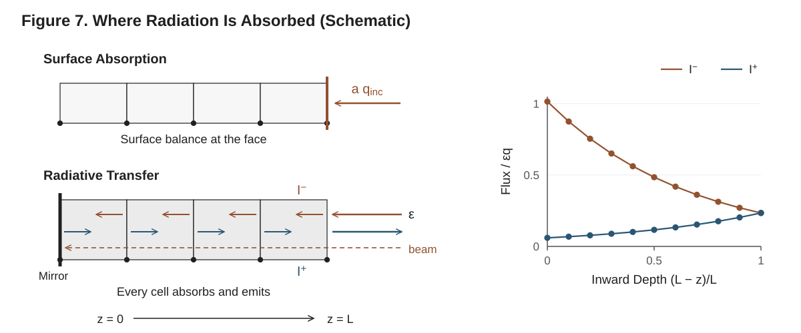

# 8. Thermal Radiation

This chapter derives and documents the two thermal-radiation models of Pyrolysis.jl
and the way each couples into the energy equation. `SURFACE_ABSORPTION` absorbs the
incident radiation at the exposed face, through the surface energy balance.
`RADIATIVE_TRANSFER` carries radiation through the solid: every cell absorbs and
emits, the radiation field is two hemispherical fluxes per face (a gray two-stream
closure with diffusivity $1/\bar\mu = 3/2$), integrated exactly across each cell, and
a heater may arrive diffuse or as beams. Where a docstring or textbook form diverges
from the code, **the code is authoritative**.

Throughout, the spatial coordinate is $z$ (axial, through-thickness), with $z=0$
the back face (tag `:bottom`) and $z=L$ the exposed surface (tag `:top`). Heat
enters from the top. A face flux is stored per unit face area along the face
normal, which points from the face's owner cell to its neighbour and out of the
domain on a boundary face: on a line the interior faces and the `:top` face have
their normal along $+z$, the `:bottom` face along $-z$ (§2). The radiative fluxes
are stored as non-negative magnitudes instead: $I^-_f$ travels toward the back
($-z$), $I^+_f$ toward the exposed face ($+z$), and a beam $I_{h,f}$ toward the
back along its direction. A cell's upstream face $u$ is the one toward the exposed
face, its downstream face $d$ the one toward the back. The radiative source of a
cell is **positive = heating**. The cell index is $i$ ($1\le i\le n$), the component
index $j$ ($1\le j\le N_C$). The Stefan–Boltzmann constant is
$\sigma = 5.670374419\times10^{-8}\ \mathrm{W\,m^{-2}\,K^{-4}}$
(`STEFAN_BOLTZMANN`, `src/Materials/constants.jl`).

---

## 8.1 The Radiation Model Family



**Figure 7. Where radiation is absorbed (schematic).** Under `SURFACE_ABSORPTION` the absorbed flux $a\,q_{\text{inc}}$ enters the surface energy balance and no cell absorbs radiation. Under `RADIATIVE_TRANSFER` each face carries the hemispherical fluxes $I^-$ (toward the back) and $I^+$ (toward the exposed face); the exposed face transmits the fraction $\varepsilon$ of the cell beside it in both directions, a collimated or cone heater travels as beams, every cell absorbs and emits, and a back without a radiative condition reflects everything. The chart gives $I^-$ and $I^+$ of the worked slab of §8.8 at its consistent start, over the absorbed heater flux $\varepsilon q$: they meet at the mirror.

### 8.1.1 The two models

The radiation treatment is selected at `solve` (or `setup`) time by one
enumeration value passed as `radiation_model`; the default is `SURFACE_ABSORPTION`.
The enum is defined in `src/Materials/radiation_types.jl`:

```julia
@enum RadiationModel begin
    SURFACE_ABSORPTION = 1
    RADIATIVE_TRANSFER = 2
end
```

The models are **mutually exclusive**: exactly one is active for the whole domain
in a given run. They differ in where the radiation arriving at the solid is absorbed
and whether the solid emits from its depth:

1. **`SURFACE_ABSORPTION`.** The incident radiation of a `RadiativeFluxBC` is
   absorbed at the exposed face. It is **not** a volumetric source: the absorbed
   flux $a\,q_{\text{inc}}(t)$ enters the energy balance as a boundary heat flux
   through the surface energy balance and its Newton solve for $T_s$ (§8.2, §12.2)
   (`evaluate_bc_flux_and_derivative`, `src/BoundaryConditions/surface_balance.jl`),
   and a `RadiativeBC` exchanges $\varepsilon\sigma(F\,T_\infty^4-T_s^4)$ in the same
   balance. Component absorption coefficients $\alpha_j$ are not read. It is the
   model of an opaque solid whose first cell is optically thick, $\tau_n\gg 1$.

2. **`RADIATIVE_TRANSFER`.** Radiation crosses the exposed face and travels through
   the solid. Every cell absorbs and emits at its absorption coefficient
   $\alpha_{\text{eff}}$ (§5.8.3) and its temperature; the field is two
   hemispherical fluxes per face, $I^-_f$ and $I^+_f$, **algebraic unknowns** of the
   state, plus one beam per face for each direction of a collimated or cone heater
   (§8.3, §8.4). The exposed face is a gray interface at the emissivity of the cell
   beside it, and the back a mirror unless its condition radiates. The surface
   energy balance keeps convection, prescribed fluxes, blowing and conduction and
   holds no radiation (§8.5). Appropriate for semi-transparent polymers and foams
   ($\tau\lesssim 10$).

### 8.1.2 What the model changes

The model-dependent decisions are made where they arise, all of them by `setup`
(`src/Integration/setup.jl`):

- **The state.** Under `RADIATIVE_TRANSFER` the layout carries $N_{\text{rad}}$
  radiation rows per face, the last rows of the node block of the face's node
  (`StateLayout(...; radiation_rows)`, `radiation_index(layout, f, k)`, §8.7.1,
  §15.1): $N_{\text{rad}} = 2 + N_{\text{beam}}$, the two hemispherical fluxes and one
  row per beam direction (`radiative_transfer_rows`). On a line of $n$ cells that is
  $(n+1)N_{\text{rad}}$ rows. `SURFACE_ABSORPTION` adds nothing.
- **The kernels.** `RADIATIVE_TRANSFER` adds a `RadiativeTransferKernel`
  (`src/Kernels/radiative_transfer.jl`) after the gas-transport kernel and before
  conduction; `SURFACE_ABSORPTION` adds none. The thermal boundary kernel reads the
  model for the `RadiativeBC` and `RadiativeFluxBC` dispatch (§8.5).
- **The tolerances and the domain test.** The radiation rows take the absolute
  tolerance $\mathrm{reltol}\cdot q_{\text{scale}}$ and the domain test reads each of them
  against its own flux (§8.7.3, §15.5.4).
- **The refusals.** `setup` refuses a deck the rows cannot represent (§8.4.4).

| Model | Extra state | Kernel | Jacobian pattern |
|---|---|---|---|
| `SURFACE_ABSORPTION` | — | — | banded (cell blocks and their neighbours) |
| `RADIATIVE_TRANSFER` | $(n+1)N_{\text{rad}}$ face fluxes (algebraic) | `RadiativeTransferKernel` | banded; each radiation row reads its family at its own face and the next one upstream along its direction and the two cells beside the face, a thermal row also the other thermal family at its face (§8.7.4) |

---

## 8.2 Surface Absorption

### 8.2.1 Surface absorption is a boundary flux, not a volumetric source

Under `SURFACE_ABSORPTION` no kernel deposits radiation in
the cells. The incident radiation is folded into the surface energy balance of
the face carrying the `RadiativeFluxBC` (`evaluate_bc_flux_and_derivative`,
`src/BoundaryConditions/surface_balance.jl`):

$$
q_{\text{BC}}(T_s) = a\,q_{\text{inc}}(t),\qquad
\frac{\mathrm{d}q_{\text{BC}}}{\mathrm{d}T_s}=0,
\qquad\text{for }\texttt{SURFACE\_ABSORPTION},
$$

where $q_{\text{inc}}(t)$ [W·m⁻²] is the condition's incident flux and $a$ the
surface absorptivity. With no explicit `absorptivity` on the condition, $a$ is the
effective surface absorptivity of the boundary cell (§5.8.2),

$$
a_{\text{eff}}=\sum_j v_j\,a_j ,
$$

with $v_j$ the mixing volume fractions and $a_j$ the component's
`absorptivity` when set and otherwise its emissivity $\varepsilon_j(T)$; with no
component absorptivity set this is Kirchhoff's law, $a_{\text{eff}}=\varepsilon_{\text{eff}}$.
The state mapping evaluates it once per cell and residual,
`ds.a[i]` from `surface_properties_of_fractions` (`src/States/derived.jl`), the sum `mixture_absorptivity` computes,
at the positive-part concentrations and the cell's trial temperature. No clamp is
applied: the weights are convex and every component value lies in $[0,1]$
(validated on the property bracket when the component is built), so the sum stays
in $[0,1]$. An explicit `absorptivity` on the condition (a constant or a function
of $t$) overrides $a_{\text{eff}}$. The absorbed incident flux does not depend on
$T_s$. Surface re-radiation is supplied separately by a `RadiativeBC` term,
$q=\varepsilon_{\text{eff}}\sigma(F\,T_\infty^4-T_s^4)$, whose $T_s$-dependence
enters the Newton derivative (§12.3.4). The `distribution` of a `RadiativeFluxBC`
has no effect under this model.

The textbook alternative — depositing the absorbed flux as a volumetric source
$a\,q_{\text{inc}}/\Delta z_n$ in the top cell — is deliberately **not**
implemented. The boundary-flux route lets the surface Newton solve resolve the
(possibly large) difference between $T_s$ and the cell temperature $T_n$
consistently with convection and re-radiation; for an opaque material with a
well-resolved first cell the two constructions are numerically close anyway.

### 8.2.2 Assumptions and validity

Surface absorption presumes the material is optically thick over the first cell,
$\tau_n=\alpha_{\text{eff}}\Delta z_n\gg 1$, so that essentially no radiation
penetrates beyond cell $n$. It adds no unknowns and no Jacobian entries beyond the
boundary cell's own, and it is the recommended choice for charring solids and fast
cone-calorimeter analysis.

It also treats the material's own emission as a surface process at $T_s$. That holds
while the mean free path of that emission, $1/\kappa_R(T)$ with $\kappa_R$ the
Rosseland mean of the absorption spectrum over the material's own emission band, is
short against the thermal-gradient scale; the in-depth transport it carries is a
radiative conductivity $16n^2\sigma T^3/(3\kappa_R)$ that the surface treatment omits
unless the deck puts it into $k$ (§5.5). For wood and char the mean free path is below
0.1 mm. For black PMMA the spectral windows at 2–3 µm and 4–5 µm give
$\kappa_R\approx4\times10^{3}$ m⁻¹ at 650 K, a mean free path of 0.25 mm and a radiative
conductivity of 0.045 W·m⁻¹·K⁻¹, a fifth of the room-temperature conductivity and
half of the value a cone-calibrated law assigns at 650 K (§5.5); in the 25 kW·m⁻² cone
case it changes the surface temperature by 6 K and the mass loss rate by 5 %, within
the scatter of those measurements, and the back-face temperature by 15 K, above it.
`RADIATIVE_TRANSFER` carries that transport through its rows (§8.3).

---

## 8.3 Radiative Transfer in the Solid

### 8.3.1 The two-stream equations

A non-scattering gray medium of absorption coefficient $\alpha$ [m⁻¹] at temperature
$T$ carries radiation of every direction. The two-stream closure keeps two
hemispherical fluxes, $I^-$ toward the back and $I^+$ toward the exposed face
[W·m⁻²], each treated as if its intensity were isotropic over its hemisphere, so that
it travels at the mean direction cosine $\bar\mu$:

$$
-\bar\mu\,\frac{\mathrm{d}I^-}{\mathrm{d}z} = \alpha\big(\sigma T^4 - I^-\big),\qquad
\bar\mu\,\frac{\mathrm{d}I^+}{\mathrm{d}z} = \alpha\big(\sigma T^4 - I^+\big),
\tag{8.1}
$$

with $1/\bar\mu = 3/2$ (`DIFFUSIVITY`). The net radiative flux along $+z$ is
$I^+ - I^-$, and the power it deposits per unit volume is

$$
Q_{\text{rad}} = -\frac{\mathrm{d}}{\mathrm{d}z}\big(I^+ - I^-\big)
= \frac{\alpha}{\bar\mu}\big(I^+ + I^- - 2\sigma T^4\big).
\tag{8.2}
$$

**Why $1/\bar\mu = 3/2$.** Deep in an optically thick medium (8.1) gives
$I^\pm = \sigma T^4 \mp (\bar\mu/\alpha)\,\mathrm{d}(\sigma T^4)/\mathrm{d}z$ to first
order, a net flux $-(2\bar\mu/\alpha)\,\mathrm{d}(\sigma T^4)/\mathrm{d}z$. With
$\bar\mu = 2/3$ that is the Rosseland flux $-\frac{4}{3\alpha}\,\mathrm{d}(\sigma T^4)/\mathrm{d}z$,
the exact limit of the transfer equation, so the closure carries the in-depth
radiative conduction of a thick medium correctly. At the thin end it is less accurate: a
layer of optical thickness $\tau\ll1$ exchanges $\tau/\bar\mu = 1.5\,\tau$ with a diffuse
field where exact transfer, averaging the path length over the hemisphere, gives
$2\tau$: 25 % too little. An isothermal slab at $\sigma T^4$ with black faces, emitting
into surroundings at 0 K, emits through each face
$\sigma T^4(1 - e^{-\tau_L/\bar\mu})$ under the closure against
$\sigma T^4\big(1 - 2E_3(\tau_L)\big)$ exactly, with $\tau_L = \int_0^L\alpha\,\mathrm dz$ the
slab's optical thickness and $E_3$ the third exponential integral:

| $\tau_L$ | $10^{-3}$ | $10^{-2}$ | 0.1 | 0.3 | 1 | 3 |
|---|---|---|---|---|---|---|
| two-stream over exact, less one | −24.8 % | −23.4 % | −16.8 % | −9.4 % | −0.5 % | +0.7 % |

On the burning PMMA profiles of V-RAD-05, down to the last tenth of the layer, the
closure moves the thermal flux leaving the exposed face by at most 0.0044 of the
absorbed heater flux against exact gray transfer (§8.9.4).

**Beams.** A collimated or cone heater does not need the closure: each of its
directions $h$, of direction cosine $\mu_h$, is carried exactly,

$$
-\mu_h\,\frac{\mathrm{d}I_h}{\mathrm{d}z} = -\alpha\,I_h ,
\tag{8.3}
$$

where $I_h$ is the beam's flux across a face normal to $z$. The medium's own emission
enters $I^\pm$ only.

### 8.3.2 Exact integration across a cell

Across a cell $i$ of uniform absorption coefficient $\alpha_i$ and temperature
$\tilde T_i$ (its trial temperature, as every property, §5), with optical thickness
$\tau_i = \alpha_i\,\Delta z_i$ and emissive power $\mathcal B_i = \sigma\tilde T_i^4$,
(8.1) and (8.3) integrate exactly from the face each flux enters by to the face it
leaves by:

$$
I^-_d = \mathcal B_i + \big(I^-_u - \mathcal B_i\big)\,e^{-\tau_i/\bar\mu},\qquad
I^+_u = \mathcal B_i + \big(I^+_d - \mathcal B_i\big)\,e^{-\tau_i/\bar\mu},\qquad
I_{h,d} = I_{h,u}\,e^{-\tau_i/\mu_h}.
\tag{8.4}
$$

These hold at any $\tau_i$: a coarse or optically thick cell is integrated exactly for
its constant emissive power, and the mesh enters only through the staircase that
cell-constant emission makes of $\sigma T^4$ (§8.6). $\alpha_i$ is (5.23) at the
positive-part concentrations, $\sum_j\xi^+_j\alpha_j$, so a depleting cell becomes
optically thin as it empties. $\Delta z_i$ is the sum of the cell's two center-to-face
distances, each smoothly floored at `DISTANCE_FLOOR_FRACTION` of its initial value
(the floors of the conduction kernel), so a collapsing cell on a moving mesh keeps a
positive, differentiable thickness.

### 8.3.3 The rows

The face fluxes are algebraic unknowns. Each row is a flux minus the value (8.4) or
a boundary gives it (`contribute!`, `src/Kernels/radiative_transfer.jl`), for the
first live cell $i_1$, whose upstream face is the exposed face $e$, every live cell
$i$ with faces $u$ and $d$, and the last cell $l$, whose downstream face is the back
face $b$:

$$
\begin{aligned}
r[I^-_e] &= I^-_e - \big[\varepsilon_e\,q^{\text{in}}_e + (1-\varepsilon_e)\,I^+_e\big] &&\text{exposed face (§8.4.1)}\\
r[I_{h,e}] &= I_{h,e} - a\,w_h\,q_{\text{inc}}(t) &&\text{each beam (§8.4.2)}\\
r[I^-_d] &= I^-_d - \big[\mathcal B_i + (I^-_u - \mathcal B_i)\,e^{-\tau_i/\bar\mu}\big] &&\text{each live cell}\\
r[I^+_u] &= I^+_u - \big[\mathcal B_i + (I^+_d - \mathcal B_i)\,e^{-\tau_i/\bar\mu}\big] &&\text{each live cell}\\
r[I_{h,d}] &= I_{h,d} - I_{h,u}\,e^{-\tau_i/\mu_h} &&\text{each live cell, each beam}\\
r[I^+_b] &= I^+_b - \Big[\varepsilon_b\,q^{\text{in}}_b + (1-\varepsilon_b)\Big(I^-_b + \sum_h I_{h,b}\Big)\Big] &&\text{back face (§8.4.3)}
\end{aligned}
\tag{8.5}
$$

Every face of the live region has exactly two thermal rows (the exposed face its
boundary row and the $I^+$ row of cell $i_1$; an interior face one row from each of
its cells; the back face the $I^-$ row of cell $l$ and its boundary row) and one row
per beam. The faces upstream of the first live cell, beyond a deactivated column,
carry no rows: they are dead and hold zero (§8.7.1).

Each live cell absorbs what enters through its two faces minus what leaves,

$$
S^{\text{rad}}_i = A_u\big(I^-_u - I^+_u\big) - A_d\big(I^-_d - I^+_d\big)
+ \sum_h\big(A_u I_{h,u} - A_d I_{h,d}\big)\quad[\text{W}],
\tag{8.6}
$$

with $A_u$, $A_d$ the face areas (equal on a planar line). At fluxes that satisfy the
rows, $S^{\text{rad}}_i/V_i$ is the exact cell average of (8.2) for the cell's constant
emission.

The rows are smooth and allocation-free: exponentials, products and the smooth
floors, and continuously differentiable in the state. The thermal rows are linear in the fluxes
for given temperatures and absorption coefficients; their determinant is
$1 - (1-\varepsilon_e)(1-\varepsilon_b)\prod_i e^{-2\tau_i/\bar\mu}$ (§8.7.2), which is at
least $\varepsilon_e$ and so at least $10^{-3}$ for every state (§8.4.1).

---

## 8.4 Boundaries

### 8.4.1 The exposed face

The exposed face $e$ is the upstream face of the first live cell from the `:top`
boundary (`exposed_face`): the `:top` face itself while no cell is dead, and the face
of the next live cell once cells beyond it are deactivated (Chapter 14). It is a
**gray interface** that transmits the fraction $\varepsilon_e$ in both directions,

$$
\varepsilon_e = \text{smooth\_floor}\big(\varepsilon_{\text{eff}}(i_1),\ 10^{-3}\big),
\tag{8.7}
$$

with $\varepsilon_{\text{eff}}(i_1)$ the effective emissivity (5.22) of the first live
cell at its trial temperature and composition and $10^{-3}$ `INTERFACE_FLOOR`.
Radiation from outside crosses it inward at $\varepsilon_e$, and the solid's
upward flux crosses it outward at $\varepsilon_e$, the rest reflecting into $I^-_e$:
the first row of (8.5). The radiation leaving through the face is
$\varepsilon_e I^+_e$. Using one $\varepsilon_e$ both ways is what makes the
interface satisfy detailed balance (§8.5.2); a condition-level emissivity would break
it, so `setup` refuses a `RadiativeBC` with its own `ε` under this model.

The diffuse radiation arriving from outside is the sum over the `:top` condition's
radiative members (`incoming_radiation`),

$$
q^{\text{in}}_e = \sum_{\texttt{RadiativeBC}} F\,\sigma T_\infty^4
\;+\sum_{\text{diffuse }\texttt{RadiativeFluxBC}} q_{\text{inc}}(t),
$$

each `RadiativeBC` the surroundings at $T_\infty$ over the fraction $F$ of the
hemisphere, each diffuse `RadiativeFluxBC` a heater's diffuse flux; several members
add. A `:top` condition with neither member is refused: radiation enters and leaves
the solid through the exposed face, and a reflecting exposed face over a transparent
column and a mirror back would make the thermal rows singular. A beam-only `:top` faces
surroundings at 0 K unless a `RadiativeBC` is added.

The smooth floor bounds the thermal rows' determinant away from zero for every state:
a gas-filled first cell (gases default to $\varepsilon = 0$, §5.8.1) or a depleting
column still leaves an interface that transmits $10^{-3}$. The floor acts both ways,
so the equilibrium of §8.5.2 holds through it.

### 8.4.2 Heaters: diffuse, collimated, cone

A `RadiativeFluxBC` arrives with the angular distribution given by its
`distribution` keyword (an `AngularDistribution`):

| `distribution` | how it enters | rows |
|---|---|---|
| `Diffuse()` (default) | into $q^{\text{in}}_e$, crossing at $\varepsilon_e$, then travelling as $I^-$ | none |
| `Collimated()` | one beam along the normal, $\mu_h = 1$ | one per face |
| `Cone(θ₁, θ₂; directions = 3)` | uniform intensity between the polar angles $\theta_1<\theta_2$: `directions` beams | `directions` per face |

A beam enters with its share of the absorbed flux, $I_{h,e} = a\,w_h\,q_{\text{inc}}(t)$,
at the condition's `absorptivity` $a$ when given and otherwise at the effective
absorptivity $a_{\text{eff}}$ (5.22b) of the first live cell. Under a cone of uniform
intensity the flux per unit direction cosine is proportional to the cosine, so the
beams sit at the Gauss–Legendre nodes $\mu_h$ of $[\cos\theta_2,\cos\theta_1]$, and each
carries a share $w_h$ of the flux proportional to its Gauss–Legendre weight times
$\mu_h$, divided by $(\cos^2\theta_1 - \cos^2\theta_2)/2$, the integral of the cosine
over that interval, so that $\sum_h w_h = 1$ (`_beam_directions`).
Three directions reproduce the downward field of a cone heater within
$2.4\times10^{-5}$ of the absorbed flux against the exact cone integral on V-RAD-02's
slab, which asserts $2\times10^{-4}$.

**Absorptivity is for beams only.** Diffuse radiation enters at $\varepsilon_e$, the
interface's transmissivity, whatever the heater: a diffuse `RadiativeFluxBC` with its
own `absorptivity`, or any diffuse `RadiativeFluxBC` on a material where a component
sets `absorptivity`, is refused. A beam is not part of the solid's thermal exchange,
so it may enter at an absorptivity for the heater's spectrum (§5.8.2). The radiation
of a `RadiativeBC` is in the solid's own band and always enters at $\varepsilon_e$.

### 8.4.3 The back face

The back face is the downstream face of the last cell, the `:bottom` face at node 1;
deactivation compacts the live cells toward it, so it never moves (Chapter 14). Its
row (the last of (8.5)) transmits $\varepsilon_b$ of what arrives on either side and
reflects the rest:

| `:bottom` condition | back | $\varepsilon_b$ |
|---|---|---|
| no `RadiativeBC` or `RadiativeFluxBC` member (adiabatic, convective, prescribed flux, Dirichlet) | mirror (`MirrorBack`): exchanges no radiation | 0 |
| a `RadiativeBC` and/or a diffuse `RadiativeFluxBC` | gray interface (`OpenBack`) | $\varepsilon_l$, the last cell's $\varepsilon_{\text{eff}}$ |
| a collimated or cone `RadiativeFluxBC` | refused | |

$q^{\text{in}}_b$ is the diffuse sum of the `:bottom` members, as at the exposed face.
An open back is the back of a sample facing open surroundings or an opaque holder at
$T_\infty$; a substrate (Kaowool, a holder) modelled as cells is part of the column,
its cells absorbing and emitting through the same rows, usually optically thick.

Beams that reach the back join $I^+_b$: a mirror sends them back up as diffuse
radiation, an open back reflects $1-\varepsilon_l$ of them that way and lets
$\varepsilon_l$ leave. The back's $\varepsilon_l$ is not floored: the exposed face's
floor alone keeps the rows nonsingular. An exact specular mirror would send a beam back up as a beam
along its own direction; the conversion is the other idealisation of an insulated
back, a diffuse one, and keeps the rows at $2 + N_{\text{beam}}$ per face. V-RAD-02 and
V-RAD-05 report the difference from a specular mirror (§8.9.4).

### 8.4.4 Refusals

Under `RADIATIVE_TRANSFER`, `setup` and the kernel's constructor refuse, with an
`ArgumentError`:

- a mesh of more than one dimension, and coordinates other than planar (the rows
  carry fluxes per unit face area and the sources read the face areas, which agree
  only where the areas are equal);
- a `:top` condition with no `RadiativeBC` or `RadiativeFluxBC` member, and a `:top`
  tag of more than one face;
- a radiative member on a tag other than `:top` and `:bottom`, and a collimated or cone
  `RadiativeFluxBC` on a tag other than `:top`;
- a `RadiativeBC` with its own `ε` on any tag;
- a diffuse `RadiativeFluxBC` with its own `absorptivity`, and any diffuse
  `RadiativeFluxBC` on a material where a component sets `absorptivity`.

No check compares the material with the model: `SURFACE_ABSORPTION` with non-zero
$\alpha_j$ (not read) and `RADIATIVE_TRANSFER` with every $\alpha_j = 0$ (a transparent
column: the radiation crossing the exposed face reaches the back, where a mirror
returns it) both run without a warning.

---

## 8.5 Source, Energy Coupling and Equilibrium

### 8.5.1 Coupling into the energy equation

The condensed-phase energy equation (§3.3, §7.3) carries a volumetric radiation
source $Q_{\text{rad}}$ on its right-hand side:

$$
\rho c_p^{\text{eff}}\,\frac{\partial T}{\partial t}
= -\nabla\!\cdot\!\mathbf{q}_{\text{cond}} - \sum_j \mathbf{J}_j\!\cdot\!\nabla h_j
+ Q_{\text{rad}} + Q_{\text{rxn}} .
$$

Discretely, every source and face flux of cell $i$ is collected in its energy
right-hand side $E_i$ [W], and the energy row is (`assemble_rows!`,
`src/Assembly/residual.jl`; §7.3)

$$
C_i\,\frac{\mathrm{d}T_i}{\mathrm{d}t} = E_i - \sum_j h_j(T_i)\,\dot M_{j,i}
\quad\text{(temperature form)},\qquad
\frac{\mathrm{d}H_i}{\mathrm{d}t} = E_i + \sum_j \omega_{j,i}V_i\,h_j(T_i)
\quad\text{(enthalpy form)},
$$

with $C_i$ the heat-capacity sum of the cell (§5.4) and $\dot M_{j,i}$ the
face-flux part of its mass rate. The two models populate $Q_{\text{rad}}$, or
bypass it for the surface route, as follows.

- **`SURFACE_ABSORPTION`.** $Q_{\text{rad}}=0$: no kernel adds a radiative source. A
  `RadiativeFluxBC` enters the surface energy balance of its face as
  $q_{\text{BC}}=a\,q_{\text{inc}}$ (§8.2) and a `RadiativeBC` as
  $\varepsilon\sigma(F\,T_\infty^4-T_s^4)$; the balance solves for $T_s$, and the flux
  conducted from the face into the boundary cell, $k(T_s-T_n)/d$, enters that cell's
  $E_n$ through the boundary face (§12.2).

- **`RADIATIVE_TRANSFER`.** Cell $i$'s energy source gains $S^{\text{rad}}_i$ of
  (8.6), the same term in both energy forms. A `RadiativeBC` and a `RadiativeFluxBC`
  contribute **zero** to the surface balance (`evaluate_bc_flux_and_derivative`
  returns $(0, 0)$ for both under this model): the radiation they describe crosses the
  interface through the rows, inward and outward, and is absorbed and emitted by the
  cells. The surface balance keeps convection, prescribed fluxes, blowing and
  conduction (§12.2), so $T_s$ is the temperature that balances those.

**The radiative conditions dispatch on the radiation model.** The dispatch
keeps every flux counted once: at the face under `SURFACE_ABSORPTION`, in the rows
and the cells under `RADIATIVE_TRANSFER`.

| Condition | `SURFACE_ABSORPTION` | `RADIATIVE_TRANSFER` |
|---|---|---|
| `RadiativeFluxBC` at `:top` | $a\,q_{\text{inc}}$ in the surface balance | zero in the surface balance; diffuse into $q^{\text{in}}_e$, beams into their rows |
| `RadiativeFluxBC` at `:bottom` | $a\,q_{\text{inc}}$ in that face's balance | zero there; diffuse into $q^{\text{in}}_b$ (an open back); beams refused |
| `RadiativeBC` | $\varepsilon\sigma(F\,T_\infty^4-T_s^4)$ in the surface balance | zero in the surface balance; $F\sigma T_\infty^4$ into $q^{\text{in}}$ of its face; its `ε` refused |
| `ConvectiveBC`, `HeatFluxBC`, … | unchanged | unchanged |

The same dispatch threads through `CombinedThermalBC`, so a cone-calorimeter
condition such as
`RadiativeFluxBC(50e3) + RadiativeBC(T_inf = 300.0) + ConvectiveBC(h = 10.0, T_inf = 300.0)`
works under both models: under `RADIATIVE_TRANSFER` its radiative members feed the
exposed row and contribute zero at the face, while the convective member acts there.

### 8.5.2 Conservation and equilibrium

**Conservation.** The sources (8.6) telescope: for any trial fluxes,

$$
\sum_i S^{\text{rad}}_i = A_e\Big(I^-_e - I^+_e + \sum_h I_{h,e}\Big)
- A_b\Big(I^-_b + \sum_h I_{h,b} - I^+_b\Big),
$$

the net radiation entering through the exposed face minus the net radiation leaving
through the back. Three series of `sol.extras` report the terms, per unit face area at
every saved time (`radiation_crossing`, `src/Outputs/solution.jl`):

| extra | value | meaning |
|---|---|---|
| `radiation_absorbed` | $\varepsilon_e\,q^{\text{in}}_e + \sum_h I_{h,e}$ | radiation crossing the exposed face inward |
| `radiation_emitted` | `radiation_absorbed` $-\big(I^-_e - I^+_e + \sum_h I_{h,e}\big)$ | radiation crossing it outward: $\varepsilon_e I^+_e$ where the exposed row holds |
| `radiation_back` | $I^-_b + \sum_h I_{h,b} - I^+_b$ | net radiation leaving through the back; zero at a mirror |

so that $\sum_i S^{\text{rad}}_i/A = $ `radiation_absorbed` $-$ `radiation_emitted`
$-$ `radiation_back` to round-off at every saved state, including the states a
Rodas5P solve interpolates between step ends (§8.7.2). All three are zero under
`SURFACE_ABSORPTION` and `NaN` once no cell is live. The surface-flux series describe
the surface balance: under `RADIATIVE_TRANSFER` `surface_heat_flux_absorbed` and
`surface_heat_flux_reradiation` are zero and `surface_heat_flux_net` holds no
radiation; `surface_emissivity` is the first live cell's $\varepsilon_{\text{eff}}$,
the interface's transmissivity before the floor (§12.9). The energy ledger (Chapter 16)
needs no radiative term of its own: the source lives in $E_i$, and the rows store no
energy.

**Equilibrium.** An isothermal medium at $T$ facing diffuse radiation $\sigma T^4$ on
both sides, or on one side with a mirror behind it, satisfies every thermal row with
$I^- = I^+ = \sigma T^4$, at any optical thickness, mesh and emissivity: substitute
into (8.5). Every source (8.6) is then zero. A solid in an enclosure at its own
temperature therefore stays at it, Kirchhoff's law by construction, because the
interface transmits $\varepsilon_e$ both ways and every cell absorbs and emits with
one $\alpha_i$. V-RAD-01 checks it on the rows to round-off and through time
integration to $10^{-8}$ K (§8.7.5). Beams are not part of the equilibrium; they
are absorbed as they travel.

---

## 8.6 Mesh Criterion and Regime

**Which model.** The validity bands are stated in terms of the optical thickness of
the layer, $\tau_L=\int_0^L\alpha_{\text{eff}}\,\mathrm{d}z$, $\alpha_{\text{eff}}L$ for a uniform layer
(`RadiationModel` docstring, `src/Materials/radiation_types.jl`):

| $\tau_L$ | regime | recommendation |
|---|---|---|
| $\tau_L>10$ | optically thick | surface absorption is adequate |
| $\tau_L<10$ | semi-transparent | `RADIATIVE_TRANSFER` |

What decides whether `SURFACE_ABSORPTION` is close to the in-depth answer is the
exposed cell, $\tau_n\gg1$ (§8.2.2). No function computes $\tau_L$ for a material; it
follows from the component values, $\tau_L = L\sum_j\xi_j\alpha_j$ for a uniform layer.
A run diagnoses itself through `radiation_back` (what crosses the column) and the
cell sources ($\sum_i S^{\text{rad}}_i/A$ against `radiation_absorbed`).

**The resolution of the emission.** The rows are exact for each cell's constant
emissive power, so the mesh error is the staircase of $\sigma T^4$. For an emissive
power that falls linearly into the depth, by $\Delta\mathcal B$ per cell, the rows carry at
every interior face the net flux $\Delta\mathcal B\coth\big(\tau_i/(2\bar\mu)\big)$, which is
$\frac{\tau_i}{2\bar\mu}\coth\frac{\tau_i}{2\bar\mu}$ times the Rosseland flux
$\Delta\mathcal B\,2\bar\mu/\tau_i$ of the continuum (V-RAD-04):

| $\alpha_i\Delta z_i$ | 0.1 | 0.14 | 0.25 | 0.5 | 1 | 2 | 5 |
|---|---|---|---|---|---|---|---|
| $\frac{\tau_i}{2\bar\mu}\coth\frac{\tau_i}{2\bar\mu} - 1$ | +0.2 % | +0.4 % | +1.2 % | +4.6 % | +18 % | +66 % | +275 % |

so $\alpha_i\Delta z_i \le 0.5$ keeps the discrete radiative conductivity within 5 % of
the continuum's. In an optically thick cell it tends to $4\sigma T^3\Delta z_i$, first
order in the cell size, where the continuum's, $16\sigma T^3/(3\alpha)$, vanishes: 0.006
W·m⁻¹·K⁻¹ at 650 K in 98 µm cells of V-BO's Kaowool (0.011 at 800 K, 0.012 at 650 K in
197 µm cells), 0.008 W·m⁻¹·K⁻¹ in a 50 µm char cell at 900 K, against conductivities of
0.06–0.2. An optically thick exposed cell also emits through the interface at its
centre temperature, not at the surface's: where the surface is much hotter than the
cell centre, grade the mesh toward the surface (§13.9) or use
`SURFACE_ABSORPTION` for an opaque material.

**Conductivity under this model.** The radiation absorbed and emitted at $\alpha_j$
travels through the rows, so under `RADIATIVE_TRANSFER` a component's $k_j$ is the
conductive part: a deck must not also put a Rosseland term
$16n^2\sigma T^3/(3\alpha_j)$ for $\alpha_j$'s band into $k_j$, and nothing is
subtracted automatically. Radiation across pores smaller than a cell, as in a char,
is not resolved by the rows and stays in $k_j$ (§5.5).

---

## 8.7 Rows in the State and the Jacobian

### 8.7.1 Families in the node block

The $N_{\text{rad}}$ radiation rows of face $f$ are the last rows of the node block of
its node (on a line face $f$ sits at node $f$), $N_{\text{rad}} = 2 + N_{\text{beam}}$ for
the one gray band:

```
node block of node f:  [z (moving) | w (moving, velocities) | radiation rows 1 … N_rad]
radiation_index(layout, f, k)       k = 1: I⁻,  k = 2: I⁺,  k = 2 + h: beam h
```

The layout knows only their number (`StateLayout(...; radiation_rows)`,
`has_radiation`, `radiation_rows`); the kernel owns the meaning of each row, and the
beams of several `RadiativeFluxBC` members follow one another. The derived state holds
them as `ds.q` ($N_{\text{rad}}\times N_{\text{face}}$) and the contributions as
`c.r_radiation`, which `assemble_rows!` writes into the residual (§15.3). All of them
are algebraic.

Deactivation moves and masks whole node blocks (§14.3.1), so the radiation rows go
with their node. A dead face beyond the first live cell is a masked identity row
holding zero; the exposed face moves to the upstream face of the new first live
cell, and the next evaluation reads that face's rows (§8.4.1).

### 8.7.2 The consistent start and the re-sweep

`consistent_radiation!` writes the face fluxes that satisfy every radiation row at a
given state, in closed form (`src/Kernels/radiative_transfer.jl`):

1. zero every face upstream of the first live cell;
2. carry each beam down from its entering value through (8.4), exactly, noting what
   reaches the back;
3. the thermal rows are linear in the fluxes: with $I^-_e$ left as a parameter, a
   downward pass gives $I^-_b$ as an affine function of it, the back row gives $I^+_b$,
   and an upward pass gives $I^+_e$ as another; the exposed row then fixes $I^-_e$, its
   denominator being the determinant of §8.3.3;
4. one downward and one upward pass write the values.

No iteration and no allocation. It runs inside `consistent_state!` at setup (after a
variable cross section's rows, whose area the absorption coefficients read, and before
the closure's velocities, §15.4), after every deactivation event (the exposed face
moves, and the old fluxes miss the new rows by the order of the optical thickness of
the cells that left), and on the interpolated output states of a Hermite method such
as KenCarp4. Under the default Rodas5P a saved state between step ends carries the
dense output of the rows, consistent to the interpolation error; `radiation_emitted`
is defined from the net intake so that the identity of §8.5.2 holds there too.

### 8.7.3 Tolerances and the domain test

Every row is a flux in W·m⁻². All radiation rows share one scale, fixed at setup
(`_transfer_scale`, `src/Integration/setup.jl`),

$$
q_{\text{scale}} = \max\!\Big(1,\ \max_t\, q^{\text{arr}}(t),\ \sigma T_{\text{rad}}^4\Big)\ \ \mathrm{W\,m^{-2}},
$$

with $q^{\text{arr}}$ the radiation arriving from outside at the exposed face and at an
open back (diffuse members, $F\sigma T_\infty^4$ and the full flux of every beam
member), sampled at 101 times over the time span, and $T_{\text{rad}}$ the largest of
the initial cell temperatures and the $T_\infty$ of every `RadiativeBC` member there. A
radiation row's absolute tolerance is $\mathrm{reltol}\cdot q_{\text{scale}}$. The
domain test reads each live radiation row against its own flux,
$\lvert r\rvert/(\mathrm{reltol}\,\lvert I\rvert + \mathrm{atol}_r)$, the form of the
integrator's own error weight, so a deck heated by convection or a prescribed flux, whose
rows carry far more than $\sigma T_{\text{rad}}^4$, is still read relatively
(§15.5.4).

### 8.7.4 The Jacobian

A radiation row at face $f$ reads, outside the radiation rows, the cells beside the
face (the temperature through $\mathcal B_i$ and $\varepsilon$, the masses through
$\alpha_i$ and $\varepsilon$), the node positions around it on a moving mesh, and the
area under a variable cross section. Among the radiation rows the reach is
directional (`radiation_reach`): $I^-$ and each beam read their own family at $f$ and
at the face upstream of $f$, $I^+$ its own at $f$ and at the face toward the back;
$I^-$ and $I^+$ at the same face read each other, since any face can become the
exposed face; and at the back face $I^+$ reads every beam arriving there. Each cell row
reads every family at its two faces. The pattern is built from these reaches
(§15.11). Each family adds exactly two colors to the coloring, which a test asserts
against its color model (`test/jacobian/test_pattern.jl`). The derivatives are those of the colored
forward-mode differentiation of the residual (§15.6); nothing is hand-coded.

### 8.7.5 Verification

The kernel tests (`test/kernels/test_radiative_transfer.jl`) check, in both energy
forms: every live row at the consistent start; the rows against the exact two-stream
solution (`test/verification/exact/two_stream.jl`) for frozen piecewise-constant
temperatures and absorption coefficients, mirror and open backs, diffuse, collimated
and cone heaters, to $10^{-12}$; the telescoping of the sources at arbitrary trial
fluxes and against the three extras; the colored Jacobian against the dense
forward-mode reference over five states, and against central differences of the
residual in the columns of the exposed cell; containment in the pattern; a moving
mesh; and refusal off planar coordinates. `test/jacobian/test_radiative_containment.jl`
adds containment for every heater and back, zero allocations per residual and per
Jacobian and the states after `deactivate!`; `test/deactivation/test_slots.jl` the
kernel's tables through deactivation; `test/kernels/test_boundary_conditions.jl` the
face rules and their refusals. The verification suite adds:

| case | checks |
|---|---|
| V-RAD-01 | a slab in an enclosure at its own temperature: every face flux $\sigma T_\infty^4$ and every source zero to $10^{-12}\sigma T_\infty^4$ for $\alpha L = 10^{-3}$–$10^3$, $\varepsilon = 0.3$–1, three meshes, both backs; through time integration $\lvert T - T_h\rvert \le 10^{-8}$ K |
| V-RAD-02 | a heater through a slab, collimated, diffuse and cone, both backs, against closed forms to $10^{-12}$ of $\varepsilon q$; three cone beams against the exact cone integral |
| V-RAD-03 | an isothermal slab emitting to 0 K, against closed forms independent of the mesh, to $10^{-12}$ of $\sigma T^4$ |
| V-RAD-04 | a linear emissive power: the net flux $\Delta\mathcal B\coth\big(\tau_i/(2\bar\mu)\big)$ at every face to $10^{-12}$; the approach to Rosseland reported |
| V-RAD-05 | burning PMMA profiles of the solver's own runs against exact gray transfer: the closure's model error, pinned at three times its observed value |
| V-RAD-06 | the radiative energy ledger through burnout, every accepted step |
| V-RAD-07 | in-depth heating with emission and a sub-surface peak, against an independent method-of-lines solution of the same rows, and its order under refinement |
| V-MMS-05 | conduction with radiative transfer on a moving mesh against a manufactured solution: second order |

---

## 8.8 Worked Numbers

A 10 mm semi-transparent slab with $\alpha_{\text{eff}}=100\ \mathrm{m^{-1}}$
($\rho = 1000\ \mathrm{kg\,m^{-3}}$, $\alpha_j = 0.1\ \mathrm{m^2\,kg^{-1}}$), ten cells of
1 mm ($\tau_i = 0.1$, $\tau_L = 1$), $\varepsilon_{\text{eff}}=0.9$, at 300 K throughout,
faces a diffuse heater of 50 kW·m⁻² and surroundings at 300 K through its exposed face,
behind it an adiabatic back, a mirror. The diffuse radiation arriving is
$q^{\text{in}}_e = 50\,000 + \sigma\,300^4 = 50\,459.3$ W·m⁻², of which
$\varepsilon_e q^{\text{in}}_e = 45\,413.4$ W·m⁻² crosses the interface. The slab's own
emission at 300 K balances the surroundings' share exactly (§8.5.2), so what the slab
absorbs is the heater's: with $e^{-\tau_L/\bar\mu} = e^{-1.5}$ and the mirror, the
heater's net intake is

$$
\varepsilon\,q\,\frac{1 - e^{-2\tau_L/\bar\mu}}{1 - (1-\varepsilon)\,e^{-2\tau_L/\bar\mu}}
= 0.9\times50\,000\times\frac{1-e^{-3}}{1-0.1\,e^{-3}} = 42\,973.5\ \mathrm{W\,m^{-2}},
$$

the rest, 2026.5 W·m⁻² of the heater's 45 kW·m⁻², reflecting off the mirror and leaving
through the exposed face. The run below reproduces these numbers at its consistent
start:

```julia
using Pyrolysis

slab = SolidComponent(:slab, ρ = 1000.0, c = 1500.0, k = 0.2, ε = 0.9, α = 0.1)
material = Material(name = :slab, components = (slab,), reactions = ())
problem = PyrolysisProblem(
    mesh = uniform_mesh(0.01, 10),
    material = material,
    bc_set = BoundaryConditionSet(
        thermal = (
            top = RadiativeFluxBC(50e3) + RadiativeBC(T_inf = 300.0),
            bottom = AdiabaticBC(),
        ),
    ),
    T_initial = z -> 300.0,
    ξ_initial = [z -> 1000.0],
    tspan = (0.0, 1.0),
    output_times = [0.0, 1.0],
)
sol = solve(problem; radiation_model = RADIATIVE_TRANSFER)
sol.extras.radiation_absorbed[1]        # 45413.4 W/m² crossing the exposed face inward
sol.extras.radiation_emitted[1]         # 2439.8 W/m² crossing it outward
sol.extras.radiation_back[1]            # 0.0: the mirror
sol.extras.surface_heat_flux_absorbed[1] # 0.0: nothing is absorbed at the face
```

The slab absorbs $45\,413.4 - 2439.8 = 42\,973.5$ W·m⁻², the heater's net intake above;
the outward 2439.8 W·m⁻² is the slab's 300 K emission through the interface,
$0.9\,\sigma\,300^4 = 413.4$, plus the heater's reflected 2026.5. From the exposed face
down, $I^-$ is 45684.5, 39385.0, 33962.9, … , 10550.4 W·m⁻² and $I^+$ is 2710.9, 3075.3,
3498.7, … , 10550.4 W·m⁻², equal at the mirror; the cell sources fall from 6.664
MW·m⁻³ in the exposed cell to 3.039 MW·m⁻³ in the last.

With `RadiativeFluxBC(50e3; distribution = Collimated())` the heater enters as a beam at
$a_{\text{eff}} = 0.9$: 45000.0 W·m⁻² at the exposed face, $45\,000\,e^{-1} = 16\,554.6$
W·m⁻² at the mirror, which turns it into $I^+$. The slab then absorbs 41658.9 W·m⁻²,
`radiation_emitted` is 3754.5 W·m⁻², and the cell sources run from 4.935 MW·m⁻³ at the
top through a minimum of 3.849 MW·m⁻³ in the fourth cell from the back to 4.072
MW·m⁻³ in the last, which the reflected flux heats from below. With
`radiation_model = SURFACE_ABSORPTION` the same deck absorbs 45000 W·m⁻² at the face,
conducted into the slab, and nothing in depth.

---

## 8.9 Comparison with reference solvers

Radiation comparisons must match where energy is absorbed and emitted as well as how
much enters the material. The versions in §1.6.5 differ in the angular treatment of
radiation in the solid, in whether the solid emits from its depth, in how the face
and the back treat radiation and in how the field is coupled in time. For the 1D
configurations below, compare optical depth, the entering flux and its angular
distribution, the back's treatment and the deposition profile before interpreting a
temperature difference as a discretization error. §5.15 converts the absorption
coefficients.

| Aspect | Pyrolysis.jl | ThermaKin2Ds | Gpyro V2 | FDS 6.11.0 solid wall |
|:---|:---|:---|:---|:---|
| Transport in the solid | gray two-stream with emission, diffusivity 3/2; beams for a collimated or cone heater | absorbed net radiation assigned to one element | the net surface flux marched as a normal beam | optional gray two-flux model with emission, factor 2 |
| Cell integration | exact for constant emission, at any optical thickness | linear share of the optical thickness | exact exponential per cell | implicit per cell, first order |
| Coupling in time | algebraic rows solved with the state | element and emission per time step | explicit, previous surface temperature | explicit, once per sub-step; face reflection a sub-step behind |
| Exposed face | gray interface at the cell's $\varepsilon$ both ways; zero radiation in the surface balance | $\varepsilon$ of the selected element | net flux $\varepsilon\big(q-\sigma(T^4-T_\infty^4)\big)$ enters when positive | gray interface at $\varepsilon$ both ways; no radiation in the face balance |
| Back | mirror, or open at the back cell's $\varepsilon$ | radiation not absorbed is not deposited | transmitted remainder leaves | mirror for an insulated back |
| Match before comparing | the heater's distribution, $\alpha$ and $\varepsilon$, the back | element selection and its emission | the net-flux entry and the lost remainder | the factor 2 against 3/2 and the cell size, the back |

### 8.9.1 ThermaKin2Ds

TK Eq. 11 uses the same mass-specific attenuation coefficient $\sum_j\alpha_j\xi_j$ as
Pyrolysis.jl. Its deposition is different: the absorbed radiation of a step is
assigned to one element, the one with the largest share (`MAX`) or one sampled from
the absorption distribution (`RAND`), whose shares come from the linear part of each
element's optical thickness (TK §3). The emission $\varepsilon\sigma T^4$ is that of the
same element and is scaled by the fraction absorbed when more than 0.1 % is
transmitted, so emission and absorption share one kernel (TK Eqs. 12 and 23). The
model has no radiative transport between elements and no diffuse field; Pyrolysis.jl
absorbs and emits in every cell and carries what each emits to the others.

TK also describes a $T^3$ conductivity contribution for optically thick radiative
diffusion. Such a property law can be supplied here under `SURFACE_ABSORPTION`; under
`RADIATIVE_TRANSFER` the rows carry that transport for $\alpha_j$'s band (§8.6).

### 8.9.2 Gpyro V2

GP Eqs. 66–67 and V2 user guide §4.2 describe exponential attenuation with
an effective absorption coefficient $\bar\kappa$ [m⁻¹]. V2's
[`IN_DEPTH_RADIATION_ABSORPTION`](https://github.com/Gedeben/GPYRO-V2/blob/bff0126c68f2a35c084ef04490ae327185f281a3/src/common/gpyro_thermal.f90#L122-L179)
marches along the coordinate normal to the irradiated face, transmitting
$q_{i+1}=q_i\exp(-\bar\kappa_i\Delta z_i)$, depositing the difference in each cell and
leaving the remainder at the end of the sample undeposited. It has no internal
emission term. The march corresponds to one of our collimated beams when optical depth
and entering flux match, and neither code then emits from the depth.

The entering flux needs a separate check. In the active
[thermal boundary path](https://github.com/Gedeben/GPYRO-V2/blob/bff0126c68f2a35c084ef04490ae327185f281a3/src/common/gpyro_thermal.f90#L1196-L1213),
V2 forms `QENET` from the absorbed irradiation minus the surface re-radiation
$\varepsilon\sigma(T_{s,\text{old}}^4 - T_\infty^4)$ at the previous step's surface
temperature (the cell temperature on a half-cell boundary) when `RERAD` is enabled. If
`QENET` is positive and the boundary-cell absorption coefficient is below $10^6$ m⁻¹,
that **net** flux enters the march; otherwise it is applied at the boundary cell.
Pyrolysis.jl transmits the incoming radiation and the solid's emission through the
interface separately, each at $\varepsilon_e$, and carries the emission from every
cell. Thus identical incident heat flux and absorption coefficients do not by
themselves establish the same radiative source distribution.

GP Eq. 7 separately permits a $T^3$ pore-radiation conductivity term,
implemented in the [thermal property assembly](https://github.com/Gedeben/GPYRO-V2/blob/bff0126c68f2a35c084ef04490ae327185f281a3/src/common/gpyro_thermal.f90#L252-L305).
That contribution belongs in a matched conductivity law, not in the attenuation
coefficient.

### 8.9.3 FDS

FDS 6.11.0 defaults to opaque surface absorption; a wall with a material whose
`KAPPA_S` is below $4.9\times10^4$ m⁻¹ switches on its in-depth model. That model is a gray two-flux
(Schuster–Schwarzschild) pair of forward and backward fluxes with thermal emission.
In the documented closure,
$\mathrm{d}I^+_{\text{FDS}}/\mathrm{d}x=\kappa_s(\sigma T^4/\pi-I^+_{\text{FDS}})/\mu_{\text{FDS}}$
with $\mu_{\text{FDS}}=1/2$ and $I^+_{\text{FDS}}$ a radiance ($\pi I^+_{\text{FDS}}$ is our
$I^+$), which is our (8.1) with the diffusivity 2 in place of 3/2: the
two closures attenuate a diffuse field at $2\kappa_s$ and $1.5\alpha$, so the same
absorption coefficient does not give the same deposition. The implementation integrates
each cell by an implicit step,
$I_d = (I_u + 2\kappa_s\Delta z\,\sigma T^4)/(1 + 2\kappa_s\Delta z)$, first order in the
cell's optical thickness, so its effective attenuation is
$\ln(1+2\kappa_s\Delta z)/\Delta z$, below $2\kappa_s$ on any finite cell. Its exposed face
transmits $\varepsilon$ both ways, with the reflected upward flux taken from the
previous sub-step, and the face balance holds no radiation; an insulated back is a
mirror. Match the angular factor, the optical depth and the cell size as well as
units; do not simply copy $\kappa_s$ into a mass-specific $\alpha_j$. The
condensed-phase model is gray; FDS's gas-phase spectral radiation options do not
establish a gray-band solid model.

### 8.9.4 Sources and numerical evidence

TK Eqs. 11–12, 23 and §3 describe its attenuation, emission and deposition, and its
`Boundary.cpp` implements them. GP Eqs. 7, 66–67 and V2 user guide §§4.2, 8 are checked
against the linked V2 routines. FDS's
[radiation equations](https://github.com/firemodels/fds/blob/FDS-6.11.0/Manuals/FDS_Technical_Reference_Guide/Solid_Chapter.tex#L52-L90),
[two-flux implementation](https://github.com/firemodels/fds/blob/FDS-6.11.0/Source/wall.f90#L2255-L2295)
and [insulated back](https://github.com/firemodels/fds/blob/FDS-6.11.0/Source/wall.f90#L2152-L2160)
establish its angular closure, cell integration and boundaries. Our rows, sources and
sweep are in `src/Kernels/radiative_transfer.jl`.

V-RAD-05 measures the two-stream closure against exact gray transfer on frames of the
solver's own burning PMMA runs (10 and 25 kW·m⁻² collimated, 50 % and 10 % of the
PMMA left): the thermal field's flux leaving the exposed face moves by at most 0.0044
of the absorbed heater flux, and with the heater's beam converted at the mirror by at
most 0.016; the cell sources of the top half millimetre move by 0.039–0.068 in the $L_1$ norm
(0.046–0.081 over the sample with the heater's beam converted at the mirror); and
the exposed cell, which the closure underweights in the thin limit, absorbs 0.755–0.791
of its exact share. V-RAD-02 reports the conversion at the back against a specular mirror
on its slab. No case compares the in-depth radiation of Pyrolysis.jl with another
code's: each of the three differs in a way §8.9.1–§8.9.3 name, and a matched
comparison would test those choices rather than the discretization. User Guide §5.6
explains the heater and surroundings choices for comparisons.

---

## 8.10 Limitations and Open Issues

The radiation subsystem makes several deliberate simplifications; the following
are the open issues most likely to matter in practice.

1. **No scattering.** There is no scattering coefficient. Strongly scattering
   chars or foams would need $\sigma_s>0$, which couples $I^+$ and $I^-$ within each
   cell's closed form; the rows would stay cell-local.

2. **Gray, refractive index one.** $\alpha_j$, $\varepsilon_j$ and $a_j$ are gray, and
   the interface transmits $\varepsilon$ with no internal reflection beyond
   $1-\varepsilon$. Real polymers are spectrally selective and refract (PMMA:
   $n\approx1.49$). A band extension would repeat the rows per band, each band's emissive
   power the blackbody fraction of that band times $\sigma T_i^4$; a refractive index would put $n^2$ into
   $\mathcal B_i$ and separate the interface's inside and outside reflectivities.

3. **The two-stream closure.** $1/\bar\mu = 3/2$ is exact for the Rosseland limit and
   25 % low for a thin layer's exchange with a diffuse field (§8.3.1). Beams are exact.

4. **Cell-constant emission.** An optically thick cell carries a radiative
   conductivity of about $4\sigma T^3\Delta z_i$ and an optically thick exposed cell
   emits at its centre temperature (§8.6); keep $\alpha_i\Delta z_i\le0.5$ where the
   in-depth emission matters, and grade toward the surface.

5. **One exposed face on a planar line.** Beams enter through the single `:top` face
   only; radiative transfer is refused off planar coordinates and on meshes of more
   than one dimension, where the two-stream does not generalize.

6. **Beams at the back continue as diffuse radiation** (§8.4.3), not as reflected
   beams.

7. **Surface versus cell optical properties.** Under `SURFACE_ABSORPTION` a
   `RadiativeBC` with its own emissivity law evaluates $\varepsilon(T_s)$ at the surface
   temperature, and the surface iteration and its implicit derivative differentiate
   this complete flux (§12.2.3); the default $\varepsilon_{\text{eff}}$ and
   $a_{\text{eff}}$ are those of the boundary cell at its composition and trial
   temperature, not at $T_s$, constants within the iteration. Under
   `RADIATIVE_TRANSFER` the interface's $\varepsilon_e$ is always the first live cell's
   at its trial temperature.

8. **`SURFACE_ABSORPTION` assumes an opaque first cell** (§8.2). Absorbed incident
   radiation enters through the *boundary balance*, and the solid's emission is a
   surface process at $T_s$; the model is accurate only when the first cell is
   optically thick ($\tau_n\gg1$). If the first cell is coarse or only marginally
   opaque, refine the surface cell or use `RADIATIVE_TRANSFER`.

9. **No warning for a model that does not match the material** (§8.4.4).
