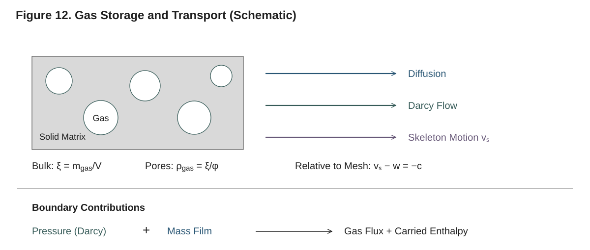

# 9. Gas-Phase Mass Transport and Pressure

A reacting solid does more than generate gas: it must also provide a route for
that gas to leave. Decomposition products accumulate in the pore space, raise
the local pressure, and move through the surrounding material toward an open
surface. Gas already present in the pores can be displaced, and gas from the
surroundings can enter. These processes determine when products escape and how
much sensible energy they carry with them. As the material chars, shrinks or
swells, both the available pore volume and the resistance to transport change.

Pyrolysis.jl describes this coupled process by storing the mass of each gas in
every cell, calculating its pressure from the available pore volume and
temperature, and using pressure differences to determine transport. The
material selects one of two pore-transport laws. `LumpedTransfer()`, the
default, represents transfer through the matrix with a common effective
coefficient. `DustyGas(...)` resolves resistance from collisions with pore
walls and from interactions between gas species, using a common molecular
diffusivity. Both include Darcy flow driven by total pressure, use the same
pore state, and connect to the same external reservoir and film models.

This chapter follows that physical path: from gas stored inside the material,
through the transport laws and their material coefficients, to mass and energy
exchange at the surface. It then develops the finite-volume face equations,
their numerical evaluation, and the checks used to integrate and verify the
coupled system. The closing comparison (§9.12) explains how these choices
relate to the reference solvers. Mobile pore transport is currently supported
in one dimension.



**Figure 12. Gas storage and transport through a reacting porous material
(schematic).** Gas occupies the void space within each bulk cell. Its motion
relative to the condensed skeleton is governed by the pore-transport law;
skeleton motion relative to the computational mesh contributes a separate ALE
flux. At an open boundary, the pore path connects to a complete external gas
state, optionally through a mass-transfer film.

## 9.1 From stored mass to pore pressure

### 9.1.1 Bulk concentration and pore volume

The species unknown in a cell is its mass $m_j$. Dividing by the current cell
volume $V$ gives the bulk concentration $\xi_j=m_j/V$ [kg/m³]. This convention
lets the same mass balance describe solids, liquids and gases, including on a
moving mesh. For a gas, however, the volume available to its molecules is only
the pore volume $\phi V$. Its density within that space is therefore larger
than its bulk concentration by a factor of $1/\phi$.

The condensed components determine the pore fraction:

$$
\phi=1-\sum_{j\in S\cup L}\frac{\xi_j}{\rho_{i,j}(T)},
\qquad
\rho_j^g=\frac{\xi_j}{\phi}.
$$

Here $S$, $L$ and $G$ denote the solid, liquid and gas component sets, and
$\rho_{i,j}$ is the intrinsic, or skeletal, density of a condensed component.
The ratio $\xi_j/\rho_{i,j}$ measures the fraction of the cell physically
occupied by that component. Gas components occupy the remaining pore space;
they do not subtract a second volume from it. The distinction between skeletal
and bulk component density is developed in §5.

### 9.1.2 The pressure closure

The pore gas is ideal and shares the local temperature $T$ with the condensed
material. Its **equation of state (EOS)** is the relation that determines
pressure from gas mass, temperature and available pore volume. Applying the
ideal-gas law to each species gives

$$
p_j=\frac{\rho_j^gRT}{M_j}
   =\frac{\xi_jRT}{M_j\phi},
\qquad
P=\sum_{j\in G}p_j,
$$

where $M_j$ is molar mass and $R$ is the universal gas constant. Thus pressure
can rise because gas is produced, because the gas is heated, or because its
pore volume contracts. The factor $1/\phi$ matters especially in dense
materials: a small gas inventory can produce a substantial pressure when
confined to a small void volume.

Pressure is calculated from the evolving species masses, temperature and
geometry; it is not an additional time-integrated unknown. Gas storage is
nevertheless retained in full through the species balances. The same pressure
closure applies to a sealed material, even when no gas can move through it.
The shared implementation is `pore_state` in `src/Physics/pressure.jl`.

For a nonempty pore gas, mole and mass fractions are

$$
x_j=\frac{p_j}{P},
\qquad
Y_j=\frac{\rho_j^g}{\sum_{k\in G}\rho_k^g}.
$$

At vacuum, pressure and intrinsic gas densities are exactly zero, and the
reported fractions are zero. No background species is inserted. If the
intended initial state is air-filled material at atmospheric pressure, that
air must be included among the gas components and initialized accordingly.
For prescribed initial partial pressures, the required bulk concentrations
follow directly from $\xi_j=p_jM_j\phi/(RT)$.

### 9.1.3 Fluxes, reference frame and assumptions

Throughout this chapter, $J_j$ is the mass flux [kg/(m² s)] of species $j$
relative to the condensed skeleton, and $n_j=J_j/M_j$ is its molar flux
[mol/(m² s)]. Both are measured per unit **bulk face area**. Interior fluxes
are positive along the face normal from owner to neighbour; boundary fluxes
are positive outward (§2).

The reference frame matters when the material moves. With skeleton velocity
$v_s$ and mesh velocity $w$, the species flux relative to the mesh contains
both $J_j$ and the separate contribution $\xi_j(v_s-w)$. On a mesh that follows
the skeleton exactly, only $J_j$ crosses the moving cell faces. Chapter 11
derives this ALE contribution; the pore laws below describe the relative
motion of gas through the skeleton.

The model assumes **local thermal equilibrium (LTE)**: pore gas and condensed
material have the same temperature at each location. It does not include
separate gas temperatures, Soret diffusion, thermal transpiration, gravity
or additional barodiffusion corrections. Its
driving potentials are partial and total pressure: uniform partial pressures
produce zero pore transport even if temperature and porosity vary. That
property describes the specified pressure-potential model, rather than a
thermal-diffusion law.

## 9.2 Two descriptions of pore transport

Both material models combine transfer through the pores with bulk Darcy flow.
It is useful to write their shared structure first:

$$
J_j=M_j n_j^D+\rho_j^g v_D,
\qquad
v_D=-\frac{\kappa}{\mu}\nabla P.
$$

The constitutive choice determines $n_j^D$. The second term advects every gas
species with the same Darcy velocity $v_D$, using permeability $\kappa$ [m²]
and the material's `gas_viscosity`, $\mu(T)$ [Pa s]. Darcy velocity is
superficial: it is volume flow per bulk area. Multiplying it by the intrinsic
pore density $\rho_j^g$ therefore gives mass flow per bulk area. Using the
bulk concentration $\xi_j$ in this term would miss the factor $1/\phi$.

### 9.2.1 Lumped transfer

`LumpedTransfer()` uses a single superficial transfer coefficient $\Lambda$
[m²/s] for all gas species:

$$
\boxed{
J_j=-\frac{\Lambda M_j}{RT}\nabla p_j
    +\rho_j^g v_D.
}
$$

The first term moves a species down its own partial-pressure gradient. The
second moves the mixture down the total-pressure gradient. These drives can
reinforce or oppose one another; equal total pressures do not imply zero
species exchange when the compositions differ.

The connection to concentration diffusion follows by substituting the pore
equation of state:

$$
J_j^D=-\frac{\Lambda}{T}\nabla\!\left(\frac{\xi_jT}{\phi}\right).
$$

At constant temperature and porosity this reduces to
$J_j^D=-(\Lambda/\phi)\nabla\xi_j$. Thus the diffusion coefficient for **bulk
concentration** is $\Lambda/\phi$, an important distinction when choosing
coefficients or comparing with a diffusion benchmark. When temperature or
porosity varies, the full partial-pressure potential must be retained.

The effective $\Lambda$ comes from the condensed components' `λ` properties
(§9.3). It is shared by the gases, so this closure does not resolve
species-dependent wall resistance. Either $\Lambda$ or $\kappa$ may be
exactly zero: zero permeability removes Darcy flow, while zero transfer
coefficient removes the partial-pressure transfer term. Both zero gives a
closed pore path.

### 9.2.2 Dusty-gas friction

`DustyGas(...)` distinguishes collisions of molecules with pore walls from
interactions between gas species. Wall resistance depends on molecular mass,
so light and heavy gases can move differently through the same pore geometry.
Molecular friction couples their fluxes. The implemented model uses one
common molecular diffusivity, rather than a separate binary diffusivity for
every species pair.

The required reference data are positive `D_ref`, `T_ref` and `P_ref`, together
with `tortuosity ≥ 1` and a pore-diameter prescription. With tortuosity $\tau$
and pore diameter $d_p$, the molecular diffusivity and superficial Knudsen
coefficients are

$$
D_m=D_{\mathrm{ref}}
    \left(\frac{T}{T_{\mathrm{ref}}}\right)^{7/4}
    \frac{P_{\mathrm{ref}}}{P},
\qquad
K_j=\frac{\phi d_p}{3\tau}
    \sqrt{\frac{8RT}{\pi M_j}}.
$$

Both have units m²/s. The factor $\phi/\tau$ accounts for pore availability
and tortuosity in the superficial transport coefficients. To write the
molecular resistance without dividing by pressure near vacuum, define

$$
\eta=\frac{\tau}{\phi D_{\mathrm{ref}}P_{\mathrm{ref}}}
     \left(\frac{T_{\mathrm{ref}}}{T}\right)^{7/4},
\qquad
\eta P=\frac{\tau}{\phi D_m}.
$$

The implementation calls this pressure-independent resistance factor `t`;
$\eta$ is used here to distinguish it from time. With
$g_j=-\nabla p_j/(RT)$, the wall/molecular molar flux satisfies

$$
\boxed{
\left(K_j^{-1}+\eta P\right)n_j^D
-\eta p_j\sum_{k\in G}n_k^D=g_j.
}
$$

The first contribution is resistance to motion through the stationary pore
walls. The molecular terms describe coupling to the other species. For a
single gas, $p_j=P$ and these molecular terms cancel exactly, leaving
$n^D=Kg$. If a wall coefficient is zero, that species' wall/molecular channel
is closed in the limiting law. These limits are evaluated without imposing a
minimum composition or opening a zero coefficient artificially.

Darcy advection is then added as in the shared flux equation. In both models,
it is this **total species flux** that must remain continuous along a path,
including across a change in material. The way that requirement determines a
face state is developed in §9.6.

## 9.3 Transport properties as the material changes

### 9.3.1 Coefficients of the condensed matrix

During pyrolysis, virgin material can be replaced by char, liquid or void.
The transport coefficients must follow the condensed matrix that remains.
For each condensed component, define its weighted bulk occupancy and the
normalized matrix weights by

$$
q_j=\gamma_j\frac{\xi_j}{\rho_{b,j}(T)},
\qquad
q=\sum_{j\in S\cup L}q_j,
\qquad
w_j=\frac{q_j}{q}\quad(q>0).
$$

Here $\rho_{b,j}$ is the component's bulk density and $\gamma_j$ its swelling
factor. These weights describe participation in the transport matrix; they
serve a different purpose from the skeletal occupancies that determine
$\phi$ in §9.1. A condensed component with $\gamma_j=0$ has zero matrix
weight but still occupies physical volume. Its matrix coefficients must be
zero. Gas components have zero matrix weight for every value of their
swelling factor and carry neither `λ` nor `κ`.

For participating condensed components, the lumped model requires explicit
`λ` data; `κ` defaults to zero. For either coefficient $a_j$, the mixture
rules are

$$
a_{\parallel}=\sum_jw_ja_j,
\qquad
a_{\mathrm{series}}=\left(\sum_j\frac{w_j}{a_j}\right)^{-1},
\qquad
a_{\mathrm{weighted}}=\beta a_{\parallel}
                     +(1-\beta)a_{\mathrm{series}}.
$$

These correspond to `PARALLEL`, `SERIES` and `WEIGHTED`. A positive-weight
constituent with zero coefficient closes the series channel exactly. This
represents a barrier in series with the other constituents. If that barrier
can disappear completely, the exact series law can jump when its weight
reaches zero; setup checks reachable changes in the participating components
and rejects unsupported paths. `CARMAN_KOZENY` provides a separate
porosity-based permeability closure (§5.7).

### 9.3.2 Pore geometry for the dusty-gas model

The dusty-gas model can take an explicit `pore_diameter` law, independent of
permeability. Alternatively, it infers an effective capillary diameter from
the mixed matrix permeability:

$$
d_p=\sqrt{\frac{32\tau\kappa_{\mathrm{eff}}}{\phi}}.
$$

The permeability is mixed first and the diameter is calculated from that
result. Averaging component diameters would define a different constitutive
law. This geometry then supplies the $K_j$ values in §9.2.2.

The square root has an unbounded derivative at zero permeability. The exact
capillary closure is therefore supported for paths that stay positive or
remain identically closed. A path that crosses zero requires an explicit
diameter or positive `capillary_regularization=ε`, which uses

$$
d_p=\sqrt{\frac{32\tau}{\phi}}\,
    \frac{\kappa_{\mathrm{eff}}}
         {\sqrt{\kappa_{\mathrm{eff}}+\varepsilon}}.
$$

This preserves an exactly closed channel at zero permeability, but changes
the physical closure near the scale $\varepsilon$ [m²]. Sensitivity to that
choice must be checked for the problem being modeled.

### 9.3.3 When the matrix disappears

A cell that remains in the computational domain after its modeled matrix
vanishes still needs a transport law. Its coefficients cannot be inferred
from normalized matrix weights once $q=0$. `LumpedEndpoint` supplies finite
transfer and permeability data for this limit; `DustyEndpoint` supplies pore
diameter, permeability and tortuosity. These are physical inputs, independent
of cell size.

The model blends to the endpoint over the declared `blend=(lo,hi)` interval.
The matrix weight is one for $q\geq hi$, zero for $q\leq lo$, and
$s^2(3-2s)$ in between, where $s=(q-lo)/(hi-lo)$. Lumped coefficients are
blended directly. For dusty gas, permeability, the geometric factor in $K_j$,
and the tortuosity factor in $\eta$ are blended with their endpoint values.

Endpoint data also declare `max_skeletal_occupancy`, the largest remaining
condensed volume fraction they support. This check matters because $q=0$
alone does not establish an empty pore path: a zero-$\gamma$ constituent may
still occupy space. Without an endpoint, the supported domain is
$q\geq hi$; reaching its lower boundary terminates integration with outcome
`:matrix_exhausted`. The implementation of these mixture and endpoint rules
is in `src/Properties/gas_transport.jl`.

## 9.4 Exchange with the surroundings

### 9.4.1 A complete external gas state

Interior transport redistributes gas; boundary transport determines what
enters or leaves the specimen. An open boundary therefore needs an external
pressure, composition and incoming temperature. Pressure sets the mechanical
drive, composition sets the species available for exchange, and temperature
sets the enthalpy carried by incoming gas.

`GasReservoir` packages these data. For a material that tracks a gas named
`:air`, an atmospheric reservoir can be written as

```julia
reservoir = GasReservoir(P=101325.0, T=300.0, mole_fractions=(air=1.0,))
open_surface = AmbientGasBC(reservoir)
```

`AmbientGasBC` connects the adjacent pore half-cell to this reservoir.
Pressure, temperature and composition may depend on time. Mole fractions are
named, nonnegative and must sum to one; unknown species with nonzero fractions
are rejected. An explicit vacuum, `GasReservoir(P=0.0, T=300.0)`, may omit
composition. Chapter 12 gives the full boundary-condition setup.

### 9.4.2 An external mass-transfer film

A finite external resistance allows the gas composition at the specimen
surface to differ from the far-field reservoir. Adding
`film=MassTransferFilm(g)` introduces an isobaric, common-diffusivity film
with conductance $g=\rho D/\delta$ [kg/(m² s)], where $\delta$ is film
thickness. For outward total mass flux $m=\sum_jJ_j$, its integrated law is

$$
J_j=Y_{j,s}m+g\,\beta(m/g)(Y_{j,s}-Y_{j,\infty}),
\qquad
\beta(B)=\frac{B}{e^B-1},\quad \beta(0)=1.
$$

The first term carries the surface composition with the bulk flow; the second
accounts for diffusion through the film, modified by that flow. At $m=0$ the
law reduces to $J_j=g(Y_{j,s}-Y_{j,\infty})$. The signed argument also covers
inward bulk flow. At zero conductance, the limiting law retains donor bulk
flow; at infinite conductance, the surface composition is fixed to the
reservoir.

For a finite film, the surface fractions are unknowns chosen so that each
species flux through the pore path matches its film flux. Only $N_g-1$
fractions are independent; the last follows from normalization. If hydraulic
or thermal conditions also introduce an unknown surface pressure or
temperature, these quantities are solved together. A fully closed pore path
with zero film conductance leaves surface composition unobservable, so the
solver pins it explicitly to the reservoir composition.

### 9.4.3 Other mass and pressure conditions

The remaining boundary types specify different parts of the same exchange
problem:

| Condition | Physical prescription |
|:---|:---|
| `ImpermeableBC()` | Zero flux of every gas species. |
| `MassFluxBC(fluxes=(...), inflow_temperature=(...))` | Named outward species mass fluxes; negative values prescribe inflow and require incoming temperatures. Omitted species have zero flux. |
| `NeumannPressureBC(gradient=..., T=..., mole_fractions=...)` | An outward total-pressure gradient, with composition and incoming temperature completing the species and energy closure. |
| `ConvectivePressureBC(reservoir; resistance=..., flow=...)` | A hydraulic resistance relating the surface-to-reservoir pressure drop to a selected flow rate, with an optional mass film. |

For the hydraulic condition, $P_s-P_\infty=R_h f$. The required `flow` choice
is `:darcy_velocity`, `:mass` or `:molar`, with respective resistance units
Pa s/m, Pa m² s/kg or Pa m² s/mol. Darcy velocity and total mass or molar flux
are distinct quantities because the latter include the wall/molecular
contribution. Likewise, a zero total-pressure gradient can still permit
counterdiffusion; it does not impose impermeability. Mass conditions select
one closure per boundary and do not add with `+`.

## 9.5 Energy carried by the gas

Gas transport also transports sensible enthalpy. Within the material, gas and
matrix share the local temperature, and the interior face flux carries
$\sum_jJ_jh_j(T^*)$ at the interface temperature defined in §9.6. At an open
boundary, incoming gas may have a different temperature from the surface,
so the energy balance must distinguish incoming and outgoing streams.

### 9.5.1 The boundary control surface

Boundary energy is assembled using a control surface that exchanges directly
with the reservoir. An outward species flux carries $h_j(T_s)$; an inward
species flux carries its specified $h_j(T_{\mathrm{in},j})$. Define

$$
H_s=\sum_jJ_jh_j(T_s),
\qquad
H_r=\sum_jJ_j
\begin{cases}
h_j(T_s), & J_j\geq0,\\
h_j(T_{\mathrm{in},j}), & J_j<0.
\end{cases}
$$

Both are signed enthalpy fluxes, positive outward. $H_s$ evaluates all species
at the wall temperature, while $H_r$ uses the temperature of each incoming or
outgoing stream. For an LTE wall heat film whose heat flux $q_s$ is positive
inward, the equivalent heat at the reservoir control surface is

$$
q_r=q_s+H_r-H_s,
\qquad
E_{\mathrm{out}}=H_r-q_r=H_s-q_s.
$$

The identity makes the two descriptions of the energy balance agree. Heating
incoming gas to the wall temperature is included once, through the conversion
between $q_s$ and $q_r$. For an adiabatic, prescribed-flux or
prescribed-temperature boundary without a thermal film, the prescribed heat
and donor enthalpy enter directly. A convective film and its gas reservoir
must share the incoming stream temperature; radiative surroundings can have a
different temperature.

### 9.5.2 Thermal films under blowing and suction

Outflow and inflow also change heat transfer through the external gas film.
For constant conductivity and species heat capacities, the classical Couette
film gives

$$
q_s=h\,\beta(C/h)(T_\infty-T_s),
\qquad
C=\sum_jJ_jc_{p,j},
$$

where $h$ is the heat-transfer coefficient and $\beta$ is the film function
from §9.4.2. The sum $C$ is signed: outward blowing and inward suction have
different effects. `CouetteFilm` allows a factor $2\lambda$ in the argument
of $\beta$; its classical value is $\lambda=1/2$. This film parameter is
separate from the matrix transfer coefficient `λ`.

Temperature-dependent properties are evaluated at the surface as a
frozen-property approximation. `PoolingFilm` uses the solved surface
composition when available. The empirical pooling and property-ratio closures
support outward products or pure freestream suction and diagnose unsupported
mixed counterflow. A custom `FunctionBlowing` receives the signed species
fluxes and surface state. Both supported energy states retain the package's
sensible-enthalpy convention (§7); these transport laws do not introduce a
separate pressure-work/internal-energy-storage formulation.

## 9.6 Conservative fluxes between cells

The continuum laws must now be converted into one flux through each mesh
face. A face between unlike cells represents two paths in series: from the
left cell centre to the interface, then from the interface to the right cell
centre. Each half retains its own temperature, transport coefficients and
centre-to-face distance $d_L$ or $d_R$.

Introduce nonnegative interface partial pressures $p_j^*$. They are chosen to
satisfy

$$
n_{j,L}(\boldsymbol p_L,\boldsymbol p^*)
=
n_{j,R}(\boldsymbol p^*,\boldsymbol p_R)
=n_{j,f}
$$

for every gas species, where each half-path flux includes both wall/molecular
transfer and Darcy advection. The interface thermal state is

$$
T^*=\frac{d_RT_L+d_LT_R}{d_L+d_R}.
$$

It supplies the gas temperature at the interface for donor transport and the
enthalpy carried by the shared face flux, to which the face adds conduction
where the gas flux outweighs conduction (§7.4.2). The wall resistance on each half
path uses that half-cell's temperature.

For an isolated linear wall channel, eliminating the interface pressure gives

$$
n_{j,f}=-\frac{p_{j,R}-p_{j,L}}
{R\left(d_LT_L/K_{j,L}+d_RT_R/K_{j,R}\right)}.
$$

The denominator is the sum of the two half-cell resistances. This recovers
the familiar series-resistance construction, including distance weighting on
a nonuniform mesh. The full constitutive law requires the more general
flux-matching equations because its mechanisms can exchange their roles
along the path. For example, a wall-only layer followed by a Darcy-only layer
can transmit gas: each half has a conducting mechanism, and their total
species fluxes can match. Averaging the two mechanisms separately would lose
that path.

Once the interface state is found, the kernel forms a single mass-flux vector
$J_{j,f}=M_jn_{j,f}$. For a face oriented from left to right, its contribution
to the left cell is $-A_fJ_{j,f}$ and to the right cell $+A_fJ_{j,f}$. The
shared enthalpy flux is assembled with the same signs. This construction is
implemented in `src/Physics/interface_transport.jl` and
`src/Kernels/gas_transport.jl`; the next two sections explain how the half-path
laws and interface states are evaluated reliably.

## 9.7 Stable evaluation of the constitutive law

### 9.7.1 Reducing the coupled friction equations

The dusty-gas equations couple all species through the total wall/molecular
molar flux $n_t=\sum_jn_j^D$. This structure permits a direct evaluation
without a dense friction-matrix solve. For one consistent face pressure
state, define

$$
u_j=\eta PK_j,\qquad
b_j=\frac{1}{1+u_j},\qquad
a_j=K_jb_j,\qquad
c_j=u_jb_jx_j,\qquad
d=\sum_jx_jb_j.
$$

The solution is then

$$
n_t=\frac{\sum_ja_jg_j}{d},
\qquad
n_j^D=a_jg_j+c_jn_t.
$$

This separates a diagonal response to each partial-pressure gradient from a
collective contribution. The positive-sum expression for $d$ avoids
subtracting nearly equal numbers when molecular coupling is strong. At small
$u_j$, the equivalent expression $d=1-\sum_j\eta a_jp_j$ is well conditioned
and gives a finite continuation to vacuum.

Strong coupling at nearly constant total pressure needs similar care in the
numerator. When all $u_j$ are large, the equivalent form

$$
\sum_ja_jg_j=
\frac{\sum_jg_j-\sum_jb_jg_j}{\eta P}
$$

removes the common diagonal contribution analytically. Compensated summation
and a total-pressure difference formed from the original endpoint pressures
preserve the small remaining drive. These are algebraic evaluations of the
same constitutive law; they introduce no minimum pressure or composition.

### 9.7.2 Selecting the transported composition

Each half-path uses the mean total pressure
$\bar P=(P_L+P_R)/2$ consistently in the friction coefficients. Its collective
contribution takes composition from the donor endpoint, selected by the sign
of $S=\sum_ja_jg_j$: left for a nonnegative drive, right for a negative drive.
The pressure vector passed to the friction law is

$$
p_j^f=\bar P\frac{p_{j,\mathrm{up}}}{P_{\mathrm{up}}}.
$$

Thus the face has one total pressure and one normalized donor composition.
Darcy advection selects its donor independently from the sign of $v_D$ and
uses that donor's actual temperature in the intrinsic gas density. Opposing
collective and Darcy drives can therefore select different donors.

On nonnegative states, an empty collective donor implies zero collective
drive. Two-sided vacuum uses the finite wall-law continuation and its first
state derivative. Branch decisions inspect primal values when automatic
differentiation is active, with a deterministic choice at zero drive. The
implementation is in `src/Physics/constitutive_transport.jl`.

## 9.8 Solving and differentiating the interface equations

The interface pressures in §9.6 are local algebraic unknowns. For lumped
transfer and for pure-gas transport, their equations admit a stable analytic
quadratic reduction. Other cases use a scaled Newton solve restricted to
nonnegative pressures. A merit-function line search and relative trust bound
control each update. The same approach is used for the coupled surface
unknowns introduced by boundary films and hydraulic resistance.

A closed channel can leave an interface pressure or composition physically
unobservable. Such an equation is replaced by an explicit choice of that
quantity, as in the closed-boundary example of §9.4.2. This distinguishes an
undetermined state with zero observable flux from a failed solve of an active
transport path.

Acceptance requires more than a small residual: the local Jacobian must be
finite and nonsingular, the pressure correction must be resolved, and the two
half-path fluxes must match. Equations and unknowns are equilibrated by row
and column scaling before conditioning is assessed. This avoids treating a
small trace-species flux as evidence of singularity merely because its scale
differs from that of the other species. Scaling does not alter physical
pressures, compositions or fluxes.

An unsuccessful solve raises `TransportFailure` with a reason, and its flux
is not assembled. Very strong, nearly isobaric coupling can demand pressure
corrections smaller than Float64 can resolve; that case is diagnosed rather
than accepted as converged. These checks establish a regular local solution,
not global uniqueness for arbitrary constitutive data.

The derivatives used by the global Jacobian follow from the converged local
equations. If $F(p^*,u)=0$ describes an interface system depending on surrounding
state $u$, then

$$
\frac{\partial p^*}{\partial u}
=-\left(\frac{\partial F}{\partial p^*}\right)^{-1}
  \frac{\partial F}{\partial u}.
$$

The implicit derivative uses the same row and column equilibration as the
Newton step. It requires a regular root and a fixed branch. At a donor switch
or degenerate channel, derivatives follow the specified limiting branch.
This construction supplies first derivatives; it does not supply higher
implicit derivatives by differentiating the Newton iteration history.

## 9.9 Conservation, positivity and dissipation

The face construction has three distinct properties. Conservation follows
from how the flux is assembled; positivity follows from its direction at an
absent species; and an isothermal dissipation inequality follows from the
pressure potential and donor choices. Their assumptions and consequences
should be kept separate.

**Conservation.** Each interior face contributes equal and opposite mass
rates to its two cells (§9.6), so internal transport cancels species by
species when the cell balances are summed. Reaction production, exchange
with the surroundings and deactivation transfers account for changes in the
total inventory. ALE fluxes and deactivation transfers have their own
conservative assembly.

**Positivity.** At an endpoint where a species is absent, the diagonal wall
term points inward, while donor contributions are inward or zero. The
transport operator therefore has semi-discrete positivity in the stated
nonnegative domain. This property does not by itself guarantee that every
trial or accepted step of a time integrator is nonnegative; accepted-state
checks and error control are addressed in §9.10.

**Dissipation.** For positive partial pressures on an isothermal, fixed
geometry with fixed pore volume, let $\Delta p_j=p_{j,R}-p_{j,L}$ and
$g_j=-c\Delta p_j$, with $c>0$. The diagonal wall term is dissipative species
by species. For a left collective donor, the logarithmic inequality gives

$$
\sum_ja_jp_{j,L}\log\!\left(\frac{p_{j,R}}{p_{j,L}}\right)
\leq\sum_ja_j\Delta p_j=-S/c\leq0.
$$

For a right donor, the reverse logarithmic inequality gives the corresponding
nonpositive contribution after multiplication by the signed collective flux.
The Darcy donor obeys the same argument. Together,

$$
\sum_j n_j\,\Delta\log p_j\leq0.
$$

At a positive interface with matched fluxes, the two log-pressure jumps
telescope, extending the inequality across the composite path. Vacuum is
handled by limiting extensions; the logarithmic proof itself requires
positive pressures. This argument establishes neither nonisothermal entropy
stability nor time-discrete positivity.

## 9.10 Pore admissibility and pressure-aware integration

### 9.10.1 Physical states and numerical trial states

The pressure closure becomes sensitive as pore volume decreases. A finite
divisor in a numerical expression is not sufficient to establish that the
material state is physically admissible. Initial states, accepted steps and
states after deactivation must retain positive pore volume:
$\phi\geq2\times10^{-12}$, together with a resolved uncertainty margin from
condensed masses, temperature and geometry.

During a nonlinear solve, trial masses can be negative and trial geometry can
be distorted. Finite extensions of the property expressions allow Newton to
recover from such trials; they do not make those states acceptable physical
solutions. The matrix-occupancy and endpoint-domain checks of §9.3.3 apply
independently of this pore-volume requirement.

### 9.10.2 Controlling error in pressure

A mass error that appears small on the scale of the condensed material can
be large on the scale of the pore-gas inventory. The `pressure_tolerance`
keyword [Pa] therefore supplies an absolute local pressure-error budget,
$p_{\mathrm{tol}}$, shared among the $N_g$ gases. The ideal-gas relation
converts each species' share into an initial gas-row mass scale proportional
to

$$
\frac{M_j\phi V}{RT}\frac{p_{\mathrm{tol}}}{N_g}.
$$

As the material evolves, the proposed-state error norm also propagates
thermal, condensed-mass and geometry errors through the current pore equation
of state. This accounts for pressure sensitivity to both the gas inventory
and the volume that contains it.

The smooth positive part used to evaluate gas properties follows the same
current-state scale,

$$
\delta_j=\frac{M_j\phi Vp_{\mathrm{tol}}}{N_gRT}.
$$

For the cubic positive part, the total pressure bias is bounded by
$0.26p_{\mathrm{tol}}$: the maximum of $s(1-3s^2+2s^3)$ on $[0,1]$ is below
0.26. The smoothing transition and gas-row error scales therefore remain
commensurate during trace-gas production. Exactly absent gas still contributes
zero pressure. Prescribed reservoir pressure is used exactly; an unknown
hydraulic surface pressure uses the corresponding total-pressure trial
extension. Residual evaluation does not mutate solver tolerances.

This controls a local error estimate, not accumulated global solution error.
Mesh refinement and comparisons with tighter tolerances remain necessary as
pores evolve. In particular, nominal porosity in a dense melt is material
data, separate from the trial divisor guard, and its consequences must be
checked in release, temperature, pressure, conservation and solver work.

### 9.10.3 Scope of the dense-material qualification

The qualification cases illustrate these joint checks for specific material
data. The 5.8 mm PMMA cone deck uses nominal $\phi=0.01$ and varies it over
0.01–0.03, with 24/48/72 cells and pressure budgets of $10^{-4}/10^{-5}$ Pa.
It uses `reltol=1e-9` and temperature `abstol=1e-11` K in both energy
formulations. Temperature and escaped-product differences contract with mesh
refinement; this qualifies that deck and its coefficients.

The calorically passive-gas burnout fixture separately covers
$\phi=0.003$–0.03 on 15/30/60 PMMA cells, with pressure budgets of
$10^{-3}/10^{-4}$ Pa. The heterogeneous burnout fixture uses $\phi=0.1$ and
qualifies 0.1–0.15 on the same mesh and pressure-budget ladder. Its moving-mesh
redistribution produces maximum matrix occupancies of 1.091/1.036/1.016 at
15/30/60 cells. This finite occupancy error is why the actual pore-volume
check matters even when nominal porosity is positive. Thermal independence
of the calorically passive gas and a separate species ledger qualify that
fixture. These results do not establish a general bound for arbitrary dense
melts.

## 9.11 Reading and verifying the transport solution

The diagnostics follow the same sequence as the model: stored pore state,
exchange at the boundary, then the integrated species balance.
`get_porosity`, `get_pressure`, `get_partial_pressures`,
`get_intrinsic_gas_densities` and `get_gas_composition` read the saved pore
states. Gas arrays follow the species ordering in `sol.gas.species`.

`get_boundary_exchange(sol, tag)` returns current-area averaged outward
species fluxes, surface pressures, Darcy velocity, carried enthalpy, heat,
total energy and local-solve diagnostics. Its heat is positive inward at the
reservoir control surface, while enthalpy and total energy are positive
outward, with `energy = enthalpy - heat` (§9.5). Dead-cell fields and absent
live-boundary fields are `NaN`. The reported velocity is Darcy velocity;
total mass or molar flow must be obtained from the species fluxes.

`sol.gas.peclet` and `sol.gas.numerical_diffusion` (faces × saved times) give every
interior face's cell Péclet number and the conductivity the face adds to its gas
enthalpy flux over the face conductivity (§7.4.2); they are `NaN` on boundary faces and
beside dead cells. `numerical_diffusion` is zero wherever conduction outweighs the gas
flux and the face is second-order accurate; a positive value marks a face the mesh does
not resolve, where the flux is upwind and first order.

For an integrated check, `gas_species_audit(sol, recorder)` separates reaction
production, escape, ingress and deactivation venting by species. This makes
it possible to distinguish gas accumulating in the pores from gas that has
actually escaped. The end-to-end example `examples/08_gas_transport.jl`
compares the two constitutive choices on a charring slab and reports these
quantities.

Verification tests the transport laws against independent references as well
as their limiting behavior:

| Case | Independent behavior tested |
|:---|:---|
| V-GT-01 | Gaussian spreading with $\sigma^2=\sigma_0^2+2\Lambda t/\phi$, checking the bulk-concentration diffusion scale. |
| V-GT-02 | The steady compressible Darcy pressure-squared profile. |
| V-GT-03 | Integrated single- and two-layer pressure potentials, including changes in the conducting mechanism. |
| V-GT-04 | Graham's binary flux relation and its logarithmic continuum integral. |

Further checks compare the reduced friction evaluation with high-precision
full matrices, evaluate vacuum and strong-coupling references from the
original inputs, and test donor inequalities, interface continuity and
implicit derivatives. Manufactured cases exercise the coupled pressure
potential and carried energy on fixed and moving meshes. Chapter 18 and the
verification reports give the broader convergence evidence.

## 9.12 Comparison with reference solvers

The practical question when transferring a pyrolysis model is whether generated
gas can accumulate, what drives its escape, and how that escape changes the
energy balance. The solvers below all account for gas production by reactions,
but they make different choices about storage and transport. Matching a heat
flux and a reaction scheme alone therefore does not establish the same
gas-release problem.

This comparison uses the versions in §1.6.5: one-dimensional ThermaKin2Ds,
Gpyro V2 with its pressure and gas-species solvers enabled, and the standard
solid-wall model in FDS 6.11.0. It uses a common gas and solid temperature
and omits gravity. FDS's surrounding gas flow enters the comparison through
its coupling to the solid surface. The equations below use this guide's
notation and flux orientation.

| Aspect | Pyrolysis.jl | ThermaKin2Ds | Gpyro V2 | FDS 6.11.0 solid wall |
|:---|:---|:---|:---|:---|
| Gas storage and pressure | species masses; pressure from the ideal-gas law | gas component inventories; defining-density/volume relation | pore-gas mass and species; pressure equation derived from continuity | instantaneous gas release; no pore-gas inventory |
| Interior transport drive | partial-pressure transfer or dusty-gas friction, plus total-pressure Darcy flow | gradient of gas volume fraction, with a pressure interpretation | gas mass-fraction diffusion plus Darcy flow | no resolved pore-transport path |
| Pore-wall resistance | common lumped coefficient, or species-dependent Knudsen coefficients | effective transfer coefficient shared by gases | common diffusivity with a tortuosity multiplier; no separate Knudsen term | no pore-wall transport law |
| Surface exchange | complete reservoir state; optional mass film and hydraulic resistance | component-specific linear or exponential surface law | species and pressure/flow boundary conditions | gas release coupled to the surrounding gas flow |
| Gas energy | shared temperature, gas heat storage and conservative carried enthalpy | shared temperature, gas heat storage and convection | shared temperature; gas heat storage depends on the exchange option | gas enthalpy included in solid and external-flow energy accounting |
| Match before comparing | transport model, Darcy term, reservoir and film | uniform porosity, $\Lambda=\phi\lambda_{\mathrm{TK}}$ and zero Darcy term; boundary law | mixture molar mass, viscosity `D12`, boundary coefficient `HM0` and exchange option | negligible accumulation and release delay; energy accounting and surface mass flux |

### 9.12.1 ThermaKin2Ds

ThermaKin2Ds and the lumped model both use a common effective transfer
coefficient, but the coefficient multiplies a different potential. TK Eq. 13
uses the gas component density at its defining pressure, denoted
$\rho_j^{\mathrm{def}}$ here to distinguish it from our intrinsic pore density:

$$
J_j^{\mathrm{TK}}
=-\rho_j^{\mathrm{def}}\lambda_{\mathrm{TK}}
  \nabla\!\left(\frac{\xi_j}{\rho_j^{\mathrm{def}}}\right).
$$

With an ideal-gas defining density
$\rho_j^{\mathrm{def}}=M_jP^{\mathrm{def}}/(RT)$ at fixed
$P^{\mathrm{def}}$, and the same bulk concentration and pore volume in both
models, TK Eq. 14 becomes

$$
J_j^{\mathrm{TK}}
=-\frac{\lambda_{\mathrm{TK}}M_j}{RT}\nabla(\phi p_j),
\qquad
J_j^{\mathrm{lumped},D}
=-\frac{\Lambda M_j}{RT}\nabla p_j.
$$

These continuum fluxes are **equivalent under the stated assumptions** when
porosity is spatially uniform, $\Lambda=\phi\lambda_{\mathrm{TK}}$, and our
separate Darcy term is zero. For varying porosity, the TK potential also
produces a term proportional to $p_j\nabla\phi$. Copying a numerical `λ`
value therefore does not generally reproduce the same transport law. Even
in the uniform-porosity limit, the effective coefficients must match as the
material changes; the component mixing bases and volume laws require the
checks in §§5.15 and 10.11.

TK describes a Darcy-like rigid-material limit of its own Eq. 14. That
interpretation does not prescribe the additional mixture Darcy term of
§9.2, nor the species-dependent wall friction of `DustyGas`. Its Eq. 19
also gives a separate component-specific boundary law. Matching an interior
flux does not automatically match our reservoir and film exchange. The
shared LTE gas-storage and convection terms provide an energy correspondence,
but boundary enthalpy, reaction-heat conventions and radiation still need to
be matched (§§7.8.1 and 12.11.1). The physical consequence is that transport
delay and gas-carried heat can differ even with identical reaction parameters.

### 9.12.2 Gpyro V2

With `SOLVE_PRESSURE` and `SOLVE_GAS_YJ` enabled, Gpyro V2 combines
ideal-gas storage, Darcy flow and diffusion driven by gas mass fractions.
Its pore-gas storage maps to ours as $\xi_j=\phi\rho_gY_j$, where
$\rho_g$ is total intrinsic gas density and Gpyro V2's porosity $\bar\psi$
is identified with $\phi$. Substituting the ideal-gas law into gas continuity
gives a pressure equation (GP Eqs. 58 and 75; V2 user guide §§4.3–4.4),
implemented by [`PRESSURE_SOLVER`](https://github.com/Gedeben/GPYRO-V2/blob/bff0126c68f2a35c084ef04490ae327185f281a3/src/common/gpyro_gas.f90#L15-L233).
Our pressure is instead evaluated from evolving species masses. This choice
of dependent variable does not remove gas storage from either formulation.
With pressure transport disabled, V2 instead provides an instantaneous
gas-release path; that is a different comparison configuration
([driver](https://github.com/Gedeben/GPYRO-V2/blob/bff0126c68f2a35c084ef04490ae327185f281a3/src/common/gpyro_pyro.f90#L85-L105)).

For mixtures, the pressure-to-density conversion needs an additional check.
With mass fractions $Y_j$, the ideal-gas mixture molar mass is
$\overline M=(\sum_jY_j/M_j)^{-1}$. V2's
[`GET_MEAN_MOLECULARE_WEIGHT`](https://github.com/Gedeben/GPYRO-V2/blob/bff0126c68f2a35c084ef04490ae327185f281a3/src/common/gpyro_gas.f90#L386-L440)
instead uses $\sum_jY_jM_j$ for both pressure and
[gas density](https://github.com/Gedeben/GPYRO-V2/blob/bff0126c68f2a35c084ef04490ae327185f281a3/src/common/gpyro_gas.f90#L972-L1006).
These expressions agree for a pure gas or equal species molar masses,
but differ for a mixture of unequal molar masses. The ideal-gas equation
mapping therefore does not establish identical mixture-pressure behavior.

The Darcy contributions correspond when permeability, gas density and
viscosity match and gravity is omitted. With kinematic viscosity
$\nu=\mu/\rho_g$, GP Eq. 71 then gives

$$
\dot m_{\mathrm{GP}}''=-\frac{\kappa}{\nu}\nabla P=\rho_gv_D.
$$

V2's [Darcy coefficient](https://github.com/Gedeben/GPYRO-V2/blob/bff0126c68f2a35c084ef04490ae327185f281a3/src/common/gpyro_gas.f90#L1102-L1244)
uses the common molecular diffusivity `D12` as $\nu$, consistent with
V2 user guide §10.6. That value must also agree with $\mu/\rho_g$ for
the mapping to hold. Although the guide equations include gravity, the
gravity contribution is commented out in the inspected
[`DARCIAN_MASS_FLUX`](https://github.com/Gedeben/GPYRO-V2/blob/bff0126c68f2a35c084ef04490ae327185f281a3/src/common/gpyro_gas.f90#L299-L382).
The comparison here does not rely on that contribution.

GP Eq. 60 specifies diffusion down gas **mass-fraction** gradients.
Including V2's implemented tortuosity multiplier gives

$$
j_j^{\mathrm{GP}}=-\phi\rho_gD_{\mathrm{eff}}\nabla Y_j,
\qquad D_{\mathrm{eff}}=\tau_{\mathrm{GP}}D_{12}.
$$

Here $\tau_{\mathrm{GP}}$ is the input `TORTUOSITY_FACTOR`. The
[interface coefficient assembly](https://github.com/Gedeben/GPYRO-V2/blob/bff0126c68f2a35c084ef04490ae327185f281a3/src/common/gpyro_gas.f90#L1102-L1244)
uses this common coefficient. The continuum diffusive fluxes then sum to
zero because $\sum_jY_j=1$. Our wall-transfer fluxes need not sum to zero.
A pure gas illustrates the distinction: V2's mass-fraction diffusion is
zero because $Y_1=1$, while our lumped or Knudsen wall law can carry a
pressure-driven flux in addition to Darcy flow. Matching diffusivity values
alone therefore does not establish equivalent pressure relaxation or release.

The boundary conditions must be matched on the same basis. V2's pressure
solver selects a prescribed pressure or mass flux. Its
[species boundary routine](https://github.com/Gedeben/GPYRO-V2/blob/bff0126c68f2a35c084ef04490ae327185f281a3/src/common/gpyro_gas.f90#L628-L675)
combines `HM0` with advective transport and an external mass fraction
(GP §§5.3–5.4). It uses `HM0` directly; the input flag
`USE_TORTUOSITY_FACTOR_FOR_FLUX` does not scale it in this active path.
Our mass film includes the signed bulk-flow correction of §9.4.2.
Match the actual coefficient, flow direction and external composition;
matching input names or units is insufficient.

Energy depends on the selected equilibrium exchange. The default omits gas
heat storage and conduction terms that `FULL_QSG` retains (GP Eq. 65;
[`GAS_SOLID_THERMAL_EXCHANGE`](https://github.com/Gedeben/GPYRO-V2/blob/bff0126c68f2a35c084ef04490ae327185f281a3/src/common/gpyro_thermal.f90#L579-L713)).
Our model always includes gas heat storage and uses the carried-enthalpy
convention of §9.5. V2's separate gas-energy equation has no corresponding
solve in the pinned driver, and the user guide's `QSG_MODEL` names do not
match its input controls (§7.8.2). Align these choices before attributing a
temperature difference to the mass-transport discretization.

The direct condensed-species update and directional thermal solver affect
finite-step error and stability even when the gas-flux laws are matched
(GP §§6.5, 6.8; §§13.11 and 15.14 here). A reproducible comparison must
therefore record the source revision, transport and thermal options, boundary
conditions and time-step controls. No V2 speedup or matched-run accuracy
claim follows from these equation and source correspondences.

### 9.12.3 FDS

The FDS standard solid-wall model assumes that generated gas is released
immediately. It has no evolving pore-gas inventory, internal pressure field
or resolved pore-diffusion path, consistent with the
[FDS 6.11.0 assumptions](https://github.com/firemodels/fds/blob/FDS-6.11.0/Manuals/FDS_Technical_Reference_Guide/Solid_Chapter.tex).
This is a different formulation from either of our finite-rate transport
models.

Setting our transport coefficients to zero traps generated gas; it does not
reproduce immediate release. A comparison using rapid transport must instead
demonstrate negligible accumulation and release delay for the chosen problem.
Gas enthalpy still matters in FDS: its
[`PYROLYSIS` routine](https://github.com/firemodels/fds/blob/FDS-6.11.0/Source/wall.f90)
accounts for the enthalpy change between solid and external gas temperatures,
including `Q_DOT_G_PPP`. Consequently, rapid mass release alone does not
establish equivalent thermal behavior. Compare the energy accounting (§7.8.3)
and the reported surface mass flux as well as total gas production.

### 9.12.4 Sources and numerical evidence

TK Eqs. 13–14 give the transfer law and its pressure interpretation,
Eqs. 15–18 storage, transport and thermal-equilibrium energy, and Eq. 19
boundary mass exchange. GP Eqs. 16, 58–60, 63–65 and 71–75 and §§5.3–5.4
give the gas state, balances, energy exchange, Darcy pressure and gas
boundaries; V2 user guide §§4.2–4.5 and 10.6 clarify thermal options, gas
transport and viscosity. These are checked against the linked pressure,
gas-species, boundary and thermal routines, which establish the executable
behavior, including the mixture molar-mass formula and its differences from
the guides. FDS's gas-release assumptions are checked against
`Source/wall.f90`, especially gas-production accumulation and `PYROLYSIS`
enthalpy accounting. Our pore state is in `src/Physics/pressure.jl`, the
fluxes in `src/Physics/constitutive_transport.jl` and
`interface_transport.jl`, and mass and carried energy in
`src/Kernels/gas_transport.jl` and `gas_boundary.jl`.

The verification cases provide a separate kind of evidence. V-GT-01–04
(§9.11) test our transport against analytical solutions and integrated
constitutive laws; V-GT-05 tests nonisothermal wall resistance, and V-GT-06
tests coupled mass and energy transport with a thermal film. Their case
definitions are in `test/verification/cases/`. The high-precision friction
checks in `test/physics/test_transport_constitutive.jl` independently test
the reduced constitutive evaluator. These checks verify the implemented laws;
they are not matched runs of the three external solvers.

Numerical agreement between the complete gas-transport models is **not
established** by the retained reference datasets. The pinned Gpyro V2
GT-07/08 runs check the specified diffusion and Darcy reductions. The
ThermaKin2Ds 7 GT-01 and GT-07a/b runs check sealed and film-bounded
diffusion; its volume-fraction law has no pressure or Darcy term, so GT-02–06
and GT-08 have no ThermaKin2Ds counterpart. No gas-transport case is compared
with FDS, and its other overlays in §18.6.4 use FDS 6.11.1, which differs
from the 6.11.0 formulation examined here. These distinctions keep a source-based
correspondence separate from agreement demonstrated by a numerical experiment.

The species diagnostics and `gas_species_audit` described in §9.11 account
for gas accumulation and boundary exchange. For practical model setup, User
Guide §7.5 covers the transport model, pore state and endpoint data;
§§5.3–5.5 cover reservoir, film and pressure conditions. When comparing
results, use the output definitions in User Guide §9.5 to distinguish gas
generation from escaped mass, and §9.8 for the conservation-recorder setup.
