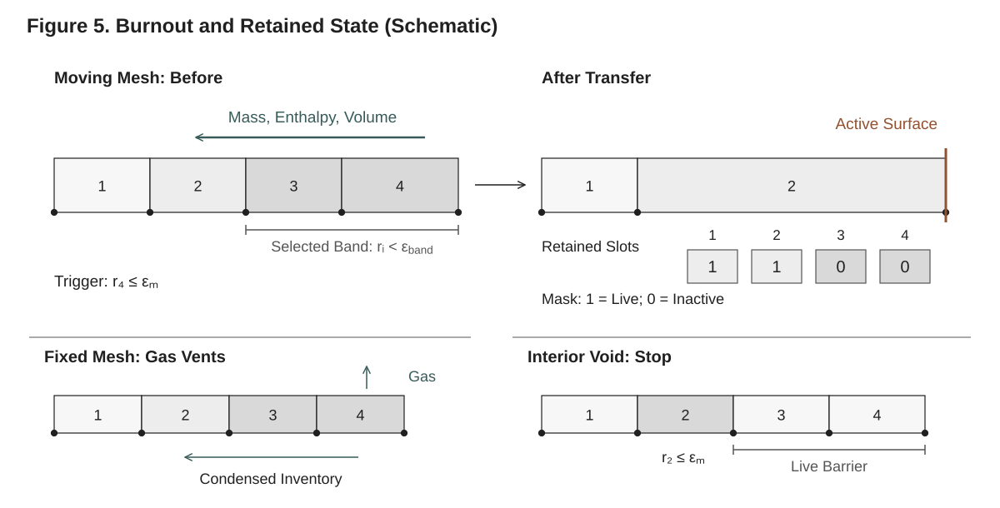
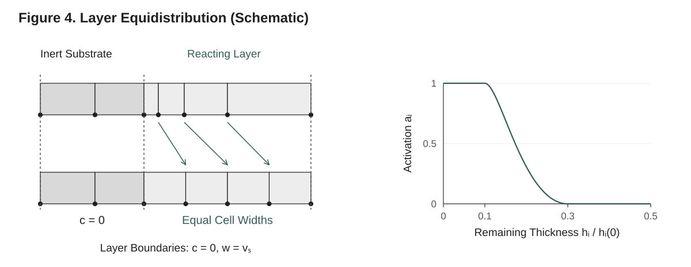

# 10. Burnout and the Correction

When a layer of solid gasifies completely, its cells empty. `solve` carries a
layer through burnout by **cell deactivation**: a cell whose condensed mass
falls below a small fraction of what it started with leaves the system, its
inventories go to the live cell beneath it, its rows become identity rows,
and the boundary conditions move to the face of the outermost live cell. On
a moving mesh (`use_ale = true`) the cells of a vanishing layer are kept
thinning together by the **equidistribution correction**, a mesh velocity
relative to the solid, so that the layer leaves in as few events as possible.
This chapter shows how to turn deactivation on, what every numerical
parameter means and defaults to, how to read what happened, and inside which
envelope the burnout path is verified. For the underlying theory (the
block-and-band rule, the conservative transfer, the masks, event location)
see Technical Reference §14; for the correction and the mesh motion,
Technical Reference §11.

> **Coordinate reminder.** `z = 0` is the back face (boundary tag
> `:bottom`); `z = L` is the exposed surface (tag `:top`). Heat enters from
> the top and the material recedes downward, so the surface cell is the
> outermost (highest-`z`) live cell. See
> Chapter 6 (Meshes and Geometry).

---

## 10.1 When to turn deactivation on

Deactivation is off by default. Turn it on when some cell can actually
empty, and size the mesh up front for everything else:

| Situation | Symptom without deactivation | What to do |
|---|---|---|
| A layer that gasifies completely (an ablating polymer, a layer on an inert substrate) | On a moving mesh the cells thin toward zero thickness, the domain test rejects many proposals, and the step count rises steeply | `deactivation = true` (§10.2) |
| A charring layer | none: its cells keep their char | nothing; deactivation removes no cell |
| The whole sample is consumed | the live thickness approaches zero | the thickness stop, `min_thickness` (§10.3), and the `:burned_out` outcome (§10.7) |
| A steep thermal or reaction front | the front is under-resolved | more cells or a mesh graded toward the surface (Chapter 6) |

What deactivation can remove follows from the reactions: a cell vanishes
when converting its components completely would leave less condensed mass
than the threshold of what it started with (§10.5.1). A wood whose
pyrolysis leaves 20 % char never reaches a 1 % threshold, whatever the
heating; it needs a char-oxidation reaction to gasify the residue before
deactivation has anything to do. At a reaction order other than one the test
is on volume: a cell that would keep 1 % or more of its initial volume is
not tested, so a char layer stays a resolved layer whatever its mass yield
(§10.4).

As a measure of the cost of leaving it off: the moving-mesh example of
§10.2.1, run without deactivation, thins its PMMA cells to below a nanometre
and fails at 327 s, return code `:DtLessThanMin` and outcome `:pore_closure`,
after 6372 accepted steps and 5797 domain rejections; with the layer
deactivated it reaches 600 s in 865 accepted steps and no domain rejection
(both at the tolerances of that example).

---

## 10.2 Deactivation



**Figure 5. Burnout and retained state (schematic).** Here $r_i$ is the remaining condensed-mass ratio. A threshold crossing selects a surface-connected band; on a moving mesh its inventories and volume transfer to the inward receiver, and a band beneath live cells goes the same way with those cells moving down into its slots. Dead nodes coincide at the merged face, while state slots and topology remain allocated. The insets show fixed-mesh gas venting and an interior void blocked by live material. A callback can re-test the receiver and emit multiple per-cell records; gas venting and a final cell without a receiver enter the loss ledger.

A deactivated cell keeps its slots: nothing changes size. The state vector,
the mesh arrays and the Jacobian's pattern keep their allocation for the
whole solve; a dead cell's rows are masked (identity rows of the Newton
matrix, their derivatives zero), and every kernel runs over the live cells,
with the boundary conditions applied at the face of the outermost live cell.

### 10.2.1 Turning it on through `solve`

Pass `deactivation = true`, on a moving or a fixed mesh. The complete script
below burns a 5.9 mm PMMA layer off 12 mm of Kaowool under 50 kW/m² with
radiative transfer through the solid, the configuration of the V-BO verification
cases with constant properties:

```julia
using Pyrolysis

pmma    = SolidComponent(:PMMA;    ρ = 1210.0, φ=.01, c = 1600.0, k = 0.2,   ε = 0.96, λ = 2e-5, α = 2.37)
kaowool = SolidComponent(:KAOWOOL; ρ = 256.0, φ=.8,  c = 1100.0, k = 0.058, ε = 1.0,  λ = 2e-5, α = 3.1e4)
mma     = GaseousComponent(:MMA;   M = 0.1, c = 1500.0, k = 0.02,)
material = Material(
    name = :PMMA_on_Kaowool,
    components = (pmma, kaowool, mma),
    reactions = (Reaction(:gasification, 1 => 3; A = 1.35e11, E = 164e3, h = 8.7e5),),
)

# 30 cells across the PMMA, the Kaowool at the same pitch; the PMMA–Kaowool
# interface falls on a node.
L_pmma, L_kw, n_pmma = 5.9e-3, 12e-3, 30
dz = L_pmma / n_pmma
n_kw = round(Int, L_kw / dz)
mesh = uniform_mesh((n_pmma + n_kw) * dz, n_pmma + n_kw)
z_if = n_kw * dz

bcs = BoundaryConditionSet(
    thermal = (
        top = RadiativeFluxBC(50e3) +              # diffuse: crosses at the PMMA's ε = 0.96
              RadiativeBC(T_inf = 298.0) +
              ConvectiveBC(h = 8.2, T_inf = 298.0),
        bottom = RadiativeBC(T_inf = 298.0),       # an open back at the Kaowool's ε = 1
    ),
    mass = (top = AmbientGasBC(GasReservoir(P=0., T=300.)), bottom = ImpermeableBC()),
)
problem = PyrolysisProblem(
    mesh = mesh,
    material = material,
    bc_set = bcs,
    T_initial = z -> 300.0,
    ξ_initial = [z -> z > z_if ? 1210.0 : 0.0, z -> z > z_if ? 0.0 : 256.0, z -> 0.0],
    tspan = (0.0, 600.0),
    output_times = collect(0.0:1.0:600.0),
)

sol = solve(problem;
    use_ale         = true,          # the mesh moves with the solid
    deactivation    = true,          # cells below the threshold leave the system
    radiation_model = RADIATIVE_TRANSFER,
    min_thickness   = 1e-3,          # [m] stop if the live column ever thins this far
)

sol.retcode                          # :Success
sol.statistics.invocations           # 2: the PMMA layer left in two events
sol.extras.live_cells[end]           # 61: the Kaowool cells
sol.extras.thickness_history[end]    # ≈ 0.012 m: the bare substrate
```

On this deck the PMMA leaves in two events: 25 cells at t ≈ 316.9 s into the PMMA
cell beneath them, then the last 5, next to the Kaowool, at t ≈ 330.1 s into the top
Kaowool cell. The solve runs on to 600 s heating the bare substrate.

| Keyword | Default | Meaning |
|---|---|---|
| `deactivation` | `false` | Deactivate cells during the solve. |
| `threshold` | `1e-2`; at an order other than one a tenth of the limiter's `conversion_threshold` | `ε_m`: a live cell deactivates when its condensed (solid and liquid) mass falls below this fraction of its own initial condensed mass, or at an order other than one when its reactive inventory falls below this fraction of its reactive reference (§10.4). Also scales the mass rows' absolute tolerances. |
| `band` | `nothing` | `ε_band`, in `[threshold, 1)`: on a moving mesh, the contiguous cells around a crossing cell below this fraction of their initial condensed mass go with a cell that crosses the threshold (§10.4). `nothing` gives `max(threshold, 0.1)` when the equidistribution correction moves some layer, `threshold` otherwise. |
| `correction` | `nothing` | The mesh velocity relative to the solid on a moving mesh (§10.5). `nothing` installs the equidistribution correction by the rule of §10.5.1. |
| `lagrangian` | `nothing` | Node ids that always move with the solid, the layer interfaces. `nothing` gives, under an equidistribution correction, every interior node between cells that start with different condensed components. |
| `use_ale` | `false` | Move the mesh with the solid (node positions and velocities enter the state). |
| `min_thickness` | `1e-6` | [m] On a moving mesh, end the solve when the live thickness falls below this (§10.3). Must be positive. |

Choose the mesh mode by the material, not by cost. A fixed mesh keeps every
cell's volume, so a gasifying layer thins in *density*, and only the
outermost live cell can go (§10.8). The layer then burns top down when the
surface cell is the hottest, as under surface absorption. Under radiative
transfer the surface cell of a regressing polymer loses its emission and
convection at the face and empties last, the cells beneath it nearly together. A
fixed-mesh solve therefore ends at the first cell below the surface that reaches
the threshold under a live one, warns, and returns outcome `:interior` (§10.7).
The same deck as above on a fixed mesh stops this way at t ≈ 172.8 s: the exposed
cell goes first, then the cell beneath the new exposed cell crosses.
A fixed mesh with deactivation suits a layer that burns top down; use
`use_ale = true` for materials that regress.

Deactivation is a line's: on a mesh of more than one dimension `setup`
refuses it (cells there leave by element death, a residual-level building
block, Technical Reference §14).

### 10.2.2 What `setup` and `solve` install

With `deactivation = true`, `setup` builds the deactivation state
(`cp.deactivation`, a `CellDeactivation` holding the threshold, the band,
each cell's initial condensed mass, the events and the tables of the solve by
slot) and, on a moving mesh,
decides the correction (§10.5.1). `solve` then adds to the integrator's
callbacks:

1. a **located deactivation event**, a continuous callback on the smallest
   threshold margin of the live cells (§10.6);
2. an **end-of-step event**, which deactivates every cell below the threshold
   at the end of an accepted step, the safety net for a crossing the location
   does not see;
3. on a moving mesh under the equidistribution correction, the **layer-time
   event**, which estimates each layer's equidistribution time at its first
   activation and again when a cell passes `r_lo` (§10.5.3);
4. on a moving mesh, the **thickness stop** (§10.3).

After each deactivation the algebraic rows are swept to consistency (the radiative
face fluxes under `RADIATIVE_TRANSFER`, the node velocities on a moving mesh), the
result is tested for admissibility, and the integrator restarts with the
step its policy names (Chapter 11). None of these callbacks is a keyword of
its own; they are wired by `solve` and `integrate` from the keywords above.

### 10.2.3 The merge conserves mass and energy

Every component mass of the dead cells goes to the receiver, the live cell
beneath them, so the masses are conserved exactly; on a fixed mesh the
receiver takes the condensed masses only, and the dead cell's gas is vented
and recorded (§10.8).

The receiver's temperature follows from the **summed sensible enthalpy** of
everything it takes, not from a volume average: with `m_j` the merged masses,

```
Σ_j m_j h_j(T_merged)  =  H_receiver + Σ_dead H_dead,     h_j(T) = ∫_{T_ref}^{T} c_p,j(T′) dT′
```

solved by the caloric inversion, exact for any temperature-dependent
`c_p,j(T)`, and with every component included, gas and condensed alike,
the same heat capacity the energy rows store. The energy state (the
temperature, or the enthalpy inventory under `energy_state = :enthalpy`) is
set from it. The small regularization the caloric extension carries in a
cell far below its heat-capacity floor is not transferred; what the merged
cells held of it beyond the receiver's is written to the event.

On a moving mesh the receiver also absorbs the dead cells' volume: its far
face moves out to enclose the merged volume, and every node of the dead
cells collapses onto it. The merge never destroys pore space: the merged
volume is the larger of the summed volumes and the merged skeletal volume
plus the summed pore volumes, the difference written to the event as
created volume. The conversion-history pair of a variable-cross-section
material goes to the receiver with the masses.

A receiver keeps its own initial condensed mass as its reference, so a
merged cell deactivates only once its whole merged inventory is below `ε_m`
of what it started with. The Kaowool cell of §10.2.1, holding the PMMA
residue, never does.

### 10.2.4 Inspecting what happened

Dead cells read as `NaN` in `sol.T`, `sol.ξ` and `sol.cell_centers`, and the
nodes beyond the outermost live one read `NaN` in `sol.z` and
`sol.correction_velocity`; `sol.m` holds zeros there. A state saved at an
event's own time is the one after the event. The events and the series:

| Where | What |
|---|---|
| `sol.events` | One `DeactivationEvent` per dead cell, in order: `t`, `invocation` (shared by the cells one event deactivates, numbered from one), `cell` and `receiver` as cells of the initial mesh (the receiver zero when none was left), `fraction` (its condensed mass over its reference when it went), `rows`, `created_volume` [m³], `lost_mass` [kg, per component], `lost_enthalpy` [J], `regularization` [J], `origin` (the initial cell in each slot after it), `reference_updates`. A merge of several cells records the outermost first, with the merge's created volume and losses on that first event. |
| `sol.statistics.invocations` | The events that deactivated cells. |
| `sol.outcome` | How deactivation or the thickness stop ended the solve (§10.7). |
| `sol.extras.deactivation_times` | The time of every deactivation, one entry per dead cell [s]. |
| `sol.extras.live_cells` | The live cells at every saved time. |
| `sol.extras.thickness_history` | The distance from the first node to the outermost live node [m]. |
| `sol.extras.min_cell_thickness` | The thinnest live cell [m]. |
| `sol.correction_velocity` | The node corrections `c = w − v_s` [m/s], `n_nodes × n_times`, on a moving mesh. |

```julia
for k in unique(e.invocation for e in sol.events)
    es = filter(e -> e.invocation == k, sol.events)
    println("invocation $k at t = $(first(es).t) s: $(length(es)) cells into cell ",
            first(es).receiver, ", largest fraction ", maximum(e.fraction for e in es))
end
# invocation 1 at t = 316.9… s: 25 cells into cell 66, largest fraction 0.0873…
# invocation 2 at t = 330.0… s: 5 cells into cell 61, largest fraction 0.0102…
```

The largest fraction is the most any cell of an invocation still held when it
went; cells above the band stay for a later invocation, as the 5 cells next to
the Kaowool do here (§10.4). That residue goes to the receiver, which gasifies it at once, so
the mass-loss rate shows a short burst just after the event, whose
convergence under refinement is part of the envelope (§10.9).

`sol(t)` reconstructs the fields at `t`
with the mask and the tables of the last event at or before `t`, and refuses a `t` strictly
inside a saving interval that an event separates, since the integrator's
interpolant there is not the trajectory; read the saved states on either
side instead (Chapter 9).

The mass and energy ledgers count what the events took out:
`conservation_audit(sol)` closes the live inventories against the boundary
fluxes and the events' lost masses, lost enthalpy and regularization, by the
trapezoid over the saved series; with a `ConservationRecorder` passed as
`callback`, `conservation_audit(sol, rec)` integrates the fluxes over every
accepted step up to the located event's time (Chapter 9, Technical
Reference §16):

```julia
rec = ConservationRecorder()
sol = solve(problem; use_ale = true, deactivation = true,
            radiation_model = RADIATIVE_TRANSFER, min_thickness = 1e-3, callback = rec)
audit = conservation_audit(sol, rec)
audit.mass.relative, audit.energy.relative
```

### 10.2.5 Deactivation and the Jacobian

Deactivation keeps the state size and the Jacobian's pattern: a dead row
keeps its entries in the pattern, and its derivative is zero (a differential
row) or its own unknown (an algebraic row), so it is an identity row of the
Newton matrix. The colored Jacobian and the linear solver run unchanged
through burnout, and the structure the `StructuredKLU` factorization has
seen only grows (Chapter 11). There is nothing to configure.

A deactivation is a discrete rewrite of the state, but its time is a smooth
function of the parameters: a located event happens at the first root of the
threshold margin. Finite-difference sensitivities through a burnout are
therefore well defined, with a step and tolerance chosen by the convergence
check of §13.4.1.

---

## 10.3 The thickness stop

On a moving mesh `solve` ends the solve cleanly once the live thickness, the
distance from the first node to the outermost live node, falls below
`min_thickness` (default `1e-6` m), with return code `:Terminated` and
outcome `:min_thickness`:

```julia
sol = solve(problem; use_ale = true, deactivation = true,
            radiation_model = RADIATIVE_TRANSFER, min_thickness = 15e-3)  # stop at 15 mm
sol.retcode, sol.outcome     # (:Terminated, :min_thickness)
succeeded(sol)               # true: a stop the caller asked for
```

The stop is a located event, so the solve ends at the crossing and the state
there is saved. On a fixed mesh the thickness does not change and there is no
stop. A layer on a substrate, as in §10.2.1, never thins below the substrate's
thickness (12 mm there), so the default `min_thickness` never fires; the
solve ends on the bare substrate instead.

---

## 10.4 The threshold and the near-threshold band

**The threshold** `ε_m` (`threshold`, default `1e-2`) is a fraction of each
cell's own initial condensed mass: a live cell is below it when its solid and
liquid masses sum to less than `ε_m` times what they summed to at the start.
A cell that started with no condensed mass never deactivates. The threshold
also sets the mass rows' absolute tolerances (`reltol · ε_m` times the cell's
initial condensed mass) and, on a moving mesh, the position and velocity
tolerances, so a smaller threshold also tightens the integration (Chapter 8).

**The band** `ε_band` (`band`) is read on a moving mesh only. When a live
cell crosses the threshold, the contiguous run of live cells from the
outermost one inward whose condensed mass is below `ε_band` of their
reference goes with it, in one merge into the live cell beneath the run:

- the run must hold a cell below `ε_m`; a run that does not, or an outermost
  cell above the band, leaves the cells where they are;
- a run that reaches the innermost cell leaves that cell, holding the run's
  inventories, as the survivor;
- after a merge the receiver, holding the run's inventories against its own
  reference, is tested in turn, and a run below the band with a cell below
  `ε_m` that starts there merges on in the same invocation;
- the last live cell, once below `ε_m`, goes with no receiver, its
  inventories written to the event as lost, and the solve ends with outcome
  `:burned_out` (§10.7).

The band exists because the cells of a vanishing layer never reach the
threshold at exactly the same time. Under the equidistribution correction
they thin together, but when the first crosses `ε_m` the slowest still holds
a few percent of its mass, or more: on the deck of §10.2.1 the first 25 cells
leave holding up to 8.7 %, and the 5 next to the Kaowool, still above the band,
leave 13 s later. Without a band the
layer would leave one cell at a time, each event a restart, and a cell beneath
the surface can cross first and leave from under live cells. The band should
therefore exceed what the slowest cell of a layer keeps when the first reaches
the threshold. On the verification decks the largest fraction a band of 0.1 merges is
0.3 to 9.9 % at `ε_m = 3e-3` and 1.0 to 10 % at `ε_m = 1e-2`, and the decks that take
more than one invocation had cells above it (§10.9). The default, `0.1`, takes most of a
layer in one event; the rest follows in another.

At a reaction order other than one the threshold reads the cell's **reactive
inventory**, the mass of each reaction's condensed reactant, against the sum of
the reactions' lineage references (a first-order reaction's being its reactant's
initial mass); the band reads the same measure. Only a cell that vanishes is tested. One
that would keep 1 % or more of its initial volume once fully converted
(`retained_volumes`) is a layer the front burns beneath: merged into its neighbour it
would stop resolving that layer, and the reactant then taken in would burn at the
temperature of the middle of it. A char that keeps its volume moves the mass-loss rate
by about 20 % integrated that way, at any mass yield; 5 % of the volume moves it
0.04 % at order 0.5. Such a cell stays, and the deck runs as it does without
deactivation. A cell that started with none of a reaction's lineage, an inert layer, is
not tested either, and the last live cell, which has no receiver, is tested on its
condensed mass, so a column that leaves a residue ends with that residue. The default
`conversion_threshold/10` puts a cell's exit a decade inside the limiter's onset.
Measured on the PMMA cone at order 0.5 against the same deck without deactivation: 0.06 %
of the peak at 72 cells, 0.03 % at 144, 0.01 % integrated at both. Above order one the
cells decay algebraically and may reach the thickness stop before this default, which
is not an error; a larger `threshold` makes them leave earlier. At order zero the
mass-loss rate is a staircase of single-cell burnouts, so its pointwise difference from
any neighbouring run is a whole step (Technical Reference §6.10).

| Keyword | Default | Constraint |
|---|---|---|
| `threshold` | `1e-2`; `conversion_threshold/10` at an order other than one | the fraction `ε_m` |
| `band` | `max(threshold, 0.1)` with a moving correction, `threshold` otherwise | `threshold ≤ band < 1`, refused otherwise |

On a fixed mesh the band is not read: the outermost live cell goes while it
is below `ε_m` (§10.8).

When comparing burnout with another solver, record both the stopping
criterion and the residual inventory. Gpyro V2's active cutoff uses a
remaining condensed-mass ratio and leaves an inert residual; its manual
describes a volume ratio. FDS wall disappearance and ThermaKin2Ds element
adjustment are also different from our located deactivation event.
Technical Reference §14.8 explains the consequences. Equal numerical
threshold values do not necessarily define the same burnout state.

---

## 10.5 The equidistribution correction



**Figure 4. Equidistribution within a vanishing layer.** The left schematic isolates redistribution toward equal cell widths. Correction is zero in the inert substrate and at layer boundaries; those boundaries can still move with the solid. The curve evaluates the implemented thickness-activation switch. Its input is remaining **thickness**, distinct from the **condensed-mass** criterion for burnout in Figure 5.

On a moving mesh the nodes move with the solid velocity plus a correction,
`w = v_s + c`. With `c = 0` (`NoCorrection()`) the mesh is Lagrangian: each
cell keeps its solid, and the cells of a layer thin at their own rates, the
hottest first. The **equidistribution correction** moves the interior nodes
of a vanishing layer relative to the solid, toward the thicker cell, so that
the layer's cells thin together and reach the threshold close
together; the inventories then cross the faces at the relative velocity
`−c`, by an upwind flux with a limited reconstruction (Technical
Reference §11). The balance rows hold the solid velocity `w − c` to each
cell's volume balance, so the solid's motion is unchanged; only the mesh
slides through it.

At an interior node `n` of a layer of `n_layer` cells, between cell `n − 1`
(inward) and cell `n`,

```
c_n = ā_n n_layer² (Δz_n − Δz_{n−1}) / τ_eq
```

which relaxes `Δz` itself toward a common value over the layer in about
`τ_eq/π²`, whatever `n_layer`. `Δz_i` is the thickness of cell `i`, `ā_n` the
node's activation (§10.5.2) and `τ_eq` the layer's equidistribution time
(§10.5.3).

### 10.5.1 The installation rule

A solve that names no `correction` gets `EquidistributionCorrection()` when
three things hold: the mesh moves (`use_ale = true`), cells are deactivated
(`deactivation = true`), and deactivation can remove some cell, that is, some
cell's components, converted completely, would leave less condensed mass
than `threshold` of what it holds. Otherwise it gets `NoCorrection()`.

What a component leaves is its **residue**: the condensed yields of a
reaction that consumes it, each weighted by that product's own residue, the
largest over the reactions that consume it (competing reactions: the least
gasifying one bounds what is left). It is zero for a component every
consuming reaction gasifies and one for an inert component. The function is
reachable through `Internal`:

```julia
using Pyrolysis.Internal: residues
residues(material)       # (0.0, 1.0, 0.0): PMMA gasifies, Kaowool is inert, MMA is a gas
```

Under the installed correction only the layers deactivation can remove move
(`layers = :vanishing`); a layer that cannot vanish, the Kaowool here, keeps
its mesh with the solid, its correction exactly zero. A layer is bounded by
the back node, the Lagrangian nodes and the end nodes; by default the
Lagrangian nodes are the layer interfaces, every interior node between cells
that start with different condensed components (node 62 of the deck of
§10.2.1, at `z_if`). A `lagrangian` list given explicitly must contain every
such interface, or `setup` refuses it: the correction would otherwise move
the mesh across a change of composition and mix the layers.

### 10.5.2 The activation thresholds

The correction acts only where a layer has begun to vanish. Each cell has a
switch

```
a_i = 𝒮((ln r_hi − ln(Δz_i/Δz_i(0))) / (ln r_hi − ln r_lo)),     𝒮(x) = x²(3 − 2x), clamped to [0, 1]
```

zero while the cell keeps at least `r_hi` of its initial thickness, one at
and below `r_lo`, continuously differentiable in `ln Δz` between. Node `n`'s
activation is the smooth "or" of the switches of its two cells,
`ā_n = 1 − (1 − a_{n−1})(1 − a_n)`.
The default `activation = (r_hi, r_lo) = (0.3, 0.1)`: a node starts to move
once one of its cells has lost 70 % of its thickness. The correction is also
zero at every bounding node of a layer and beside a dead cell.

### 10.5.3 The layer time

The equidistribution time of a layer is estimated twice (`ActivationTime()`),
each time from the layer's thickness `L_layer` and its thinning rate `L̇_layer`
at that moment: when its first cell activates (falls below `r_hi` of its
initial thickness), and again when a cell first falls below `r_lo`:

```
τ_eq,k = λ_τ L_layer / |L̇_layer|,     λ_τ = 1.8 (the keyword λ),     k = 1, 2
```

so the layer synchronizes (in about `τ_eq,k/π²`) within about a fifth of the
life `L_layer/|L̇_layer|` each estimate implies. The first estimate sets the
layer's gain. The second, taken near the layer's end where it thins faster,
takes over through a second switch of each cell, `a_i^lo = 𝒮(x_i − 1)` with
`x_i` the argument of the switch of §10.5.2: zero while the cell keeps at
least `r_lo` of its initial thickness and one at and below `r_lo²/r_hi` of it
(1/30 by default). With `ā_n^lo` the smooth "or" of a node's two cells'
second switches,

```
c_n = (ā_n/τ_eq,1 + ā_n^lo (1/τ_eq,2 − 1/τ_eq,1)) n_layer² (Δz_n − Δz_{n−1})
```

which runs at `τ_eq,1` until the cells pass `r_lo` and at `τ_eq,2` below
`r_lo²/r_hi`. Neither estimate changes the right-hand side where it is taken:
each switch leaves zero with zero slope there. Before its first estimate a
layer has no correction; a layer not thinning at its first estimate gets none
until its second, and one not thinning at its second keeps its first. Each
estimate is taken once; a cell that re-activates later changes nothing.

The rate scales with the physical rates and `λ_τ` is a pure number, so a deck
whose rates are all multiplied by `s` gets both times divided by `s`, and the
correction scales with it; one fixed `τ` for every deck does not. No estimate
reads the solve's time span.

The estimates are located events of their own, so each is taken at the
crossing, not at the end of a step. After the solve, the bound correction
holds every layer's estimates:

```julia
c = sol.definition.closure.correction    # the correction bound to the mesh
c.first_estimate                         # [τ_eq,1] of each moving layer [s]
c.time, c.set_at                         # its latest estimate and the time it was taken [s]
```

On the deck of §10.2.1 the PMMA layer's first estimate is about 745 s, taken at
t ≈ 81 s, and its second 353 s, at t ≈ 167 s.

| `ActivationTime` keyword | Default | Meaning |
|---|---|---|
| `λ` | `1.8` (`ACTIVATION_TIME_FACTOR`) | `λ_τ` in `τ_eq,k = λ_τ L_layer/\|L̇_layer\|` at each estimate |

A number for `τ` gives every layer that one fixed time from the start, and the
second switch then changes nothing; `Pyrolysis.Closures.EQUIDISTRIBUTION_TIME`
(720 s) is such a value.

### 10.5.4 The layers

`layers = :vanishing`, the default, moves only the layers deactivation can
remove. `layers = :all` moves every layer, including those that cannot vanish,
for decks that exercise the correction itself.

### 10.5.5 Choosing a correction yourself

Pass `correction` to override the rule:

```julia
# The installed correction, written out:
sol = solve(problem; use_ale = true, deactivation = true, radiation_model = RADIATIVE_TRANSFER,
            correction = EquidistributionCorrection(
                τ = ActivationTime(λ = 1.8),   # or a number [s]: one time for every layer
                activation = (0.3, 0.1),       # (r_hi, r_lo)
                layers = :vanishing))

# The Lagrangian mesh: each cell keeps its solid.
sol = solve(problem; use_ale = true, deactivation = true, radiation_model = RADIATIVE_TRANSFER,
            correction = NoCorrection())
```

`EquidistributionCorrection` refuses a non-positive `τ` and an activation
without `0 < r_lo < r_hi`; any correction other than `NoCorrection()` needs
`use_ale = true`. Under
`NoCorrection()` the band defaults to the threshold, so only the cells
already below the threshold go in an event, one invocation to a cell or so: a tail
handed to a receiver delays it past its inward neighbour, so cells leave from under
live ones (V-BO-11), and the live cells above move down a slot. On the deck of
§10.2.1 under radiative transfer the Lagrangian mesh takes the PMMA off in 30
invocations, 17 of them from under live cells, in 1118 accepted steps against the
correction's two invocations and 865 steps. A cell beneath a skin that still holds its
material would end the solve instead (§10.7). The correction is what carries a layer
through burnout in one or two events.

`correction = PrescribedCorrection(w)`, with `w(x, t)` a function of the node
position and time, prescribes every node's velocity, moving the mesh over a
solid at rest; it is a verification device (the material must not react) and
cannot be combined with deactivation.

---

## 10.6 Located events

A deactivation event is located inside the step: a continuous callback watches
the smallest margin of a live cell's condensed mass over its threshold,
`(m − ε_m m_ref)/(ε_m m_ref)`, and
the event is applied at the interpolated state at its first downward root.
There the crossing cell holds exactly its threshold, so the tests of §10.4
are widened by the relative tolerance (`1 + reltol` times `ε_m` and
`ε_band`): the crossing cell goes, and with it the cells of its run within
the tolerance of their thresholds, whose crossings the solve does not
resolve from the located one. A cell within `reltol` of its threshold inward
of a cell above the band stays.

Location makes the event time converge with the tolerance and puts the
event on the trajectory, which is what makes a deactivation time a smooth
function of the parameters (§10.2.5). The end-of-step event is the safety net:
it takes the cells below the threshold at the end of an accepted step, for a
crossing the downward-root search does not see.

After every event the integrator restarts with the step its policy names:
the default Rodas5P policy proposes its initial-step estimate at the state
the event left, the FBDF policy a forced step of 1e-6 s, the KenCarp4 policy
its own proposal (Chapter 11).

---

## 10.7 Outcomes and the interior void

`sol.outcome` says how deactivation or the thickness stop ended the solve;
`sol.retcode` is the integrator's return code. `succeeded(sol)` accepts a
complete run and the two terminations the model intends; `completed(sol)` is
the strict test, `:Success` only.

| `retcode` | `outcome` | `succeeded` | Meaning |
|---|---|---|---|
| `:Success` | `:none` | `true` | The solve reached the end of `tspan`, with or without deactivations. |
| `:Terminated` | `:burned_out` | `true` | The last live cell went; its inventories are written to the last event as lost. |
| `:Terminated` | `:min_thickness` | `true` | The live thickness of a moving mesh fell below `min_thickness` (§10.3). |
| `:Terminated` | `:interior` | `false` | A cell below the threshold lies inward of a live cell on a fixed mesh, or beneath a skin on a moving one; the solve warns and ends. |
| `:DtLessThanMin` | `:pore_closure` | `false` | The domain test kept rejecting a cell whose porosity left the resolved pore domain until the step fell below `dtmin`: its pore volume closed, or fell to its own mass, thermal and geometry uncertainty. Tighter tolerances resolve the second. |
| `:Failure` | `:none` | `false` | The state after an event was inadmissible (a receiver outside its own mass tolerances, crossed nodes, a cell at or below absolute zero, under gas transport a porosity outside `[0, 1]`), or no consistent node velocities exist after it; the solve warns naming the event's time. |

The state a solve ends on is always saved, whether or not `saveat` names its
time.

**The interior void.** A cell can reach the threshold under live cells in two ways.
On a moving mesh a tail handed to a receiver delays it past the cell inward of it, so
that cell crosses first under a receiver that is itself spent. That void is the
transfer's, and the pass closes it: the cell merges into the live cell beneath it, or a
bottom run into the live cell above it, and the live cells above move down into its
slots with their tables, so the live cells are always `1:top_live_cell`.
`interior_events(sol)` lists these events and `show(sol)` counts them.

A cell beneath the surface can also empty under a skin that still holds its material:
a pocket, physical in PMMA, which the model has no gap to represent. A live cell
outward of the crossing is a skin when it holds `VOID_SKIN` (10) thresholds or more of
its reference, or is never tested. The cells above a tail's void hold at most 6
thresholds, so a thin, nearly spent skin reads as spent. On a fixed mesh the geometry
stays with its slots, so any cell under a live one is such a stop. The solve warns
once,

```
┌ Warning: solve(): cell 89 is below its threshold inward of a live cell at t = 172.81…; the solve ends with outcome :interior
```

and ends with `:Terminated`: the regressing polymer under radiative transfer on a
fixed mesh (§10.2.1; the V-BO-05 case asserts the stop). The remedy at order one is the moving mesh
with its correction, which carries such a layer through burnout in one or two events.

---
## 10.8 Fixed-mesh deactivation: the gas is vented

On a fixed mesh (`use_ale = false`) no node moves, so there is no correction
and no band. The outermost live cell goes while it is below `ε_m`, into the
cell beneath it, each merge re-testing the receiver with the dead cell's
condensed inventories added; several cells can go in one invocation that
way.

The receiver keeps its volume and takes the dead cell's **condensed**
inventories only. Its pores could hold the dead cell's gas only at a higher
pressure, so that gas is vented: its masses and sensible enthalpy are written
to the event as `lost_mass` and `lost_enthalpy`, and the conservation audit
counts them as having left the live region. The receiver's temperature
follows from the summed sensible enthalpy of what it takes (§10.2.3).

```julia
sol = solve(problem; deactivation = true, radiation_model = SURFACE_ABSORPTION)
sol.statistics.invocations                       # one cell per event here: the layer burns top down
vented = sum(sum(e.lost_mass) for e in sol.events)
```

Under surface absorption the surface cell is the hottest and empties first,
so the layer of §10.2.1 burns top down, one cell per event, with no interior
void (the V-BO-02 case). Under radiative transfer it does not (§10.7).

---

## 10.9 The supported envelope

The burnout path (the equidistribution correction with its layer time estimated
twice, the near-threshold band, located deactivation events) is
verified under joint refinement of the mesh and the tolerance on five decks:
a 5.9 mm PMMA layer on Kaowool under 50 kW/m² on a uniform mesh (V-BO-01) and
on a mesh graded threefold toward the surface (V-BO-06); the same layer with
a second, slower solid mixed in, graded from none at the substrate to half at
the surface (V-BO-07); a 1 mm layer (V-BO-08); and the 5.9 mm layer with a
convective loss in place of re-radiation and an adiabatic back. The V-BO
cases are listed in Technical Reference §18.

### 10.9.1 The numerical parameters

| Parameter | Keyword | Default | Verified |
|---|---|---|---|
| threshold `ε_m` | `threshold` | `1e-2` | `3e-3`, `1e-2` |
| band `ε_band` | `band` | `0.1` under the correction | `0.1`; `0.009` and `0.03` measured as well, and the threshold alone (below) |
| activation `(r_hi, r_lo)` | `EquidistributionCorrection(activation = …)` | `(0.3, 0.1)` | `(0.3, 0.1)`, `(0.7, 0.3)` |
| layer time `τ` | `EquidistributionCorrection(τ = …)` | `ActivationTime()`, `λ = 1.8` | the default |
| tolerance | `reltol` (`abstol` the case's) | `1e-6` | `1e-6`, `1e-7` |
| energy form | `energy_state` | `:temperature` | both |
| cells across the layer | the mesh | — | 30 to 240 (10 to 80 on the 1 mm layer) |

### 10.9.2 Inside the envelope

Inside the envelope every quantity of interest (complete burnout, the mass
lost, the mass ledger and a converged surface balance at every accepted step)
is within its case's tolerance at every resolution, and the end-of-layer burst
converges: the largest per-step excess of N cells over 2N and the successive L1
differences fall at least 1.5× per doubling. On V-BO-01 the tolerances are
0.01 mm on the final thickness, 0.3 percentage points on the mass loss and 3e-5
on the mass ledger's relative closure.

- `ε_m = 1e-2` with `ε_band = 0.1`, the default, is inside on all five decks
  from 30 cells across the layer (10 on the 1 mm layer) under the default
  activation; under `(0.7, 0.3)` the mixed layer and the convective-loss deck are
  inside from 60 cells.
- `ε_m = 3e-3` with `ε_band = 0.1` is inside on the uniform and the 1 mm layers
  from 30 cells, on the convective-loss deck from 30 (from 60 under `(0.7, 0.3)`)
  and on the graded mesh from 60; the
  mixed layer is inside from 60 cells under the default activation and outside
  under `(0.7, 0.3)`, where it does not burn out at 30 and 60 cells.

Both hold at reltol 1e-6 and 1e-7; the enthalpy form is checked at each deck's CI resolution.

The band decides how much of a layer one invocation takes: the largest fraction
a band of 0.1 merges is 0.3 to 9.9 % at `ε_m = 3e-3` and 1.0 to 10 % at `1e-2` on
these decks, and cells still above it go in a later invocation. With a band no
wider than the threshold the layer leaves one cell per event.

The number of deactivation invocations is reported, not a criterion. At the
default threshold it is two on the uniform layer, two on the graded mesh (one
under `(0.7, 0.3)`), one on the mixed and the 1 mm layers and three or four on
the convective-loss deck; at `ε_m = 3e-3` it is one on every deck but the
convective-loss deck, which takes two or three. The largest per-step rate just
after a layer's deactivation stays below the main peak on every deck but the
graded mesh at 30 cells, where it exceeds it by up to 9.5 %, and on that one too
from 60 cells.

### 10.9.3 The material parameters

Material parameters outside these decks (other materials, thicker or
charring layers, higher heating) are outside the verified envelope. A
refinement ladder adds V-BO-01 at 25 and 100 kW/m², at half and twice its
pre-exponential factor, and with its flux stepped after activation, at 30 to
120 cells, all within tolerance at every resolution in one or two invocations; the
burst converges on all but the 100 kW/m² deck and the raised flux. Outside these, run the same check on your own deck: solve at
two or three resolutions and two tolerances, and read the burnout quantities
you care about, `sol.statistics.invocations` and the events' largest
fraction against the band.

---

## 10.10 Summary of options and defaults

| Option | Where | Default | Section |
|---|---|---|---|
| `deactivation` | `solve`, `setup` | `false` | 10.2 |
| `threshold` | `solve`, `setup` | `1e-2`; `conversion_threshold/10` at an order other than one | 10.4 |
| `band` | `solve`, `setup` | `max(threshold, 0.1)` with a moving correction, else `threshold` | 10.4 |
| `use_ale` | `solve`, `setup` | `false` | 10.2.1 |
| `correction` | `solve`, `setup` | installed by rule | 10.5.1 |
| `lagrangian` | `solve`, `setup` | the layer interfaces | 10.5.1 |
| `min_thickness` | `solve`, `integrate` | `1e-6` m | 10.3 |
| `EquidistributionCorrection(; τ, activation, layers)` | exported | `ActivationTime()`, `(0.3, 0.1)`, `:vanishing` | 10.5 |
| `ActivationTime(; λ)` | exported | `1.8` | 10.5.3 |
| `NoCorrection()` | exported | — | 10.5.5 |
| `PrescribedCorrection(w)` | exported | — | 10.5.5 |

**Key correctness reminders.** Deactivation conserves every component mass
exactly (on a fixed mesh the dead cell's gas is vented and recorded) and the
sensible enthalpy of everything the receiver takes; the state size and the
Jacobian's pattern never change; on a moving mesh a cell leaves from under spent cells,
which move down a slot, while beneath a skin, and on a fixed mesh beneath any live cell,
a cell below the threshold ends the solve with outcome `:interior`; the band should exceed
the residue of a layer's slowest cell; and the verified envelope is that of §10.9. For the theory behind these
operations, see Technical Reference §11 (the mesh motion and the correction),
§14 (deactivation), §15 (the integrator and the Jacobian) and §16 (the
conservation ledgers).
