# MaCFP PMMA validation

The MaCFP condensed-phase working group's database holds property sets for one black
PMMA, each calibrated by an institution in its own code, with that institution's
predictions of a common set of targets (the MaCFP-2 targets) and of experiments in
the NIST gasification apparatus (the MaCFP-3 validation data). Pyrolysis.jl runs every
set as written; FDS 6.11.1, Gpyro V2 and ThermaKin2Ds 7 run the same decks. Each run is
compared with the institution's own submission, with the other codes' runs of the
same deck, and with the apparatus experiments. The submissions are each group's
calibrated model, not measurements, so agreement with them measures how faithfully a
code reproduces another code's model; the apparatus measurements are the experimental
test.

Data come from [MaCFP/matl-db](https://github.com/MaCFP/matl-db) at commit
`2772b0eb`. The decks, the runners and this page's generator are in
`scripts/macfp_pmma/` (its `README.md` describes each choice); the translation of each
deck for FDS, Gpyro and ThermaKin2Ds is described beside their runners in
`scripts/macfp_pmma/external/`.

## Scenario

The MaCFP-2 gasification targets expose a 6 or 12 mm slab at 293 K to 10, 25 or
65 kW/m² with no convection; the slab re-radiates to 293 K and its back is perfectly
insulated. The flux is absorbed at the surface emissivity. Pyrolysis.jl runs each case
on a moving mesh of 20 cells/mm with deactivation, at the default tolerances. A deck
that absorbs at its surface runs under `SURFACE_ABSORPTION`. A deck with an absorption
coefficient κ runs under `RADIATIVE_TRANSFER`: every cell absorbs and emits, the
heater is `Diffuse()`, and the insulated back is a mirror. The TGA targets heat one
50 µm cell from 300 K at 10 and 100 K/min.

| set | year | calibrated in | absorption | κ (1/m) | reactions | MaCFP-2 submission |
|---|---|---|---|---|---|---|
| Aalto_I | 2021 | FDS | in-depth | 3421 | 2 | yes |
| BUW-FZJ_A | 2021 | FDS | surface | – | 2 | yes |
| BUW-FZJ_B | 2021 | FDS | surface | – | 2 | yes |
| BUW-FZJ_C | 2023 | FDS | in-depth | 3434, 50000 | 4 | no |
| DBI_1 | 2021 | FDS | surface | – | 1 | yes |
| DBI_calibrated | 2023 | FDS | in-depth | 2250 | 1 | no |
| GIDAZE+ | 2021 | Gpyro | in-depth | 2870 | 1 | yes |
| NIST-StMU | 2023 | FDS | in-depth | 2620 | 2 | no |
| NIST | 2021 | FDS | surface | – | 1 | yes |
| UMD | 2021 | ThermaKin | in-depth | 2870 | 2 | yes |
| UMET_GP | 2021 | Gpyro | in-depth | 2700 | 2 | yes |
| UMET_TK | 2021 | ThermaKin | in-depth | 2700 | 2 | yes |

The sets Sandia_1, Sandia_2, Sandia_3, Sandia_4, Sandia_5, Sandia_6, UCLAN give kinetics only and run the TGA targets alone.

Each in-depth deck also runs variants that move one choice, and three variants run
what a group evidently ran:

| variant | what it changes |
|---|---|
| `collimated` | the heater as one beam along the normal, attenuated at κ rather than the diffuse field's 1.5κ |
| `fds_closure` | every component's κ × ln(1 + 2κΔz)/(1.5κΔz) at Δz = 50 µm: FDS's two-flux attenuation on its own cells (below) |
| `fds_matched` | `fds_closure` with the one item FDS cannot express aligned with FDS: no pyrolyzate enthalpy in the solid (UMD, UMET_TK); UMET_GP's second reaction first order, as FDS runs it on a shrinking cell |
| `surface` | `SURFACE_ABSORPTION`: no radiation in depth |
| `h5.33` | BUW-FZJ_A/B: convection h = 5.33 W/(m²·K) to 293 K, which their submissions include |
| `tablesC` | DBI_1, DBI_calibrated: the kelvin-valued c and k tables read as °C, as DBI_1's FDS runs read them (DBI_calibrated's are not published) |
| `T303` | Aalto_I: start and surroundings at 303.15 K, where their runs start |

FDS 6.11.1 runs all 12 sets,
Gpyro V2 runs Aalto_I, BUW-FZJ_A, BUW-FZJ_B, GIDAZE+, NIST, UMET_GP, UMET_TK, and ThermaKin2Ds 7 runs Aalto_I, BUW-FZJ_A, BUW-FZJ_B, GIDAZE+, NIST, UMD, UMET_TK in its
`MAX` mode (the absorbed radiation deposited in the element that absorbs most) and
Aalto_I, GIDAZE+, UMD, UMET_TK also in its
`RAND` mode (in an element drawn from the absorption distribution).

## Gasification against the submissions

Median over the six cases of the relative difference in the time to 50 % mass loss,
|Δt₅₀|, and in brackets in the peak mass-loss rate, |Δpeak|, against the institution's
submission (%). t₅₀ is the first saved time at or below half the initial mass; the
peak is the largest finite mass-loss rate. BUW-FZJ_A is reported on its own below.

| set | calibrated in | Pyrolysis.jl | FDS 6.11.1 | Gpyro V2 | ThermaKin2Ds MAX | ThermaKin2Ds RAND |
|---|---|---|---|---|---|---|
| Aalto_I | FDS | 1.9 (1.4) | 2.5 (2.0) | 4.1 (4.9) | 7.1 (8.0) | 1.2 (1.6) |
| BUW-FZJ_B | FDS | 9.6 (12.8) | 9.7 (12.8) | 8.7 (9.6) | 10.3 (14.2) | – |
| DBI_1 | FDS | 7.6 (1.0) | 8.0 (1.6) | – | – | – |
| GIDAZE+ | Gpyro | 3.6 (3.6) | 2.7 (4.3) | 0.1 (4.6) | 6.2 (13.6) | 5.4 (5.2) |
| NIST | FDS | 0.5 (0.7) | 0.5 (0.5) | 1.0 (1.7) | 0.7 (0.3) | – |
| UMD | ThermaKin | 0.8 (6.7) | 2.2 (9.1) | – | 7.6 (16.4) | 2.9 (0.8) |
| UMET_GP | Gpyro | 3.0 (5.4) | 6.0 (12.4) | 1.2 (1.7) | – | – |
| UMET_TK | ThermaKin | 5.5 (5.7) | 6.3 (6.7) | 5.3 (5.2) | 4.6 (5.9) | 6.1 (6.2) |

Where a set was calibrated in a code, that code's run of the deck checks the deck: Gpyro
reproduces GIDAZE+ to 0.1 %, FDS reproduces NIST to
0.5 % and Aalto_I to 2.5 %, and ThermaKin2Ds reproduces UMD to
0.4–0.8 % at 10 kW/m² in `MAX` mode and to
2.1–2.9 % at 25 and 65 kW/m² in `RAND` mode. Gpyro
reproduces UMET_GP to 1.2 % with the density held at its 293 K value, as every
deck holds it, and to 0.6 % with UMET's temperature-dependent density.
ThermaKin2Ds does not reproduce UMET_TK (4.6 % in `MAX`,
6.1 % in `RAND`, 4.3 % in `MAX` with UMET's ρ(T)).

On the in-depth sets Pyrolysis.jl's median |Δt₅₀| to the submission is
Aalto_I 1.9, GIDAZE+ 3.6, UMD 0.8, UMET_GP 3.0, UMET_TK 5.5 %. It is closer to the submission than the
calibration code's own run on Aalto_I, UMD (UMD's ThermaKin2Ds run taken in `MAX` at
10 kW/m² and `RAND` above) and farther on GIDAZE+, UMET_GP. UMET_TK's ThermaKin2Ds mode is
not known; Pyrolysis.jl (5.5 %) is between `MAX` (4.6 %) and `RAND`
(6.1 %) there.

## Code to code

Median |Δt₅₀| (median |Δpeak|) of Pyrolysis.jl's run of each deck against each other
code's run of the same deck (%). The 2023 sets NIST-StMU, DBI_calibrated and BUW-FZJ_C
have no MaCFP-2 submission; FDS runs them.

| set | absorption | FDS 6.11.1 | Gpyro V2 | ThermaKin2Ds MAX | ThermaKin2Ds RAND |
|---|---|---|---|---|---|
| Aalto_I | in-depth | 0.6 (0.7) | 2.0 (2.6) | 4.8 (5.7) | 0.7 (0.9) |
| BUW-FZJ_B | surface | 0.0 (0.0) | 1.0 (2.9) | 0.6 (1.1) | – |
| BUW-FZJ_C | in-depth | 0.7 (0.4) | – | – | – |
| DBI_1 | surface | 0.3 (0.6) | – | – | – |
| DBI_calibrated | in-depth | 0.7 (0.7) | – | – | – |
| GIDAZE+ | in-depth | 1.2 (1.6) | 3.5 (6.8) | 9.6 (18.1) | 2.1 (1.1) |
| NIST-StMU | in-depth | 0.7 (0.9) | – | – | – |
| NIST | surface | 0.0 (0.0) | 0.8 (1.2) | 0.3 (0.4) | – |
| UMD | in-depth | 1.0 (0.9) | – | 9.4 (19.8) | 1.9 (0.4) |
| UMET_GP | in-depth | 3.4 (5.7) | 2.2 (3.0) | – | – |
| UMET_TK | in-depth | 1.2 (0.8) | 0.2 (0.5) | 4.5 (6.6) | 0.7 (0.5) |

On the decks that absorb at the surface, Pyrolysis.jl and FDS solve the same problem and
agree to 0.0–0.3 % in t₅₀. On the in-depth decks the codes differ in how
the solid absorbs and emits the radiation (Technical Reference §8.9).

## Matched to FDS

FDS's in-depth model is a two-flux model with emission, like Pyrolysis.jl's, but its
sweep crosses a cell of width Δz with transmission 1/(1 + 2κΔz), where the diffuse
two-stream model transmits e^(−1.5κΔz). At an absorption coefficient of
ln(1 + 2κΔz)/(1.5Δz) the two agree cell by cell, in transmission and in emission
(`fds_closure`, taken at FDS's 50 µm cells). Where a deck holds an item FDS cannot
express, `fds_matched` also aligns it. FDS 6.11.1's runs of the same decks:

| set | factor on κ | aligned item | max \|Δt₅₀\| (%) | median \|Δt₅₀\| (%) | max \|Δpeak\| (%) | worst RMS ΔT top / back (K) | max \|Δm\| (g) | FDS 25 µm vs 50 µm: max \|Δt₅₀\| / \|Δpeak\| (%) |
|---|---|---|---|---|---|---|---|---|
| Aalto_I | 1.147 | – | 0.11 | 0.00 | 0.28 | 0.34 / 0.58 | 0.19 | 0.32 / 0.30 |
| BUW-FZJ_C | 1.146, 0.478 | – | 0.68 | 0.28 | 0.71 | 1.29 / 1.45 | 0.61 | – |
| DBI_calibrated | 1.203 | – | 0.23 | 0.15 | 0.36 | 0.90 / 0.38 | 0.61 | – |
| GIDAZE+ | 1.172 | – | 0.21 | 0.03 | 0.58 | 0.38 / 1.05 | 0.55 | 0.70 / 0.46 |
| NIST-StMU | 1.184 | – | 0.05 | 0.00 | 0.25 | 0.26 / 0.50 | 0.22 | – |
| UMD | 1.172 | no gas enthalpy | 0.10 | 0.03 | 0.53 | 0.83 / 0.62 | 0.41 | 0.43 / 0.46 |
| UMET_GP | 1.180 | reaction 2 first order | 0.32 | 0.04 | 0.43 | 1.87 / 0.19 | 0.30 | 0.32 / 0.21 |
| UMET_TK | 1.180 | no gas enthalpy | 0.19 | 0.00 | 0.20 | 0.23 / 0.30 | 0.14 | 0.31 / 0.21 |

Temperatures are compared at FDS's saved times while both runs hold more than 10 % of
their mass; masses are for the 10 cm × 10 cm sample. With the deck's κ as written and
the diffuse heater the same runs differ from FDS by 0.6–3.4 % in median t₅₀ and
up to 8.1 % in peak. FDS also runs Aalto_I, GIDAZE+, UMD, UMET_GP, UMET_TK on
25 µm cells. Matched, the largest |Δt₅₀| is within FDS's own change between its 50 and
25 µm runs on all 5 of these sets,
and the largest |Δpeak| on 2 of 5 (not on GIDAZE+, UMD, UMET_GP). The factor
belongs to FDS's cell size, so it changes with the cell FDS runs. BUW-FZJ_C is the
exception to a single factor: its residue's κ = 50 000 1/m takes a factor of 0.48,
and a factor applied per component is not FDS's attenuation of the cell's mixture.

## In-depth radiation: the variants

Median |Δt₅₀| (median |Δpeak|) of each Pyrolysis.jl variant of the in-depth decks
against the submission and each code (%). Bold: the variant closest to that column's
run in t₅₀.

**Aalto_I** (calibrated in FDS)

| variant | submission | FDS 6.11.1 | Gpyro V2 | ThermaKin2Ds MAX | ThermaKin2Ds RAND |
|---|---|---|---|---|---|
| `base` | 1.9 (1.4) | 0.6 (0.7) | 2.0 (2.6) | 4.8 (5.7) | **0.7 (0.9)** |
| `collimated` | **1.0 (0.4)** | 1.5 (2.3) | 2.9 (5.6) | 5.7 (9.1) | 0.9 (1.8) |
| `fds_closure` | 2.5 (1.9) | **0.0 (0.1)** | **1.5 (1.9)** | 4.2 (5.1) | 1.1 (1.0) |
| `surface` | 8.0 (7.3) | 5.3 (5.4) | 3.6 (3.7) | **1.1 (0.9)** | 6.1 (6.4) |

**BUW-FZJ_C** (calibrated in FDS)

| variant | FDS 6.11.1 |
|---|---|
| `base` | 0.7 (0.4) |
| `collimated` | 1.0 (0.6) |
| `fds_closure` | **0.3 (0.2)** |
| `surface` | 2.9 (1.8) |

**DBI_calibrated** (calibrated in FDS)

| variant | FDS 6.11.1 |
|---|---|
| `base` | 0.7 (0.7) |
| `collimated` | 2.1 (2.6) |
| `fds_closure` | **0.2 (0.2)** |
| `surface` | 6.5 (6.8) |

**GIDAZE+** (calibrated in Gpyro)

| variant | submission | FDS 6.11.1 | Gpyro V2 | ThermaKin2Ds MAX | ThermaKin2Ds RAND |
|---|---|---|---|---|---|
| `base` | 3.6 (3.6) | 1.2 (1.6) | 3.5 (6.8) | 9.6 (18.1) | 2.1 (1.1) |
| `collimated` | 5.2 (6.5) | 2.9 (6.4) | 5.1 (12.7) | 11.8 (23.3) | **1.9 (7.2)** |
| `fds_closure` | **2.8 (4.2)** | **0.0 (0.3)** | **2.8 (5.4)** | 8.7 (16.4) | 2.6 (0.7) |
| `surface` | 9.9 (13.4) | 12.7 (13.5) | 9.9 (6.3) | **2.5 (1.2)** | 16.2 (10.9) |

**NIST-StMU** (calibrated in FDS)

| variant | FDS 6.11.1 |
|---|---|
| `base` | 0.7 (0.9) |
| `collimated` | 1.8 (3.0) |
| `fds_closure` | **0.0 (0.1)** |
| `surface` | 5.4 (6.3) |

**UMD** (calibrated in ThermaKin)

| variant | submission | FDS 6.11.1 | ThermaKin2Ds MAX | ThermaKin2Ds RAND |
|---|---|---|---|---|
| `base` | **0.8 (6.7)** | 1.0 (0.9) | 9.4 (19.8) | 1.9 (0.4) |
| `collimated` | 2.1 (10.6) | 2.0 (3.7) | 11.6 (24.9) | 2.3 (7.0) |
| `fds_closure` | 0.9 (5.9) | 2.0 (2.4) | 8.3 (18.3) | 2.7 (1.4) |
| `fds_matched` | 2.2 (9.3) | **0.0 (0.2)** | 9.8 (21.1) | **0.8 (1.5)** |
| `surface` | 15.2 (17.8) | 16.9 (18.4) | **4.0 (1.8)** | 18.6 (17.6) |

**UMET_GP** (calibrated in Gpyro)

| variant | submission | FDS 6.11.1 | Gpyro V2 |
|---|---|---|---|
| `base` | 3.0 (5.4) | 3.4 (5.7) | 2.2 (3.0) |
| `collimated` | 4.2 (7.2) | 2.5 (4.2) | 3.1 (5.5) |
| `fds_closure` | 2.3 (4.6) | 3.9 (6.2) | **1.6 (2.3)** |
| `fds_matched` | 6.1 (12.0) | **0.0 (0.1)** | 5.3 (10.3) |
| `surface` | **2.2 (1.7)** | 8.8 (11.0) | 3.3 (3.2) |

**UMET_TK** (calibrated in ThermaKin)

| variant | submission | FDS 6.11.1 | Gpyro V2 | ThermaKin2Ds MAX | ThermaKin2Ds RAND |
|---|---|---|---|---|---|
| `base` | 5.5 (5.7) | 1.2 (0.8) | **0.2 (0.5)** | 4.5 (6.6) | 0.7 (0.5) |
| `collimated` | 7.2 (8.3) | 1.4 (1.1) | 1.0 (3.6) | 5.7 (8.5) | 0.8 (2.2) |
| `fds_closure` | 5.0 (5.0) | 1.7 (1.3) | 0.6 (0.4) | 3.9 (5.9) | 1.2 (1.2) |
| `fds_matched` | 6.4 (6.8) | **0.0 (0.1)** | 1.3 (1.5) | 5.2 (7.5) | **0.6 (0.6)** |
| `surface` | **4.6 (4.4)** | 6.7 (6.5) | 5.4 (5.2) | **0.9 (0.7)** | 6.0 (6.1) |

- **The heater.** The diffuse heater deposits at 1.5κ, the collimated one at κ. Diffuse
  is closer than collimated to the submission on 4 of the 4 sets
  calibrated in Gpyro or ThermaKin2Ds (GIDAZE+ 3.6 against 5.2 %, UMD 0.8 against 2.1 %, UMET_GP 3.0 against 4.2 %, UMET_TK 5.5 against 7.2 %)
  and to FDS on 7 of 8 (not on UMET_GP).
- **Gpyro** deposits the net surface flux along a Beer–Lambert march at κ and emits
  nothing from the depth (Technical Reference §8.9.2). Of the variants that absorb in
  depth, `fds_closure`, which deposits shallowest, is closest to Gpyro on
  3 of the 4 sets Gpyro runs (Aalto_I 1.5 %, GIDAZE+ 2.8 %, UMET_GP 1.6 %, UMET_TK 0.6 %); no
  variant shares its net-flux deposition.
- **ThermaKin2Ds** deposits each step's absorbed radiation in one element. In `MAX` mode
  that is the surface element for a uniform κ, and `surface` is the closest variant on
  4 of the 4 in-depth sets it runs (Aalto_I 1.1 %, GIDAZE+ 2.5 %, UMD 4.0 %, UMET_TK 0.9 %). `RAND` draws the
  element from the absorption distribution and sits within 0.7–2.7 % of
  the variants that absorb in depth.
- **UMET's runs** use a temperature-dependent density, which the decks hold at its
  293 K value; Gpyro with UMET's ρ(T) reproduces UMET_GP's submission (above).
- **No radiation in depth** (`surface`) moves t₅₀ by
  2.8–15.7 % (median per set) from the diffuse base.

## Runs as the groups ran them

Three submissions depart from the MaCFP-2 scenario in a way their files show, and a
Pyrolysis.jl variant reproduces each; on NIST, a surface-absorbing set calibrated in
FDS, the two codes solve the same problem. |Δt₅₀| over the six cases (%):

| set | variant | what it reproduces | against | median | max | median, deck as written |
|---|---|---|---|---|---|---|
| BUW-FZJ_B | `h5.33` | convection h = 5.33 W/(m²·K) | submission | 0.04 | 0.22 | 9.60 |
| DBI_1 | `tablesC` | c and k tables read as °C | submission | 2.24 | 3.17 | 7.62 |
| Aalto_I | `T303` | 303.15 K start and surroundings | submission | 0.22 | 0.65 | 1.93 |
| NIST | `base` | the deck as written, against FDS | FDS 6.11.1 | 0.00 | 0.01 | – |

## BUW-FZJ_A

BUW-FZJ_A absorbs at the surface, and its residue (ε = 0.40704 against the virgin
material's 0.76899) collects in the surface cell as a film. The surface emissivity,
and with it the absorbed flux, then depends on how much of that film the surface cell
holds: in FDS on the size of the first cell, in Pyrolysis.jl on the cell size and on
how long the moving mesh keeps a burnt-out layer in the surface cell before it retires
it. The deck's mass-loss histories measure that discretization as much as the set, so
it is kept out of the medians above. Median / max |Δt₅₀| over the six cases (%):

| run | against | median \|Δt₅₀\| | max \|Δt₅₀\| | median \|Δpeak\| |
|---|---|---|---|---|
| Pyrolysis.jl, 20 cells/mm | submission | 23.9 | 34.5 | 44.2 |
| Pyrolysis.jl, 40 cells/mm | submission | 28.9 | 34.5 | 39.7 |
| Pyrolysis.jl, h = 5.33, 20 cells/mm | submission | 7.8 | 39.8 | 12.6 |
| Pyrolysis.jl, h = 5.33, 40 cells/mm | submission | 10.7 | 44.7 | 15.4 |
| FDS, 50 µm | submission | 15.0 | 34.5 | 43.0 |
| FDS, 25 µm | submission | 13.7 | 34.5 | 21.0 |
| Gpyro V2 | submission | 32.6 | 47.4 | 27.5 |
| ThermaKin2Ds MAX | submission | 16.4 | 34.7 | 63.4 |
| Pyrolysis.jl, 40 cells/mm | Pyrolysis.jl, 20 cells/mm | 1.4 | 6.4 | 0.6 |
| FDS, 25 µm | FDS, 50 µm | 0.9 | 4.2 | 7.0 |
| Pyrolysis.jl, 20 cells/mm | FDS, 50 µm | 11.0 | 46.6 | 4.8 |

## Gasification histories

Mass, mass-loss rate, the submission's top temperature (the surface, or the mean over
the top millimetre where the group reported that) and the back temperature, per set.
The interval holding a deactivation event is blanked in Pyrolysis.jl's MLR: the event
vents the last 1 % of a layer's mass in one step. ThermaKin2Ds' UMD runs end where its
integration diverges, once the deck's conductivity turns negative above 809.5 K; their
last temperatures, outside 200–1200 K, are not drawn.

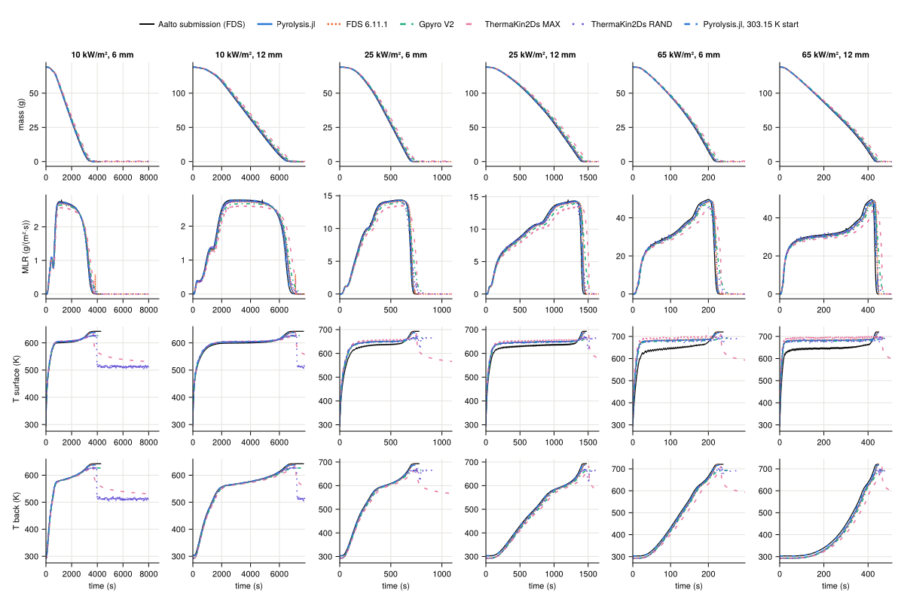

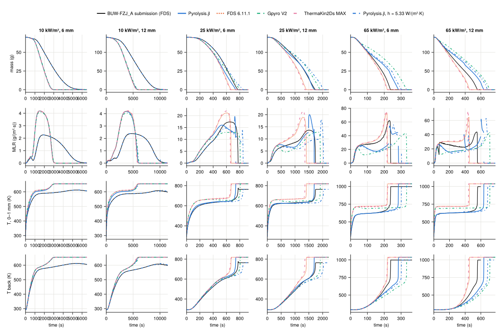

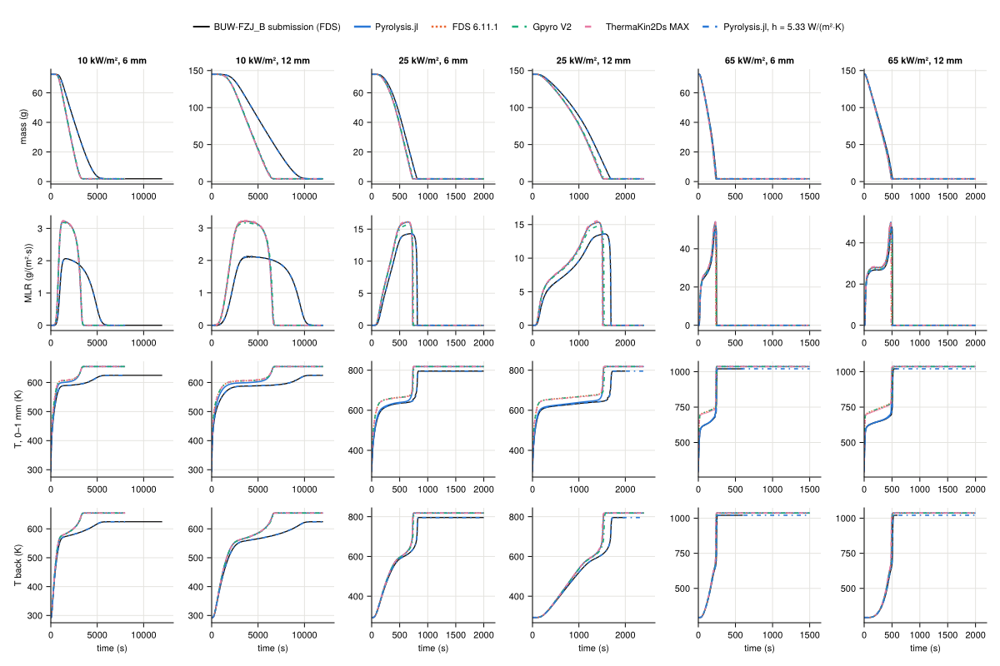

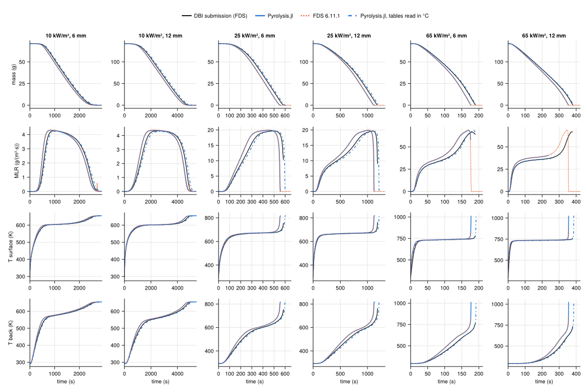

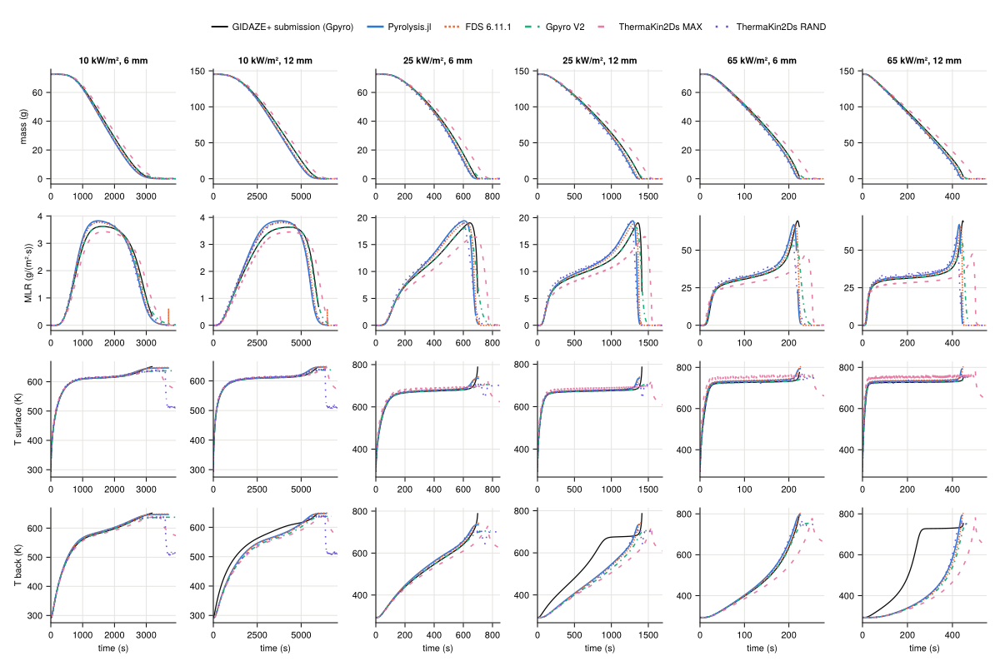

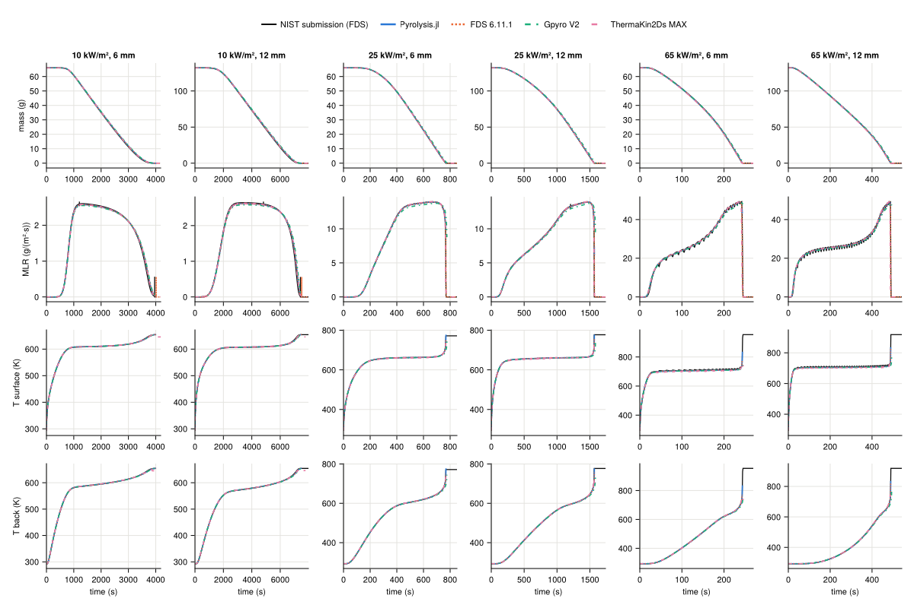

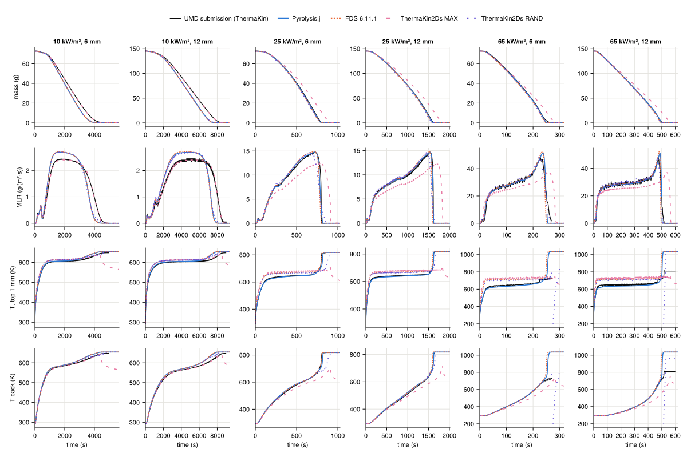

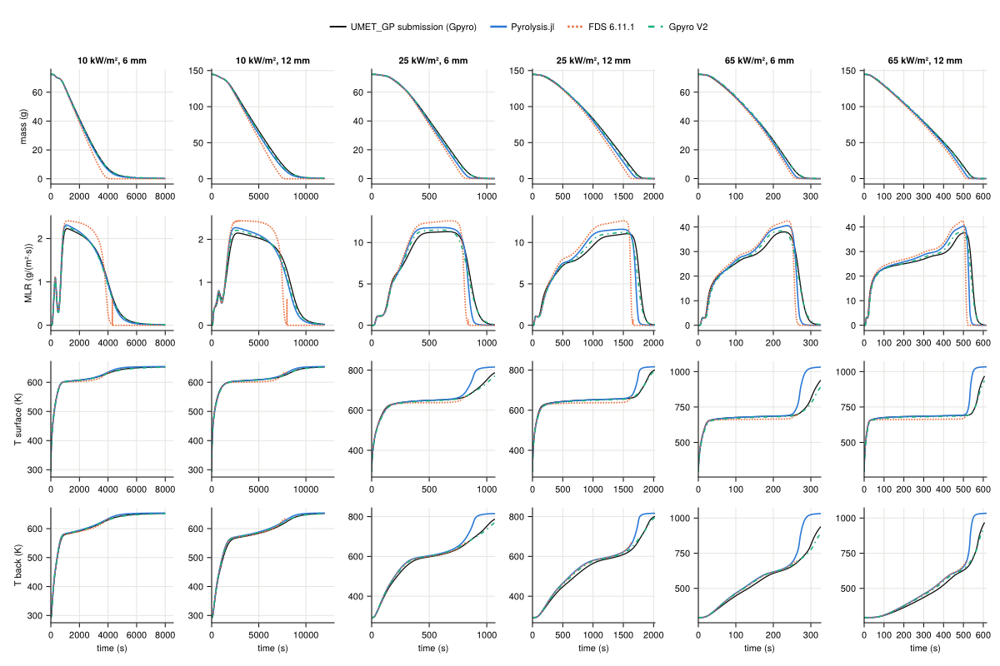

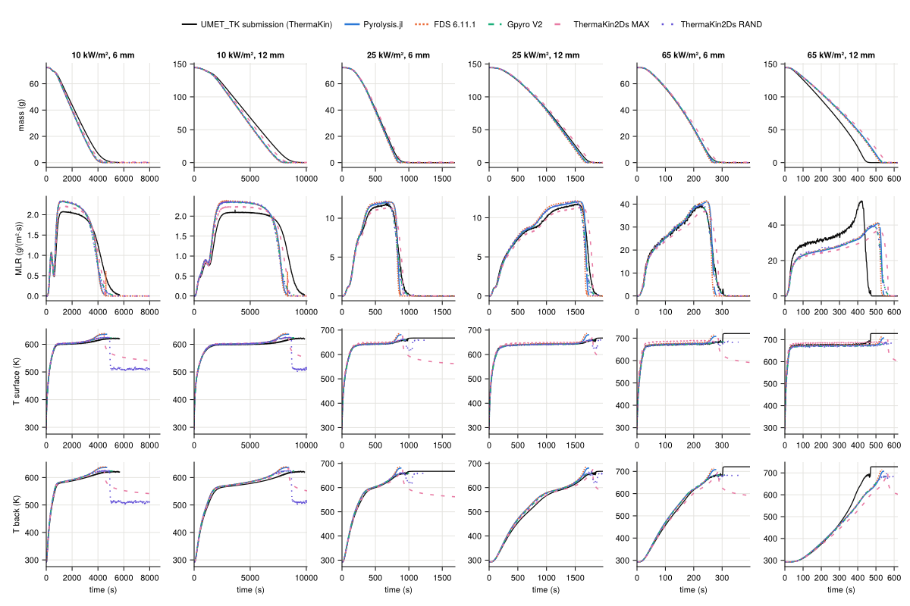

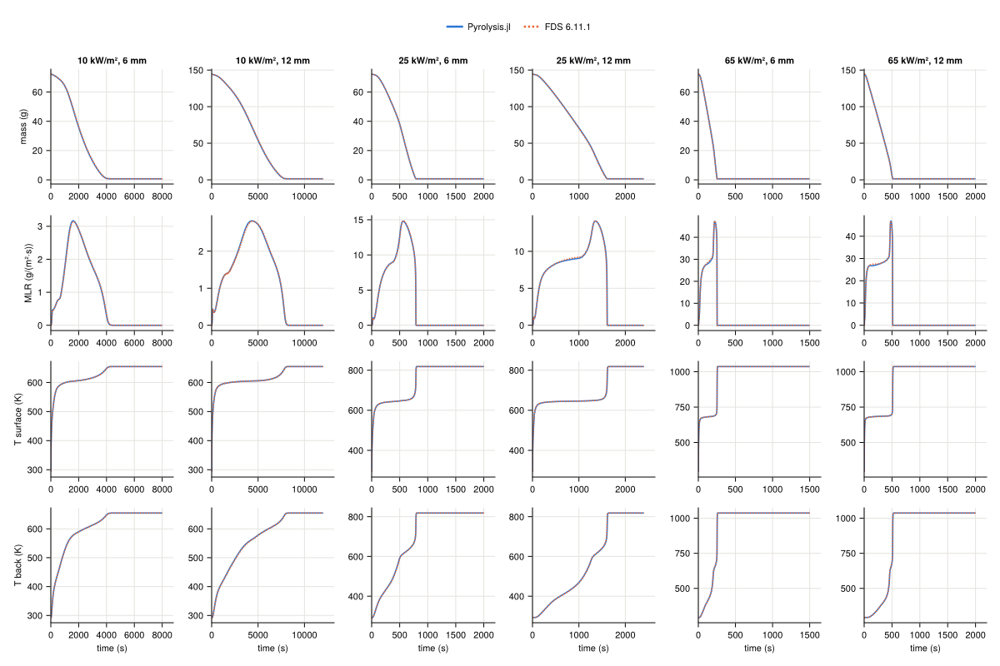

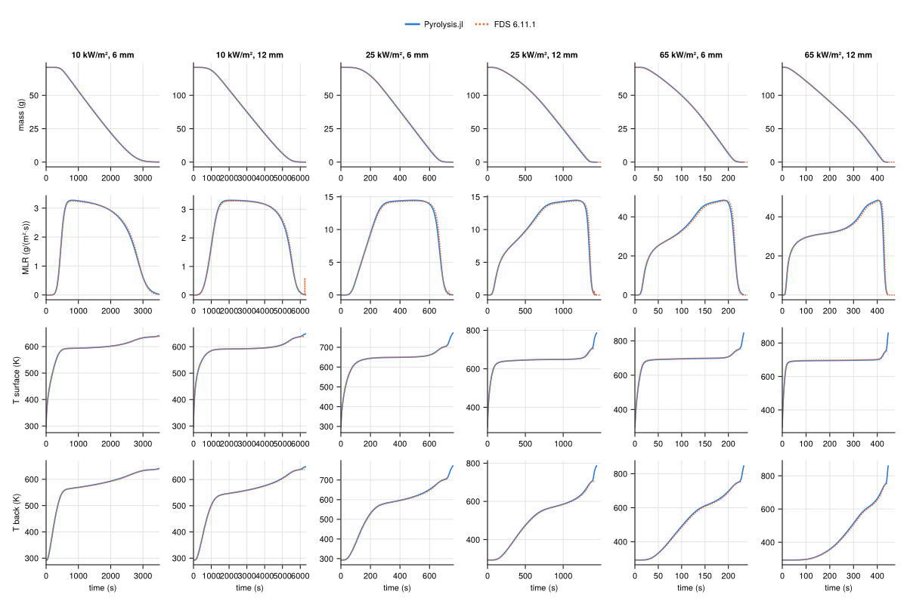

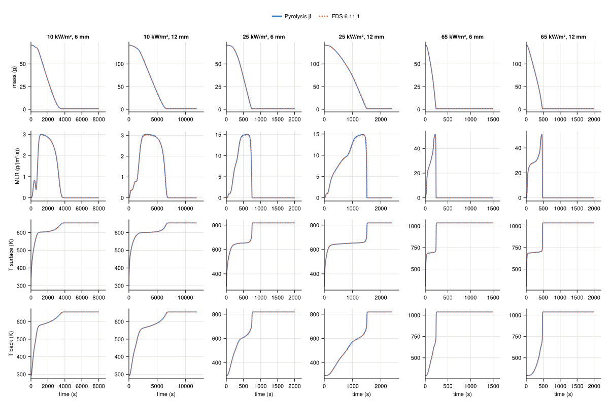

## TGA

Temperature at which 10, 50 and 90 % of the mass is lost, Pyrolysis.jl minus the
submission (K).

| set | β (K/min) | ΔT₁₀ | ΔT₅₀ | ΔT₉₀ |
|---|---|---|---|---|
| Aalto_I | 10 | 0.0 | 0.0 | 0.0 |
| Aalto_I | 100 | 0.1 | 0.1 | 0.1 |
| BUW-FZJ_A | 10 | 0.0 | 0.0 | 0.0 |
| BUW-FZJ_A | 100 | 0.1 | 0.1 | 0.1 |
| BUW-FZJ_B | 10 | 0.0 | 0.0 | 0.0 |
| BUW-FZJ_B | 100 | 0.0 | 0.1 | 0.1 |
| DBI_1 | 10 | 0.0 | 0.2 | 0.9 |
| DBI_1 | 100 | 0.1 | 0.3 | 1.1 |
| GIDAZE+ | 10 | 0.0 | 0.0 | 0.0 |
| GIDAZE+ | 100 | 0.1 | 0.1 | 0.1 |
| NIST | 10 | 0.4 | 0.0 | -0.4 |
| NIST | 100 | -3.5 | -7.7 | -9.1 |
| Sandia_1 | 10 | -0.5 | -0.6 | -0.8 |
| Sandia_1 | 100 | -2.2 | -2.4 | -2.3 |
| Sandia_2 | 10 | -0.2 | -0.3 | -0.4 |
| Sandia_2 | 100 | -3.0 | -1.9 | -1.2 |
| Sandia_3 | 10 | 8.5 | -1.3 | -1.0 |
| Sandia_3 | 100 | -2.2 | -2.0 | -1.7 |
| Sandia_4 | 10 | -0.9 | -1.0 | -0.4 |
| Sandia_4 | 100 | -1.7 | -1.5 | -1.7 |
| Sandia_5 | 10 | -1.0 | -0.9 | -1.0 |
| Sandia_5 | 100 | -6.1 | -1.9 | -2.2 |
| Sandia_6 | 10 | 1.5 | -0.9 | -0.5 |
| Sandia_6 | 100 | 1.5 | -0.3 | 0.1 |
| UCLAN | 10 | 0.0 | 0.0 | 0.0 |
| UCLAN | 100 | -0.6 | -0.7 | -0.8 |
| UMD | 10 | -0.6 | -0.6 | -0.6 |
| UMD | 100 | -0.5 | -0.4 | -0.4 |
| UMET_GP | 10 | 0.4 | 0.4 | 0.3 |
| UMET_GP | 100 | 0.6 | 0.5 | 0.4 |
| UMET_TK | 10 | 0.0 | 0.0 | 0.0 |
| UMET_TK | 100 | 0.0 | 0.1 | 0.1 |

## MaCFP-3: the NIST gasification apparatus

Every deck with complete properties runs the eleven PMMA tests of the apparatus on one
shared deck: the sample at the thickness that holds its measured mass at the deck's
density on the 6.99 cm disc, bonded to 28.52 mm of Kaowool PM; convection with
h = 10.0 W/(m²·K) to gas at 298.15 K and re-radiation to walls at 289.15 K;
adiabatic beneath the board. The heater is a cone of uniform intensity from the normal to
50°: a coaxial disc fitted to the apparatus's radial flux profile at 50 kW/m² is seen
out to 33–62° within the profile's error bars, and no disc fits the 25 kW/m² profile
within its bars. The Kaowool cell under the sample is opaque and absorbs what the
sample transmits; the board beneath it is transparent, because its measured
conductivity already carries its own radiation.

The score is MaCFP's: the mean of the runs of the repeats, against the mean of the
measured repeats over the shortest repeat, as NRMS = RMS/(max − min) of the measured
mean. For an in-depth deck, the range is that of the diffuse and collimated heaters,
which bound the cone.

| set | mass, 50: Pyrolysis.jl | group | MLR, 50: Pyrolysis.jl | group | T back, 50: Pyrolysis.jl | group | T back, 25: Pyrolysis.jl | group |
|---|---|---|---|---|---|---|---|---|
| Aalto_I | 0.035 (0.034–0.036) | 0.053 | 0.187 (0.175–0.201) | 0.226 | 0.046 (0.043–0.052) | 0.044 | 0.052 (0.050–0.054) | 0.083 |
| BUW-FZJ_A | 0.170 | 0.033 | 0.393 | 0.173 | 0.324 | 0.338 | 0.287 | – |
| BUW-FZJ_B | 0.047 | 0.033 | 0.143 | 0.177 | 0.181 | 0.234 | 0.135 | – |
| BUW-FZJ_C | 0.047 (0.045–0.050) | 0.037 | 0.076 (0.073–0.082) | 0.373 | 0.064 (0.054–0.075) | 0.033 | 0.054 (0.053–0.055) | – |
| DBI_1 | 0.129 | – | 0.466 | – | 0.186 | – | 0.201 | – |
| DBI_calibrated | 0.058 (0.058–0.061) | 0.034 | 0.245 (0.173–0.255) | 0.167 | 0.331 (0.302–0.362) | 0.228 | 0.287 (0.272–0.302) | 0.158 |
| GIDAZE+ | 0.053 (0.049–0.056) | – | 0.286 (0.268–0.311) | – | 0.193 (0.177–0.210) | – | 0.109 (0.101–0.118) | – |
| NIST-StMU | 0.053 (0.053–0.053) | 0.044 | 0.134 (0.122–0.146) | 0.116 | 0.039 (0.038–0.045) | 0.121 | 0.042 (0.042–0.044) | 0.102 |
| NIST | 0.118 | 0.128 | 0.217 | 0.328 | 0.147 | 0.238 | 0.120 | 0.195 |
| UMD | 0.040 (0.038–0.042) | 0.028 | 0.092 (0.073–0.099) | 0.103 | 0.183 (0.167–0.200) | 0.030 | 0.108 (0.100–0.117) | 0.016 |
| UMET_GP | 0.080 (0.078–0.082) | 0.030 | 0.136 (0.131–0.142) | 0.190 | 0.580 (0.562–0.598) | 0.803 | 0.345 (0.337–0.353) | 0.601 |
| UMET_TK | 0.086 (0.084–0.089) | – | 0.153 (0.145–0.161) | – | 0.612 (0.594–0.631) | – | 0.367 (0.359–0.375) | – |

Against the groups' own predictions of the same tests, scored against the same measurements,
Pyrolysis.jl's score is as good or better on 2 of 9 sets for mass, 50 kW/m², 6 of 9 sets for MLR, 50 kW/m², 5 of 9 sets for T back, 50 kW/m², 4 of 6 sets for T back, 25 kW/m².
The heater's distribution moves an in-depth deck's score by at most 0.082. The
back temperatures are those of the sample's interface with the board, which the shared
deck's convection coefficient and the board's conductivity set as much as the
property set: on the inert Kaowool stack below, the shared deck is
93 K above the measurement at 17.16 mm after 1200 s.

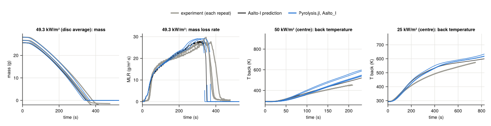

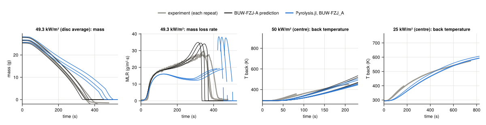

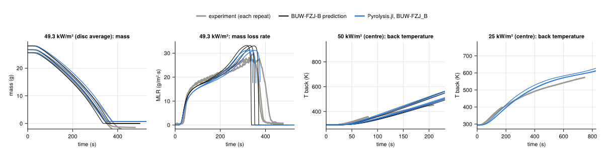

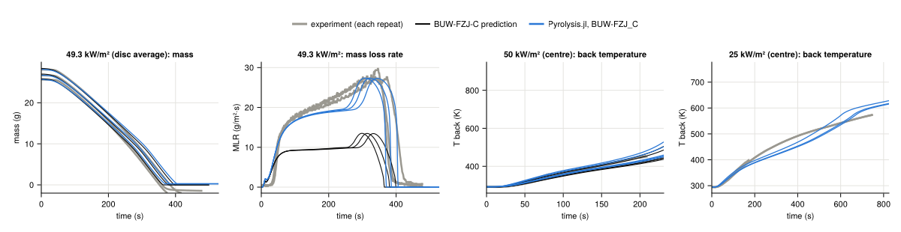

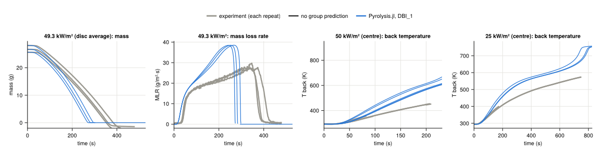

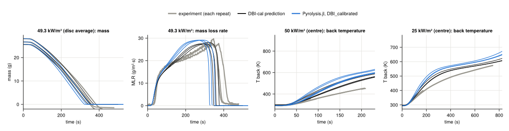

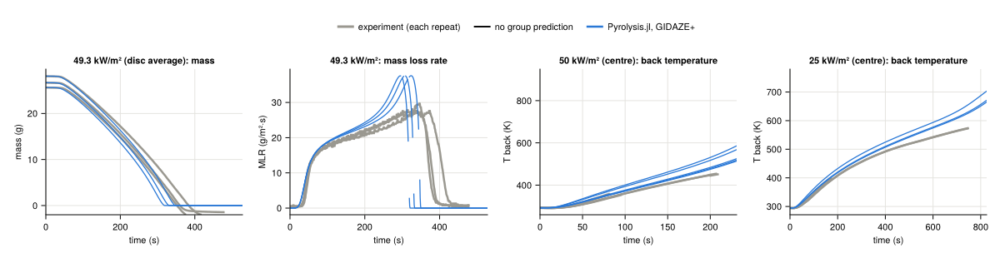

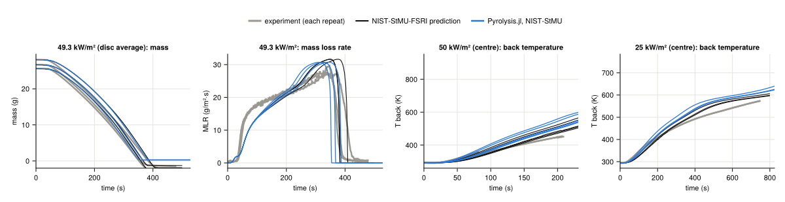

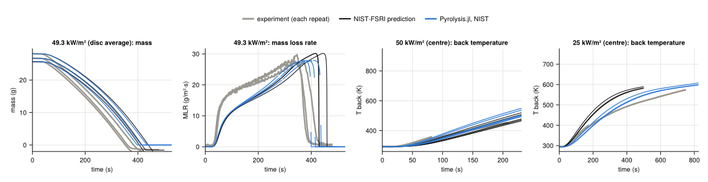

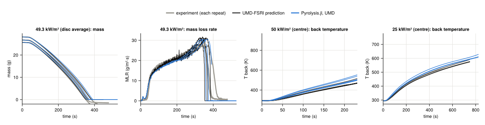

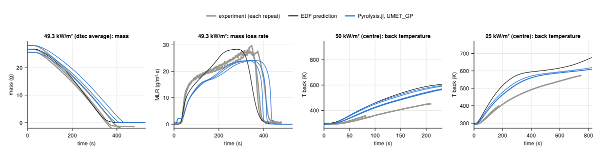

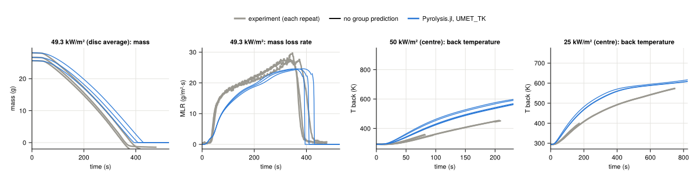

### Inert tests

The apparatus's inert tests check the shared deck without a pyrolysing sample: five
Kaowool discs painted black (ε 0.95), and a copper disc painted black (ε 0.92) on
Kaowool, both at 50 kW/m². They test the shared convection coefficient and the
Kaowool's conductivity.

| test | depth (mm) | time (s) | Pyrolysis.jl (K) | experiment (K) | difference (K) |
|---|---|---|---|---|---|
| Black-Insulation | 5.72 | 300 | 729.6 | 720.6 | +9.0 |
| Black-Insulation | 5.72 | 600 | 794.4 | 788.3 | +6.1 |
| Black-Insulation | 5.72 | 1200 | 847.5 | 821.0 | +26.5 |
| Black-Insulation | 11.44 | 300 | 530.2 | 515.7 | +14.5 |
| Black-Insulation | 11.44 | 600 | 652.7 | 638.3 | +14.4 |
| Black-Insulation | 11.44 | 1200 | 762.5 | 707.4 | +55.1 |
| Black-Insulation | 17.16 | 300 | 379.5 | 377.0 | +2.5 |
| Black-Insulation | 17.16 | 600 | 517.4 | 505.4 | +12.0 |
| Black-Insulation | 17.16 | 1200 | 685.0 | 591.7 | +93.3 |
| Black-Copper | 3.17 | 25 | 374.2 | 387.0 | -12.8 |
| Black-Copper | 3.17 | 50 | 460.2 | 475.3 | -15.0 |
| Black-Copper | 3.17 | 100 | 613.4 | 621.6 | -8.2 |

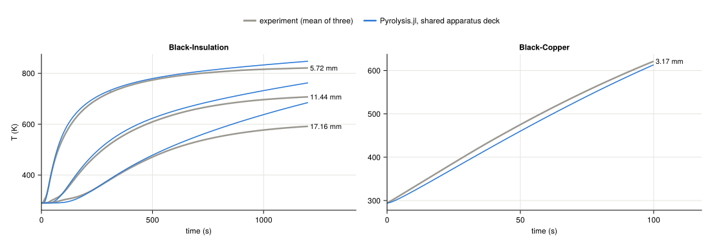

## Cost

Each code is scored against its own finest run of each case: Pyrolysis.jl against
80 cells/mm at reltol 1e-8, FDS against its 25 µm run, Gpyro and ThermaKin2Ds
against their half-cell, half-step runs. A run is within tolerance when its peak MLR
and t₅₀ are within 1 % and its surface and back temperature histories within 2 K up
to 90 % mass loss; the error is the largest of those four ratios. Pyrolysis.jl runs
a ladder of 10, 20 and 40 cells/mm at the default tolerances and ten times them. Every
time is the median of repeated solves on one pinned core of a quiet machine
(`scripts/timing/README.md`). FDS and ThermaKin2Ds step at a fixed step to the case's
end time; their times scaled to their own burnout are given beside them, since
Pyrolysis.jl and Gpyro stop at burnout.

| set | case | code | cheapest within tolerance (s) | at 20 cells/mm or base (s) | scaled to burnout (s) |
|---|---|---|---|---|---|
| Aalto_I | apparatus q25_Temp_R2 | Pyrolysis.jl | 0.93 (10/mm ×10) | 4.23 | – |
| Aalto_I | apparatus q50_Mass_R4 | Pyrolysis.jl | 0.98 (10/mm ×10) | 4.43 | – |
| Aalto_I | 10kW_12mm | Pyrolysis.jl | 1.45 (10/mm ×10) | 6.95 | – |
| Aalto_I | 10kW_6mm | Pyrolysis.jl | 0.30 (10/mm ×10) | 1.20 | – |
| Aalto_I | 10kW_6mm | FDS 6.11.1 | 29.86 (base) | 29.86 | 13.08 |
| Aalto_I | 25kW_12mm | Pyrolysis.jl | 1.61 (10/mm ×10) | 8.65 | – |
| Aalto_I | 25kW_6mm | Pyrolysis.jl | 0.39 (10/mm ×10) | 2.01 | – |
| Aalto_I | 25kW_6mm | FDS 6.11.1 | 7.56 (base) | 7.56 | 2.68 |
| Aalto_I | 25kW_6mm | Gpyro V2 | 2.29 (base) | 2.29 | – |
| Aalto_I | 65kW_12mm | Pyrolysis.jl | 1.99 (10/mm ×10) | 10.82 | – |
| Aalto_I | 65kW_12mm | FDS 6.11.1 | not reached | 7.77 | 1.71 |
| Aalto_I | 65kW_6mm | Pyrolysis.jl | 0.47 (10/mm ×10) | 2.45 | – |
| GIDAZE+ | apparatus q25_Temp_R2 | Pyrolysis.jl | 0.68 (10/mm ×10) | 3.04 | – |
| GIDAZE+ | apparatus q50_Mass_R4 | Pyrolysis.jl | 0.76 (10/mm ×10) | 3.45 | – |
| GIDAZE+ | 10kW_12mm | Pyrolysis.jl | 1.08 (10/mm ×10) | 5.15 | – |
| GIDAZE+ | 10kW_6mm | Pyrolysis.jl | 0.28 (10/mm ×10) | 1.03 | – |
| GIDAZE+ | 10kW_6mm | FDS 6.11.1 | 28.82 (base) | 28.82 | 11.50 |
| GIDAZE+ | 25kW_12mm | Pyrolysis.jl | 1.39 (10/mm ×10) | 7.57 | – |
| GIDAZE+ | 25kW_6mm | Pyrolysis.jl | 0.34 (10/mm ×10) | 1.68 | – |
| GIDAZE+ | 25kW_6mm | FDS 6.11.1 | not reached | 7.46 | 2.55 |
| GIDAZE+ | 25kW_6mm | Gpyro V2 | 1.84 (base) | 1.84 | – |
| GIDAZE+ | 25kW_6mm | ThermaKin2Ds | not reached | 3.85 | 1.49 |
| GIDAZE+ | 65kW_12mm | Pyrolysis.jl | not reached | 9.51 | – |
| GIDAZE+ | 65kW_12mm | FDS 6.11.1 | not reached | 7.55 | 1.67 |
| GIDAZE+ | 65kW_6mm | Pyrolysis.jl | 1.45 (20/mm ×10) | 2.19 | – |
| NIST | apparatus q25_Temp_R2 | Pyrolysis.jl | 0.60 (10/mm ×10) | 2.65 | – |
| NIST | apparatus q50_Mass_R4 | Pyrolysis.jl | 0.65 (10/mm ×10) | 2.79 | – |
| NIST | 10kW_12mm | Pyrolysis.jl | 0.89 (10/mm ×10) | 3.90 | – |
| NIST | 10kW_6mm | Pyrolysis.jl | 0.20 (10/mm ×10) | 0.63 | – |
| NIST | 10kW_6mm | FDS 6.11.1 | 29.02 (base) | 29.02 | 13.73 |
| NIST | 25kW_12mm | Pyrolysis.jl | 0.93 (10/mm ×10) | 4.91 | – |
| NIST | 25kW_6mm | Pyrolysis.jl | 0.24 (10/mm ×10) | 1.16 | – |
| NIST | 25kW_6mm | FDS 6.11.1 | 7.42 (base) | 7.42 | 2.84 |
| NIST | 25kW_6mm | Gpyro V2 | 1.45 (base) | 1.45 | – |
| NIST | 25kW_6mm | ThermaKin2Ds | 3.63 (base) | 3.63 | 1.39 |
| NIST | 65kW_12mm | Pyrolysis.jl | 1.23 (10/mm ×10) | 6.66 | – |
| NIST | 65kW_12mm | FDS 6.11.1 | 7.36 (base) | 7.36 | 1.80 |
| NIST | 65kW_6mm | Pyrolysis.jl | 0.30 (10/mm ×10) | 1.53 | – |
| UMD | apparatus q25_Temp_R2 | Pyrolysis.jl | 1.23 (10/mm ×10) | 6.06 | – |
| UMD | apparatus q50_Mass_R4 | Pyrolysis.jl | 1.25 (10/mm ×10) | 6.36 | – |
| UMD | 10kW_12mm | Pyrolysis.jl | 2.11 (10/mm ×10) | 11.09 | – |
| UMD | 10kW_6mm | Pyrolysis.jl | 0.56 (10/mm ×10) | 2.43 | – |
| UMD | 10kW_6mm | FDS 6.11.1 | 30.94 (base) | 30.94 | 15.44 |
| UMD | 10kW_6mm | ThermaKin2Ds | 58.58 (base) | 58.58 | 37.66 |
| UMD | 25kW_12mm | Pyrolysis.jl | not reached | 14.14 | – |
| UMD | 25kW_6mm | Pyrolysis.jl | 0.66 (10/mm ×10) | 3.47 | – |
| UMD | 25kW_6mm | FDS 6.11.1 | not reached | 7.90 | 3.11 |
| UMD | 25kW_6mm | ThermaKin2Ds | not reached | 13.51 | 6.30 |
| UMD | 65kW_12mm | Pyrolysis.jl | 45.83 (40/mm ×10) | 16.88 | – |
| UMD | 65kW_12mm | FDS 6.11.1 | not reached | 8.10 | 1.99 |
| UMD | 65kW_6mm | Pyrolysis.jl | 2.55 (20/mm ×10) | 4.10 | – |

Pyrolysis.jl reaches the tolerance on 30 of its 32 timed cases,
27 of them at 10 cells/mm. On the cases where an external code is timed too,
its cheapest run within tolerance takes less time than FDS 6.11.1's base run on 10 of 11 (9 of 11 against its time scaled to burnout); Gpyro V2's base run on 3 of 3; ThermaKin2Ds's base run on 4 of 4 (4 of 4 against its time scaled to burnout).

