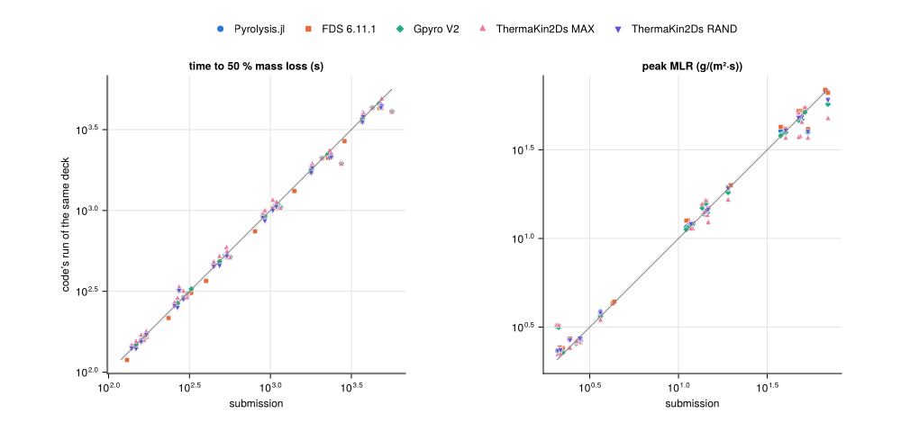
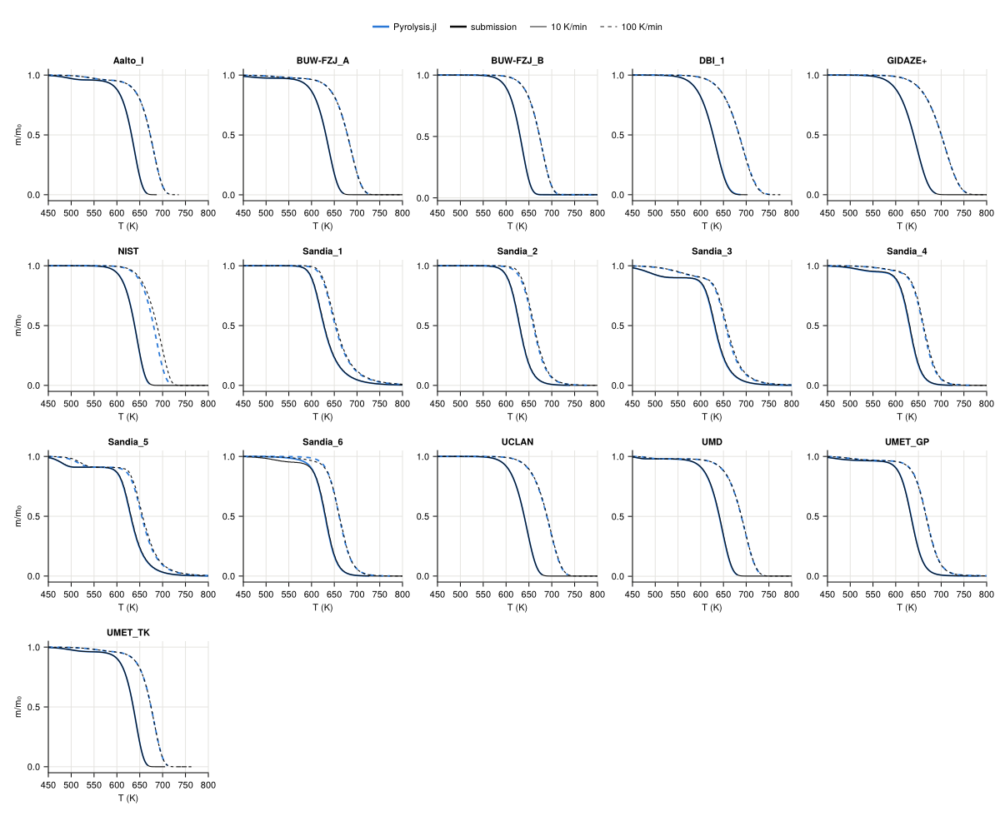
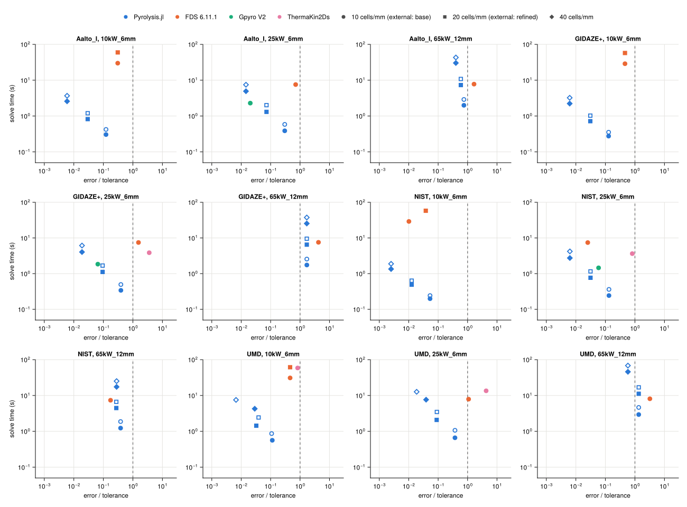

# MaCFP PMMA validation

The MaCFP condensed-phase working group's database holds property sets for one black
PMMA. Each set was calibrated by an institution in its own code (FDS, Gpyro or
ThermaKin2Ds) and comes with that institution's predictions: of the MaCFP-2 targets (TGA,
and gasification of 6 and 12 mm slabs at 10, 25 and 65 kW/m²) and, for most sets, of the
MaCFP-3 experiments in the NIST gasification apparatus. Pyrolysis.jl runs every set as
written, and FDS 6.11.1, Gpyro V2 and ThermaKin2Ds 7 run the same decks
([decks and scenario](macfp_pmma/01_decks.md)).

The submissions are calibrated models, not measurements: agreement with them shows how
faithfully a code reproduces another code's model. The apparatus experiments are the
measurements.

## Findings

- **Same deck, same answer.** On the decks that absorb at the surface, Pyrolysis.jl and
  FDS agree to 0.0–0.3 % in t₅₀. On the in-depth decks, with FDS's attenuation
  matched, all 48 cases agree within 0.71 % in t₅₀ and peak mass-loss rate.
- **The groups' predictions.** Pyrolysis.jl reproduces each submission about as well as
  the code the set was calibrated in: as close or closer on 5 of 7 sets. The two
  largest gaps are submissions that ran a different scenario; reproducing it brings
  BUW-FZJ_B to 0.04 % and DBI_1 to 2.24 %.
- **Where the codes differ**, the difference follows how each code deposits the
  radiation the solid absorbs.
- **TGA.** The kinetics reproduce the submitted curves within 2 K on 11 of
  16 sets.
- **The apparatus experiments.** Scored against the measurements, Pyrolysis.jl is as
  good as or better than the groups' own predictions on mass-loss rate in 6 of 9 sets
  and on back temperature in 9 of 15, but on mass in 2 of 9. The shared
  apparatus deck limits the back-temperature scores.
- **Cost.** Pyrolysis.jl reaches a 1 %, 2 K accuracy tolerance on 30 of 32 timed
  cases, and its cheapest such run takes less time than FDS's on 10 of 11 shared cases.

## Against FDS on the same decks

On the decks that absorb at the surface, Pyrolysis.jl and FDS solve the same problem and
agree to 0.0–0.3 % in median t₅₀. On the in-depth decks both codes absorb
and emit in every cell, but FDS's two-flux sweep crosses a cell of width Δz with
transmission 1/(1 + 2κΔz) where Pyrolysis.jl's two-stream model transmits e^(−1.5κΔz).
Scaling κ so the two agree on FDS's 50 µm cells, and aligning the one item FDS cannot
express on UMD, UMET_GP and UMET_TK, leaves differences within 0.71 % in every case.
In t₅₀ they are within FDS's own change between its 50 and 25 µm cells on
all 5 of the sets FDS also ran at 25 µm.

| set | deck as written: median \|Δt₅₀\| (%) | matched: max \|Δt₅₀\| (%) | matched: max \|Δpeak\| (%) | matched: worst RMS ΔT (K) |
|---|---|---|---|---|
| Aalto_I | 0.6 | 0.11 | 0.28 | 0.6 |
| BUW-FZJ_C | 0.7 | 0.68 | 0.71 | 1.5 |
| DBI_calibrated | 0.7 | 0.23 | 0.36 | 0.9 |
| GIDAZE+ | 1.2 | 0.21 | 0.58 | 1.1 |
| NIST-StMU | 0.7 | 0.05 | 0.25 | 0.5 |
| UMD | 1.0 | 0.10 | 0.53 | 0.8 |
| UMET_GP | 3.4 | 0.32 | 0.43 | 1.9 |
| UMET_TK | 1.2 | 0.19 | 0.20 | 0.3 |

Per-code tables: [code to code](macfp_pmma/02_gasification.md#Code-to-code) and
[matched to FDS](macfp_pmma/02_gasification.md#Matched-to-FDS).

## Against the groups' predictions

The code a set was calibrated in, running the published deck, is the yardstick: it
reproduces the submission only as far as the deck and the scenario are what the group
ran. Median |Δt₅₀| over the six cases (%):

| set | calibrated in | Pyrolysis.jl | calibration code | Pyrolysis.jl, as the group ran |
|---|---|---|---|---|
| Aalto_I | FDS | 1.9 | 2.5 | 0.22 |
| BUW-FZJ_B | FDS | 9.6 | 9.7 | 0.04 |
| DBI_1 | FDS | 7.6 | 8.0 | 2.24 |
| GIDAZE+ | Gpyro | 3.6 | 0.1 | – |
| NIST | FDS | 0.5 | 0.5 | – |
| UMD | ThermaKin | 0.8 | 2.3 | – |
| UMET_GP | Gpyro | 3.0 | 1.2 | – |
| UMET_TK | ThermaKin | 5.5 | 4.6 / 6.1 (`MAX` / `RAND`) | – |

UMD's ThermaKin2Ds run is read in `MAX` mode at 10 kW/m² and `RAND` above, which
reproduces its submission; UMET_TK's mode is not known. The last column reproduces what
three groups ran instead of the specified scenario: convection at h = 5.33 W/(m²·K)
(BUW-FZJ_B), c and k tables read as °C (DBI_1), and a 303.15 K start (Aalto_I).

BUW-FZJ_A is left out. Its low-emissivity residue collects as a film at the surface, and
how much of that film the surface cell holds, and so how much of the heater's flux the
sample absorbs, depends on the cell size in every code. Its results measure the
discretization as much as the property set ([BUW-FZJ_A](macfp_pmma/02_gasification.md#BUW-FZJ_A)).

Every code against every submission: [gasification](macfp_pmma/02_gasification.md#Against-the-submissions);
the mass, mass-loss rate and temperature histories of each set:
[gasification histories](macfp_pmma/03_histories.md).

## Where the codes differ

The differences to Gpyro and ThermaKin2Ds follow how each code deposits the radiation it
absorbs. Variants of each in-depth deck that move one choice at a time show it:

- Gpyro deposits the net surface flux along a Beer–Lambert march and emits nothing from
  the depth; the shallowest-depositing variant is closest to it on 3 of 4 sets.
- ThermaKin2Ds in `MAX` mode deposits the absorbed radiation in the surface element;
  surface absorption is the closest variant on 4 of 4 sets.
- A diffuse heater is closer than a collimated one to the submission on 4 of 4
  sets calibrated in Gpyro or ThermaKin2Ds, and to FDS on 7 of 8.
- Absorbing at the surface instead of in depth moves t₅₀ by
  2.8–15.7 % per set.

Every variant against every code: [radiation in depth](macfp_pmma/02_gasification.md#Radiation-in-depth).

## TGA

The TGA targets test the kinetics alone. Pyrolysis.jl's temperatures at 10, 50 and
90 % mass loss are within 2 K of the submission on 11 of the 16 sets at both
heating rates; the largest difference is 9.1 K (NIST, 100 K/min).

Per set and rate: [TGA](macfp_pmma/04_tga.md).

## Against the apparatus experiments

Every deck with complete properties runs the eleven PMMA tests of the NIST gasification
apparatus on one shared apparatus deck, scored against the measured repeats with MaCFP's
normalized RMS (lower is better). Against the groups' own predictions of the same tests,
over the sets with a group prediction:

| quantity | Pyrolysis.jl as good or better | median NRMS, Pyrolysis.jl | median NRMS, groups |
|---|---|---|---|
| mass, 50 kW/m² | 2 of 9 | 0.053 | 0.034 |
| MLR, 50 kW/m² | 6 of 9 | 0.143 | 0.177 |
| T back, 50 kW/m² | 5 of 9 | 0.181 | 0.228 |
| T back, 25 kW/m² | 4 of 6 | 0.114 | 0.130 |

The back temperatures measure the shared deck as much as the property sets: on the
apparatus's inert Kaowool stack, with no sample, it runs 93 K above the measurement at
17.16 mm after 1200 s.

Scores, histories and the inert tests: [gasification apparatus](macfp_pmma/05_apparatus.md).

## Cost

Each code is scored against its own finest run of each case, and a run is within
tolerance when its peak mass-loss rate and t₅₀ are within 1 % and its temperature
histories within 2 K. Pyrolysis.jl reaches the tolerance on 30 of its 32 timed
cases, 27 of them at 10 cells/mm. Its cheapest run within tolerance takes less time than
FDS 6.11.1's base run on 10 of 11 (9 of 11 against its time scaled to burnout); Gpyro V2's base run on 3 of 3; ThermaKin2Ds's base run on 4 of 4 (4 of 4 against its time scaled to burnout).

Every case and code: [cost](macfp_pmma/06_cost.md).
