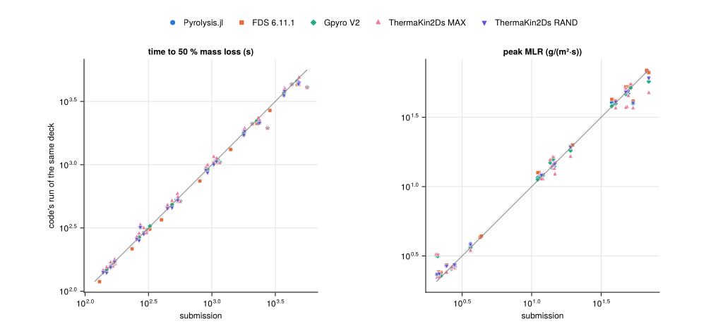

# Gasification

The MaCFP-2 gasification targets of the [MaCFP PMMA validation](../macfp_pmma.md): each code's run of every deck
against the institution's submission, against the other codes' runs, and against FDS
with the attenuation matched. t₅₀ is the first saved time at or below half the initial
mass; the peak is the largest finite mass-loss rate. Unless a table says otherwise, a
cell is the median over the six cases of the relative difference in t₅₀, |Δt₅₀|, and in
brackets in the peak, |Δpeak| (%).

## Against the submissions

BUW-FZJ_A is reported on its own below.

| set | calibrated in | Pyrolysis.jl | FDS 6.11.1 | Gpyro V2 | ThermaKin2Ds MAX | ThermaKin2Ds RAND |
|---|---|---|---|---|---|---|
| Aalto_I | FDS | 1.9 (1.4) | 2.5 (2.0) | 4.1 (4.9) | 7.1 (8.0) | 1.2 (1.6) |
| BUW-FZJ_B | FDS | 9.6 (12.8) | 9.7 (12.8) | 8.7 (9.6) | 10.3 (14.2) | – |
| DBI_1 | FDS | 7.6 (1.0) | 8.0 (1.6) | – | – | – |
| GIDAZE+ | Gpyro | 3.6 (3.6) | 2.7 (4.3) | 0.1 (4.6) | 6.2 (13.6) | 5.4 (5.2) |
| NIST | FDS | 0.5 (0.7) | 0.5 (0.5) | 1.0 (1.7) | 0.7 (0.3) | – |
| UMD | ThermaKin | 0.8 (6.7) | 2.2 (9.1) | – | 7.6 (16.4) | 2.9 (0.8) |
| UMET_GP | Gpyro | 3.0 (5.4) | 6.0 (12.4) | 1.2 (1.7) | – | – |
| UMET_TK | ThermaKin | 5.5 (5.7) | 6.3 (6.7) | 5.3 (5.2) | 4.6 (5.9) | 6.1 (6.2) |

Where a set was calibrated in a code, that code's run of the deck checks the deck: Gpyro
reproduces GIDAZE+ to 0.1 %, FDS reproduces NIST to
0.5 % and Aalto_I to 2.5 %, and ThermaKin2Ds reproduces UMD to
0.4–0.8 % at 10 kW/m² in `MAX` mode and to
2.1–2.9 % at 25 and 65 kW/m² in `RAND` mode. Gpyro
reproduces UMET_GP to 1.2 % with the density held at its 293 K value, as every
deck holds it, and to 0.6 % with UMET's temperature-dependent density.
ThermaKin2Ds does not reproduce UMET_TK (4.6 % in `MAX`,
6.1 % in `RAND`, 4.3 % in `MAX` with UMET's ρ(T)).

On the in-depth sets Pyrolysis.jl's median |Δt₅₀| to the submission is
Aalto_I 1.9, GIDAZE+ 3.6, UMD 0.8, UMET_GP 3.0, UMET_TK 5.5 %. It is closer to the submission than the
calibration code's own run on Aalto_I, UMD (UMD's ThermaKin2Ds run taken in `MAX` at
10 kW/m² and `RAND` above) and farther on GIDAZE+, UMET_GP. UMET_TK's ThermaKin2Ds mode is
not known; Pyrolysis.jl (5.5 %) is between `MAX` (4.6 %) and `RAND`
(6.1 %) there.

## Code to code

Pyrolysis.jl's run of each deck against each other code's run of the same deck. The
2023 sets NIST-StMU, DBI_calibrated and BUW-FZJ_C have no MaCFP-2 submission; FDS runs
them.

| set | absorption | FDS 6.11.1 | Gpyro V2 | ThermaKin2Ds MAX | ThermaKin2Ds RAND |
|---|---|---|---|---|---|
| Aalto_I | in-depth | 0.6 (0.7) | 2.0 (2.6) | 4.8 (5.7) | 0.7 (0.9) |
| BUW-FZJ_B | surface | 0.0 (0.0) | 1.0 (2.9) | 0.6 (1.1) | – |
| BUW-FZJ_C | in-depth | 0.7 (0.4) | – | – | – |
| DBI_1 | surface | 0.3 (0.6) | – | – | – |
| DBI_calibrated | in-depth | 0.7 (0.7) | – | – | – |
| GIDAZE+ | in-depth | 1.2 (1.6) | 3.5 (6.8) | 9.6 (18.1) | 2.1 (1.1) |
| NIST-StMU | in-depth | 0.7 (0.9) | – | – | – |
| NIST | surface | 0.0 (0.0) | 0.8 (1.2) | 0.3 (0.4) | – |
| UMD | in-depth | 1.0 (0.9) | – | 9.4 (19.8) | 1.9 (0.4) |
| UMET_GP | in-depth | 3.4 (5.7) | 2.2 (3.0) | – | – |
| UMET_TK | in-depth | 1.2 (0.8) | 0.2 (0.5) | 4.5 (6.6) | 0.7 (0.5) |

On the decks that absorb at the surface, Pyrolysis.jl and FDS solve the same problem and
agree to 0.0–0.3 % in t₅₀. On the in-depth decks the codes differ in how
the solid absorbs and emits the radiation (Technical Reference §8.9).

## Matched to FDS

FDS's in-depth model is a two-flux model with emission, like Pyrolysis.jl's, but its
sweep crosses a cell of width Δz with transmission 1/(1 + 2κΔz), where the diffuse
two-stream model transmits e^(−1.5κΔz). At an absorption coefficient of
ln(1 + 2κΔz)/(1.5Δz) the two agree cell by cell, in transmission and in emission
(`fds_closure`, taken at FDS's 50 µm cells). Where a deck holds an item FDS cannot
express, `fds_matched` also aligns it. FDS 6.11.1's runs of the same decks:

| set | factor on κ | aligned item | max \|Δt₅₀\| (%) | median \|Δt₅₀\| (%) | max \|Δpeak\| (%) | worst RMS ΔT top / back (K) | max \|Δm\| (g) | FDS 25 µm vs 50 µm: max \|Δt₅₀\| / \|Δpeak\| (%) |
|---|---|---|---|---|---|---|---|---|
| Aalto_I | 1.147 | – | 0.11 | 0.00 | 0.28 | 0.34 / 0.58 | 0.19 | 0.32 / 0.30 |
| BUW-FZJ_C | 1.146, 0.478 | – | 0.68 | 0.28 | 0.71 | 1.29 / 1.45 | 0.61 | – |
| DBI_calibrated | 1.203 | – | 0.23 | 0.15 | 0.36 | 0.90 / 0.38 | 0.61 | – |
| GIDAZE+ | 1.172 | – | 0.21 | 0.03 | 0.58 | 0.38 / 1.05 | 0.55 | 0.70 / 0.46 |
| NIST-StMU | 1.184 | – | 0.05 | 0.00 | 0.25 | 0.26 / 0.50 | 0.22 | – |
| UMD | 1.172 | no gas enthalpy | 0.10 | 0.03 | 0.53 | 0.83 / 0.62 | 0.41 | 0.43 / 0.46 |
| UMET_GP | 1.180 | reaction 2 first order | 0.32 | 0.04 | 0.43 | 1.87 / 0.19 | 0.30 | 0.32 / 0.21 |
| UMET_TK | 1.180 | no gas enthalpy | 0.19 | 0.00 | 0.20 | 0.23 / 0.30 | 0.14 | 0.31 / 0.21 |

Temperatures are compared at FDS's saved times while both runs hold more than 10 % of
their mass; masses are for the 10 cm × 10 cm sample. With the deck's κ as written and
the diffuse heater the same runs differ from FDS by 0.6–3.4 % in median t₅₀ and
up to 8.1 % in peak. FDS also runs Aalto_I, GIDAZE+, UMD, UMET_GP, UMET_TK on
25 µm cells. Matched, the largest |Δt₅₀| is within FDS's own change between its 50 and
25 µm runs on all 5 of these sets,
and the largest |Δpeak| on 2 of 5 (not on GIDAZE+, UMD, UMET_GP). The factor
belongs to FDS's cell size, so it changes with the cell FDS runs. BUW-FZJ_C is the
exception to a single factor: its residue's κ = 50 000 1/m takes a factor of 0.48,
and a factor applied per component is not FDS's attenuation of the cell's mixture.

## Radiation in depth

Each Pyrolysis.jl variant of the in-depth decks against the submission and each code.
Bold: the variant closest to that column's run in t₅₀.

**Aalto_I** (calibrated in FDS)

| variant | submission | FDS 6.11.1 | Gpyro V2 | ThermaKin2Ds MAX | ThermaKin2Ds RAND |
|---|---|---|---|---|---|
| `base` | 1.9 (1.4) | 0.6 (0.7) | 2.0 (2.6) | 4.8 (5.7) | **0.7 (0.9)** |
| `collimated` | **1.0 (0.4)** | 1.5 (2.3) | 2.9 (5.6) | 5.7 (9.1) | 0.9 (1.8) |
| `fds_closure` | 2.5 (1.9) | **0.0 (0.1)** | **1.5 (1.9)** | 4.2 (5.1) | 1.1 (1.0) |
| `surface` | 8.0 (7.3) | 5.3 (5.4) | 3.6 (3.7) | **1.1 (0.9)** | 6.1 (6.4) |

**BUW-FZJ_C** (calibrated in FDS)

| variant | FDS 6.11.1 |
|---|---|
| `base` | 0.7 (0.4) |
| `collimated` | 1.0 (0.6) |
| `fds_closure` | **0.3 (0.2)** |
| `surface` | 2.9 (1.8) |

**DBI_calibrated** (calibrated in FDS)

| variant | FDS 6.11.1 |
|---|---|
| `base` | 0.7 (0.7) |
| `collimated` | 2.1 (2.6) |
| `fds_closure` | **0.2 (0.2)** |
| `surface` | 6.5 (6.8) |

**GIDAZE+** (calibrated in Gpyro)

| variant | submission | FDS 6.11.1 | Gpyro V2 | ThermaKin2Ds MAX | ThermaKin2Ds RAND |
|---|---|---|---|---|---|
| `base` | 3.6 (3.6) | 1.2 (1.6) | 3.5 (6.8) | 9.6 (18.1) | 2.1 (1.1) |
| `collimated` | 5.2 (6.5) | 2.9 (6.4) | 5.1 (12.7) | 11.8 (23.3) | **1.9 (7.2)** |
| `fds_closure` | **2.8 (4.2)** | **0.0 (0.3)** | **2.8 (5.4)** | 8.7 (16.4) | 2.6 (0.7) |
| `surface` | 9.9 (13.4) | 12.7 (13.5) | 9.9 (6.3) | **2.5 (1.2)** | 16.2 (10.9) |

**NIST-StMU** (calibrated in FDS)

| variant | FDS 6.11.1 |
|---|---|
| `base` | 0.7 (0.9) |
| `collimated` | 1.8 (3.0) |
| `fds_closure` | **0.0 (0.1)** |
| `surface` | 5.4 (6.3) |

**UMD** (calibrated in ThermaKin)

| variant | submission | FDS 6.11.1 | ThermaKin2Ds MAX | ThermaKin2Ds RAND |
|---|---|---|---|---|
| `base` | **0.8 (6.7)** | 1.0 (0.9) | 9.4 (19.8) | 1.9 (0.4) |
| `collimated` | 2.1 (10.6) | 2.0 (3.7) | 11.6 (24.9) | 2.3 (7.0) |
| `fds_closure` | 0.9 (5.9) | 2.0 (2.4) | 8.3 (18.3) | 2.7 (1.4) |
| `fds_matched` | 2.2 (9.3) | **0.0 (0.2)** | 9.8 (21.1) | **0.8 (1.5)** |
| `surface` | 15.2 (17.8) | 16.9 (18.4) | **4.0 (1.8)** | 18.6 (17.6) |

**UMET_GP** (calibrated in Gpyro)

| variant | submission | FDS 6.11.1 | Gpyro V2 |
|---|---|---|---|
| `base` | 3.0 (5.4) | 3.4 (5.7) | 2.2 (3.0) |
| `collimated` | 4.2 (7.2) | 2.5 (4.2) | 3.1 (5.5) |
| `fds_closure` | 2.3 (4.6) | 3.9 (6.2) | **1.6 (2.3)** |
| `fds_matched` | 6.1 (12.0) | **0.0 (0.1)** | 5.3 (10.3) |
| `surface` | **2.2 (1.7)** | 8.8 (11.0) | 3.3 (3.2) |

**UMET_TK** (calibrated in ThermaKin)

| variant | submission | FDS 6.11.1 | Gpyro V2 | ThermaKin2Ds MAX | ThermaKin2Ds RAND |
|---|---|---|---|---|---|
| `base` | 5.5 (5.7) | 1.2 (0.8) | **0.2 (0.5)** | 4.5 (6.6) | 0.7 (0.5) |
| `collimated` | 7.2 (8.3) | 1.4 (1.1) | 1.0 (3.6) | 5.7 (8.5) | 0.8 (2.2) |
| `fds_closure` | 5.0 (5.0) | 1.7 (1.3) | 0.6 (0.4) | 3.9 (5.9) | 1.2 (1.2) |
| `fds_matched` | 6.4 (6.8) | **0.0 (0.1)** | 1.3 (1.5) | 5.2 (7.5) | **0.6 (0.6)** |
| `surface` | **4.6 (4.4)** | 6.7 (6.5) | 5.4 (5.2) | **0.9 (0.7)** | 6.0 (6.1) |

- **The heater.** The diffuse heater deposits at 1.5κ, the collimated one at κ. Diffuse
  is closer than collimated to the submission on 4 of the 4 sets
  calibrated in Gpyro or ThermaKin2Ds (GIDAZE+ 3.6 against 5.2 %, UMD 0.8 against 2.1 %, UMET_GP 3.0 against 4.2 %, UMET_TK 5.5 against 7.2 %)
  and to FDS on 7 of 8 (not on UMET_GP).
- **Gpyro** deposits the net surface flux along a Beer–Lambert march at κ and emits
  nothing from the depth (Technical Reference §8.9.2). Of the variants that absorb in
  depth, `fds_closure`, which deposits shallowest, is closest to Gpyro on
  3 of the 4 sets Gpyro runs (Aalto_I 1.5 %, GIDAZE+ 2.8 %, UMET_GP 1.6 %, UMET_TK 0.6 %); no
  variant shares its net-flux deposition.
- **ThermaKin2Ds** deposits each step's absorbed radiation in one element. In `MAX` mode
  that is the surface element for a uniform κ, and `surface` is the closest variant on
  4 of the 4 in-depth sets it runs (Aalto_I 1.1 %, GIDAZE+ 2.5 %, UMD 4.0 %, UMET_TK 0.9 %). `RAND` draws the
  element from the absorption distribution and sits within 0.7–2.7 % of
  the variants that absorb in depth.
- **UMET's runs** use a temperature-dependent density, which the decks hold at its
  293 K value; Gpyro with UMET's ρ(T) reproduces UMET_GP's submission (above).
- **No radiation in depth** (`surface`) moves t₅₀ by
  2.8–15.7 % (median per set) from the diffuse base.

## Runs as the groups ran them

Three submissions depart from the MaCFP-2 scenario in a way their files show, and a
Pyrolysis.jl variant reproduces each; on NIST, a surface-absorbing set calibrated in
FDS, the two codes solve the same problem. |Δt₅₀| over the six cases (%):

| set | variant | what it reproduces | against | median | max | median, deck as written |
|---|---|---|---|---|---|---|
| BUW-FZJ_B | `h5.33` | convection h = 5.33 W/(m²·K) | submission | 0.04 | 0.22 | 9.60 |
| DBI_1 | `tablesC` | c and k tables read as °C | submission | 2.24 | 3.17 | 7.62 |
| Aalto_I | `T303` | 303.15 K start and surroundings | submission | 0.22 | 0.65 | 1.93 |
| NIST | `base` | the deck as written, against FDS | FDS 6.11.1 | 0.00 | 0.01 | – |

## BUW-FZJ_A

BUW-FZJ_A absorbs at the surface, and its residue (ε = 0.40704 against the virgin
material's 0.76899) collects in the surface cell as a film. The surface emissivity,
and with it the absorbed flux, then depends on how much of that film the surface cell
holds: in FDS on the size of the first cell, in Pyrolysis.jl on the cell size and on
how long the moving mesh keeps a burnt-out layer in the surface cell before it retires
it. The deck's mass-loss histories measure that discretization as much as the set, so
it is kept out of the medians above. Median / max |Δt₅₀| over the six cases (%):

| run | against | median \|Δt₅₀\| | max \|Δt₅₀\| | median \|Δpeak\| |
|---|---|---|---|---|
| Pyrolysis.jl, 20 cells/mm | submission | 23.9 | 34.5 | 44.2 |
| Pyrolysis.jl, 40 cells/mm | submission | 28.9 | 34.5 | 39.7 |
| Pyrolysis.jl, h = 5.33, 20 cells/mm | submission | 7.8 | 39.8 | 12.6 |
| Pyrolysis.jl, h = 5.33, 40 cells/mm | submission | 10.7 | 44.7 | 15.4 |
| FDS, 50 µm | submission | 15.0 | 34.5 | 43.0 |
| FDS, 25 µm | submission | 13.7 | 34.5 | 21.0 |
| Gpyro V2 | submission | 32.6 | 47.4 | 27.5 |
| ThermaKin2Ds MAX | submission | 16.4 | 34.7 | 63.4 |
| Pyrolysis.jl, 40 cells/mm | Pyrolysis.jl, 20 cells/mm | 1.4 | 6.4 | 0.6 |
| FDS, 25 µm | FDS, 50 µm | 0.9 | 4.2 | 7.0 |
| Pyrolysis.jl, 20 cells/mm | FDS, 50 µm | 11.0 | 46.6 | 4.8 |

The mass, mass-loss rate and temperature histories of every set are on [Gasification histories](03_histories.md).
