# Gasification histories

The MaCFP-2 gasification histories of the [MaCFP PMMA validation](../macfp_pmma.md), per set: mass, mass-loss rate, the
submission's top temperature (the surface, or the mean over the top millimetre where the
group reported that) and the back temperature. The interval holding a deactivation event
is blanked in Pyrolysis.jl's MLR: the event vents the last 1 % of a layer's mass in one
step. ThermaKin2Ds' UMD runs end where its integration diverges, once the deck's
conductivity turns negative above 809.5 K; their last temperatures, outside
200–1200 K, are not drawn.

## Aalto_I

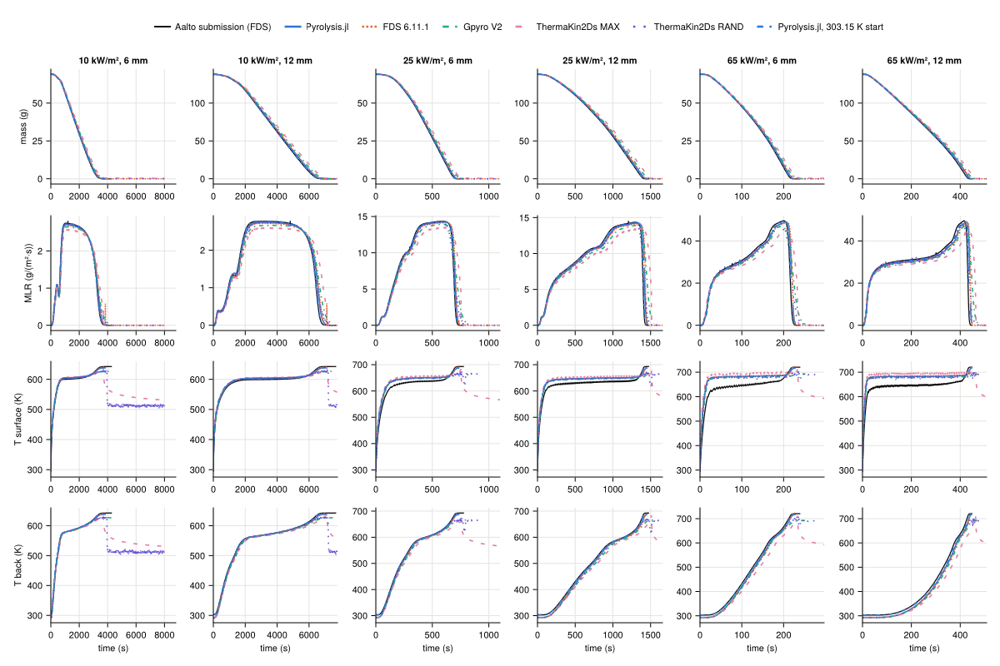

## BUW-FZJ_A

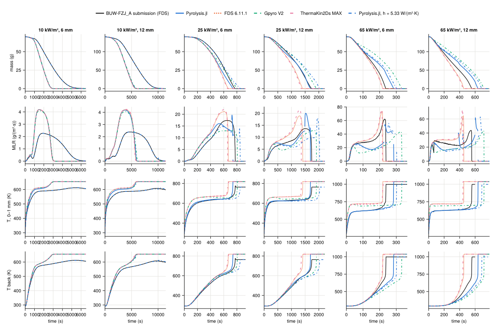

## BUW-FZJ_B

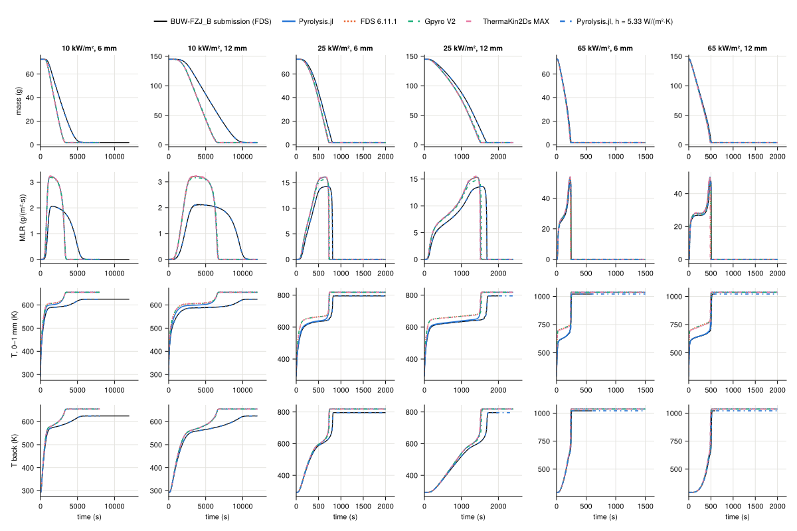

## DBI_1

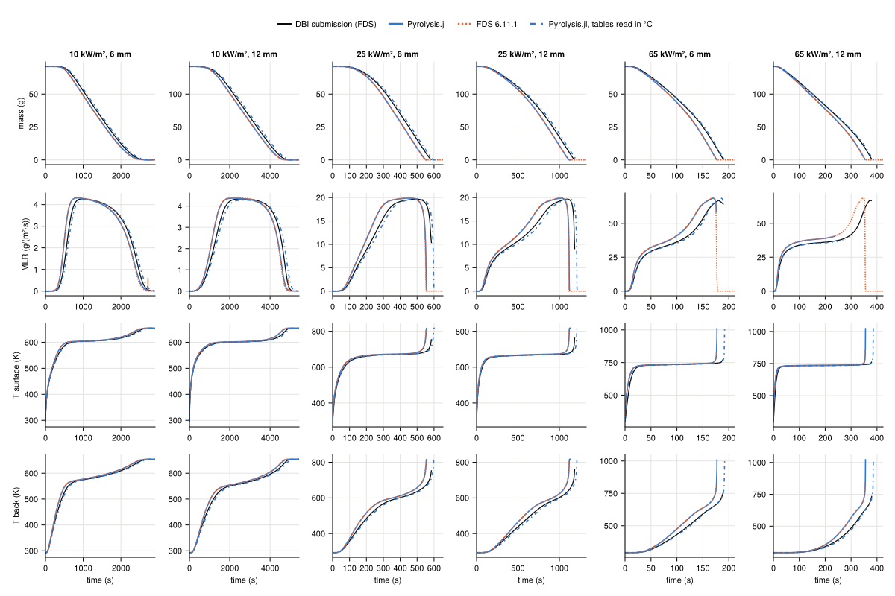

## GIDAZE+

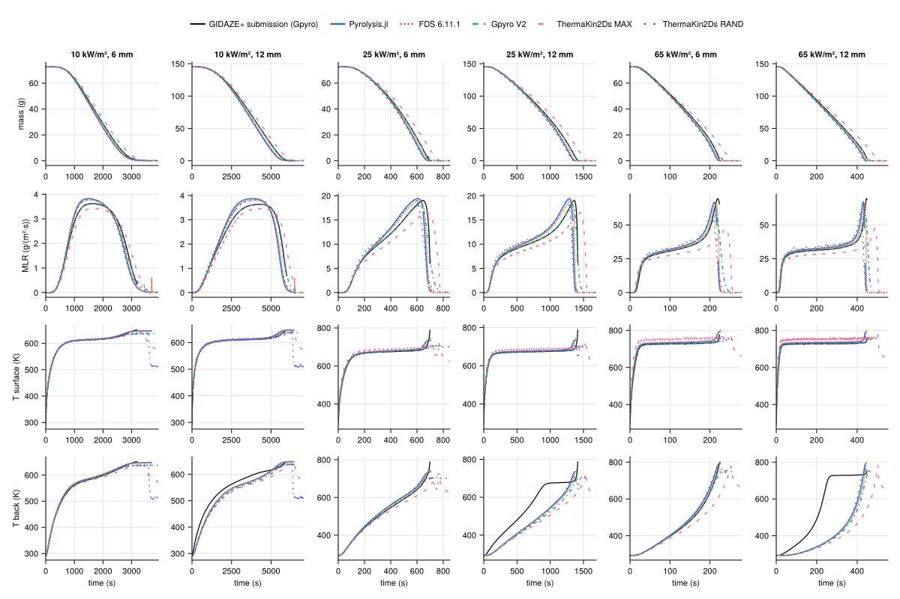

## NIST

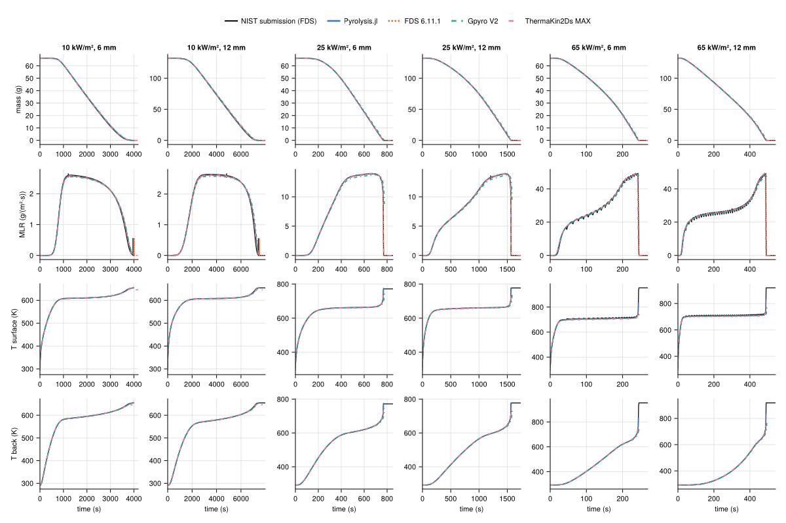

## UMD

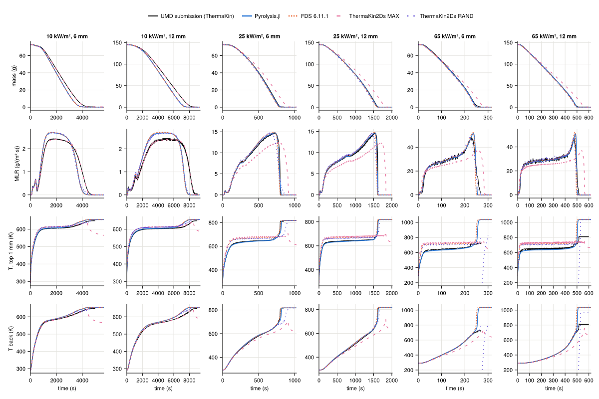

## UMET_GP

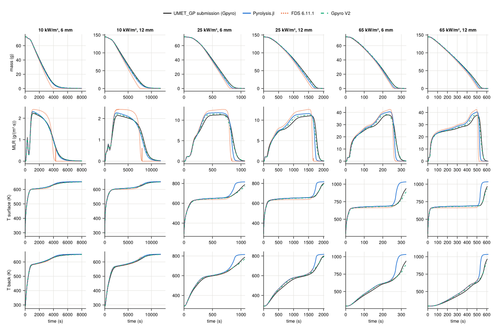

## UMET_TK

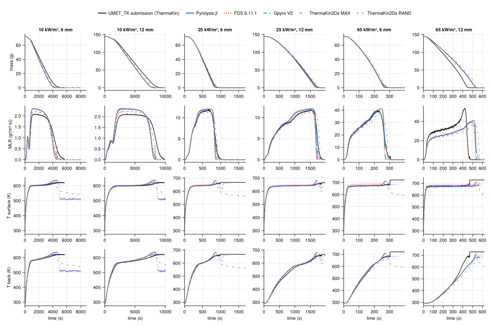

## BUW-FZJ_C

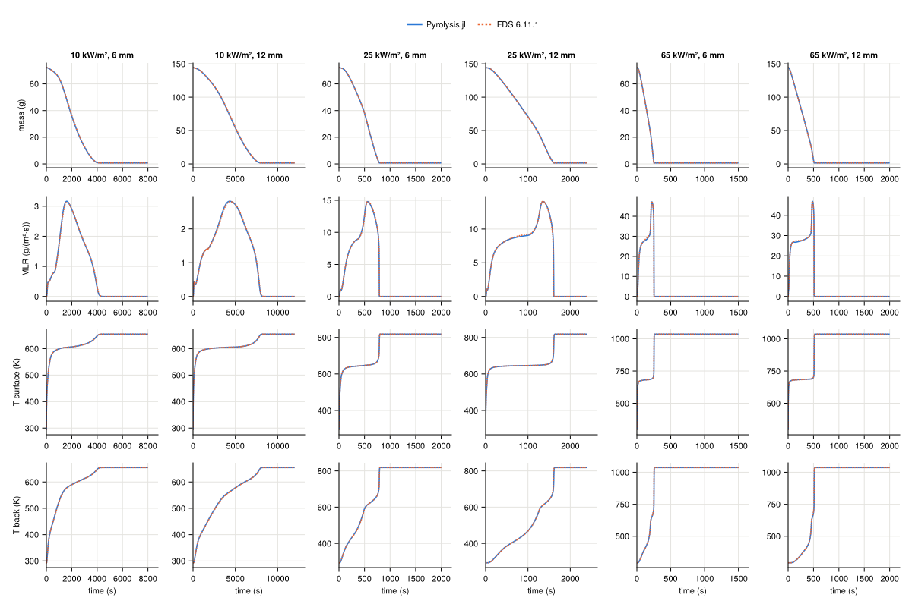

## DBI_calibrated

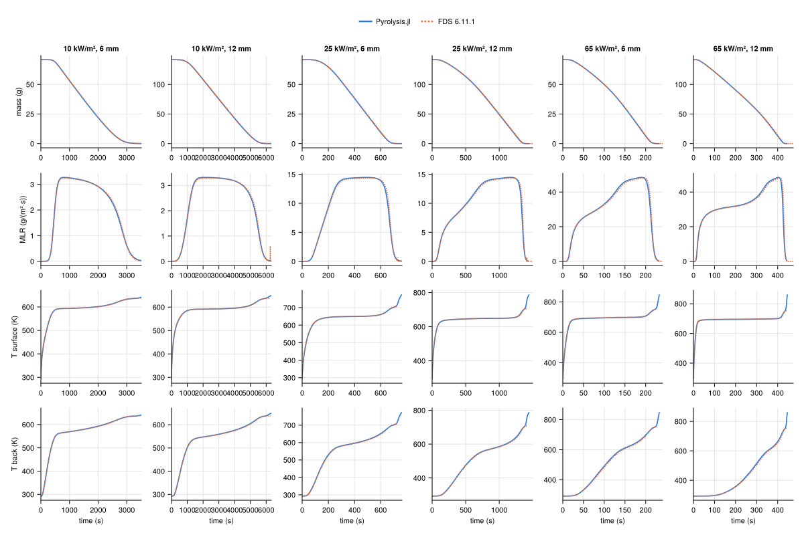

## NIST-StMU

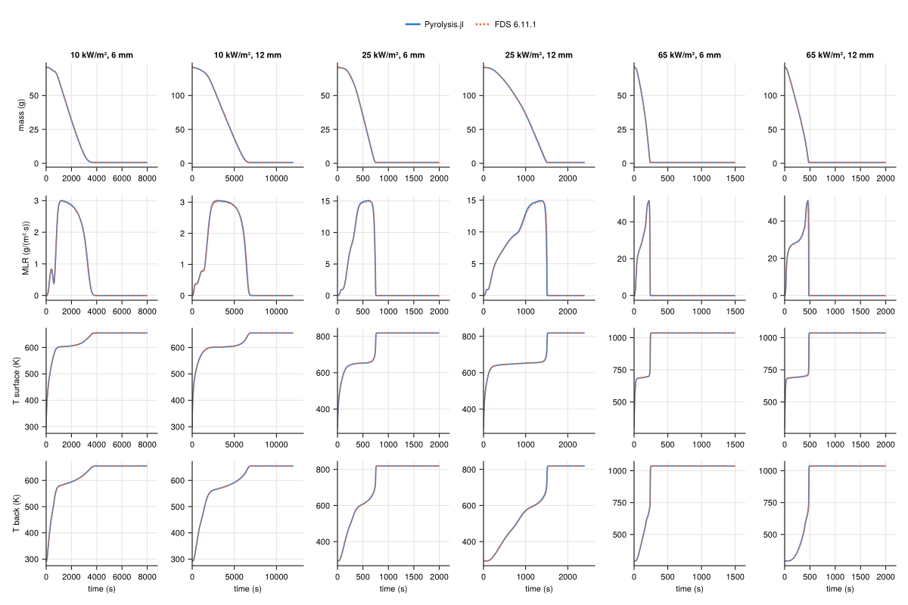
