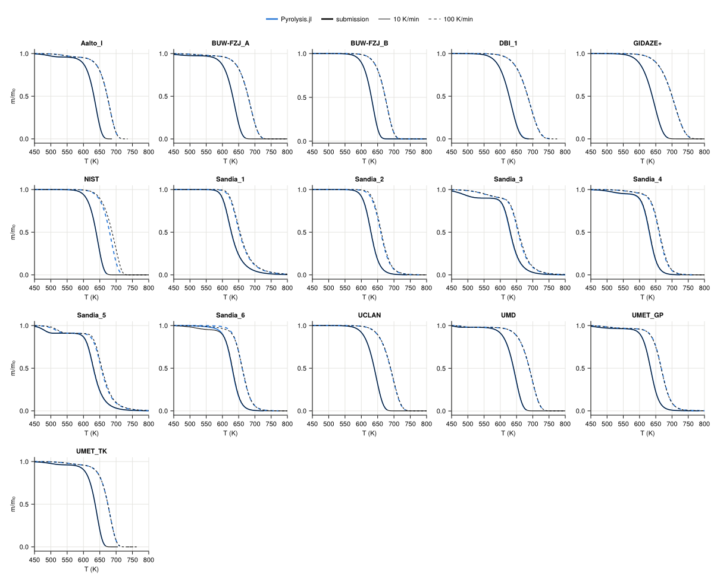

# TGA

The MaCFP-2 TGA targets of the [MaCFP PMMA validation](../macfp_pmma.md): the temperature at which 10, 50 and 90 % of
the mass is lost, Pyrolysis.jl minus the submission (K).

| set | β (K/min) | ΔT₁₀ | ΔT₅₀ | ΔT₉₀ |
|---|---|---|---|---|
| Aalto_I | 10 | 0.0 | 0.0 | 0.0 |
| Aalto_I | 100 | 0.1 | 0.1 | 0.1 |
| BUW-FZJ_A | 10 | 0.0 | 0.0 | 0.0 |
| BUW-FZJ_A | 100 | 0.1 | 0.1 | 0.1 |
| BUW-FZJ_B | 10 | 0.0 | 0.0 | 0.0 |
| BUW-FZJ_B | 100 | 0.0 | 0.1 | 0.1 |
| DBI_1 | 10 | 0.0 | 0.2 | 0.9 |
| DBI_1 | 100 | 0.1 | 0.3 | 1.1 |
| GIDAZE+ | 10 | 0.0 | 0.0 | 0.0 |
| GIDAZE+ | 100 | 0.1 | 0.1 | 0.1 |
| NIST | 10 | 0.4 | 0.0 | -0.4 |
| NIST | 100 | -3.5 | -7.7 | -9.1 |
| Sandia_1 | 10 | -0.5 | -0.6 | -0.8 |
| Sandia_1 | 100 | -2.2 | -2.4 | -2.3 |
| Sandia_2 | 10 | -0.2 | -0.3 | -0.4 |
| Sandia_2 | 100 | -3.0 | -1.9 | -1.2 |
| Sandia_3 | 10 | 8.5 | -1.3 | -1.0 |
| Sandia_3 | 100 | -2.2 | -2.0 | -1.7 |
| Sandia_4 | 10 | -0.9 | -1.0 | -0.4 |
| Sandia_4 | 100 | -1.7 | -1.5 | -1.7 |
| Sandia_5 | 10 | -1.0 | -0.9 | -1.0 |
| Sandia_5 | 100 | -6.1 | -1.9 | -2.2 |
| Sandia_6 | 10 | 1.5 | -0.9 | -0.5 |
| Sandia_6 | 100 | 1.5 | -0.3 | 0.1 |
| UCLAN | 10 | 0.0 | 0.0 | 0.0 |
| UCLAN | 100 | -0.6 | -0.7 | -0.8 |
| UMD | 10 | -0.6 | -0.6 | -0.6 |
| UMD | 100 | -0.5 | -0.4 | -0.4 |
| UMET_GP | 10 | 0.4 | 0.4 | 0.3 |
| UMET_GP | 100 | 0.6 | 0.5 | 0.4 |
| UMET_TK | 10 | 0.0 | 0.0 | 0.0 |
| UMET_TK | 100 | 0.0 | 0.1 | 0.1 |

