# Gasification apparatus

The MaCFP-3 experiments of the [MaCFP PMMA validation](../macfp_pmma.md): every deck with complete properties runs the
eleven PMMA tests of the NIST gasification apparatus, scored against the measurements.

## Apparatus deck

The tests run on one shared deck: the sample at the thickness that holds its measured
mass at the deck's density on the 6.99 cm disc, bonded to 28.52 mm of Kaowool PM;
convection with h = 10.0 W/(m²·K) to gas at 298.15 K and re-radiation to walls at
289.15 K; adiabatic beneath the board. The heater is a cone of uniform intensity
from the normal to 50°: a coaxial disc fitted to the apparatus's radial flux profile
at 50 kW/m² is seen out to 33–62° within the profile's error bars, and no disc fits the
25 kW/m² profile within its bars. The Kaowool cell under the sample is opaque and absorbs
what the sample transmits; the board beneath it is transparent, because its measured
conductivity already carries its own radiation.

## Scores

The score is MaCFP's: the mean of the runs of the repeats, against the mean of the
measured repeats over the shortest repeat, as NRMS = RMS/(max − min) of the measured
mean; lower is better. For an in-depth deck, the range is that of the diffuse and
collimated heaters, which bound the cone.

| set | mass, 50: Pyrolysis.jl | group | MLR, 50: Pyrolysis.jl | group | T back, 50: Pyrolysis.jl | group | T back, 25: Pyrolysis.jl | group |
|---|---|---|---|---|---|---|---|---|
| Aalto_I | 0.035 (0.034–0.036) | 0.053 | 0.187 (0.175–0.201) | 0.226 | 0.046 (0.043–0.052) | 0.044 | 0.052 (0.050–0.054) | 0.083 |
| BUW-FZJ_A | 0.170 | 0.033 | 0.393 | 0.173 | 0.324 | 0.338 | 0.287 | – |
| BUW-FZJ_B | 0.047 | 0.033 | 0.143 | 0.177 | 0.181 | 0.234 | 0.135 | – |
| BUW-FZJ_C | 0.047 (0.045–0.050) | 0.037 | 0.076 (0.073–0.082) | 0.373 | 0.064 (0.054–0.075) | 0.033 | 0.054 (0.053–0.055) | – |
| DBI_1 | 0.129 | – | 0.466 | – | 0.186 | – | 0.201 | – |
| DBI_calibrated | 0.058 (0.058–0.061) | 0.034 | 0.245 (0.173–0.255) | 0.167 | 0.331 (0.302–0.362) | 0.228 | 0.287 (0.272–0.302) | 0.158 |
| GIDAZE+ | 0.053 (0.049–0.056) | – | 0.286 (0.268–0.311) | – | 0.193 (0.177–0.210) | – | 0.109 (0.101–0.118) | – |
| NIST-StMU | 0.053 (0.053–0.053) | 0.044 | 0.134 (0.122–0.146) | 0.116 | 0.039 (0.038–0.045) | 0.121 | 0.042 (0.042–0.044) | 0.102 |
| NIST | 0.118 | 0.128 | 0.217 | 0.328 | 0.147 | 0.238 | 0.120 | 0.195 |
| UMD | 0.040 (0.038–0.042) | 0.028 | 0.092 (0.073–0.099) | 0.103 | 0.183 (0.167–0.200) | 0.030 | 0.108 (0.100–0.117) | 0.016 |
| UMET_GP | 0.080 (0.078–0.082) | 0.030 | 0.136 (0.131–0.142) | 0.190 | 0.580 (0.562–0.598) | 0.803 | 0.345 (0.337–0.353) | 0.601 |
| UMET_TK | 0.086 (0.084–0.089) | – | 0.153 (0.145–0.161) | – | 0.612 (0.594–0.631) | – | 0.367 (0.359–0.375) | – |

Against the groups' own predictions of the same tests, scored against the same measurements,
Pyrolysis.jl's score is as good or better on 2 of 9 sets for mass, 50 kW/m², 6 of 9 sets for MLR, 50 kW/m², 5 of 9 sets for T back, 50 kW/m², 4 of 6 sets for T back, 25 kW/m².
The heater's distribution moves an in-depth deck's score by at most 0.082. The
back temperatures are those of the sample's interface with the board, which the shared
deck's convection coefficient and the board's conductivity set as much as the
property set: on the inert Kaowool stack (below), the shared deck is
93 K above the measurement at 17.16 mm after 1200 s.

## Runs against the experiments

### Aalto_I

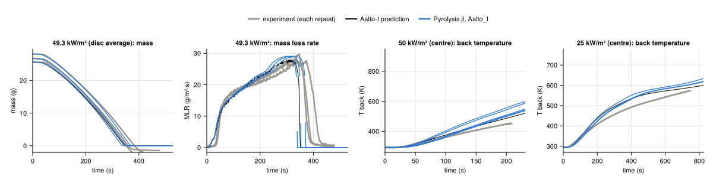

### BUW-FZJ_A

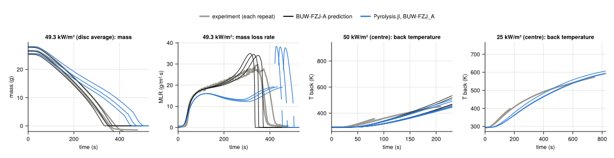

### BUW-FZJ_B

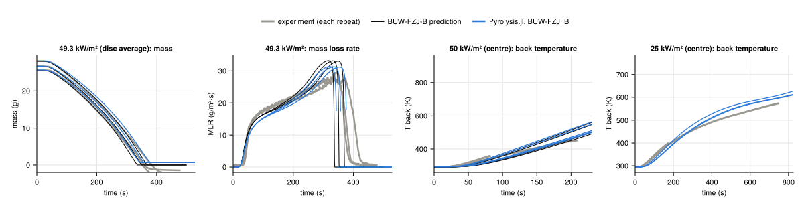

### BUW-FZJ_C

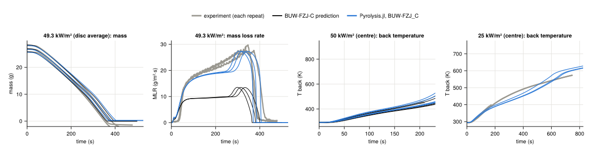

### DBI_1

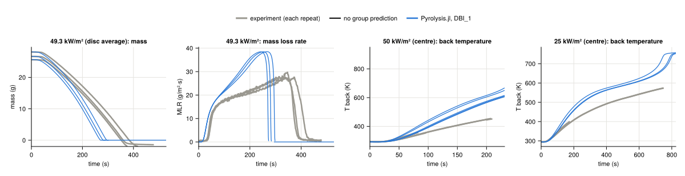

### DBI_calibrated

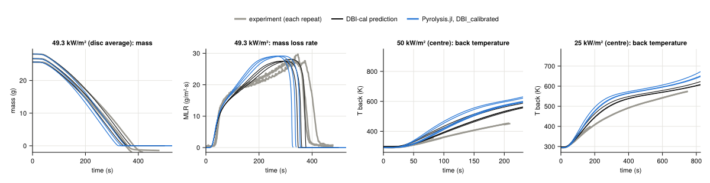

### GIDAZE+

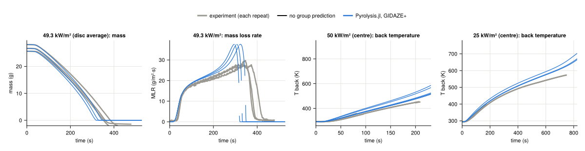

### NIST-StMU

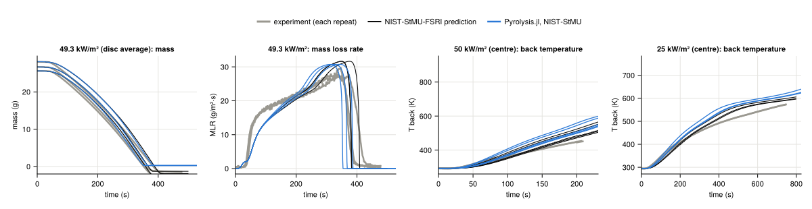

### NIST

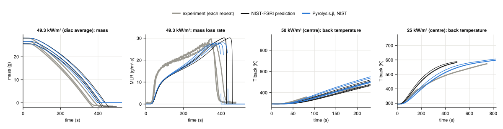

### UMD

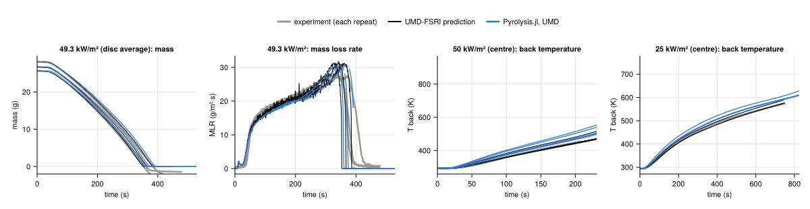

### UMET_GP

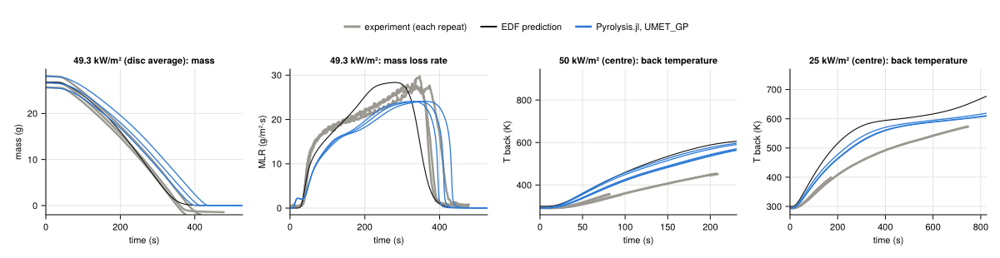

### UMET_TK

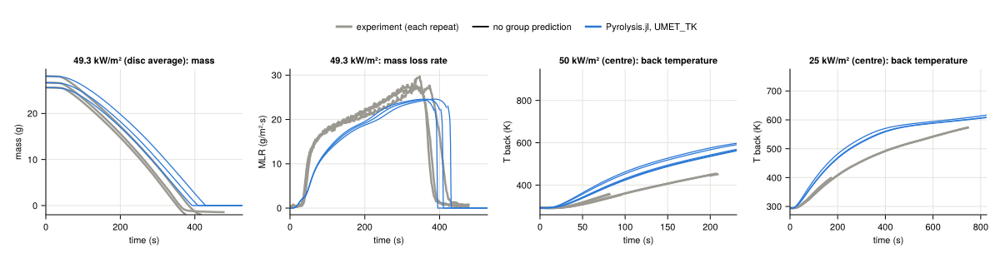

## Inert tests

The apparatus's inert tests check the shared deck without a pyrolysing sample: five
Kaowool discs painted black (ε 0.95), and a copper disc painted black (ε 0.92) on
Kaowool, both at 50 kW/m². They test the shared convection coefficient and the
Kaowool's conductivity.

| test | depth (mm) | time (s) | Pyrolysis.jl (K) | experiment (K) | difference (K) |
|---|---|---|---|---|---|
| Black-Insulation | 5.72 | 300 | 729.6 | 720.6 | +9.0 |
| Black-Insulation | 5.72 | 600 | 794.4 | 788.3 | +6.1 |
| Black-Insulation | 5.72 | 1200 | 847.5 | 821.0 | +26.5 |
| Black-Insulation | 11.44 | 300 | 530.2 | 515.7 | +14.5 |
| Black-Insulation | 11.44 | 600 | 652.7 | 638.3 | +14.4 |
| Black-Insulation | 11.44 | 1200 | 762.5 | 707.4 | +55.1 |
| Black-Insulation | 17.16 | 300 | 379.5 | 377.0 | +2.5 |
| Black-Insulation | 17.16 | 600 | 517.4 | 505.4 | +12.0 |
| Black-Insulation | 17.16 | 1200 | 685.0 | 591.7 | +93.3 |
| Black-Copper | 3.17 | 25 | 374.2 | 387.0 | -12.8 |
| Black-Copper | 3.17 | 50 | 460.2 | 475.3 | -15.0 |
| Black-Copper | 3.17 | 100 | 613.4 | 621.6 | -8.2 |

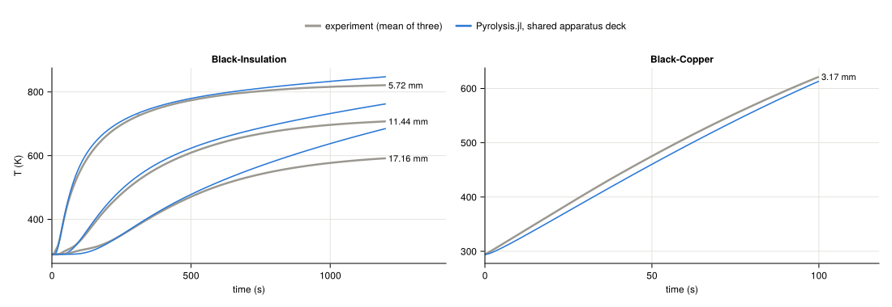
