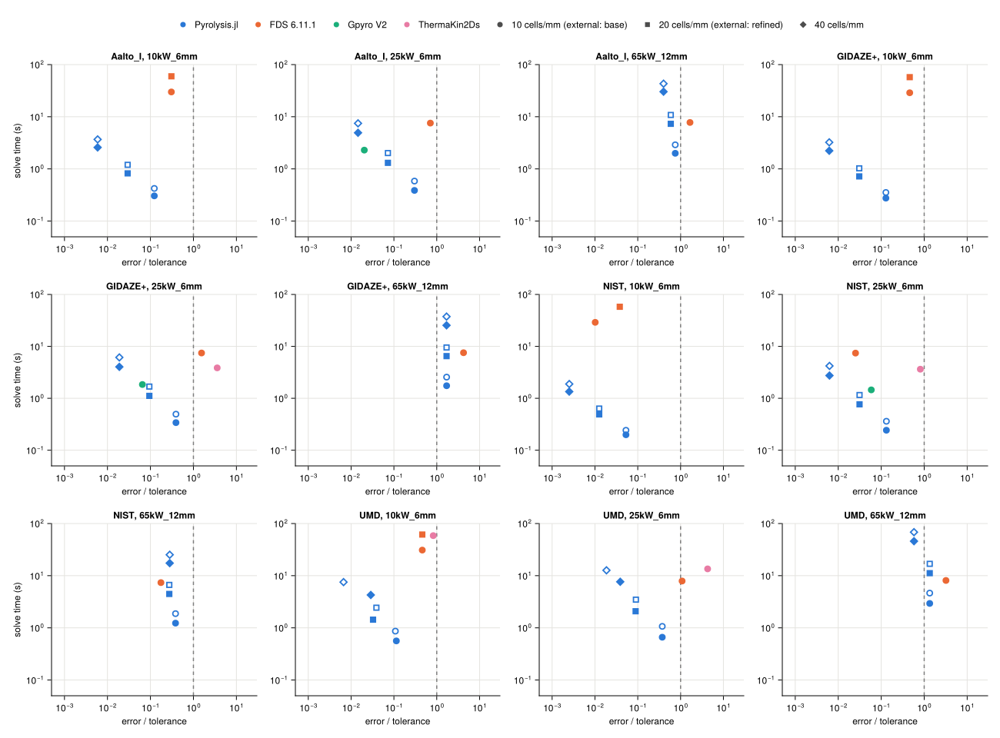

# Cost

The cost at matched accuracy of the [MaCFP PMMA validation](../macfp_pmma.md). Each code is scored against its own finest
run of each case: Pyrolysis.jl against 80 cells/mm at reltol 1e-8, FDS against its 25 µm
run, Gpyro and ThermaKin2Ds against their half-cell, half-step runs. A run is within
tolerance when its peak MLR and t₅₀ are within 1 % and its surface and back temperature
histories within 2 K up to 90 % mass loss; the error is the largest of those four
ratios. Pyrolysis.jl runs a ladder of 10, 20 and 40 cells/mm at the default tolerances
and ten times them. Every time is the median of repeated solves on one pinned core of a
quiet machine (`scripts/timing/README.md`). FDS and ThermaKin2Ds step at a fixed step to
the case's end time; their times scaled to their own burnout are given beside them,
since Pyrolysis.jl and Gpyro stop at burnout.

| set | case | code | cheapest within tolerance (s) | at 20 cells/mm or base (s) | scaled to burnout (s) |
|---|---|---|---|---|---|
| Aalto_I | apparatus q25_Temp_R2 | Pyrolysis.jl | 0.93 (10/mm ×10) | 4.23 | – |
| Aalto_I | apparatus q50_Mass_R4 | Pyrolysis.jl | 0.98 (10/mm ×10) | 4.43 | – |
| Aalto_I | 10kW_12mm | Pyrolysis.jl | 1.45 (10/mm ×10) | 6.95 | – |
| Aalto_I | 10kW_6mm | Pyrolysis.jl | 0.30 (10/mm ×10) | 1.20 | – |
| Aalto_I | 10kW_6mm | FDS 6.11.1 | 29.86 (base) | 29.86 | 13.08 |
| Aalto_I | 25kW_12mm | Pyrolysis.jl | 1.61 (10/mm ×10) | 8.65 | – |
| Aalto_I | 25kW_6mm | Pyrolysis.jl | 0.39 (10/mm ×10) | 2.01 | – |
| Aalto_I | 25kW_6mm | FDS 6.11.1 | 7.56 (base) | 7.56 | 2.68 |
| Aalto_I | 25kW_6mm | Gpyro V2 | 2.29 (base) | 2.29 | – |
| Aalto_I | 65kW_12mm | Pyrolysis.jl | 1.99 (10/mm ×10) | 10.82 | – |
| Aalto_I | 65kW_12mm | FDS 6.11.1 | not reached | 7.77 | 1.71 |
| Aalto_I | 65kW_6mm | Pyrolysis.jl | 0.47 (10/mm ×10) | 2.45 | – |
| GIDAZE+ | apparatus q25_Temp_R2 | Pyrolysis.jl | 0.68 (10/mm ×10) | 3.04 | – |
| GIDAZE+ | apparatus q50_Mass_R4 | Pyrolysis.jl | 0.76 (10/mm ×10) | 3.45 | – |
| GIDAZE+ | 10kW_12mm | Pyrolysis.jl | 1.08 (10/mm ×10) | 5.15 | – |
| GIDAZE+ | 10kW_6mm | Pyrolysis.jl | 0.28 (10/mm ×10) | 1.03 | – |
| GIDAZE+ | 10kW_6mm | FDS 6.11.1 | 28.82 (base) | 28.82 | 11.50 |
| GIDAZE+ | 25kW_12mm | Pyrolysis.jl | 1.39 (10/mm ×10) | 7.57 | – |
| GIDAZE+ | 25kW_6mm | Pyrolysis.jl | 0.34 (10/mm ×10) | 1.68 | – |
| GIDAZE+ | 25kW_6mm | FDS 6.11.1 | not reached | 7.46 | 2.55 |
| GIDAZE+ | 25kW_6mm | Gpyro V2 | 1.84 (base) | 1.84 | – |
| GIDAZE+ | 25kW_6mm | ThermaKin2Ds | not reached | 3.85 | 1.49 |
| GIDAZE+ | 65kW_12mm | Pyrolysis.jl | not reached | 9.51 | – |
| GIDAZE+ | 65kW_12mm | FDS 6.11.1 | not reached | 7.55 | 1.67 |
| GIDAZE+ | 65kW_6mm | Pyrolysis.jl | 1.45 (20/mm ×10) | 2.19 | – |
| NIST | apparatus q25_Temp_R2 | Pyrolysis.jl | 0.60 (10/mm ×10) | 2.65 | – |
| NIST | apparatus q50_Mass_R4 | Pyrolysis.jl | 0.65 (10/mm ×10) | 2.79 | – |
| NIST | 10kW_12mm | Pyrolysis.jl | 0.89 (10/mm ×10) | 3.90 | – |
| NIST | 10kW_6mm | Pyrolysis.jl | 0.20 (10/mm ×10) | 0.63 | – |
| NIST | 10kW_6mm | FDS 6.11.1 | 29.02 (base) | 29.02 | 13.73 |
| NIST | 25kW_12mm | Pyrolysis.jl | 0.93 (10/mm ×10) | 4.91 | – |
| NIST | 25kW_6mm | Pyrolysis.jl | 0.24 (10/mm ×10) | 1.16 | – |
| NIST | 25kW_6mm | FDS 6.11.1 | 7.42 (base) | 7.42 | 2.84 |
| NIST | 25kW_6mm | Gpyro V2 | 1.45 (base) | 1.45 | – |
| NIST | 25kW_6mm | ThermaKin2Ds | 3.63 (base) | 3.63 | 1.39 |
| NIST | 65kW_12mm | Pyrolysis.jl | 1.23 (10/mm ×10) | 6.66 | – |
| NIST | 65kW_12mm | FDS 6.11.1 | 7.36 (base) | 7.36 | 1.80 |
| NIST | 65kW_6mm | Pyrolysis.jl | 0.30 (10/mm ×10) | 1.53 | – |
| UMD | apparatus q25_Temp_R2 | Pyrolysis.jl | 1.23 (10/mm ×10) | 6.06 | – |
| UMD | apparatus q50_Mass_R4 | Pyrolysis.jl | 1.25 (10/mm ×10) | 6.36 | – |
| UMD | 10kW_12mm | Pyrolysis.jl | 2.11 (10/mm ×10) | 11.09 | – |
| UMD | 10kW_6mm | Pyrolysis.jl | 0.56 (10/mm ×10) | 2.43 | – |
| UMD | 10kW_6mm | FDS 6.11.1 | 30.94 (base) | 30.94 | 15.44 |
| UMD | 10kW_6mm | ThermaKin2Ds | 58.58 (base) | 58.58 | 37.66 |
| UMD | 25kW_12mm | Pyrolysis.jl | not reached | 14.14 | – |
| UMD | 25kW_6mm | Pyrolysis.jl | 0.66 (10/mm ×10) | 3.47 | – |
| UMD | 25kW_6mm | FDS 6.11.1 | not reached | 7.90 | 3.11 |
| UMD | 25kW_6mm | ThermaKin2Ds | not reached | 13.51 | 6.30 |
| UMD | 65kW_12mm | Pyrolysis.jl | 45.83 (40/mm ×10) | 16.88 | – |
| UMD | 65kW_12mm | FDS 6.11.1 | not reached | 8.10 | 1.99 |
| UMD | 65kW_6mm | Pyrolysis.jl | 2.55 (20/mm ×10) | 4.10 | – |

Pyrolysis.jl reaches the tolerance on 30 of its 32 timed cases,
27 of them at 10 cells/mm. On the cases where an external code is timed too,
its cheapest run within tolerance takes less time than FDS 6.11.1's base run on 10 of 11 (9 of 11 against its time scaled to burnout); Gpyro V2's base run on 3 of 3; ThermaKin2Ds's base run on 4 of 4 (4 of 4 against its time scaled to burnout).

