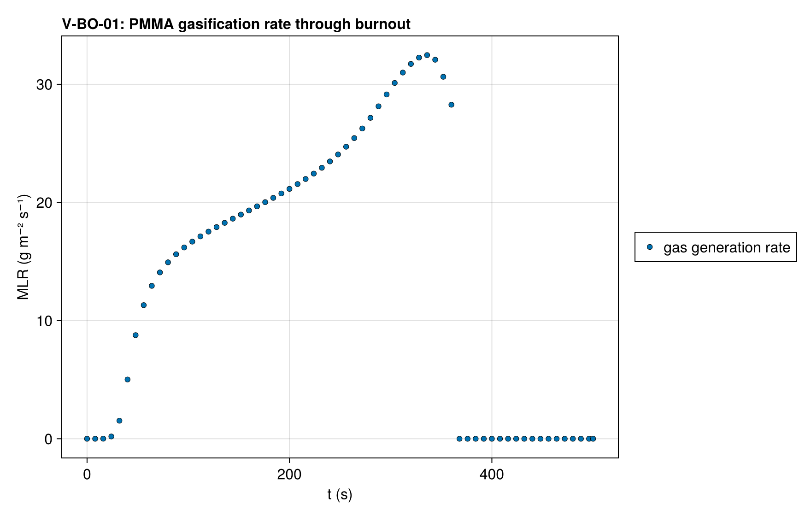
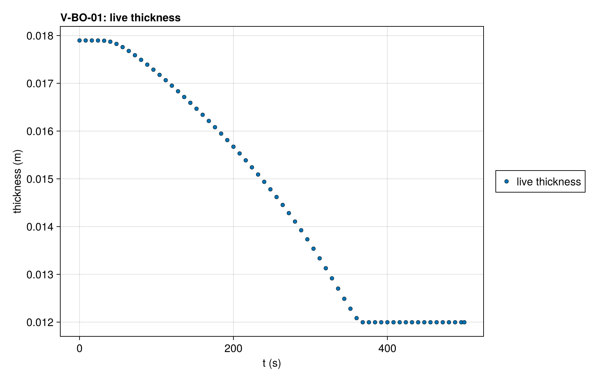

# V-BO-01 — PMMA-on-Kaowool burnout under ALE (layer deactivation)

**Tags:** `ale`, `burnout`, `depletion`, `beer_lambert`, `coupled`, `performance`

**References:**

- MaCFP-2 PMMA gasification case (NIST), 50 kW/m²
- Gpyro V2 PMMA deck property fits

## Problem statement

A 5.9 mm PMMA slab on 12 mm Kaowool under 50 kW/m² burns out completely:
the PMMA cells thin to the deactivation threshold, the layer is deactivated
and the run ends on the bare substrate. The deck is the MaCFP PMMA
gasification case with the Gpyro V2 property fits (power-law k(T), c(T)
above 394 K — positive on the whole property bracket) and in-depth
(Beer–Lambert) absorption.

The run must burn out completely, lose exactly the mass of the PMMA layer,
match the reference peak mass loss rate, its time and the burnout time,
close the mass ledger, and converge the surface temperature at every
accepted step, within a wall-time budget at 0.098 mm cells.

The mesh moves by the equidistribution correction, the PMMA–Kaowool
interface a Lagrangian node, so the PMMA cells thin together and the layer
deactivates in one invocation into the Kaowool cell beneath. The surface
QoI counts accepted states whose surface balance did not converge or sits
on the trial clamp, since that Newton never warns.

### Quantities of interest (n = 120)

| QoI | value | exact | error | tolerance | within tol | provenance |
| --- | --- | --- | --- | --- | --- | --- |
| complete burnout: live thickness at t_end is the substrate | 0.012 | 0.012 | 3.333e-06 | 1e-05 | yes | every PMMA cell deactivated; 12.0 ± 0.01 mm |
| mass loss of the gasified PMMA layer | 69.92 | 69.91 | 0.005841 | 0.3 | yes | percent of the initial mass; exact = the layer's initial mass / m₀ |
| peak MLR | 32.47 | 32.39 | 0.002439 | 0.03 | yes | g m⁻² s⁻¹, gas generation rate |
| mass ledger closure | 6.274e-08 | 0 | 6.274e-08 | 3e-05 | yes | total-mass drop vs ∫ ṁ″ dt over the accepted steps (three-point Gauss–Legendre per step) and the mass deactivation vented |
| clamped surface balances on accepted states | 0 | 0 | 0 | 0.5 | yes | boundary temperature solve converged inside the property bracket at every accepted step |
| time of peak MLR | 335.5 | 335 | 0.001493 | 0.03 | yes | s |
| burnout time (live thickness < 12.02 mm) | 363.5 | 363.5 | 0 | 0.01 | yes | s |
| deactivation invocations for the PMMA layer (reported) | 1 | 1 | 0 | Inf | yes | 120 cells; largest merged fraction 0.0435 (4.35 ε_m); reported, not asserted |

### Solver configuration

| setting | value |
| --- | --- |
| integrator | Rodas5P (default) |
| use_ale | true |
| deactivation | true |
| min_thickness | 0.001 |
| radiation_model | BEER_LAMBERT |
| abstol | 1.0e-8 |
| reltol | 1.0e-6 |

