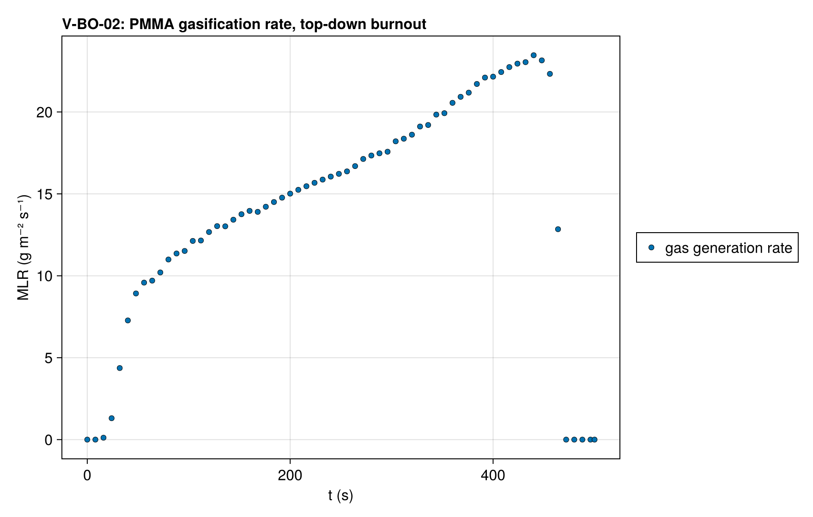
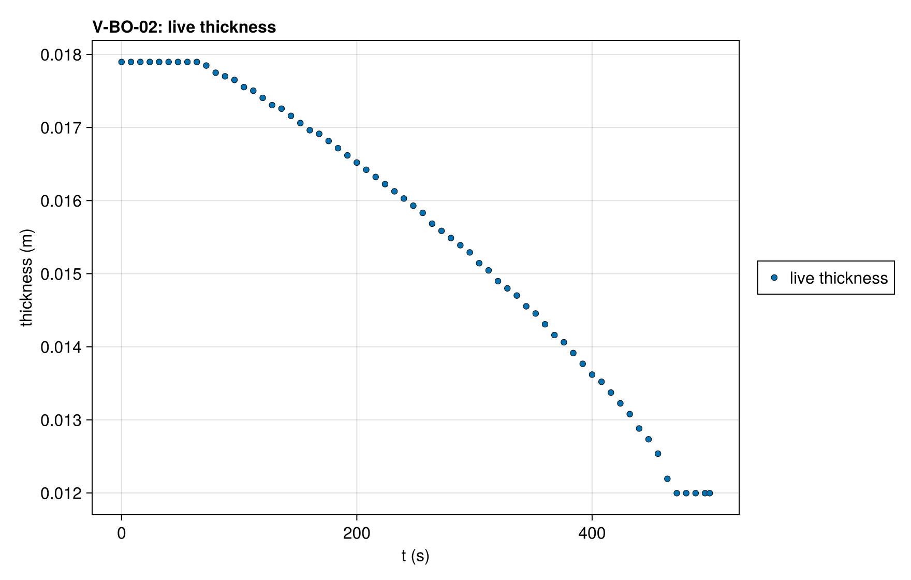
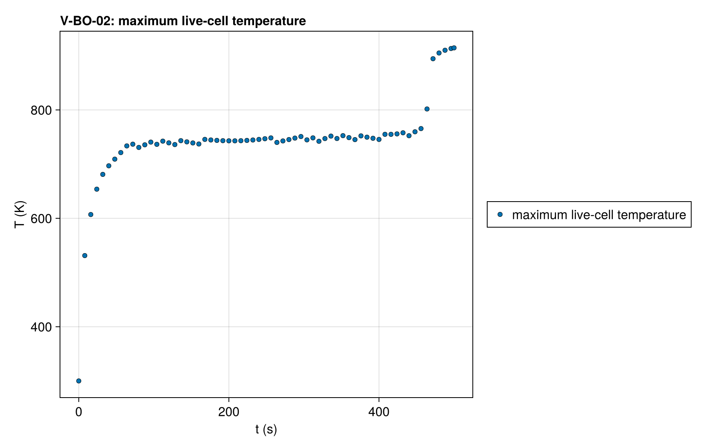

# V-BO-02 — PMMA-on-Kaowool burnout on a fixed mesh under surface absorption (top-cell deactivation)

**Tags:** `eulerian`, `burnout`, `depletion`, `surface_absorption`, `coupled`

**References:**

- MaCFP-2 PMMA gasification case (NIST), 50 kW/m²

## Problem statement

The V-BO-01 deck on a fixed mesh, with the incident flux absorbed at the
surface. A fixed mesh keeps every cell's volume, so a gasifying cell empties
instead of thinning, and only the top live cell deactivates: once its
condensed mass falls below ε_m (1 %) of its initial value it merges into the
cell beneath, which becomes the surface. With the flux absorbed at the
surface, the surface cell is the hottest and empties first, so the layer
burns top down and no cell below the surface empties before it.

The run must deactivate all 60 PMMA cells, lose exactly the mass of the
PMMA layer, end on the bare substrate, close the mass ledger, keep the
maximum live-cell temperature below 1000 K, and resolve each gas-release
transient without approaching the minimum allowed step. The peak mass loss rate is informational:
surface absorption is a different problem from the in-depth reference of
V-BO-01.

### Quantities of interest (n = 120)

| QoI | value | exact | error | tolerance | within tol | provenance |
| --- | --- | --- | --- | --- | --- | --- |
| complete burnout: live thickness at t_end is the substrate | 0.012 | 0.012 | 3.333e-06 | 1e-05 | yes | every PMMA cell deactivated; 12.0 ± 0.01 mm |
| mass loss of the gasified PMMA layer | 69.92 | 69.91 | 0.005836 | 0.3 | yes | percent of the initial mass; exact = the layer's initial mass / m₀ |
| mass ledger closure | 3.594e-11 | 0 | 3.594e-11 | 0.0003 | yes | total-mass drop vs ∫ ṁ″ dt over the accepted steps (three-point Gauss–Legendre per step) and the mass deactivation vented; gas-release transients are resolved at reltol 1e-9 and a 1e-4 Pa pressure budget (relative ledger defects below 1e-10 in both energy forms at 60 cells) |
| clamped surface balances on accepted states | 0 | 0 | 0 | 0.5 | yes | boundary temperature solve converged inside the property bracket at every accepted step |
| deactivation events | 120 | 120 | 0 | 0.5 | yes | every PMMA cell deactivates as the top live cell, top down |
| maximum live-cell temperature | 914.5 | — | 914.5 | 1000 | yes | K over every accepted step (observed 915); the surface cell is the hottest and empties first, so no interior void forms |
| smallest accepted step | 2.321e-06 | 1e-08 | 0 | 0.001 | yes | s; lower work bound 1e-8, above dtmin=1e-12; gas transients can require steps shorter than the proposed restart step (minimum 4.87e-7 at 60 cells across the two energy forms) |
| Newton failures | 0 | 0 | 0 | 100 | yes | budget at the CI resolution (60 PMMA cells); observed 0: the default integrator, Rodas5P, is a Rosenbrock method and solves no nonlinear system |
| accepted steps | 2.569e+04 | 0 | 2.569e+04 | 5e+04 | yes | work budget at reltol 1e-9 and pressure tolerance 1e-4 Pa, scaled by cell count; 60-cell qualification: 15884 temperature steps, 21868 enthalpy steps |

### Solver configuration

| setting | value |
| --- | --- |
| integrator | Rodas5P (default) |
| use_ale | false |
| deactivation | true |
| radiation_model | SURFACE_ABSORPTION |
| abstol | 1.0e-11 |
| reltol | 1.0e-9 |
| pressure_tolerance | 0.0001 |
