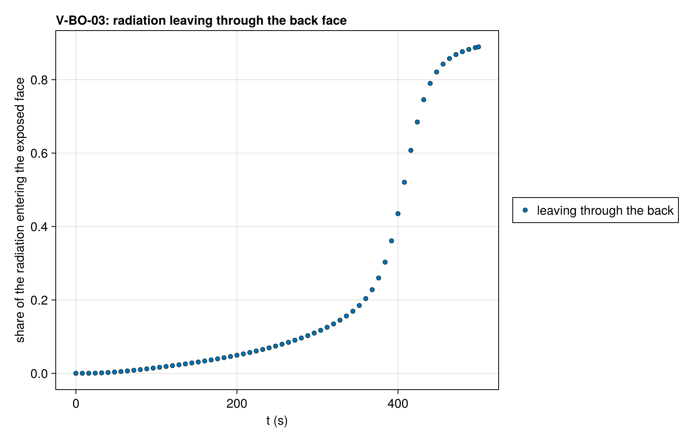
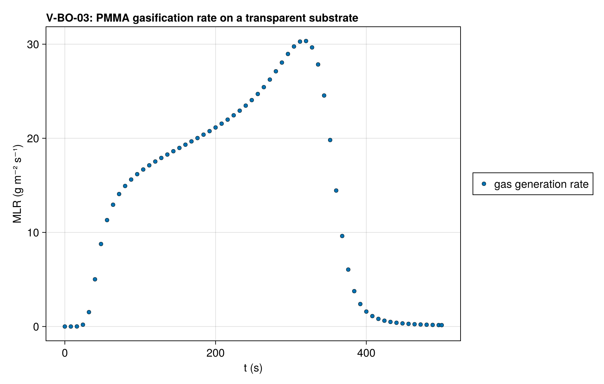

# V-BO-03 — PMMA burnout on a transparent substrate (transmitted-flux guard)

**Tags:** `ale`, `burnout`, `depletion`, `radiative_transfer`

**References:**

- MaCFP-2 PMMA gasification case (NIST), 50 kW/m²

## Problem statement

The V-BO-01 deck under ALE with the Kaowool absorption coefficient set to
zero, so the substrate neither absorbs nor emits. Radiation that passes the
PMMA layer, the heater's and the PMMA's own, crosses the substrate and
leaves through the back face without heating it, so the share of the
radiation entering the exposed face that leaves through the back rises
toward one as the PMMA thins. The mesh moves by the equidistribution
correction as in V-BO-01. The run must complete with the surface
temperature converged at every accepted step, and the radiation leaving
through the back face (solution.extras.radiation_back) must reach more than
1 % of the radiation entering (solution.extras.radiation_absorbed).

### Quantities of interest (n = 120)

| QoI | value | exact | error | tolerance | within tol | provenance |
| --- | --- | --- | --- | --- | --- | --- |
| clamped surface balances on accepted states | 0 | 0 | 0 | 0.5 | yes | boundary temperature solve converged inside the property bracket at every accepted step |
| radiation leaving through the back reported (series peak above 1 % of the radiation entering) | 0.8893 | 1 | 0 | 0.5 | yes | largest share of the radiation entering the exposed face that leaves through the transparent back face |
| peak share of the radiation entering that leaves through the back | 0.8893 | 1 | 0.1107 | 0.3 | yes | asymptote 1 once the PMMA is gone, since the substrate neither absorbs nor emits; at t_end the PMMA cells next to the substrate still hold about 1 % of their mass and absorb 8 % of it, and 3 % leaves through the exposed face (observed 0.889) |
| mass loss (informational) | 69.54 | 69.91 | 0.3708 | 10 | yes | percent; the radiation crossing the substrate does not heat it |

### Solver configuration

| setting | value |
| --- | --- |
| integrator | Rodas5P (default) |
| use_ale | true |
| deactivation | true |
| min_thickness | 0.001 |
| radiation_model | RADIATIVE_TRANSFER |
| abstol | 1.0e-8 |
| reltol | 1.0e-6 |
