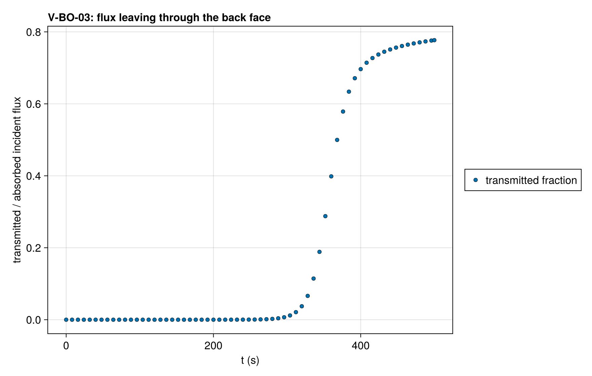
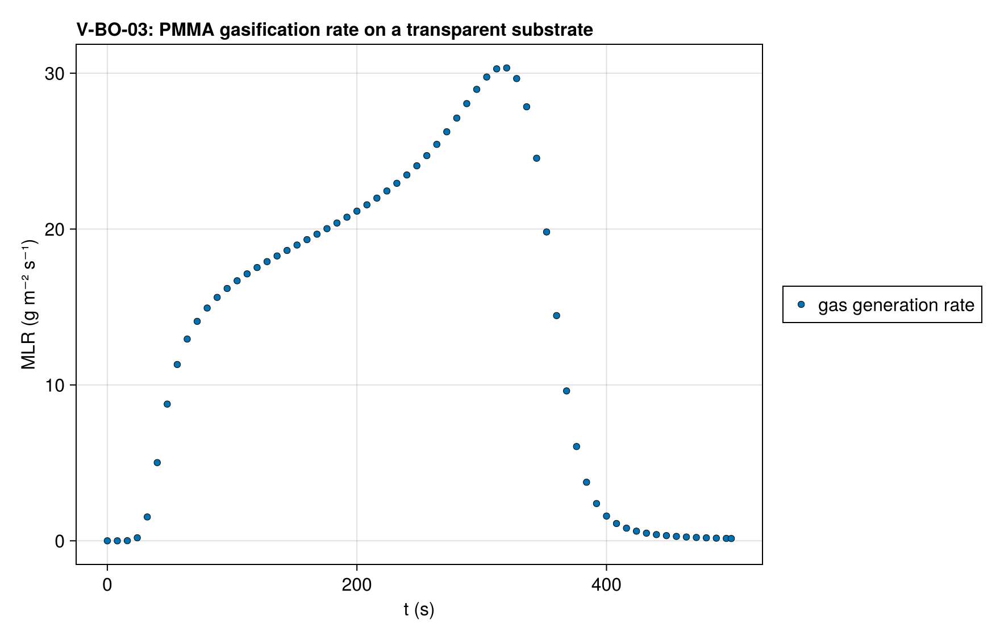

# V-BO-03 — PMMA burnout on a transparent substrate (transmitted-flux guard)

**Tags:** `ale`, `burnout`, `depletion`, `beer_lambert`

**References:**

- MaCFP-2 PMMA gasification case (NIST), 50 kW/m²

## Problem statement

The V-BO-01 deck under ALE with the Kaowool absorption coefficient set to
zero. Radiation that passes the PMMA layer crosses the substrate and leaves
through the back face without heating it, so the share of the incident flux
that leaves the slab rises toward one as the PMMA thins. The run must
complete, report the flux that leaves through the back face
(solution.extras.radiation_transmitted) and warn about it once, with the
surface temperature converged at every evaluation.

### Quantities of interest (n = 120)

| QoI | value | exact | error | tolerance | within tol | provenance |
| --- | --- | --- | --- | --- | --- | --- |
| surface-Newton warnings | 0 | 0 | 0 | 0.5 | yes | boundary temperature solve converged at every evaluation |
| transmitted-flux warning fired | 1 | 1 | 0 | 0.5 | yes | radiation leaving through the transparent back face is reported |
| peak transmitted fraction of the incident flux | 0.777 | 1 | 0.223 | 0.3 | yes | asymptote 1 once the PMMA is gone; the transmitted flux does not heat the substrate, so a residual PMMA layer remains at t_end and absorbs about 20 % |
| mass loss (informational) | 68.88 | 69.91 | 1.036 | 10 | yes | percent; the transmitted flux does not heat the substrate |

### Solver configuration

| setting | value |
| --- | --- |
| integrator | KenCarp4 (default) |
| use_ale | true |
| handle_depletion | true |
| depletion_threshold | 0.05 |
| min_cells | 2 |
| min_thickness | 0.001 |
| radiation_model | BEER_LAMBERT |
| abstol | 1.0e-8 |
| reltol | 1.0e-6 |

