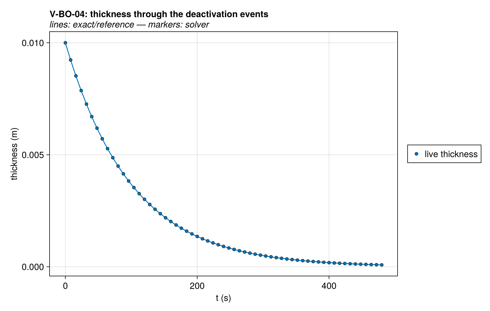
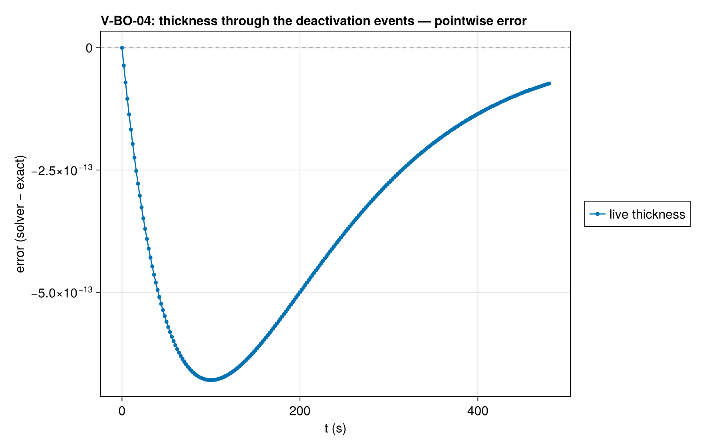
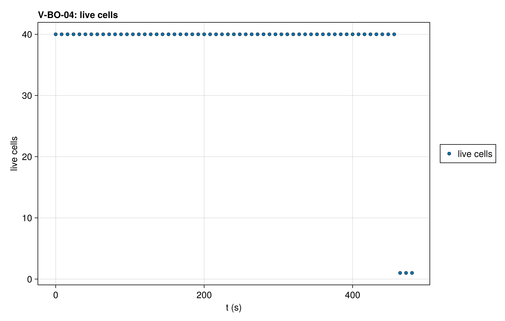

# V-BO-04 — Uniform zero-order burnout: exact thickness through the deactivation event

**Tags:** `ale`, `burnout`, `depletion`, `kinetics`, `exact`

**References:**

- closed form L(t) = L₀ exp(−r t/ρ_s)

## Problem statement

An adiabatic slab at uniform T₀ with one zero-order reaction solid → gas,
γ_gas = 0 and no heat of reaction. The temperature stays at T₀ exactly (no
heat source, no gradient), so the volumetric rate r = A·exp(−E/RT₀) is a
constant and every cell loses the same fraction r/ρ_s of its current
volume per unit time. Under ALE the solid concentration stays at ρ_s
(dilation removes volume, not concentration) and the exact thickness is

  L(t) = L₀ · exp(−r t / ρ_s).

Every cell reaches the deactivation threshold at the same instant, so
deactivation meets its worst case. The cells deactivate at a fraction ε_m
of their initial mass and every cell is in the near-threshold band when the
first crosses it, so the whole column merges into the innermost cell in one
invocation; that survivor holds the column's mass, about 40 ε_m of its own
initial mass, at ρ_s and burns on at the exact rate past t_end. L(t) must
follow the exact law through the event, located at the exact crossing
t = ln(1/ε_m) ρ_s/r, and ξ_s must stay at ρ_s to roundoff.

### Quantities of interest (n = 40)

| QoI | value | exact | error | tolerance | within tol | provenance |
| --- | --- | --- | --- | --- | --- | --- |
| thickness follows L₀ exp(−r t/ρ) through the event | 8.23e-05 | 8.23e-05 | 8.894e-10 | 1e-06 | yes | max relative error over all output times |
| solid concentration stays at ρ_s (dilation removes volume only) | 1000 | 1000 | 8.499e-12 | 1e-08 | yes | max \|ξ_s − ρ_s\|/ρ_s over live cells and times |
| isothermal: T stays at T₀ | 600 | 600 | 1.251e-12 | 1e-06 | yes | K; no heat of reaction, no gradient |
| one invocation deactivates the column into one survivor | 1 | 1 | 0 | 0.5 | yes | 39 events in 1 invocation(s), outcome running |
| the event is located at the exact crossing of ε_m | 460.5 | 460.5 | 1.872e-10 | 1e-06 | yes | relative distance of the event from the exact crossing time (ε_m = 1e-2) |

### Solver configuration

| setting | value |
| --- | --- |
| integrator | Rodas5P (default) |
| use_ale | true |
| deactivation | true |
| min_thickness | 1.0e-6 |
| abstol | 1.0e-9 |
| reltol | 1.0e-7 |
