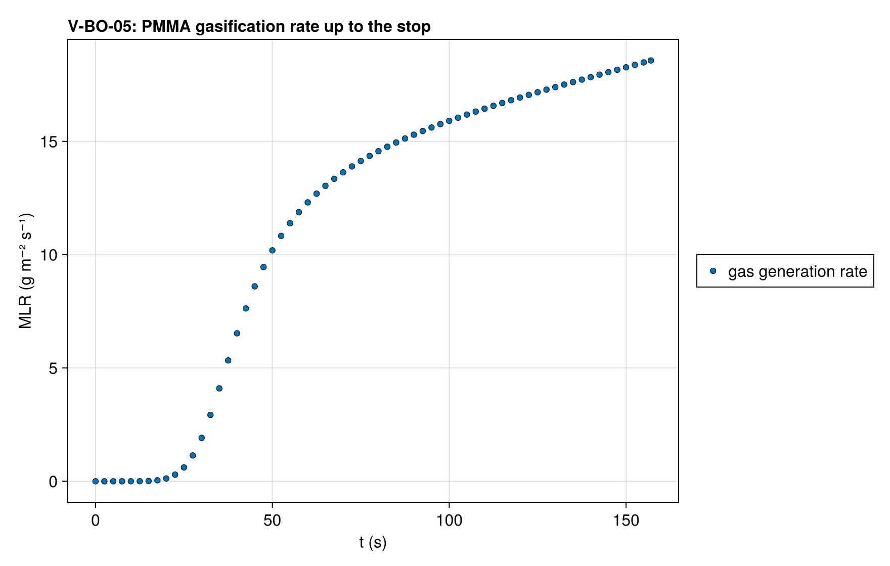
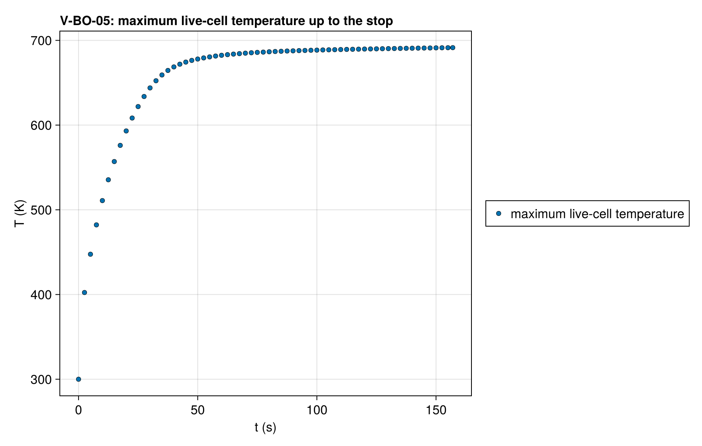
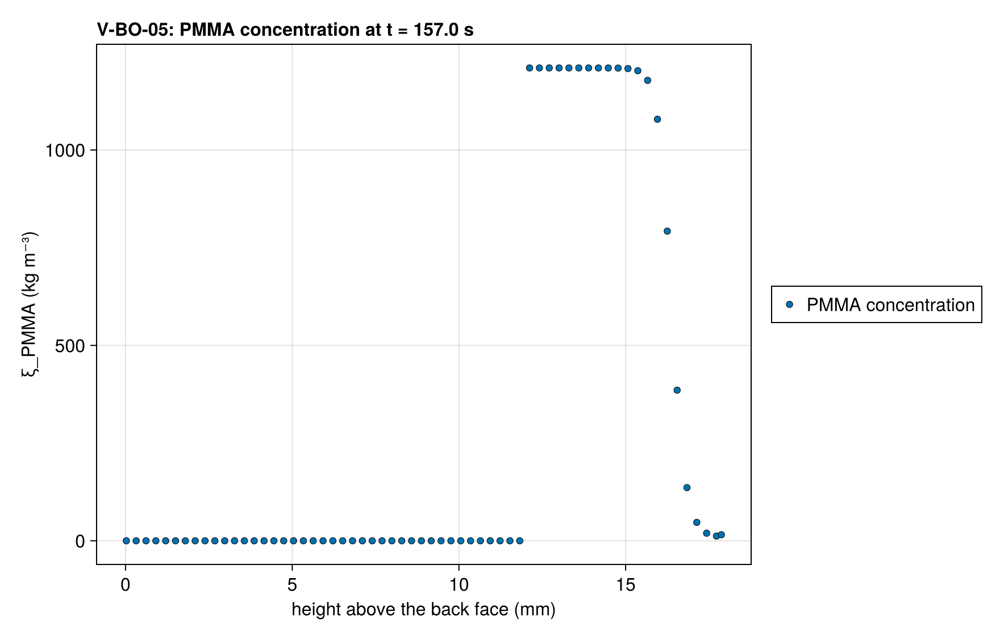
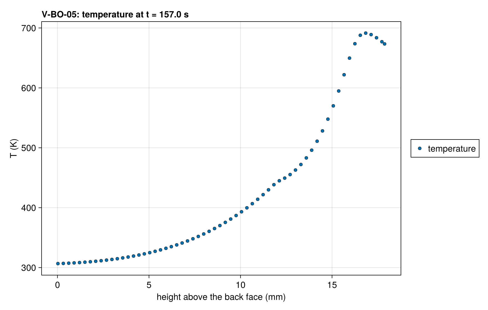

# V-BO-05 — PMMA-on-Kaowool burnout on a fixed mesh under radiative transfer stops at the first interior void

**Tags:** `eulerian`, `burnout`, `depletion`, `radiative_transfer`, `coupled`

**References:**

- MaCFP-2 PMMA gasification case (NIST), 50 kW/m²

## Problem statement

The V-BO-01 deck, radiative transfer included, on a fixed mesh. The cells
absorb and emit through the depth while the exposed face also loses heat by
convection, so the temperature maximum of the PMMA lies below the surface
and the surface cell reacts slowest: it persists as a low-density skin while
the cells beneath it empty, and the layer gasifies from within.

A cell deactivates when its condensed mass falls below ε_m of its initial
value. A fixed mesh removes only its outermost live cell, and a void beneath
a live skin is a gap the model does not represent, so a crossing cell
beneath a live cell ends the solve with outcome `:interior` and retcode
Terminated. The run must stop
before any deactivation, with the maximum live-cell temperature below
1000 K. The histories report the time reached at each resolution.

### Quantities of interest (n = 120)

| QoI | value | exact | error | tolerance | within tol | provenance |
| --- | --- | --- | --- | --- | --- | --- |
| outcome :interior | 1 | 1 | 0 | 0.5 | yes | the solve ended with outcome :interior |
| deactivation events before the stop | 0 | 0 | 0 | 0.5 | yes | the surface cell persists as a skin while the layer gasifies from within |
| maximum live-cell temperature up to the stop | 691.4 | — | 691.4 | 1000 | yes | K over every accepted step (observed 691) |

### Solver configuration

| setting | value |
| --- | --- |
| integrator | Rodas5P (default) |
| use_ale | false |
| deactivation | true |
| radiation_model | RADIATIVE_TRANSFER |
| abstol | 1.0e-8 |
| reltol | 1.0e-6 |
