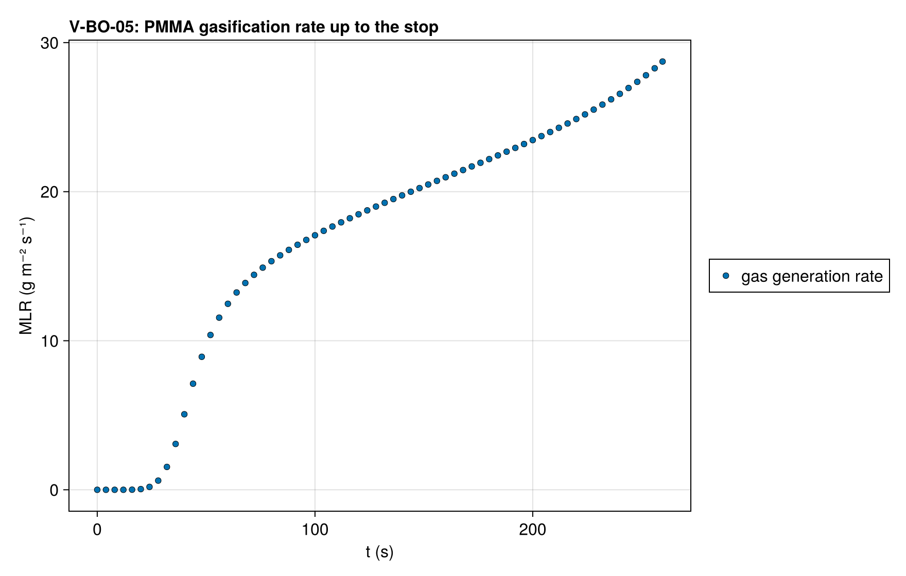
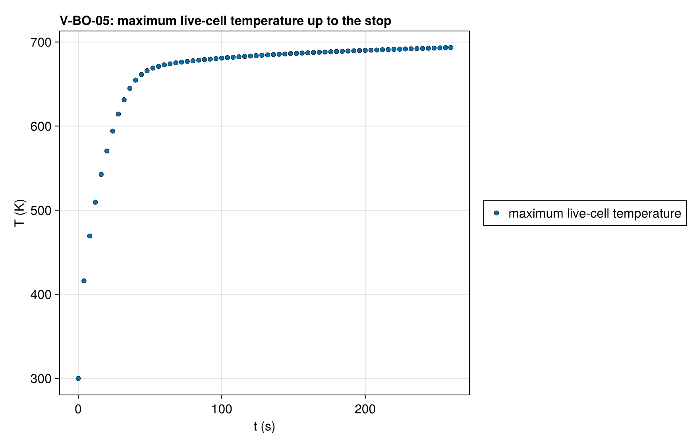
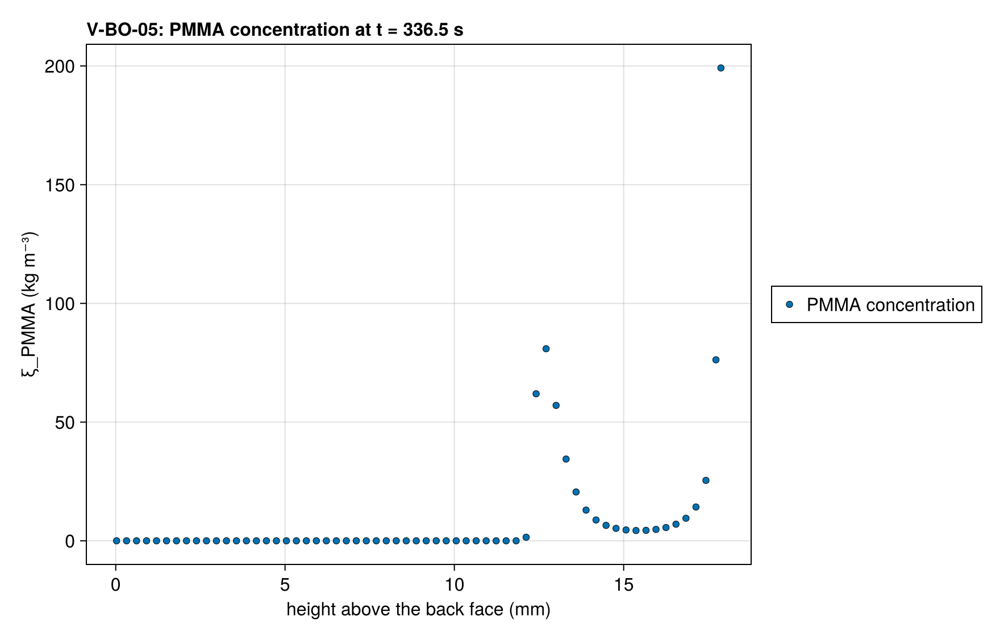
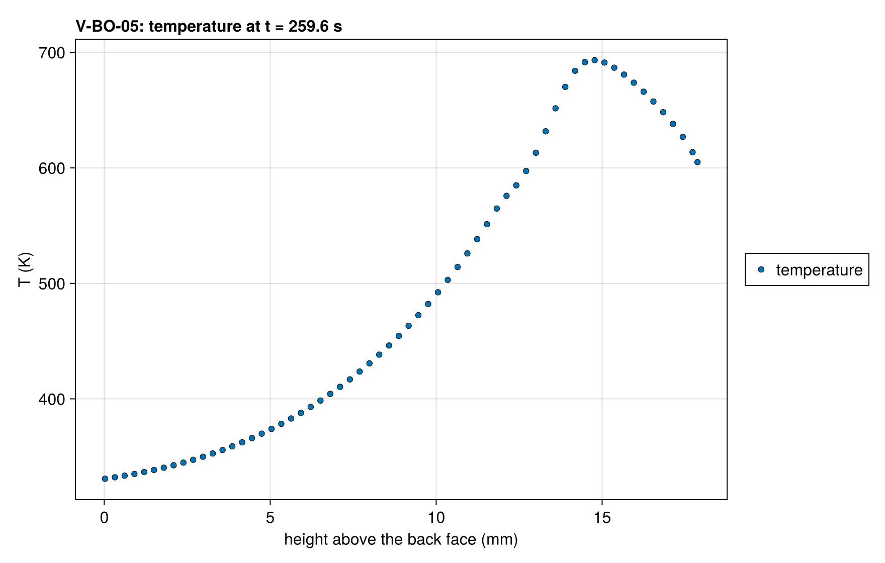

# V-BO-05 — PMMA-on-Kaowool burnout on a fixed mesh under in-depth absorption stops at the first interior void

**Tags:** `eulerian`, `burnout`, `depletion`, `beer_lambert`, `coupled`

**References:**

- MaCFP-2 PMMA gasification case (NIST), 50 kW/m²

## Problem statement

The V-BO-01 deck, in-depth absorption included, on a fixed mesh. The
temperature maximum of the PMMA lies below the surface, so the surface cell
reacts slowest: it persists as a low-density skin while the cells beneath it
empty, and the layer gasifies from within. A void cell conducts with the gas
conductivity and absorbs nothing, and nothing in the model carries heat
across a void, so the flux transmitted through the void column would heat
the substrate beneath it far outside the property bracket.

A cell deactivates when its condensed mass falls below ε_m of its initial
value, and on a fixed mesh a crossing cell beneath a live cell ends the
solve with outcome `:interior` and retcode Terminated. The run must stop
before any deactivation, with the maximum live-cell temperature below
1000 K. The histories report the time reached at each resolution.

### Quantities of interest (n = 120)

| QoI | value | exact | error | tolerance | within tol | provenance |
| --- | --- | --- | --- | --- | --- | --- |
| outcome :interior | 1 | 1 | 0 | 0.5 | yes | the solve ended with outcome :interior |
| deactivation events before the stop | 0 | 0 | 0 | 0.5 | yes | the surface cell persists as a skin while the layer gasifies from within |
| maximum live-cell temperature up to the stop | 693.4 | — | 693.4 | 1000 | yes | K over every accepted step (observed 693) |

### Solver configuration

| setting | value |
| --- | --- |
| integrator | Rodas5P (default) |
| use_ale | false |
| deactivation | true |
| radiation_model | BEER_LAMBERT |
| abstol | 1.0e-8 |
| reltol | 1.0e-6 |

