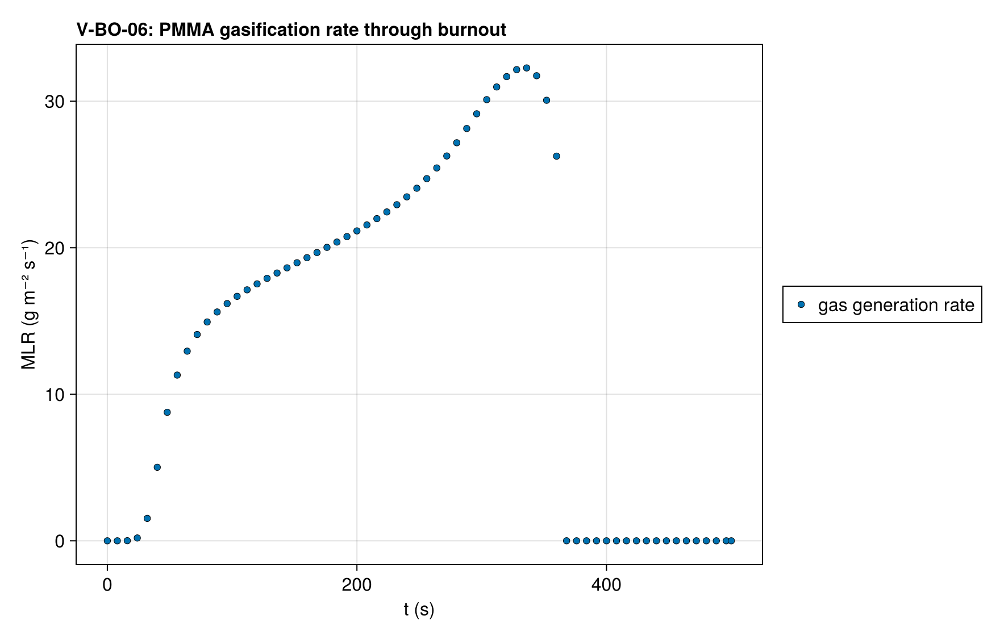
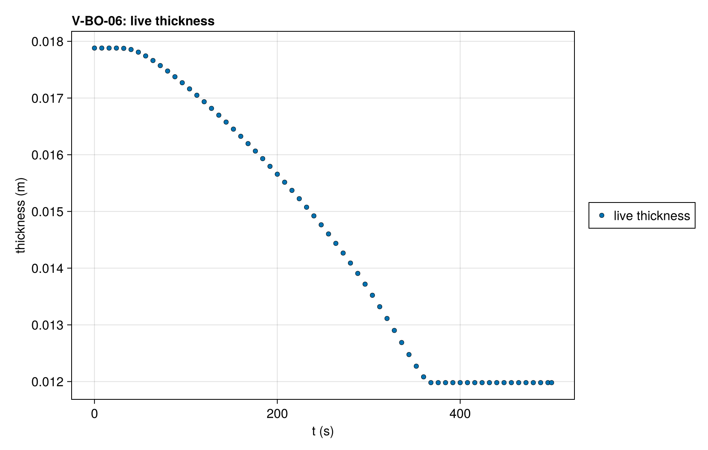

# V-BO-06 — PMMA-on-Kaowool burnout on a mesh graded toward the exposed surface

**Tags:** `ale`, `burnout`, `depletion`, `beer_lambert`, `coupled`

**References:**

- MaCFP-2 PMMA gasification case (NIST), 50 kW/m²
- Gpyro V2 PMMA deck property fits

## Problem statement

The V-BO-01 deck with its PMMA cells graded geometrically toward the exposed
surface, each cell 1/1.02 of the one beneath it at 60 cells, so the surface
cell is a third of the cell at the PMMA–Kaowool interface; at other
resolutions the ratio per cell keeps that third, so the cell ladder refines
one mesh. The Kaowool takes the interface cell's pitch. The burnout
quantities do not depend on the mesh, so V-BO-01's references and
tolerances hold. The equidistribution correction starts from cells of
unequal thickness, and the invocations that deactivate the layer are
reported.

### Quantities of interest (n = 60)

| QoI | value | exact | error | tolerance | within tol | provenance |
| --- | --- | --- | --- | --- | --- | --- |
| complete burnout: live thickness at t_end is the substrate | 0.01198 | 0.01198 | 4.026e-10 | 1e-05 | yes | every PMMA cell deactivated; 11.98 ± 0.01 mm |
| mass loss of the gasified PMMA layer | 69.95 | 69.95 | 4.775e-06 | 0.3 | yes | percent of the initial mass; exact = the layer's initial mass / m₀ |
| peak MLR | 32.29 | 32.39 | 0.003142 | 0.03 | yes | g m⁻² s⁻¹, gas generation rate |
| mass ledger closure | 9.437e-08 | 0 | 9.437e-08 | 3e-05 | yes | total-mass drop vs ∫ ṁ″ dt over the accepted steps (three-point Gauss–Legendre per step) and the mass deactivation vented |
| clamped surface balances on accepted states | 0 | 0 | 0 | 0.5 | yes | boundary temperature solve converged inside the property bracket at every accepted step |
| time of peak MLR | 334 | 335 | 0.002985 | 0.03 | yes | s |
| burnout time (live thickness < 12.0 mm) | 364 | 363.5 | 0.001376 | 0.01 | yes | s |
| deactivation invocations for the PMMA layer (reported) | 1 | 1 | 0 | Inf | yes | 60 cells; largest merged fraction 0.0159 (1.59 ε_m); reported, not asserted |

### Solver configuration

| setting | value |
| --- | --- |
| integrator | Rodas5P (default) |
| use_ale | true |
| deactivation | true |
| min_thickness | 0.001 |
| radiation_model | BEER_LAMBERT |
| abstol | 1.0e-8 |
| reltol | 1.0e-6 |

