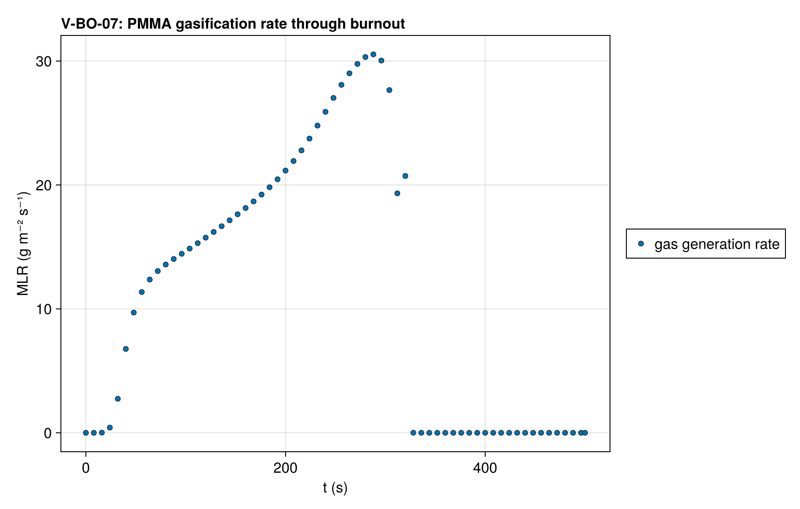
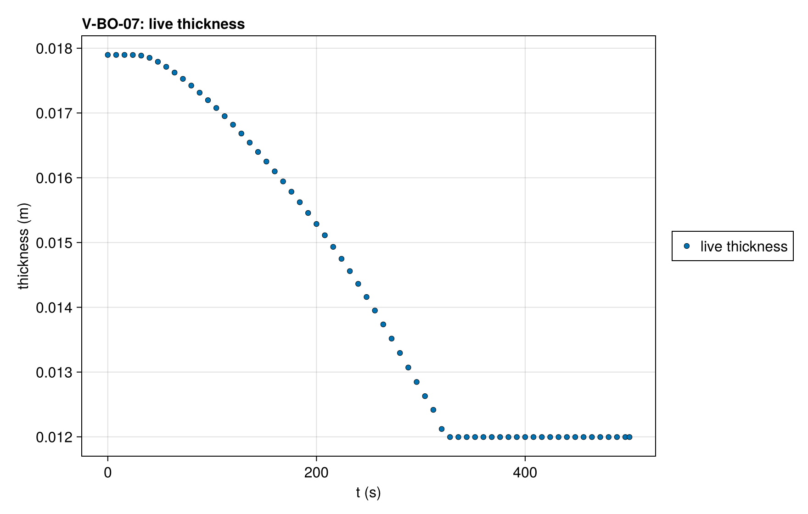

# V-BO-07 — Burnout of a heterogeneous PMMA layer of mixed composition

**Tags:** `ale`, `burnout`, `depletion`, `beer_lambert`, `coupled`

**References:**

- MaCFP-2 PMMA gasification case (NIST), 50 kW/m², with a second solid mixed in

## Problem statement

The V-BO-01 deck with a second solid mixed into the PMMA layer: the same
properties at half the density (605 kg/m³) and a tenth of the
pre-exponential factor, its mass fraction rising linearly from zero at the
PMMA–Kaowool interface to one half at the exposed surface, each cell's
concentrations filling its volume. The layer's density therefore varies
across one activated region, which is where the equidistribution monitor's
mass term acts. Both solids gasify completely, so the run loses exactly the
layer's initial mass and ends on the bare Kaowool. Peak mass loss rate and
timing are reported through the history curves.

Nominal pore fraction 0.1 supplies resolved gas storage during heterogeneous
ALE redistribution. The maximum matrix occupancy decreases from 1.091 to
1.016 over 15/30/60 PMMA cells. The joint pore/mesh/pressure gate verifies
the 0.1–0.15 range, both energy forms, thermal independence of the passive
gas, and the independent species ledger.

The layer deactivates in one invocation. The burn
runs down from the surface: the upper cells lose their PMMA first and keep
the slow solid, and the PMMA beneath burns last and fast. When the first cell
crosses ε_m the others still hold up to about 6 % of their initial mass,
with or without the monitor's mass term; the case reports the invocations
and that fraction. Under refinement at ε_m = 1e-2 the largest per-step excess
of N cells over 2N stops falling between 120 and 240 cells, where at 3e-3 it
falls by two per doubling (test/gates/burnout_envelope.jl measures it).

### Quantities of interest (n = 60)

| QoI | value | exact | error | tolerance | within tol | provenance |
| --- | --- | --- | --- | --- | --- | --- |
| complete burnout: live thickness at t_end is the substrate | 0.012 | 0.012 | 1.902e-09 | 1e-05 | yes | every PMMA cell deactivated; 12.0 ± 0.01 mm |
| mass loss of the gasified PMMA layer | 65.34 | 65.34 | 1.475e-05 | 0.3 | yes | percent of the initial mass; exact = the layer's initial mass / m₀ |
| mass ledger closure | 1.479e-11 | 0 | 1.479e-11 | 3e-05 | yes | total-mass drop vs ∫ ṁ″ dt over the accepted steps (three-point Gauss–Legendre per step) and the mass deactivation vented |
| clamped surface balances on accepted states | 0 | 0 | 0 | 0.5 | yes | boundary temperature solve converged inside the property bracket at every accepted step |
| deactivation invocations for the PMMA layer (reported) | 1 | 1 | 0 | Inf | yes | 60 cells; largest merged fraction 0.0614 (6.14 ε_m); reported, not asserted |

### Solver configuration

| setting | value |
| --- | --- |
| integrator | Rodas5P (default) |
| use_ale | true |
| deactivation | true |
| min_thickness | 0.001 |
| radiation_model | BEER_LAMBERT |
| abstol | 1.0e-11 |
| reltol | 1.0e-9 |
| pressure_tolerance | 0.0001 |
