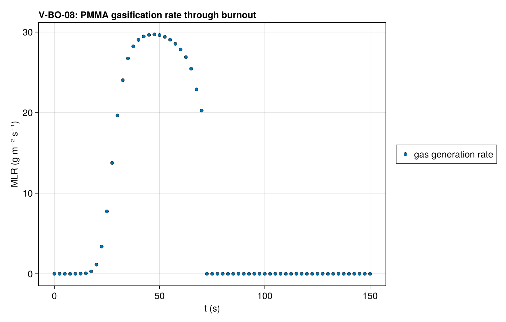
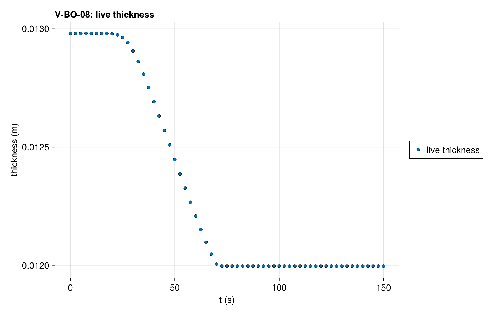

# V-BO-08 — Localized burnout of a thin PMMA layer on a deep substrate

**Tags:** `ale`, `burnout`, `depletion`, `beer_lambert`, `coupled`

**References:**

- MaCFP-2 PMMA gasification case (NIST), 50 kW/m², a 1 mm layer

## Problem statement

The V-BO-01 deck with a PMMA layer of ten cells at V-BO-01's pitch (about
1 mm) on the 12 mm Kaowool. The layer burns out at about 70 s and the
substrate heats on beneath the bare surface to 150 s. The run must lose
exactly the layer's mass and end on the bare Kaowool. The layer
deactivates in one invocation and the correction stays where the layer is:
the Kaowool, which cannot vanish, keeps its mesh with the solid, so the
correction velocity is exactly zero at every Kaowool node at every saved
time.

### Quantities of interest (n = 10)

| QoI | value | exact | error | tolerance | within tol | provenance |
| --- | --- | --- | --- | --- | --- | --- |
| complete burnout: live thickness at t_end is the substrate | 0.012 | 0.012 | 4.476e-10 | 1e-05 | yes | every PMMA cell deactivated; 12.0 ± 0.01 mm |
| mass loss of the gasified PMMA layer | 27.92 | 27.92 | 1.272e-05 | 0.3 | yes | percent of the initial mass; exact = the layer's initial mass / m₀ |
| mass ledger closure | 5.731e-06 | 0 | 5.731e-06 | 3e-05 | yes | total-mass drop vs ∫ ṁ″ dt over the accepted steps (three-point Gauss–Legendre per step) and the mass deactivation vented |
| clamped surface balances on accepted states | 0 | 0 | 0 | 0.5 | yes | boundary temperature solve converged inside the property bracket at every accepted step |
| deactivation invocations for the PMMA layer (reported) | 1 | 1 | 0 | Inf | yes | 10 cells; largest merged fraction 0.0135 (1.35 ε_m); reported, not asserted |
| the correction is zero at every Kaowool node | 0 | 0 | 0 | 2.22e-16 | yes | m/s over the 123 substrate nodes and every saved time |

### Solver configuration

| setting | value |
| --- | --- |
| integrator | Rodas5P (default) |
| use_ale | true |
| deactivation | true |
| min_thickness | 0.001 |
| radiation_model | BEER_LAMBERT |
| abstol | 1.0e-8 |
| reltol | 1.0e-6 |

