# V-CPL-01 — Neumann Stefan problem via apparent heat capacity (Gpyro params)

**Tags:** `moving_front`, `latent_heat`, `state_dependent_properties`, `coupled`

**References:**

- Carslaw & Jaeger (1959) §11.2
- Lautenberger dissertation (2007) §3.4.3, Eqs. 3.137–3.138, Fig. 3.11

## Problem statement

Gpyro's moving-front verification (Lautenberger dissertation §3.4.3, Eqs.
3.137–3.138; Carslaw & Jaeger §11.2). Liquid initially at T₀ > T_m; wall
(top face) dropped to T∞ < T_m at t = 0; a solidification front
s(t) = 2λ√(αₛt) propagates inward releasing ΔH_m. Exact solution and
eigenvalue in exact/stefan.jl (λ = 0.2317 for the dissertation parameters —
self-tested against the published value and an independent quadrature
energy balance).

Two solver realizations:

Route A (this case): apparent heat capacity — Gaussian c_p peak of variance
  σ² = 0.1 K² (Gpyro Eq. 3.5c with σ_m² = 0.1) carrying the full ΔH_m,
  exercising the T-dependent property path + property-derivative Jacobian
  through a 38× spike in c. Uses the dissertation's polypropylene-like
  parameter set verbatim, so profiles compare to dissertation Fig. 3.11.

Route B (V-CPL-01b): latent heat via a T_max-gated reaction melt → solid
  (h = −ΔH_m: solidification releases heat; our h > 0 = endothermic).
  The temperature gate is a tanh ramp of configurable width
  (`Reaction(...; gate_width)` [K], default 1.0; src/Physics/kinetics.jl).
  At the default 1 K width the dissertation's 5 K driving ΔT shifts the
  effective freezing point by ~20% of the driving force (measured: front
  19% slow), so this CI case rescales to ±50 K driving ΔT (own exact λ
  from the same library), making the gate a ~1–2% effect. The dissertation
  parameter set with a narrow gate (e.g. 0.1 K) and the gate-width → 0
  convergence sweep belong in report mode.

Geometry: cold Dirichlet wall on TOP (z = L; depth x = L − z), adiabatic
bottom, L = 4 cm ≫ liquid penetration √(4α_l t) ≈ 1.25 cm (back-face guard
asserts undisturbedness). Lower report rungs use a geometrically stretched
mesh, finest at the wall. The plotted 800-cell route-A rung is uniform at
50 μm, matching the 800 intervals between Gpyro V2's 801 boundary nodes.

No CI ConvergenceSpec: with fixed peak width σ (route A) or gate width
(route B) the solver converges to the smeared problem, whose offset from
the sharp-front Stefan solution dominates the mesh error — a meaningful
order study is the σ → 0 + mesh ladder (a report-mode peak-width
convergence study).

## V-CPL-01 — Neumann Stefan problem via apparent heat capacity (Gpyro params)

### Quantities of interest (n = 800)

| QoI | value | exact | error | tolerance | within tol | provenance |
| --- | --- | --- | --- | --- | --- | --- |
| T-history L∞ error at x = 0.5 mm | 0.01367 | — | 0.01367 | 0.05 | yes | vs exact two-phase profile, t ≥ 100.0 s |
| T-history L∞ error at x = 1.0 mm | 0.02718 | — | 0.02718 | 0.1 | yes | vs exact two-phase profile, t ≥ 100.0 s |
| T-history L∞ error at x = 1.5 mm | 0.03778 | — | 0.03778 | 0.12 | yes | vs exact two-phase profile, t ≥ 100.0 s |
| T-history L∞ error at x = 2.0 mm | 0.1336 | — | 0.1336 | 0.4 | yes | vs exact two-phase profile, t ≥ 100.0 s |
| front position at t = 100.0 s | 0.001691 | 0.001675 | 0.009555 | 0.03 | yes | s(t) = 2λ√(αₛt), λ = 0.23166 |
| front position at t = 200.0 s | 0.002392 | 0.002369 | 0.009535 | 0.03 | yes | s(t) = 2λ√(αₛt), λ = 0.23166 |
| front position at t = 300.0 s | 0.002929 | 0.002901 | 0.009408 | 0.03 | yes | s(t) = 2λ√(αₛt), λ = 0.23166 |
| √t front-growth coefficient | 0.0001691 | 0.0001675 | 0.009443 | 0.03 | yes | fit over t ∈ [100.0, 300.0] s |
| back-face disturbance (semi-infinite validity) | 8.174e-05 | 0 | 8.174e-05 | 0.01 | yes | L = 4 cm vs penetration ≈ 1.25 cm |

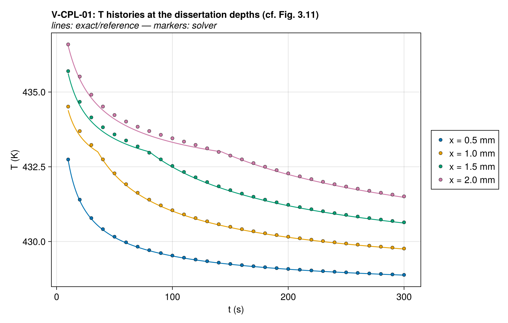

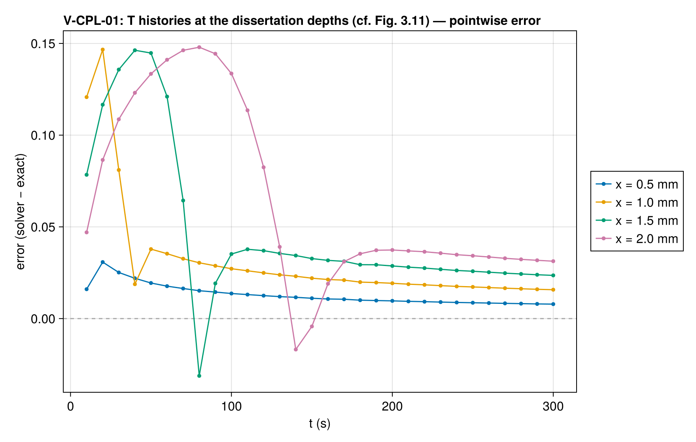

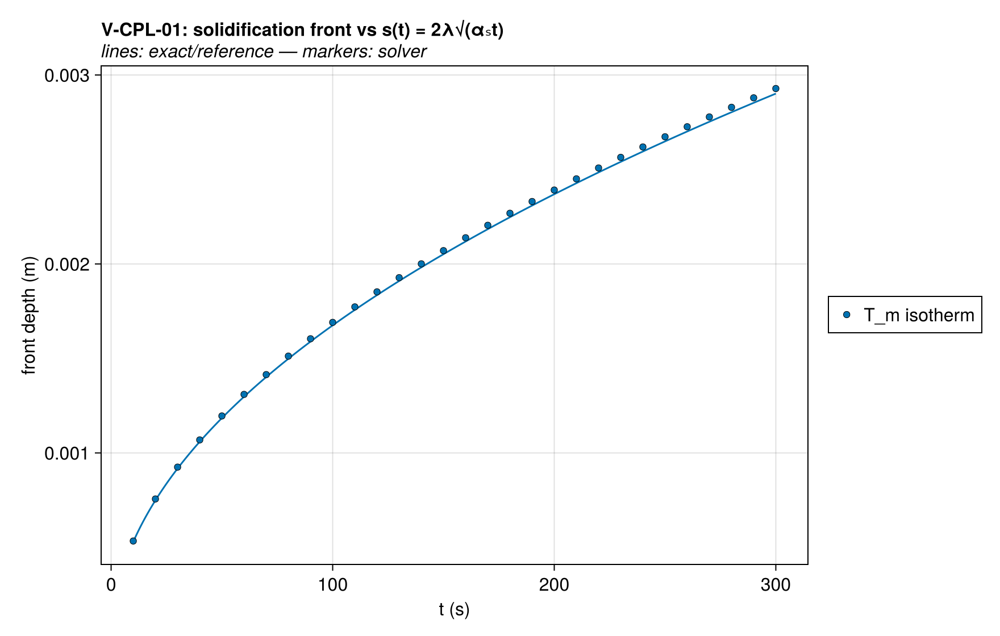

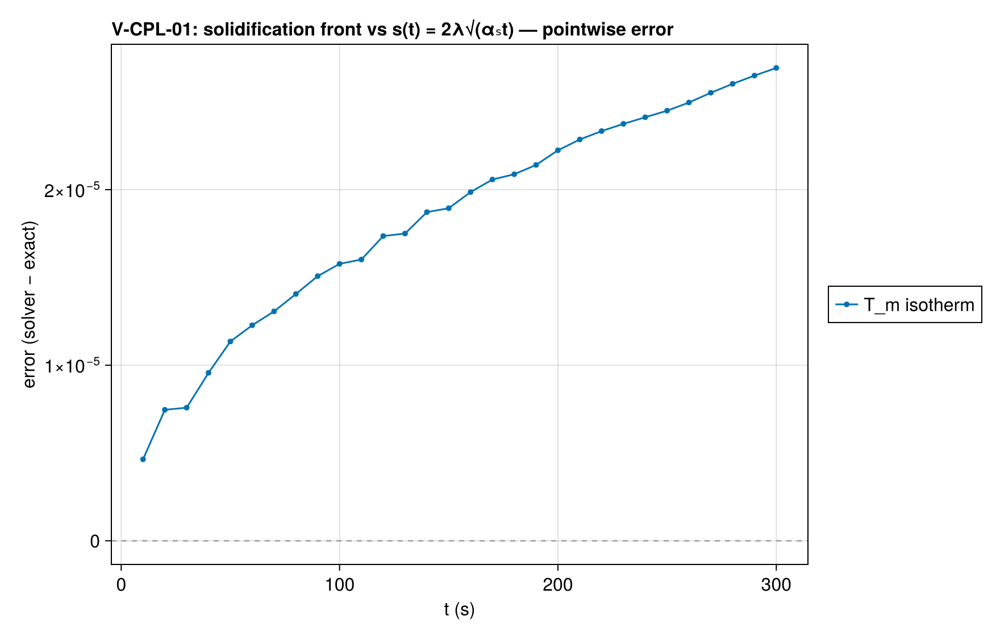

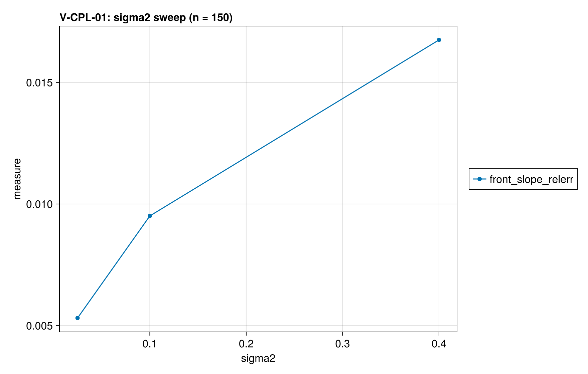

### Comparison with other codes

Physical-problem agreement does not establish equal discretization or cost. See the [mesh and time comparison basis](comparison_coverage.md#comparison-basis-audit) and [per-pair inventory](assets/comparison_basis.csv). Costs are compared at matched accuracy only.

Matched native-input runs at seven configurations (coarser and finer time steps at fixed mesh, and a finer mesh) are retained under `test/verification/reference/matched/`. See the [coverage and matching notes](comparison_coverage.md). The plotted external series use the base resolution; [analytical errors at every configuration](assets/V-CPL-01/V-CPL-01_comparison_accuracy.csv) are retained separately, and the same runs are timed for the cost comparison.

Gpyro V2 revision `bff0126c68f2` uses 801 boundary nodes (800 intervals, 0.05 mm spacing) at dt = 0.02 s, with the latent heat as its apparent-c_p Gaussian (σₘ² = 0.1). The front is the T_m isotherm, interpolated linearly between the first pair of nodes that bracket it.

Error panels show absolute error at each code's output points. Zeros are displayed at 1e-12 on the logarithmic axis; the reference CSV precision limits the discernible error.

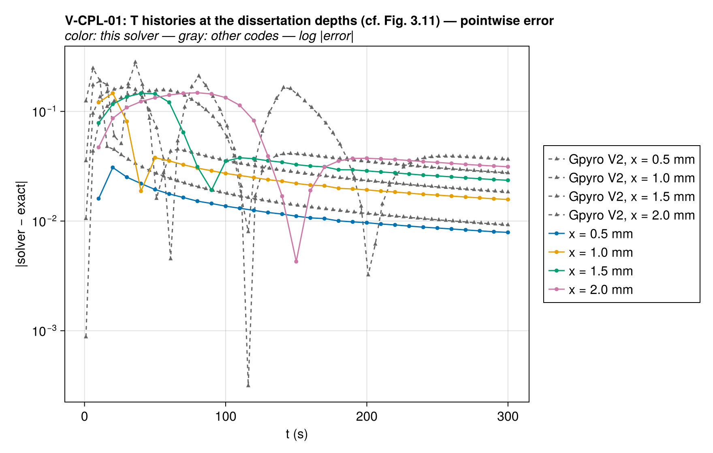

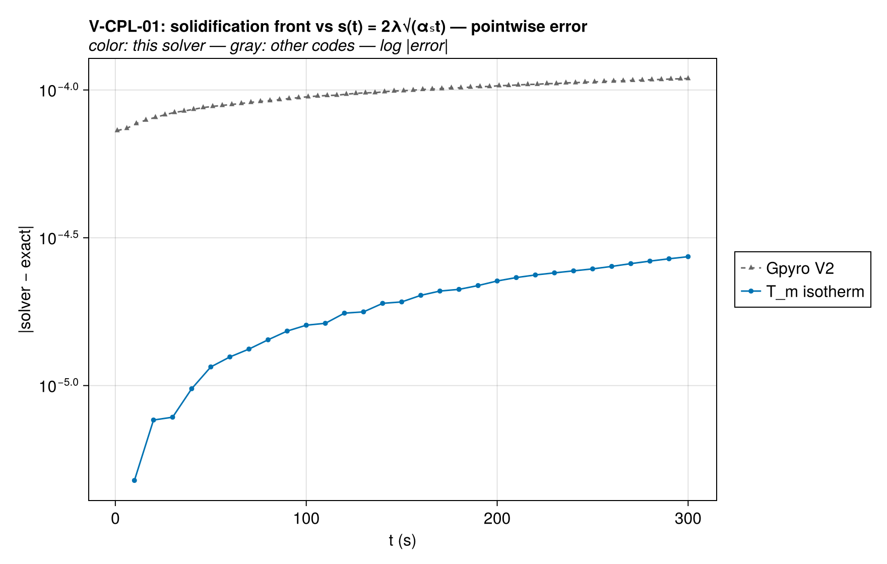

#### Cost at matched accuracy

Each external code appears at its matched mesh h and time step Δt, at
coarser steps (2Δt, 4Δt) and at refinements (Δt/2, Δt/4, h/2 at Δt/4,
h/2 at Δt/2); this code at its report ladder, the external meshes and any
finer cost-only meshes, each at its report tolerances and at 10, 100 and
1000 times looser ones, the counterpart of the coarser steps. A coarse
configuration a code cannot express or complete is left out; for the
external codes the reason is in the matched provenance. The error is the
largest analytical error over
the curves and references the external run is scored on. Times are FDS's
internal elapsed time, which excludes its MPI start-up; Gpyro's and
ThermaKin's process time; and this code's warm problem construction and
solve. Each is the median of repeated runs on one pinned core
(`scripts/timing/README.md`; data and provenance in
`test/verification/reference/matched/timing/`). On the smallest problems
the external times are mostly input, setup and output. In the figure,
filled markers are each external code's matched mesh and step and this
code's report tolerances, open markers are the other runs, and this
code's line joins its cheapest configuration at each accuracy; lower left
is better. Errors at or below 1e-12 count as exact
when matching accuracy, errors at or below 1e-14 are drawn at 1e-14, and
runs every code solves exactly are not drawn.

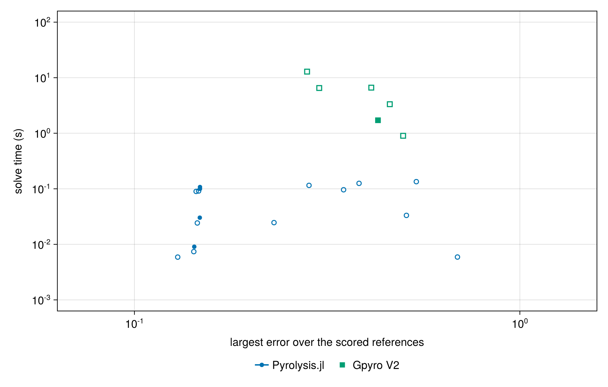

For each external mesh and step: the external code's cheapest run at least as accurate (often itself; a coarser or finer run of the same code when that costs less), this code's cheapest configuration at least as accurate on every scored reference (its cells, and its tolerance multiplier when looser than the report's), and the ratio of the two. A ratio marked ≥ uses this code's coarsest configuration, fewest cells at the loosest tolerance, whose accuracy already exceeds the external run's.

| External run | Mesh, step | External error | External time (s) | Cheapest external at this accuracy (s) | Our cells, tolerance | Our time (s) | Cheapest external/our time |
| --- | --- | --- | --- | --- | --- | --- | --- |
| Gpyro V2 | h, Δt | 0.4284 | 1.714 | 1.714 | 75, 100× tol | 0.00598 | 287.0 |
| Gpyro V2 | h, 2Δt | 0.4979 | 0.9 | 0.9 | 75, 100× tol | 0.00598 | 151.0 |
| Gpyro V2 | h, Δt/2 | 0.4598 | 3.333 | 1.714 | 75, 100× tol | 0.00598 | 287.0 |
| Gpyro V2 | h, Δt/4 | 0.4116 | 6.624 | 6.522 | 75, 100× tol | 0.00598 | 1090.0 |
| Gpyro V2 | h/2, Δt/4 | 0.2805 | 12.87 | 12.87 | 75, 100× tol | 0.00598 | 2150.0 |
| Gpyro V2 | h/2, Δt/2 | 0.3016 | 6.522 | 6.522 | 75, 100× tol | 0.00598 | 1090.0 |

Solution overlays including the other codes' points: [T_histories_at_depths_vs_codes](assets/V-CPL-01/V-CPL-01_T_histories_at_depths_vs_codes.png), [front_trajectory_vs_codes](assets/V-CPL-01/V-CPL-01_front_trajectory_vs_codes.png).

### Solver configuration

| setting | value |
| --- | --- |
| integrator | Rodas5P (default) |
| abstol | 1.0e-8 |
| reltol | 1.0e-6 |

## V-CPL-01b — Neumann Stefan problem via gated reaction (±50 K rescaled)

### Quantities of interest (n = 800)

| QoI | value | exact | error | tolerance | within tol | provenance |
| --- | --- | --- | --- | --- | --- | --- |
| T-history L∞ error at x = 0.5 mm | 0.1725 | — | 0.1725 | 0.55 | yes | vs exact two-phase profile, t ≥ 50.0 s |
| T-history L∞ error at x = 1.0 mm | 0.3312 | — | 0.3312 | 1.1 | yes | vs exact two-phase profile, t ≥ 50.0 s |
| T-history L∞ error at x = 1.5 mm | 0.529 | — | 0.529 | 1.9 | yes | vs exact two-phase profile, t ≥ 50.0 s |
| T-history L∞ error at x = 2.0 mm | 1.246 | — | 1.246 | 3.8 | yes | vs exact two-phase profile, t ≥ 50.0 s |
| front position at t = 50.0 s | 0.001575 | 0.00159 | 0.009103 | 0.045 | yes | s(t) = 2λ√(αₛt), λ = 0.31088 |
| front position at t = 100.0 s | 0.002219 | 0.002248 | 0.01284 | 0.045 | yes | s(t) = 2λ√(αₛt), λ = 0.31088 |
| front position at t = 150.0 s | 0.002718 | 0.002753 | 0.01291 | 0.045 | yes | s(t) = 2λ√(αₛt), λ = 0.31088 |
| √t front-growth coefficient | 0.000222 | 0.0002248 | 0.01227 | 0.035 | yes | fit over t ∈ [50.0, 150.0] s |
| back-face disturbance (semi-infinite validity) | 2.541e-08 | 0 | 2.541e-08 | 0.01 | yes | L = 4 cm vs penetration ≈ 1.25 cm |

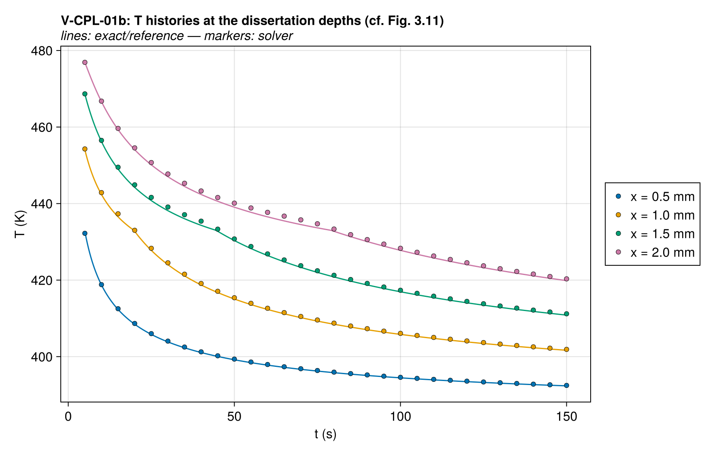

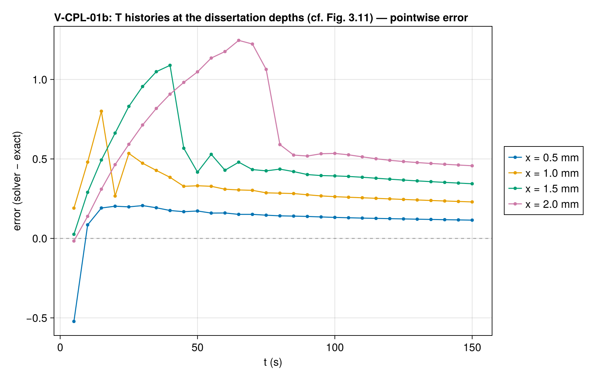

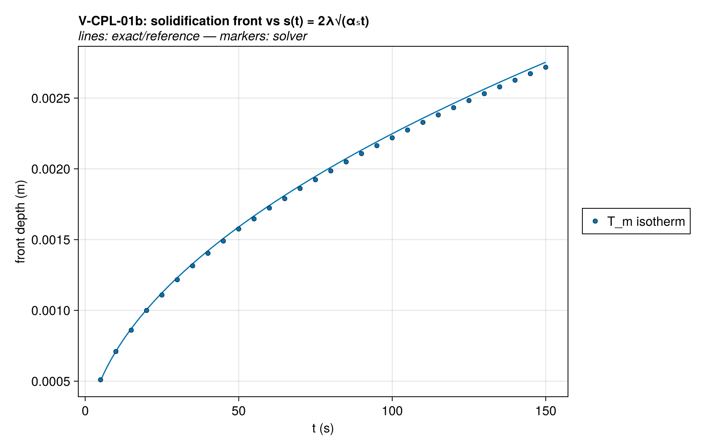

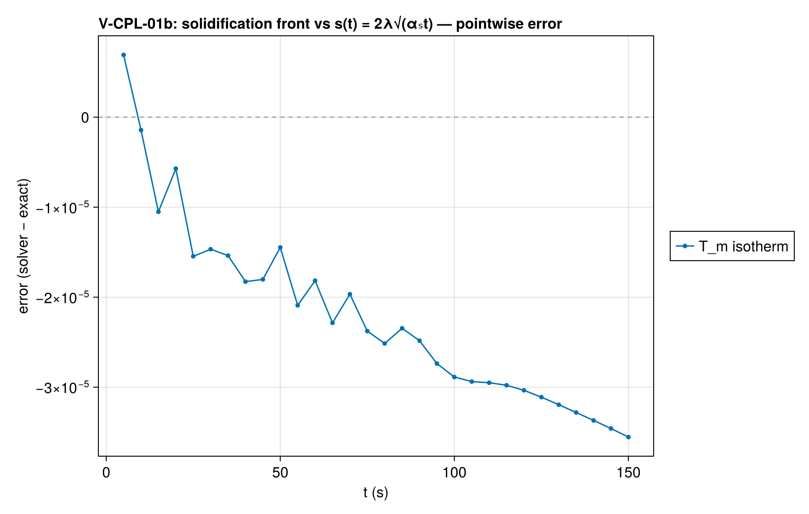

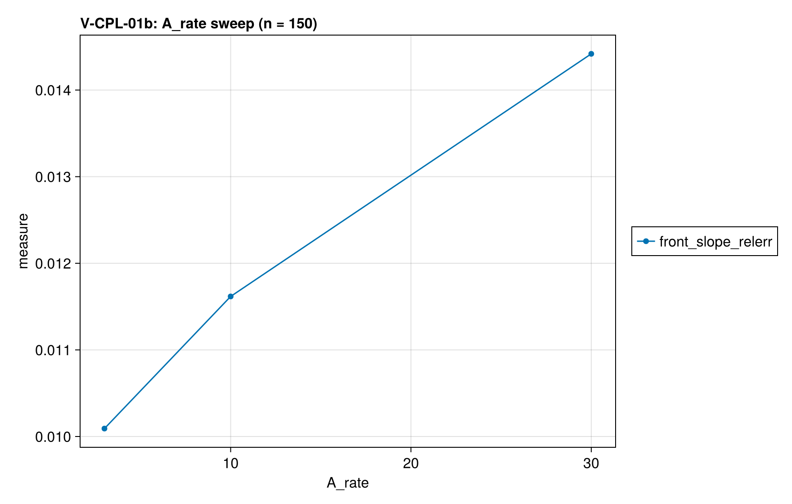

### Solver configuration

| setting | value |
| --- | --- |
| integrator | Rodas5P (default) |
| abstol | 1.0e-8 |
| reltol | 1.0e-6 |
