# V-CPL-01 — Neumann Stefan problem via apparent heat capacity (Gpyro params)

**Tags:** `moving_front`, `latent_heat`, `state_dependent_properties`, `coupled`

**References:**

- Carslaw & Jaeger (1959) §11.2
- Lautenberger dissertation (2007) §3.4.3, Eqs. 3.137–3.138, Fig. 3.11

## Problem statement

Gpyro's flagship moving-front verification (Lautenberger §3.4.3, Eqs.
3.137–3.138; Carslaw & Jaeger §11.2). Liquid initially at T₀ > T_m; wall
(top face) dropped to T∞ < T_m at t = 0; a solidification front
s(t) = 2λ√(αₛt) propagates inward releasing ΔH_m. Exact solution and
eigenvalue in exact/stefan.jl (λ = 0.2317 for the dissertation parameters —
self-tested against the published value and an independent quadrature
energy balance).

Two solver realizations:

Route A (this case): apparent heat capacity — Gaussian c_p peak of variance
  σ² = 0.1 K² (Gpyro Eq. 3.5c with σ_m² = 0.1) carrying the full ΔH_m,
  exercising the T-dependent property path + property-derivative Jacobian
  through a 38× spike in c. Uses the dissertation's polypropylene-like
  parameter set verbatim, so profiles compare to dissertation Fig. 3.11.

Route B (V-CPL-01b): latent heat via a T_max-gated reaction melt → solid
  (h = −ΔH_m: solidification releases heat; our h > 0 = endothermic).
  The temperature gate is a tanh ramp of configurable width
  (`Reaction(...; gate_width)` [K], default 1.0; src/Physics/kinetics.jl).
  At the default 1 K width the dissertation's 5 K driving ΔT shifts the
  effective freezing point by ~20% of the driving force (measured: front
  19% slow), so this CI case rescales to ±50 K driving ΔT (own exact λ
  from the same library), making the gate a ~1–2% effect. The dissertation
  parameter set with a narrow gate (e.g. 0.1 K) and the gate-width → 0
  convergence sweep belong in report mode.

Geometry: cold Dirichlet wall on TOP (z = L; depth x = L − z), adiabatic
bottom, L = 4 cm ≫ liquid penetration √(4α_l t) ≈ 1.25 cm (back-face guard
asserts undisturbedness). Geometrically stretched mesh, finest at the wall
(Δz_top ≈ 14 μm, ≈ 103 μm at the deepest front position ≈ 3 mm — Gpyro
used uniform 50 μm).

No CI ConvergenceSpec: with fixed peak width σ (route A) or gate width
(route B) the solver converges to the smeared problem, whose offset from
the sharp-front Stefan solution dominates the mesh error — a meaningful
order study is the σ → 0 + mesh ladder (a report-mode peak-width
convergence study).

## V-CPL-01 — Neumann Stefan problem via apparent heat capacity (Gpyro params)

### Quantities of interest (n = 800)

| QoI | value | exact | error | tolerance | within tol | provenance |
| --- | --- | --- | --- | --- | --- | --- |
| T-history L∞ error at x = 0.5 mm | 0.01367 | — | 0.01367 | 0.05 | yes | vs exact two-phase profile, t ≥ 100.0 s |
| T-history L∞ error at x = 1.0 mm | 0.02718 | — | 0.02718 | 0.1 | yes | vs exact two-phase profile, t ≥ 100.0 s |
| T-history L∞ error at x = 1.5 mm | 0.03778 | — | 0.03778 | 0.12 | yes | vs exact two-phase profile, t ≥ 100.0 s |
| T-history L∞ error at x = 2.0 mm | 0.1336 | — | 0.1336 | 0.4 | yes | vs exact two-phase profile, t ≥ 100.0 s |
| front position at t = 100.0 s | 0.001691 | 0.001675 | 0.009555 | 0.03 | yes | s(t) = 2λ√(αₛt), λ = 0.23166 |
| front position at t = 200.0 s | 0.002392 | 0.002369 | 0.009535 | 0.03 | yes | s(t) = 2λ√(αₛt), λ = 0.23166 |
| front position at t = 300.0 s | 0.002929 | 0.002901 | 0.009408 | 0.03 | yes | s(t) = 2λ√(αₛt), λ = 0.23166 |
| √t front-growth coefficient | 0.0001691 | 0.0001675 | 0.009443 | 0.03 | yes | fit over t ∈ [100.0, 300.0] s |
| back-face disturbance (semi-infinite validity) | 8.174e-05 | 0 | 8.174e-05 | 0.01 | yes | L = 4 cm vs penetration ≈ 1.25 cm |

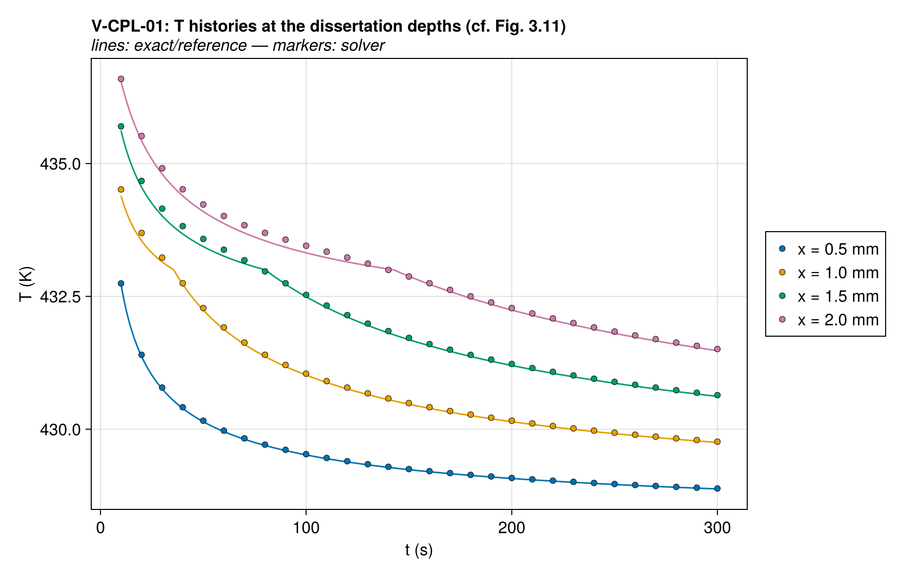

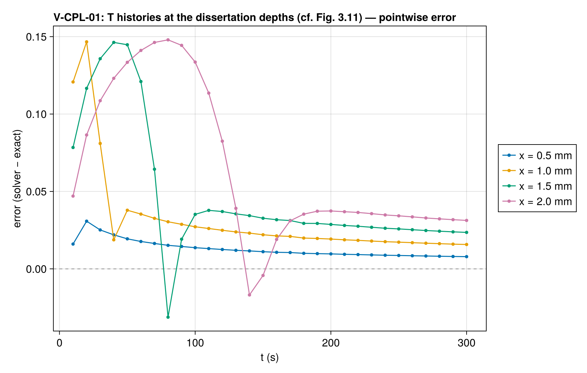

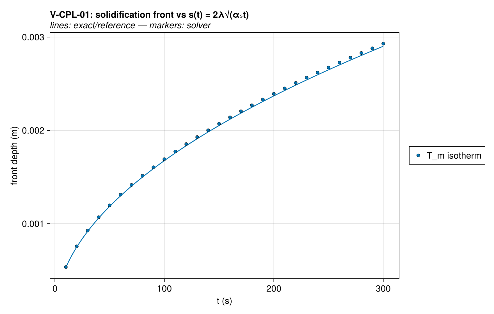

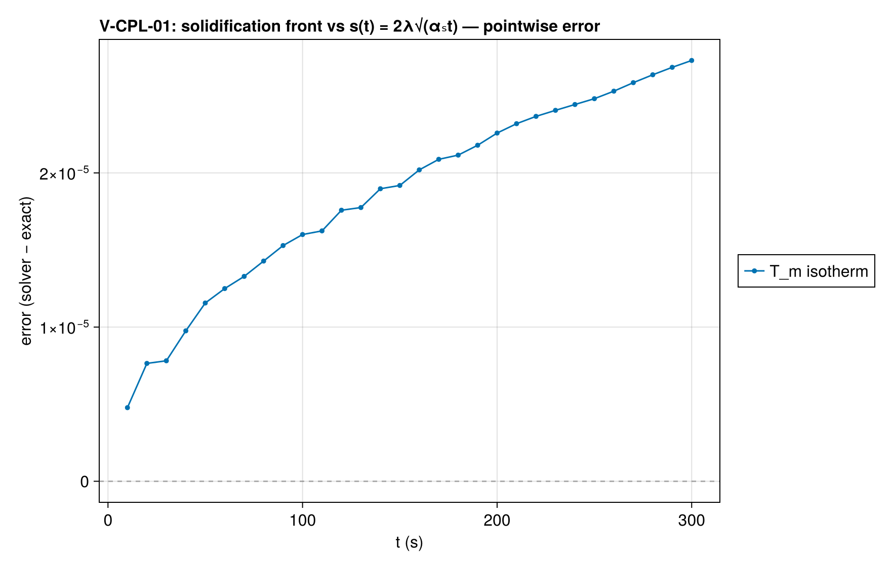

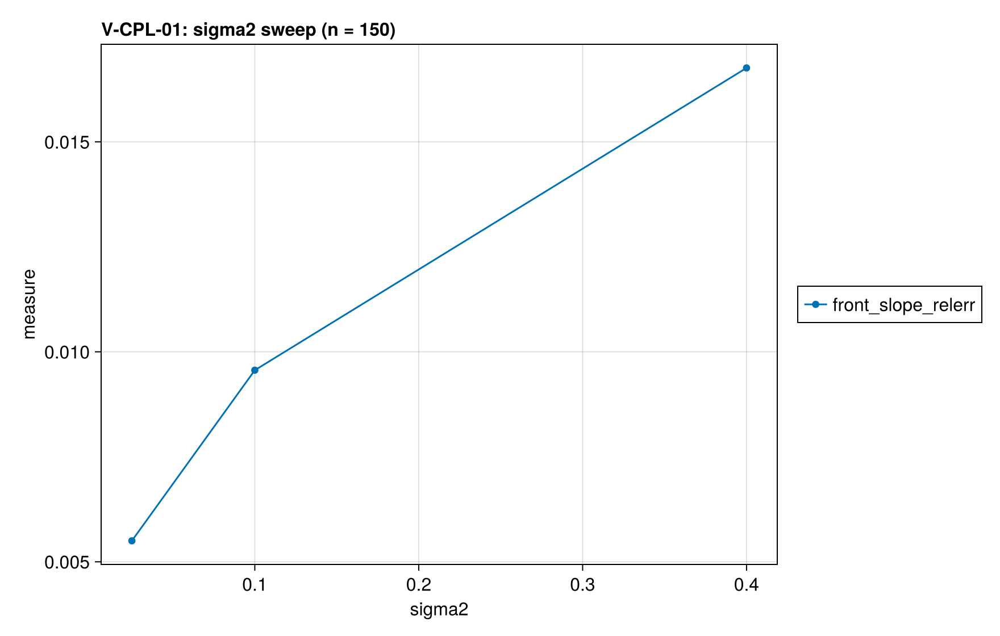

### Comparison with other codes

The same case was solved with Gpyro 0.8200 at 801 nodes (Δz=0.05 mm); decks, outputs, and
run provenance are committed under `test/verification/reference/`.
Each code's error against the same exact solution is drawn below
on a log scale, muted gray behind this solver's series — the
signed linear-scale panel above shows where the error lives, this
one compares magnitudes across codes.

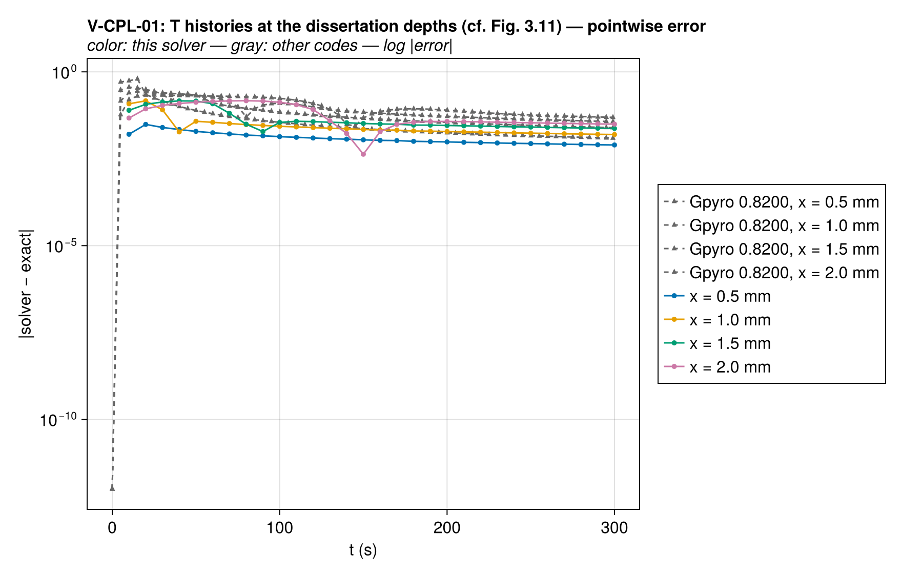

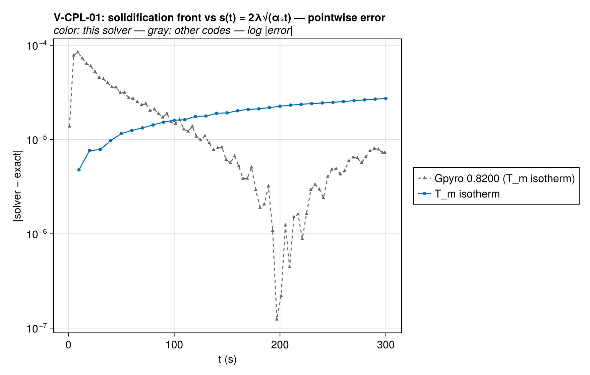

Wall times at every ladder rung against the reference runs.
Resolutions and simulated spans differ where noted (details in
`reference/timings.csv`), so cross-code timings are indicative
rather than a controlled benchmark; rungs at a matched
resolution are directly comparable.

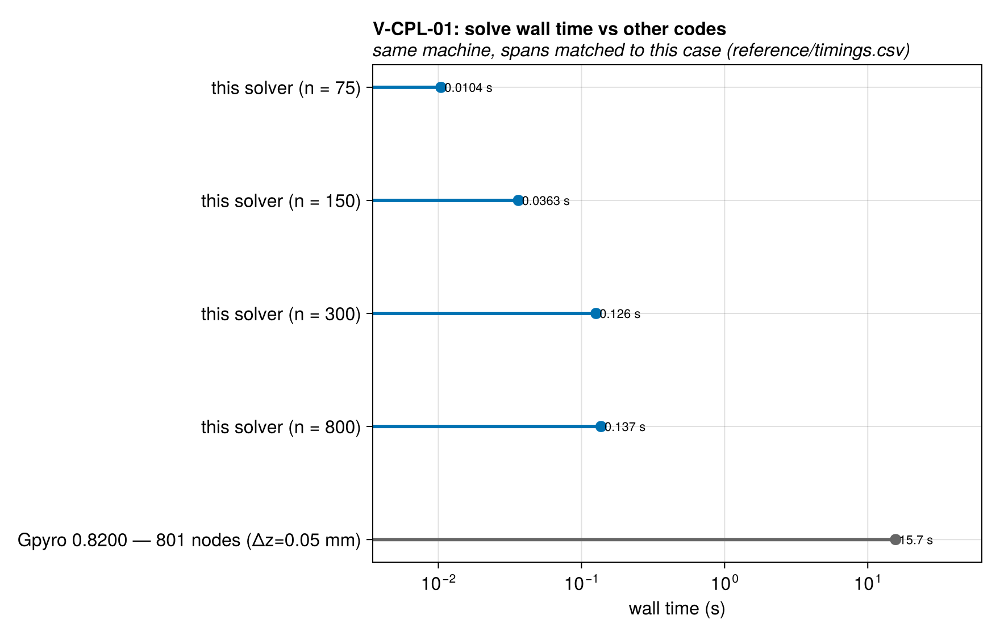

Solution overlays including the other codes' points: [T_histories_at_depths_vs_codes](assets/V-CPL-01/V-CPL-01_T_histories_at_depths_vs_codes.png), [front_trajectory_vs_codes](assets/V-CPL-01/V-CPL-01_front_trajectory_vs_codes.png).

### Solver configuration

| setting | value |
| --- | --- |
| integrator | Rodas5P (default) |
| abstol | 1.0e-8 |
| reltol | 1.0e-6 |

## V-CPL-01b — Neumann Stefan problem via gated reaction (±50 K rescaled)

### Quantities of interest (n = 800)

| QoI | value | exact | error | tolerance | within tol | provenance |
| --- | --- | --- | --- | --- | --- | --- |
| T-history L∞ error at x = 0.5 mm | 0.1725 | — | 0.1725 | 0.55 | yes | vs exact two-phase profile, t ≥ 50.0 s |
| T-history L∞ error at x = 1.0 mm | 0.3312 | — | 0.3312 | 1.1 | yes | vs exact two-phase profile, t ≥ 50.0 s |
| T-history L∞ error at x = 1.5 mm | 0.529 | — | 0.529 | 1.9 | yes | vs exact two-phase profile, t ≥ 50.0 s |
| T-history L∞ error at x = 2.0 mm | 1.246 | — | 1.246 | 3.8 | yes | vs exact two-phase profile, t ≥ 50.0 s |
| front position at t = 50.0 s | 0.001575 | 0.00159 | 0.009103 | 0.045 | yes | s(t) = 2λ√(αₛt), λ = 0.31088 |
| front position at t = 100.0 s | 0.002219 | 0.002248 | 0.01284 | 0.045 | yes | s(t) = 2λ√(αₛt), λ = 0.31088 |
| front position at t = 150.0 s | 0.002718 | 0.002753 | 0.01291 | 0.045 | yes | s(t) = 2λ√(αₛt), λ = 0.31088 |
| √t front-growth coefficient | 0.000222 | 0.0002248 | 0.01227 | 0.035 | yes | fit over t ∈ [50.0, 150.0] s |
| back-face disturbance (semi-infinite validity) | 2.541e-08 | 0 | 2.541e-08 | 0.01 | yes | L = 4 cm vs penetration ≈ 1.25 cm |

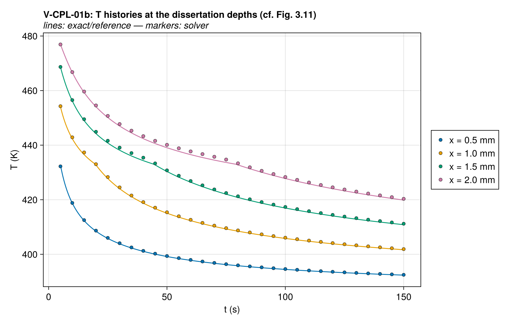

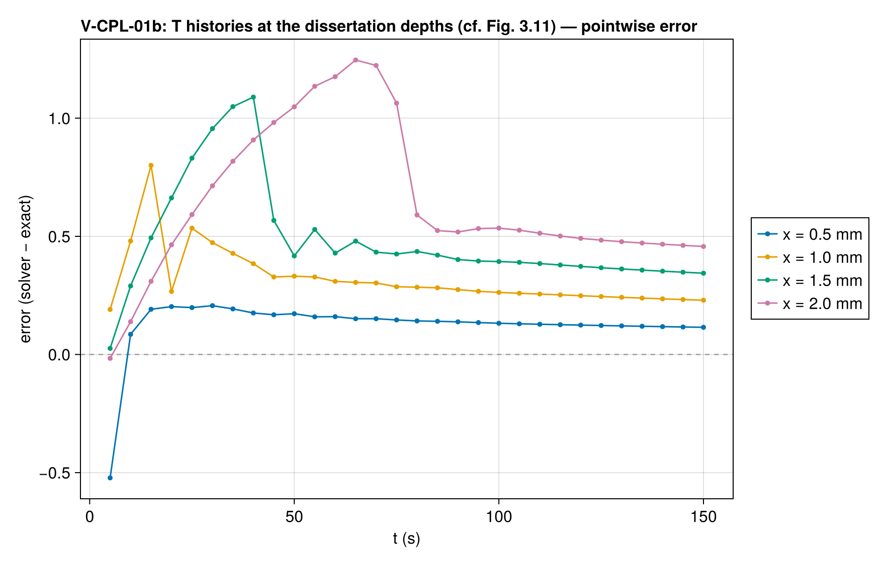

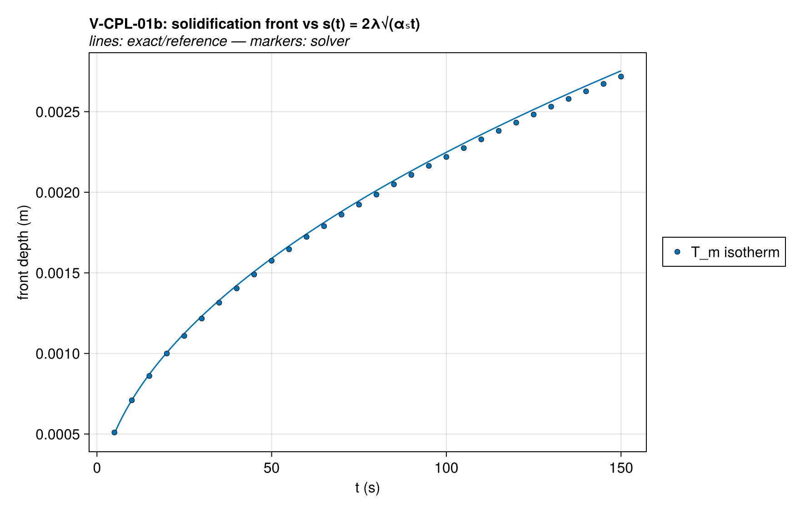

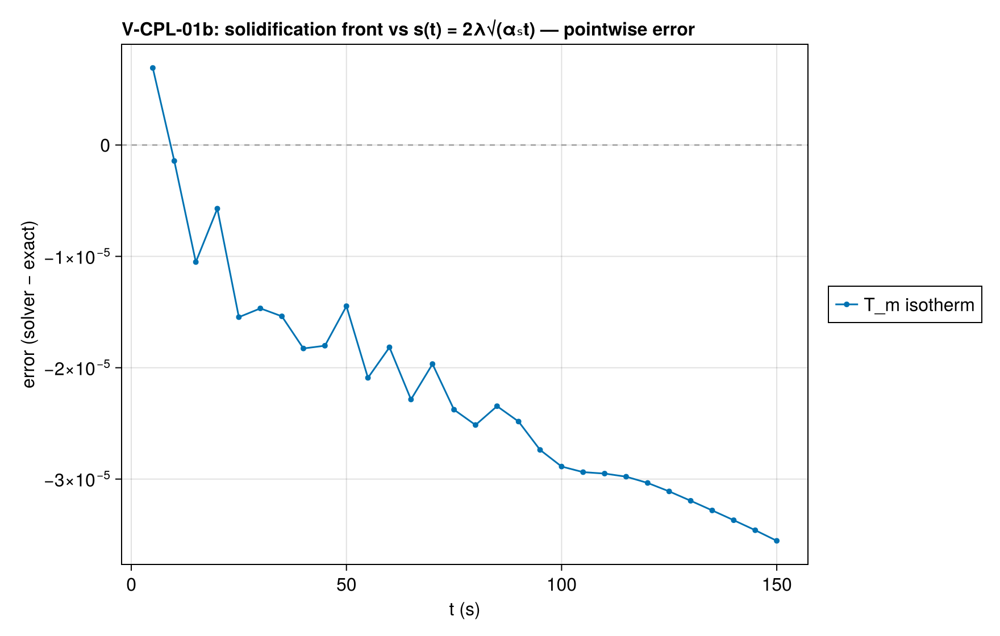

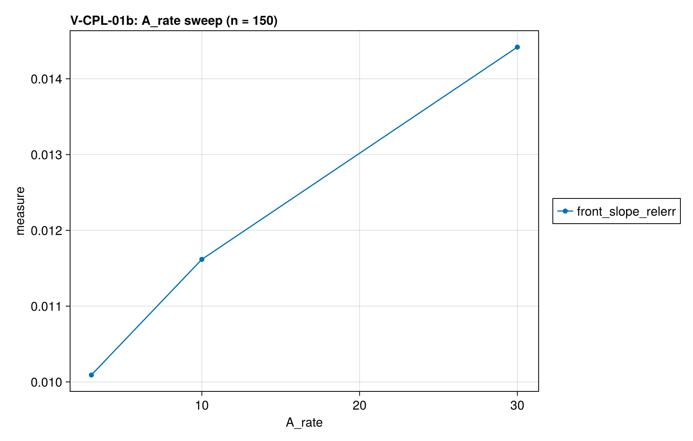

### Comparison with other codes

The same case was solved with Gpyro 0.8200 at 801 nodes (Δz=0.05 mm); decks, outputs, and
run provenance are committed under `test/verification/reference/`.
Each code's error against the same exact solution is drawn below
on a log scale, muted gray behind this solver's series — the
signed linear-scale panel above shows where the error lives, this
one compares magnitudes across codes.

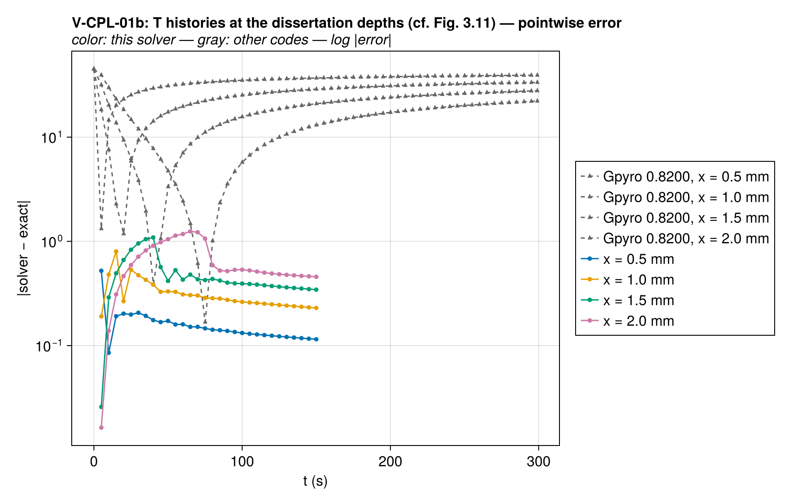

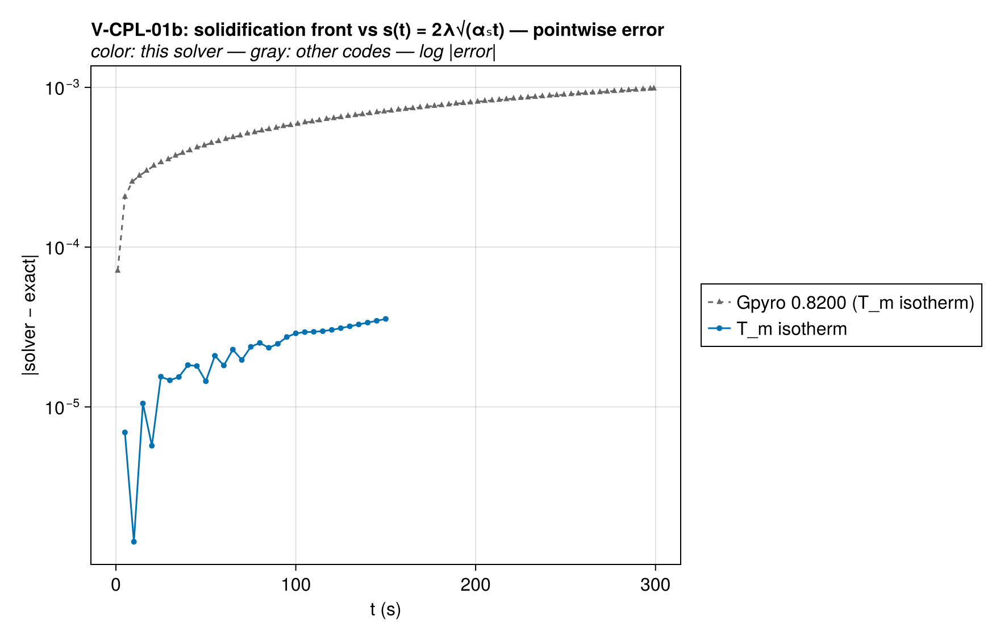

Wall times at every ladder rung against the reference runs.
Resolutions and simulated spans differ where noted (details in
`reference/timings.csv`), so cross-code timings are indicative
rather than a controlled benchmark; rungs at a matched
resolution are directly comparable.

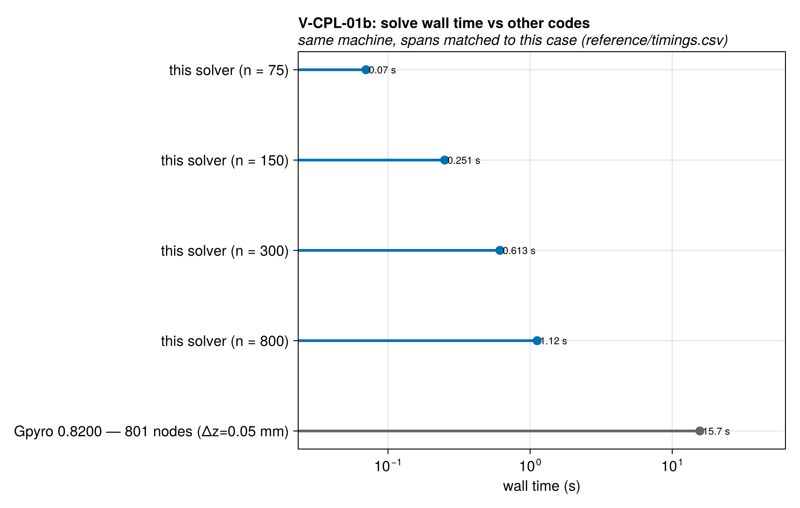

Solution overlays including the other codes' points: [T_histories_at_depths_vs_codes](assets/V-CPL-01b/V-CPL-01b_T_histories_at_depths_vs_codes.png), [front_trajectory_vs_codes](assets/V-CPL-01b/V-CPL-01b_front_trajectory_vs_codes.png).

### Solver configuration

| setting | value |
| --- | --- |
| integrator | Rodas5P (default) |
| abstol | 1.0e-8 |
| reltol | 1.0e-6 |

