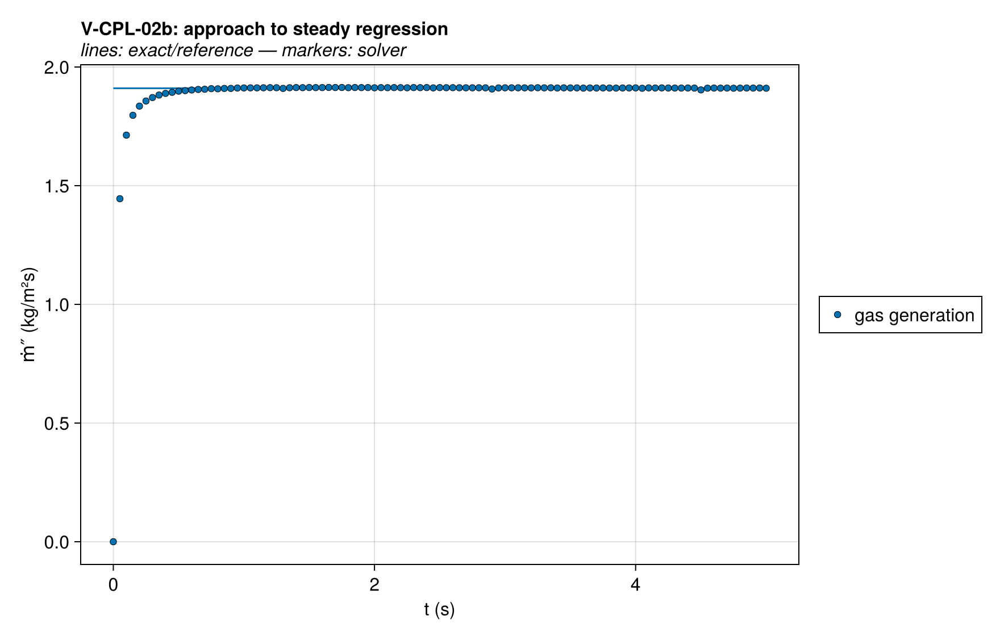
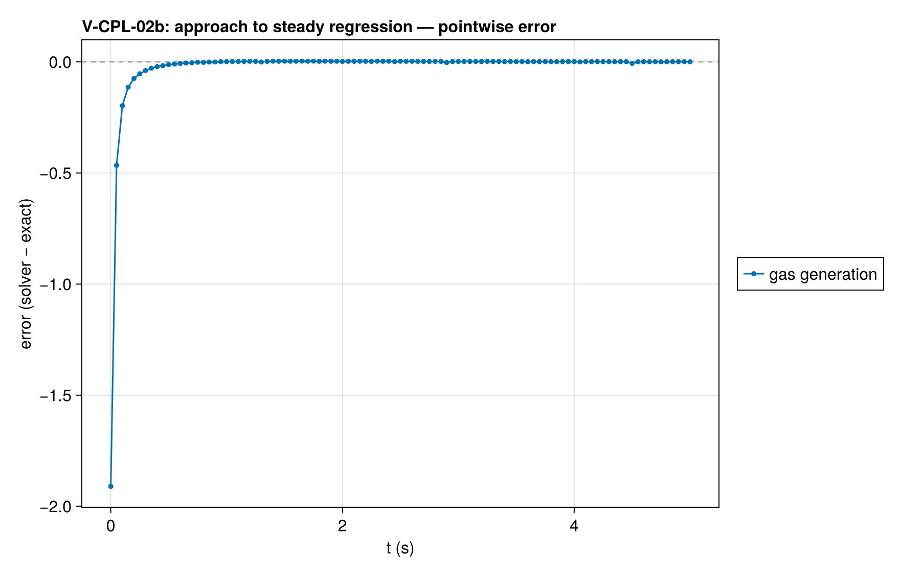
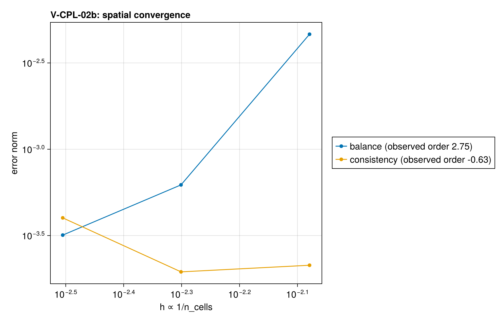

# V-CPL-02 — Landau ablation: steady surface regression under ALE

**Tags:** `ale`, `moving_boundary`, `kinetics`, `surface_regression`, `coupled`

**References:**

- H.G. Landau, Q. Appl. Math. 8:81 (1950)

## Problem statement

H.G. Landau, Q. Appl. Math. 8:81 (1950). An analytical ALE check.
Semi-infinite solid, constant net
surface flux q″, material removed at ablation temperature T_p with heat of
ablation ΔH_p. Exact steady traveling wave (exact/landau.jl):

  v_ss = q″/(ρ[c(T_p − T₀) + ΔH_p]),  T(ζ) = T₀ + (T_p − T₀)e^(−v_ss ζ/α)

Realization: single reaction solid → gas with γ_gas = 0 (volume loss at
intrinsic density ⇒ surface regression) under ALE with cell
deactivation. The kinetics-controlled front approximates the fixed-T_p
ablation limit; (A, E) are chosen on the leading-order Laplace locus

  A = v² E (T_p − T₀) e^(E/RT_p) / (α R T_p²)

so the designed regression rate is v_target at ablation temperature ≈ T_p.
At finite E the front self-adjusts: the primary QoI therefore compares the
measured regression rate v against the Landau balance evaluated at the
MEASURED surface temperature — an identity that must hold for the steady
wave regardless of kinetics — and the design locus is only a loose check.

With c_gas = c_solid the reaction enthalpy is constant. Integrating the
steady first law from stationary virgin solid at T₀ to the escaping gas
gives q″ = ρ v [c(T_s − T₀) + ΔH], independently of the front's kinetics.
This identity requires a stationary cold far field and negligible changes
in stored energy and gas holdup. The reaction gate leaves the virgin solid
inert. The broader-front companion uses a longer domain and later window;
both cases check the back temperature and report mesh refinement.

The half-cell surface-temperature closure and finite front resolution
contribute spatial error. The Laplace design locus remains a loose check;
it is not the analytical reference for the measured regression rate.
Prescribed net heat flux has no blowing correction. The depletion limiter
is active as front cells approach deactivation.

## V-CPL-02 — Landau ablation: steady surface regression under ALE

### Quantities of interest (n = 240)

| QoI | value | exact | error | tolerance | within tol | provenance |
| --- | --- | --- | --- | --- | --- | --- |
| steady energy balance: v vs Landau v_ss(measured T_s) | 0.001952 | 0.001951 | 0.0003337 | 0.0021 | yes | steady first law with stationary virgin solid and c_gas = c_solid |
| regression consistency: thickness slope vs gas generation | 0.001952 | 0.001952 | 2.133e-05 | 0.0021 | yes | γ_gas = 0 ⇒ dL/dt = −ṁ‴_gas/ρ exactly |
| mass ledger closure over plateau window | 0.7771 | 0.7807 | 0.00462 | 0.0049 | yes | total-mass drop vs ∫ ṁ″ dt; residual = holdup drift |
| in-depth profile decay rate (surface-attached frame) | 0.001967 | 0.001952 | 0.007865 | 0.027 | yes | ln(T−T₀) slope over ζ/δ ∈ [0.75, 1.7], 12 cells |
| design-locus regression rate (loose) | 0.001952 | 0.002 | 0.0242 | 0.1 | yes | leading-order Laplace locus only pins T_p to O(RT_p²/E); informational, tightens as E ↑ (see V-CPL-02b) |
| back-face rise (semi-infinite validity) | 0.0003587 | 0 | 0.0003587 | 0.01 | yes | guards the semi-infinite assumption |

### Convergence

| n_cells | h | wall (s) | balance | consistency |
| --- | --- | --- | --- | --- |
| 60 | 0.01667 | 9.181 | 0.0006181 | 0.001283 |
| 100 | 0.01 | 13.33 | 0.00116 | 0.00051 |
| 160 | 0.00625 | 27.73 | 0.0003602 | 0.0001159 |
| 240 | 0.004167 | 57.16 | 0.0003337 | 2.133e-05 |

Observed order 0.6363 (balance).

### Solver configuration

| setting | value |
| --- | --- |
| integrator | Rodas5P (default) |
| use_ale | true |
| min_thickness | 0.0001 |
| deactivation | true |
| abstol | 1.0e-9 |
| reltol | 1.0e-7 |
| pressure_tolerance | 0.001 |

## V-CPL-02b — Landau ablation: kinetics-limit insensitivity variant (E/2)

### Quantities of interest (n = 320)

| QoI | value | exact | error | tolerance | within tol | provenance |
| --- | --- | --- | --- | --- | --- | --- |
| steady energy balance: v vs Landau v_ss(measured T_s) | 0.001911 | 0.00191 | 0.0003182 | 0.002 | yes | identity must close at E = 50 kJ/mol as at 100 (locus check) |
| regression consistency: thickness slope vs gas generation | 0.001911 | 0.00191 | 0.0004004 | 0.0017 | yes | γ_gas = 0 ⇒ dL/dt = −ṁ‴_gas/ρ exactly |
| stationary far-field temperature | 3.481e-07 | 0 | 3.481e-07 | 0.0001 | yes | cold reaction gate and domain length qualify the steady reference |

### Convergence

| n_cells | h | wall (s) | balance | consistency |
| --- | --- | --- | --- | --- |
| 120 | 0.008333 | 15.6 | 0.004637 | 0.0002128 |
| 200 | 0.005 | 46.85 | 0.0006218 | 0.0001949 |
| 320 | 0.003125 | 70.54 | 0.0003182 | 0.0004004 |

Observed order 2.749 (balance).

### Solver configuration

| setting | value |
| --- | --- |
| integrator | Rodas5P (default) |
| use_ale | true |
| min_thickness | 0.0001 |
| deactivation | true |
| abstol | 1.0e-9 |
| reltol | 1.0e-7 |
| pressure_tolerance | 0.001 |
