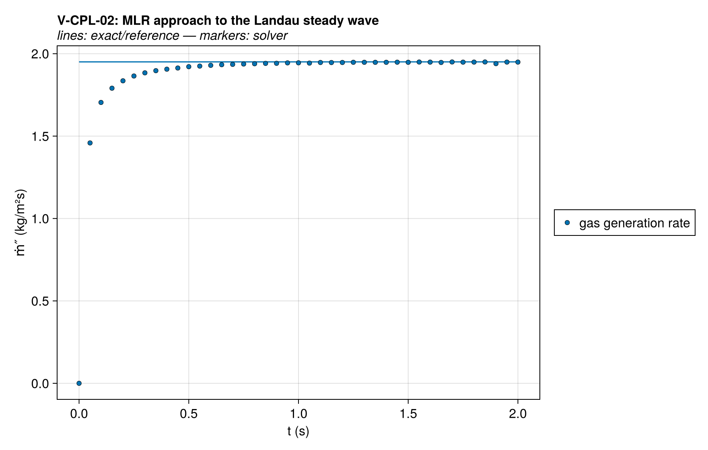
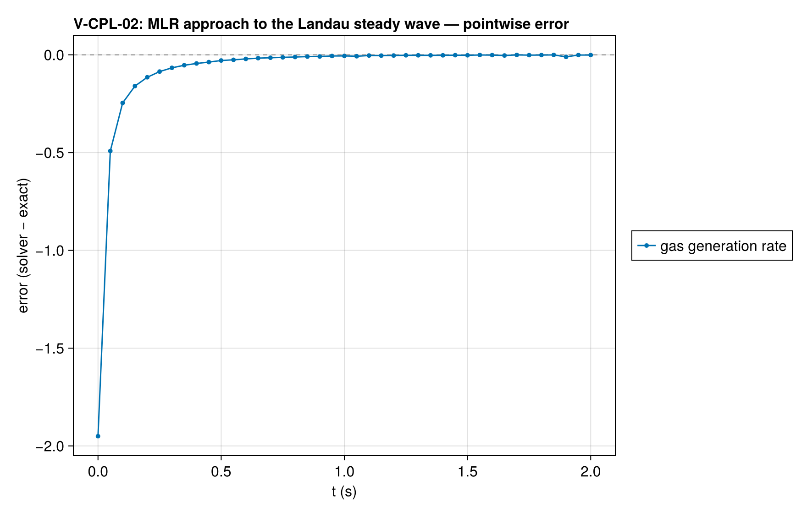
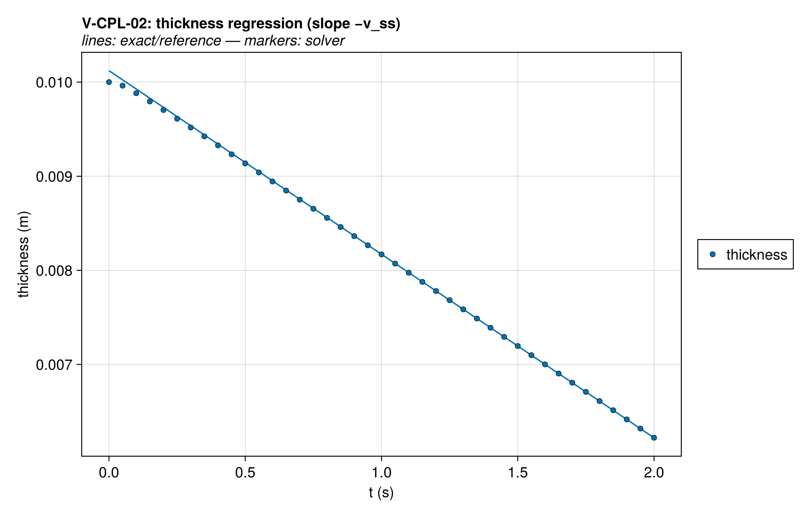
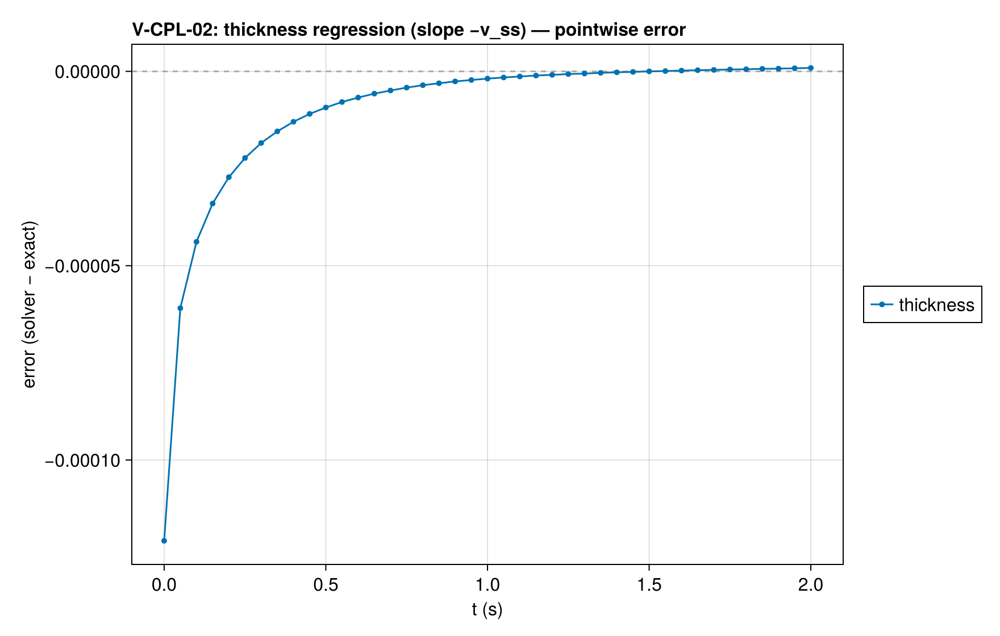
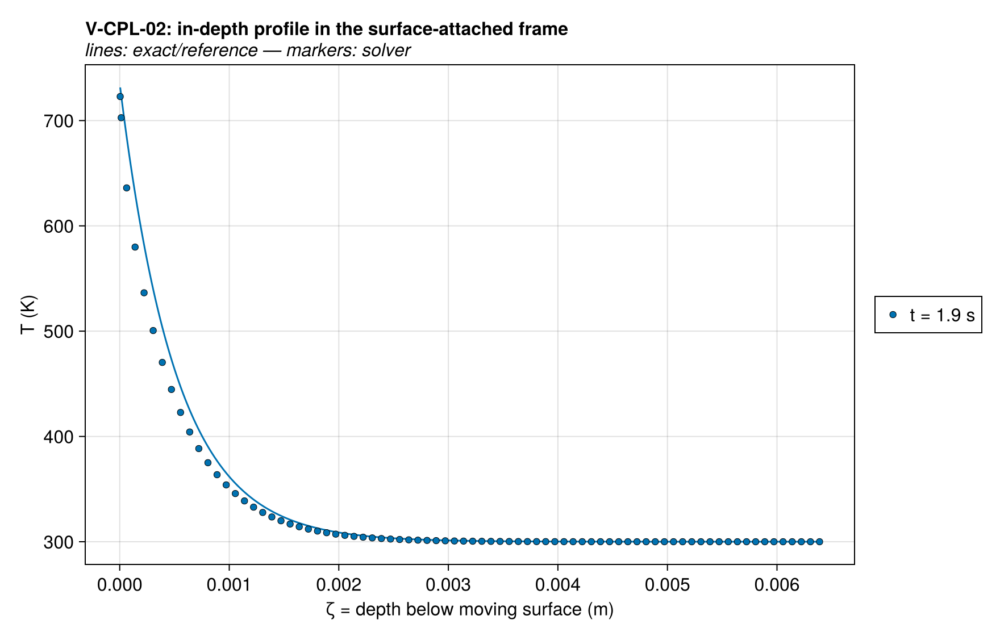
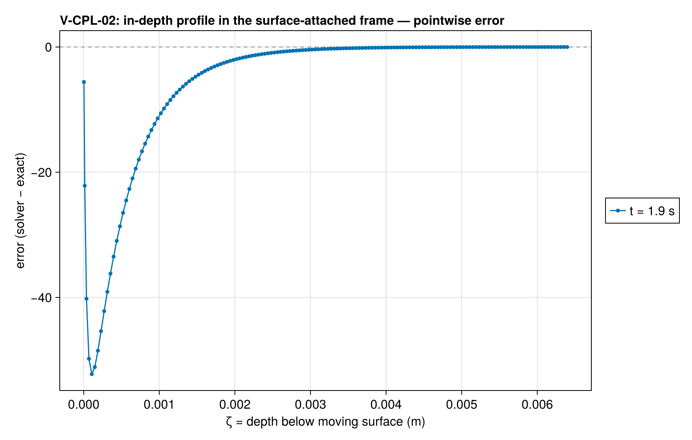
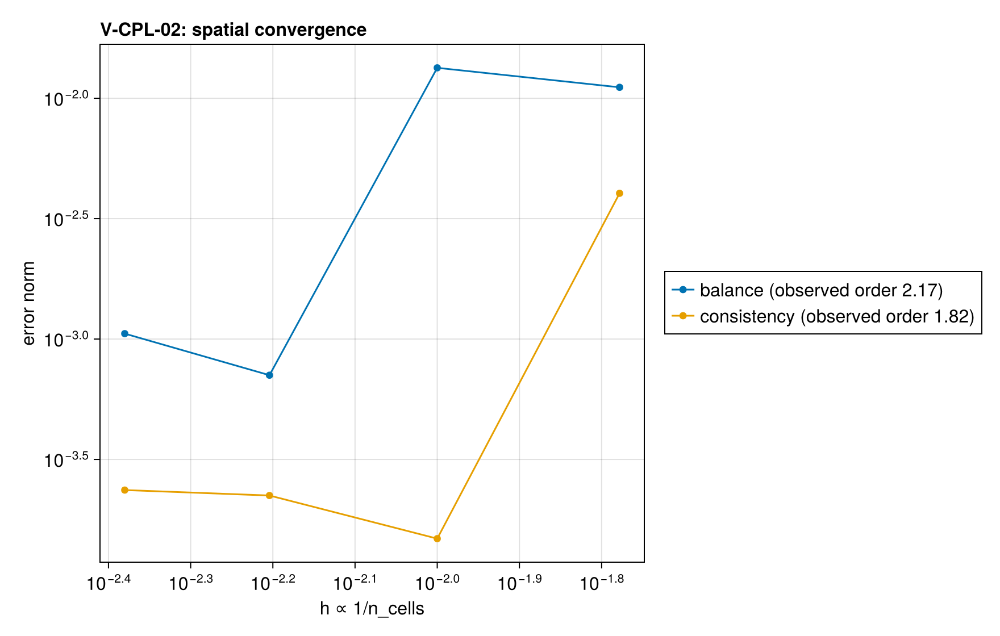
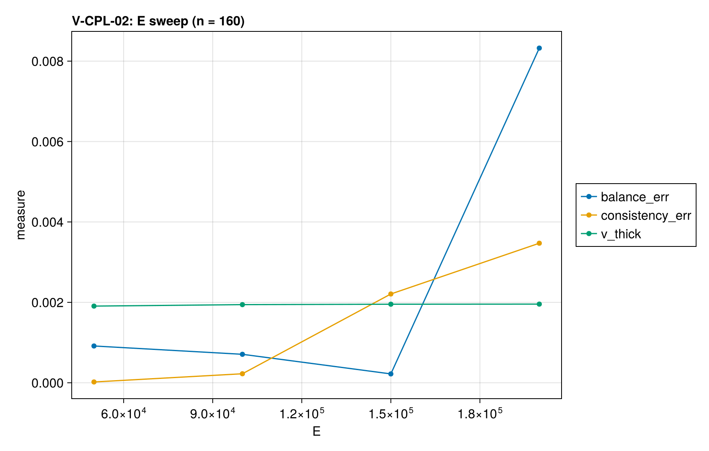

# V-CPL-02 — Landau ablation: steady surface regression under ALE

**Tags:** `ale`, `moving_boundary`, `kinetics`, `surface_regression`, `coupled`

**References:**

- H.G. Landau, Q. Appl. Math. 8:81 (1950)

## Problem statement

H.G. Landau, Q. Appl. Math. 8:81 (1950). The flagship ALE case: none of
FDS/Gpyro/ThermaKin verify against it. Semi-infinite solid, constant net
surface flux q″, material removed at ablation temperature T_p with heat of
ablation ΔH_p. Exact steady traveling wave (exact/landau.jl):

  v_ss = q″/(ρ[c(T_p − T₀) + ΔH_p]),  T(ζ) = T₀ + (T_p − T₀)e^(−v_ss ζ/α)

Realization: single reaction solid → gas with γ_gas = 0 (volume loss at
intrinsic density ⇒ surface regression) under ALE with cell
deactivation. The kinetics-controlled front approximates the fixed-T_p
ablation limit; (A, E) are chosen on the leading-order Laplace locus

  A = v² E (T_p − T₀) e^(E/RT_p) / (α R T_p²)

so the designed regression rate is v_target at ablation temperature ≈ T_p.
At finite E the front self-adjusts: the primary QoI therefore compares the
measured regression rate v against the Landau balance evaluated at the
MEASURED surface temperature — an identity that must hold for the steady
wave regardless of kinetics — and the design locus is only a loose check.

Gas heat capacity is set EQUAL to the solid's (c_gas = c_solid): then the
heat of reaction ΔH(T) is T-independent (Kirchhoff) and the traveling-wave
identity v = v_ss(measured T_s) is exact for ANY kinetics — the regression
anchor. With c_gas ≈ 0 the identity is NOT exact at finite E: the true wave
consumes only c(T̄_form − T₀) + ΔH per kg (conversion happens at T̄_form <
T_s), so v runs ≈ +RT_s²/E·c/(cΔT+ΔH) fast against v_ss(T_s) — that
configuration belongs to report-mode studies, not to this pinned QoI.

The c_gas = c_solid anchor also guards the relative-velocity ALE energy
formulation (tech-ref §11.2.2): a spurious full-mesh-velocity T-advection
term (`+w·∂T/∂z` applied although the mesh rides the collapsing solid)
would break this identity by ≈ c·(T_s − T̄_form) ≈ RT_s²/E·c per kg — a
few-percent deficit. For the identity to be a sharp guard the QoI window
must sit deep in the steady wave: from a uniform-T₀ start the true
initial-value solution approaches the traveling wave as e^(−t/τ) with
τ = α/v² ≈ 0.25 s — heat is still being banked into the growing thermal
tail, so v(t) runs below v_ss(measured T_s) while T_s itself equilibrates
early. That deficit is the correct transient of the initial-value problem,
not solver error: the windowed first law (q″Δt = ΔE_stored + ablation
enthalpy) closes throughout the approach, and the pre-ablation phase
matches Landau's exact constant-flux heat-up T_s(t) = T₀ + 2q″√(t/(πρck)).
The steady exact solution is simply not a valid reference before ~6τ: in
a window at 2–4τ the residual deficit is ≈0.9% and mesh-INDEPENDENT
(n=60→240 ladder, observed order 0.11). The window therefore sits at ≥6τ,
where the remaining residual is the §12.3.2 half-cell T_s closure with the
reaction zone inside the boundary half-cell — mesh-DEPENDENT as it should
be (it shifts v_ss(measured T_s) but not the actual regression rate):
~1.3% at Δz ≈ 2δ_r, ~7e-4 at the CI mesh Δz ≈ δ_r — so the pinned
tolerance actually arms the ALE guard.

Blowing correction stays OFF (exact solution assumes prescribed net flux).
Depletion limiter stays ON: the tanh roll-off is part of the regression
physics here (front cells are consumed to zero) and its effect is contained
in the pinned tolerances.

CI runs no ConvergenceSpec: the case resolves a moving reaction front
(δ_r ≈ δ·RT_s²/(E(T_s−T₀)) ≈ 53 μm ≈ Δz at the CI mesh) and a meaningful
order study requires the report-mode Richardson ladder; the assert-mode
QoIs below are all physics identities with pinned headroom instead.
V-CPL-02b (broader front, E halved) doubles as the kinetics-limit
insensitivity check of the ablation-temperature locus.

### Quantities of interest (n = 240)

| QoI | value | exact | error | tolerance | within tol | provenance |
| --- | --- | --- | --- | --- | --- | --- |
| steady energy balance: v vs Landau v_ss(measured T_s) | 0.001949 | 0.00195 | 0.000893 | 0.0021 | yes | traveling-wave identity, exact at any E for c_gas = c_solid |
| regression consistency: thickness slope vs gas generation | 0.001949 | 0.001948 | 0.0004392 | 0.0021 | yes | γ_gas = 0 ⇒ dL/dt = −ṁ‴_gas/ρ exactly |
| mass ledger closure over plateau window | 0.7804 | 0.7793 | 0.001416 | 0.0049 | yes | total-mass drop vs ∫ ṁ″ dt; residual = holdup drift |
| in-depth profile decay rate (surface-attached frame) | 0.001973 | 0.001949 | 0.0123 | 0.027 | yes | ln(T−T₀) slope over ζ/δ ∈ [0.75, 1.7], 12 cells |
| design-locus regression rate (loose) | 0.001949 | 0.002 | 0.02568 | 0.1 | yes | leading-order Laplace locus only pins T_p to O(RT_p²/E); informational, tightens as E ↑ (see V-CPL-02b) |
| back-face rise (semi-infinite validity) | 0.0003462 | 0 | 0.0003462 | 0.01 | yes | guards the semi-infinite assumption |

### Convergence

| n_cells | h | wall (s) | balance | consistency |
| --- | --- | --- | --- | --- |
| 60 | 0.01667 | 0.2645 | 0.003945 | 0.001565 |
| 100 | 0.01 | 0.3305 | 0.0025 | 0.001839 |
| 160 | 0.00625 | 0.5917 | 0.001867 | 0.0002906 |
| 240 | 0.004167 | 1.466 | 0.000893 | 0.0004392 |

Observed order 1.016 (balance).

### Solver configuration

| setting | value |
| --- | --- |
| integrator | Rodas5P (default) |
| use_ale | true |
| min_thickness | 0.0001 |
| deactivation | true |
| abstol | 1.0e-7 |
| reltol | 1.0e-5 |

