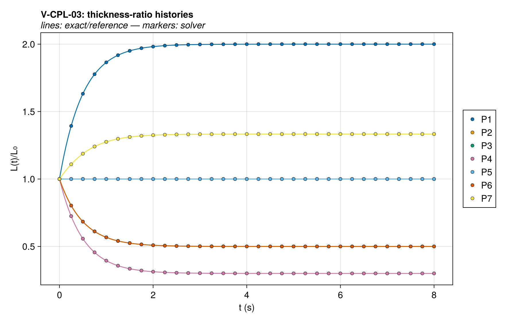
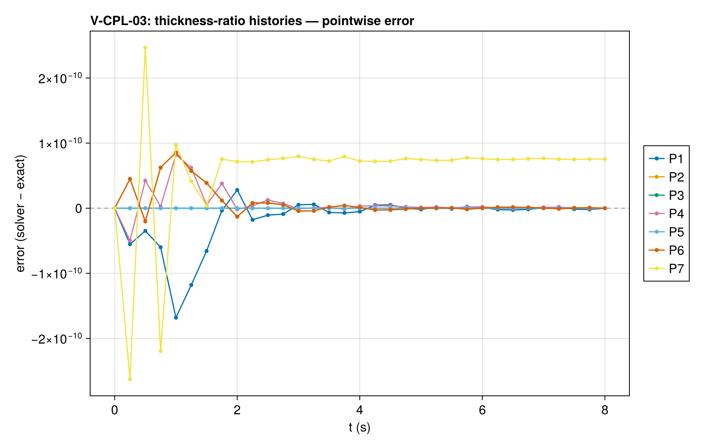
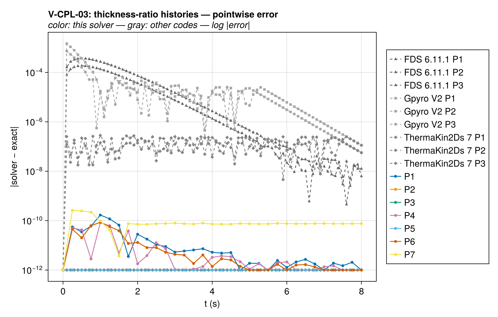
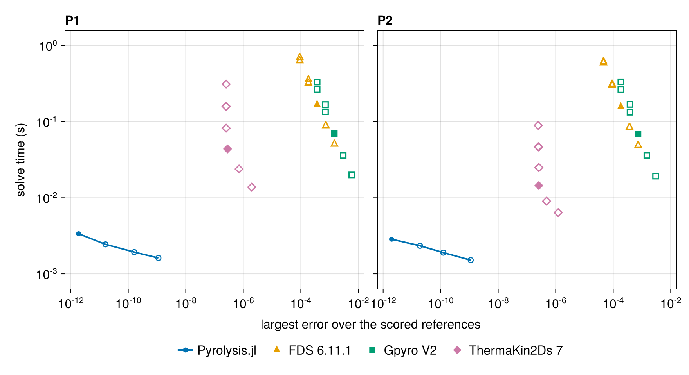

# V-CPL-03 — shrink/swell exact endpoints (5 permutations + lateral law)

**Tags:** `ale`, `volume_change`, `swelling`, `chi`, `mass_conservation`

**References:**

- FDS Verification Guide `shrink_swell` (endpoint concept)
- Technical reference Ch. 10/11 (volumetric strain model)

## Problem statement

FDS verifies exact final thickness/density for ρ_product ≷ ρ_reactant
permutations. Under OUR volumetric-strain model the endpoint follows from
(technical reference Ch. 10/11; src/Physics/volume_change.jl):

  V̇/V = θ = Σⱼ ω̇ⱼ/ρⱼ      (condensed components; gases never enter)

with ω̇ⱼ the reaction mass rates [kg/m³/s]. For a single reaction
A → Σⱼ yⱼ Bⱼ (Σyⱼ = 1) at rate r: ω̇_A = −r, ω̇_Bⱼ = +yⱼ r, so per cell

  dV = (1/ρ_A − Σⱼ yⱼ/ρⱼ) dm_A    (condensed Bⱼ; r V dt = −dm_A)

— LINEAR in the converted mass, hence path-independent: the endpoint is
exact regardless of rate history, temperature, or spatial distribution.
Integrating from m_A = ξ_A0·V₀ to 0, with the standard initialization
ξ_A0 = ρ_A (bulk density):

  V_f/V₀ = Σⱼ yⱼ ρ_A/ρⱼ      (condensed Bⱼ)

and a pure solid product ends exactly at its bulk density ρ_B. All ρ here
are the components' BULK densities (the strain kernel uses bulk ρ, not
ρ_intrinsic — see the SolidComponent docstring note). Swelling is a
product of lower bulk density (P1).

Permutations (ρ_A = 1000, isothermal via E = 0, h = 0, everything
impermeable). Mass QoIs: EVERY permutation asserts total-mass conservation
to integrator tolerance — every component's mass is a state that rides the
mesh, so its concentration ξ = m/V follows the cell volume (tech-ref
§11.3.4): the gas held in a collapsing impermeable matrix compresses cell
by cell (ξ_g ↑ as V ↓) and leaves only
through the (closed) faces. P4 is the sealed-column anchor for that
bookkeeping. Gas-producing permutations additionally assert the SOLID
ledger (char endpoint = y_char·m_A0 exactly).

  P1 swell:            A → B(ρ=500)               V_f/V₀ = 2
  P2 shrink:           A → B(ρ=2000)              V_f/V₀ = 1/2
  P3 neutral:          A → B(ρ=1000)              V_f/V₀ = 1
  P4 char + gas:       A → 0.3 C(ρ=1000) + 0.7 G  V_f/V₀ = 0.3
  P5 mass loss, ΔV=0:  A → 0.5 C(ρ=500)  + 0.5 G  V_f/V₀ = 1
  P6 lateral law:      P5 chemistry + lateral law A/A₀ = 1 − 0.5·χ̄
       χ̄_f = 0.5 (released dry-mass fraction) ⇒ A_f/A₀ = 0.75 exactly,
       L_f/L₀ = (V_f/V₀)/(A_f/A₀) = 4/3.

P1 (the swelling branch, exercising mesh GROWTH) runs through the standard
harness path; the remaining permutations are solved inside `qois` (each is
a ~1 s, 8-cell isothermal solve) so the whole family stays one case.

First-order kinetics with A_r·t_end = 16 ⇒ residual conversion e⁻¹⁶ ≈ 1e-7
bounds the endpoint error; the depletion limiter is disabled so the decay
stays exactly first-order (with it, the tail below ~1 kg/m³ slows and the
residual at fixed t_end grows ~1000×).

### Quantities of interest (n = 8)

| QoI | value | exact | error | tolerance | within tol | provenance |
| --- | --- | --- | --- | --- | --- | --- |
| P1: final thickness ratio | 2 | 2 | 5.627e-08 | 3e-06 | yes | path-independent endpoint of θ = Σⱼω̇ⱼ/ρⱼ (case header) |
| P1: total mass conservation | 2 | 2 | 4.441e-16 | 2e-06 | yes | solid-only permutation; impermeable everywhere |
| P2: final thickness ratio | 0.5 | 0.5 | 1.125e-07 | 3e-06 | yes | path-independent endpoint of θ = Σⱼω̇ⱼ/ρⱼ (case header) |
| P2: total mass conservation | 2 | 2 | 5.551e-16 | 2e-06 | yes | solid-only permutation; impermeable everywhere |
| P3: final thickness ratio | 1 | 1 | 0 | 3e-06 | yes | path-independent endpoint of θ = Σⱼω̇ⱼ/ρⱼ (case header) |
| P3: total mass conservation | 2 | 2 | 3.331e-16 | 2e-06 | yes | solid-only permutation; impermeable everywhere |
| P4: final thickness ratio | 0.3 | 0.3 | 2.626e-07 | 3e-06 | yes | path-independent endpoint of θ = Σⱼω̇ⱼ/ρⱼ (case header) |
| P4: total mass conservation | 2 | 2 | 1.221e-15 | 2e-06 | yes | held gas compresses with its cell under collapse; the sealed P4 corner anchors the dilation bookkeeping |
| P4: final char mass (solid ledger) | 0.6 | 0.6 | 1.125e-07 | 2e-06 | yes | char endpoint is path-independent; complements the total-mass anchor |
| P5: final thickness ratio | 1 | 1 | 0 | 3e-06 | yes | path-independent endpoint of θ = Σⱼω̇ⱼ/ρⱼ (case header) |
| P5: total mass conservation | 2 | 2 | 2.22e-16 | 2e-06 | yes | held gas compresses with its cell under collapse; the sealed P4 corner anchors the dilation bookkeeping |
| P5: final char mass (solid ledger) | 1 | 1 | 1.125e-07 | 2e-06 | yes | char endpoint is path-independent; complements the total-mass anchor |
| P6: final thickness ratio | 1.333 | 1.333 | 3.751e-08 | 3e-06 | yes | path-independent endpoint of θ = Σⱼω̇ⱼ/ρⱼ (case header) |
| P6: total mass conservation | 2 | 2 | 1.11e-15 | 2e-06 | yes | held gas compresses with its cell under collapse; the sealed P4 corner anchors the dilation bookkeeping |
| P6: final char mass (solid ledger) | 1 | 1 | 1.125e-07 | 2e-06 | yes | char endpoint is path-independent; complements the total-mass anchor |
| P6: final lateral area ratio A_f/A₀ = law(χ̄ = 1/2) | 0.75 | 0.75 | 3.751e-08 | 3e-06 | yes | χ̄_f = released dry-mass fraction = y_gas = 0.5 |

### Comparison with other codes

Physical-problem agreement does not establish equal discretization or cost. See the [mesh and time comparison basis](comparison_coverage.md#comparison-basis-audit) and [per-pair inventory](assets/comparison_basis.csv). Costs are compared at matched accuracy only.

Matched native-input runs at seven configurations (coarser and finer time steps at fixed mesh, and a finer mesh) are retained under `test/verification/reference/matched/`. See the [coverage and matching notes](comparison_coverage.md). The plotted external series use the base resolution; [analytical errors at every configuration](assets/V-CPL-03/V-CPL-03_comparison_accuracy.csv) are retained separately, and the same runs are timed for the cost comparison.

Error panels show absolute error at each code's output points. Zeros are displayed at 1e-12 on the logarithmic axis; the reference CSV precision limits the discernible error.

#### Cost at matched accuracy

Each external code appears at its matched mesh h and time step Δt, at
coarser steps (2Δt, 4Δt) and at refinements (Δt/2, Δt/4, h/2 at Δt/4,
h/2 at Δt/2); this code at its report ladder, the external meshes and any
finer cost-only meshes, each at its report tolerances and at 10, 100 and
1000 times looser ones, the counterpart of the coarser steps. A coarse
configuration a code cannot express or complete is left out; for the
external codes the reason is in the matched provenance. The error is the
largest analytical error over
the curves and references the external run is scored on. Times are FDS's
internal elapsed time, which excludes its MPI start-up; Gpyro's and
ThermaKin's process time; and this code's warm problem construction and
solve. Each is the median of repeated runs on one pinned core
(`scripts/timing/README.md`; data and provenance in
`test/verification/reference/matched/timing/`). On the smallest problems
the external times are mostly input, setup and output. In the figure,
filled markers are each external code's matched mesh and step and this
code's report tolerances, open markers are the other runs, and this
code's line joins its cheapest configuration at each accuracy; lower left
is better. Errors at or below 1e-12 count as exact
when matching accuracy, errors at or below 1e-14 are drawn at 1e-14, and
runs every code solves exactly are not drawn.

For each external mesh and step: the external code's cheapest run at least as accurate (often itself; a coarser or finer run of the same code when that costs less), this code's cheapest configuration at least as accurate on every scored reference (its cells, and its tolerance multiplier when looser than the report's), and the ratio of the two. A ratio marked ≥ uses this code's coarsest configuration, fewest cells at the loosest tolerance, whose accuracy already exceeds the external run's.

| External run | Mesh, step | External error | External time (s) | Cheapest external at this accuracy (s) | Our cells, tolerance | Our time (s) | Cheapest external/our time |
| --- | --- | --- | --- | --- | --- | --- | --- |
| FDS 6.11.1, P1 | h, Δt | 0.0003682 | 0.168 | 0.168 | 8, 1000× tol | 0.001542 | ≥ 109.0 |
| FDS 6.11.1, P1 | h, 2Δt | 0.000737 | 0.089 | 0.089 | 8, 1000× tol | 0.001542 | ≥ 57.7 |
| FDS 6.11.1, P1 | h, 4Δt | 0.001476 | 0.051 | 0.051 | 8, 1000× tol | 0.001542 | ≥ 33.1 |
| FDS 6.11.1, P1 | h, Δt/2 | 0.000184 | 0.324 | 0.324 | 8, 1000× tol | 0.001542 | ≥ 210.0 |
| FDS 6.11.1, P1 | h, Δt/4 | 9.2e-05 | 0.635 | 0.635 | 8, 1000× tol | 0.001542 | ≥ 412.0 |
| FDS 6.11.1, P1 | h/2, Δt/4 | 9.2e-05 | 0.7 | 0.635 | 8, 1000× tol | 0.001542 | ≥ 412.0 |
| FDS 6.11.1, P1 | h/2, Δt/2 | 0.000184 | 0.357 | 0.324 | 8, 1000× tol | 0.001542 | ≥ 210.0 |
| FDS 6.11.1, P2 | h, Δt | 0.0001841 | 0.157 | 0.157 | 8, 1000× tol | 0.0015 | ≥ 105.0 |
| FDS 6.11.1, P2 | h, 2Δt | 0.0003685 | 0.085 | 0.085 | 8, 1000× tol | 0.0015 | ≥ 56.7 |
| FDS 6.11.1, P2 | h, 4Δt | 0.0007382 | 0.049 | 0.049 | 8, 1000× tol | 0.0015 | ≥ 32.7 |
| FDS 6.11.1, P2 | h, Δt/2 | 9.202e-05 | 0.302 | 0.302 | 8, 1000× tol | 0.0015 | ≥ 201.0 |
| FDS 6.11.1, P2 | h, Δt/4 | 4.597e-05 | 0.597 | 0.597 | 8, 1000× tol | 0.0015 | ≥ 398.0 |
| FDS 6.11.1, P2 | h/2, Δt/4 | 4.597e-05 | 0.617 | 0.597 | 8, 1000× tol | 0.0015 | ≥ 398.0 |
| FDS 6.11.1, P2 | h/2, Δt/2 | 9.202e-05 | 0.313 | 0.302 | 8, 1000× tol | 0.0015 | ≥ 201.0 |
| FDS 6.11.1, P3 | h, Δt | 0 | 0.16 | 0.05 | 8, 1000× tol | 0.001257 | ≥ 39.8 |
| FDS 6.11.1, P3 | h, 2Δt | 0 | 0.085 | 0.05 | 8, 1000× tol | 0.001257 | ≥ 39.8 |
| FDS 6.11.1, P3 | h, 4Δt | 0 | 0.05 | 0.05 | 8, 1000× tol | 0.001257 | ≥ 39.8 |
| FDS 6.11.1, P3 | h, Δt/2 | 0 | 0.307 | 0.05 | 8, 1000× tol | 0.001257 | ≥ 39.8 |
| FDS 6.11.1, P3 | h, Δt/4 | 0 | 0.602 | 0.05 | 8, 1000× tol | 0.001257 | ≥ 39.8 |
| FDS 6.11.1, P3 | h/2, Δt/4 | 0 | 0.636 | 0.05 | 8, 1000× tol | 0.001257 | ≥ 39.8 |
| FDS 6.11.1, P3 | h/2, Δt/2 | 0 | 0.324 | 0.05 | 8, 1000× tol | 0.001257 | ≥ 39.8 |
| Gpyro V2, P1 | h, Δt | 0.001469 | 0.06978 | 0.06978 | 8, 1000× tol | 0.001542 | ≥ 45.2 |
| Gpyro V2, P1 | h, 2Δt | 0.002969 | 0.03608 | 0.03608 | 8, 1000× tol | 0.001542 | ≥ 23.4 |
| Gpyro V2, P1 | h, 4Δt | 0.005919 | 0.01998 | 0.01998 | 8, 1000× tol | 0.001542 | ≥ 13.0 |
| Gpyro V2, P1 | h, Δt/2 | 0.0007192 | 0.1348 | 0.1348 | 8, 1000× tol | 0.001542 | ≥ 87.4 |
| Gpyro V2, P1 | h, Δt/4 | 0.0003692 | 0.265 | 0.265 | 8, 1000× tol | 0.001542 | ≥ 172.0 |
| Gpyro V2, P1 | h/2, Δt/4 | 0.0003692 | 0.3335 | 0.265 | 8, 1000× tol | 0.001542 | ≥ 172.0 |
| Gpyro V2, P1 | h/2, Δt/2 | 0.0007192 | 0.1682 | 0.1348 | 8, 1000× tol | 0.001542 | ≥ 87.4 |
| Gpyro V2, P2 | h, Δt | 0.0007346 | 0.06861 | 0.06861 | 8, 1000× tol | 0.0015 | ≥ 45.7 |
| Gpyro V2, P2 | h, 2Δt | 0.001485 | 0.0361 | 0.0361 | 8, 1000× tol | 0.0015 | ≥ 24.1 |
| Gpyro V2, P2 | h, 4Δt | 0.002985 | 0.01929 | 0.01929 | 8, 1000× tol | 0.0015 | ≥ 12.9 |
| Gpyro V2, P2 | h, Δt/2 | 0.0003846 | 0.1333 | 0.1333 | 8, 1000× tol | 0.0015 | ≥ 88.9 |
| Gpyro V2, P2 | h, Δt/4 | 0.0001846 | 0.2643 | 0.2643 | 8, 1000× tol | 0.0015 | ≥ 176.0 |
| Gpyro V2, P2 | h/2, Δt/4 | 0.0001846 | 0.3348 | 0.2643 | 8, 1000× tol | 0.0015 | ≥ 176.0 |
| Gpyro V2, P2 | h/2, Δt/2 | 0.0003846 | 0.1689 | 0.1333 | 8, 1000× tol | 0.0015 | ≥ 88.9 |
| Gpyro V2, P3 | h, Δt | 0 | 0.06881 | 0.02 | 8, 1000× tol | 0.001257 | ≥ 15.9 |
| Gpyro V2, P3 | h, 2Δt | 0 | 0.03554 | 0.02 | 8, 1000× tol | 0.001257 | ≥ 15.9 |
| Gpyro V2, P3 | h, 4Δt | 0 | 0.02 | 0.02 | 8, 1000× tol | 0.001257 | ≥ 15.9 |
| Gpyro V2, P3 | h, Δt/2 | 0 | 0.1339 | 0.02 | 8, 1000× tol | 0.001257 | ≥ 15.9 |
| Gpyro V2, P3 | h, Δt/4 | 0 | 0.2653 | 0.02 | 8, 1000× tol | 0.001257 | ≥ 15.9 |
| Gpyro V2, P3 | h/2, Δt/4 | 0 | 0.334 | 0.02 | 8, 1000× tol | 0.001257 | ≥ 15.9 |
| Gpyro V2, P3 | h/2, Δt/2 | 0 | 0.169 | 0.02 | 8, 1000× tol | 0.001257 | ≥ 15.9 |
| ThermaKin2Ds 7, P1 | h, Δt | 2.832e-07 | 0.04387 | 0.04387 | 8, 1000× tol | 0.001542 | ≥ 28.4 |
| ThermaKin2Ds 7, P1 | h, 2Δt | 7.119e-07 | 0.02391 | 0.02391 | 8, 1000× tol | 0.001542 | ≥ 15.5 |
| ThermaKin2Ds 7, P1 | h, 4Δt | 1.964e-06 | 0.01379 | 0.01379 | 8, 1000× tol | 0.001542 | ≥ 8.94 |
| ThermaKin2Ds 7, P1 | h, Δt/2 | 2.531e-07 | 0.08238 | 0.08238 | 8, 1000× tol | 0.001542 | ≥ 53.4 |
| ThermaKin2Ds 7, P1 | h, Δt/4 | 2.531e-07 | 0.1587 | 0.08238 | 8, 1000× tol | 0.001542 | ≥ 53.4 |
| ThermaKin2Ds 7, P1 | h/2, Δt/4 | 2.531e-07 | 0.3125 | 0.08238 | 8, 1000× tol | 0.001542 | ≥ 53.4 |
| ThermaKin2Ds 7, P1 | h/2, Δt/2 | 2.531e-07 | 0.1597 | 0.08238 | 8, 1000× tol | 0.001542 | ≥ 53.4 |
| ThermaKin2Ds 7, P2 | h, Δt | 2.59e-07 | 0.01449 | 0.01449 | 8, 1000× tol | 0.0015 | ≥ 9.66 |
| ThermaKin2Ds 7, P2 | h, 2Δt | 4.821e-07 | 0.009029 | 0.009029 | 8, 1000× tol | 0.0015 | ≥ 6.02 |
| ThermaKin2Ds 7, P2 | h, 4Δt | 1.221e-06 | 0.006383 | 0.006383 | 8, 1000× tol | 0.0015 | ≥ 4.26 |
| ThermaKin2Ds 7, P2 | h, Δt/2 | 2.59e-07 | 0.02499 | 0.01449 | 8, 1000× tol | 0.0015 | ≥ 9.66 |
| ThermaKin2Ds 7, P2 | h, Δt/4 | 2.477e-07 | 0.04692 | 0.04692 | 8, 1000× tol | 0.0015 | ≥ 31.3 |
| ThermaKin2Ds 7, P2 | h/2, Δt/4 | 2.477e-07 | 0.08945 | 0.04692 | 8, 1000× tol | 0.0015 | ≥ 31.3 |
| ThermaKin2Ds 7, P2 | h/2, Δt/2 | 2.59e-07 | 0.04654 | 0.01449 | 8, 1000× tol | 0.0015 | ≥ 9.66 |
| ThermaKin2Ds 7, P3 | h, Δt | 0 | 0.0227 | 0.008446 | 8, 1000× tol | 0.001257 | ≥ 6.72 |
| ThermaKin2Ds 7, P3 | h, 2Δt | 0 | 0.01272 | 0.008446 | 8, 1000× tol | 0.001257 | ≥ 6.72 |
| ThermaKin2Ds 7, P3 | h, 4Δt | 0 | 0.008446 | 0.008446 | 8, 1000× tol | 0.001257 | ≥ 6.72 |
| ThermaKin2Ds 7, P3 | h, Δt/2 | 0 | 0.0414 | 0.008446 | 8, 1000× tol | 0.001257 | ≥ 6.72 |
| ThermaKin2Ds 7, P3 | h, Δt/4 | 0 | 0.0793 | 0.008446 | 8, 1000× tol | 0.001257 | ≥ 6.72 |
| ThermaKin2Ds 7, P3 | h/2, Δt/4 | 0 | 0.1553 | 0.008446 | 8, 1000× tol | 0.001257 | ≥ 6.72 |
| ThermaKin2Ds 7, P3 | h/2, Δt/2 | 0 | 0.07952 | 0.008446 | 8, 1000× tol | 0.001257 | ≥ 6.72 |

Solution overlays including the other codes' points: [thickness_histories_vs_codes](assets/V-CPL-03/V-CPL-03_thickness_histories_vs_codes.png).

### Solver configuration

| setting | value |
| --- | --- |
| integrator | Rodas5P (default) |
| use_ale | true |
| min_thickness | 1.0e-5 |
| abstol | 1.0e-10 |
| reltol | 1.0e-8 |
