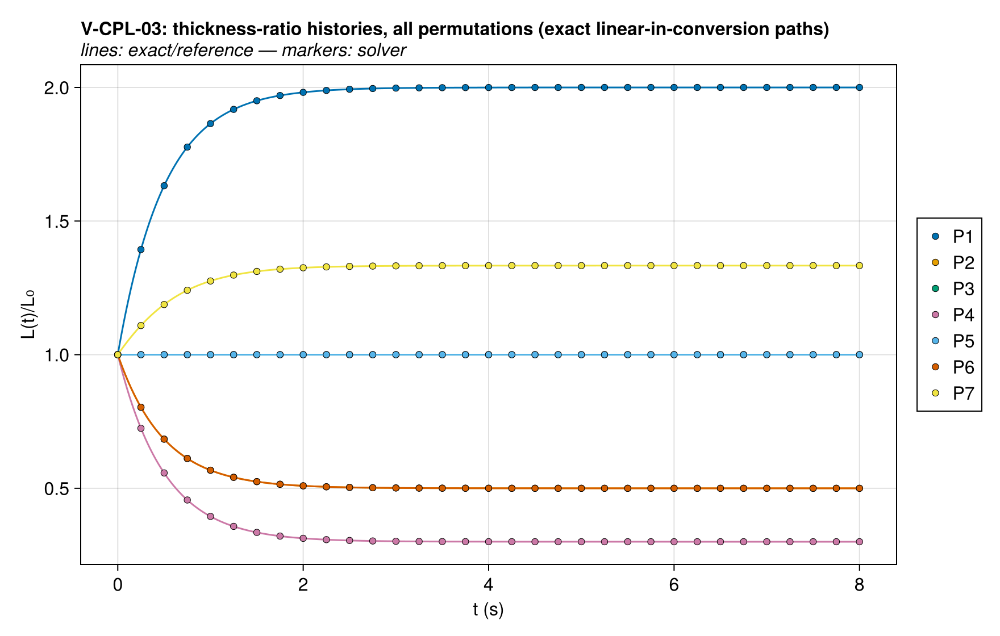
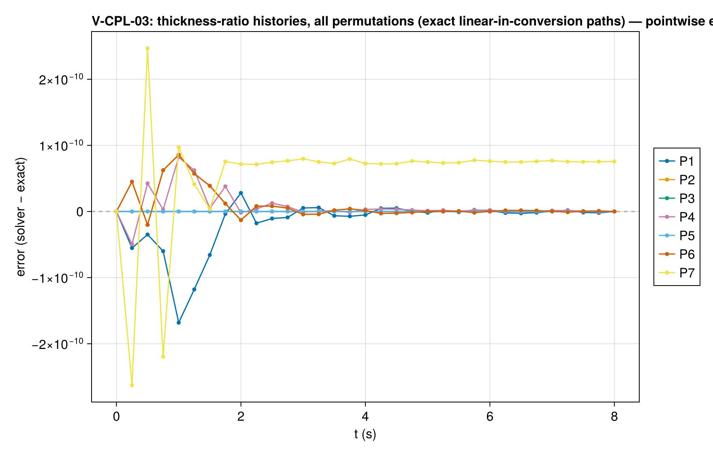
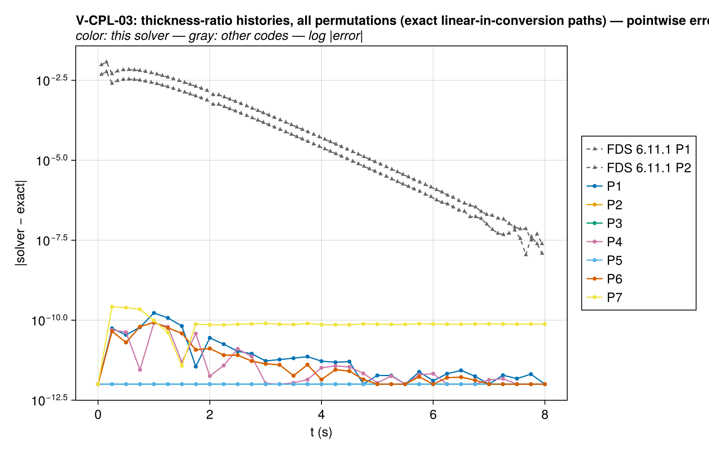
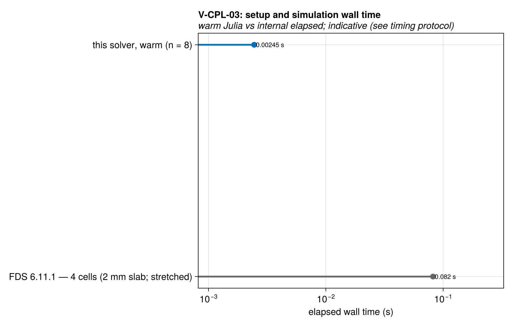

# V-CPL-03 — shrink/swell exact endpoints (6 permutations + lateral law)

**Tags:** `ale`, `volume_change`, `swelling`, `chi`, `mass_conservation`

**References:**

- FDS Verification Guide `shrink_swell` (endpoint concept)
- Technical reference Ch. 10/11 (volumetric strain model)

## Problem statement

FDS verifies exact final thickness/density for ρ_product ≷ ρ_reactant
permutations. Under OUR volumetric-strain model the endpoint follows from
(technical reference Ch. 10/11; src/Physics/volume_change.jl):

  V̇/V = θ = Σⱼ (γⱼ/ρⱼ) ω̇ⱼ

with ω̇ⱼ the reaction mass rates [kg/m³/s]. For a single reaction
A → Σⱼ yⱼ Bⱼ (Σyⱼ = 1) at rate r: ω̇_A = −r, ω̇_Bⱼ = +yⱼ r, so per cell

  dV = (γ_A/ρ_A − Σⱼ yⱼ γⱼ/ρⱼ) dm_A        (r V dt = −dm_A)

— LINEAR in the converted mass, hence path-independent: the endpoint is
exact regardless of rate history, temperature, or spatial distribution.
Integrating from m_A = ξ_A0·V₀ to 0, with the standard initialization
ξ_A0 = ρ_A (bulk density) and γ_A = 1:

  V_f/V₀ = 1 − γ_A + Σⱼ yⱼ γⱼ ρ_A/ρⱼ  =  Σⱼ yⱼ γⱼ ρ_A/ρⱼ

and a pure solid product ends exactly at bulk density ρ_B/γ_B. All ρ here
are the components' BULK densities (the strain kernel uses bulk ρ, not
ρ_intrinsic — see the SolidComponent docstring note).

NOTE a γ > 1 intumescent branch is NOT representable: γ is
validated to [0, 1] (universal volume-fraction semantics shared with
volume-fraction and conductivity mixing). Swelling is exercised through
ρ_B < ρ_A (P1) and the partial-contribution branch through γ_B ∈ (0, 1)
(P6). Documented as a model limitation.

Permutations (ρ_A = 1000, γ_A = 1, isothermal via E = 0, h = 0, everything
impermeable). Mass QoIs: EVERY permutation asserts total-mass conservation
to integrator tolerance — every component's mass is a state that rides the
mesh, so its concentration ξ = m/V follows the cell volume (tech-ref
§11.3.4): the gas held in a collapsing impermeable matrix compresses cell
by cell (ξ_g ↑ as V ↓) and leaves only
through the (closed) faces. P4 is the sealed-column anchor for that
bookkeeping. Gas-producing permutations additionally assert the SOLID
ledger (char endpoint = y_char·m_A0 exactly).

  P1 swell:            A → B(ρ=500)               V_f/V₀ = 2
  P2 shrink:           A → B(ρ=2000)              V_f/V₀ = 1/2
  P3 neutral:          A → B(ρ=1000)              V_f/V₀ = 1
  P4 char + gas:       A → 0.3 C(ρ=1000) + 0.7 G  V_f/V₀ = 0.3
  P5 mass loss, ΔV=0:  A → 0.5 C(ρ=500)  + 0.5 G  V_f/V₀ = 1
  P6 partial γ:        A → B(ρ=1000, γ=0.5)       V_f/V₀ = 1/2
  P7 lateral law:      P5 chemistry + lateral law A/A₀ = 1 − 0.5·χ̄
       χ̄_f = 0.5 (released dry-mass fraction) ⇒ A_f/A₀ = 0.75 exactly,
       L_f/L₀ = (V_f/V₀)/(A_f/A₀) = 4/3.

P1 (the swelling branch, exercising mesh GROWTH) runs through the standard
harness path; the remaining permutations are solved inside `qois` (each is
a ~1 s, 8-cell isothermal solve) so the whole family stays one case.

First-order kinetics with A_r·t_end = 16 ⇒ residual conversion e⁻¹⁶ ≈ 1e-7
bounds the endpoint error; the depletion limiter is disabled so the decay
stays exactly first-order (with it, the tail below ~1 kg/m³ slows and the
residual at fixed t_end grows ~1000×).

### Quantities of interest (n = 8)

| QoI | value | exact | error | tolerance | within tol | provenance |
| --- | --- | --- | --- | --- | --- | --- |
| P1: final thickness ratio | 2 | 2 | 5.627e-08 | 3e-06 | yes | path-independent endpoint of θ = Σγⱼω̇ⱼ/ρⱼ (case header) |
| P1: total mass conservation | 2 | 2 | 4.441e-16 | 2e-06 | yes | solid-only permutation; impermeable everywhere |
| P2: final thickness ratio | 0.5 | 0.5 | 1.125e-07 | 3e-06 | yes | path-independent endpoint of θ = Σγⱼω̇ⱼ/ρⱼ (case header) |
| P2: total mass conservation | 2 | 2 | 8.882e-16 | 2e-06 | yes | solid-only permutation; impermeable everywhere |
| P3: final thickness ratio | 1 | 1 | 0 | 3e-06 | yes | path-independent endpoint of θ = Σγⱼω̇ⱼ/ρⱼ (case header) |
| P3: total mass conservation | 2 | 2 | 3.331e-16 | 2e-06 | yes | solid-only permutation; impermeable everywhere |
| P4: final thickness ratio | 0.3 | 0.3 | 2.626e-07 | 3e-06 | yes | path-independent endpoint of θ = Σγⱼω̇ⱼ/ρⱼ (case header) |
| P4: total mass conservation | 2 | 2 | 4.441e-16 | 2e-06 | yes | held gas compresses with its cell under collapse; the sealed P4 corner anchors the dilation bookkeeping |
| P4: final char mass (solid ledger) | 0.6 | 0.6 | 1.125e-07 | 2e-06 | yes | char endpoint is path-independent; complements the total-mass anchor |
| P5: final thickness ratio | 1 | 1 | 0 | 3e-06 | yes | path-independent endpoint of θ = Σγⱼω̇ⱼ/ρⱼ (case header) |
| P5: total mass conservation | 2 | 2 | 2.22e-16 | 2e-06 | yes | held gas compresses with its cell under collapse; the sealed P4 corner anchors the dilation bookkeeping |
| P5: final char mass (solid ledger) | 1 | 1 | 1.125e-07 | 2e-06 | yes | char endpoint is path-independent; complements the total-mass anchor |
| P6: final thickness ratio | 0.5 | 0.5 | 1.125e-07 | 3e-06 | yes | path-independent endpoint of θ = Σγⱼω̇ⱼ/ρⱼ (case header) |
| P6: total mass conservation | 2 | 2 | 8.882e-16 | 2e-06 | yes | solid-only permutation; impermeable everywhere |
| P7: final thickness ratio | 1.333 | 1.333 | 3.746e-08 | 3e-06 | yes | path-independent endpoint of θ = Σγⱼω̇ⱼ/ρⱼ (case header) |
| P7: total mass conservation | 2 | 2 | 2.442e-15 | 2e-06 | yes | held gas compresses with its cell under collapse; the sealed P4 corner anchors the dilation bookkeeping |
| P7: final char mass (solid ledger) | 1 | 1 | 1.125e-07 | 2e-06 | yes | char endpoint is path-independent; complements the total-mass anchor |
| P7: final lateral area ratio A_f/A₀ = law(χ̄ = 1/2) | 0.75 | 0.75 | 3.751e-08 | 3e-06 | yes | χ̄_f = released dry-mass fraction = y_gas = 0.5 |

### Comparison with other codes

Reference runs are available from FDS 6.11.1 at 4 cells (2 mm slab; stretched). Decks, outputs and
available provenance are under `test/verification/reference/`; check
case-specific parameters and transformations before comparing. Where
error panels are present, they compare against the analytical reference.
A timing entry alone does not establish an identical physical workload.

Setup and simulation wall times at every ladder rung against the
reference runs. Julia times model construction and solve after warm-up;
FDS and Gpyro use internal total elapsed wall time, including setup and
simulation output. Process launch and Julia compilation are excluded
from the figure. Output costs, discretizations and time-stepping rules
still differ, so these are indicative costs, not pure solver speedups.
See `test/verification/reference/README.md` and `timings.csv` for the
timer boundaries, resolutions and measurement provenance.

Reference timings below are medians of five runs after one warm-up. Full process time also includes launch and shutdown; it is shown separately and is not compared with Julia's warmed time.

| Code | Resolution | Internal elapsed (s) | Full process (s) |
| --- | --- | --- | --- |
| FDS 6.11.1 | 4 cells (2 mm slab; stretched) | 0.082 | 0.3402 |

Solution overlays including the other codes' points: [thickness_histories_vs_codes](assets/V-CPL-03/V-CPL-03_thickness_histories_vs_codes.png).

### Solver configuration

| setting | value |
| --- | --- |
| integrator | Rodas5P (default) |
| use_ale | true |
| min_thickness | 1.0e-5 |
| abstol | 1.0e-10 |
| reltol | 1.0e-8 |
