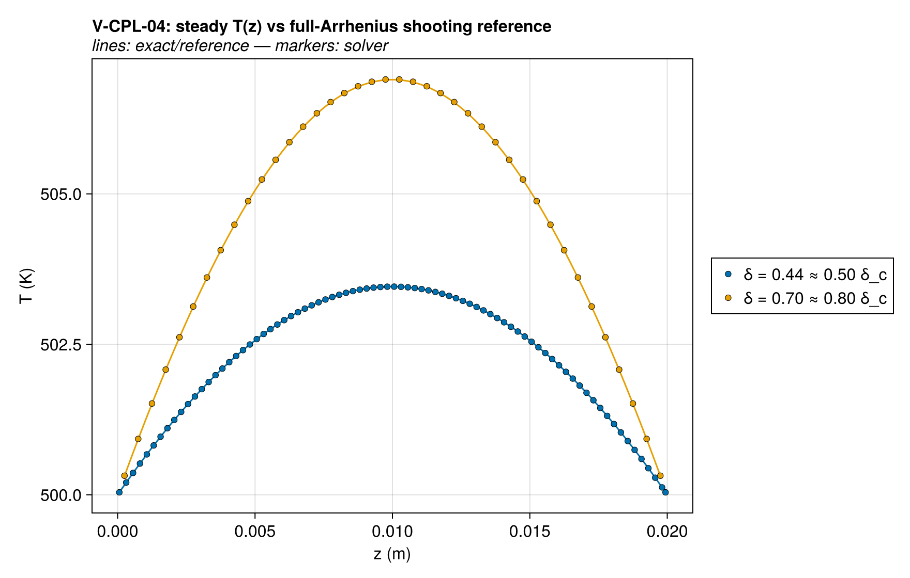
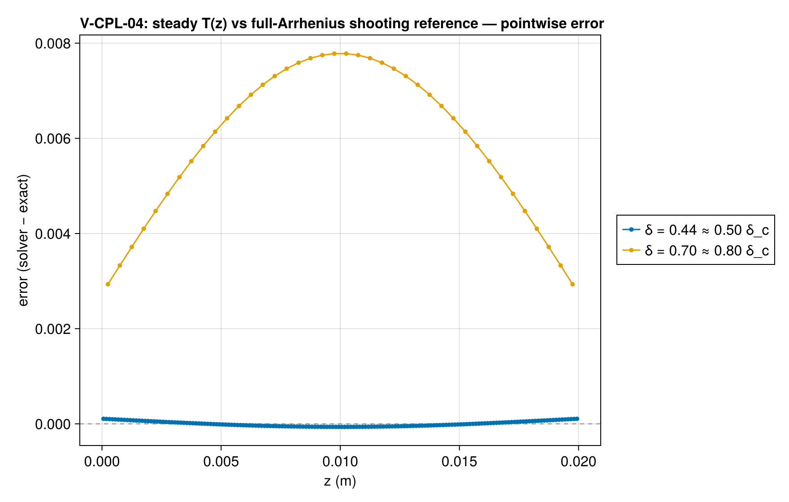
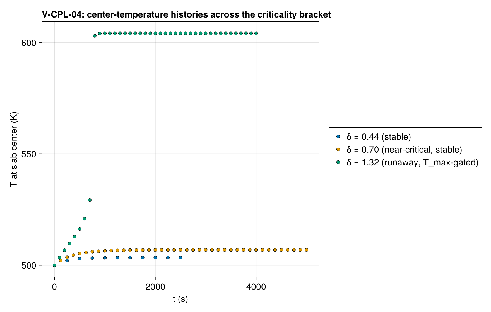
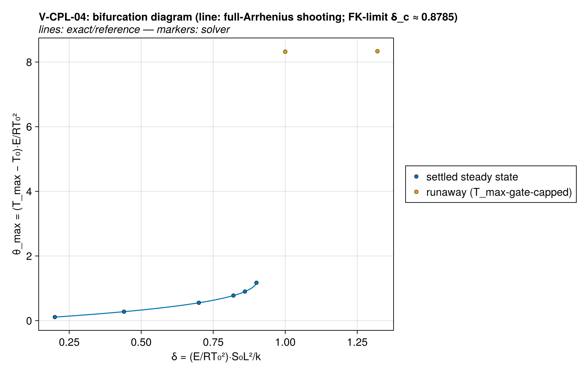
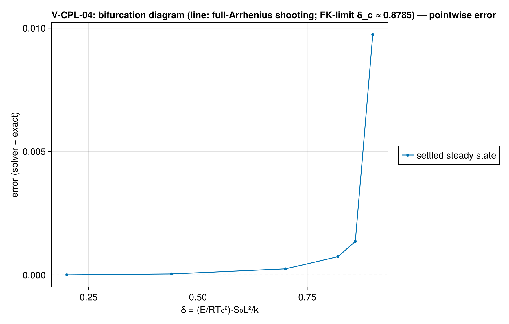
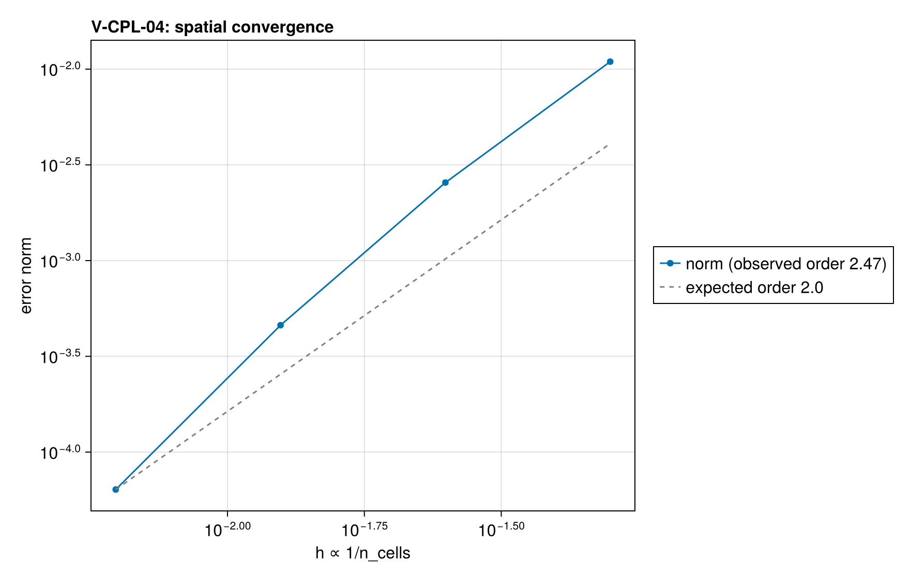

# V-CPL-04 — Frank-Kamenetskii slab: subcritical steady state + criticality bracket

**Tags:** `reaction_conduction`, `bifurcation`, `exothermic`, `coupled_jacobian`

**References:**

- D.A. Frank-Kamenetskii, Diffusion and Heat Exchange in Chemical Kinetics
- Verification Suite Plan 2026-07-06, V-CPL-04

## Problem statement

Zero-order exothermic Arrhenius source in a slab with Dirichlet walls
(Frank-Kamenetskii). The only case where reaction heat release feeds back
on the temperature field with a sharply known stability boundary
δ_c = 0.878 (slab), δ = (E/RT₀²)·S₀L²/k, L = half-width,
S₀ = |h|·A·e^(−E/RT₀).

Realization: the volumetric heat source is a SELF-REGENERATING reaction
A → A (order n = 0, h < 0) — product index = reactant index nets ξ̇ ≡ 0
exactly (verified: drift 0.0) while depositing |h|·A·e^(−E/RT) per unit
volume, i.e. a pure zero-order Arrhenius source with no reactant-depletion
clock. The depletion limiter's tanh(ξ/1) factor is exactly 1.0 at
ξ = 1000 kg/m³, and the default gates (T_min = 0) are exactly open, so the
kinetics are pure Arrhenius. A T_max gate at T₀ + 100 K caps the
SUPERCRITICAL branch so the runaway saturates instead of chasing e^θ to
integrator death; the subcritical branch (rise ≤ 15 K) never feels it.

References (exact/frank_kamenetskii.jl, self-tested): the FK closed-form
profile at E/RT₀ → ∞, AND a full-Arrhenius RK4-shooting steady solution at
the case's finite E/RT₀ = 40 — the primary comparison, since the FK-limit
truncation error (~2–5% at E/RT₀ = 40) is physics, not discretization.

Assert-mode protocol:
  main solve  δ = 0.44 ≈ 0.50·δ_c → steady; center/interior T vs shooting
  bracket     δ = 0.70 ≈ 0.80·δ_c → must stay bounded (near-critical, stable)
              δ = 1.32 ≈ 1.50·δ_c → must run away past the detection rise
The δ_c bisection itself (turning-point hunt) is report-mode work.

### Quantities of interest (n = 160)

| QoI | value | exact | error | tolerance | within tol | provenance |
| --- | --- | --- | --- | --- | --- | --- |
| steady center temperature vs full-Arrhenius shooting | 503.5 | 503.5 | 1.843e-05 | 0.0025 | yes | δ = 0.44 ≈ 0.5 δ_c, E/RT₀ = 40, relative to the rise |
| steady center rise vs FK closed form (limit check) | 0.2767 | 0.2772 | 0.001877 | 0.006 | yes | quantifies the FK-limit error at finite E/RT₀ |
| steady profile L∞ vs shooting (relative to center rise) | 3.059e-05 | — | 3.059e-05 | 0.0025 | yes | includes the symmetry check |
| steady-state reached (last-output drift) | 0.0003826 | 0 | 0.0003826 | 0.001 | yes | t_end = 5 diffusion times |
| near-critical δ = 0.80 δ_c stays on the stable branch | 0.552 | 0.5575 | 0.009852 | 0.03 | yes | bounded, near the FK lower branch (θ ≈ 0.558) |
| supercritical δ = 1.50 δ_c ignites (thermal runaway) | 104.2 | — | 0 | 0.5 | yes | max rise 104.2 K must exceed 50 K (θ_c ≈ 1.19 ⇒ 14.9 K is the largest stable rise) |

### Convergence

| n_cells | h | wall (s) | norm |
| --- | --- | --- | --- |
| 20 | 0.05 | 0.00431 | 0.01094 |
| 40 | 0.025 | 0.01028 | 0.002556 |
| 80 | 0.0125 | 0.0141 | 0.0004599 |
| 160 | 0.00625 | 0.02536 | 6.376e-05 |

Observed order 2.474 (norm), expected 2.0.

### Solver configuration

| setting | value |
| --- | --- |
| integrator | KenCarp4 (default) |
| abstol | 1.0e-10 |
| reltol | 1.0e-8 |

