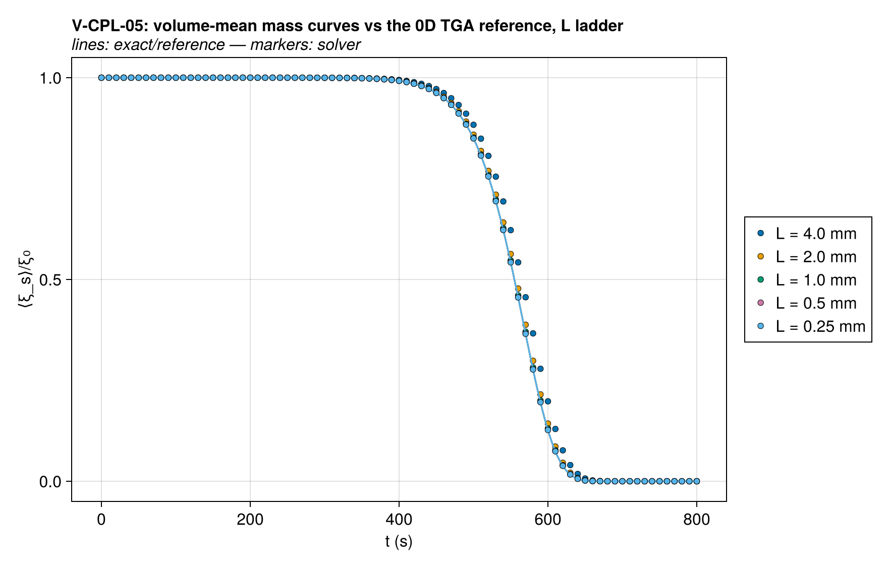
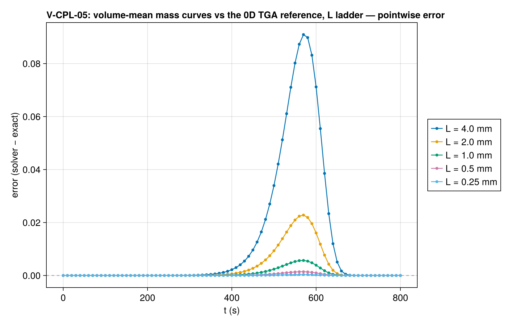
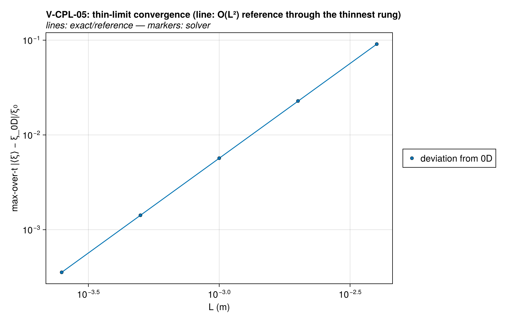
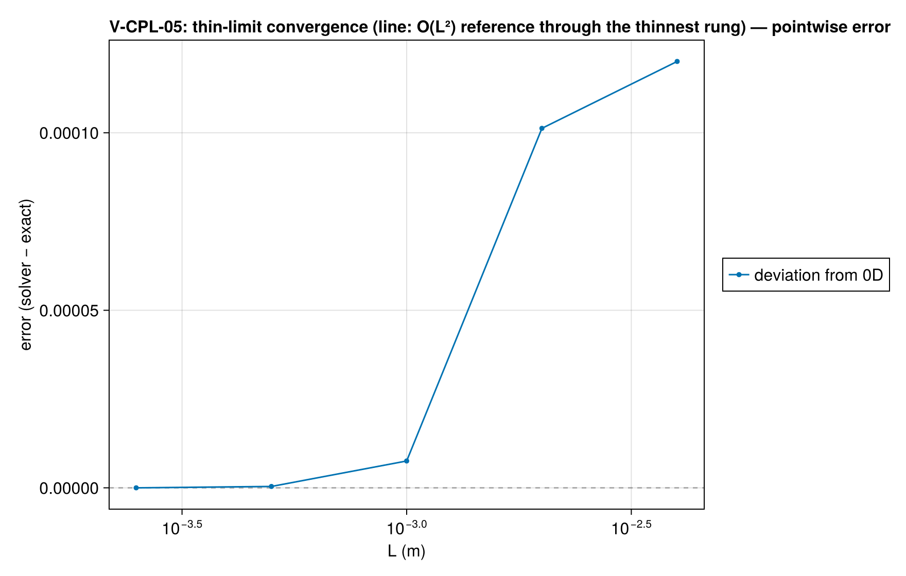
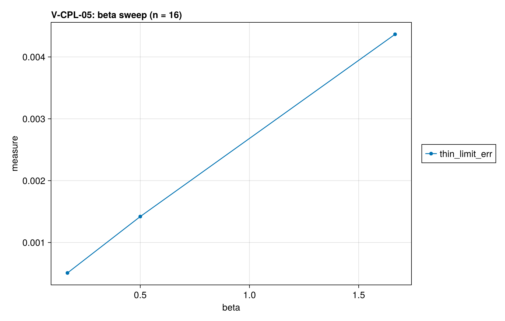

# V-CPL-05 — TGA-to-gasification consistency ladder (1D → 0D thin limit)

**Tags:** `kinetics`, `consistency_ladder`, `thin_limit`, `bc_coupling`

**References:**

- MaCFP condensed-phase guidelines (2020) — TGA target simulations

## Problem statement

MaCFP-style internal-consistency chain: the same first-order kinetics run
(a) 0D isothermal — covered exactly by the V-RX cases;
(b) 0D constant heating rate — exact reference ξ(t) = ξ₀e^(−(A/β)I(T)) with
    the temperature integral I computed to high precision (exact/tga.jl,
    self-tested against the asymptotic expansion);
(c) 1D slabs driven by a Dirichlet ramp T = T₀ + βt on BOTH faces, with a
    thickness ladder L → 0: the volume-mean solid mass must converge to the
    0D TGA curve at second order in L (the interior lags the faces by the
    quasi-steady parabola ΔT ≈ β(L/2)²/2α ∝ L², which maps onto the mass
    curve through dξ/dT). Catches BC/volume-coupling contamination of the
    kinetics that no pure 0D test can.

The depletion limiter is disabled: its tanh roll-off below ~1 kg/m³ holds a
residual tail of order 0.1% of ξ₀ — the size of the thinnest rung's entire
error — which would corrupt both the error metric and the observed order.
h = 0 keeps the ramp exact (no reaction self-heating), everything is
impermeable and Eulerian (held gas, no volume change), so temperature is
the ONLY coupling between the 1D solve and the kinetics.

### Quantities of interest (n = 16)

| QoI | value | exact | error | tolerance | within tol | provenance |
| --- | --- | --- | --- | --- | --- | --- |
| thin-limit deviation from 0D TGA (L = 0.5 mm) | 0.00142 | — | 0.00142 | 0.003 | yes | max-over-t of \|⟨ξ⟩ − ξ_0D\|/ξ₀; lag ΔT ≈ β(L/2)²/2α ≈ 0.12 K |
| L-convergence rate, rung 1 → 2 | 2.004 | 2 | 0.004498 | 0.1 | yes | errors [0.0228, 0.00568, 0.00142] at L = [0.002, 0.001, 0.0005] |
| L-convergence rate, rung 2 → 3 | 2.002 | 2 | 0.001528 | 0.1 | yes | errors [0.0228, 0.00568, 0.00142] at L = [0.002, 0.001, 0.0005] |
| complete conversion at t_end (coarsest rung) | -3.945e-11 | 0 | 3.945e-11 | 1e-06 | yes | exact residual e^(−(A/β)I(700 K)) ≈ e⁻¹¹⁴ |

### Solver configuration

| setting | value |
| --- | --- |
| integrator | Rodas5P (default) |
| abstol | 1.0e-10 |
| reltol | 1.0e-8 |

