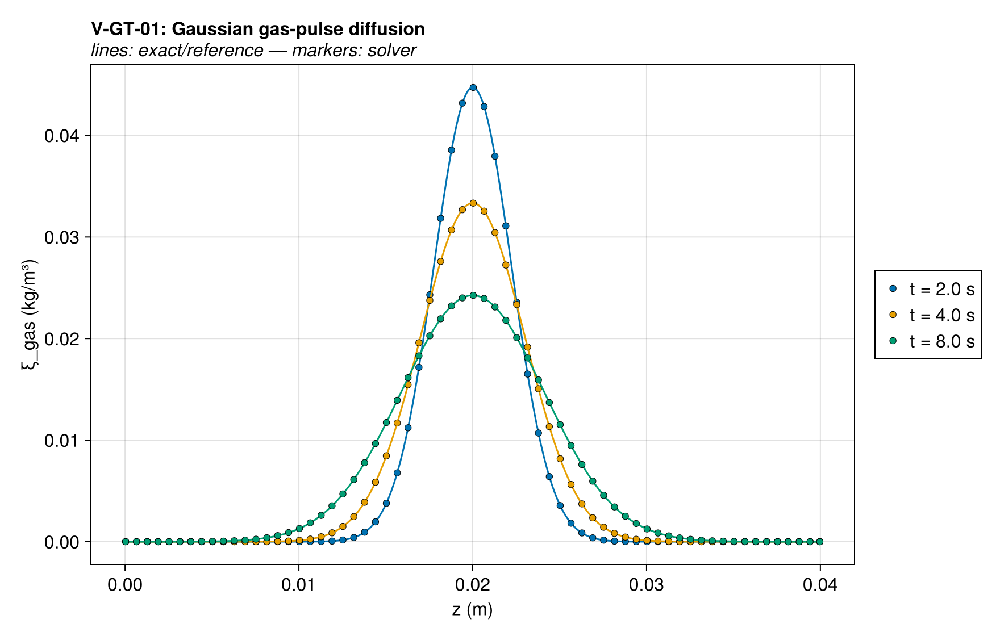
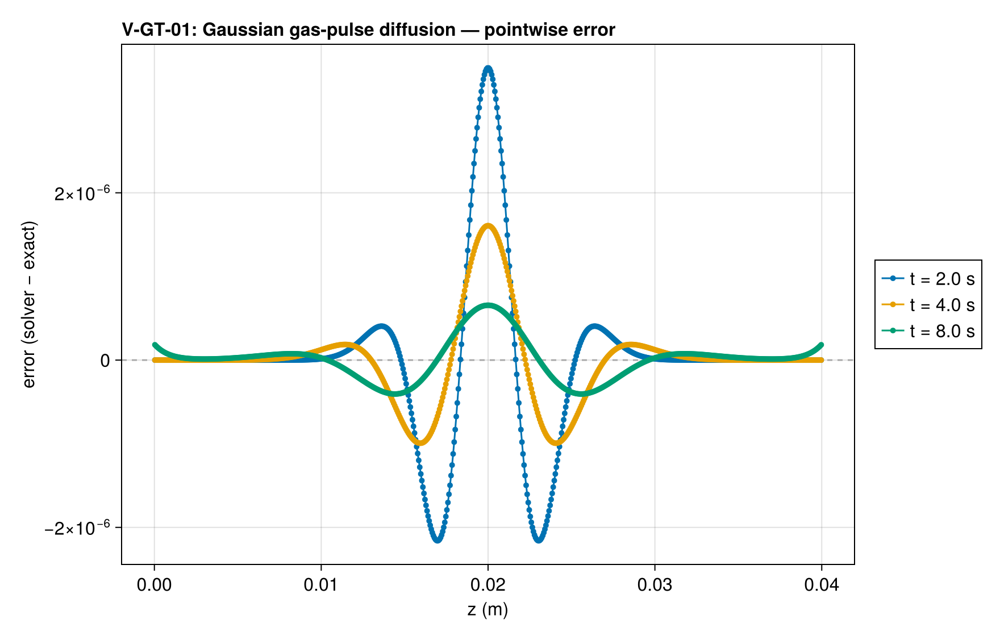
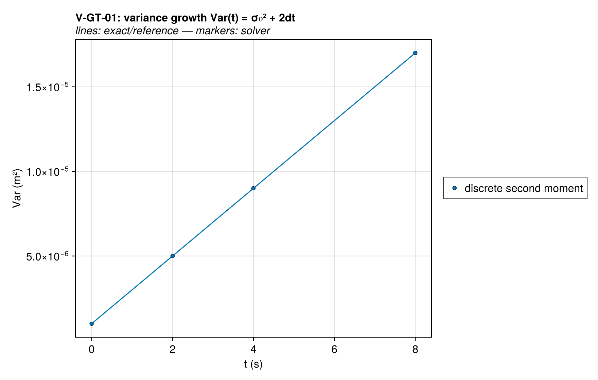
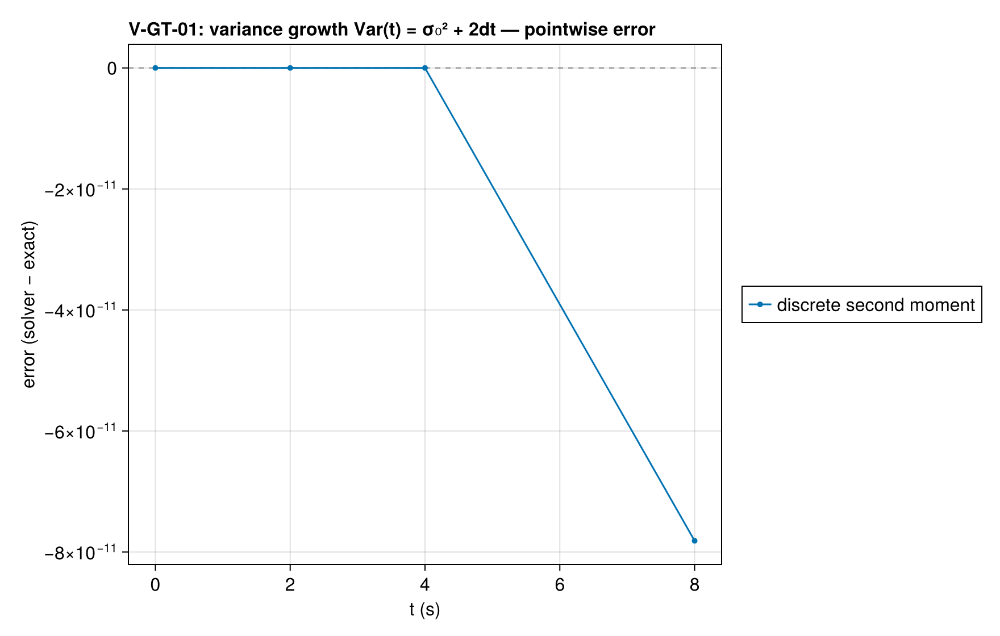
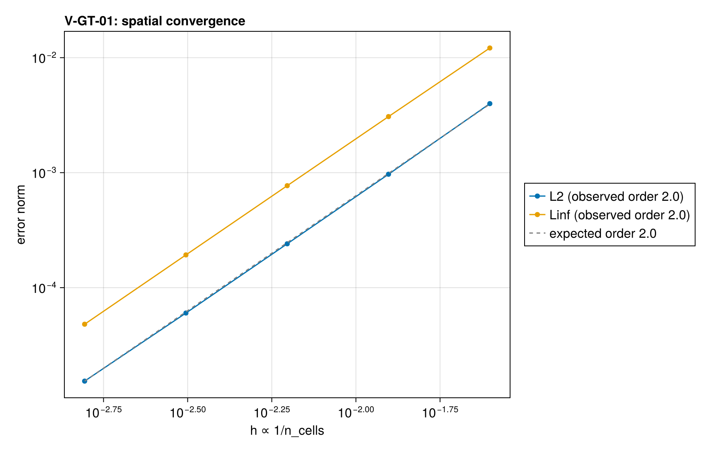

# V-GT-01 — Gaussian gas-pulse diffusion (plane source)

**Tags:** `gas_transport`, `fickian`, `mass_conservation`

**References:**

- J. Crank, The Mathematics of Diffusion (plane-source solution)
- Stoliarov & Lyon, FSS 9:1141 (2008), gas-transport verification

## Problem statement

Pure Fickian transport of gas released inside the solid (Crank/ThermaKin
plane source). Instead of approximating a delta function, the initial
condition is a finite-width Gaussian — itself an exact solution — so the
comparison is IC-discretization-free:

  ξ(z,t) = M_tot/√(2πσ²(t)) · exp(−(z−z₀)²/(2σ²(t))),  σ²(t) = σ₀² + 2dt

Setup notes:
- All permeabilities are 0 ⇒ `has_darcy_flow` is false ⇒ the gas-transport
  kernel takes the Fickian path, whose face flux
  −(λ/T)·Δ(ξT)/Δz reduces exactly to Fick's law with diffusivity λ at
  uniform T (adiabatic faces + no sources keep T uniform to machine).
- λ = d is set on BOTH components: PARALLEL mixing is volume-fraction
  weighted, so equal per-component λ makes λ_eff ≡ d independent of
  composition (otherwise the pulse would see a composition-dependent d).
- Default ImpermeableBC on both faces: mass is conserved to machine
  precision; the sealed-boundary image-source correction to the infinite-
  domain reference is ≤ e^(−11.7) ≈ 8e-6 of the peak at t_end (domain
  half-width = 4.9σ(t_end)) — below the discretization error.

QoIs: profile L∞ (relative to the evolving peak), total-mass conservation,
and the parameter-free variance growth law Var(t) = σ₀² + 2dt.

### Quantities of interest (n = 640)

| QoI | value | exact | error | tolerance | within tol | provenance |
| --- | --- | --- | --- | --- | --- | --- |
| L∞ ξ-profile error / peak, t=2.0 s | 7.811e-05 | — | 7.811e-05 | 0.004 | yes | Gaussian stays Gaussian; n=160 uniform, σ₀ = 4Δz |
| L∞ ξ-profile error / peak, t=4.0 s | 4.822e-05 | — | 4.822e-05 | 0.004 | yes | Gaussian stays Gaussian; n=160 uniform, σ₀ = 4Δz |
| L∞ ξ-profile error / peak, t=8.0 s | 2.703e-05 | — | 2.703e-05 | 0.004 | yes | Gaussian stays Gaussian; n=160 uniform, σ₀ = 4Δz |
| gas-mass conservation (sealed) | 3.46e-15 | — | 3.46e-15 | 1e-13 | yes | antisymmetric face fluxes telescope exactly |
| variance growth, t=2.0 s | 5e-06 | 5e-06 | 4.235e-15 | 2e-05 | yes | Var(t) = σ₀² + 2dt; relative error reported |
| variance growth, t=4.0 s | 9e-06 | 9e-06 | 1.038e-10 | 2e-05 | yes | Var(t) = σ₀² + 2dt; relative error reported |
| variance growth, t=8.0 s | 1.7e-05 | 1.7e-05 | 4.597e-06 | 2e-05 | yes | Var(t) = σ₀² + 2dt; relative error reported |

### Convergence

| n_cells | h | wall (s) | L2 | Linf |
| --- | --- | --- | --- | --- |
| 40 | 0.025 | 0.00311 | 0.003984 | 0.01214 |
| 80 | 0.0125 | 0.005935 | 0.0009693 | 0.003074 |
| 160 | 0.00625 | 0.01189 | 0.0002407 | 0.0007708 |
| 320 | 0.003125 | 0.02324 | 6.009e-05 | 0.0001929 |
| 640 | 0.001563 | 0.0463 | 1.502e-05 | 4.822e-05 |

Observed order 2.011 (L2), expected 2.0.

### Solver configuration

| setting | value |
| --- | --- |
| integrator | Rodas5P (default) |
| abstol | 1.0e-12 |
| reltol | 1.0e-10 |

