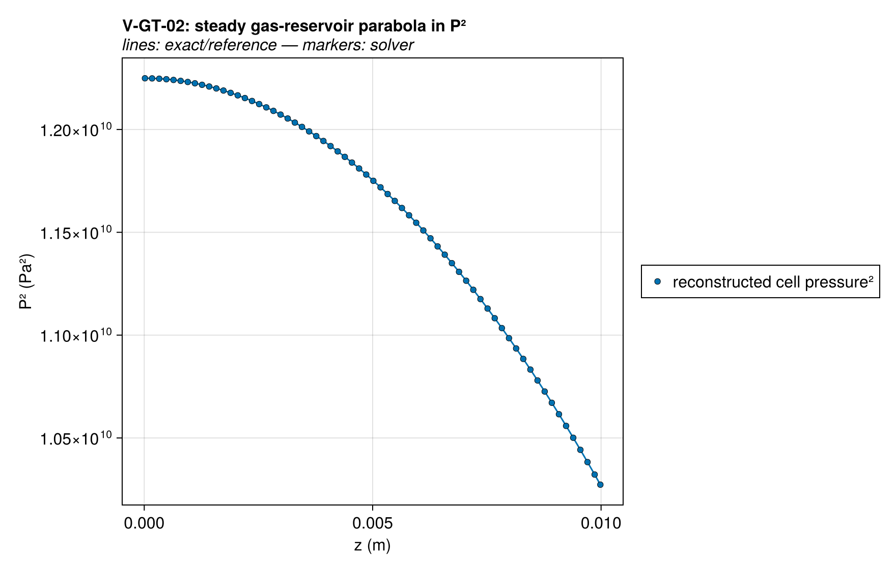
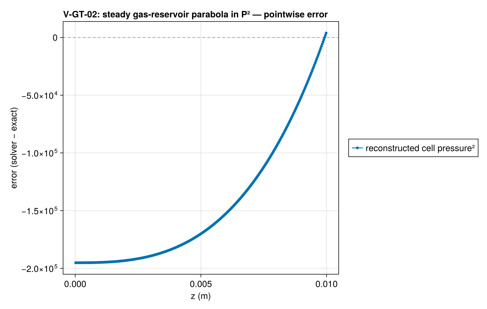
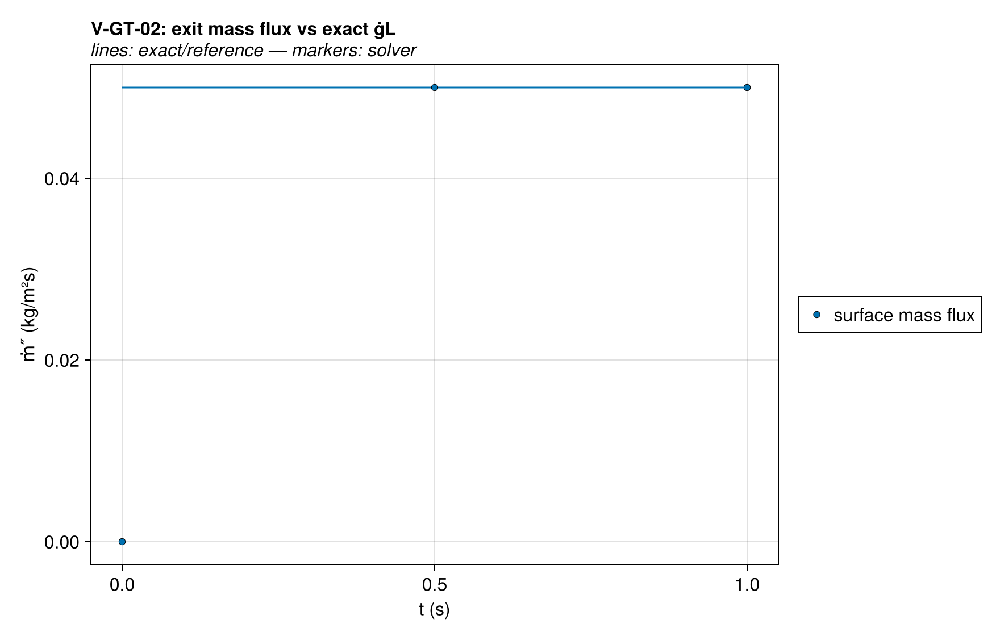
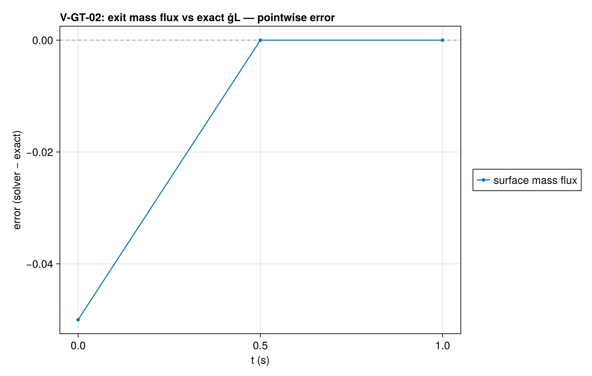
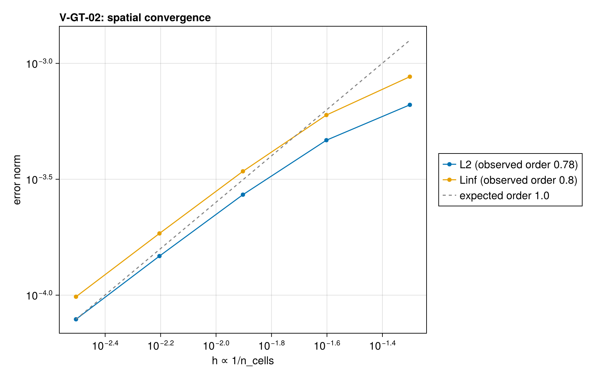

# V-GT-02 — steady compressible Darcy outflow (P² profile)

**Tags:** `gas_transport`, `darcy`, `pressure_closure`, `steady`

**References:**

- gas-reservoir P² solution (Muskat-form compressible Darcy, standard porous-media texts)
- technical reference Ch. 9 (wood-pyrolysis overpressure magnitudes)

## Problem statement

The canonical porous-flow exact solution (gas-reservoir form): isothermal
ideal gas, uniform volumetric generation ġ (zero-order gas-producing
reaction at clamped T), sealed back at z = 0, Dirichlet pressure P∞ at
z = L. The steady mass balance d/dz[(κM/μRT)·P·dP/dz] = −ġ integrates to

  P²(z) = P∞² + (μRT·ġ/(κM))·(L² − z²),    exit mass flux = ġ·L  (exact)

Nonlinear in P; exercises the algebraic ideal-gas pressure closure, face
mobility, Darcy upwinding, and the complete-reservoir outflow — all at
once. The existing Darcy test only checks v = −(κ/μ)∇P pointwise.

The saved pressure accessor uses the central pore-state definition.
- Initial gas is seeded with background_gas_concentration so P(z,0) = P∞
  (starting from ξ_gas = 0 would start from vacuum).
- μ in the exact profile is the MATERIAL's own viscosity curve,
  mat.gas_viscosity(T_iso), not a hand-picked constant — so the
  case stays exact for whatever `gas_viscosity` the material carries, which
  is what lets the ×2-viscosity check in test_darcy.jl exercise that field.
- The condensed matrix has Λ = 0: pure Darcy outflow.
- ρ_intrinsic = 1e5 (φ = 0.99, verification-only value): solid→gas
  conversion frees pore volume at dφ/dt = ġ/ρ_intrinsic, and the gas
  stored in that new volume steals (P̄M/RT)/ρ_intrinsic of the exit flux —
  a mesh-independent bias (~3.6e-4 at ρ_intrinsic = 2000) that would floor
  the convergence study; at 1e5 it is ~7e-6, below discretization error.
  Permeability mixes on the renormalized solid basis, so κ_eff = κ exactly
  regardless of φ.

Timescales: pressure equilibrates in ≪ 0.1 s (gas inventory / production
≈ 0.07 s); compared at t = 1 s ≈ steady, with an explicit steadiness QoI.

### Quantities of interest (n = 320)

| QoI | value | exact | error | tolerance | within tol | provenance |
| --- | --- | --- | --- | --- | --- | --- |
| isothermal invariant | 0 | — | 0 | 1e-08 | yes |  |
| P² profile error / overpressure² scale | 9.845e-05 | — | 9.845e-05 | 0.0025 | yes | steady gas-reservoir parabola in P²; n=80 uniform |
| back-face pressure | 1.107e+05 | 1.107e+05 | 9.663e-05 | 0.0025 | yes | overpressure ≈ 9351.0 Pa (wood-pyrolysis magnitude) |
| exit mass flux vs ġL | 0.05 | 0.05 | 7.248e-06 | 5e-05 | yes | parameter-free exact steady outflow |
| steadiness of exit flux | 4.287e-12 | — | 4.287e-12 | 1e-06 | yes | fill timescale ≈ 0.07 s ≪ t_end = 1 s |

### Convergence

| n_cells | h | wall (s) | L2 | Linf |
| --- | --- | --- | --- | --- |
| 20 | 0.05 | 0.01451 | 0.0006625 | 0.0008762 |
| 40 | 0.025 | 0.02134 | 0.0004662 | 0.0005986 |
| 80 | 0.0125 | 0.04162 | 0.0002714 | 0.0003422 |
| 160 | 0.00625 | 0.08006 | 0.0001474 | 0.0001846 |
| 320 | 0.003125 | 0.1551 | 7.868e-05 | 9.845e-05 |

Observed order 0.7808 (L2), expected 1.0.

### Solver configuration

| setting | value |
| --- | --- |
| integrator | Rodas5P (default) |
| abstol | 1.0e-10 |
| reltol | 1.0e-8 |
