# V-GT-03 — pure-gas integrated transport (lumped + Darcy, forward)

**Tags:** `gas_transport`, `analytical`, `interface`

**References:**

- integrated pressure potential ΛP + κP²/(2μ)

## Problem statement

Pure-gas slab: integrate (Λ + κ P/μ) dP = -n RT dz in each layer.
A quadratic potential gives the profile and a scalar monotone interface
equation fixes the transmitted flux. All reference coefficients are built
from the original material inputs inside 256-bit arithmetic.

## V-GT-03 — pure-gas integrated transport (lumped + Darcy, forward)

### Quantities of interest (n = 160)

| QoI | value | exact | error | tolerance | within tol | provenance |
| --- | --- | --- | --- | --- | --- | --- |
| continuum pressure profile | 0.0001149 | — | 0.0001149 | 0.01 | yes |  |
| integrated continuum species flux | 0.01715 | 0.01714 | 0.0008421 | 0.015 | yes |  |
| steady signed boundary balance | 5.551e-17 | — | 3.239e-15 | 1e-07 | yes |  |
| isothermal invariant | 0 | — | 0 | 1e-08 | yes |  |

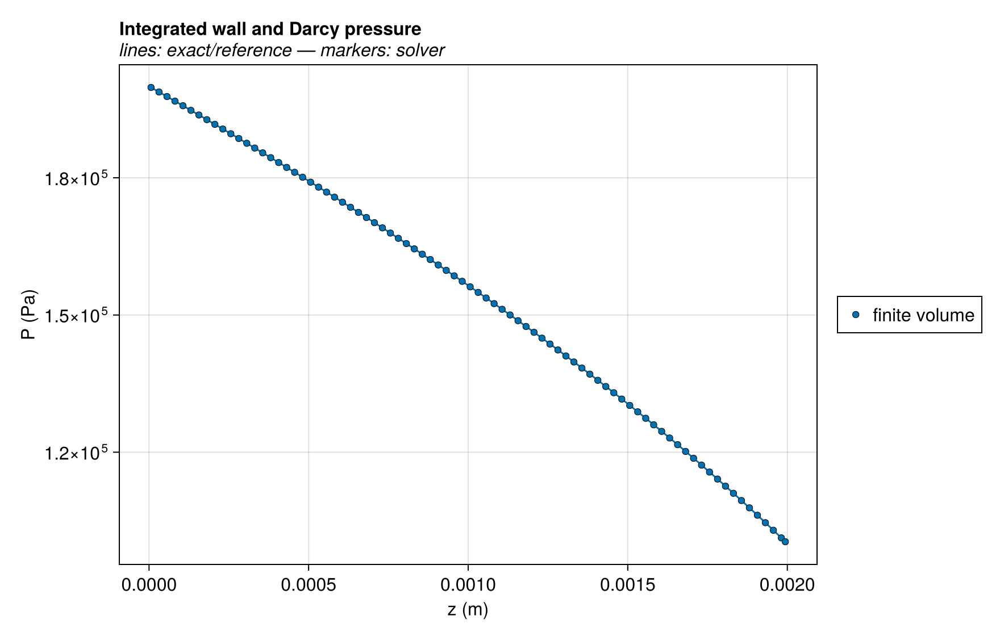

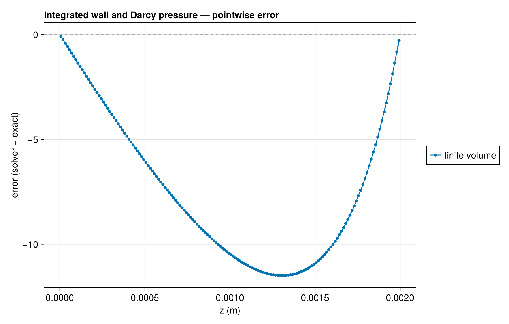

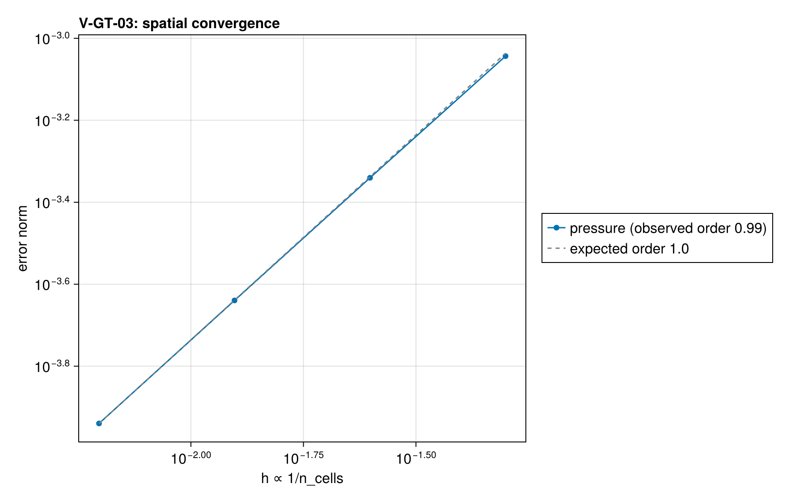

### Convergence

| n_cells | h | wall (s) | pressure |
| --- | --- | --- | --- |
| 20 | 0.05 | 0.01278 | 0.0009047 |
| 40 | 0.025 | 0.02161 | 0.0004567 |
| 80 | 0.0125 | 0.03917 | 0.0002293 |
| 160 | 0.00625 | 0.07534 | 0.0001149 |

Observed order 0.9926 (pressure), expected 1.0.

### Solver configuration

| setting | value |
| --- | --- |
| integrator | Rodas5P (default) |
| reltol | 1.0e-10 |
| abstol | 1.0e-12 |
| pressure_tolerance | 0.0001 |

## V-GT-03b — pure-gas integrated transport (wall-only / Darcy-only layers, forward)

### Quantities of interest (n = 160)

| QoI | value | exact | error | tolerance | within tol | provenance |
| --- | --- | --- | --- | --- | --- | --- |
| continuum pressure profile | 0.0001285 | — | 0.0001285 | 0.01 | yes |  |
| integrated continuum species flux | 0.005331 | 0.005331 | 0.0001745 | 0.015 | yes |  |
| steady signed boundary balance | 1.405e-16 | — | 2.636e-14 | 1e-07 | yes |  |
| isothermal invariant | 0 | — | 0 | 1e-08 | yes |  |

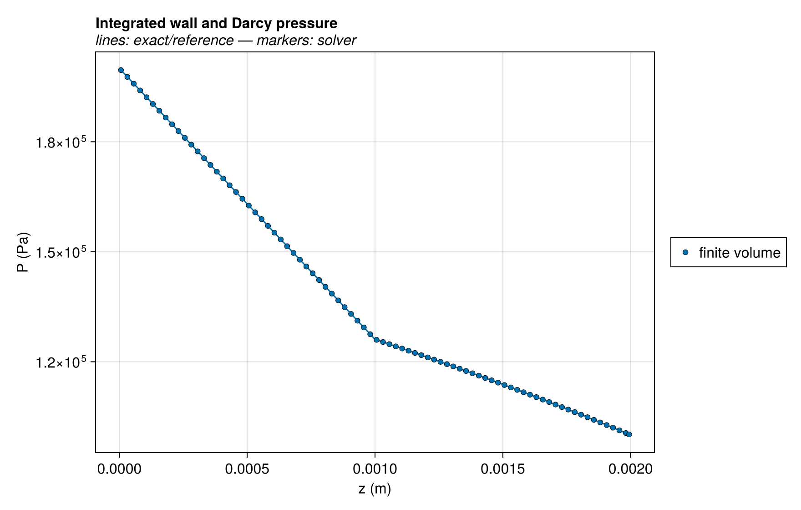

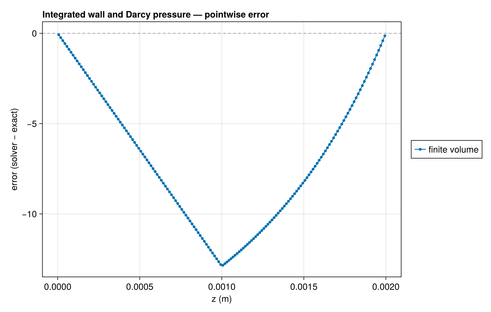

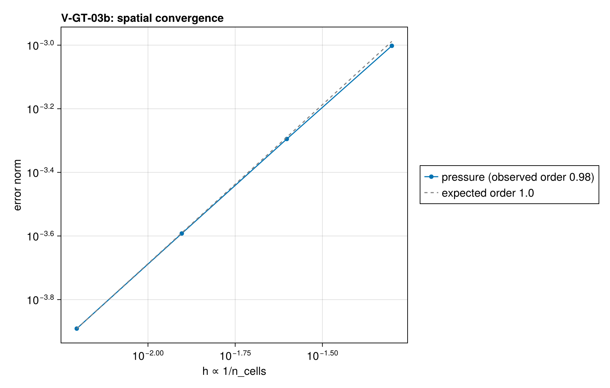

### Convergence

| n_cells | h | wall (s) | pressure |
| --- | --- | --- | --- |
| 20 | 0.05 | 0.01252 | 0.0009952 |
| 40 | 0.025 | 0.02094 | 0.000507 |
| 80 | 0.0125 | 0.04165 | 0.0002558 |
| 160 | 0.00625 | 0.08522 | 0.0001285 |

Observed order 0.9848 (pressure), expected 1.0.

### Solver configuration

| setting | value |
| --- | --- |
| integrator | Rodas5P (default) |
| reltol | 1.0e-10 |
| abstol | 1.0e-12 |
| pressure_tolerance | 0.0001 |

## V-GT-03c — pure-gas integrated transport (Knudsen + viscous, forward)

### Quantities of interest (n = 160)

| QoI | value | exact | error | tolerance | within tol | provenance |
| --- | --- | --- | --- | --- | --- | --- |
| continuum pressure profile | 4.034e-05 | — | 4.034e-05 | 0.01 | yes |  |
| integrated continuum species flux | 0.03269 | 0.03267 | 0.0004493 | 0.015 | yes |  |
| steady signed boundary balance | 1.603e-15 | — | 4.906e-14 | 1e-07 | yes |  |
| isothermal invariant | 0 | — | 0 | 1e-08 | yes |  |

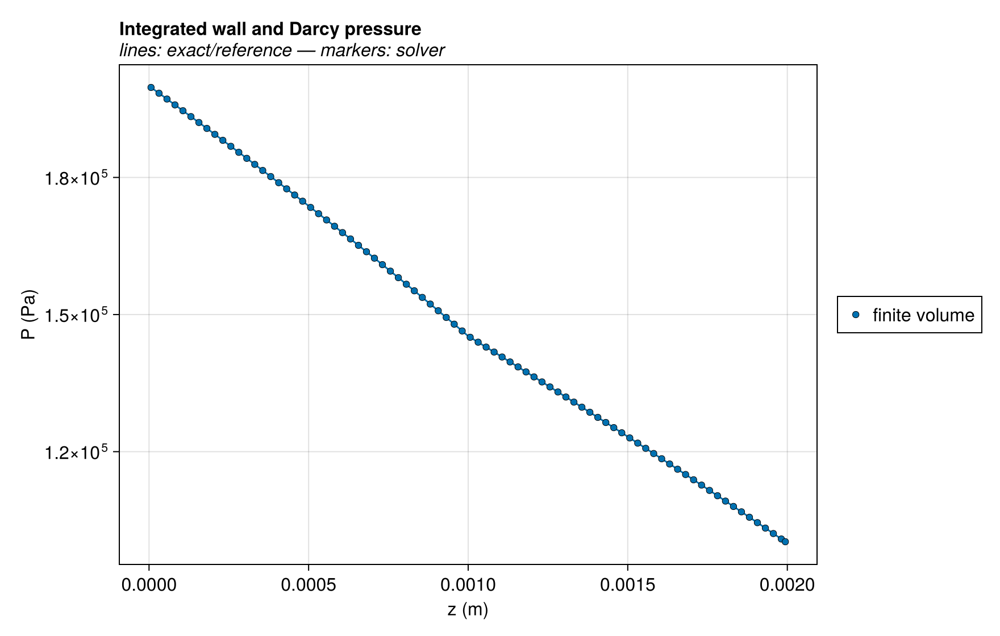

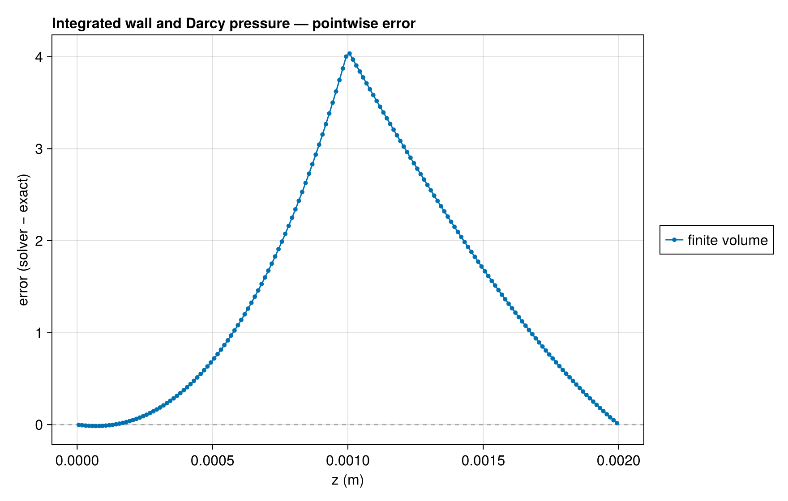

### Convergence

| n_cells | h | wall (s) | pressure |
| --- | --- | --- | --- |
| 20 | 0.05 | 0.01332 | 0.0003027 |
| 40 | 0.025 | 0.1931 | 0.000157 |
| 80 | 0.0125 | 0.04678 | 7.996e-05 |
| 160 | 0.00625 | 0.08943 | 4.034e-05 |

Observed order 0.9695 (pressure), expected 1.0.

### Solver configuration

| setting | value |
| --- | --- |
| integrator | Rodas5P (default) |
| reltol | 1.0e-10 |
| abstol | 1.0e-12 |
| pressure_tolerance | 0.0001 |

## V-GT-03d — pure-gas integrated transport (wall-only / Darcy-only layers, reverse)

### Quantities of interest (n = 160)

| QoI | value | exact | error | tolerance | within tol | provenance |
| --- | --- | --- | --- | --- | --- | --- |
| continuum pressure profile | 4.169e-05 | — | 4.169e-05 | 0.01 | yes |  |
| integrated continuum species flux | -0.005969 | -0.005969 | 5.072e-05 | 0.015 | yes |  |
| steady signed boundary balance | 5.083e-16 | — | 8.516e-14 | 1e-07 | yes |  |
| isothermal invariant | 5.684e-14 | — | 5.684e-14 | 1e-08 | yes |  |

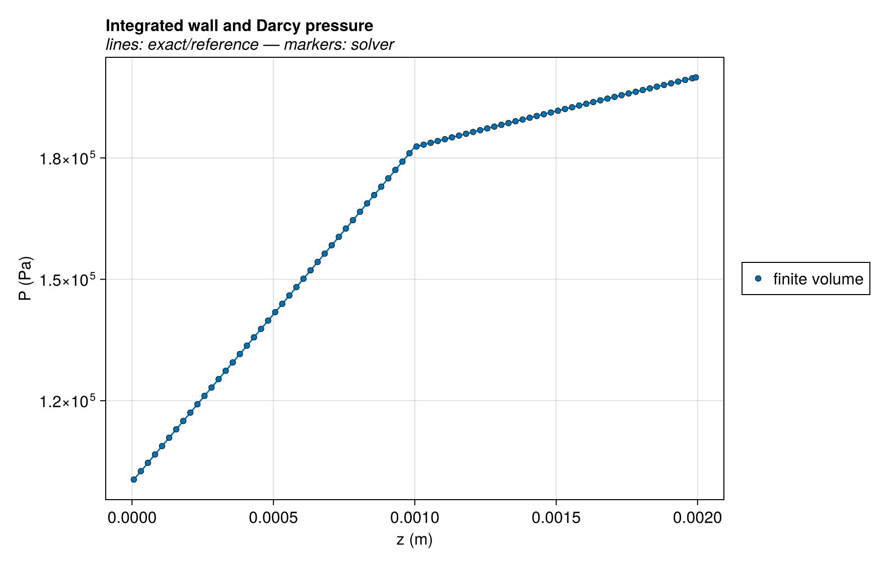

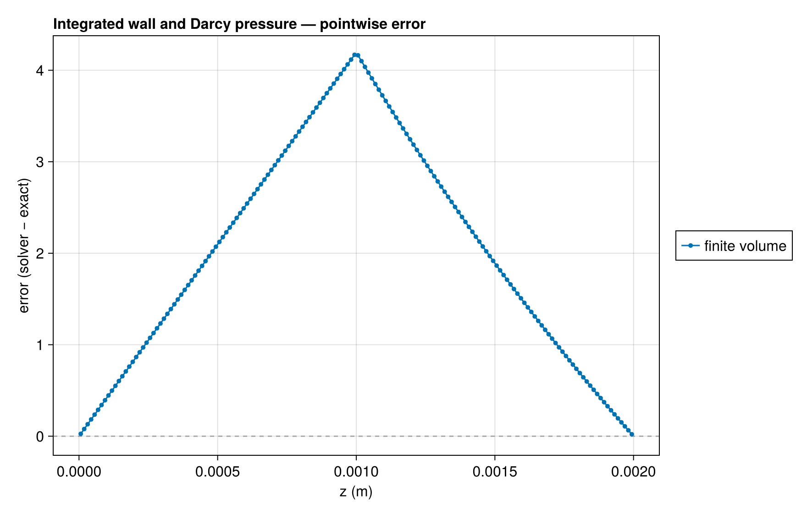

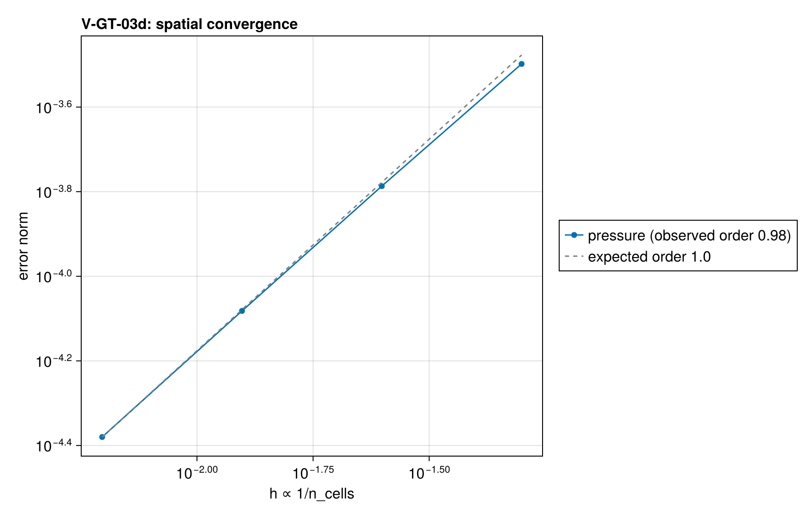

### Convergence

| n_cells | h | wall (s) | pressure |
| --- | --- | --- | --- |
| 20 | 0.05 | 0.01378 | 0.0003177 |
| 40 | 0.025 | 0.02202 | 0.0001634 |
| 80 | 0.0125 | 0.03931 | 8.281e-05 |
| 160 | 0.00625 | 0.0815 | 4.169e-05 |

Observed order 0.977 (pressure), expected 1.0.

### Solver configuration

| setting | value |
| --- | --- |
| integrator | Rodas5P (default) |
| reltol | 1.0e-10 |
| abstol | 1.0e-12 |
| pressure_tolerance | 0.0001 |
