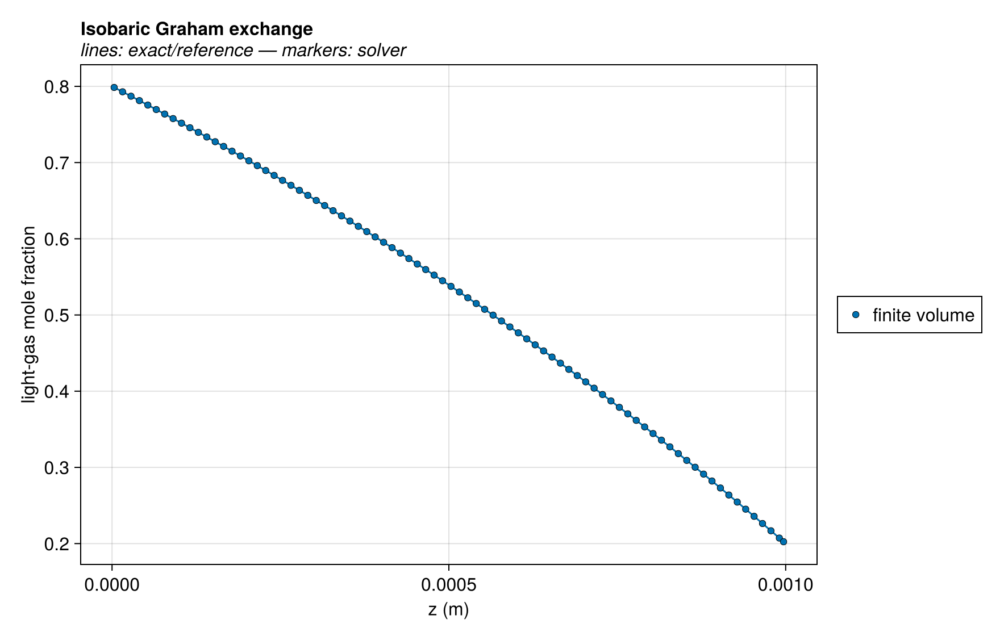
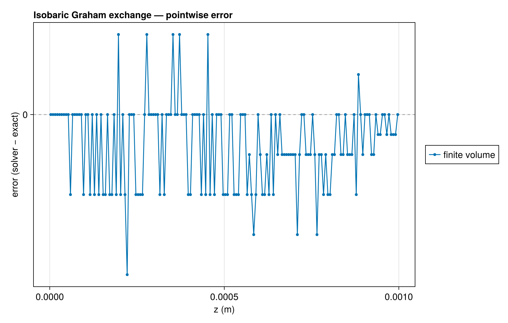
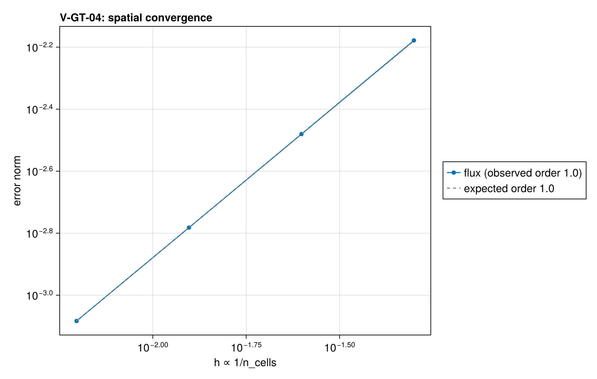

# V-GT-04 — isobaric dusty-gas binary exchange (Graham relation)

**Tags:** `gas_transport`, `dusty_gas`, `analytical`

**References:**

- integrated binary friction equation at constant pressure

## Problem statement

At constant total pressure, summing the two friction equations gives
n₁/K₁+n₂/K₂=0. Substitution into species 1 gives
n₁=-P x₁'/(RT [A-B x₁]), A=1/K₁+tP, B=tP(1-K₂/K₁).
Thus A-Bx(z) is exponential and the flux follows by a logarithmic integral.

### Quantities of interest (n = 160)

| QoI | value | exact | error | tolerance | within tol | provenance |
| --- | --- | --- | --- | --- | --- | --- |
| Graham wall-weighted flux ratio | -0.3162 | -0.3162 | 0 | 1e-07 | yes |  |
| logarithmic binary flux | 0.1923 | 0.1922 | 0.0008259 | 0.015 | yes |  |
| exponential composition profile | 2.22e-16 | — | 2.22e-16 | 0.005 | yes |  |
| isobaric solution | 3.347e-10 | — | 3.347e-10 | 0.01 | yes |  |
| isothermal solution | 0 | — | 0 | 1e-08 | yes |  |

### Convergence

| n_cells | h | wall (s) | flux |
| --- | --- | --- | --- |
| 20 | 0.05 | — | 0.006633 |
| 40 | 0.025 | — | 0.003309 |
| 80 | 0.0125 | — | 0.001653 |
| 160 | 0.00625 | — | 0.0008259 |

Observed order 1.002 (flux), expected 1.0.

### Solver configuration

| setting | value |
| --- | --- |
| integrator | Rodas5P (default) |
| reltol | 1.0e-10 |
| abstol | 1.0e-12 |
| pressure_tolerance | 0.0001 |
