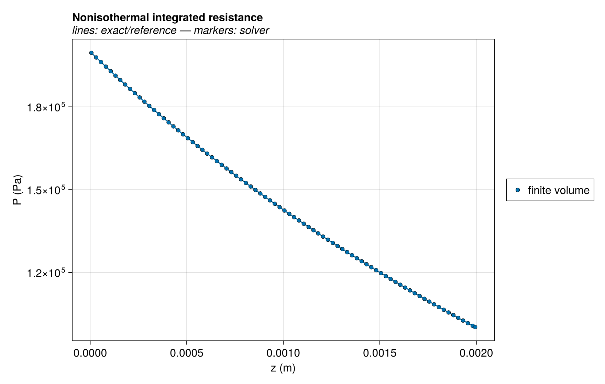
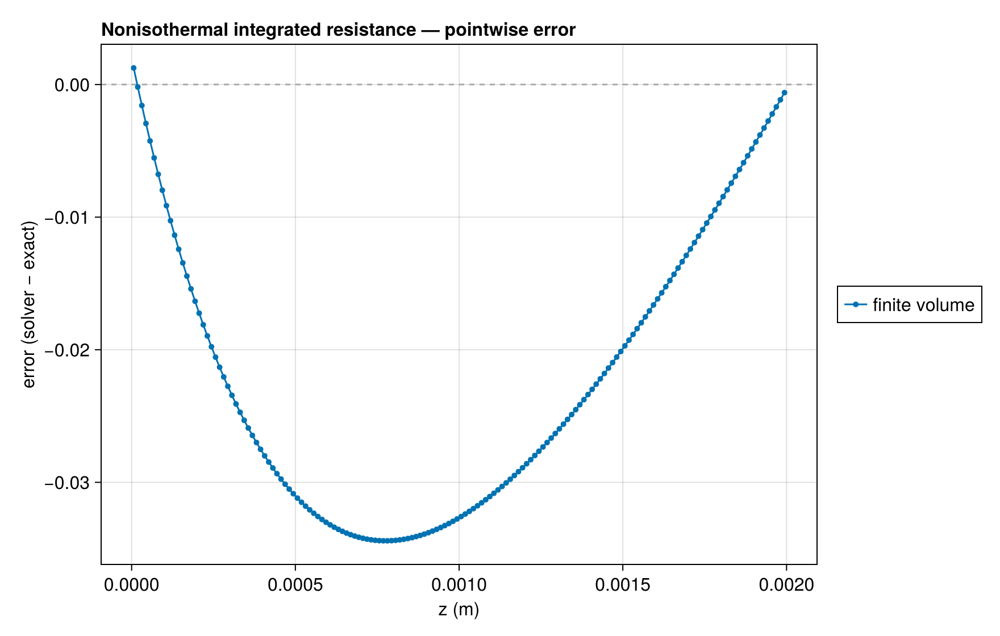
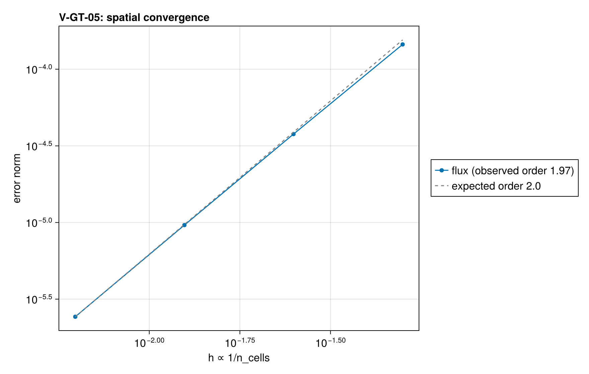

# V-GT-05 — nonisothermal integrated wall resistance

**Tags:** `gas_transport`, `analytical`, `nonisothermal`

**References:**

- direct integral of T/Λ(T) along a linear temperature field

## Problem statement

A continuously varying temperature and wall coefficient give an independent
integrated resistance: n=(PL-PR)/(R ∫T/Λ(T) dz). With Λ=Λ0(T/T0)^2
and linear T, the integral is T0² L log(TR/TL)/(Λ0 (TR-TL)).

### Quantities of interest (n = 160)

| QoI | value | exact | error | tolerance | within tol | provenance |
| --- | --- | --- | --- | --- | --- | --- |
| integrated nonisothermal wall resistance | 2.427e-06 | — | 2.427e-06 | 0.0001 | yes |  |
| logarithmic pressure profile | 3.441e-07 | — | 3.441e-07 | 0.0001 | yes |  |
| linear thermal field | 1.137e-13 | — | 1.137e-13 | 1e-08 | yes |  |

### Convergence

| n_cells | h | wall (s) | flux |
| --- | --- | --- | --- |
| 20 | 0.05 | 0.03859 | 0.0001451 |
| 40 | 0.025 | 0.0722 | 3.773e-05 |
| 80 | 0.0125 | 0.1456 | 9.616e-06 |
| 160 | 0.00625 | 0.3011 | 2.427e-06 |

Observed order 1.968 (flux), expected 2.0.

### Solver configuration

| setting | value |
| --- | --- |
| integrator | Rodas5P (default) |
| reltol | 1.0e-10 |
| abstol | 1.0e-12 |
| pressure_tolerance | 0.0001 |
