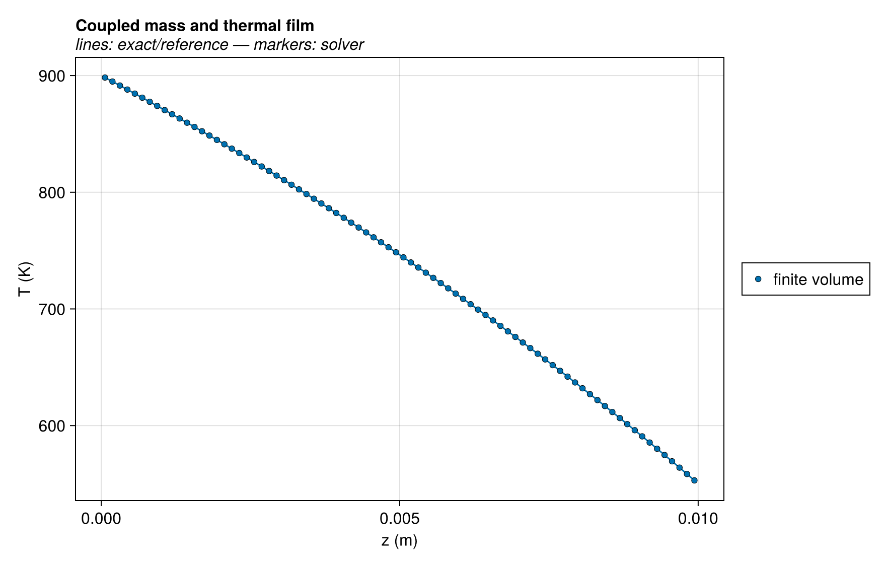
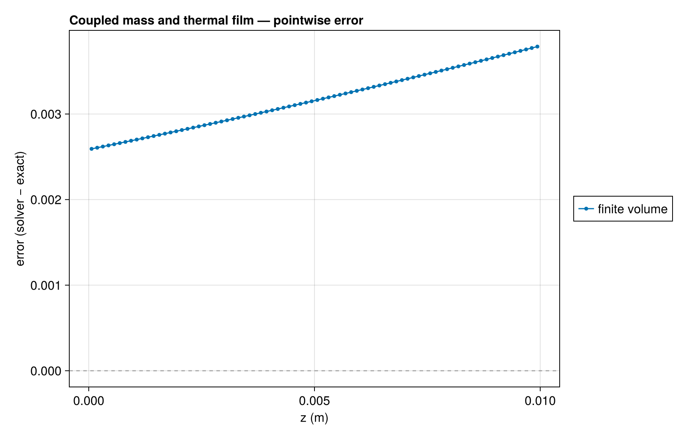
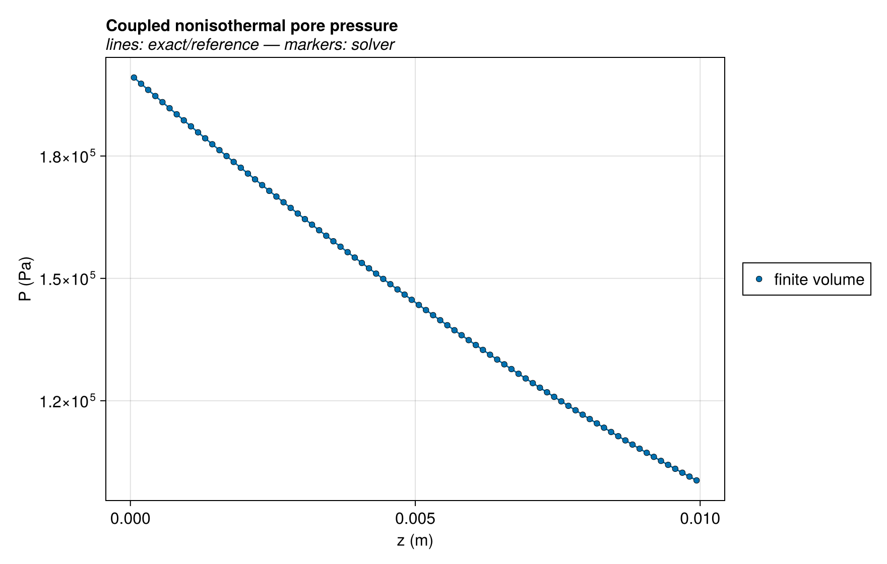
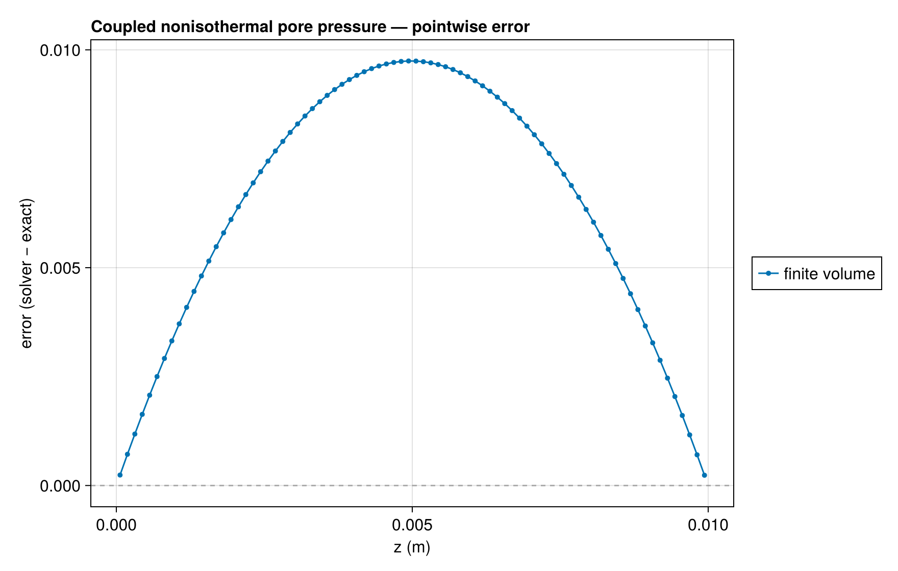
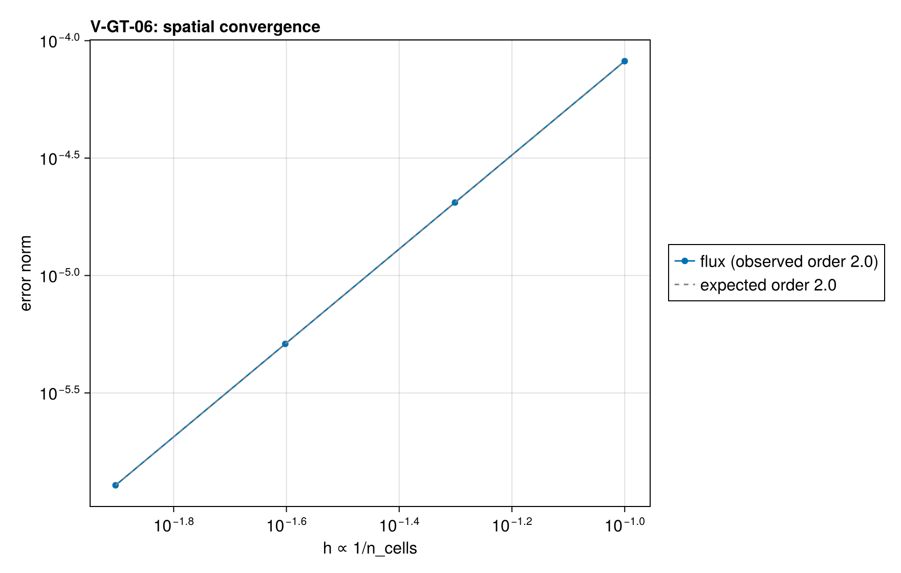

# V-GT-06 — coupled nonisothermal gas and thermal film

**Tags:** `gas_transport`, `analytical`, `nonisothermal`, `film`

**References:**

- integrated steady mass and energy equations with a Couette film

## Problem statement

Coupled steady gas/energy reference, derived directly from the continuum:
N'=0, (N cp T-k T')'=0, p'=-N R T/(M Λ).
At the top, k T'=h β(N cp/h)(Tin-Ts). The resulting exponential T
profile, integrated pore resistance and film equation determine N and Ts.

### Quantities of interest (n = 80)

| QoI | value | exact | error | tolerance | within tol | provenance |
| --- | --- | --- | --- | --- | --- | --- |
| coupled continuum flux | 1.279e-06 | — | 1.279e-06 | 0.001 | yes |  |
| coupled surface temperature | 550.3 | 550.3 | 0.0004165 | 0.2 | yes |  |
| exponential thermal field | 0.003788 | — | 0.003788 | 0.2 | yes |  |
| continuum reservoir heat | -4.42e+04 | -4.42e+04 | 1.502e-06 | 0.001 | yes |  |
| coupled local root residual | 7.071e-17 | — | 7.071e-17 | 1e-09 | yes |  |

### Convergence

| n_cells | h | wall (s) | flux |
| --- | --- | --- | --- |
| 10 | 0.1 | — | 8.181e-05 |
| 20 | 0.05 | — | 2.046e-05 |
| 40 | 0.025 | — | 5.115e-06 |
| 80 | 0.0125 | — | 1.279e-06 |

Observed order 2 (flux), expected 2.0.

### Solver configuration

| setting | value |
| --- | --- |
| integrator | Rodas5P (default) |
| reltol | 1.0e-10 |
| abstol | 1.0e-11 |
| pressure_tolerance | 0.0001 |
