# V-GT-07 — transient binary diffusion through a mass film (h_m = 0.0001)

**Tags:** `gas_transport`, `diffusion`, `mass_film`, `transient`, `analytical`

**References:**

- [Gpyro Verification and Validation Manual v1.0 (2026), §4.4, pp. 30–31, Eqs. (4.7)–(4.11)](https://github.com/Gedeben/GPYRO-V2/blob/bff0126c68f2a35c084ef04490ae327185f281a3/documentation/gpyro_verification_manual.pdf#page=32)

## Problem statement

Adapted from Gpyro Verification and Validation Manual v1.0 (2026), §4.4,
pp. 30–31, Eqs. (4.7)–(4.11): a 1 m porous slab initially containing
carrier gas, exposed at its top to a reservoir with tracer fraction 0.22;
the bottom is sealed. T = 300 K, P = 1 bar, φ = 0.6, D = 2e-5 m²/s.
Members a/b use h_m = 1e-4 / 1e-2 kg/(m² s), respectively.

Like the upstream input decks, both tracer gases have M = 0.032 kg/mol;
equal molecular masses, heat capacities and wall coefficients preserve
constant total pressure, density and temperature during counterdiffusion.
LumpedTransfer with Λ = φD and κ = 0 realizes the constant-D equation;
Chapman–Enskog diffusivity is replaced by the guide's specified constant.
The zero-total-flow MassTransferFilm law reduces exactly to the Robin BC.

At depth x = L-z, Y = Y∞ Φ(x,t), where Φ is the semi-infinite convective
erfc solution with h/k = b = h_m/(φρ_gD). We stop at 400 s so the back
face is over five diffusion lengths away; the reference tail is checked.
Surface uptake is h_m Y∞ erfcx(b√(Dt)); its time integral independently
predicts the stored tracer mass. All references use original inputs.

Cell-center and cell-average profile errors are reported separately. The
latter compares each finite-volume inventory with the analytical integral
over its actual cell. Gpyro's boundary-node values retain point references.
Resolution figures use the maximum over 50, 150 and 400 s; the existing
spatial-order check uses the profile at 400 s.

## V-GT-07a — transient binary diffusion through a mass film (h_m = 0.0001)

### Quantities of interest (n = 160)

| QoI | value | exact | error | tolerance | within tol | provenance |
| --- | --- | --- | --- | --- | --- | --- |
| transient tracer profile / reservoir fraction | 0.0001283 | — | 0.0001283 | 0.0004 | yes | n=160: observed 1.28e-4 / 1.28e-3 for h_m=1e-4 / 1e-2; ~3× margin |
| transient tracer cell average / reservoir fraction | 0.0002639 | — | 0.0002639 | 0.0004 | yes | analytical integral over each cell; same tolerance as the center-value metric |
| surface uptake vs analytical flux | 0.0003341 | — | 0.0003341 | 0.0011 | yes | h_m Y∞ erfcx(b√(Dt)); observed 3.34e-4 / 2.45e-3; ~3× margin |
| stored tracer vs integrated analytical influx | 0.0009245 | — | 0.0009245 | 0.003 | yes | integrated exact influx; observed 9.25e-4 / 2.55e-3; ~3× margin |
| total gas inventory conservation | 5.551e-16 | — | 5.551e-16 | 1e-10 | yes | equal-mass binary counterdiffusion has zero net mass influx |
| zero net boundary mass flux | 2.868e-18 | — | 1.304e-13 | 3e-08 | yes | two species counterdiffuse; flux scale h_m Y∞; enthalpy form observed 1.1e-8 at these tolerances, falling with them to 8.7e-12 at 1e-3 of them |
| sealed back face | 0 | — | 0 | 1e-14 | yes |  |
| isobaric invariant | 0.0001286 | — | 1.286e-09 | 4e-09 | yes | observed relative drift ≤1.05e-9 (0.000105 Pa); pressure tolerance 0.001 Pa |
| isothermal invariant | 0 | — | 0 | 1e-08 | yes |  |
| semi-infinite reference tail at back | 2.444e-16 | — | 2.444e-16 | 1e-12 | yes | bounds the neglected far-boundary penetration |

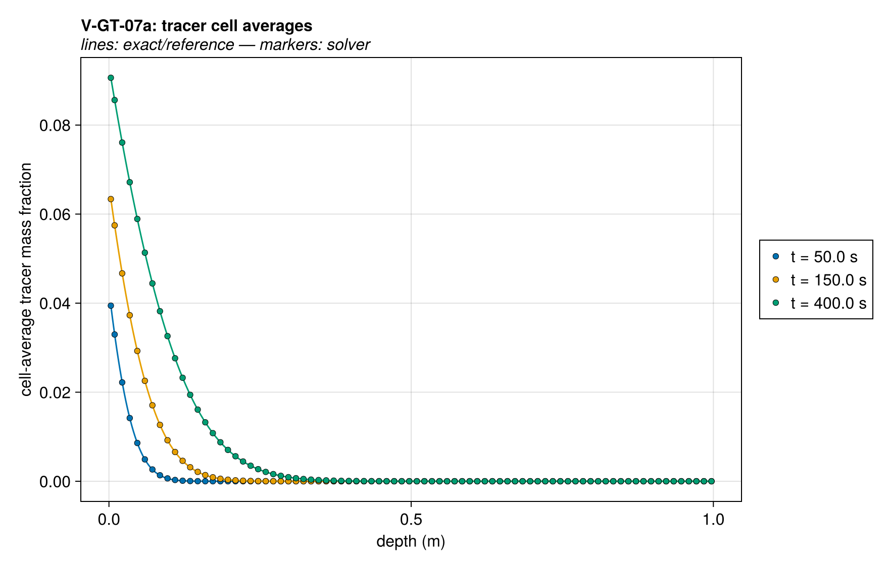

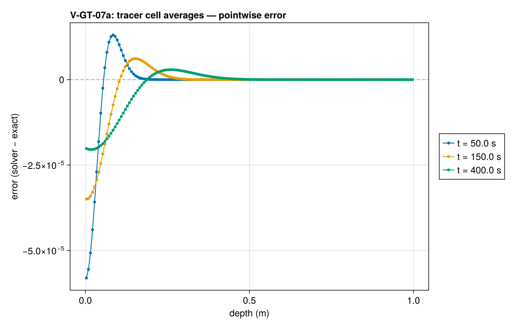

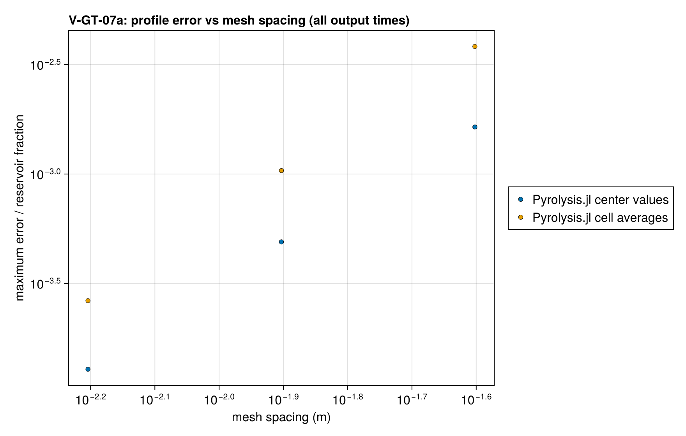

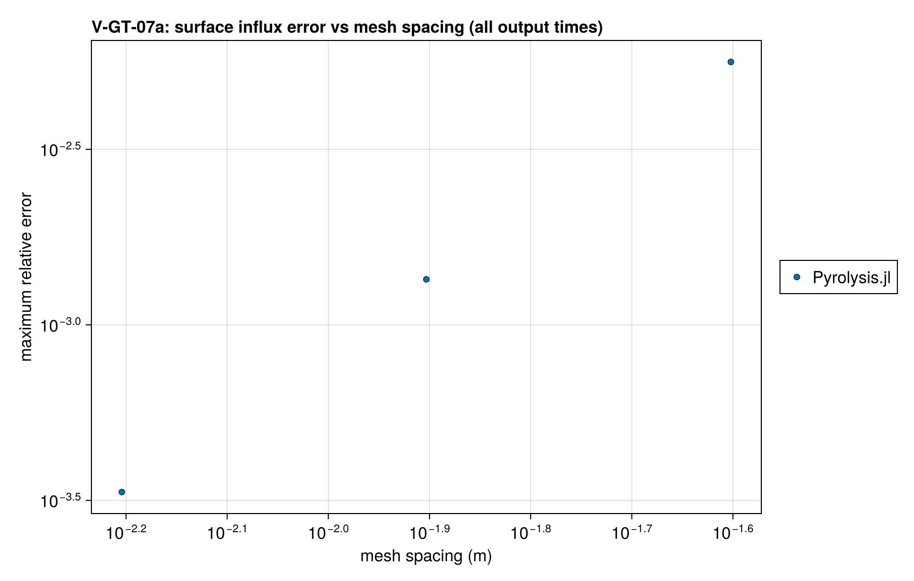

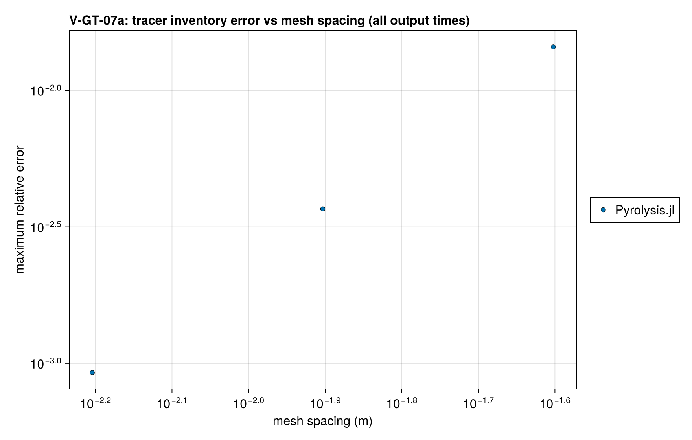

### Comparison with other codes

Physical-problem agreement does not establish equal discretization or cost. See the [mesh and time comparison basis](comparison_coverage.md#comparison-basis-audit) and [per-pair inventory](assets/comparison_basis.csv). Costs are compared at matched accuracy only.

Matched native-input runs at seven configurations (coarser and finer time steps at fixed mesh, and a finer mesh) are retained under `test/verification/reference/matched/`. See the [coverage and matching notes](comparison_coverage.md). The plotted external series use the base resolution; [analytical errors at every configuration](assets/V-GT-07a/V-GT-07a_comparison_accuracy.csv) are retained separately, and the same runs are timed for the cost comparison.

Gpyro V2 (`bff0126c68f2`) uses 161 boundary-centered nodes (160 intervals) and Δt = 0.05 s. Molecular collision parameters give D = 2e-5 m²/s at 300 K and 1 bar. The far-side reservoir contains only carrier gas so Gpyro's positive floor on the zero film coefficient contributes negligible exchange. Its influx is the film flux h_m(Y∞ − Y_s) and its inventory integrates the nodes over half end cells at its native gas density. All codes are compared with the analytical Robin solution, with their native gas constants retained; Gpyro's are point values.

Error panels show absolute error at each code's output points. Zeros are displayed at 1e-12 on the logarithmic axis; the reference CSV precision limits the discernible error.

#### Cost at matched accuracy

Each external code appears at its matched mesh h and time step Δt, at
coarser steps (2Δt, 4Δt) and at refinements (Δt/2, Δt/4, h/2 at Δt/4,
h/2 at Δt/2); this code at its report ladder, the external meshes and any
finer cost-only meshes, each at its report tolerances and at 10, 100 and
1000 times looser ones, the counterpart of the coarser steps. A coarse
configuration a code cannot express or complete is left out; for the
external codes the reason is in the matched provenance. The error is the
largest analytical error over
the curves and references the external run is scored on. Times are FDS's
internal elapsed time, which excludes its MPI start-up; Gpyro's and
ThermaKin's process time; and this code's warm problem construction and
solve. Each is the median of repeated runs on one pinned core
(`scripts/timing/README.md`; data and provenance in
`test/verification/reference/matched/timing/`). On the smallest problems
the external times are mostly input, setup and output. In the figure,
filled markers are each external code's matched mesh and step and this
code's report tolerances, open markers are the other runs, and this
code's line joins its cheapest configuration at each accuracy; lower left
is better. Errors at or below 1e-12 count as exact
when matching accuracy, errors at or below 1e-14 are drawn at 1e-14, and
runs every code solves exactly are not drawn.

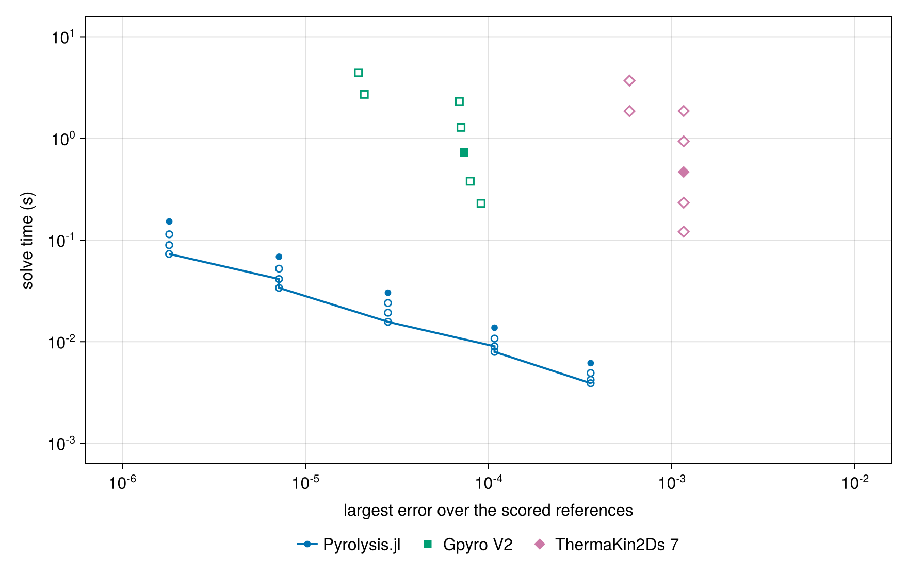

For each external mesh and step: the external code's cheapest run at least as accurate (often itself; a coarser or finer run of the same code when that costs less), this code's cheapest configuration at least as accurate on every scored reference (its cells, and its tolerance multiplier when looser than the report's), and the ratio of the two. A ratio marked ≥ uses this code's coarsest configuration, fewest cells at the loosest tolerance, whose accuracy already exceeds the external run's.

| External run | Mesh, step | External error | External time (s) | Cheapest external at this accuracy (s) | Our cells, tolerance | Our time (s) | Cheapest external/our time |
| --- | --- | --- | --- | --- | --- | --- | --- |
| Gpyro V2 | h, Δt | 7.359e-05 | 0.726 | 0.726 | 160, 1000× tol | 0.01569 | 46.3 |
| Gpyro V2 | h, 2Δt | 7.938e-05 | 0.3793 | 0.3793 | 160, 1000× tol | 0.01569 | 24.2 |
| Gpyro V2 | h, 4Δt | 9.096e-05 | 0.2295 | 0.2295 | 160, 1000× tol | 0.01569 | 14.6 |
| Gpyro V2 | h, Δt/2 | 7.069e-05 | 1.284 | 1.284 | 160, 1000× tol | 0.01569 | 81.8 |
| Gpyro V2 | h, Δt/4 | 6.924e-05 | 2.309 | 2.309 | 160, 1000× tol | 0.01569 | 147.0 |
| Gpyro V2 | h/2, Δt/4 | 1.948e-05 | 4.442 | 4.442 | 320, 1000× tol | 0.03386 | 131.0 |
| Gpyro V2 | h/2, Δt/2 | 2.097e-05 | 2.71 | 2.71 | 320, 1000× tol | 0.03386 | 80.0 |
| ThermaKin2Ds 7 | h, Δt | 0.001162 | 0.4674 | 0.1208 | 40, 1000× tol | 0.003906 | ≥ 30.9 |
| ThermaKin2Ds 7 | h, 2Δt | 0.001162 | 0.2332 | 0.1208 | 40, 1000× tol | 0.003906 | ≥ 30.9 |
| ThermaKin2Ds 7 | h, 4Δt | 0.001162 | 0.1208 | 0.1208 | 40, 1000× tol | 0.003906 | ≥ 30.9 |
| ThermaKin2Ds 7 | h, Δt/2 | 0.001162 | 0.9367 | 0.1208 | 40, 1000× tol | 0.003906 | ≥ 30.9 |
| ThermaKin2Ds 7 | h, Δt/4 | 0.001162 | 1.861 | 0.1208 | 40, 1000× tol | 0.003906 | ≥ 30.9 |
| ThermaKin2Ds 7 | h/2, Δt/4 | 0.000588 | 3.703 | 1.856 | 40, 1000× tol | 0.003906 | ≥ 475.0 |
| ThermaKin2Ds 7 | h/2, Δt/2 | 0.000588 | 1.856 | 1.856 | 40, 1000× tol | 0.003906 | ≥ 475.0 |

Solution overlays including the other codes' points: [profiles_vs_codes](assets/V-GT-07a/V-GT-07a_profiles_vs_codes.png), [uptake_vs_codes](assets/V-GT-07a/V-GT-07a_uptake_vs_codes.png), [inventory_vs_codes](assets/V-GT-07a/V-GT-07a_inventory_vs_codes.png).

### Convergence

| n_cells | h | wall (s) | Linf | cell_average_Linf |
| --- | --- | --- | --- | --- |
| 40 | 0.025 | 0.006204 | 0.001024 | 0.001489 |
| 80 | 0.0125 | 0.01389 | 0.0002564 | 0.0003724 |
| 160 | 0.00625 | 0.03099 | 6.402e-05 | 9.307e-05 |

Wall time: median of up to five warm runs of problem construction and solve on one pinned core, after a discarded compiling run.

Observed order 2 (Linf), expected 2.0.

### Solver configuration

| setting | value |
| --- | --- |
| integrator | Rodas5P (default) |
| reltol | 1.0e-9 |
| abstol | 1.0e-11 |
| pressure_tolerance | 0.001 |

## V-GT-07b — transient binary diffusion through a mass film (h_m = 0.01)

### Quantities of interest (n = 160)

| QoI | value | exact | error | tolerance | within tol | provenance |
| --- | --- | --- | --- | --- | --- | --- |
| transient tracer profile / reservoir fraction | 0.001282 | — | 0.001282 | 0.004 | yes | n=160: observed 1.28e-4 / 1.28e-3 for h_m=1e-4 / 1e-2; ~3× margin |
| transient tracer cell average / reservoir fraction | 0.001659 | — | 0.001659 | 0.004 | yes | analytical integral over each cell; same tolerance as the center-value metric |
| surface uptake vs analytical flux | 0.002445 | — | 0.002445 | 0.0075 | yes | h_m Y∞ erfcx(b√(Dt)); observed 3.34e-4 / 2.45e-3; ~3× margin |
| stored tracer vs integrated analytical influx | 0.002549 | — | 0.002549 | 0.008 | yes | integrated exact influx; observed 9.25e-4 / 2.55e-3; ~3× margin |
| total gas inventory conservation | 5.551e-16 | — | 5.551e-16 | 1e-10 | yes | equal-mass binary counterdiffusion has zero net mass influx |
| zero net boundary mass flux | 1.437e-18 | — | 6.53e-16 | 3e-08 | yes | two species counterdiffuse; flux scale h_m Y∞; enthalpy form observed 1.1e-8 at these tolerances, falling with them to 8.7e-12 at 1e-3 of them |
| sealed back face | 0 | — | 0 | 1e-14 | yes |  |
| isobaric invariant | 0.0001298 | — | 1.298e-09 | 4e-09 | yes | observed relative drift ≤1.05e-9 (0.000105 Pa); pressure tolerance 0.001 Pa |
| isothermal invariant | 0 | — | 0 | 1e-08 | yes |  |
| semi-infinite reference tail at back | 2.427e-15 | — | 2.427e-15 | 1e-12 | yes | bounds the neglected far-boundary penetration |

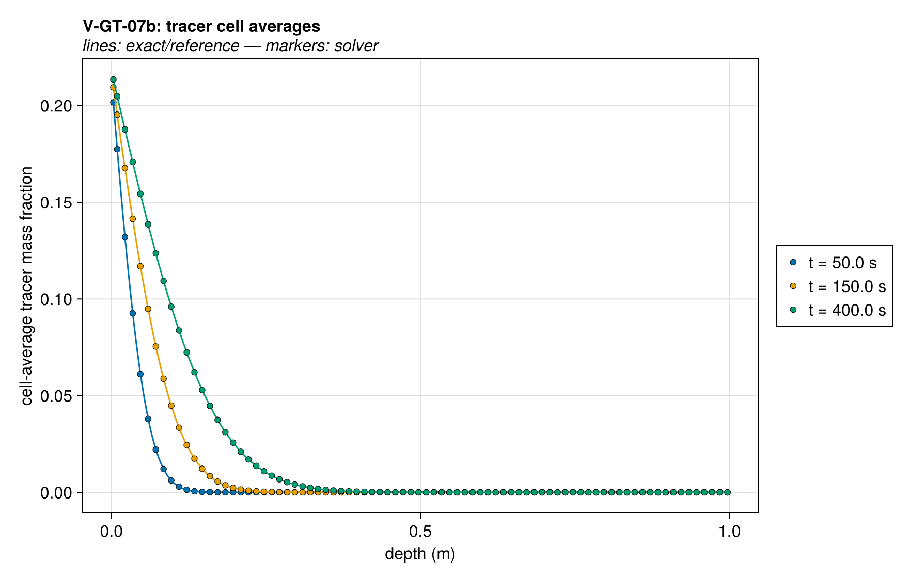

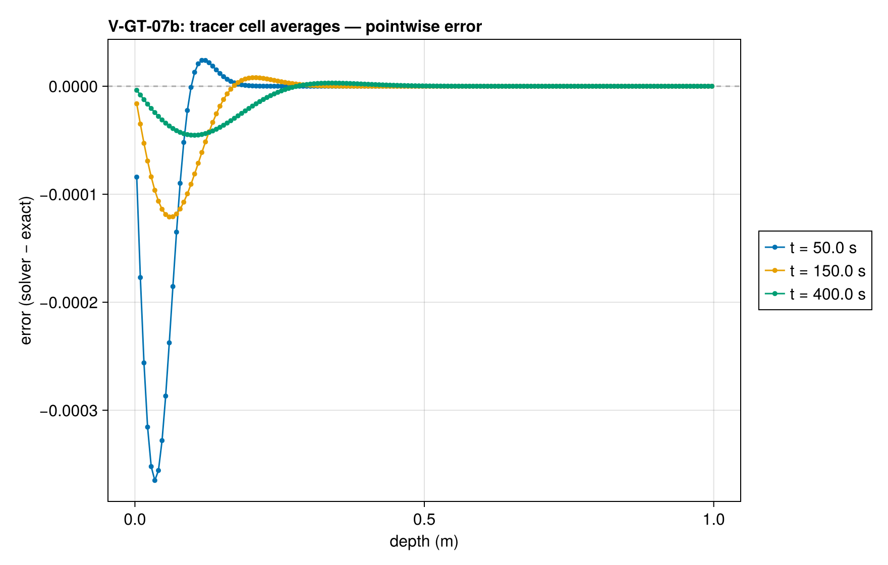

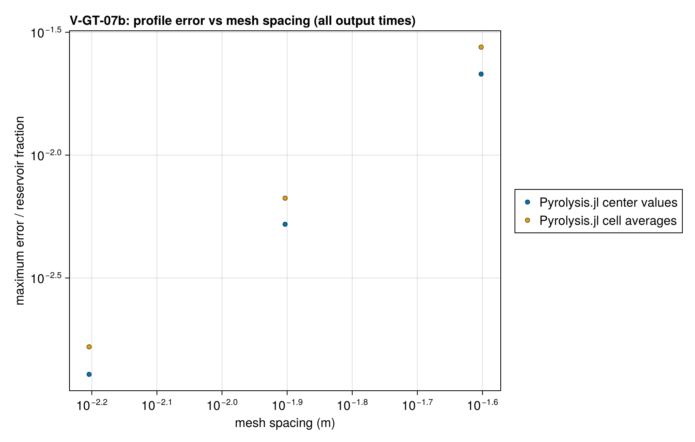

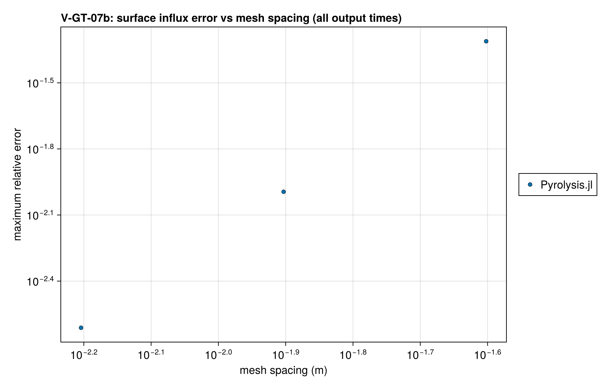

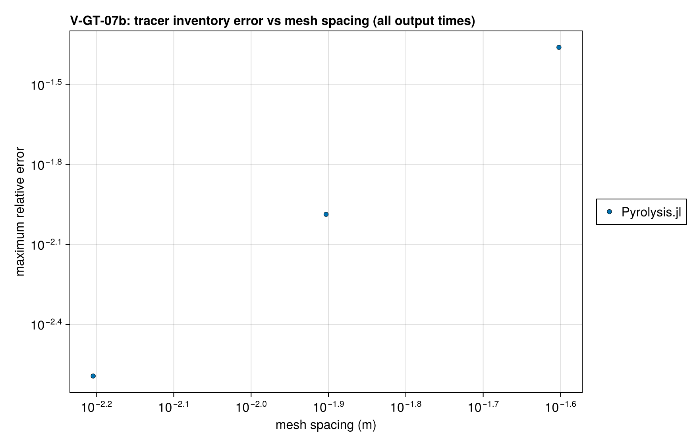

### Comparison with other codes

Physical-problem agreement does not establish equal discretization or cost. See the [mesh and time comparison basis](comparison_coverage.md#comparison-basis-audit) and [per-pair inventory](assets/comparison_basis.csv). Costs are compared at matched accuracy only.

Matched native-input runs at seven configurations (coarser and finer time steps at fixed mesh, and a finer mesh) are retained under `test/verification/reference/matched/`. See the [coverage and matching notes](comparison_coverage.md). The plotted external series use the base resolution; [analytical errors at every configuration](assets/V-GT-07b/V-GT-07b_comparison_accuracy.csv) are retained separately, and the same runs are timed for the cost comparison.

Gpyro V2 (`bff0126c68f2`) uses 161 boundary-centered nodes (160 intervals) and Δt = 0.05 s. Molecular collision parameters give D = 2e-5 m²/s at 300 K and 1 bar. The far-side reservoir contains only carrier gas so Gpyro's positive floor on the zero film coefficient contributes negligible exchange. Its influx is the film flux h_m(Y∞ − Y_s) and its inventory integrates the nodes over half end cells at its native gas density. All codes are compared with the analytical Robin solution, with their native gas constants retained; Gpyro's are point values.

Error panels show absolute error at each code's output points. Zeros are displayed at 1e-12 on the logarithmic axis; the reference CSV precision limits the discernible error.

#### Cost at matched accuracy

Each external code appears at its matched mesh h and time step Δt, at
coarser steps (2Δt, 4Δt) and at refinements (Δt/2, Δt/4, h/2 at Δt/4,
h/2 at Δt/2); this code at its report ladder, the external meshes and any
finer cost-only meshes, each at its report tolerances and at 10, 100 and
1000 times looser ones, the counterpart of the coarser steps. A coarse
configuration a code cannot express or complete is left out; for the
external codes the reason is in the matched provenance. The error is the
largest analytical error over
the curves and references the external run is scored on. Times are FDS's
internal elapsed time, which excludes its MPI start-up; Gpyro's and
ThermaKin's process time; and this code's warm problem construction and
solve. Each is the median of repeated runs on one pinned core
(`scripts/timing/README.md`; data and provenance in
`test/verification/reference/matched/timing/`). On the smallest problems
the external times are mostly input, setup and output. In the figure,
filled markers are each external code's matched mesh and step and this
code's report tolerances, open markers are the other runs, and this
code's line joins its cheapest configuration at each accuracy; lower left
is better. Errors at or below 1e-12 count as exact
when matching accuracy, errors at or below 1e-14 are drawn at 1e-14, and
runs every code solves exactly are not drawn.

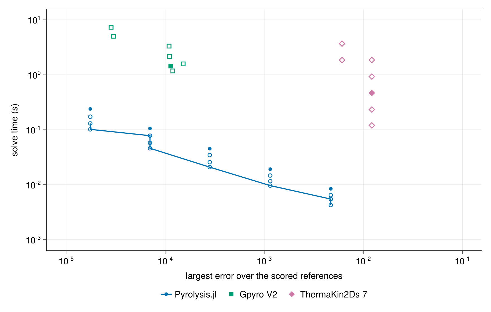

For each external mesh and step: the external code's cheapest run at least as accurate (often itself; a coarser or finer run of the same code when that costs less), this code's cheapest configuration at least as accurate on every scored reference (its cells, and its tolerance multiplier when looser than the report's), and the ratio of the two. A ratio marked ≥ uses this code's coarsest configuration, fewest cells at the loosest tolerance, whose accuracy already exceeds the external run's.

| External run | Mesh, step | External error | External time (s) | Cheapest external at this accuracy (s) | Our cells, tolerance | Our time (s) | Cheapest external/our time |
| --- | --- | --- | --- | --- | --- | --- | --- |
| Gpyro V2 | h, Δt | 0.0001138 | 1.447 | 1.447 | 320, 1000× tol | 0.04613 | 31.4 |
| Gpyro V2 | h, 2Δt | 0.0001195 | 1.178 | 1.178 | 320, 1000× tol | 0.04613 | 25.5 |
| Gpyro V2 | h, 4Δt | 0.0001518 | 1.581 | 1.178 | 320, 1000× tol | 0.04613 | 25.5 |
| Gpyro V2 | h, Δt/2 | 0.0001109 | 2.147 | 2.147 | 320, 1000× tol | 0.04613 | 46.5 |
| Gpyro V2 | h, Δt/4 | 0.0001095 | 3.341 | 3.341 | 320, 1000× tol | 0.04613 | 72.4 |
| Gpyro V2 | h/2, Δt/4 | 2.843e-05 | 7.339 | 7.339 | 640, 1000× tol | 0.1019 | 72.0 |
| Gpyro V2 | h/2, Δt/2 | 2.999e-05 | 5.042 | 5.042 | 640, 1000× tol | 0.1019 | 49.5 |
| ThermaKin2Ds 7 | h, Δt | 0.01221 | 0.4684 | 0.1205 | 40, 1000× tol | 0.004266 | ≥ 28.3 |
| ThermaKin2Ds 7 | h, 2Δt | 0.01221 | 0.2339 | 0.1205 | 40, 1000× tol | 0.004266 | ≥ 28.3 |
| ThermaKin2Ds 7 | h, 4Δt | 0.01221 | 0.1205 | 0.1205 | 40, 1000× tol | 0.004266 | ≥ 28.3 |
| ThermaKin2Ds 7 | h, Δt/2 | 0.01221 | 0.9311 | 0.1205 | 40, 1000× tol | 0.004266 | ≥ 28.3 |
| ThermaKin2Ds 7 | h, Δt/4 | 0.01221 | 1.864 | 0.1205 | 40, 1000× tol | 0.004266 | ≥ 28.3 |
| ThermaKin2Ds 7 | h/2, Δt/4 | 0.00611 | 3.7 | 1.858 | 40, 1000× tol | 0.004266 | ≥ 436.0 |
| ThermaKin2Ds 7 | h/2, Δt/2 | 0.00611 | 1.858 | 1.858 | 40, 1000× tol | 0.004266 | ≥ 436.0 |

Solution overlays including the other codes' points: [profiles_vs_codes](assets/V-GT-07b/V-GT-07b_profiles_vs_codes.png), [uptake_vs_codes](assets/V-GT-07b/V-GT-07b_uptake_vs_codes.png), [inventory_vs_codes](assets/V-GT-07b/V-GT-07b_inventory_vs_codes.png).

### Convergence

| n_cells | h | wall (s) | Linf | cell_average_Linf |
| --- | --- | --- | --- | --- |
| 40 | 0.025 | 0.008748 | 0.002551 | 0.003291 |
| 80 | 0.0125 | 0.0202 | 0.0006366 | 0.0008253 |
| 160 | 0.00625 | 0.04527 | 0.000159 | 0.0002063 |

Wall time: median of up to five warm runs of problem construction and solve on one pinned core, after a discarded compiling run.

Observed order 2.002 (Linf), expected 2.0.

### Solver configuration

| setting | value |
| --- | --- |
| integrator | Rodas5P (default) |
| reltol | 1.0e-9 |
| abstol | 1.0e-11 |
| pressure_tolerance | 0.001 |
