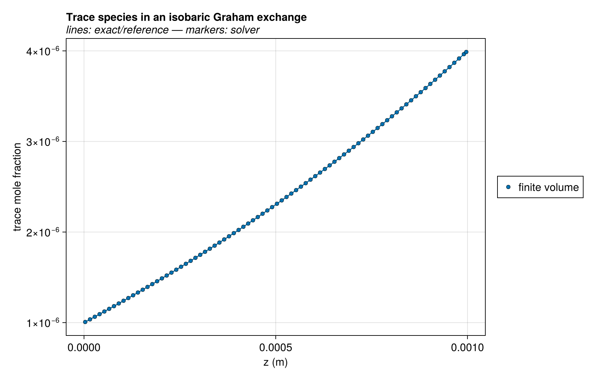
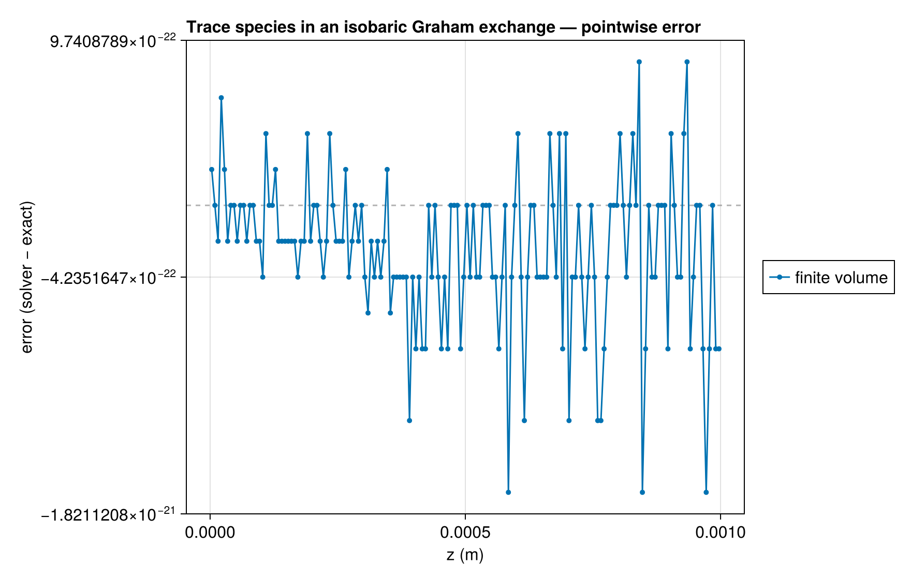
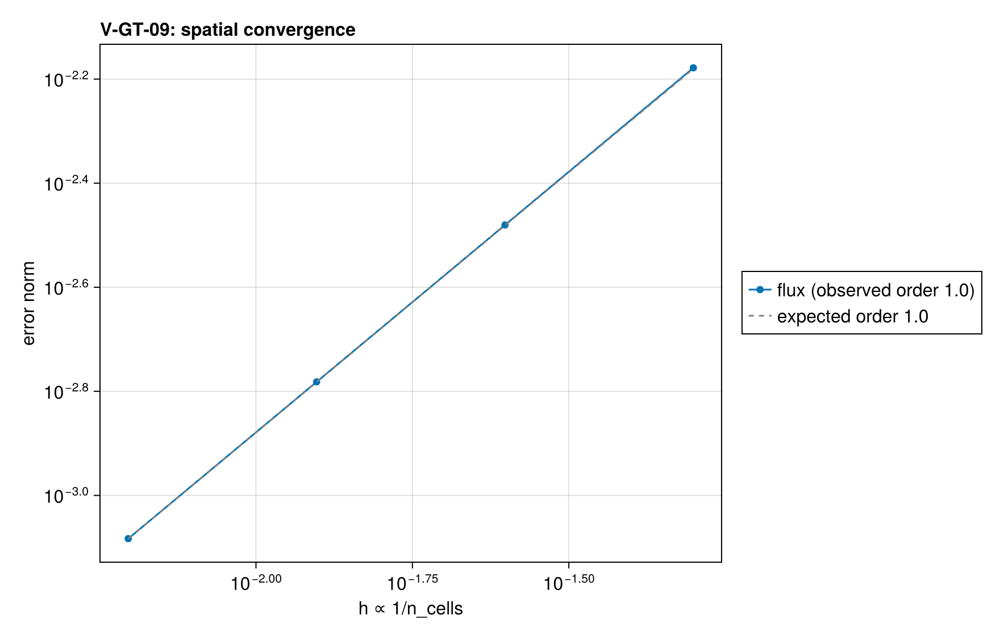

# V-GT-09 — isobaric dusty-gas exchange carrying trace species

**Tags:** `gas_transport`, `dusty_gas`, `analytical`

**References:**

- linear friction equations of an isobaric multicomponent mixture

## Problem statement

The isobaric binary of V-GT-04 carrying three trace species. At constant
pressure and steady total molar flux N, each species' friction equation is
linear in its own pressure:
  -p_j'/(RT) = n_j (1/K_j + tP) - t N p_j,
so p_j(z) = p*_j + (p_j(0) - p*_j) G^(z/L), with G = exp(RTtNL) and
p*_j = (p_j(L) - G p_j(0))/(1 - G), n_j = tN p*_j/(1/K_j + tP). Summing the
species fluxes to N fixes G = Σ p_j(L)/(1+tPK_j) / Σ p_j(0)/(1+tPK_j) over
every species, traces included. The second trace is the first scaled by
1e-12 and must stay proportional to it; the third is absent. Every present
trace lies far above the pressure budget pressure_tolerance/Ng, below which
the pore pressures guard the inventories. The friction equations also sum to
Σ n_j/K_j = 0, the multicomponent Graham relation.

### Quantities of interest (n = 160)

| QoI | value | exact | error | tolerance | within tol | provenance |
| --- | --- | --- | --- | --- | --- | --- |
| trace flux | -3.335e-07 | -3.333e-07 | 0.0008259 | 0.005 | yes |  |
| trace exponential profile | 4.235e-16 | — | 4.235e-16 | 1e-13 | yes |  |
| trace scaled by 1e-12 stays proportional | 5.551e-16 | — | 5.551e-16 | 1e-13 | yes |  |
| absent species stays absent | 0 | — | 0 | 2.225e-308 | yes |  |
| multicomponent Graham relation | -9.331e-15 | — | 9.331e-15 | 1e-12 | yes |  |
| isobaric solution | 1.164e-10 | — | 1.164e-10 | 1e-09 | yes |  |

### Convergence

| n_cells | h | wall (s) | flux |
| --- | --- | --- | --- |
| 20 | 0.05 | 0.4179 | 0.006633 |
| 40 | 0.025 | 1.002 | 0.003309 |
| 80 | 0.0125 | 2.293 | 0.001653 |
| 160 | 0.00625 | 5.211 | 0.0008259 |

Wall time: median of up to five warm runs of problem construction and solve on one pinned core, after a discarded compiling run.

Observed order 1.002 (flux), expected 1.0.

### Solver configuration

| setting | value |
| --- | --- |
| integrator | Rodas5P (default) |
| reltol | 1.0e-10 |
| abstol | 1.0e-12 |
| pressure_tolerance | 1.0e-15 |
