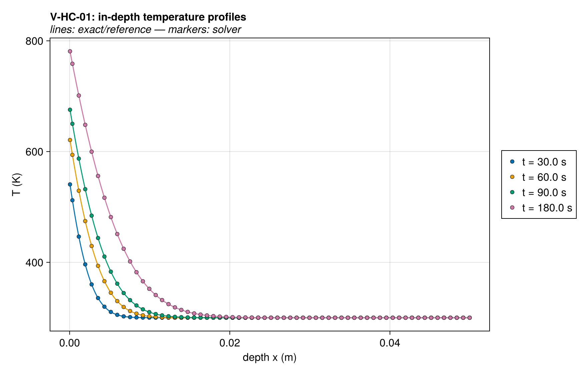
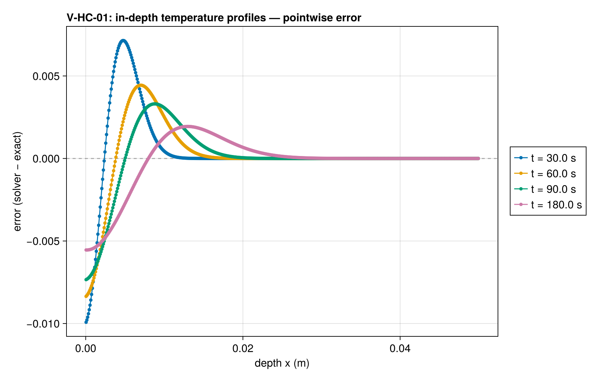
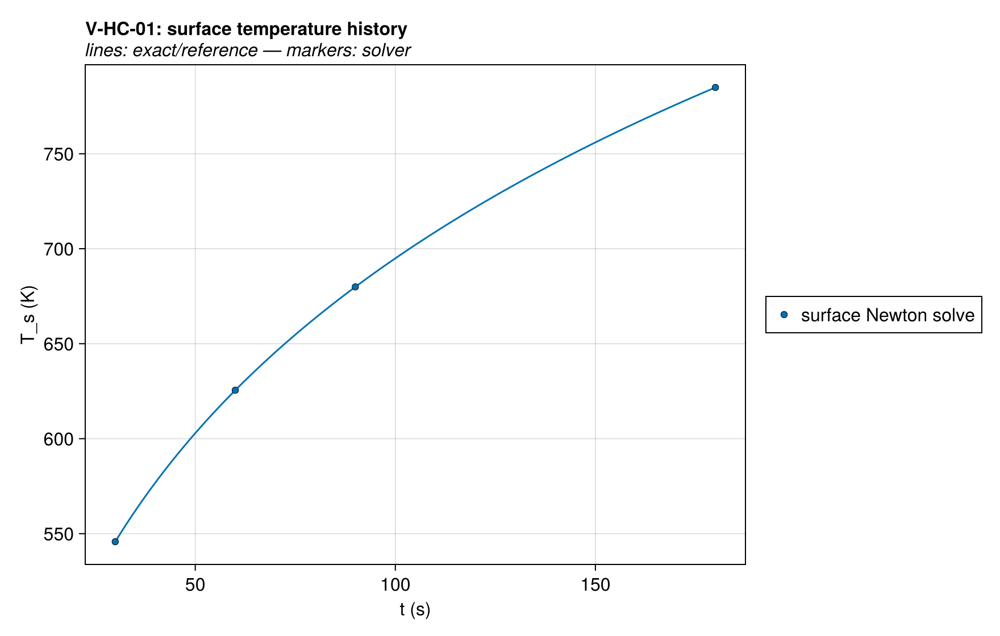
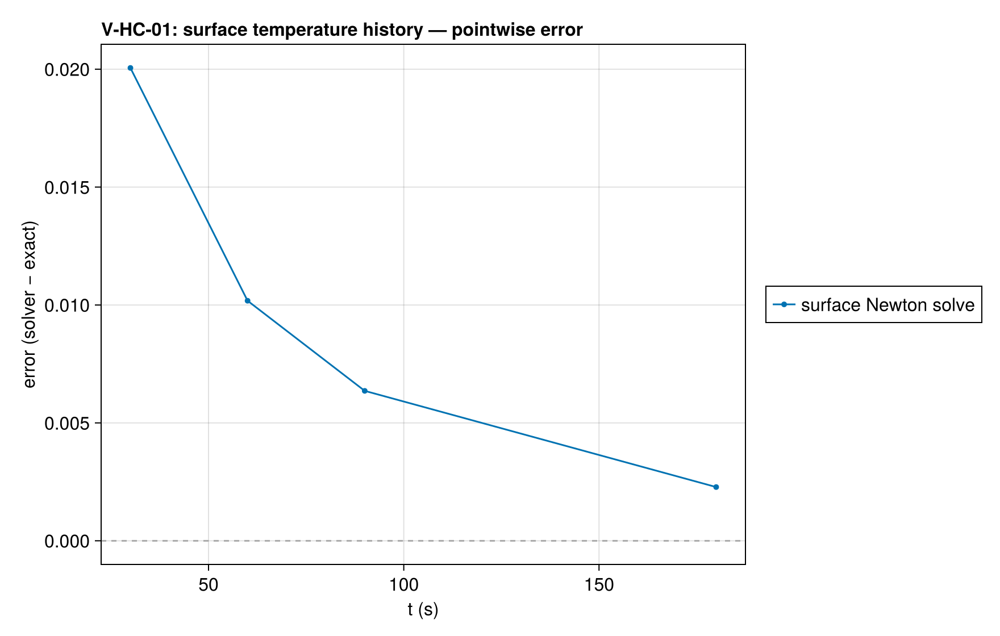
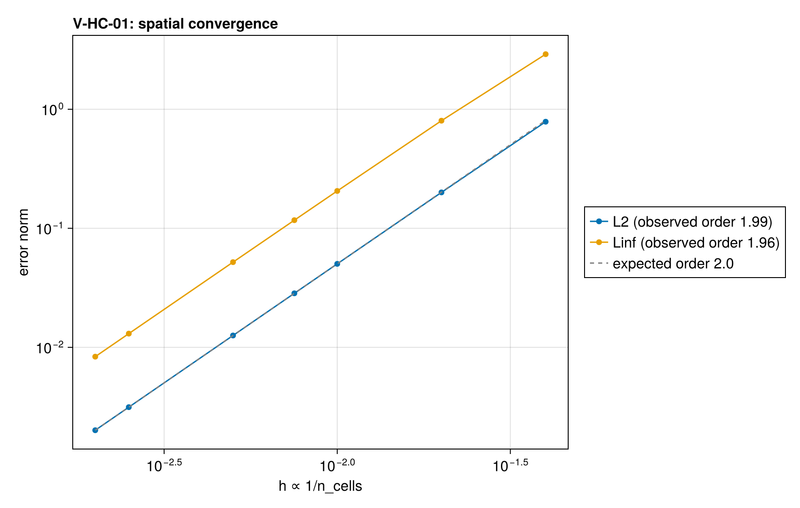
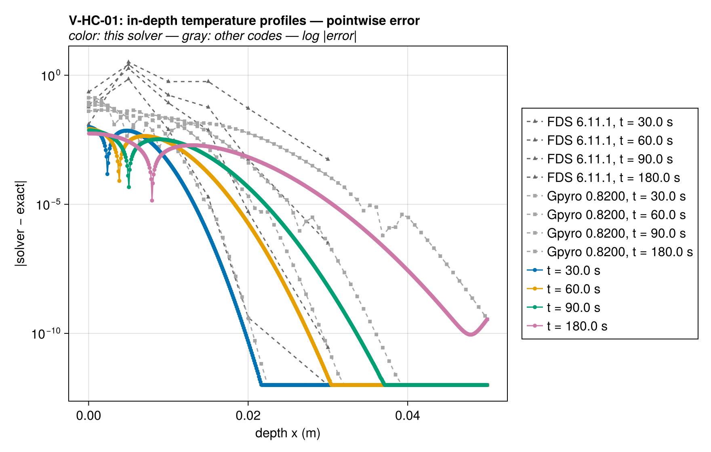
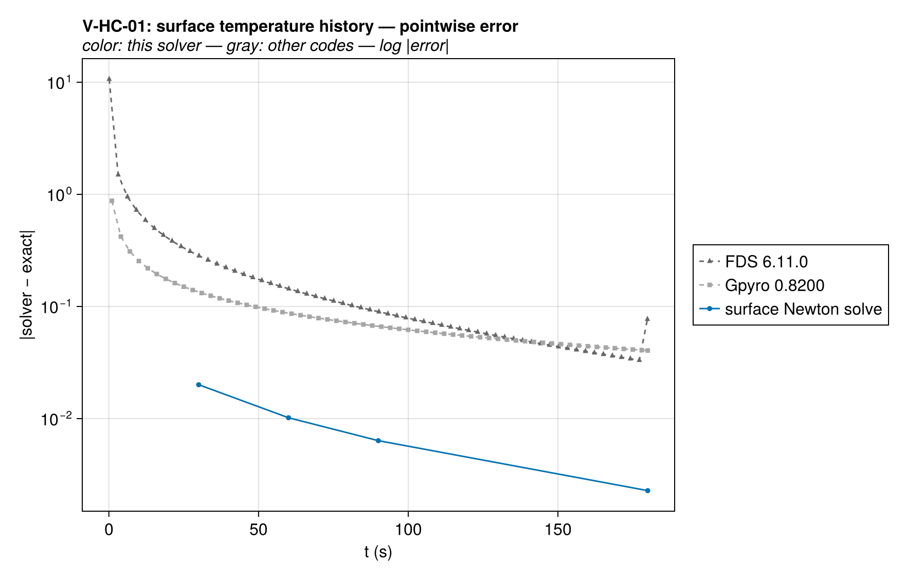
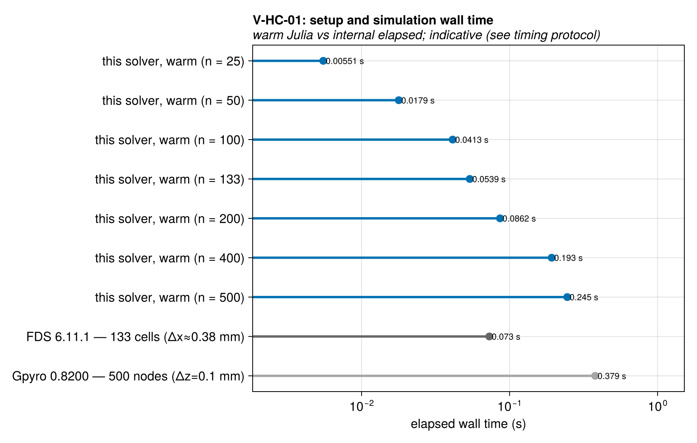

# V-HC-01 — semi-infinite solid, convective surface BC (erfc)

**Tags:** `heat_conduction`, `convective_bc`, `surface_newton`

**References:**

- Carslaw & Jaeger (1959), Conduction of Heat in Solids, §2.7
- Lautenberger dissertation (2007) §3.4.1 (parameters)
- FDS Verification Guide `ht3d_slab`; ThermaKin (FSS 9:1141) Eq. 25

## Problem statement

A semi-infinite conduction benchmark, using the parameters of
Lautenberger's dissertation §3.4.1 (ThermaKin Eq. 25 uses the same
analytical form with different parameters):
constant absorbed radiant flux q″ = 25 kW/m² plus convective exchange
h = 20 W/m²K with T∞ = T₀ = 300 K; k = 0.2 W/(m·K), ρ = 1000 kg/m³,
c = 1400 J/(kg·K), so profiles at t = 30/60/90/180 s are directly comparable
to the dissertation figures.

Because the combined surface BC is linear in T_s, absorbed-flux + convection
is exactly convection toward T∞_eff = T∞ + q″/h = 1550 K, and the Carslaw &
Jaeger §2.7 erfc solution (exact/semi_infinite.jl) applies unchanged.

Coverage beyond the existing Dirichlet erf test: `HeatFluxBC + ConvectiveBC`
enter the surface Newton solve, so the surface temperature is an unknown
coupled to the interior — the place surface-BC bugs live.

Domain: L = 5 cm ≫ thermal penetration (erfc(η) ≈ 3e-12 at the back face at
t = 180 s), so the finite slab is semi-infinite to well below the QoI
tolerances; the back-face-rise QoI enforces this assumption explicitly.

### Quantities of interest (n = 500)

| QoI | value | exact | error | tolerance | within tol | provenance |
| --- | --- | --- | --- | --- | --- | --- |
| L∞ T-profile error, t=30.0 s | 0.009925 | — | 0.009925 | 0.75 | yes | observed 0.24/0.21/0.18/0.14 K at t=30/60/90/180 s |
| L∞ T-profile error, t=60.0 s | 0.008354 | — | 0.008354 | 0.75 | yes | observed 0.24/0.21/0.18/0.14 K at t=30/60/90/180 s |
| L∞ T-profile error, t=90.0 s | 0.007341 | — | 0.007341 | 0.75 | yes | observed 0.24/0.21/0.18/0.14 K at t=30/60/90/180 s |
| L∞ T-profile error, t=180.0 s | 0.005543 | — | 0.005543 | 0.75 | yes | observed 0.24/0.21/0.18/0.14 K at t=30/60/90/180 s |
| surface temperature, t=30.0 s | 545.8 | 545.7 | 0.02005 | 1.5 | yes | surface Newton solve vs exact θ_s = 1 − erfcx(h√(αt)/k); observed 0.50/0.26/0.16/0.06 K at t=30/60/90/180 s |
| surface temperature, t=60.0 s | 625.5 | 625.5 | 0.01018 | 1.5 | yes | surface Newton solve vs exact θ_s = 1 − erfcx(h√(αt)/k); observed 0.50/0.26/0.16/0.06 K at t=30/60/90/180 s |
| surface temperature, t=90.0 s | 679.9 | 679.9 | 0.006359 | 1.5 | yes | surface Newton solve vs exact θ_s = 1 − erfcx(h√(αt)/k); observed 0.50/0.26/0.16/0.06 K at t=30/60/90/180 s |
| surface temperature, t=180.0 s | 784.9 | 784.9 | 0.002279 | 1.5 | yes | surface Newton solve vs exact θ_s = 1 − erfcx(h√(αt)/k); observed 0.50/0.26/0.16/0.06 K at t=30/60/90/180 s |
| back-face rise (semi-infinite validity) | 7.191e-10 | 0 | 7.191e-10 | 1e-06 | yes | guards the semi-infinite assumption of the reference solution |

### Comparison with other codes

Reference runs are available from FDS 6.11.1 at 133 cells (Δx≈0.38 mm) and Gpyro 0.8200 at 500 nodes (Δz=0.1 mm). Decks, outputs and
available provenance are under `test/verification/reference/`; check
case-specific parameters and transformations before comparing. Where
error panels are present, they compare against the analytical reference.
A timing entry alone does not establish an identical physical workload.

Setup and simulation wall times at every ladder rung against the
reference runs. Julia times model construction and solve after warm-up;
FDS and Gpyro use internal total elapsed wall time, including setup and
simulation output. Process launch and Julia compilation are excluded
from the figure. Output costs, discretizations and time-stepping rules
still differ, so these are indicative costs, not pure solver speedups.
See `test/verification/reference/README.md` and `timings.csv` for the
timer boundaries, resolutions and measurement provenance.

Reference timings below are medians of five runs after one warm-up. Full process time also includes launch and shutdown; it is shown separately and is not compared with Julia's warmed time.

| Code | Resolution | Internal elapsed (s) | Full process (s) |
| --- | --- | --- | --- |
| FDS 6.11.1 | 133 cells (Δx≈0.38 mm) | 0.073 | 0.3312 |
| Gpyro 0.8200 | 500 nodes (Δz=0.1 mm) | 0.379 | 0.3814 |

Solution overlays including the other codes' points: [T_profiles_vs_codes](assets/V-HC-01/V-HC-01_T_profiles_vs_codes.png), [surface_T_history_vs_codes](assets/V-HC-01/V-HC-01_surface_T_history_vs_codes.png).

### Convergence

| n_cells | h | wall (s) | L2 | Linf |
| --- | --- | --- | --- | --- |
| 25 | 0.04 | 0.005513 | 0.7857 | 2.901 |
| 50 | 0.02 | 0.01785 | 0.2003 | 0.8012 |
| 100 | 0.01 | 0.04127 | 0.05027 | 0.2059 |
| 133 | 0.007519 | 0.05386 | 0.02844 | 0.117 |
| 200 | 0.005 | 0.08624 | 0.01258 | 0.05197 |
| 400 | 0.0025 | 0.1926 | 0.003146 | 0.01304 |
| 500 | 0.002 | 0.2454 | 0.002013 | 0.008354 |

Observed order 1.993 (L2), expected 2.0.

### Solver configuration

| setting | value |
| --- | --- |
| integrator | Rodas5P (default) |
| abstol | 1.0e-12 |
| reltol | 1.0e-10 |
