# V-HC-02 — finite slab, convective BC, Bi = 0.1

**Tags:** `heat_conduction`, `convective_bc`, `biot_sweep`

**References:**

- Carslaw & Jaeger (1959) §3.11 (eigenfunction series)
- FDS Verification Guide `heat_conduction_a–d`

## Problem statement

0.1 m slab initially at Tᵢ = 300 K, convective front (T∞ = 500 K), adiabatic
back, Bi = hL/k ∈ {0.1, 1, 10, 100} — four regimes from one definition:
Bi = 0.1 is lumped-like (BC-dominated), Bi = 100 is surface-Dirichlet-like
(interior-dominated). Exact eigenfunction series with eigencondition
λₙ tan λₙ = Bi (exact/slab_series.jl).

Mesh mapping: adiabatic face is z = 0, so the series coordinate is x̃ = z/L.
Comparison times are Fo = αt/L² ∈ {0.05, 0.1, 0.2, 0.5}, all well above the
60-root series validity floor (Fo ≳ 1.1e-3).

Convergence spot check runs on the Bi = 10 member only (the mixed regime);
the other three assert QoIs at the CI mesh.

## V-HC-02a — finite slab, convective BC, Bi = 0.1

### Quantities of interest (n = 320)

| QoI | value | exact | error | tolerance | within tol | provenance |
| --- | --- | --- | --- | --- | --- | --- |
| L∞ T-profile error, Fo=0.05 | 1.441e-05 | — | 1.441e-05 | 0.06 | yes | observed max per Bi: 2.3e-4 (0.1), 2.4e-3 (1), 1.8e-2 (10), 2.0e-2 (100) K |
| surface temperature, Fo=0.05 | 304.9 | 304.9 | 5.691e-05 | 0.015 | yes | front face from the surface Newton solve vs series at x̃=1; observed max per Bi: 9.2e-4 (0.1), 4.4e-3 (1), 4.9e-3 (10), 9.8e-4 (100) K |
| L∞ T-profile error, Fo=0.1 | 1.177e-05 | — | 1.177e-05 | 0.06 | yes | observed max per Bi: 2.3e-4 (0.1), 2.4e-3 (1), 1.8e-2 (10), 2.0e-2 (100) K |
| surface temperature, Fo=0.1 | 306.9 | 306.9 | 3.896e-05 | 0.015 | yes | front face from the surface Newton solve vs series at x̃=1; observed max per Bi: 9.2e-4 (0.1), 4.4e-3 (1), 4.9e-3 (10), 9.8e-4 (100) K |
| L∞ T-profile error, Fo=0.2 | 1.362e-05 | — | 1.362e-05 | 0.06 | yes | observed max per Bi: 2.3e-4 (0.1), 2.4e-3 (1), 1.8e-2 (10), 2.0e-2 (100) K |
| surface temperature, Fo=0.2 | 309.7 | 309.7 | 2.798e-05 | 0.015 | yes | front face from the surface Newton solve vs series at x̃=1; observed max per Bi: 9.2e-4 (0.1), 4.4e-3 (1), 4.9e-3 (10), 9.8e-4 (100) K |
| L∞ T-profile error, Fo=0.5 | 6.884e-06 | — | 6.884e-06 | 0.06 | yes | observed max per Bi: 2.3e-4 (0.1), 2.4e-3 (1), 1.8e-2 (10), 2.0e-2 (100) K |
| surface temperature, Fo=0.5 | 315.6 | 315.6 | 2.603e-05 | 0.015 | yes | front face from the surface Newton solve vs series at x̃=1; observed max per Bi: 9.2e-4 (0.1), 4.4e-3 (1), 4.9e-3 (10), 9.8e-4 (100) K |

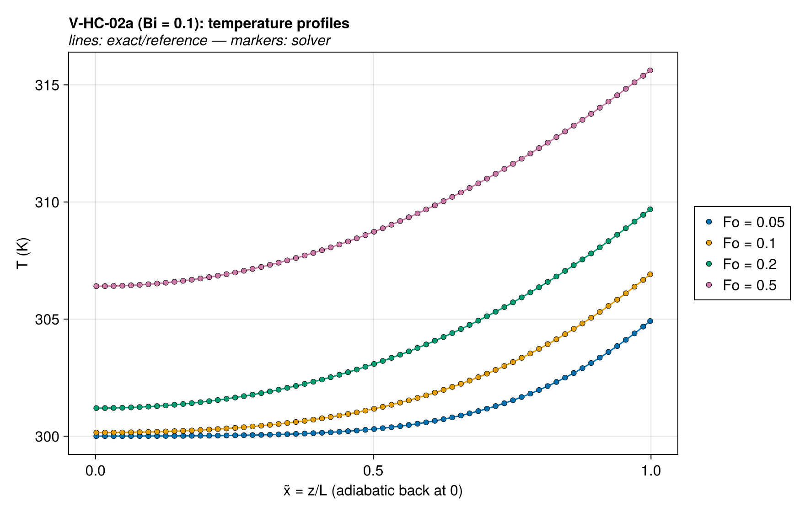

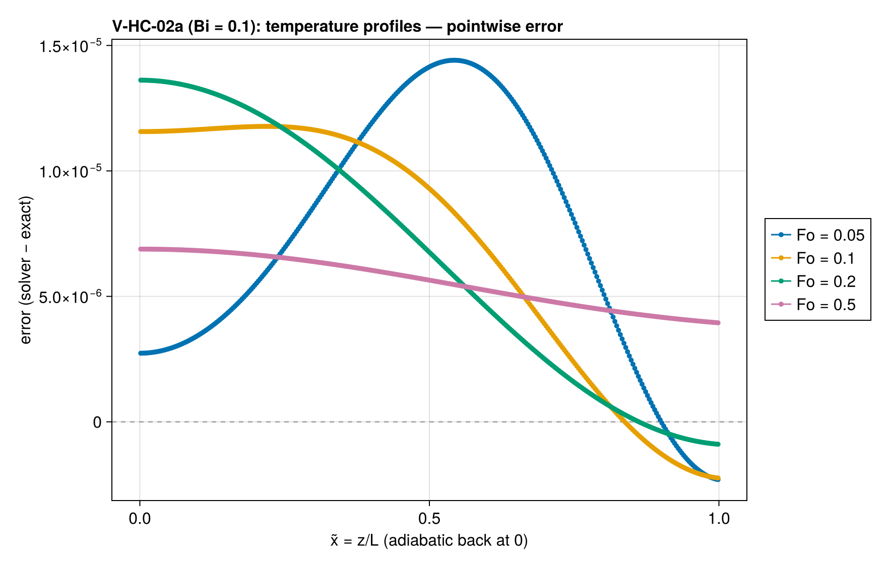

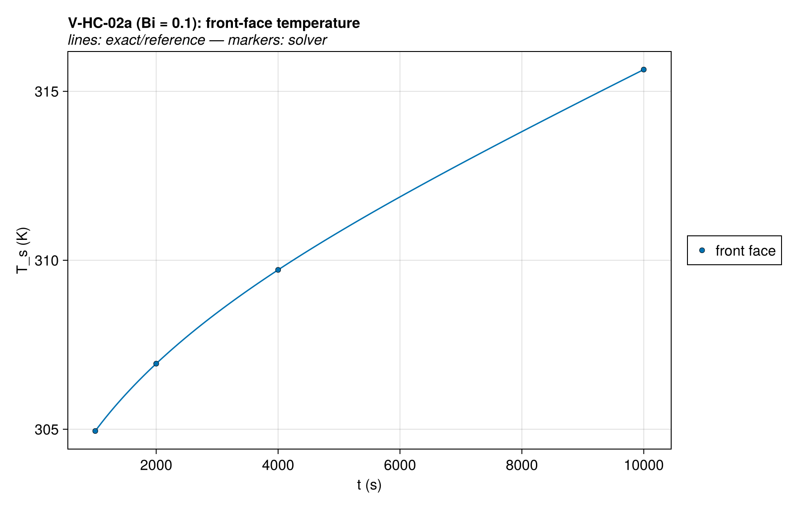

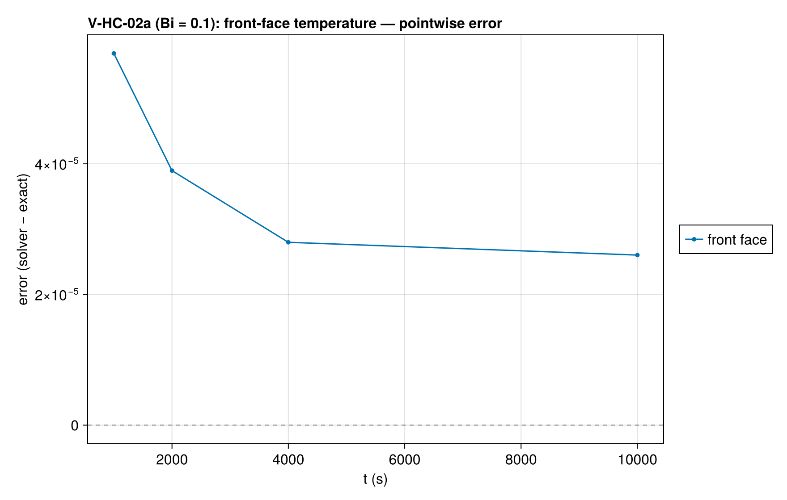

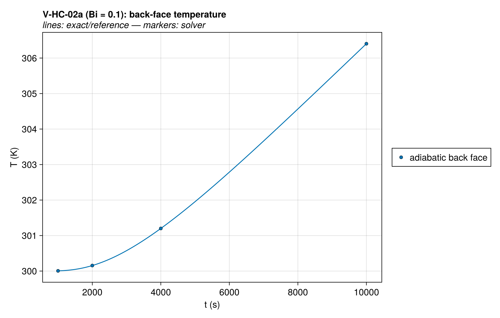

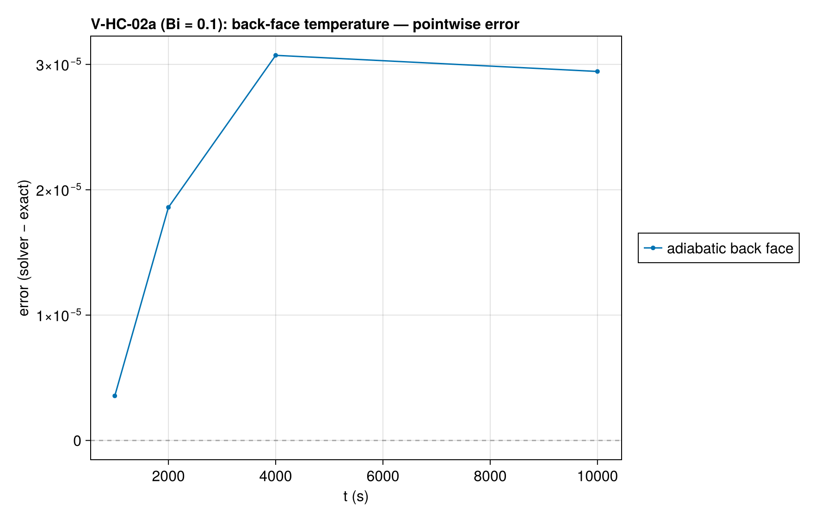

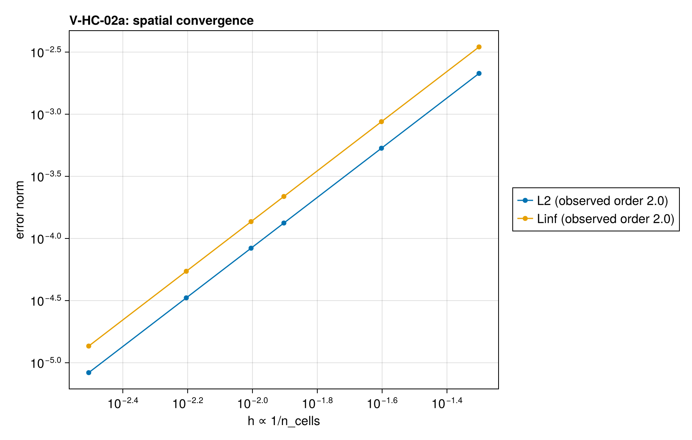

### Comparison with other codes

The same case was solved with FDS 6.11.0 at 101 cells (Δx≈1 mm); decks, outputs, and
run provenance are committed under `test/verification/reference/`.
Each code's error against the same exact solution is drawn below
on a log scale, muted gray behind this solver's series — the
signed linear-scale panel above shows where the error lives, this
one compares magnitudes across codes.

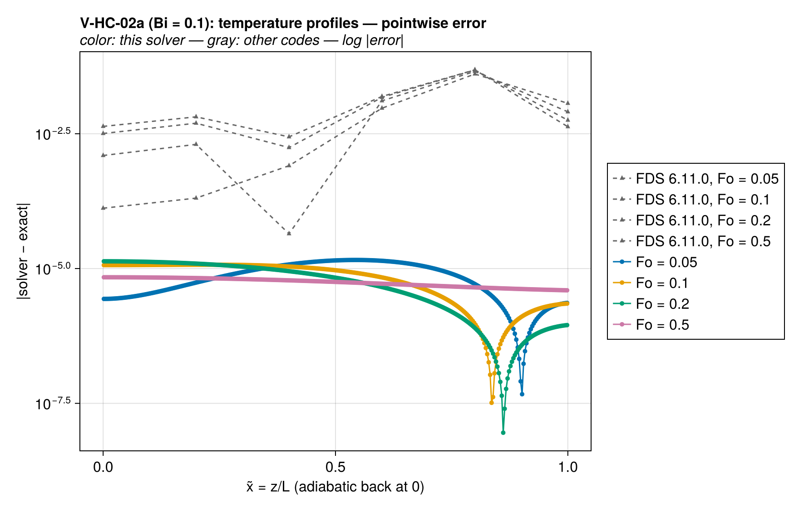

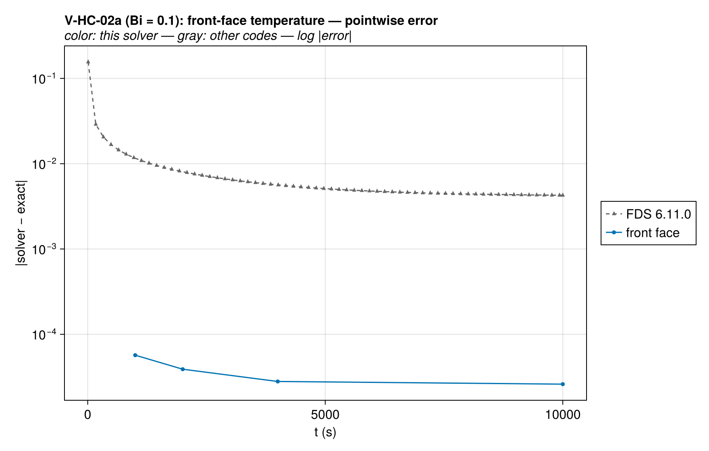

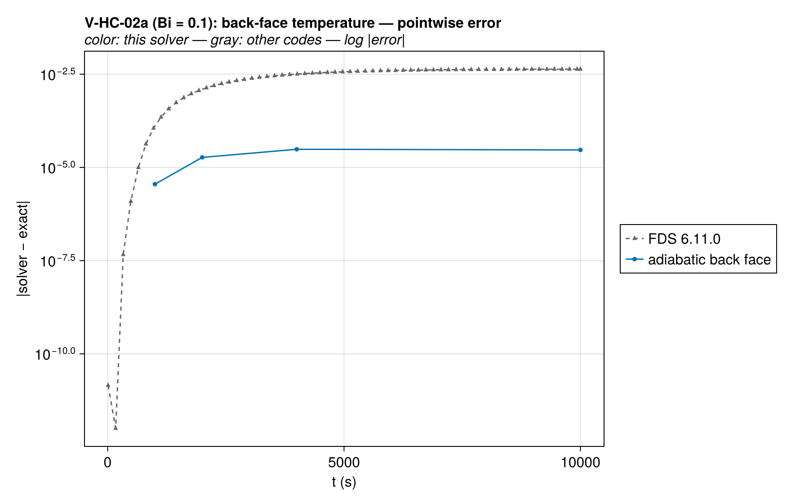

Wall times at every ladder rung against the reference runs.
Resolutions and simulated spans differ where noted (details in
`reference/timings.csv`), so cross-code timings are indicative
rather than a controlled benchmark; rungs at a matched
resolution are directly comparable.

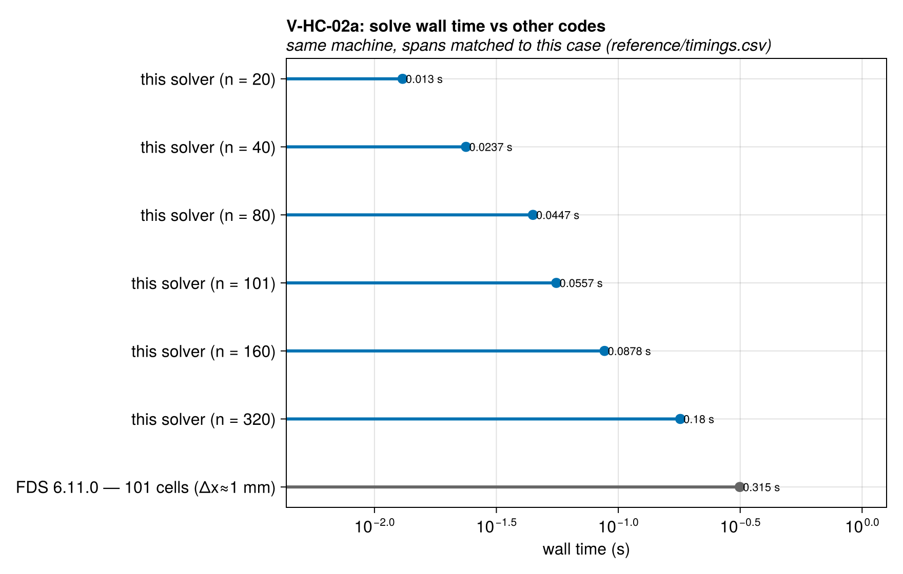

Solution overlays including the other codes' points: [T_profiles_vs_codes](assets/V-HC-02a/V-HC-02a_T_profiles_vs_codes.png), [surface_T_history_vs_codes](assets/V-HC-02a/V-HC-02a_surface_T_history_vs_codes.png), [back_T_history_vs_codes](assets/V-HC-02a/V-HC-02a_back_T_history_vs_codes.png).

### Convergence

| n_cells | h | wall (s) | L2 | Linf |
| --- | --- | --- | --- | --- |
| 20 | 0.05 | 0.01305 | 0.00213 | 0.003479 |
| 40 | 0.025 | 0.02374 | 0.0005325 | 0.000871 |
| 80 | 0.0125 | 0.04468 | 0.0001331 | 0.0002178 |
| 101 | 0.009901 | 0.05571 | 8.353e-05 | 0.0001367 |
| 160 | 0.00625 | 0.08784 | 3.328e-05 | 5.446e-05 |
| 320 | 0.003125 | 0.1796 | 8.322e-06 | 1.362e-05 |

Observed order 2 (L2).

### Solver configuration

| setting | value |
| --- | --- |
| integrator | KenCarp4 (default) |
| abstol | 1.0e-12 |
| reltol | 1.0e-10 |

## V-HC-02b — finite slab, convective BC, Bi = 1.0

### Quantities of interest (n = 320)

| QoI | value | exact | error | tolerance | within tol | provenance |
| --- | --- | --- | --- | --- | --- | --- |
| L∞ T-profile error, Fo=0.05 | 0.0001504 | — | 0.0001504 | 0.06 | yes | observed max per Bi: 2.3e-4 (0.1), 2.4e-3 (1), 1.8e-2 (10), 2.0e-2 (100) K |
| surface temperature, Fo=0.05 | 341.9 | 341.9 | 0.0002724 | 0.015 | yes | front face from the surface Newton solve vs series at x̃=1; observed max per Bi: 9.2e-4 (0.1), 4.4e-3 (1), 4.9e-3 (10), 9.8e-4 (100) K |
| L∞ T-profile error, Fo=0.1 | 0.0001246 | — | 0.0001246 | 0.06 | yes | observed max per Bi: 2.3e-4 (0.1), 2.4e-3 (1), 1.8e-2 (10), 2.0e-2 (100) K |
| surface temperature, Fo=0.1 | 355.3 | 355.3 | 0.0001343 | 0.015 | yes | front face from the surface Newton solve vs series at x̃=1; observed max per Bi: 9.2e-4 (0.1), 4.4e-3 (1), 4.9e-3 (10), 9.8e-4 (100) K |
| L∞ T-profile error, Fo=0.2 | 8.822e-05 | — | 8.822e-05 | 0.06 | yes | observed max per Bi: 2.3e-4 (0.1), 2.4e-3 (1), 1.8e-2 (10), 2.0e-2 (100) K |
| surface temperature, Fo=0.2 | 371.3 | 371.3 | 6.553e-05 | 0.015 | yes | front face from the surface Newton solve vs series at x̃=1; observed max per Bi: 9.2e-4 (0.1), 4.4e-3 (1), 4.9e-3 (10), 9.8e-4 (100) K |
| L∞ T-profile error, Fo=0.5 | 4.769e-05 | — | 4.769e-05 | 0.06 | yes | observed max per Bi: 2.3e-4 (0.1), 2.4e-3 (1), 1.8e-2 (10), 2.0e-2 (100) K |
| surface temperature, Fo=0.5 | 399.1 | 399.1 | 4.457e-05 | 0.015 | yes | front face from the surface Newton solve vs series at x̃=1; observed max per Bi: 9.2e-4 (0.1), 4.4e-3 (1), 4.9e-3 (10), 9.8e-4 (100) K |

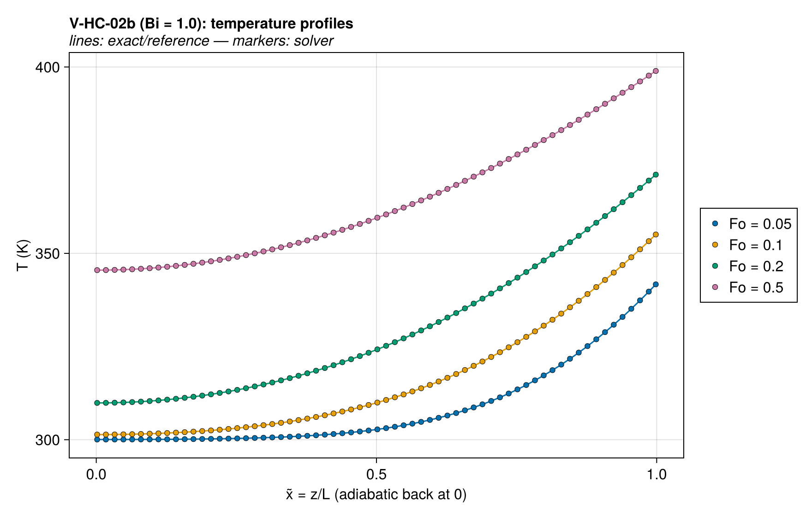

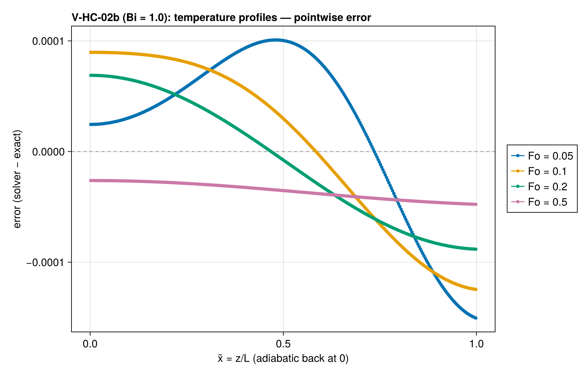

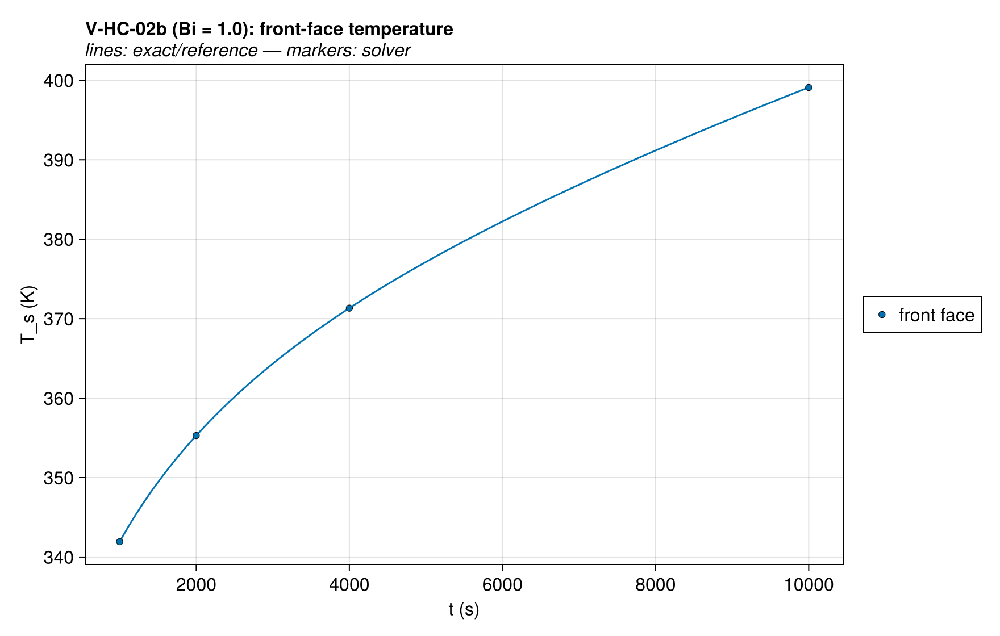

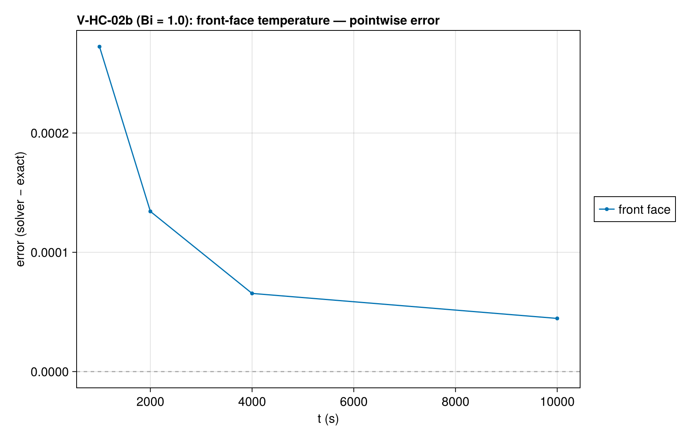

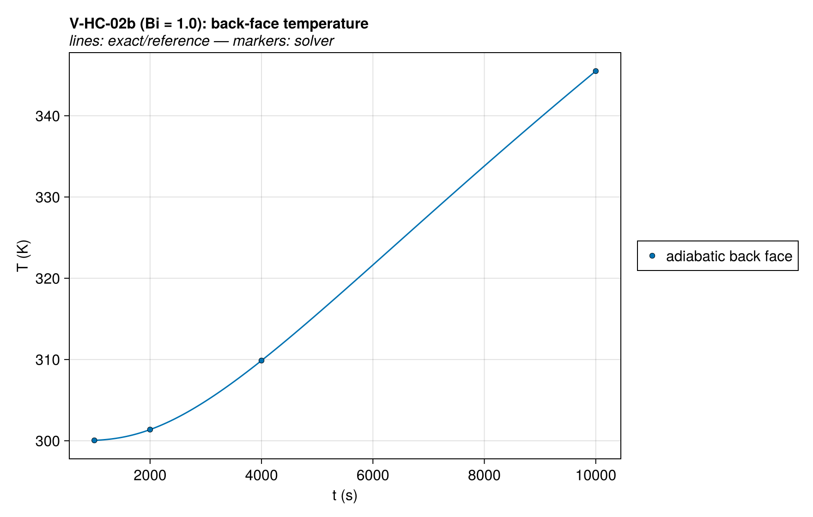

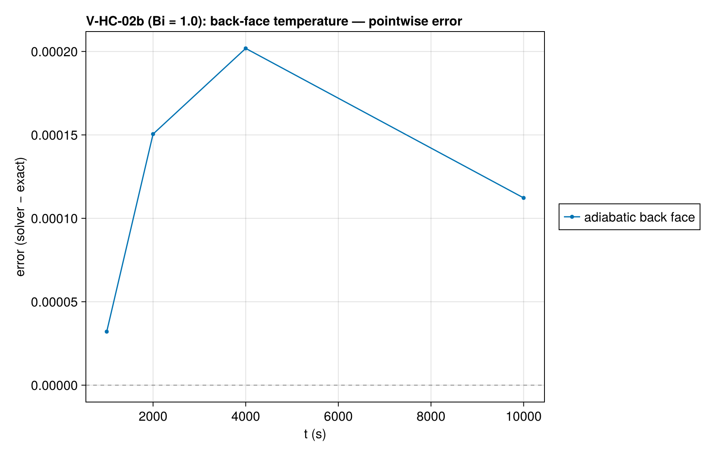

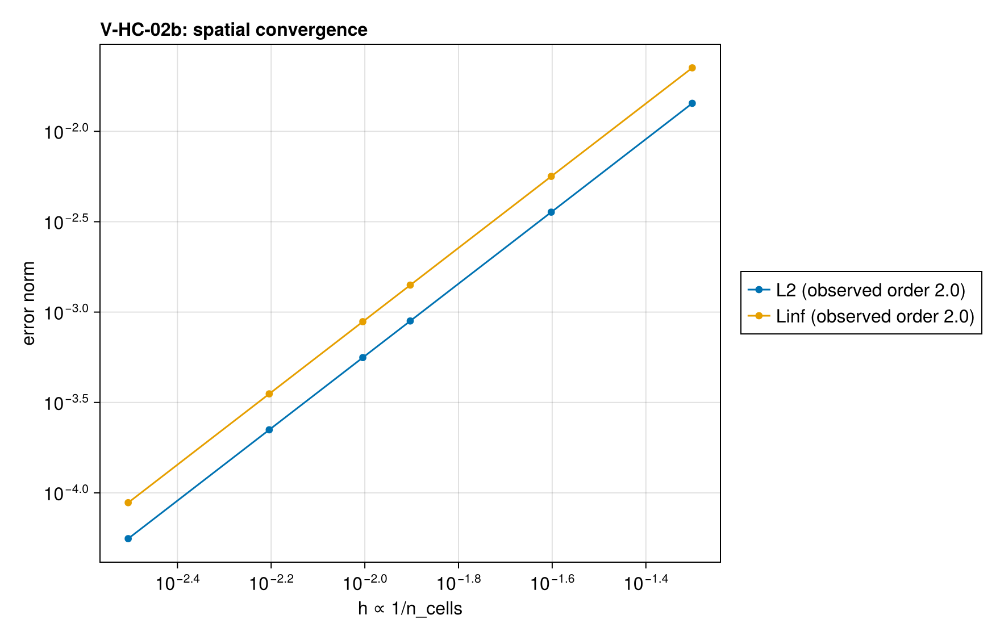

### Comparison with other codes

The same case was solved with FDS 6.11.0 at 101 cells (Δx≈1 mm); decks, outputs, and
run provenance are committed under `test/verification/reference/`.
Each code's error against the same exact solution is drawn below
on a log scale, muted gray behind this solver's series — the
signed linear-scale panel above shows where the error lives, this
one compares magnitudes across codes.

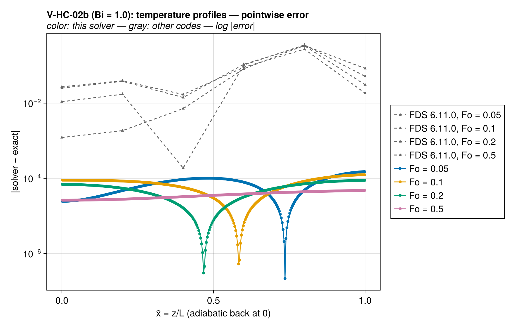

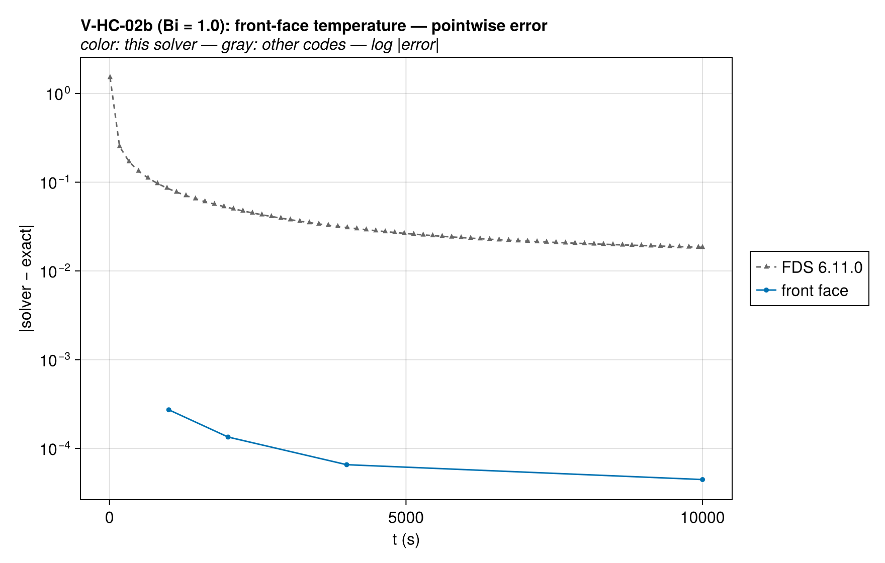

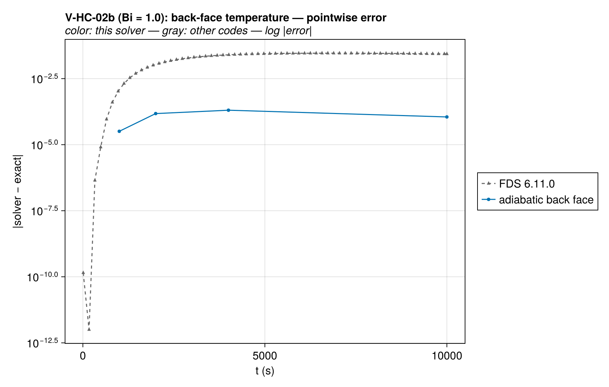

Wall times at every ladder rung against the reference runs.
Resolutions and simulated spans differ where noted (details in
`reference/timings.csv`), so cross-code timings are indicative
rather than a controlled benchmark; rungs at a matched
resolution are directly comparable.

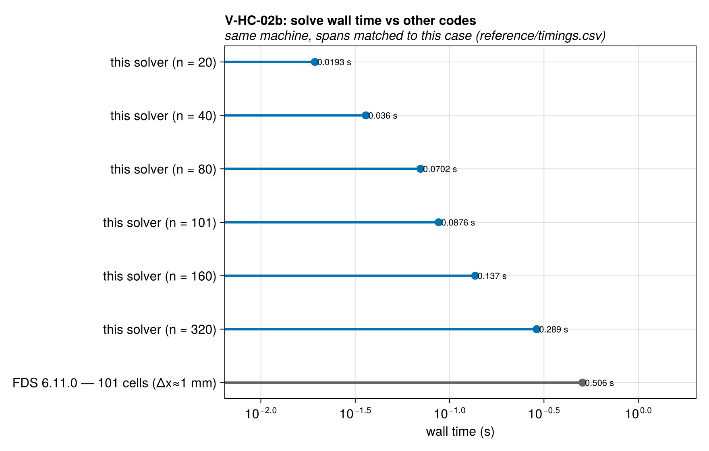

Solution overlays including the other codes' points: [T_profiles_vs_codes](assets/V-HC-02b/V-HC-02b_T_profiles_vs_codes.png), [surface_T_history_vs_codes](assets/V-HC-02b/V-HC-02b_surface_T_history_vs_codes.png), [back_T_history_vs_codes](assets/V-HC-02b/V-HC-02b_back_T_history_vs_codes.png).

### Convergence

| n_cells | h | wall (s) | L2 | Linf |
| --- | --- | --- | --- | --- |
| 20 | 0.05 | 0.01932 | 0.01429 | 0.02246 |
| 40 | 0.025 | 0.03601 | 0.003572 | 0.005634 |
| 80 | 0.0125 | 0.07017 | 0.0008929 | 0.00141 |
| 101 | 0.009901 | 0.08759 | 0.0005602 | 0.0008851 |
| 160 | 0.00625 | 0.1366 | 0.0002232 | 0.0003528 |
| 320 | 0.003125 | 0.2893 | 5.58e-05 | 8.822e-05 |

Observed order 2 (L2).

### Solver configuration

| setting | value |
| --- | --- |
| integrator | KenCarp4 (default) |
| abstol | 1.0e-12 |
| reltol | 1.0e-10 |

## V-HC-02c — finite slab, convective BC, Bi = 10.0

### Quantities of interest (n = 320)

| QoI | value | exact | error | tolerance | within tol | provenance |
| --- | --- | --- | --- | --- | --- | --- |
| L∞ T-profile error, Fo=0.05 | 0.001126 | — | 0.001126 | 0.06 | yes | observed max per Bi: 2.3e-4 (0.1), 2.4e-3 (1), 1.8e-2 (10), 2.0e-2 (100) K |
| surface temperature, Fo=0.05 | 453.5 | 453.5 | 0.0003044 | 0.015 | yes | front face from the surface Newton solve vs series at x̃=1; observed max per Bi: 9.2e-4 (0.1), 4.4e-3 (1), 4.9e-3 (10), 9.8e-4 (100) K |
| L∞ T-profile error, Fo=0.1 | 0.0005972 | — | 0.0005972 | 0.06 | yes | observed max per Bi: 2.3e-4 (0.1), 2.4e-3 (1), 1.8e-2 (10), 2.0e-2 (100) K |
| surface temperature, Fo=0.1 | 465.9 | 465.9 | 0.0001471 | 0.015 | yes | front face from the surface Newton solve vs series at x̃=1; observed max per Bi: 9.2e-4 (0.1), 4.4e-3 (1), 4.9e-3 (10), 9.8e-4 (100) K |
| L∞ T-profile error, Fo=0.2 | 0.0002715 | — | 0.0002715 | 0.06 | yes | observed max per Bi: 2.3e-4 (0.1), 2.4e-3 (1), 1.8e-2 (10), 2.0e-2 (100) K |
| surface temperature, Fo=0.2 | 475.5 | 475.5 | 5.103e-05 | 0.015 | yes | front face from the surface Newton solve vs series at x̃=1; observed max per Bi: 9.2e-4 (0.1), 4.4e-3 (1), 4.9e-3 (10), 9.8e-4 (100) K |
| L∞ T-profile error, Fo=0.5 | 0.0002269 | — | 0.0002269 | 0.06 | yes | observed max per Bi: 2.3e-4 (0.1), 2.4e-3 (1), 1.8e-2 (10), 2.0e-2 (100) K |
| surface temperature, Fo=0.5 | 487.1 | 487.1 | 1.973e-05 | 0.015 | yes | front face from the surface Newton solve vs series at x̃=1; observed max per Bi: 9.2e-4 (0.1), 4.4e-3 (1), 4.9e-3 (10), 9.8e-4 (100) K |

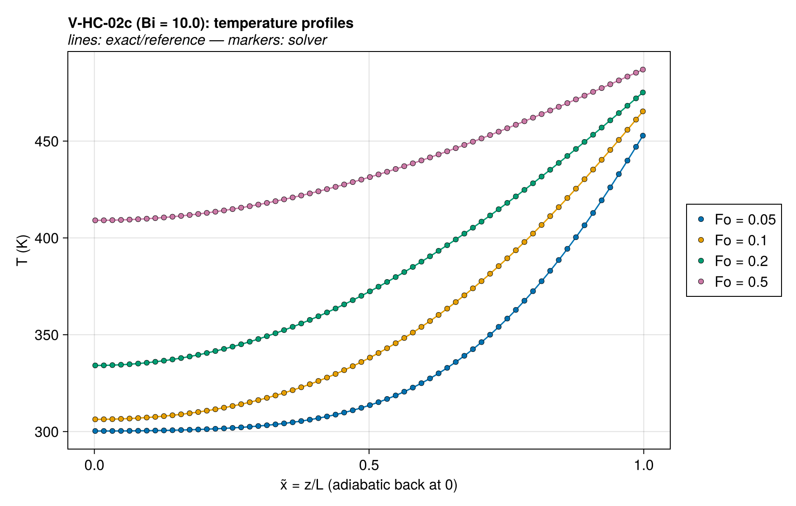

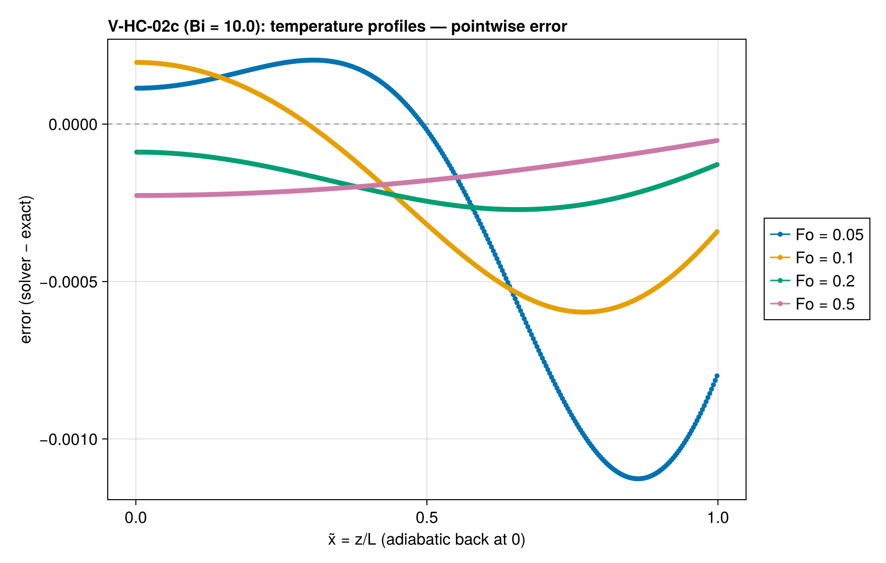

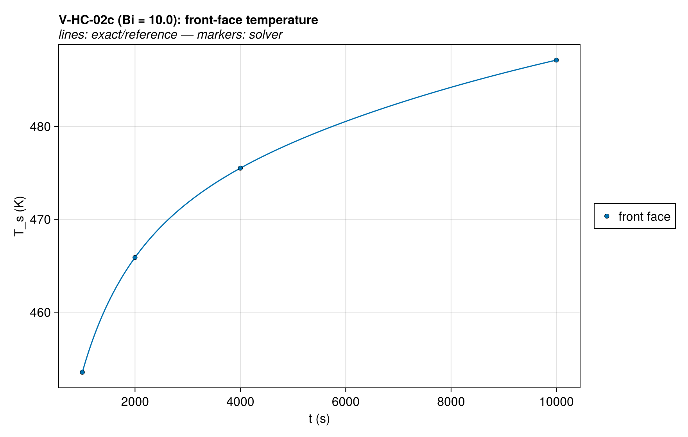

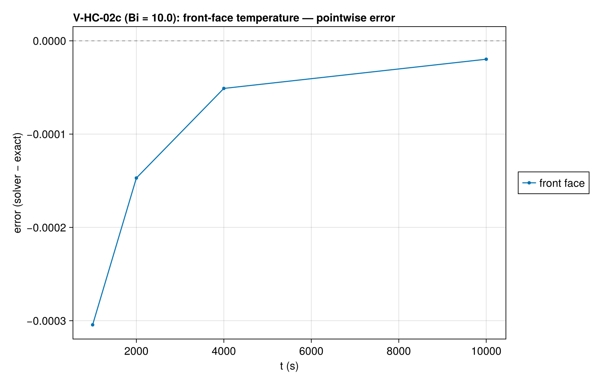

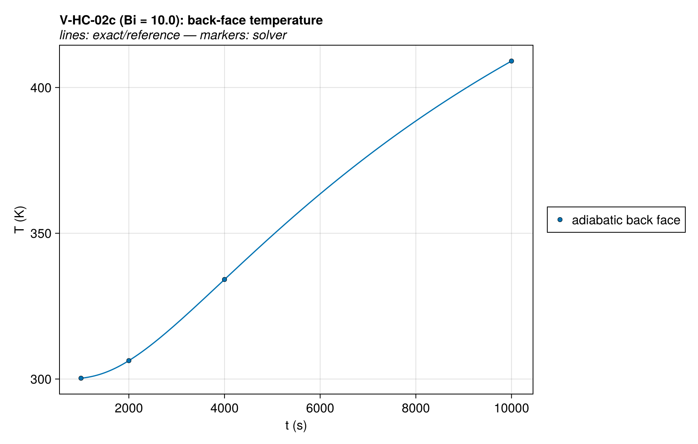

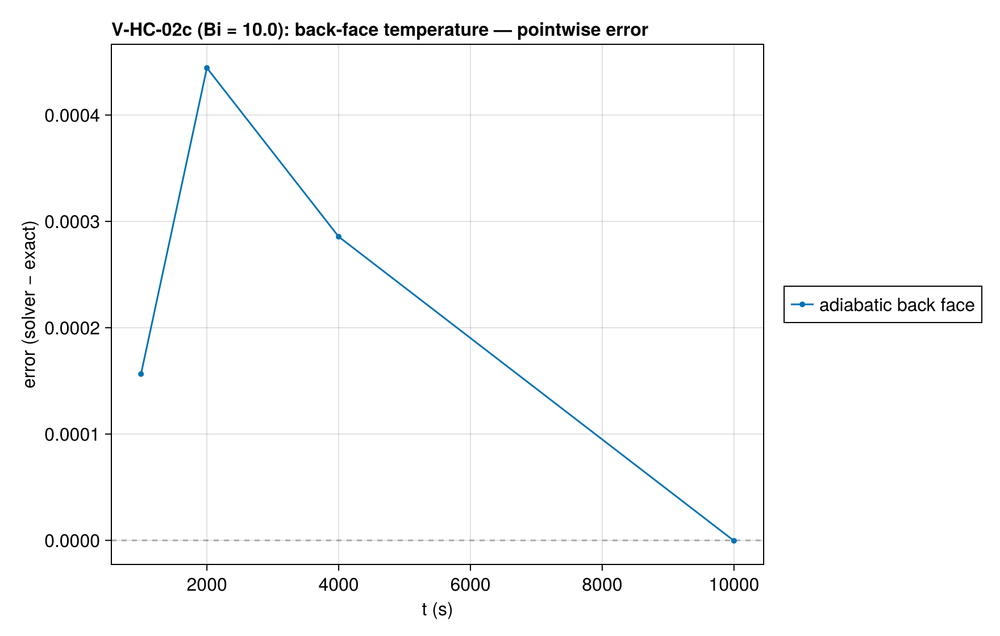

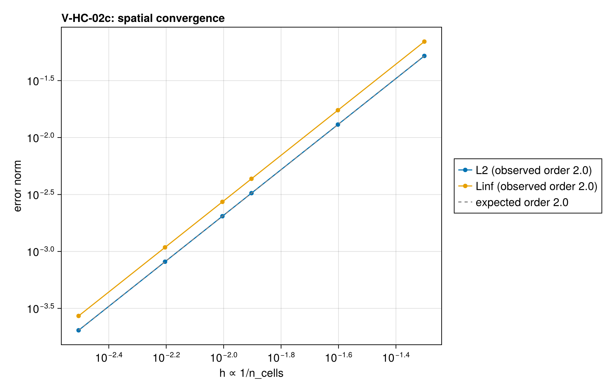

### Comparison with other codes

The same case was solved with FDS 6.11.0 at 101 cells (Δx≈1 mm); decks, outputs, and
run provenance are committed under `test/verification/reference/`.
Each code's error against the same exact solution is drawn below
on a log scale, muted gray behind this solver's series — the
signed linear-scale panel above shows where the error lives, this
one compares magnitudes across codes.

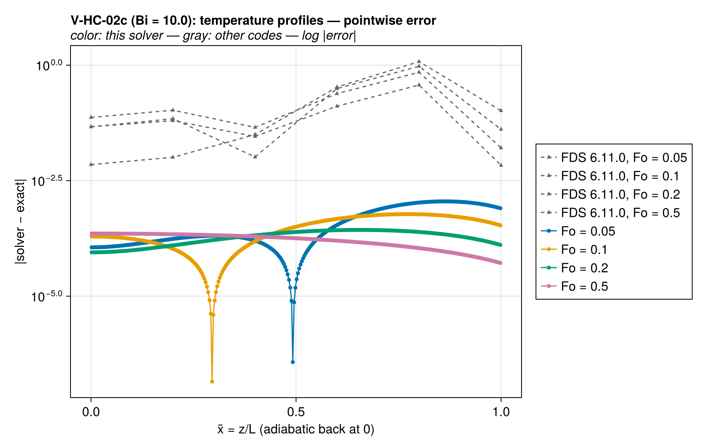

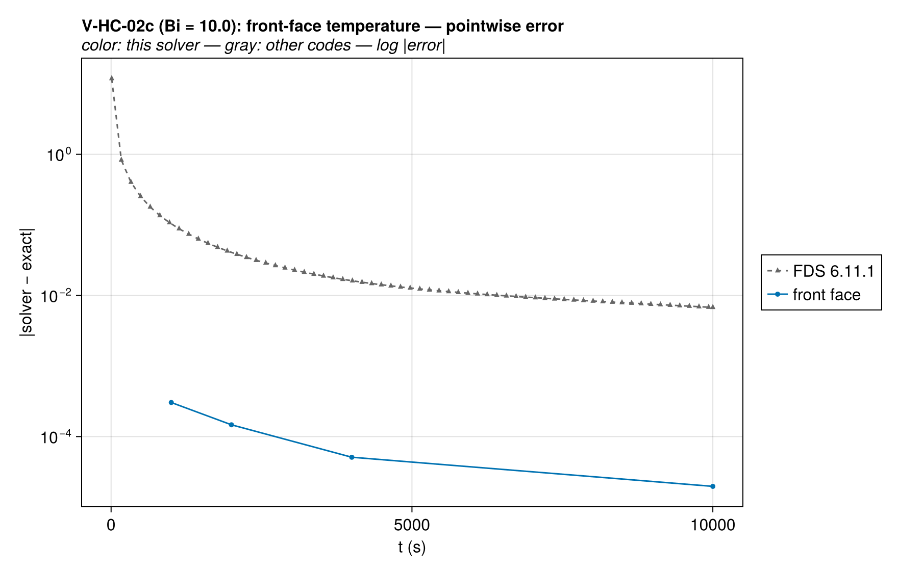

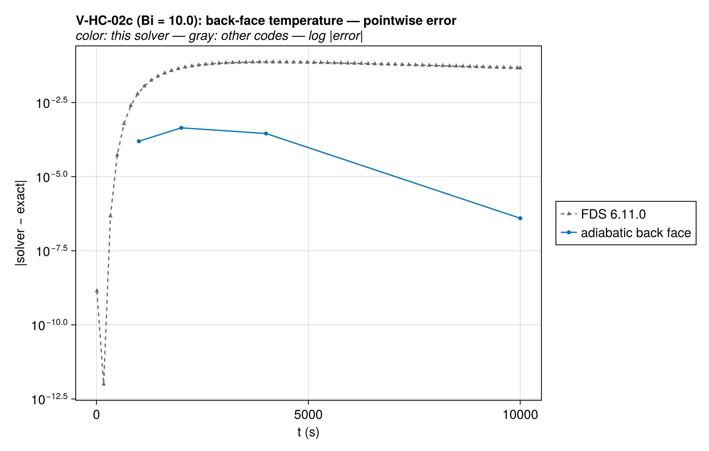

Wall times at every ladder rung against the reference runs.
Resolutions and simulated spans differ where noted (details in
`reference/timings.csv`), so cross-code timings are indicative
rather than a controlled benchmark; rungs at a matched
resolution are directly comparable.

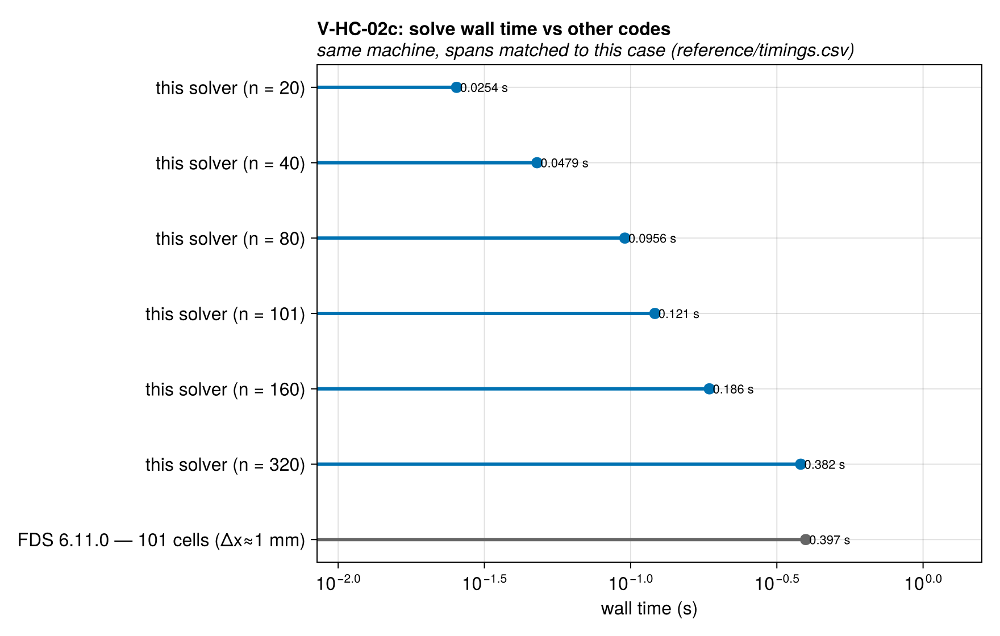

Solution overlays including the other codes' points: [T_profiles_vs_codes](assets/V-HC-02c/V-HC-02c_T_profiles_vs_codes.png), [surface_T_history_vs_codes](assets/V-HC-02c/V-HC-02c_surface_T_history_vs_codes.png), [back_T_history_vs_codes](assets/V-HC-02c/V-HC-02c_back_T_history_vs_codes.png).

### Convergence

| n_cells | h | wall (s) | L2 | Linf |
| --- | --- | --- | --- | --- |
| 20 | 0.05 | 0.02541 | 0.05208 | 0.06959 |
| 40 | 0.025 | 0.04786 | 0.013 | 0.01738 |
| 80 | 0.0125 | 0.09558 | 0.00325 | 0.004345 |
| 101 | 0.009901 | 0.1211 | 0.002039 | 0.002726 |
| 160 | 0.00625 | 0.1859 | 0.0008124 | 0.001086 |
| 320 | 0.003125 | 0.3817 | 0.0002031 | 0.0002715 |

Observed order 2.001 (L2), expected 2.0.

### Solver configuration

| setting | value |
| --- | --- |
| integrator | KenCarp4 (default) |
| abstol | 1.0e-12 |
| reltol | 1.0e-10 |

## V-HC-02d — finite slab, convective BC, Bi = 100.0

### Quantities of interest (n = 320)

| QoI | value | exact | error | tolerance | within tol | provenance |
| --- | --- | --- | --- | --- | --- | --- |
| L∞ T-profile error, Fo=0.05 | 0.001275 | — | 0.001275 | 0.06 | yes | observed max per Bi: 2.3e-4 (0.1), 2.4e-3 (1), 1.8e-2 (10), 2.0e-2 (100) K |
| surface temperature, Fo=0.05 | 495 | 495 | 6.105e-05 | 0.015 | yes | front face from the surface Newton solve vs series at x̃=1; observed max per Bi: 9.2e-4 (0.1), 4.4e-3 (1), 4.9e-3 (10), 9.8e-4 (100) K |
| L∞ T-profile error, Fo=0.1 | 0.0006256 | — | 0.0006256 | 0.06 | yes | observed max per Bi: 2.3e-4 (0.1), 2.4e-3 (1), 1.8e-2 (10), 2.0e-2 (100) K |
| surface temperature, Fo=0.1 | 496.4 | 496.4 | 2.152e-05 | 0.015 | yes | front face from the surface Newton solve vs series at x̃=1; observed max per Bi: 9.2e-4 (0.1), 4.4e-3 (1), 4.9e-3 (10), 9.8e-4 (100) K |
| L∞ T-profile error, Fo=0.2 | 0.0002811 | — | 0.0002811 | 0.06 | yes | observed max per Bi: 2.3e-4 (0.1), 2.4e-3 (1), 1.8e-2 (10), 2.0e-2 (100) K |
| surface temperature, Fo=0.2 | 497.5 | 497.5 | 6.205e-06 | 0.015 | yes | front face from the surface Newton solve vs series at x̃=1; observed max per Bi: 9.2e-4 (0.1), 4.4e-3 (1), 4.9e-3 (10), 9.8e-4 (100) K |
| L∞ T-profile error, Fo=0.5 | 0.0002559 | — | 0.0002559 | 0.06 | yes | observed max per Bi: 2.3e-4 (0.1), 2.4e-3 (1), 1.8e-2 (10), 2.0e-2 (100) K |
| surface temperature, Fo=0.5 | 498.8 | 498.8 | 2.813e-06 | 0.015 | yes | front face from the surface Newton solve vs series at x̃=1; observed max per Bi: 9.2e-4 (0.1), 4.4e-3 (1), 4.9e-3 (10), 9.8e-4 (100) K |

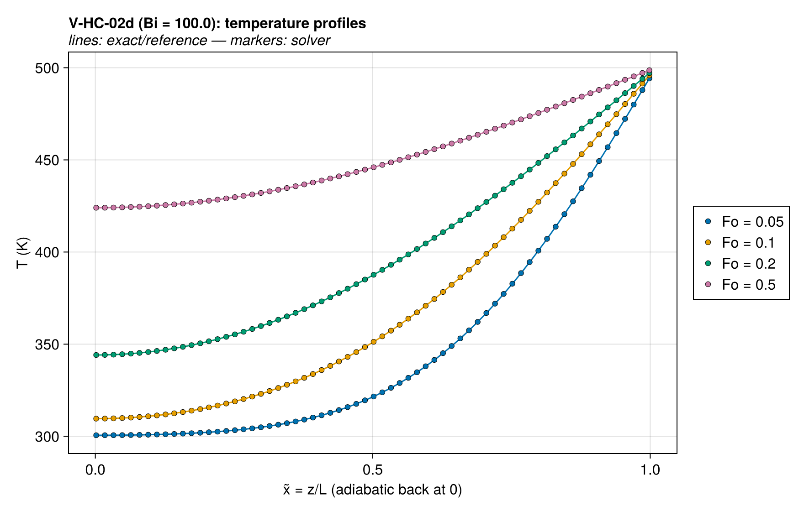

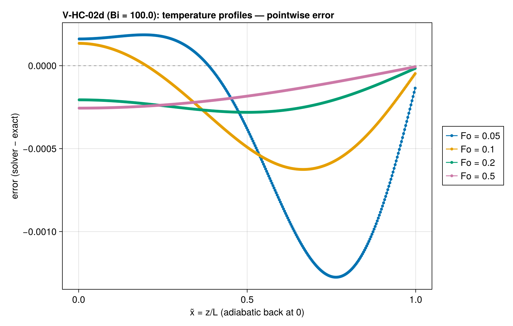

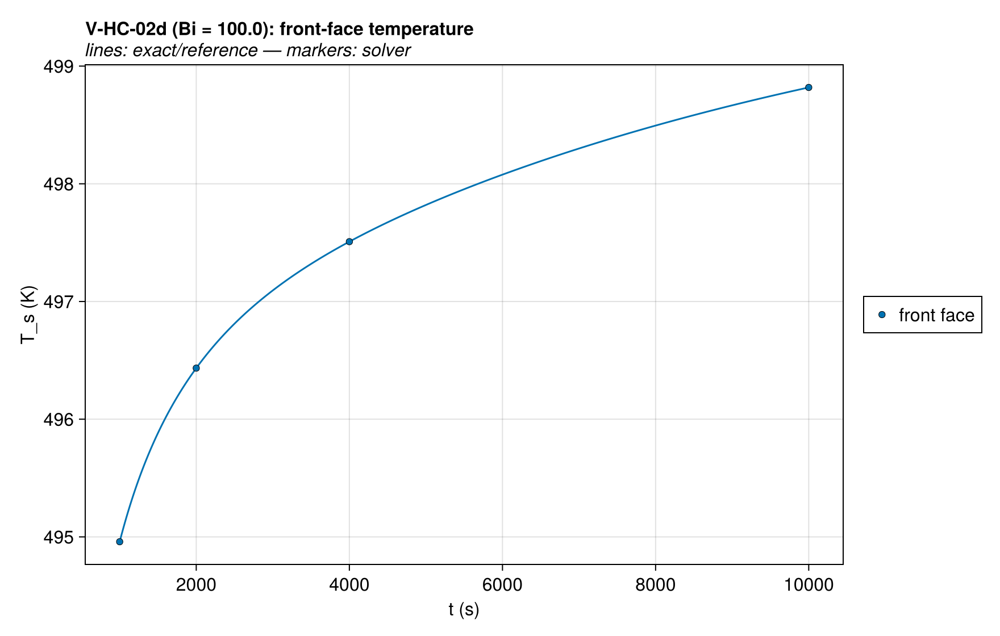

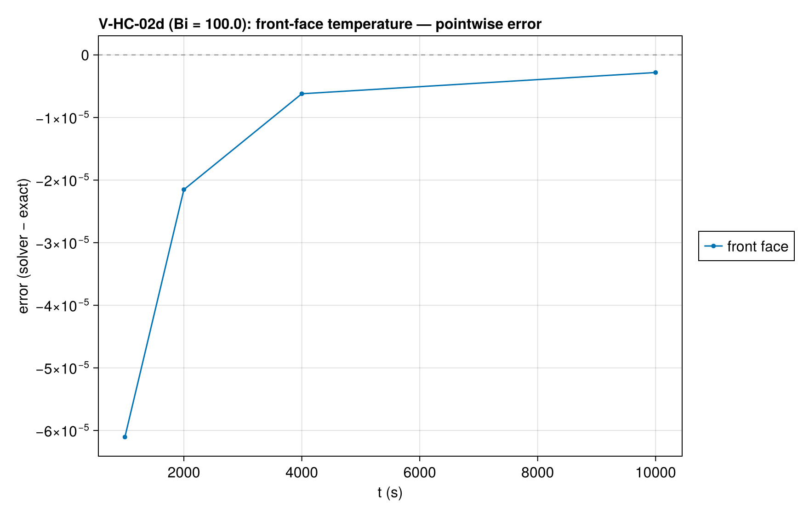

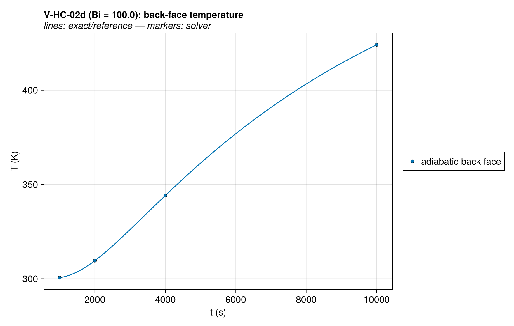

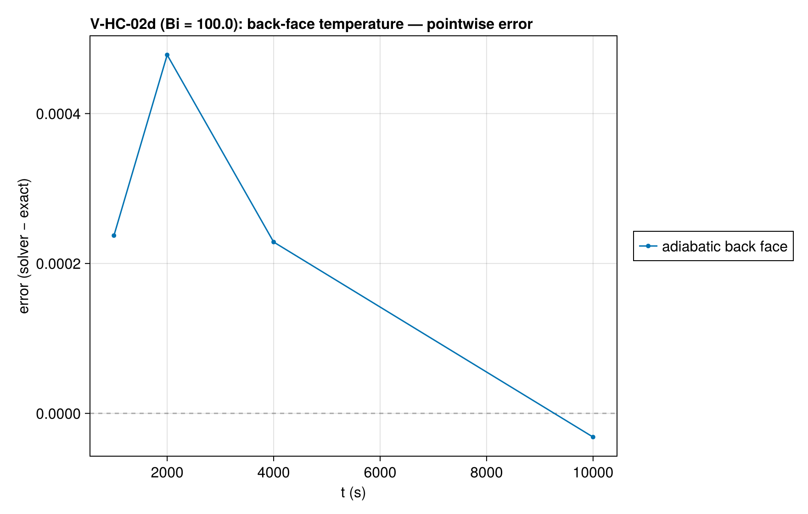

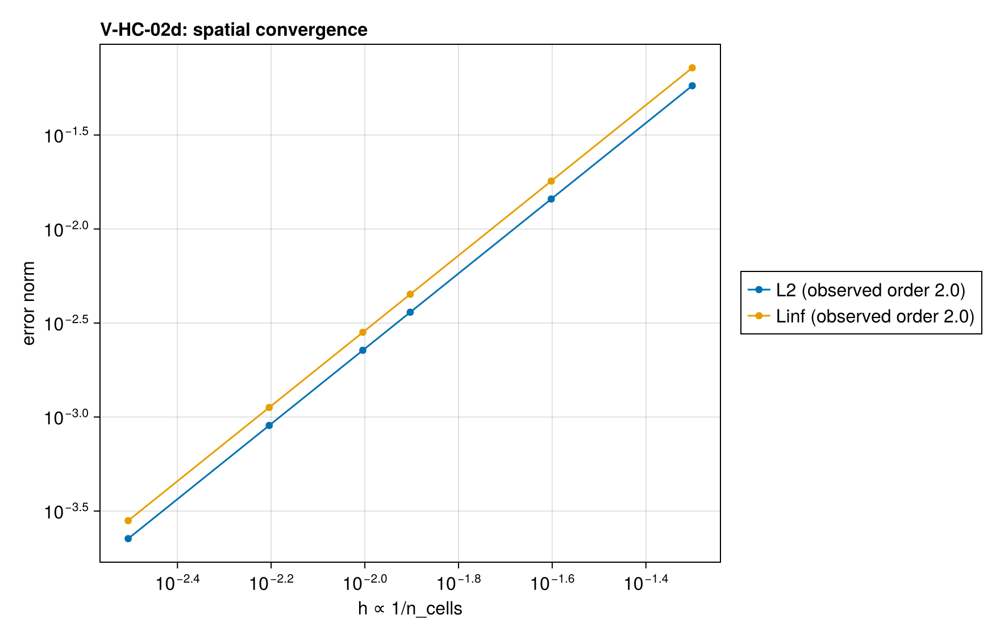

### Comparison with other codes

The same case was solved with FDS 6.11.0 at 101 cells (Δx≈1 mm); decks, outputs, and
run provenance are committed under `test/verification/reference/`.
Each code's error against the same exact solution is drawn below
on a log scale, muted gray behind this solver's series — the
signed linear-scale panel above shows where the error lives, this
one compares magnitudes across codes.

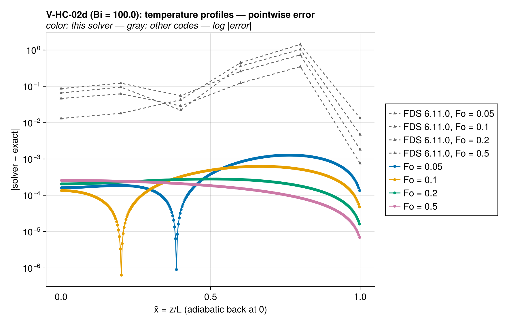

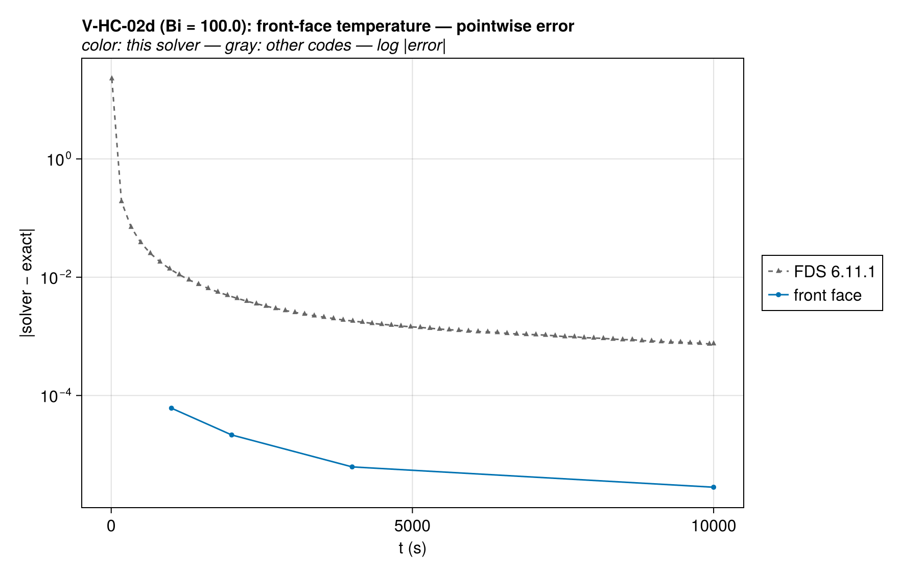

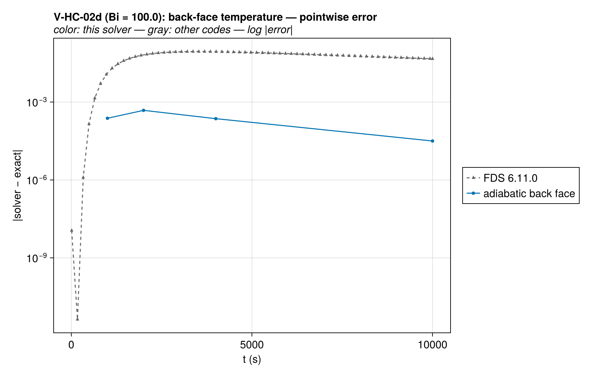

Wall times at every ladder rung against the reference runs.
Resolutions and simulated spans differ where noted (details in
`reference/timings.csv`), so cross-code timings are indicative
rather than a controlled benchmark; rungs at a matched
resolution are directly comparable.

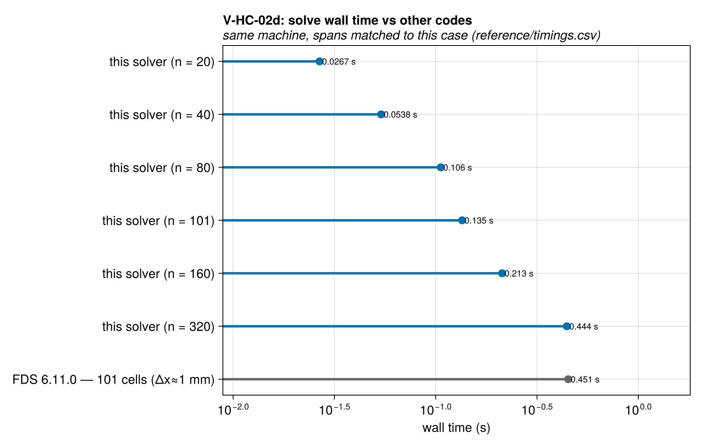

Solution overlays including the other codes' points: [T_profiles_vs_codes](assets/V-HC-02d/V-HC-02d_T_profiles_vs_codes.png), [surface_T_history_vs_codes](assets/V-HC-02d/V-HC-02d_surface_T_history_vs_codes.png), [back_T_history_vs_codes](assets/V-HC-02d/V-HC-02d_back_T_history_vs_codes.png).

### Convergence

| n_cells | h | wall (s) | L2 | Linf |
| --- | --- | --- | --- | --- |
| 20 | 0.05 | 0.02671 | 0.0578 | 0.07198 |
| 40 | 0.025 | 0.0538 | 0.01444 | 0.01799 |
| 80 | 0.0125 | 0.106 | 0.003609 | 0.004497 |
| 101 | 0.009901 | 0.135 | 0.002264 | 0.002822 |
| 160 | 0.00625 | 0.2128 | 0.0009023 | 0.001124 |
| 320 | 0.003125 | 0.4441 | 0.0002256 | 0.0002811 |

Observed order 2 (L2).

### Solver configuration

| setting | value |
| --- | --- |
| integrator | KenCarp4 (default) |
| abstol | 1.0e-12 |
| reltol | 1.0e-10 |

