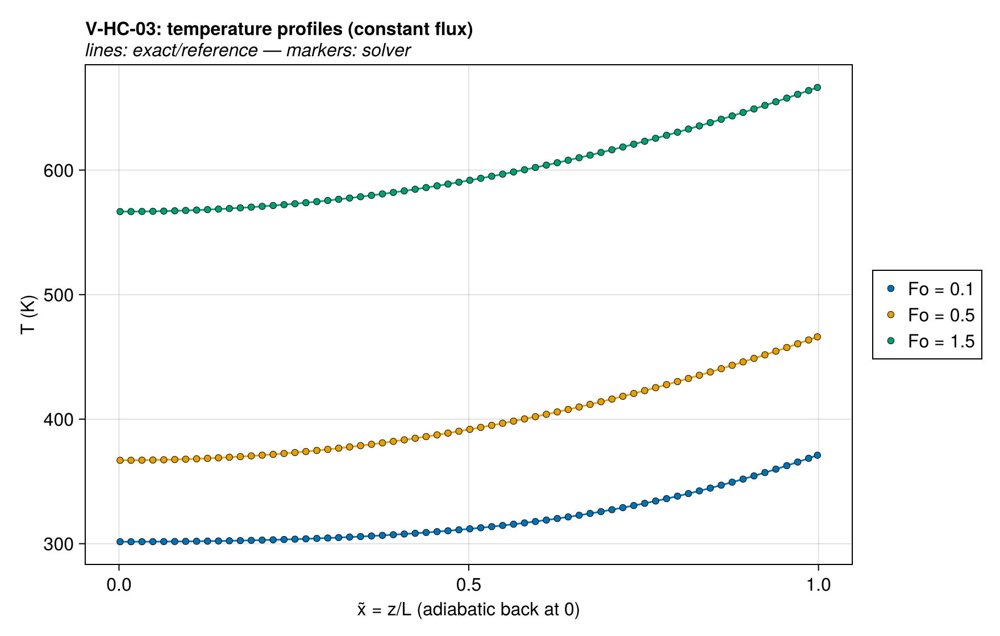
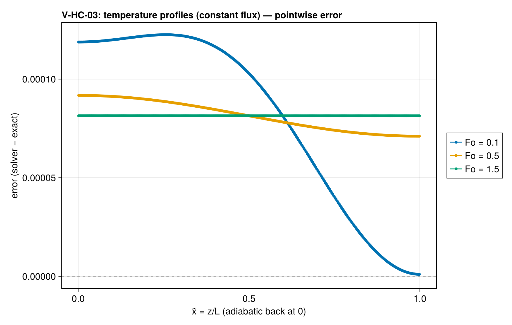
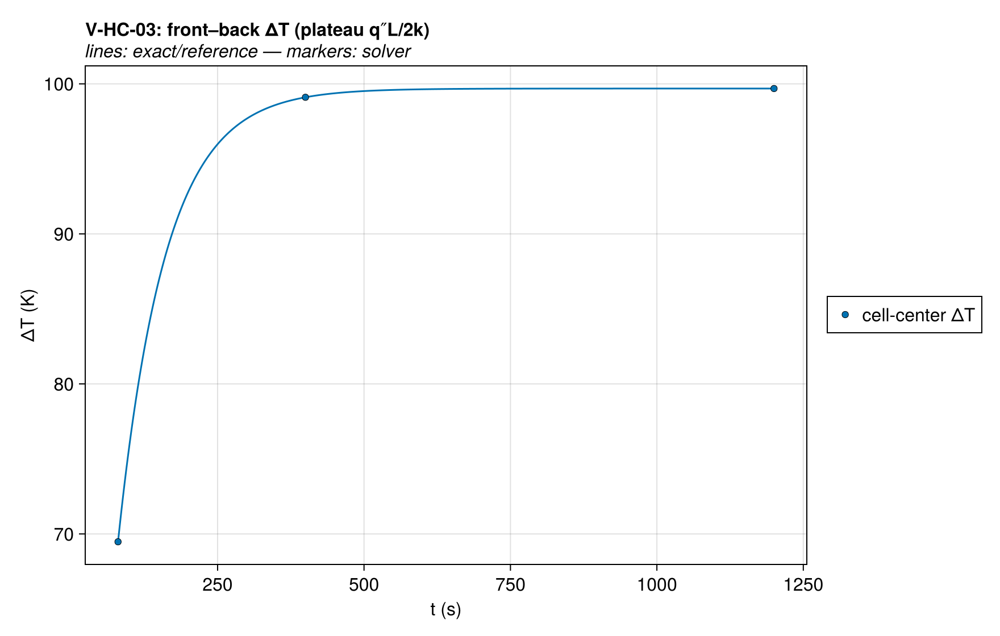
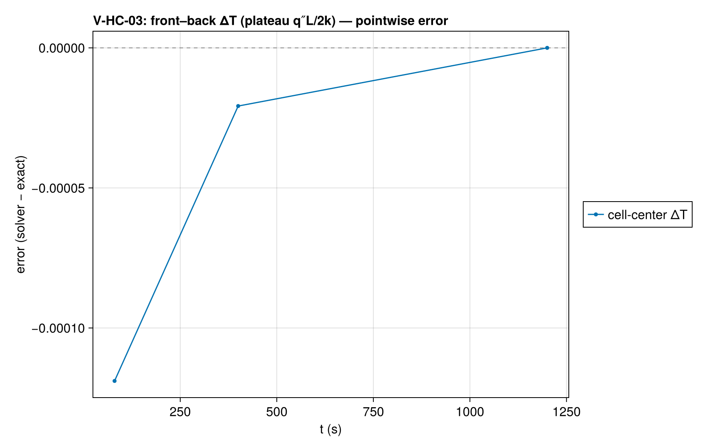
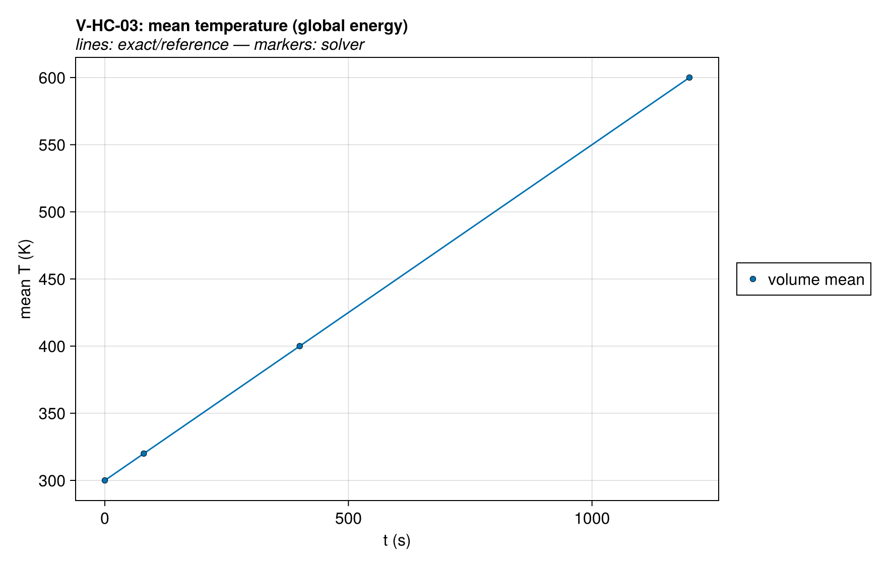
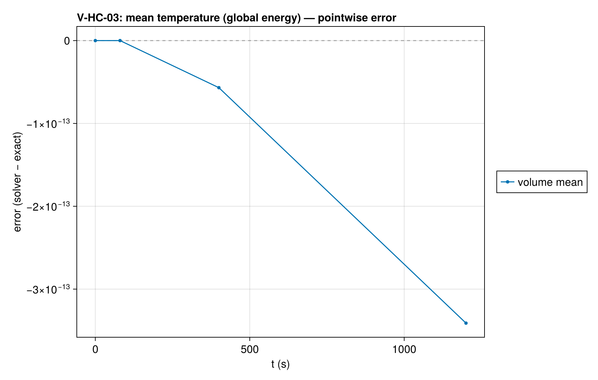
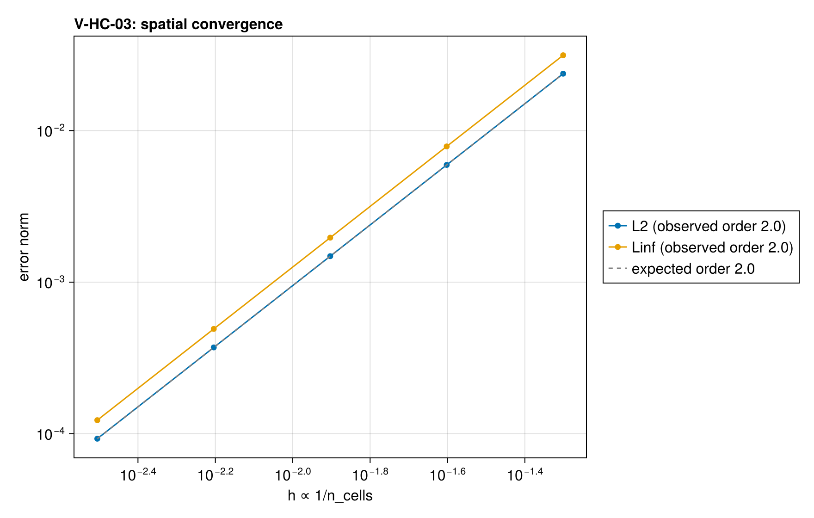
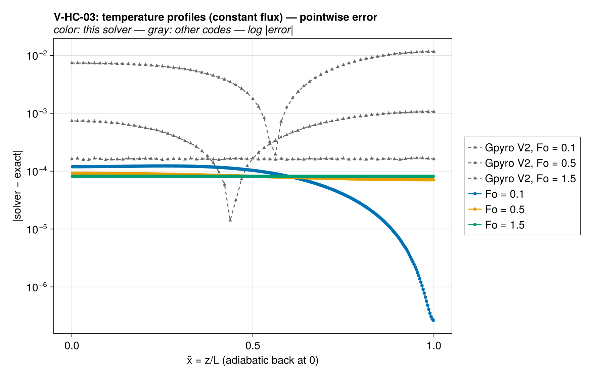
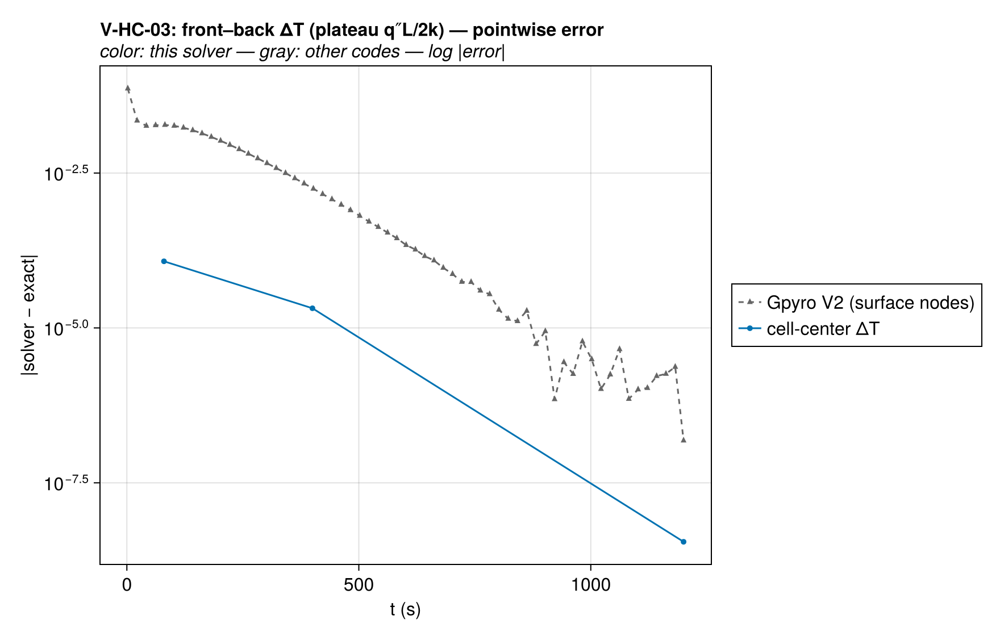

# V-HC-03 — finite slab, constant flux, adiabatic back

**Tags:** `heat_conduction`, `heat_flux_bc`, `energy_balance`

**References:**

- Carslaw & Jaeger (1959) §3.8 (constant-flux slab series)

## Problem statement

Complements the semi-infinite cases at LONG times: the thermal wave reaches
the back face — the regime cone-calorimeter simulations actually live in.
Constant q″ at the top face, insulated back; exact solution
T = T₀ + (q″L/k)·φ(x̃, Fo) with φ from exact/slab_series.jl (C&J §3.8),
x̃ = z/L from the adiabatic back face.

Two parameter-free exact targets beyond the profiles:
- front–back plateau: ΔT → q″L/2k for Fo ≫ 1 (100 K here),
- global energy: mean temperature rises exactly at q″/(ρcL) (0.25 K/s here).

### Quantities of interest (n = 320)

| QoI | value | exact | error | tolerance | within tol | provenance |
| --- | --- | --- | --- | --- | --- | --- |
| L∞ T-profile error, Fo=0.1 | 0.0001229 | — | 0.0001229 | 0.006 | yes | observed 2.0e-3/1.5e-3/1.3e-3 K at Fo=0.1/0.5/1.5 |
| L∞ T-profile error, Fo=0.5 | 9.176e-05 | — | 9.176e-05 | 0.006 | yes | observed 2.0e-3/1.5e-3/1.3e-3 K at Fo=0.1/0.5/1.5 |
| L∞ T-profile error, Fo=1.5 | 8.138e-05 | — | 8.138e-05 | 0.006 | yes | observed 2.0e-3/1.5e-3/1.3e-3 K at Fo=0.1/0.5/1.5 |
| front–back ΔT plateau, Fo=1.5 | 99.69 | 99.69 | 3.535e-09 | 1e-05 | yes | steady-shape plateau q″L/2k = 100 K between faces |
| mean-temperature rise (global energy) | 200 | 200 | 1.307e-12 | 1e-05 | yes | exact constant q″/(ρcL) = 0.25 K/s; integrator-tolerance limited |

### Comparison with other codes

Physical-problem agreement does not establish equal discretization or cost. See the [mesh and time comparison basis](comparison_coverage.md#comparison-basis-audit) and [per-pair inventory](assets/comparison_basis.csv). Runtime comparisons require a shared achieved-accuracy target.

Gpyro V2 revision `bff0126c68f2` uses 321 boundary nodes (320 intervals, 0.0625 mm spacing). The base mesh matches the plotted Julia spacing where spatially resolved. Independent time and space refinements, native outputs, and provenance are retained under `test/verification/reference/gpyro/v2_migration/`. See the [V2 accuracy checks](comparison_coverage.md#gpyro-v2-accuracy). These runs carry no timing measurements.

Accuracy comparison only; timing measurements are omitted.

Error panels show absolute error at each code's output points. Zeros are displayed at 1e-12 on the logarithmic axis; the reference CSV precision limits the discernible error.

Solution overlays including the other codes' points: [T_profiles_vs_codes](assets/V-HC-03/V-HC-03_T_profiles_vs_codes.png), [front_back_dT_history_vs_codes](assets/V-HC-03/V-HC-03_front_back_dT_history_vs_codes.png).

### Convergence

| n_cells | h | L2 | Linf |
| --- | --- | --- | --- |
| 20 | 0.05 | 0.02373 | 0.0314 |
| 40 | 0.025 | 0.005935 | 0.007862 |
| 80 | 0.0125 | 0.001484 | 0.001966 |
| 160 | 0.00625 | 0.000371 | 0.0004916 |
| 200 | 0.005 | 0.0002374 | 0.0003146 |
| 320 | 0.003125 | 9.275e-05 | 0.0001229 |

Observed order 2 (L2), expected 2.0.

### Solver configuration

| setting | value |
| --- | --- |
| integrator | Rodas5P (default) |
| abstol | 1.0e-12 |
| reltol | 1.0e-10 |
