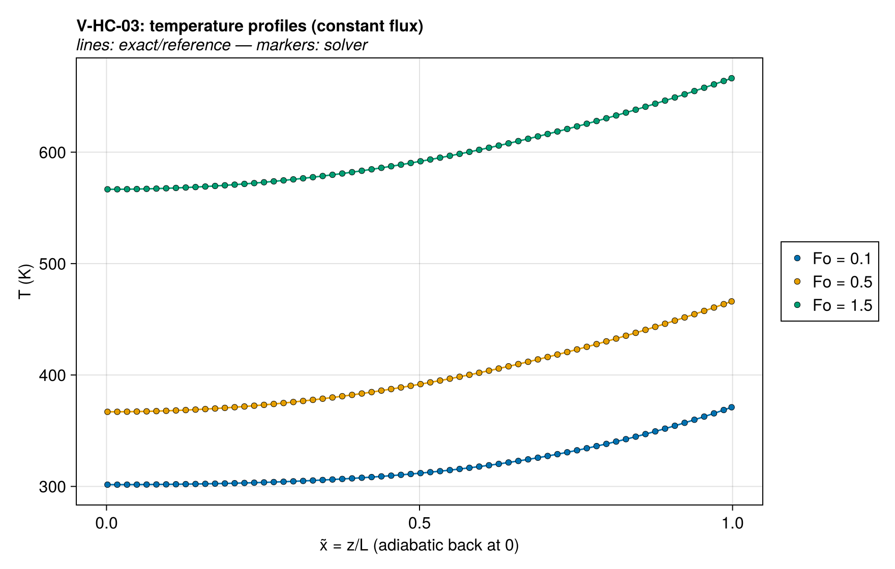
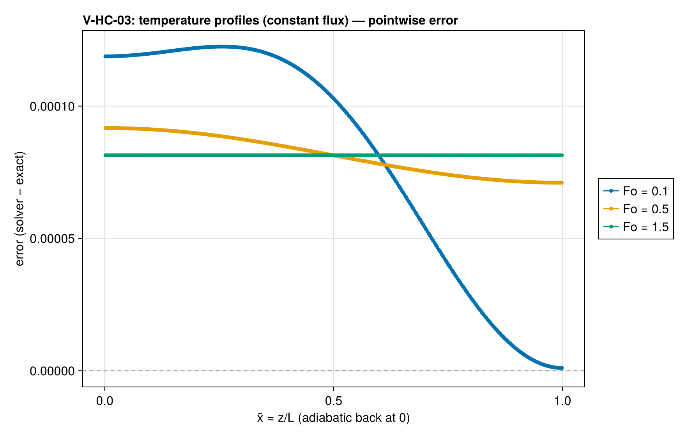
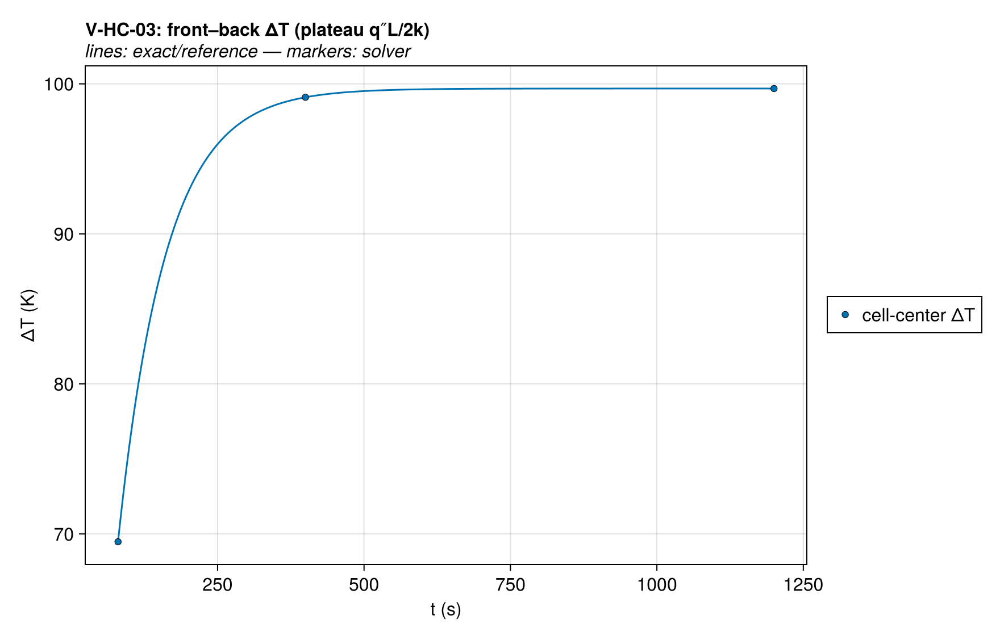
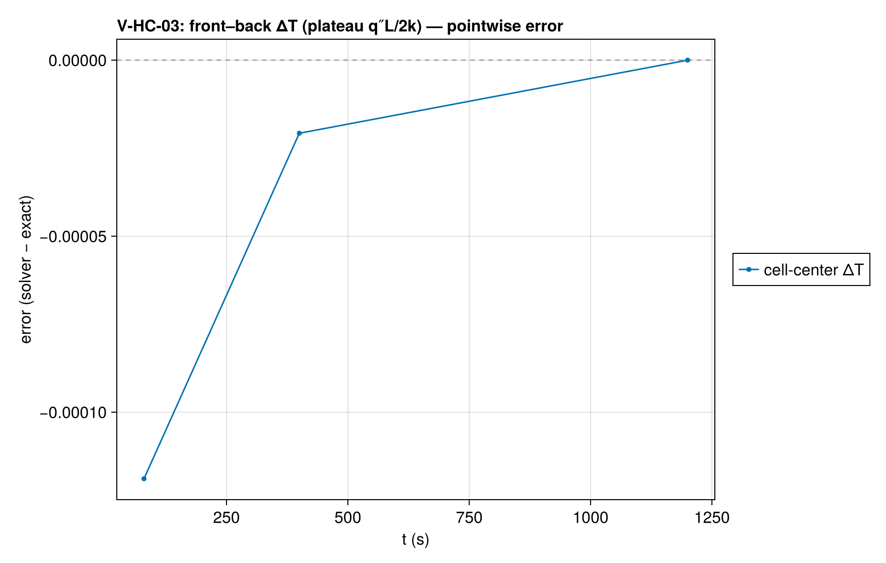
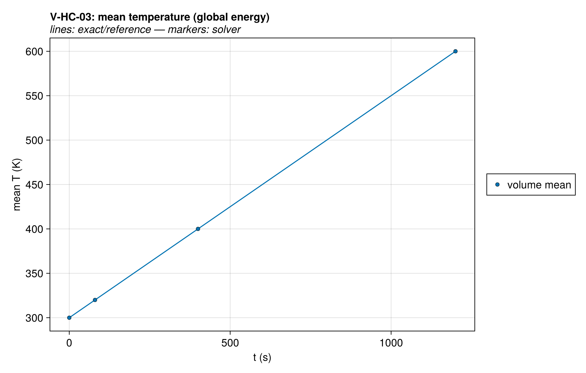
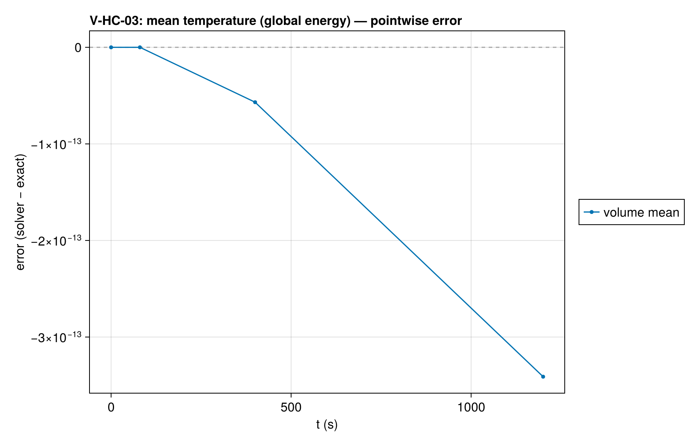
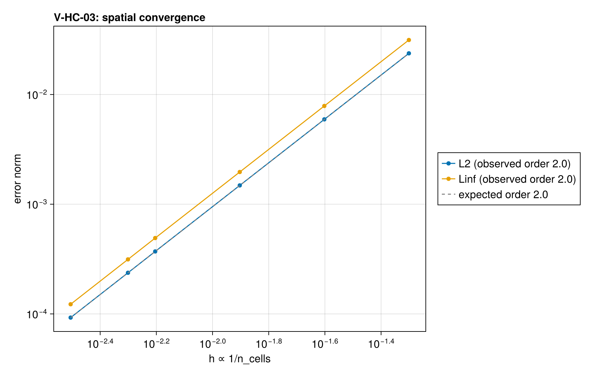
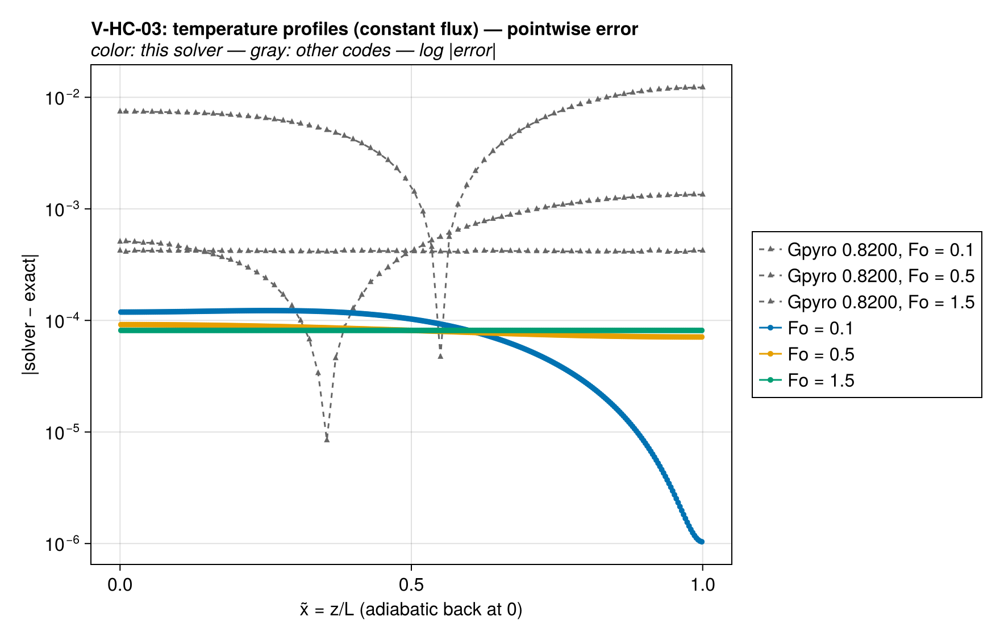
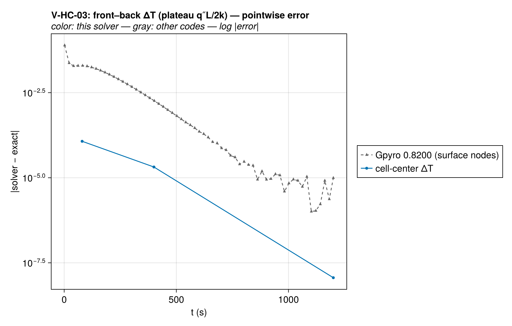
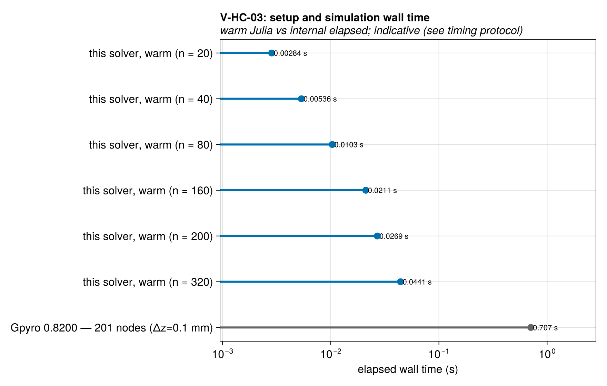

# V-HC-03 — finite slab, constant flux, adiabatic back

**Tags:** `heat_conduction`, `heat_flux_bc`, `energy_balance`

**References:**

- Carslaw & Jaeger (1959) §3.8 (constant-flux slab series)

## Problem statement

Complements the semi-infinite cases at LONG times: the thermal wave reaches
the back face — the regime cone-calorimeter simulations actually live in.
Constant q″ at the top face, insulated back; exact solution
T = T₀ + (q″L/k)·φ(x̃, Fo) with φ from exact/slab_series.jl (C&J §3.8),
x̃ = z/L from the adiabatic back face.

Two parameter-free exact targets beyond the profiles:
- front–back plateau: ΔT → q″L/2k for Fo ≫ 1 (100 K here),
- global energy: mean temperature rises exactly at q″/(ρcL) (0.25 K/s here).

### Quantities of interest (n = 320)

| QoI | value | exact | error | tolerance | within tol | provenance |
| --- | --- | --- | --- | --- | --- | --- |
| L∞ T-profile error, Fo=0.1 | 0.0001229 | — | 0.0001229 | 0.006 | yes | observed 2.0e-3/1.5e-3/1.3e-3 K at Fo=0.1/0.5/1.5 |
| L∞ T-profile error, Fo=0.5 | 9.176e-05 | — | 9.176e-05 | 0.006 | yes | observed 2.0e-3/1.5e-3/1.3e-3 K at Fo=0.1/0.5/1.5 |
| L∞ T-profile error, Fo=1.5 | 8.138e-05 | — | 8.138e-05 | 0.006 | yes | observed 2.0e-3/1.5e-3/1.3e-3 K at Fo=0.1/0.5/1.5 |
| front–back ΔT plateau, Fo=1.5 | 99.69 | 99.69 | 3.535e-09 | 1e-05 | yes | steady-shape plateau q″L/2k = 100 K between faces |
| mean-temperature rise (global energy) | 200 | 200 | 1.307e-12 | 1e-05 | yes | exact constant q″/(ρcL) = 0.25 K/s; integrator-tolerance limited |

### Comparison with other codes

The same case was solved with Gpyro 0.8200 at 201 nodes (Δz=0.1 mm); decks, outputs, and
run provenance are committed under `test/verification/reference/`.
Each code's error against the same exact solution is drawn below
on a log scale, muted gray behind this solver's series — the
signed linear-scale panel above shows where the error lives, this
one compares magnitudes across codes.

Setup and simulation wall times at every ladder rung against the
reference runs. Julia times model construction and solve after warm-up;
FDS and Gpyro use internal total elapsed wall time, including setup and
simulation output. Process launch and Julia compilation are excluded
from the figure. Output costs, discretizations and time-stepping rules
still differ, so these are indicative costs, not pure solver speedups.
See `test/verification/reference/README.md` and `timings.csv` for the
timer boundaries, resolutions and measurement provenance.

Reference timings below are medians of five runs after one warm-up. Full process time also includes launch and shutdown; it is shown separately and is not compared with Julia's warmed time.

| Code | Resolution | Internal elapsed (s) | Full process (s) |
| --- | --- | --- | --- |
| Gpyro 0.8200 | 201 nodes (Δz=0.1 mm) | 0.707 | 0.7094 |

Solution overlays including the other codes' points: [T_profiles_vs_codes](assets/V-HC-03/V-HC-03_T_profiles_vs_codes.png), [front_back_dT_history_vs_codes](assets/V-HC-03/V-HC-03_front_back_dT_history_vs_codes.png).

### Convergence

| n_cells | h | wall (s) | L2 | Linf |
| --- | --- | --- | --- | --- |
| 20 | 0.05 | 0.002844 | 0.02373 | 0.0314 |
| 40 | 0.025 | 0.005356 | 0.005935 | 0.007862 |
| 80 | 0.0125 | 0.01033 | 0.001484 | 0.001966 |
| 160 | 0.00625 | 0.02108 | 0.000371 | 0.0004916 |
| 200 | 0.005 | 0.02694 | 0.0002374 | 0.0003146 |
| 320 | 0.003125 | 0.04415 | 9.275e-05 | 0.0001229 |

Observed order 2 (L2), expected 2.0.

### Solver configuration

| setting | value |
| --- | --- |
| integrator | Rodas5P (default) |
| abstol | 1.0e-12 |
| reltol | 1.0e-10 |

