# V-HC-04 — two-layer slab, k-ratio 10.0:1

**Tags:** `heat_conduction`, `laminate`, `harmonic_mean`, `steady`

**References:**

- series thermal-resistance network (exact)
- FDS Verification Guide `insulated_steel_plate` / `ht_pile`

## Problem statement

FDS `insulated_steel_plate` / `ht_pile` analog. Two inert solids layered via
composition step ICs; Dirichlet T at both faces; steady exact solution is
the series-resistance network:

  q = ΔT / (d₁/k₁ + d₂/k₂),   T_interface = T_bot + q·d₁/k₁,  piecewise linear

What is verified: the distance-weighted harmonic-mean face conductivity is
NODALLY EXACT for piecewise-constant k with the jump on a face — the steady
cell-center temperatures and the boundary fluxes must match the resistance
network to integrator precision, for k-ratios 10:1 and 100:1.

Off-face variant (c): composition step ICs are SAMPLED AT CELL CENTERS, so
a prescribed interface that is not on a face quantizes to the nearest face —
there are no mixed cells. Measured: the numerics match the
QUANTIZED-interface network to 1e-11 (i.e. the scheme is still nodally
exact), and the entire user-facing error is the true-vs-quantized network
gap (1.64% in flux, 1.47 K in profile at Δz = 0.5 mm) — pinned here against
its a-priori Δz/2 sensitivity bound.

Variant (d) uses the same prescribed 10.2 mm interface as (c), with a mesh
face placed there using line_mesh. Both have 40 cells. Its
physical problem is unchanged, so the same native FDS/Gpyro runs apply.
Every member reports errors against the prescribed and represented geometry
separately; the off-face case remains a deliberate geometry-resolution test.

No convergence spec: (a)/(b)/(d) are nodally exact (error is integrator-, not
mesh-limited); (c) is quantization-dominated and non-monotone in n.

## V-HC-04a — two-layer slab, k-ratio 10.0:1

### Quantities of interest (n = 40)

| QoI | value | exact | error | tolerance | within tol | provenance |
| --- | --- | --- | --- | --- | --- | --- |
| L∞ steady profile vs represented interface | 5.684e-14 | — | 5.684e-14 | 1e-08 | yes | harmonic-mean face k is NODALLY EXACT for face-aligned jumps; k-ratio 10.0:1 |
| steady bottom-face flux vs represented interface | 909.1 | 909.1 | 9.079e-14 | 1e-08 | yes | both faces must carry the exact series flux |
| steady bottom-face flux vs prescribed interface | 909.1 | 909.1 | 9.079e-14 | 1e-08 | yes | exact geometry discrepancy plus the 1e-8 discrete-solve allowance |
| steady top-face flux vs represented interface | 909.1 | 909.1 | 1.013e-14 | 1e-08 | yes | both faces must carry the exact series flux |
| steady top-face flux vs prescribed interface | 909.1 | 909.1 | 1.013e-14 | 1e-08 | yes | exact geometry discrepancy plus the 1e-8 discrete-solve allowance |
| L∞ steady profile vs prescribed interface | 5.684e-14 | — | 5.684e-14 | 1e-08 | yes | exact geometry discrepancy plus the 1e-8 K discrete-solve allowance |
| represented interface position (m) | 0.01 | 0.01 | 0 | 0.00025 | yes | cell-center composition sampling; at most half a cell displacement |
| steadiness (last half-interval drift) | 1.137e-13 | — | 1.137e-13 | 1e-06 | yes | t_end = 10·L²/α_min |

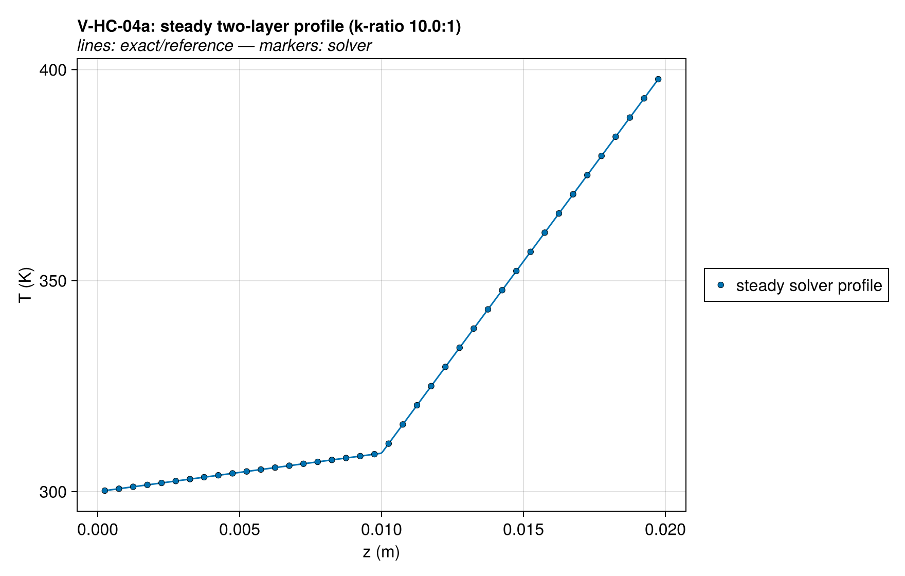

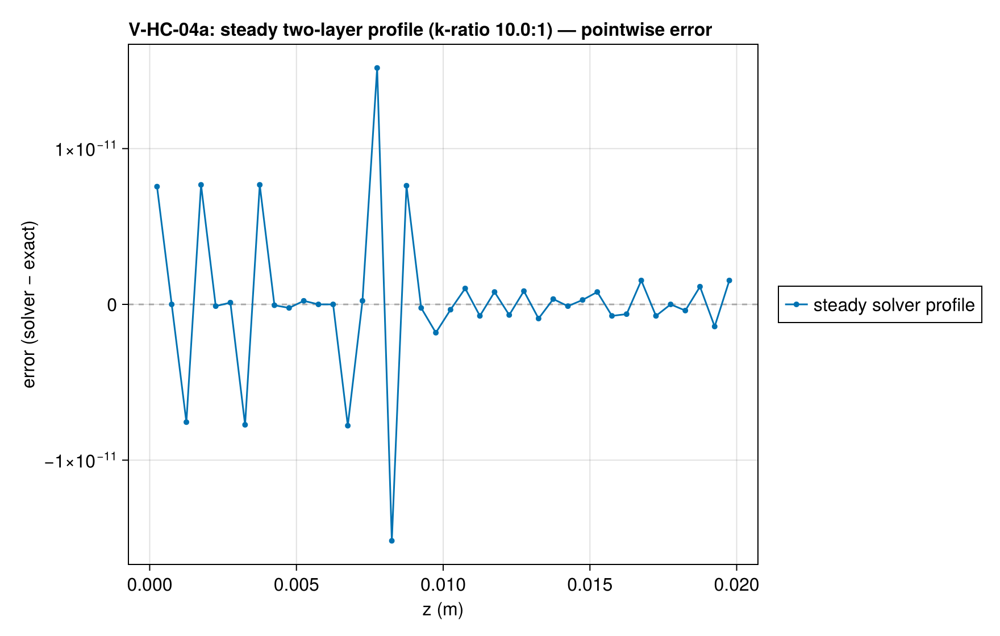

### Comparison with other codes

Physical-problem agreement does not establish equal discretization or cost. See the [mesh and time comparison basis](comparison_coverage.md#comparison-basis-audit) and [per-pair inventory](assets/comparison_basis.csv). Runtime comparisons require a shared achieved-accuracy target.

Matched native-input runs, independent time refinement at fixed mesh (dt, dt/2, dt/4), and spatial refinement at fixed dt/4 are retained under `test/verification/reference/matched/`. See the [coverage and matching notes](comparison_coverage.md). The plotted external series use the base resolution; [analytical errors at all retained resolutions](assets/V-HC-04a/V-HC-04a_comparison_accuracy.csv) are retained separately. These runs provide accuracy measurements.

Accuracy comparison only; timing measurements are omitted.

Error panels show absolute error at each code's output points. Zeros are displayed at 1e-12 on the logarithmic axis; the reference CSV precision limits the discernible error.

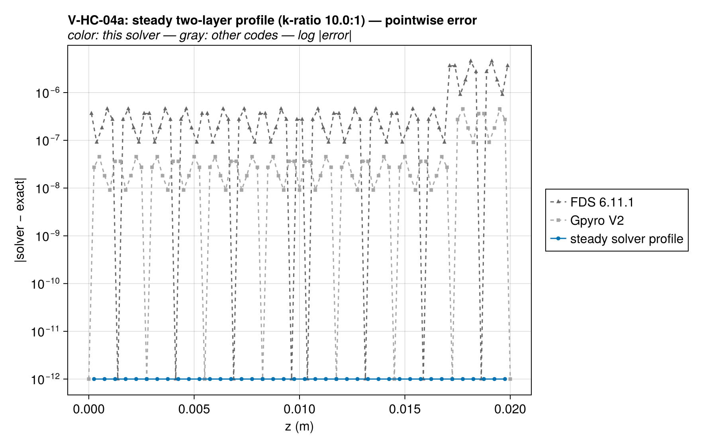

Solution overlays including the other codes' points: [T_profile_steady_vs_codes](assets/V-HC-04a/V-HC-04a_T_profile_steady_vs_codes.png).

### Solver configuration

| setting | value |
| --- | --- |
| integrator | Rodas5P (default) |
| abstol | 1.0e-10 |
| reltol | 1.0e-8 |

## V-HC-04b — two-layer slab, k-ratio 100.0:1

### Quantities of interest (n = 40)

| QoI | value | exact | error | tolerance | within tol | provenance |
| --- | --- | --- | --- | --- | --- | --- |
| L∞ steady profile vs represented interface | 5.684e-14 | — | 5.684e-14 | 1e-08 | yes | harmonic-mean face k is NODALLY EXACT for face-aligned jumps; k-ratio 100.0:1 |
| steady bottom-face flux vs represented interface | 99.01 | 99.01 | 5.912e-13 | 1e-08 | yes | both faces must carry the exact series flux |
| steady bottom-face flux vs prescribed interface | 99.01 | 99.01 | 5.912e-13 | 1e-08 | yes | exact geometry discrepancy plus the 1e-8 discrete-solve allowance |
| steady top-face flux vs represented interface | 99.01 | 99.01 | 5.024e-15 | 1e-08 | yes | both faces must carry the exact series flux |
| steady top-face flux vs prescribed interface | 99.01 | 99.01 | 5.024e-15 | 1e-08 | yes | exact geometry discrepancy plus the 1e-8 discrete-solve allowance |
| L∞ steady profile vs prescribed interface | 5.684e-14 | — | 5.684e-14 | 1e-08 | yes | exact geometry discrepancy plus the 1e-8 K discrete-solve allowance |
| represented interface position (m) | 0.01 | 0.01 | 0 | 0.00025 | yes | cell-center composition sampling; at most half a cell displacement |
| steadiness (last half-interval drift) | 1.137e-13 | — | 1.137e-13 | 1e-06 | yes | t_end = 10·L²/α_min |

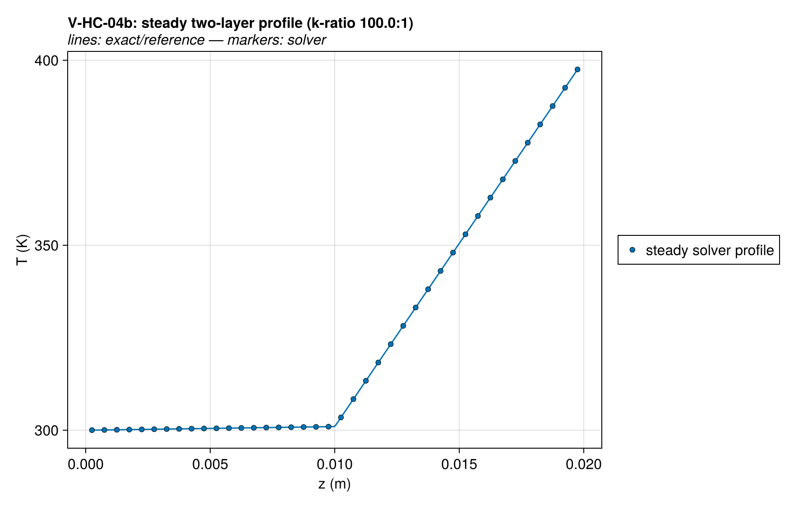

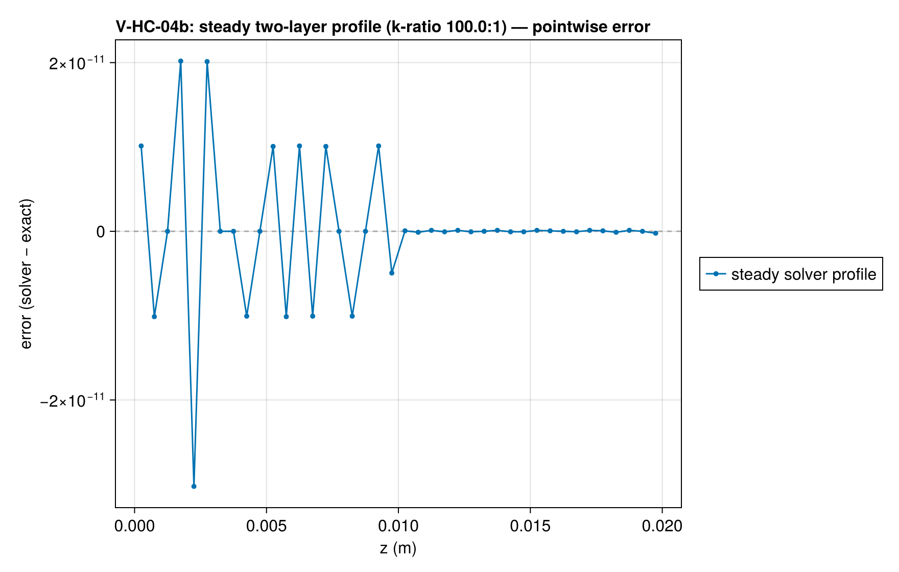

### Comparison with other codes

Physical-problem agreement does not establish equal discretization or cost. See the [mesh and time comparison basis](comparison_coverage.md#comparison-basis-audit) and [per-pair inventory](assets/comparison_basis.csv). Runtime comparisons require a shared achieved-accuracy target.

Matched native-input runs, independent time refinement at fixed mesh (dt, dt/2, dt/4), and spatial refinement at fixed dt/4 are retained under `test/verification/reference/matched/`. See the [coverage and matching notes](comparison_coverage.md). The plotted external series use the base resolution; [analytical errors at all retained resolutions](assets/V-HC-04b/V-HC-04b_comparison_accuracy.csv) are retained separately. These runs provide accuracy measurements.

Accuracy comparison only; timing measurements are omitted.

Error panels show absolute error at each code's output points. Zeros are displayed at 1e-12 on the logarithmic axis; the reference CSV precision limits the discernible error.

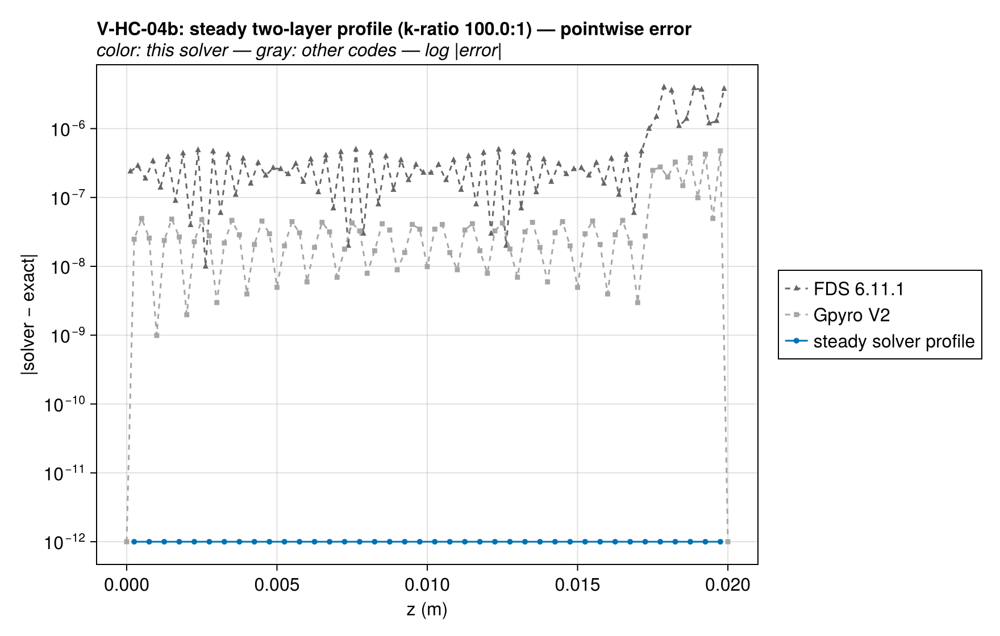

Solution overlays including the other codes' points: [T_profile_steady_vs_codes](assets/V-HC-04b/V-HC-04b_T_profile_steady_vs_codes.png).

### Solver configuration

| setting | value |
| --- | --- |
| integrator | Rodas5P (default) |
| abstol | 1.0e-10 |
| reltol | 1.0e-8 |

## V-HC-04c — two-layer slab, k-ratio 10.0:1 (off-face interface)

### Quantities of interest (n = 40)

| QoI | value | exact | error | tolerance | within tol | provenance |
| --- | --- | --- | --- | --- | --- | --- |
| L∞ steady profile vs represented interface | 5.684e-14 | — | 5.684e-14 | 1e-08 | yes | harmonic-mean face k is NODALLY EXACT for face-aligned jumps; k-ratio 10.0:1 |
| steady bottom-face flux vs represented interface | 909.1 | 909.1 | 9.079e-14 | 1e-08 | yes | both faces must carry the exact series flux |
| steady bottom-face flux vs prescribed interface | 909.1 | 924.2 | 0.01636 | 0.01636 | yes | exact geometry discrepancy plus the 1e-8 discrete-solve allowance |
| steady top-face flux vs represented interface | 909.1 | 909.1 | 1.013e-14 | 1e-08 | yes | both faces must carry the exact series flux |
| steady top-face flux vs prescribed interface | 909.1 | 924.2 | 0.01636 | 0.01636 | yes | exact geometry discrepancy plus the 1e-8 discrete-solve allowance |
| L∞ steady profile vs prescribed interface | 1.475 | — | 1.475 | 1.475 | yes | exact geometry discrepancy plus the 1e-8 K discrete-solve allowance |
| represented interface position (m) | 0.01 | 0.0102 | 0.0002 | 0.00025 | yes | cell-center composition sampling; at most half a cell displacement |
| interface-quantization smearing (documented) | 0.01636 | 0 | 0.01636 | 0.02079 | yes | THE laminate-off-mesh error users see: flux off by 1.64% at Δz = 0.0005000000000000004 m |
| steadiness (last half-interval drift) | 1.137e-13 | — | 1.137e-13 | 1e-06 | yes | t_end = 10·L²/α_min |

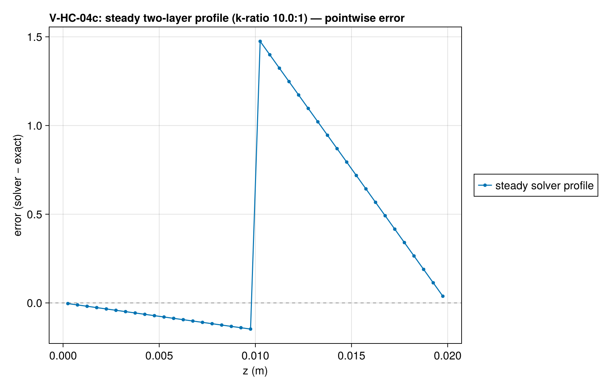

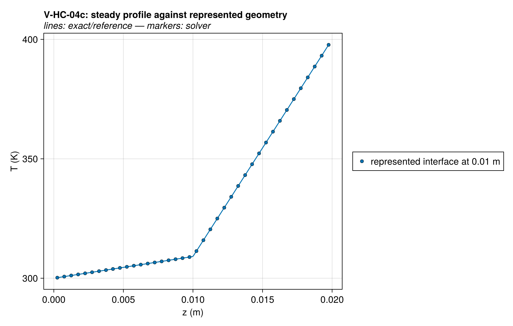

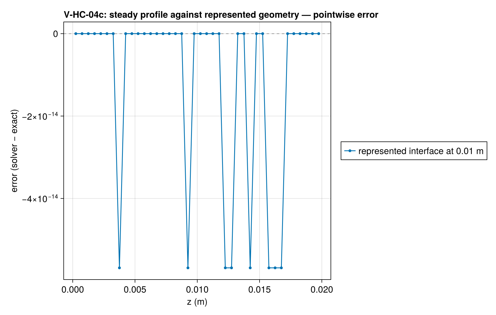

### Comparison with other codes

Physical-problem agreement does not establish equal discretization or cost. See the [mesh and time comparison basis](comparison_coverage.md#comparison-basis-audit) and [per-pair inventory](assets/comparison_basis.csv). Runtime comparisons require a shared achieved-accuracy target.

Matched native-input runs, independent time refinement at fixed mesh (dt, dt/2, dt/4), and spatial refinement at fixed dt/4 are retained under `test/verification/reference/matched/`. See the [coverage and matching notes](comparison_coverage.md). The plotted external series use the base resolution; [analytical errors at all retained resolutions](assets/V-HC-04c/V-HC-04c_comparison_accuracy.csv) are retained separately. These runs provide accuracy measurements.

Accuracy comparison only; timing measurements are omitted.

Error panels show absolute error at each code's output points. Zeros are displayed at 1e-12 on the logarithmic axis; the reference CSV precision limits the discernible error.

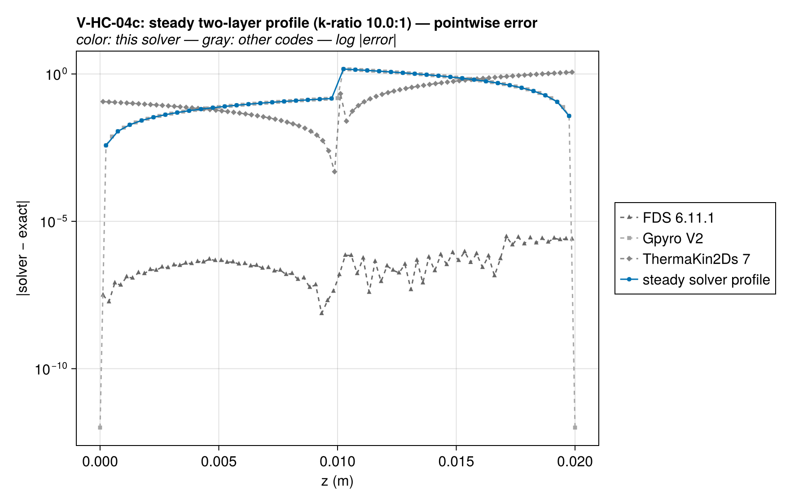

Solution overlays including the other codes' points: [T_profile_steady_vs_codes](assets/V-HC-04c/V-HC-04c_T_profile_steady_vs_codes.png).

### Solver configuration

| setting | value |
| --- | --- |
| integrator | Rodas5P (default) |
| abstol | 1.0e-10 |
| reltol | 1.0e-8 |

## V-HC-04d — two-layer slab, k-ratio 10.0:1 (10.2 mm interface aligned to a mesh face)

### Quantities of interest (n = 40)

| QoI | value | exact | error | tolerance | within tol | provenance |
| --- | --- | --- | --- | --- | --- | --- |
| L∞ steady profile vs represented interface | 5.684e-14 | — | 5.684e-14 | 1e-08 | yes | harmonic-mean face k is NODALLY EXACT for face-aligned jumps; k-ratio 10.0:1 |
| steady bottom-face flux vs represented interface | 924.2 | 924.2 | 1.091e-13 | 1e-08 | yes | both faces must carry the exact series flux |
| steady bottom-face flux vs prescribed interface | 924.2 | 924.2 | 1.091e-13 | 1e-08 | yes | exact geometry discrepancy plus the 1e-8 discrete-solve allowance |
| steady top-face flux vs represented interface | 924.2 | 924.2 | 6.15e-15 | 1e-08 | yes | both faces must carry the exact series flux |
| steady top-face flux vs prescribed interface | 924.2 | 924.2 | 6.15e-15 | 1e-08 | yes | exact geometry discrepancy plus the 1e-8 discrete-solve allowance |
| L∞ steady profile vs prescribed interface | 5.684e-14 | — | 5.684e-14 | 1e-08 | yes | exact geometry discrepancy plus the 1e-8 K discrete-solve allowance |
| represented interface position (m) | 0.0102 | 0.0102 | 0 | 1e-14 | yes | mesh face at the prescribed interface |
| steadiness (last half-interval drift) | 1.137e-13 | — | 1.137e-13 | 1e-06 | yes | t_end = 10·L²/α_min |

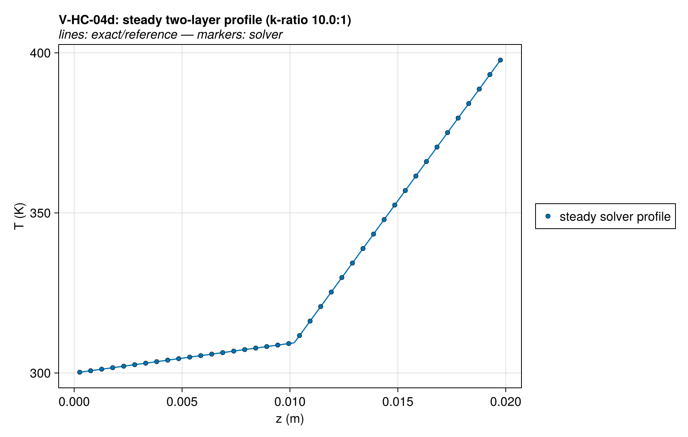

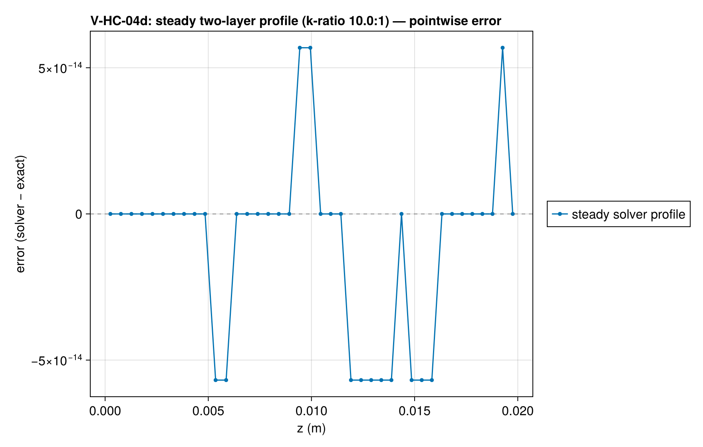

### Comparison with other codes

Physical-problem agreement does not establish equal discretization or cost. See the [mesh and time comparison basis](comparison_coverage.md#comparison-basis-audit) and [per-pair inventory](assets/comparison_basis.csv). Runtime comparisons require a shared achieved-accuracy target.

Matched native-input runs, independent time refinement at fixed mesh (dt, dt/2, dt/4), and spatial refinement at fixed dt/4 are retained under `test/verification/reference/matched/`. See the [coverage and matching notes](comparison_coverage.md). The plotted external series use the base resolution; [analytical errors at all retained resolutions](assets/V-HC-04d/V-HC-04d_comparison_accuracy.csv) are retained separately. These runs provide accuracy measurements.

V-HC-04d changes only the Julia mesh: its 10.2 mm interface, materials and boundary conditions are identical to V-HC-04c. The manifests explicitly reuse the same native V-HC-04c runs; their meshes and errors are retained without adjustment.

Accuracy comparison only; timing measurements are omitted.

Error panels show absolute error at each code's output points. Zeros are displayed at 1e-12 on the logarithmic axis; the reference CSV precision limits the discernible error.

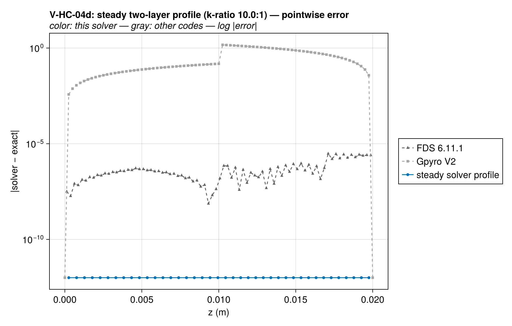

Solution overlays including the other codes' points: [T_profile_steady_vs_codes](assets/V-HC-04d/V-HC-04d_T_profile_steady_vs_codes.png).

### Solver configuration

| setting | value |
| --- | --- |
| integrator | Rodas5P (default) |
| abstol | 1.0e-10 |
| reltol | 1.0e-8 |
