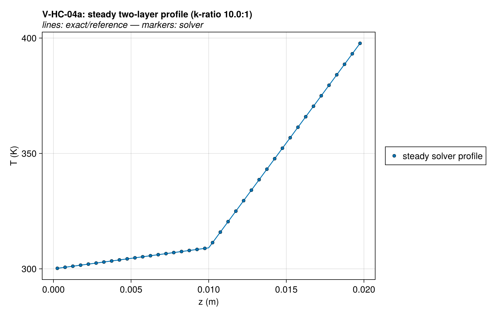
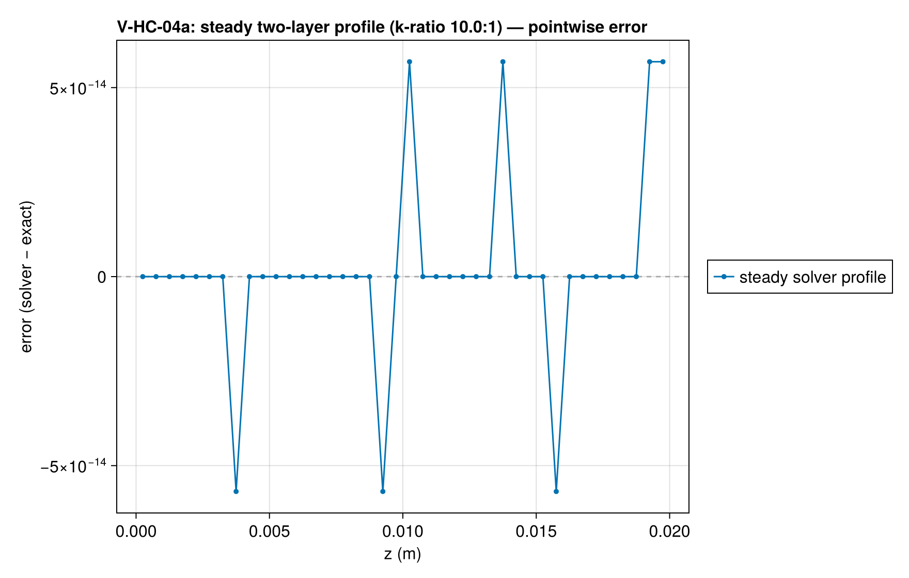
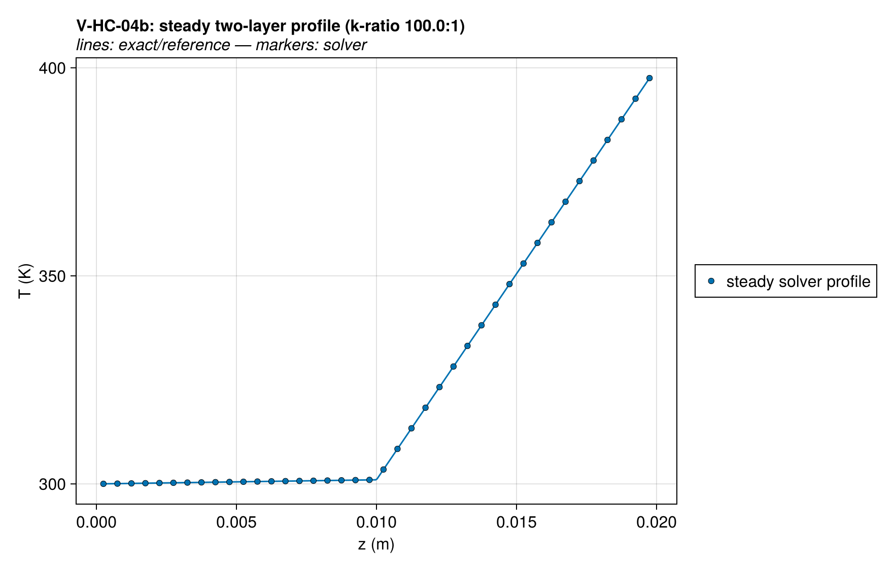
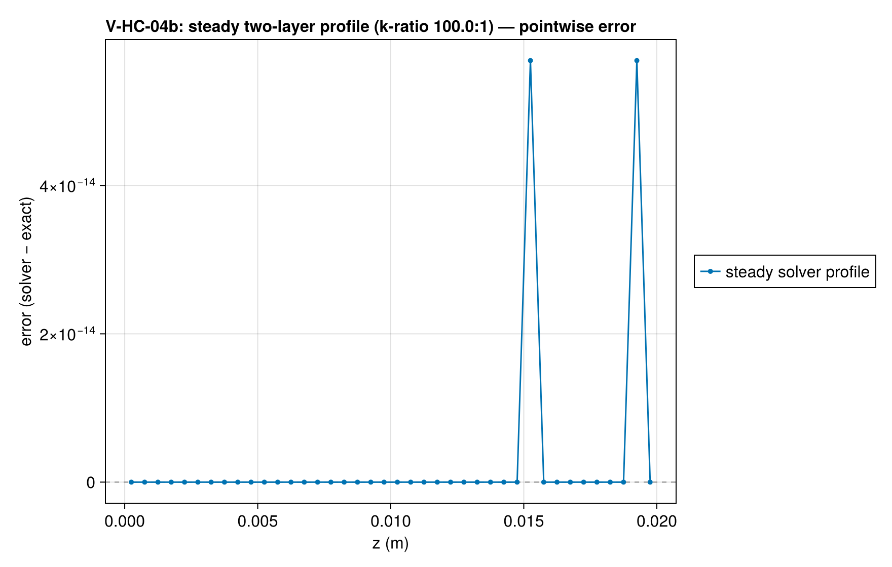
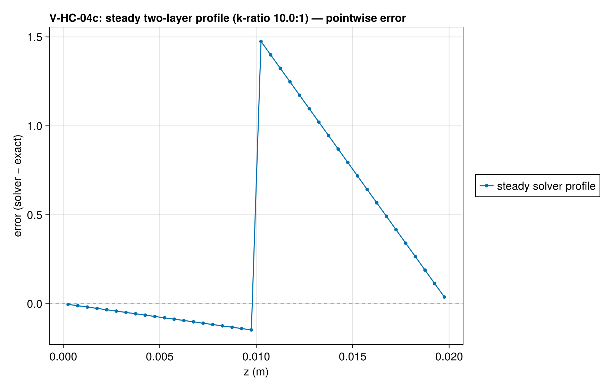

# V-HC-04 — two-layer slab, k-ratio 10.0:1

**Tags:** `heat_conduction`, `laminate`, `harmonic_mean`, `steady`

**References:**

- series thermal-resistance network (exact)
- FDS Verification Guide `insulated_steel_plate` / `ht_pile`

## Problem statement

FDS `insulated_steel_plate` / `ht_pile` analog. Two inert solids layered via
composition step ICs; Dirichlet T at both faces; steady exact solution is
the series-resistance network:

  q = ΔT / (d₁/k₁ + d₂/k₂),   T_interface = T_bot + q·d₁/k₁,  piecewise linear

What is verified: the distance-weighted harmonic-mean face conductivity is
NODALLY EXACT for piecewise-constant k with the jump on a face — the steady
cell-center temperatures and the boundary fluxes must match the resistance
network to integrator precision, for k-ratios 10:1 and 100:1.

Off-face variant (c): composition step ICs are SAMPLED AT CELL CENTERS, so
a prescribed interface that is not on a face quantizes to the nearest face —
there are no mixed cells. Measured: the numerics match the
QUANTIZED-interface network to 1e-11 (i.e. the scheme is still nodally
exact), and the entire user-facing error is the true-vs-quantized network
gap (1.64% in flux, 1.47 K in profile at Δz = 0.5 mm) — pinned here against
its a-priori Δz/2 sensitivity bound.

No convergence spec: (a)/(b) are nodally exact (error is integrator-, not
mesh-limited); (c) is quantization-dominated and non-monotone in n.

## V-HC-04a — two-layer slab, k-ratio 10.0:1

### Quantities of interest (n = 40)

| QoI | value | exact | error | tolerance | within tol | provenance |
| --- | --- | --- | --- | --- | --- | --- |
| L∞ steady profile vs (quantized) network | 5.684e-14 | — | 5.684e-14 | 1e-08 | yes | harmonic-mean face k is NODALLY EXACT for face-aligned jumps; k-ratio 10.0:1 |
| steady bottom-face flux vs network | 909.1 | 909.1 | 9.079e-14 | 1e-08 | yes | both faces must carry the exact series flux |
| steady top-face flux vs network | 909.1 | 909.1 | 9.254e-15 | 1e-08 | yes | both faces must carry the exact series flux |
| steadiness (last half-interval drift) | 1.137e-13 | — | 1.137e-13 | 1e-06 | yes | t_end = 10·L²/α_min |

### Solver configuration

| setting | value |
| --- | --- |
| integrator | Rodas5P (default) |
| abstol | 1.0e-10 |
| reltol | 1.0e-8 |

## V-HC-04b — two-layer slab, k-ratio 100.0:1

### Quantities of interest (n = 40)

| QoI | value | exact | error | tolerance | within tol | provenance |
| --- | --- | --- | --- | --- | --- | --- |
| L∞ steady profile vs (quantized) network | 5.684e-14 | — | 5.684e-14 | 1e-08 | yes | harmonic-mean face k is NODALLY EXACT for face-aligned jumps; k-ratio 100.0:1 |
| steady bottom-face flux vs network | 99.01 | 99.01 | 5.912e-13 | 1e-08 | yes | both faces must carry the exact series flux |
| steady top-face flux vs network | 99.01 | 99.01 | 5.885e-15 | 1e-08 | yes | both faces must carry the exact series flux |
| steadiness (last half-interval drift) | 1.137e-13 | — | 1.137e-13 | 1e-06 | yes | t_end = 10·L²/α_min |

### Solver configuration

| setting | value |
| --- | --- |
| integrator | Rodas5P (default) |
| abstol | 1.0e-10 |
| reltol | 1.0e-8 |

## V-HC-04c — two-layer slab, k-ratio 10.0:1 (off-face interface)

### Quantities of interest (n = 40)

| QoI | value | exact | error | tolerance | within tol | provenance |
| --- | --- | --- | --- | --- | --- | --- |
| L∞ steady profile vs (quantized) network | 5.684e-14 | — | 5.684e-14 | 1e-08 | yes | harmonic-mean face k is NODALLY EXACT for face-aligned jumps; k-ratio 10.0:1 |
| steady bottom-face flux vs network | 909.1 | 909.1 | 9.079e-14 | 1e-08 | yes | both faces must carry the exact series flux |
| steady top-face flux vs network | 909.1 | 909.1 | 9.254e-15 | 1e-08 | yes | both faces must carry the exact series flux |
| interface-quantization smearing (documented) | 0.01636 | 0 | 0.01636 | 0.02079 | yes | THE laminate-off-mesh error users see: flux off by 1.64% at Δz = 0.0005 m |
| steadiness (last half-interval drift) | 1.137e-13 | — | 1.137e-13 | 1e-06 | yes | t_end = 10·L²/α_min |

### Solver configuration

| setting | value |
| --- | --- |
| integrator | Rodas5P (default) |
| abstol | 1.0e-10 |
| reltol | 1.0e-8 |

