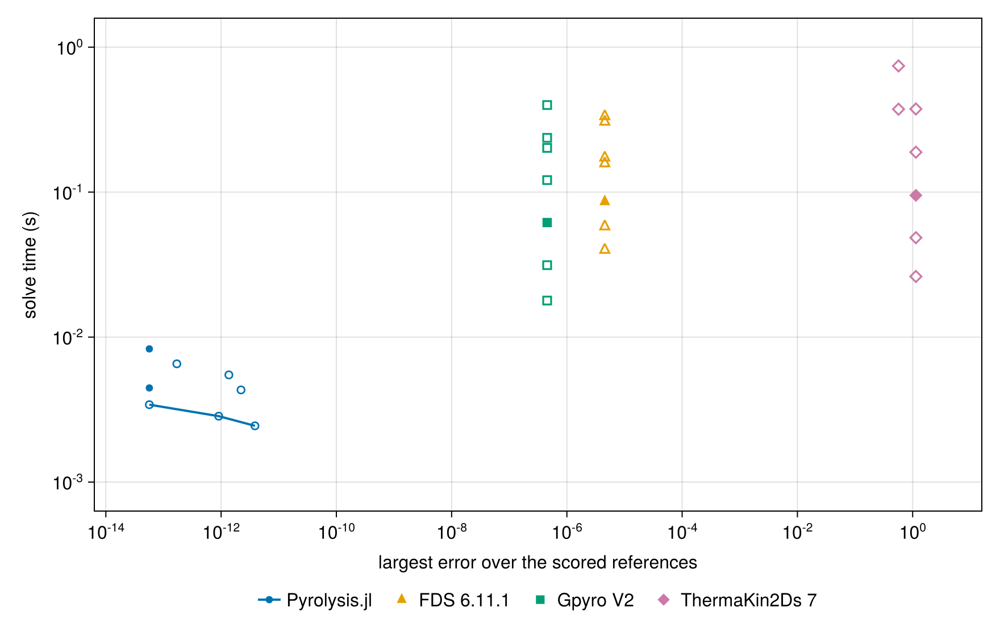
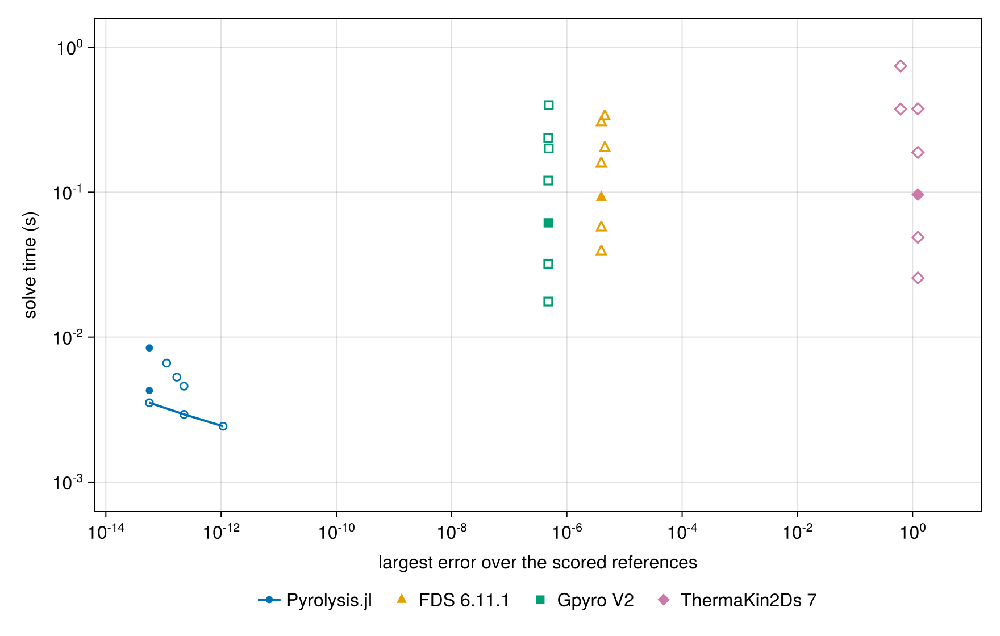
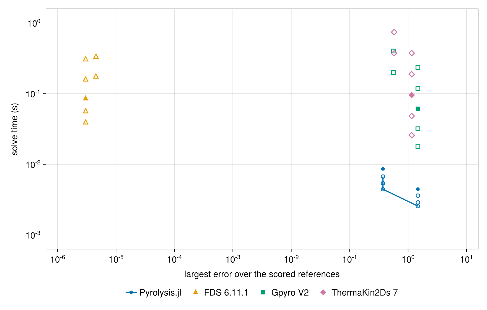
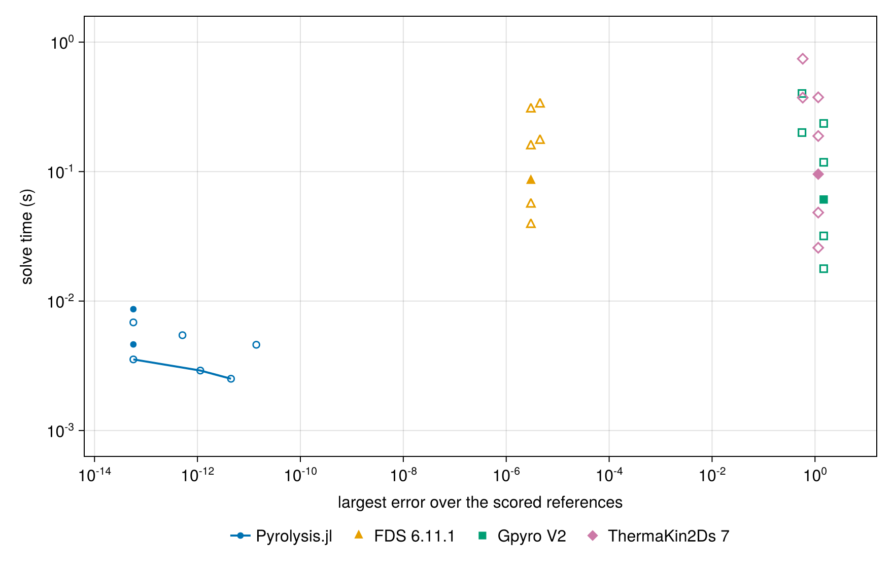

# V-HC-04 — two-layer slab, k-ratio 10.0:1

**Tags:** `heat_conduction`, `laminate`, `harmonic_mean`, `steady`

**References:**

- series thermal-resistance network (exact)
- FDS Verification Guide `insulated_steel_plate` / `ht_pile`

## Problem statement

FDS `insulated_steel_plate` / `ht_pile` analog. Two inert solids layered via
composition step ICs; Dirichlet T at both faces; steady exact solution is
the series-resistance network:

  q = ΔT / (d₁/k₁ + d₂/k₂),   T_interface = T_bot + q·d₁/k₁,  piecewise linear

What is verified: the distance-weighted harmonic-mean face conductivity is
NODALLY EXACT for piecewise-constant k with the jump on a face — the steady
cell-center temperatures and the boundary fluxes must match the resistance
network to integrator precision, for k-ratios 10:1 and 100:1.

Off-face variant (c): composition step ICs are SAMPLED AT CELL CENTERS, so
a prescribed interface that is not on a face quantizes to the nearest face —
there are no mixed cells. Measured: the numerics match the
QUANTIZED-interface network to 1e-11 (i.e. the scheme is still nodally
exact), and the entire user-facing error is the true-vs-quantized network
gap (1.64% in flux, 1.47 K in profile at Δz = 0.5 mm) — pinned here against
its a-priori Δz/2 sensitivity bound.

Variant (d) uses the same prescribed 10.2 mm interface as (c), with a mesh
face placed there using line_mesh. Both have 40 cells. Its
physical problem is unchanged, so the same native FDS/Gpyro runs apply.
Every member reports errors against the prescribed and represented geometry
separately; the off-face case remains a deliberate geometry-resolution test.

No convergence spec: (a)/(b)/(d) are nodally exact (error is integrator-, not
mesh-limited); (c) is quantization-dominated and non-monotone in n.

## V-HC-04a — two-layer slab, k-ratio 10.0:1

### Quantities of interest (n = 40)

| QoI | value | exact | error | tolerance | within tol | provenance |
| --- | --- | --- | --- | --- | --- | --- |
| L∞ steady profile vs represented interface | 5.684e-14 | — | 5.684e-14 | 1e-08 | yes | harmonic-mean face k is NODALLY EXACT for face-aligned jumps; k-ratio 10.0:1 |
| steady bottom-face flux vs represented interface | 909.1 | 909.1 | 9.079e-14 | 1e-08 | yes | both faces must carry the exact series flux |
| steady bottom-face flux vs prescribed interface | 909.1 | 909.1 | 9.079e-14 | 1e-08 | yes | exact geometry discrepancy plus the 1e-8 discrete-solve allowance |
| steady top-face flux vs represented interface | 909.1 | 909.1 | 1.013e-14 | 1e-08 | yes | both faces must carry the exact series flux |
| steady top-face flux vs prescribed interface | 909.1 | 909.1 | 1.013e-14 | 1e-08 | yes | exact geometry discrepancy plus the 1e-8 discrete-solve allowance |
| L∞ steady profile vs prescribed interface | 5.684e-14 | — | 5.684e-14 | 1e-08 | yes | exact geometry discrepancy plus the 1e-8 K discrete-solve allowance |
| represented interface position (m) | 0.01 | 0.01 | 0 | 0.00025 | yes | cell-center composition sampling; at most half a cell displacement |
| steadiness (last half-interval drift) | 1.137e-13 | — | 1.137e-13 | 1e-06 | yes | t_end = 10·L²/α_min |

### Comparison with other codes

Physical-problem agreement does not establish equal discretization or cost. See the [mesh and time comparison basis](comparison_coverage.md#comparison-basis-audit) and [per-pair inventory](assets/comparison_basis.csv). Costs are compared at matched accuracy only.

Matched native-input runs at seven configurations (coarser and finer time steps at fixed mesh, and a finer mesh) are retained under `test/verification/reference/matched/`. See the [coverage and matching notes](comparison_coverage.md). The plotted external series use the base resolution; [analytical errors at every configuration](assets/V-HC-04a/V-HC-04a_comparison_accuracy.csv) are retained separately, and the same runs are timed for the cost comparison.

Error panels show absolute error at each code's output points. Zeros are displayed at 1e-12 on the logarithmic axis; the reference CSV precision limits the discernible error.

#### Cost at matched accuracy

Each external code appears at its matched mesh h and time step Δt, at
coarser steps (2Δt, 4Δt) and at refinements (Δt/2, Δt/4, h/2 at Δt/4,
h/2 at Δt/2); this code at its report ladder, the external meshes and any
finer cost-only meshes, each at its report tolerances and at 10, 100 and
1000 times looser ones, the counterpart of the coarser steps. A coarse
configuration a code cannot express or complete is left out; for the
external codes the reason is in the matched provenance. The error is the
largest analytical error over
the curves and references the external run is scored on. Times are FDS's
internal elapsed time, which excludes its MPI start-up; Gpyro's and
ThermaKin's process time; and this code's warm problem construction and
solve. Each is the median of repeated runs on one pinned core
(`scripts/timing/README.md`; data and provenance in
`test/verification/reference/matched/timing/`). On the smallest problems
the external times are mostly input, setup and output. In the figure,
filled markers are each external code's matched mesh and step and this
code's report tolerances, open markers are the other runs, and this
code's line joins its cheapest configuration at each accuracy; lower left
is better. Errors at or below 1e-12 count as exact
when matching accuracy, errors at or below 1e-14 are drawn at 1e-14, and
runs every code solves exactly are not drawn.

For each external mesh and step: the external code's cheapest run at least as accurate (often itself; a coarser or finer run of the same code when that costs less), this code's cheapest configuration at least as accurate on every scored reference (its cells, and its tolerance multiplier when looser than the report's), and the ratio of the two. A ratio marked ≥ uses this code's coarsest configuration, fewest cells at the loosest tolerance, whose accuracy already exceeds the external run's.

| External run | Mesh, step | External error | External time (s) | Cheapest external at this accuracy (s) | Our cells, tolerance | Our time (s) | Cheapest external/our time |
| --- | --- | --- | --- | --- | --- | --- | --- |
| FDS 6.11.1 | h, Δt | 4.545e-06 | 0.086 | 0.04 | 40, 1000× tol | 0.002482 | ≥ 16.1 |
| FDS 6.11.1 | h, 2Δt | 4.545e-06 | 0.058 | 0.04 | 40, 1000× tol | 0.002482 | ≥ 16.1 |
| FDS 6.11.1 | h, 4Δt | 4.545e-06 | 0.04 | 0.04 | 40, 1000× tol | 0.002482 | ≥ 16.1 |
| FDS 6.11.1 | h, Δt/2 | 4.545e-06 | 0.158 | 0.04 | 40, 1000× tol | 0.002482 | ≥ 16.1 |
| FDS 6.11.1 | h, Δt/4 | 4.545e-06 | 0.306 | 0.04 | 40, 1000× tol | 0.002482 | ≥ 16.1 |
| FDS 6.11.1 | h/2, Δt/4 | 4.545e-06 | 0.334 | 0.04 | 40, 1000× tol | 0.002482 | ≥ 16.1 |
| FDS 6.11.1 | h/2, Δt/2 | 4.545e-06 | 0.173 | 0.04 | 40, 1000× tol | 0.002482 | ≥ 16.1 |
| Gpyro V2 | h, Δt | 4.545e-07 | 0.06169 | 0.01787 | 40, 1000× tol | 0.002482 | ≥ 7.2 |
| Gpyro V2 | h, 2Δt | 4.545e-07 | 0.03136 | 0.01787 | 40, 1000× tol | 0.002482 | ≥ 7.2 |
| Gpyro V2 | h, 4Δt | 4.545e-07 | 0.01787 | 0.01787 | 40, 1000× tol | 0.002482 | ≥ 7.2 |
| Gpyro V2 | h, Δt/2 | 4.545e-07 | 0.1211 | 0.01787 | 40, 1000× tol | 0.002482 | ≥ 7.2 |
| Gpyro V2 | h, Δt/4 | 4.545e-07 | 0.2369 | 0.01787 | 40, 1000× tol | 0.002482 | ≥ 7.2 |
| Gpyro V2 | h/2, Δt/4 | 4.545e-07 | 0.3989 | 0.01787 | 40, 1000× tol | 0.002482 | ≥ 7.2 |
| Gpyro V2 | h/2, Δt/2 | 4.545e-07 | 0.2019 | 0.01787 | 40, 1000× tol | 0.002482 | ≥ 7.2 |
| ThermaKin2Ds 7 | h, Δt | 1.136 | 0.09501 | 0.02619 | 40, 1000× tol | 0.002482 | ≥ 10.6 |
| ThermaKin2Ds 7 | h, 2Δt | 1.136 | 0.0485 | 0.02619 | 40, 1000× tol | 0.002482 | ≥ 10.6 |
| ThermaKin2Ds 7 | h, 4Δt | 1.136 | 0.02619 | 0.02619 | 40, 1000× tol | 0.002482 | ≥ 10.6 |
| ThermaKin2Ds 7 | h, Δt/2 | 1.136 | 0.1886 | 0.02619 | 40, 1000× tol | 0.002482 | ≥ 10.6 |
| ThermaKin2Ds 7 | h, Δt/4 | 1.136 | 0.3747 | 0.02619 | 40, 1000× tol | 0.002482 | ≥ 10.6 |
| ThermaKin2Ds 7 | h/2, Δt/4 | 0.5683 | 0.7425 | 0.3733 | 40, 1000× tol | 0.002482 | ≥ 150.0 |
| ThermaKin2Ds 7 | h/2, Δt/2 | 0.5683 | 0.3733 | 0.3733 | 40, 1000× tol | 0.002482 | ≥ 150.0 |

Solution overlays including the other codes' points: [T_profile_steady_vs_codes](assets/V-HC-04a/V-HC-04a_T_profile_steady_vs_codes.png).

### Solver configuration

| setting | value |
| --- | --- |
| integrator | Rodas5P (default) |
| abstol | 1.0e-10 |
| reltol | 1.0e-8 |

## V-HC-04b — two-layer slab, k-ratio 100.0:1

### Quantities of interest (n = 40)

| QoI | value | exact | error | tolerance | within tol | provenance |
| --- | --- | --- | --- | --- | --- | --- |
| L∞ steady profile vs represented interface | 5.684e-14 | — | 5.684e-14 | 1e-08 | yes | harmonic-mean face k is NODALLY EXACT for face-aligned jumps; k-ratio 100.0:1 |
| steady bottom-face flux vs represented interface | 99.01 | 99.01 | 5.912e-13 | 1e-08 | yes | both faces must carry the exact series flux |
| steady bottom-face flux vs prescribed interface | 99.01 | 99.01 | 5.912e-13 | 1e-08 | yes | exact geometry discrepancy plus the 1e-8 discrete-solve allowance |
| steady top-face flux vs represented interface | 99.01 | 99.01 | 5.024e-15 | 1e-08 | yes | both faces must carry the exact series flux |
| steady top-face flux vs prescribed interface | 99.01 | 99.01 | 5.024e-15 | 1e-08 | yes | exact geometry discrepancy plus the 1e-8 discrete-solve allowance |
| L∞ steady profile vs prescribed interface | 5.684e-14 | — | 5.684e-14 | 1e-08 | yes | exact geometry discrepancy plus the 1e-8 K discrete-solve allowance |
| represented interface position (m) | 0.01 | 0.01 | 0 | 0.00025 | yes | cell-center composition sampling; at most half a cell displacement |
| steadiness (last half-interval drift) | 1.137e-13 | — | 1.137e-13 | 1e-06 | yes | t_end = 10·L²/α_min |

### Comparison with other codes

Physical-problem agreement does not establish equal discretization or cost. See the [mesh and time comparison basis](comparison_coverage.md#comparison-basis-audit) and [per-pair inventory](assets/comparison_basis.csv). Costs are compared at matched accuracy only.

Matched native-input runs at seven configurations (coarser and finer time steps at fixed mesh, and a finer mesh) are retained under `test/verification/reference/matched/`. See the [coverage and matching notes](comparison_coverage.md). The plotted external series use the base resolution; [analytical errors at every configuration](assets/V-HC-04b/V-HC-04b_comparison_accuracy.csv) are retained separately, and the same runs are timed for the cost comparison.

Error panels show absolute error at each code's output points. Zeros are displayed at 1e-12 on the logarithmic axis; the reference CSV precision limits the discernible error.

#### Cost at matched accuracy

Each external code appears at its matched mesh h and time step Δt, at
coarser steps (2Δt, 4Δt) and at refinements (Δt/2, Δt/4, h/2 at Δt/4,
h/2 at Δt/2); this code at its report ladder, the external meshes and any
finer cost-only meshes, each at its report tolerances and at 10, 100 and
1000 times looser ones, the counterpart of the coarser steps. A coarse
configuration a code cannot express or complete is left out; for the
external codes the reason is in the matched provenance. The error is the
largest analytical error over
the curves and references the external run is scored on. Times are FDS's
internal elapsed time, which excludes its MPI start-up; Gpyro's and
ThermaKin's process time; and this code's warm problem construction and
solve. Each is the median of repeated runs on one pinned core
(`scripts/timing/README.md`; data and provenance in
`test/verification/reference/matched/timing/`). On the smallest problems
the external times are mostly input, setup and output. In the figure,
filled markers are each external code's matched mesh and step and this
code's report tolerances, open markers are the other runs, and this
code's line joins its cheapest configuration at each accuracy; lower left
is better. Errors at or below 1e-12 count as exact
when matching accuracy, errors at or below 1e-14 are drawn at 1e-14, and
runs every code solves exactly are not drawn.

For each external mesh and step: the external code's cheapest run at least as accurate (often itself; a coarser or finer run of the same code when that costs less), this code's cheapest configuration at least as accurate on every scored reference (its cells, and its tolerance multiplier when looser than the report's), and the ratio of the two. A ratio marked ≥ uses this code's coarsest configuration, fewest cells at the loosest tolerance, whose accuracy already exceeds the external run's.

| External run | Mesh, step | External error | External time (s) | Cheapest external at this accuracy (s) | Our cells, tolerance | Our time (s) | Cheapest external/our time |
| --- | --- | --- | --- | --- | --- | --- | --- |
| FDS 6.11.1 | h, Δt | 3.96e-06 | 0.092 | 0.039 | 40, 1000× tol | 0.002427 | ≥ 16.1 |
| FDS 6.11.1 | h, 2Δt | 3.96e-06 | 0.057 | 0.039 | 40, 1000× tol | 0.002427 | ≥ 16.1 |
| FDS 6.11.1 | h, 4Δt | 3.96e-06 | 0.039 | 0.039 | 40, 1000× tol | 0.002427 | ≥ 16.1 |
| FDS 6.11.1 | h, Δt/2 | 3.96e-06 | 0.158 | 0.039 | 40, 1000× tol | 0.002427 | ≥ 16.1 |
| FDS 6.11.1 | h, Δt/4 | 3.96e-06 | 0.303 | 0.039 | 40, 1000× tol | 0.002427 | ≥ 16.1 |
| FDS 6.11.1 | h/2, Δt/4 | 4.554e-06 | 0.334 | 0.039 | 40, 1000× tol | 0.002427 | ≥ 16.1 |
| FDS 6.11.1 | h/2, Δt/2 | 4.554e-06 | 0.202 | 0.039 | 40, 1000× tol | 0.002427 | ≥ 16.1 |
| Gpyro V2 | h, Δt | 4.752e-07 | 0.0614 | 0.01759 | 40, 1000× tol | 0.002427 | ≥ 7.25 |
| Gpyro V2 | h, 2Δt | 4.752e-07 | 0.03207 | 0.01759 | 40, 1000× tol | 0.002427 | ≥ 7.25 |
| Gpyro V2 | h, 4Δt | 4.752e-07 | 0.01759 | 0.01759 | 40, 1000× tol | 0.002427 | ≥ 7.25 |
| Gpyro V2 | h, Δt/2 | 4.752e-07 | 0.1201 | 0.01759 | 40, 1000× tol | 0.002427 | ≥ 7.25 |
| Gpyro V2 | h, Δt/4 | 4.752e-07 | 0.2369 | 0.01759 | 40, 1000× tol | 0.002427 | ≥ 7.25 |
| Gpyro V2 | h/2, Δt/4 | 4.851e-07 | 0.3987 | 0.01759 | 40, 1000× tol | 0.002427 | ≥ 7.25 |
| Gpyro V2 | h/2, Δt/2 | 4.851e-07 | 0.2001 | 0.01759 | 40, 1000× tol | 0.002427 | ≥ 7.25 |
| ThermaKin2Ds 7 | h, Δt | 1.238 | 0.09625 | 0.02557 | 40, 1000× tol | 0.002427 | ≥ 10.5 |
| ThermaKin2Ds 7 | h, 2Δt | 1.238 | 0.04881 | 0.02557 | 40, 1000× tol | 0.002427 | ≥ 10.5 |
| ThermaKin2Ds 7 | h, 4Δt | 1.238 | 0.02557 | 0.02557 | 40, 1000× tol | 0.002427 | ≥ 10.5 |
| ThermaKin2Ds 7 | h, Δt/2 | 1.238 | 0.1879 | 0.02557 | 40, 1000× tol | 0.002427 | ≥ 10.5 |
| ThermaKin2Ds 7 | h, Δt/4 | 1.238 | 0.3753 | 0.02557 | 40, 1000× tol | 0.002427 | ≥ 10.5 |
| ThermaKin2Ds 7 | h/2, Δt/4 | 0.6188 | 0.7413 | 0.3735 | 40, 1000× tol | 0.002427 | ≥ 154.0 |
| ThermaKin2Ds 7 | h/2, Δt/2 | 0.6188 | 0.3735 | 0.3735 | 40, 1000× tol | 0.002427 | ≥ 154.0 |

Solution overlays including the other codes' points: [T_profile_steady_vs_codes](assets/V-HC-04b/V-HC-04b_T_profile_steady_vs_codes.png).

### Solver configuration

| setting | value |
| --- | --- |
| integrator | Rodas5P (default) |
| abstol | 1.0e-10 |
| reltol | 1.0e-8 |

## V-HC-04c — two-layer slab, k-ratio 10.0:1 (off-face interface)

### Quantities of interest (n = 40)

| QoI | value | exact | error | tolerance | within tol | provenance |
| --- | --- | --- | --- | --- | --- | --- |
| L∞ steady profile vs represented interface | 5.684e-14 | — | 5.684e-14 | 1e-08 | yes | harmonic-mean face k is NODALLY EXACT for face-aligned jumps; k-ratio 10.0:1 |
| steady bottom-face flux vs represented interface | 909.1 | 909.1 | 9.079e-14 | 1e-08 | yes | both faces must carry the exact series flux |
| steady bottom-face flux vs prescribed interface | 909.1 | 924.2 | 0.01636 | 0.01636 | yes | exact geometry discrepancy plus the 1e-8 discrete-solve allowance |
| steady top-face flux vs represented interface | 909.1 | 909.1 | 1.013e-14 | 1e-08 | yes | both faces must carry the exact series flux |
| steady top-face flux vs prescribed interface | 909.1 | 924.2 | 0.01636 | 0.01636 | yes | exact geometry discrepancy plus the 1e-8 discrete-solve allowance |
| L∞ steady profile vs prescribed interface | 1.475 | — | 1.475 | 1.475 | yes | exact geometry discrepancy plus the 1e-8 K discrete-solve allowance |
| represented interface position (m) | 0.01 | 0.0102 | 0.0002 | 0.00025 | yes | cell-center composition sampling; at most half a cell displacement |
| interface-quantization smearing (documented) | 0.01636 | 0 | 0.01636 | 0.02079 | yes | THE laminate-off-mesh error users see: flux off by 1.64% at Δz = 0.0005000000000000004 m |
| steadiness (last half-interval drift) | 1.137e-13 | — | 1.137e-13 | 1e-06 | yes | t_end = 10·L²/α_min |

### Comparison with other codes

Physical-problem agreement does not establish equal discretization or cost. See the [mesh and time comparison basis](comparison_coverage.md#comparison-basis-audit) and [per-pair inventory](assets/comparison_basis.csv). Costs are compared at matched accuracy only.

Matched native-input runs at seven configurations (coarser and finer time steps at fixed mesh, and a finer mesh) are retained under `test/verification/reference/matched/`. See the [coverage and matching notes](comparison_coverage.md). The plotted external series use the base resolution; [analytical errors at every configuration](assets/V-HC-04c/V-HC-04c_comparison_accuracy.csv) are retained separately, and the same runs are timed for the cost comparison.

Error panels show absolute error at each code's output points. Zeros are displayed at 1e-12 on the logarithmic axis; the reference CSV precision limits the discernible error.

#### Cost at matched accuracy

Each external code appears at its matched mesh h and time step Δt, at
coarser steps (2Δt, 4Δt) and at refinements (Δt/2, Δt/4, h/2 at Δt/4,
h/2 at Δt/2); this code at its report ladder, the external meshes and any
finer cost-only meshes, each at its report tolerances and at 10, 100 and
1000 times looser ones, the counterpart of the coarser steps. A coarse
configuration a code cannot express or complete is left out; for the
external codes the reason is in the matched provenance. The error is the
largest analytical error over
the curves and references the external run is scored on. Times are FDS's
internal elapsed time, which excludes its MPI start-up; Gpyro's and
ThermaKin's process time; and this code's warm problem construction and
solve. Each is the median of repeated runs on one pinned core
(`scripts/timing/README.md`; data and provenance in
`test/verification/reference/matched/timing/`). On the smallest problems
the external times are mostly input, setup and output. In the figure,
filled markers are each external code's matched mesh and step and this
code's report tolerances, open markers are the other runs, and this
code's line joins its cheapest configuration at each accuracy; lower left
is better. Errors at or below 1e-12 count as exact
when matching accuracy, errors at or below 1e-14 are drawn at 1e-14, and
runs every code solves exactly are not drawn.

For each external mesh and step: the external code's cheapest run at least as accurate (often itself; a coarser or finer run of the same code when that costs less), this code's cheapest configuration at least as accurate on every scored reference (its cells, and its tolerance multiplier when looser than the report's), and the ratio of the two. A ratio marked ≥ uses this code's coarsest configuration, fewest cells at the loosest tolerance, whose accuracy already exceeds the external run's.

| External run | Mesh, step | External error | External time (s) | Cheapest external at this accuracy (s) | Our cells, tolerance | Our time (s) | Cheapest external/our time |
| --- | --- | --- | --- | --- | --- | --- | --- |
| FDS 6.11.1 | h, Δt | 3.013e-06 | 0.085 | 0.039 | not reached | — | — |
| FDS 6.11.1 | h, 2Δt | 3.013e-06 | 0.056 | 0.039 | not reached | — | — |
| FDS 6.11.1 | h, 4Δt | 3.013e-06 | 0.039 | 0.039 | not reached | — | — |
| FDS 6.11.1 | h, Δt/2 | 3.013e-06 | 0.158 | 0.039 | not reached | — | — |
| FDS 6.11.1 | h, Δt/4 | 3.013e-06 | 0.304 | 0.039 | not reached | — | — |
| FDS 6.11.1 | h/2, Δt/4 | 4.529e-06 | 0.332 | 0.039 | not reached | — | — |
| FDS 6.11.1 | h/2, Δt/2 | 4.529e-06 | 0.174 | 0.039 | not reached | — | — |
| Gpyro V2 | h, Δt | 1.475 | 0.06088 | 0.01779 | 40, 1000× tol | 0.002431 | ≥ 7.32 |
| Gpyro V2 | h, 2Δt | 1.475 | 0.03185 | 0.01779 | 40, 1000× tol | 0.002431 | ≥ 7.32 |
| Gpyro V2 | h, 4Δt | 1.475 | 0.01779 | 0.01779 | 40, 1000× tol | 0.002431 | ≥ 7.32 |
| Gpyro V2 | h, Δt/2 | 1.475 | 0.118 | 0.01779 | 40, 1000× tol | 0.002431 | ≥ 7.32 |
| Gpyro V2 | h, Δt/4 | 1.475 | 0.2355 | 0.01779 | 40, 1000× tol | 0.002431 | ≥ 7.32 |
| Gpyro V2 | h/2, Δt/4 | 0.5587 | 0.4011 | 0.2002 | 80, 1000× tol | 0.004221 | 47.4 |
| Gpyro V2 | h/2, Δt/2 | 0.5587 | 0.2002 | 0.2002 | 80, 1000× tol | 0.004221 | 47.4 |
| ThermaKin2Ds 7 | h, Δt | 1.155 | 0.09554 | 0.02581 | 80, 1000× tol | 0.004221 | 6.12 |
| ThermaKin2Ds 7 | h, 2Δt | 1.155 | 0.04825 | 0.02581 | 80, 1000× tol | 0.004221 | 6.12 |
| ThermaKin2Ds 7 | h, 4Δt | 1.155 | 0.02581 | 0.02581 | 80, 1000× tol | 0.004221 | 6.12 |
| ThermaKin2Ds 7 | h, Δt/2 | 1.155 | 0.1882 | 0.02581 | 80, 1000× tol | 0.004221 | 6.12 |
| ThermaKin2Ds 7 | h, Δt/4 | 1.155 | 0.3746 | 0.02581 | 80, 1000× tol | 0.004221 | 6.12 |
| ThermaKin2Ds 7 | h/2, Δt/4 | 0.5777 | 0.7436 | 0.3725 | 80, 1000× tol | 0.004221 | 88.3 |
| ThermaKin2Ds 7 | h/2, Δt/2 | 0.5777 | 0.3725 | 0.3725 | 80, 1000× tol | 0.004221 | 88.3 |

Solution overlays including the other codes' points: [T_profile_steady_vs_codes](assets/V-HC-04c/V-HC-04c_T_profile_steady_vs_codes.png).

### Solver configuration

| setting | value |
| --- | --- |
| integrator | Rodas5P (default) |
| abstol | 1.0e-10 |
| reltol | 1.0e-8 |

## V-HC-04d — two-layer slab, k-ratio 10.0:1 (10.2 mm interface aligned to a mesh face)

### Quantities of interest (n = 40)

| QoI | value | exact | error | tolerance | within tol | provenance |
| --- | --- | --- | --- | --- | --- | --- |
| L∞ steady profile vs represented interface | 5.684e-14 | — | 5.684e-14 | 1e-08 | yes | harmonic-mean face k is NODALLY EXACT for face-aligned jumps; k-ratio 10.0:1 |
| steady bottom-face flux vs represented interface | 924.2 | 924.2 | 1.091e-13 | 1e-08 | yes | both faces must carry the exact series flux |
| steady bottom-face flux vs prescribed interface | 924.2 | 924.2 | 1.091e-13 | 1e-08 | yes | exact geometry discrepancy plus the 1e-8 discrete-solve allowance |
| steady top-face flux vs represented interface | 924.2 | 924.2 | 6.15e-15 | 1e-08 | yes | both faces must carry the exact series flux |
| steady top-face flux vs prescribed interface | 924.2 | 924.2 | 6.15e-15 | 1e-08 | yes | exact geometry discrepancy plus the 1e-8 discrete-solve allowance |
| L∞ steady profile vs prescribed interface | 5.684e-14 | — | 5.684e-14 | 1e-08 | yes | exact geometry discrepancy plus the 1e-8 K discrete-solve allowance |
| represented interface position (m) | 0.0102 | 0.0102 | 0 | 1e-14 | yes | mesh face at the prescribed interface |
| steadiness (last half-interval drift) | 1.137e-13 | — | 1.137e-13 | 1e-06 | yes | t_end = 10·L²/α_min |

### Comparison with other codes

Physical-problem agreement does not establish equal discretization or cost. See the [mesh and time comparison basis](comparison_coverage.md#comparison-basis-audit) and [per-pair inventory](assets/comparison_basis.csv). Costs are compared at matched accuracy only.

Matched native-input runs at seven configurations (coarser and finer time steps at fixed mesh, and a finer mesh) are retained under `test/verification/reference/matched/`. See the [coverage and matching notes](comparison_coverage.md). The plotted external series use the base resolution; [analytical errors at every configuration](assets/V-HC-04d/V-HC-04d_comparison_accuracy.csv) are retained separately, and the same runs are timed for the cost comparison.

V-HC-04d changes only the Julia mesh: its 10.2 mm interface, materials and boundary conditions are identical to V-HC-04c. The manifests explicitly reuse the same native V-HC-04c runs; their meshes and errors are retained without adjustment.

Error panels show absolute error at each code's output points. Zeros are displayed at 1e-12 on the logarithmic axis; the reference CSV precision limits the discernible error.

#### Cost at matched accuracy

Each external code appears at its matched mesh h and time step Δt, at
coarser steps (2Δt, 4Δt) and at refinements (Δt/2, Δt/4, h/2 at Δt/4,
h/2 at Δt/2); this code at its report ladder, the external meshes and any
finer cost-only meshes, each at its report tolerances and at 10, 100 and
1000 times looser ones, the counterpart of the coarser steps. A coarse
configuration a code cannot express or complete is left out; for the
external codes the reason is in the matched provenance. The error is the
largest analytical error over
the curves and references the external run is scored on. Times are FDS's
internal elapsed time, which excludes its MPI start-up; Gpyro's and
ThermaKin's process time; and this code's warm problem construction and
solve. Each is the median of repeated runs on one pinned core
(`scripts/timing/README.md`; data and provenance in
`test/verification/reference/matched/timing/`). On the smallest problems
the external times are mostly input, setup and output. In the figure,
filled markers are each external code's matched mesh and step and this
code's report tolerances, open markers are the other runs, and this
code's line joins its cheapest configuration at each accuracy; lower left
is better. Errors at or below 1e-12 count as exact
when matching accuracy, errors at or below 1e-14 are drawn at 1e-14, and
runs every code solves exactly are not drawn.

For each external mesh and step: the external code's cheapest run at least as accurate (often itself; a coarser or finer run of the same code when that costs less), this code's cheapest configuration at least as accurate on every scored reference (its cells, and its tolerance multiplier when looser than the report's), and the ratio of the two. A ratio marked ≥ uses this code's coarsest configuration, fewest cells at the loosest tolerance, whose accuracy already exceeds the external run's.

| External run | Mesh, step | External error | External time (s) | Cheapest external at this accuracy (s) | Our cells, tolerance | Our time (s) | Cheapest external/our time |
| --- | --- | --- | --- | --- | --- | --- | --- |
| FDS 6.11.1 | h, Δt | 3.013e-06 | 0.085 | 0.039 | 40, 1000× tol | 0.002291 | ≥ 17.0 |
| FDS 6.11.1 | h, 2Δt | 3.013e-06 | 0.056 | 0.039 | 40, 1000× tol | 0.002291 | ≥ 17.0 |
| FDS 6.11.1 | h, 4Δt | 3.013e-06 | 0.039 | 0.039 | 40, 1000× tol | 0.002291 | ≥ 17.0 |
| FDS 6.11.1 | h, Δt/2 | 3.013e-06 | 0.158 | 0.039 | 40, 1000× tol | 0.002291 | ≥ 17.0 |
| FDS 6.11.1 | h, Δt/4 | 3.013e-06 | 0.304 | 0.039 | 40, 1000× tol | 0.002291 | ≥ 17.0 |
| FDS 6.11.1 | h/2, Δt/4 | 4.529e-06 | 0.332 | 0.039 | 40, 1000× tol | 0.002291 | ≥ 17.0 |
| FDS 6.11.1 | h/2, Δt/2 | 4.529e-06 | 0.174 | 0.039 | 40, 1000× tol | 0.002291 | ≥ 17.0 |
| Gpyro V2 | h, Δt | 1.475 | 0.06088 | 0.01779 | 40, 1000× tol | 0.002291 | ≥ 7.77 |
| Gpyro V2 | h, 2Δt | 1.475 | 0.03185 | 0.01779 | 40, 1000× tol | 0.002291 | ≥ 7.77 |
| Gpyro V2 | h, 4Δt | 1.475 | 0.01779 | 0.01779 | 40, 1000× tol | 0.002291 | ≥ 7.77 |
| Gpyro V2 | h, Δt/2 | 1.475 | 0.118 | 0.01779 | 40, 1000× tol | 0.002291 | ≥ 7.77 |
| Gpyro V2 | h, Δt/4 | 1.475 | 0.2355 | 0.01779 | 40, 1000× tol | 0.002291 | ≥ 7.77 |
| Gpyro V2 | h/2, Δt/4 | 0.5587 | 0.4011 | 0.2002 | 40, 1000× tol | 0.002291 | ≥ 87.4 |
| Gpyro V2 | h/2, Δt/2 | 0.5587 | 0.2002 | 0.2002 | 40, 1000× tol | 0.002291 | ≥ 87.4 |
| ThermaKin2Ds 7 | h, Δt | 1.155 | 0.09554 | 0.02581 | 40, 1000× tol | 0.002291 | ≥ 11.3 |
| ThermaKin2Ds 7 | h, 2Δt | 1.155 | 0.04825 | 0.02581 | 40, 1000× tol | 0.002291 | ≥ 11.3 |
| ThermaKin2Ds 7 | h, 4Δt | 1.155 | 0.02581 | 0.02581 | 40, 1000× tol | 0.002291 | ≥ 11.3 |
| ThermaKin2Ds 7 | h, Δt/2 | 1.155 | 0.1882 | 0.02581 | 40, 1000× tol | 0.002291 | ≥ 11.3 |
| ThermaKin2Ds 7 | h, Δt/4 | 1.155 | 0.3746 | 0.02581 | 40, 1000× tol | 0.002291 | ≥ 11.3 |
| ThermaKin2Ds 7 | h/2, Δt/4 | 0.5777 | 0.7436 | 0.3725 | 40, 1000× tol | 0.002291 | ≥ 163.0 |
| ThermaKin2Ds 7 | h/2, Δt/2 | 0.5777 | 0.3725 | 0.3725 | 40, 1000× tol | 0.002291 | ≥ 163.0 |

Solution overlays including the other codes' points: [T_profile_steady_vs_codes](assets/V-HC-04d/V-HC-04d_T_profile_steady_vs_codes.png).

### Solver configuration

| setting | value |
| --- | --- |
| integrator | Rodas5P (default) |
| abstol | 1.0e-10 |
| reltol | 1.0e-8 |
