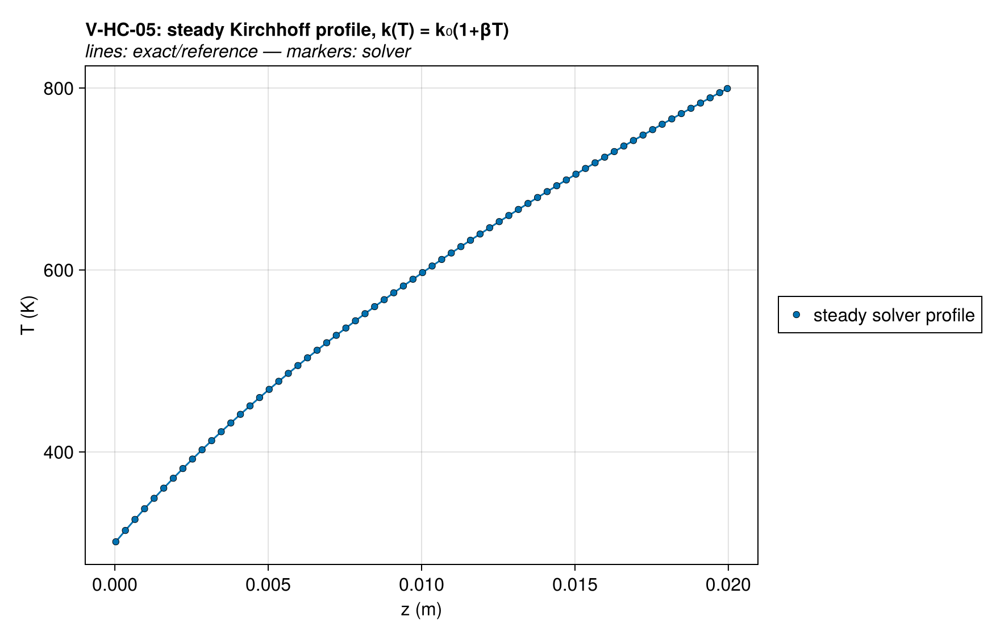
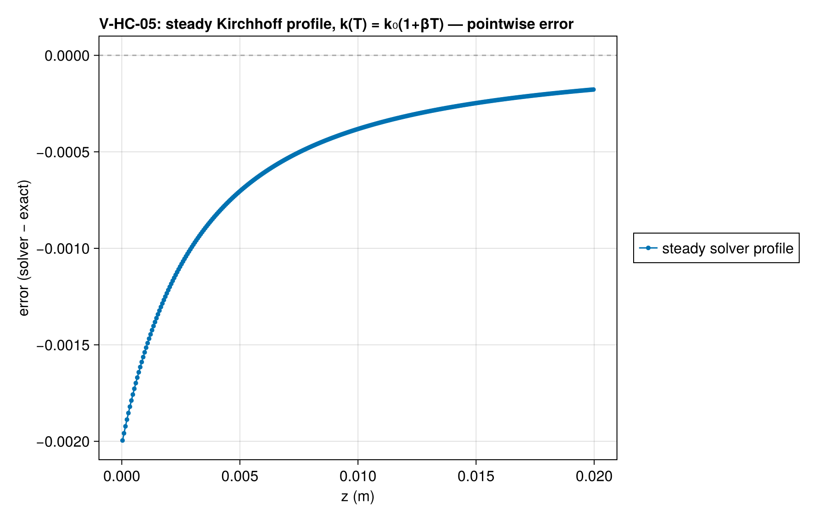
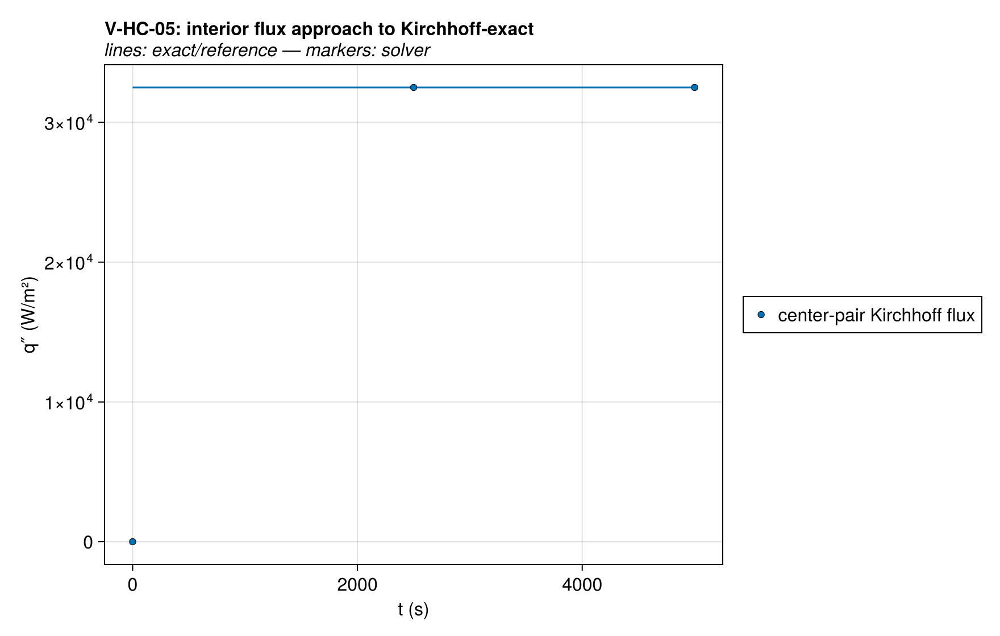
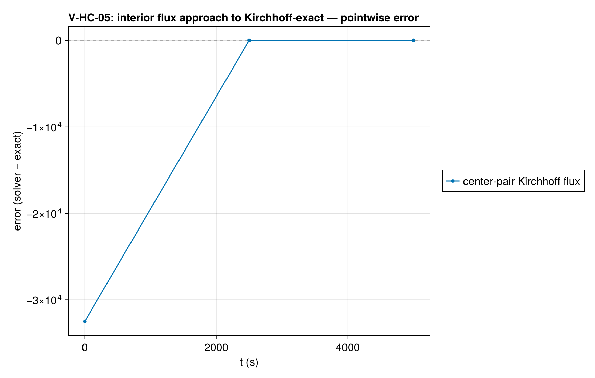
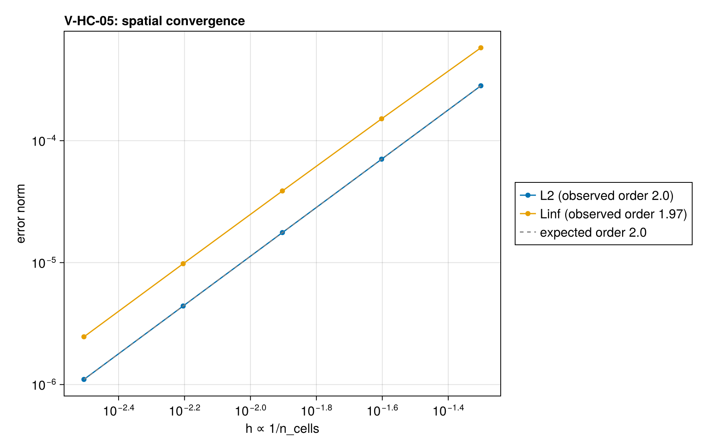

# V-HC-05 — steady Kirchhoff profile with k(T) = k₀(1+βT)

**Tags:** `heat_conduction`, `temperature_dependent_k`, `kirchhoff`, `steady`

**References:**

- Kirchhoff transform (exact steady flux/profile), standard texts

## Problem statement

Steady conduction across a slab with k(T) = k₀(1 + βT), fixed T at both
faces. The Kirchhoff transform gives the exact flux and implicit profile:

  q = (k₀/L)·[(T_top − T_bot) + β(T_top² − T_bot²)/2]
  z(T) = k₀[(T − T_bot) + β(T² − T_bot²)/2] / q          (bottom cold face)

The implicit form is compared invert-free: evaluate z(T_num[i]) and compare
to the cell position. k varies 2.25× across 300–800 K with β = 0.01 (the
linear form caps the ratio at T_top/T_bot; 2.25× is char-vs-virgin scale).

What is verified: the T-dependent property path (LinearProperty) and the
distance-weighted harmonic-mean face interpolation of cell-centered k(T)
under strong nonlinearity. Note k(T) is evaluated at cell centers and
harmonic-averaged to faces — NOT the integrated Kirchhoff face conductance —
so unlike V-HC-04 this is a genuine discretization-error measurement, with
a convergence check. Transient T-dependent {k,c} has no exact solution
(that regime is B-02, code-to-code).

### Quantities of interest (n = 320)

| QoI | value | exact | error | tolerance | within tol | provenance |
| --- | --- | --- | --- | --- | --- | --- |
| L∞ Kirchhoff-profile error (z(T) map, /L) | 2.464e-06 | — | 2.464e-06 | 0.00012 | yes | implicit profile compared invert-free; n=80 uniform |
| steady flux vs Kirchhoff-exact | 3.25e+04 | 3.25e+04 | 1.096e-06 | 6e-05 | yes | q = (k₀/L)[ΔT + βΔ(T²)/2] = 32500.0 W/m² |
| steadiness (last half-interval drift) | 2.274e-13 | — | 2.274e-13 | 1e-06 | yes | t_end = 10·L²/α_min |

### Convergence

| n_cells | h | wall (s) | L2 | Linf |
| --- | --- | --- | --- | --- |
| 20 | 0.05 | 0.007311 | 0.0002818 | 0.0005775 |
| 40 | 0.025 | 0.01518 | 7.051e-05 | 0.0001511 |
| 80 | 0.0125 | 0.03185 | 1.763e-05 | 3.87e-05 |
| 160 | 0.00625 | 0.06951 | 4.408e-06 | 9.794e-06 |
| 320 | 0.003125 | 0.1494 | 1.102e-06 | 2.464e-06 |

Observed order 2 (L2), expected 2.0.

### Solver configuration

| setting | value |
| --- | --- |
| integrator | Rodas5P (default) |
| abstol | 1.0e-12 |
| reltol | 1.0e-10 |

