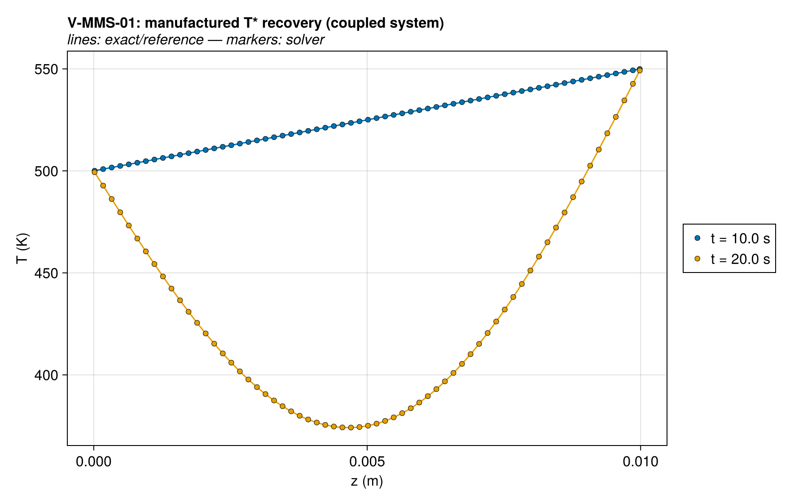
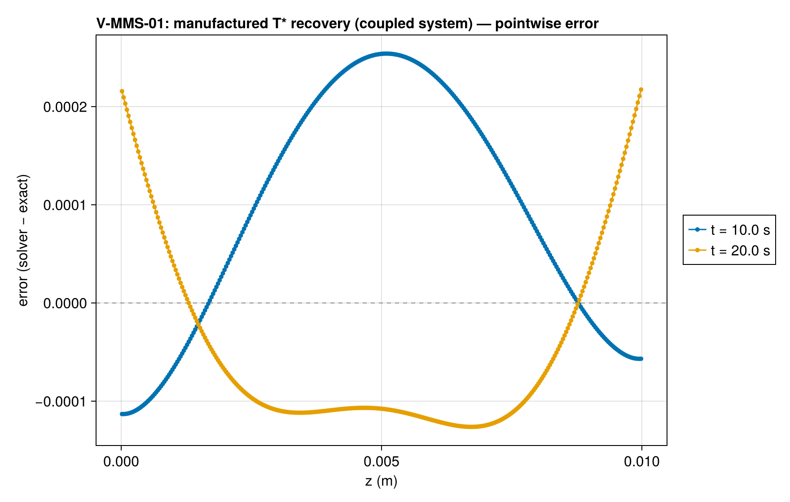
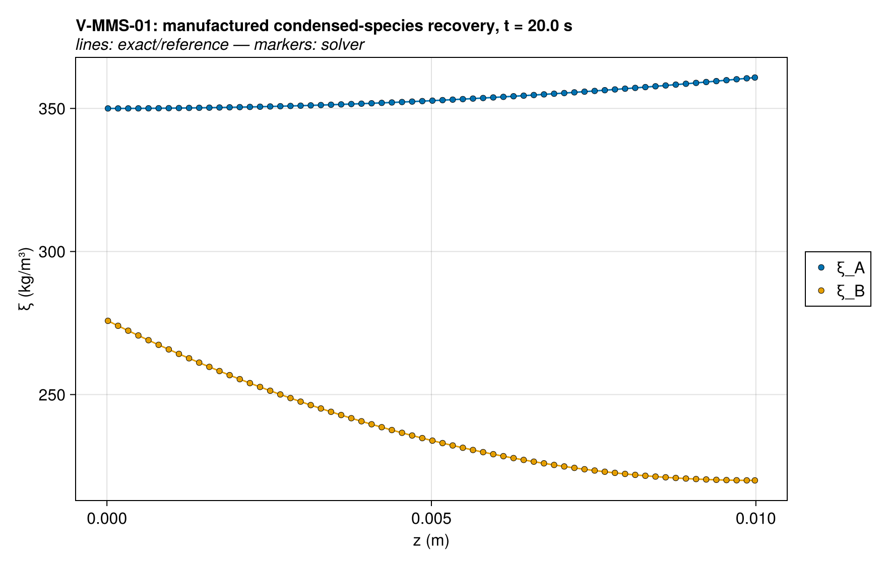
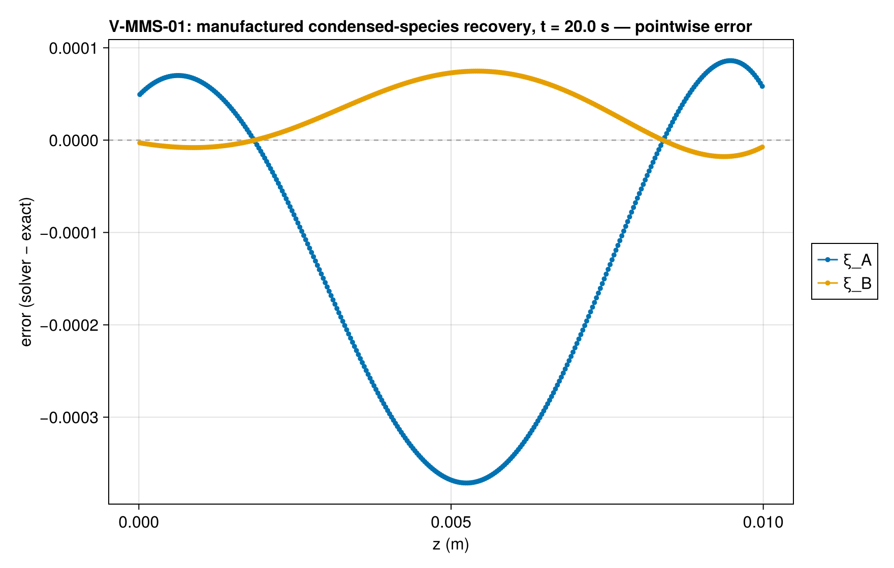
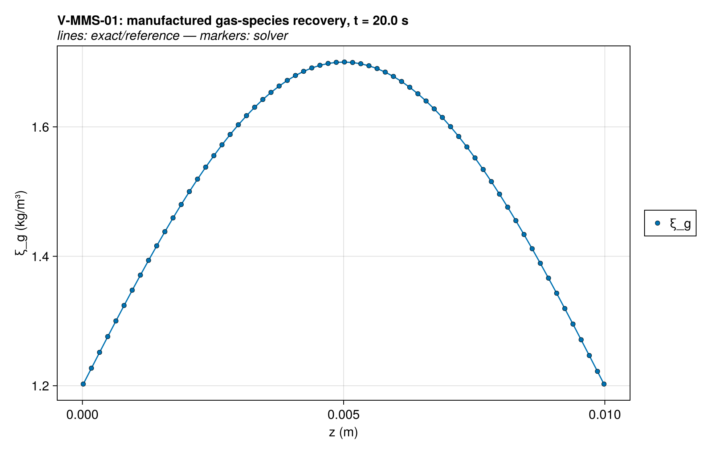
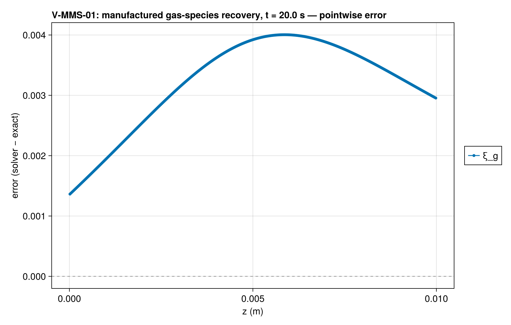
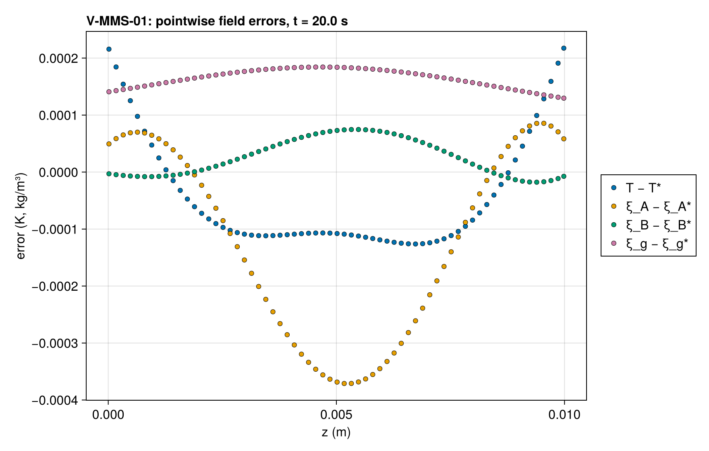
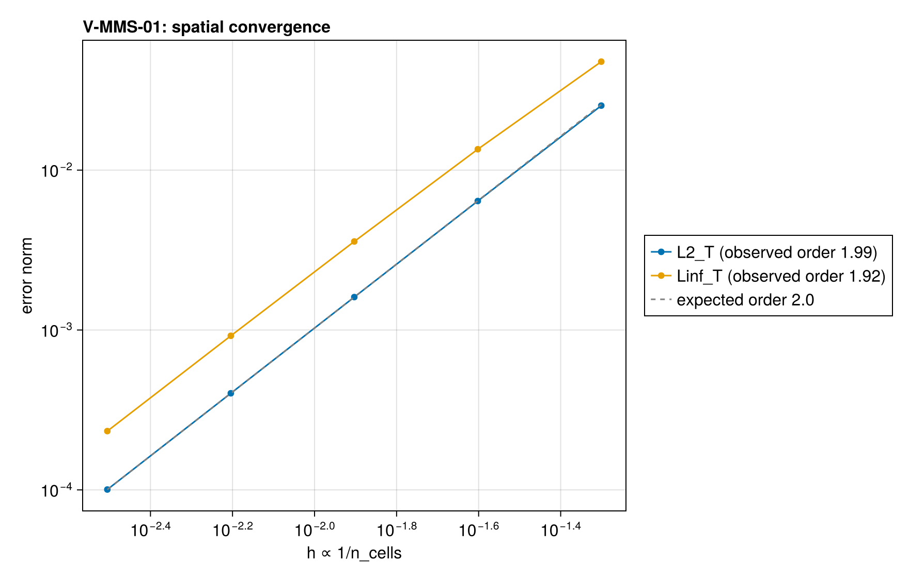
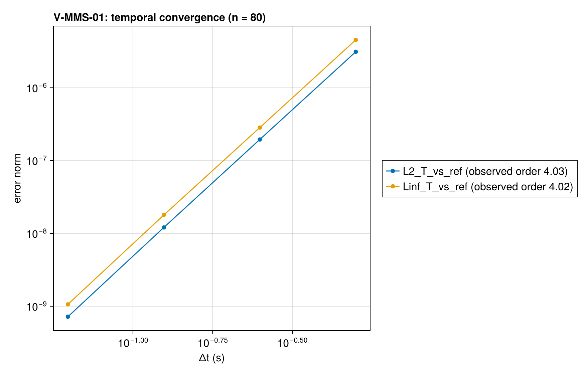

# V-MMS-01 — manufactured solution, coupled kinetics + T-props + gas transport

**Tags:** `mms`, `coupled`, `kinetics`, `gas_transport`, `order_verification`

**References:**

- Roache, Verification and Validation in Computational Science (MMS methodology)
- docs/guide/technical_reference/18_verification-validation.md §18.2 (the documented gap)
- FDS Verification Guide (MMS usage precedent, fluid phase)

## Problem statement

Method of Manufactured Solutions over the coupled energy + kinetics + gas
transport operators — the only formal order-of-accuracy verification of the
*coupled* system (every other case has zero residual source; tech ref §18.2
documents this gap; FDS uses MMS for the same reason in the fluid phase).

Active couplings, all with O(1) contributions over the space–time domain:
- T-dependent k(T), c(T) on both condensed components (mixture rules live,
  composition varying in z and t);
- two-step kinetics A → 0.65 B + 0.35 gas (endothermic) and B → gas
  (exothermic): intermediate B produced and consumed, reaction heat feeding
  back into the energy equation, gas produced into the transport field;
- partial-pressure gas transport J = −(Λ/T)∂z(ξT/φ), with condensed
  matrix coefficients and the skeletal pore volume evaluated independently;
- gas-advection energy source S_adv = −cp_g·J·∂zT;
- manufactured Neumann BCs (HeatFluxBC/MassFluxBC callables of t) — the
  Dirichlet face reconstruction is first-order and would cap the observed
  order (see exact/mms.jl header, design decision 3).

The manufactured sources are assembled by nested ForwardDiff through the
package's own property/kinetics functions (exact/mms.jl) and injected at the
state-derivative level as functions of (z, t), so the colored Jacobian stays
exact.

The depletion limiter is left at the material default: the source generator
evaluates the identical rate law, and every reactant concentration stays
> 20× the 1 kg/m³ threshold, where the tanh factor is exactly 1.0 in
Float64. Temperature gates are at defaults (fully open).

Fields (z̃ = z/L, smooth, strictly positive concentrations):
  T*  = 500 + 150·sin(πz̃)·cos(ωt) + 50·z̃            [K]     (≈ 350–700 K)
  ξ*_A = 350 + 80·z̃²·e^(−t/τ)                        [kg/m³]
  ξ*_B = 220 + 60·(1−z̃)²·(1 − 0.5·e^(−t/τ))          [kg/m³]
  ξ*_g = 1.2 + 0.5·sin(πz̃)·(1 + 0.3·sin(ωt))         [kg/m³]

### Quantities of interest (n = 320)

| QoI | value | exact | error | tolerance | within tol | provenance |
| --- | --- | --- | --- | --- | --- | --- |
| L∞ T error, t=10.0 s | 0.0003366 | — | 0.0003366 | 0.05 | yes | manufactured T* recovered on the coupled system; refined to 160 cells to resolve the pore-pressure gradients |
| L∞ T error, t=20.0 s | 0.0008934 | — | 0.0008934 | 0.05 | yes | manufactured T* recovered on the coupled system; refined to 160 cells to resolve the pore-pressure gradients |
| relative L∞ ξ_A error, t=20.0 s | 1.321e-06 | — | 1.321e-06 | 0.0002 | yes | scale = manufactured baseline; observed 5.3e-6; L∞ ξ order ≈ 2 on [20,40,80,160] |
| relative L∞ ξ_B error, t=20.0 s | 4.21e-07 | — | 4.21e-07 | 0.0001 | yes | scale = manufactured baseline; observed 1.7e-6; L∞ ξ order ≈ 2 on [20,40,80,160] |
| relative L∞ ξ_gas error, t=20.0 s | 0.003337 | — | 0.003337 | 0.03 | yes | scale = manufactured baseline; observed 1.34e-2; L∞ ξ order ≈ 2 on [20,40,80,160] |

### Convergence

| n_cells | h | wall (s) | L2_T | Linf_T |
| --- | --- | --- | --- | --- |
| 20 | 0.05 | 0.6403 | 0.1112 | 0.2226 |
| 40 | 0.025 | 1.347 | 0.02837 | 0.05681 |
| 80 | 0.0125 | 2.606 | 0.007129 | 0.01427 |
| 160 | 0.00625 | 5.324 | 0.001785 | 0.003573 |
| 320 | 0.003125 | 10.38 | 0.0004463 | 0.0008934 |

Observed order 1.991 (L2_T), expected 2.0.

### Solver configuration

| setting | value |
| --- | --- |
| integrator | Rodas5P (default) |
| abstol | 1.0e-11 |
| reltol | 1.0e-9 |
