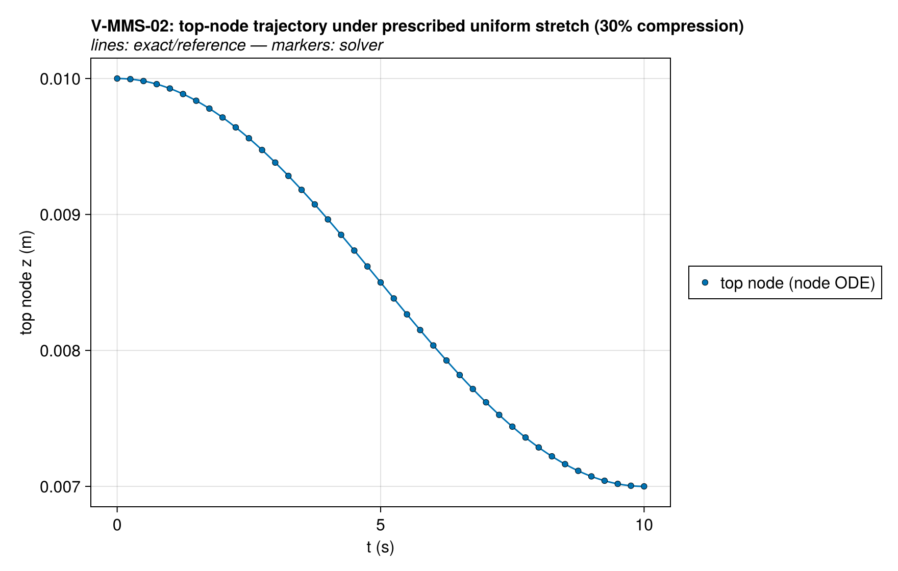
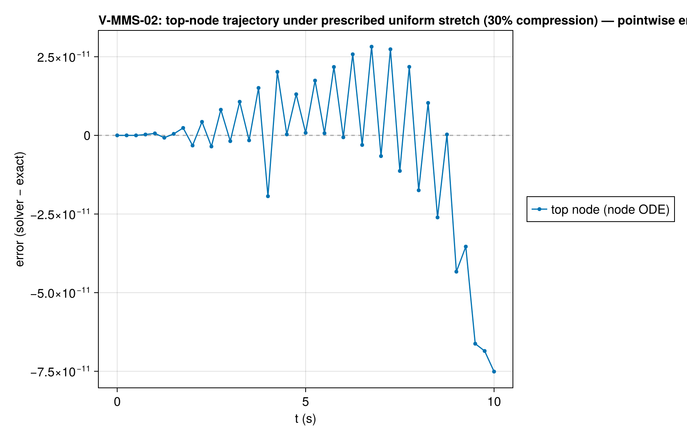

# V-MMS-02 — ALE free-stream preservation under prescribed mesh motion

**Tags:** `mms`, `ale`, `gcl`, `free_stream`

**References:**

- Thomas & Lombard, AIAA J. 17 (1979) — geometric conservation law
- docs/guide/technical_reference/18_verification-validation.md §18.2 (MMS driver, ALE cases)

## Problem statement

The sharpest possible discrete-GCL assert: spatially uniform T*, ξ* with no
reactions and zero-flux manufactured BCs, while the mesh is compressed to
70 % of its initial thickness by the solve's `w_override` hook with the
uniform-stretch velocity

  w*(z, t) = (ṡ/s)·z,   s(t) = 1 − 0.15·(1 − cos(2πt/20)),   z_bottom pinned

(node trajectories z_i(t) = z_i(0)·s(t) exactly). The mesh moves over a
solid at rest, every inventory crossing the faces at the mesh-relative
velocity. A uniform state must stay uniform to machine precision on the
moving mesh: the relative flux of a constant field must balance the change
of the cell volumes discretely, and the conductive/species fluxes are zero.
Any drift is a moving-mesh transport defect that smooth-field order studies
(V-MMS-03) can hide inside their truncation error.

The node-motion ODE ż_i = w*(z_i,t) is integrated by the same stiff
integrator, so the top-cell-center trajectory doubles as an exactness check
on the prescribed-motion path (temporal tolerance only).

### Quantities of interest (n = 20)

| QoI | value | exact | error | tolerance | within tol | provenance |
| --- | --- | --- | --- | --- | --- | --- |
| free-stream T drift (all cells, all snapshots) | 3.411e-13 | 0 | 3.411e-13 | 1e-10 | yes | uniform field must survive 30% mesh compression |
| free-stream ξ_solid relative drift | 1.838e-14 | 0 | 1.838e-14 | 1e-12 | yes | relative flux + cell-volume change must cancel for a uniform state |
| free-stream ξ_gas relative drift | 2.916e-14 | 0 | 2.916e-14 | 1e-12 | yes | relative flux + cell-volume change must cancel for a uniform state |
| top cell-center trajectory vs z₀·s(t_end) | 0.006825 | 0.006825 | 7.322e-09 | 1.5e-06 | yes | node ODE ż = (ṡ/s)z integrated at solver tolerance |

### Solver configuration

| setting | value |
| --- | --- |
| integrator | Rodas5P (default) |
| abstol | 1.0e-10 |
| reltol | 1.0e-8 |

