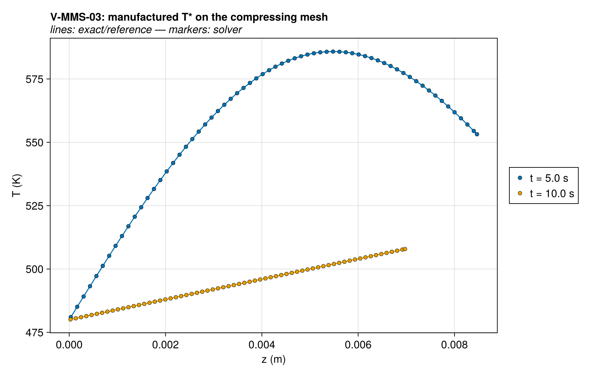
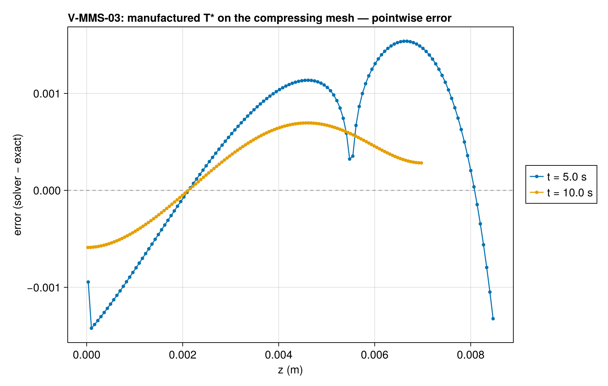
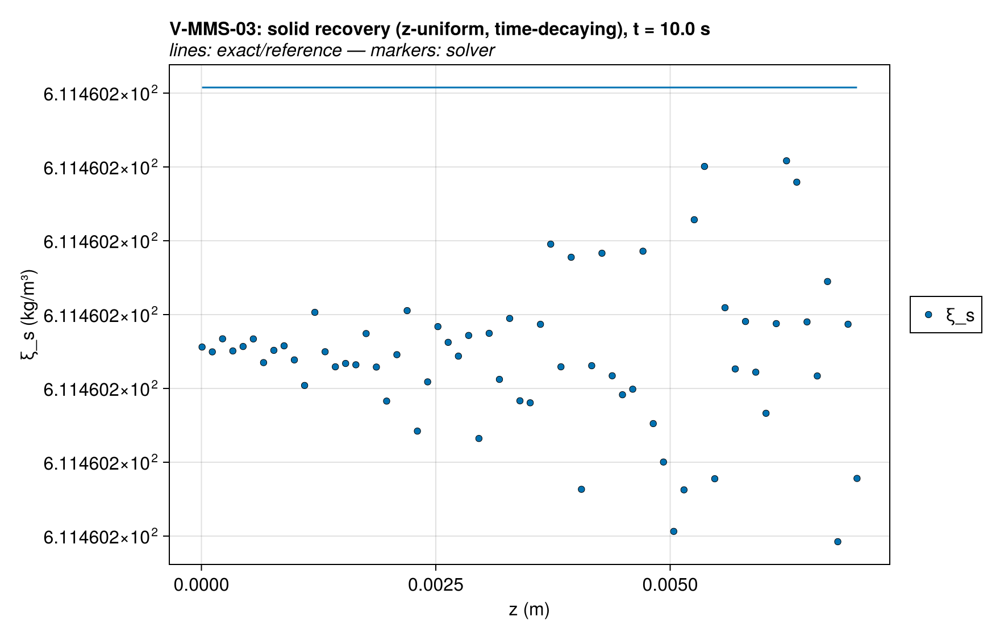
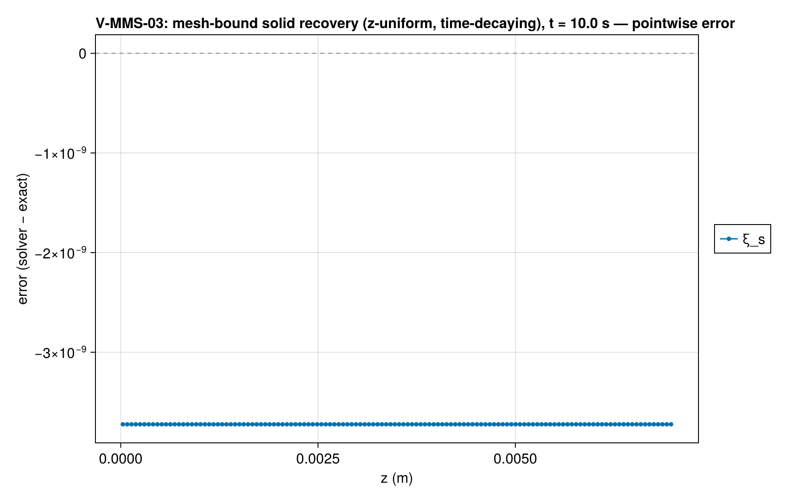
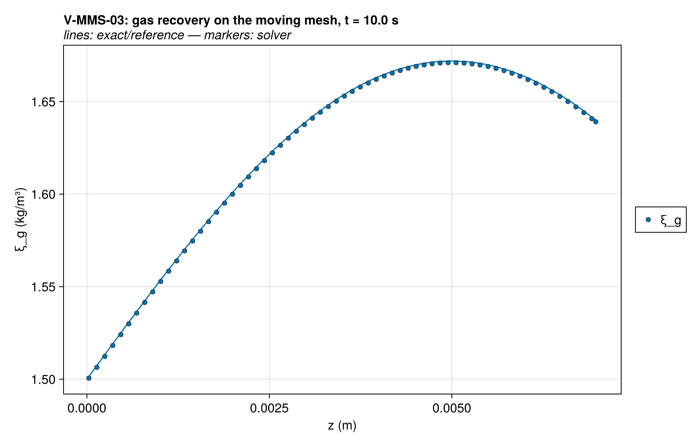
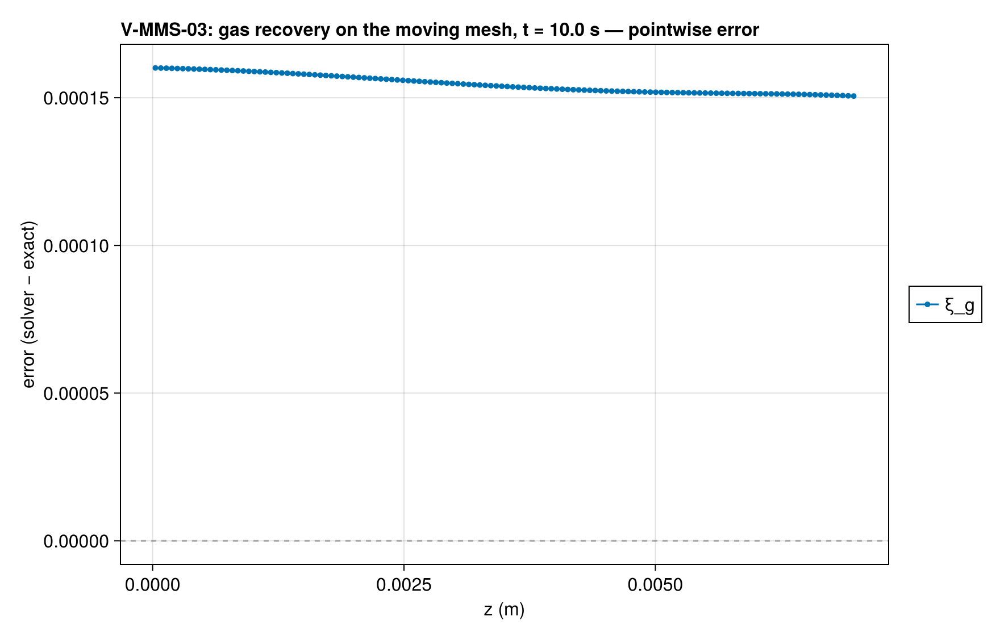
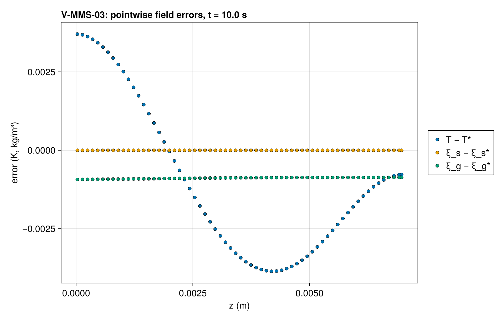
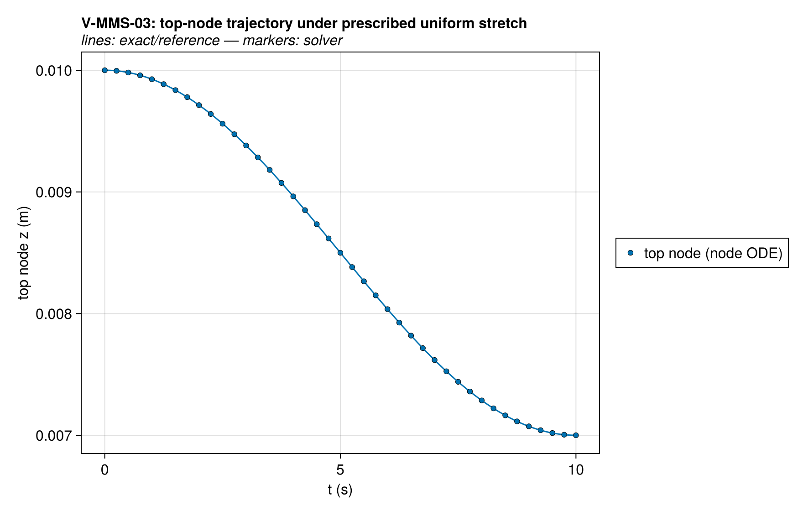
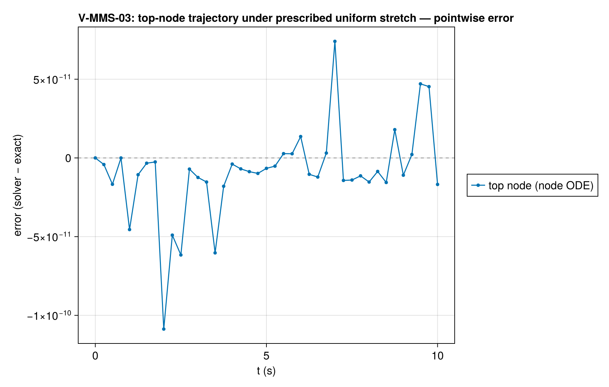
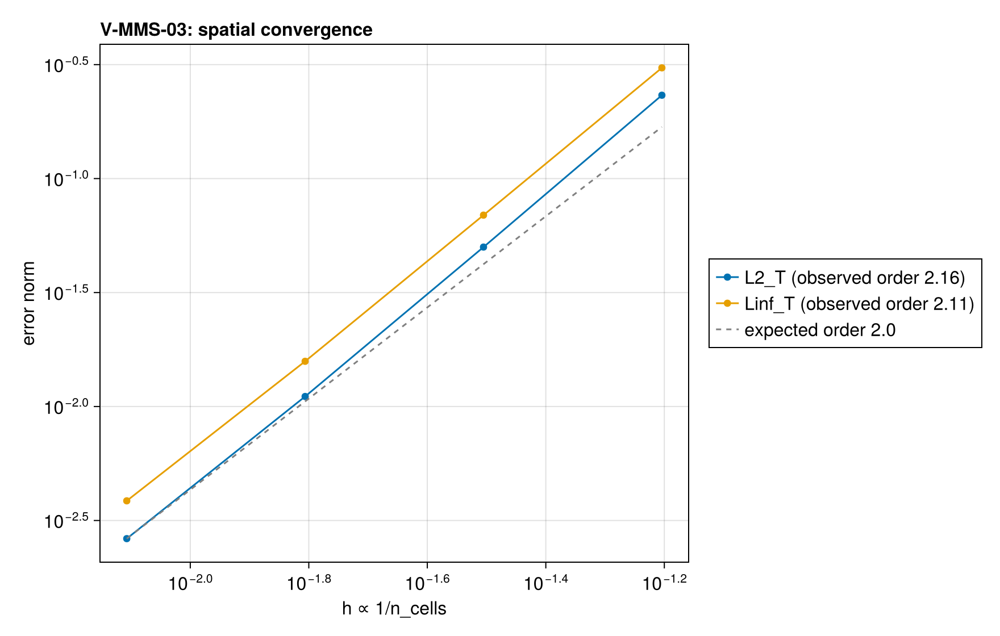

# V-MMS-03 — ALE manufactured solution, prescribed smooth mesh motion

**Tags:** `mms`, `ale`, `gcl`, `order_verification`

**References:**

- docs/guide/technical_reference/18_verification-validation.md §18.2 (MMS driver, ALE cases)
- Thomas & Lombard, AIAA J. 17 (1979) — geometric conservation law

## Problem statement

The moving-mesh order-verification companion to V-MMS-01: non-trivial
manufactured fields solved on a mesh compressed to 70 % of its thickness by
the prescribed uniform-stretch velocity

  w*(z, t) = (ṡ/s)·z,   s(t) = 1 − 0.15·(1 − cos(2πt/20)),  z_i(t) = z_i(0)·s(t)

through the solve's `w_override` hook. The mesh moves over a solid at rest
and every inventory, T's energy with it, crosses the faces at the
mesh-relative velocity, so the Eulerian manufactured sources — evaluated at
the cell centers — make the fields exact on the moving mesh (see
exact/mms.jl header, "ALE"). The T error norm therefore measures exactly
the moving-mesh transport truncation: the relative energy flux (upwind-biased
face temperature) + lab-frame operators on a nonuniform-in-time mesh; the
gas error measures the diffusive and relative fluxes on the moving mesh.

No reactions: mesh motion is prescribed, not volume-change-driven, so the
case isolates GCL/advection from kinetics (V-MMS-01 covers those). The
solid field is spatially UNIFORM but time-varying (uniform keeps the T
pins focused on the relative energy flux); T and the gas field carry the
full space–time structure.

Expected order: second. The gas converges at second order and the
temperature below it on coarse meshes (L2 rates 3.27, 1.70 on the CI
ladder; 1.63, 1.83, 1.92 from 64 to 512 cells): the upwind-biased face
temperature of the relative energy flux carries a pre-asymptotic
third-order error term of the opposite sign to the second-order one. A drop
below min_order flags a moving-mesh transport regression.

### Quantities of interest (n = 128)

| QoI | value | exact | error | tolerance | within tol | provenance |
| --- | --- | --- | --- | --- | --- | --- |
| L∞ T error on moving mesh, t=10.0 s | 0.0006956 | — | 0.0006956 | 0.25 | yes | manufactured T* on 30%-compressed mesh |
| relative L∞ ξ_solid (uniform) error, t=10.0 s | 4.942e-13 | — | 4.942e-13 | 1e-10 | yes | uniform solid: verifies the relative flux of a uniform field under the moving mesh + source injection |
| relative L∞ ξ_gas error, t=10.0 s | 0.0001067 | — | 0.0001067 | 0.006 | yes | gas: diffusive + relative flux on the moving mesh |

### Convergence

| n_cells | h | wall (s) | L2_T | Linf_T |
| --- | --- | --- | --- | --- |
| 16 | 0.0625 | 0.02602 | 0.05036 | 0.1138 |
| 32 | 0.03125 | 0.07228 | 0.004431 | 0.009085 |
| 64 | 0.01562 | 0.2148 | 0.00145 | 0.002204 |
| 128 | 0.007812 | 0.3569 | 0.0004783 | 0.0006956 |

Observed order 2.177 (L2_T), expected 2.0.

### Solver configuration

| setting | value |
| --- | --- |
| integrator | Rodas5P (default) |
| abstol | 1.0e-11 |
| reltol | 1.0e-9 |

