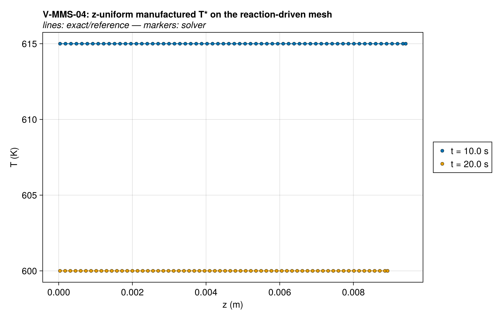
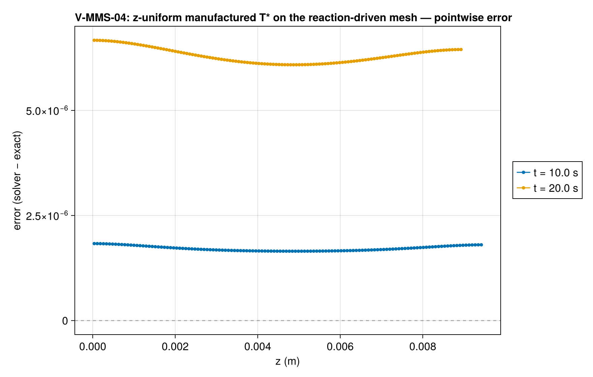
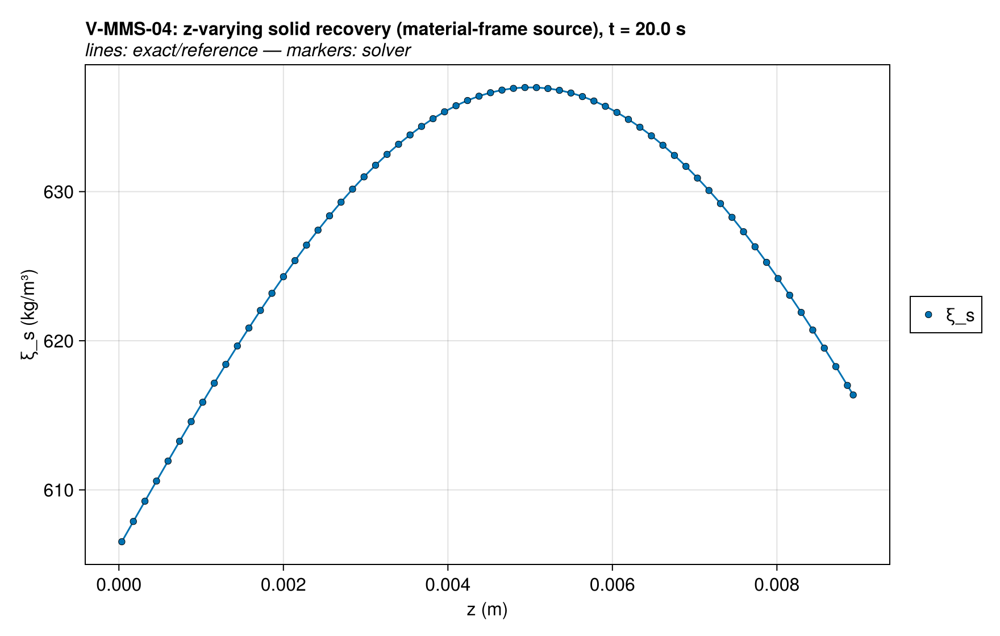
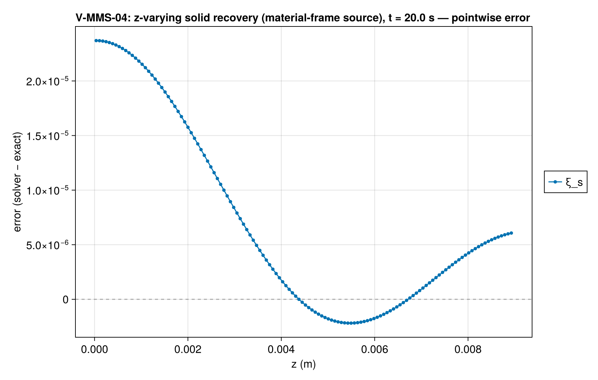
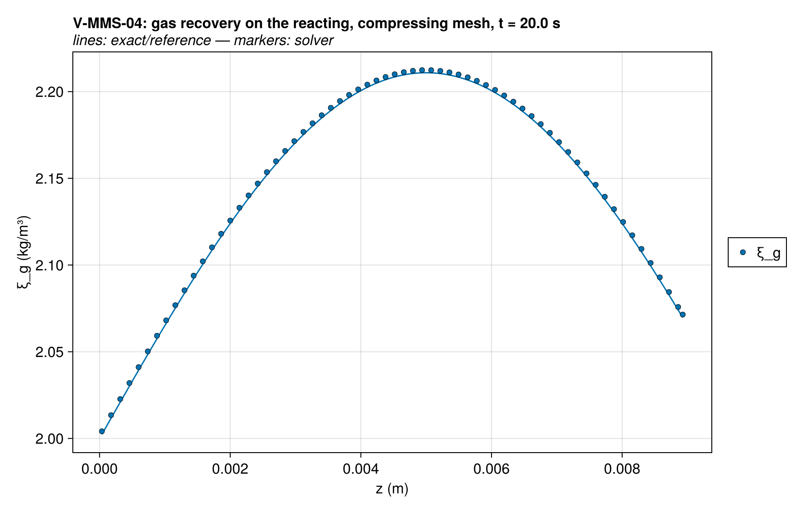
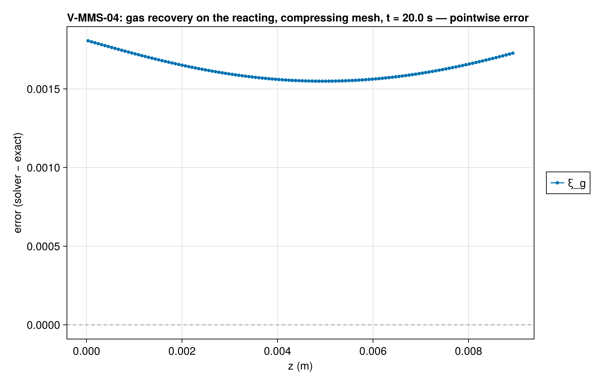
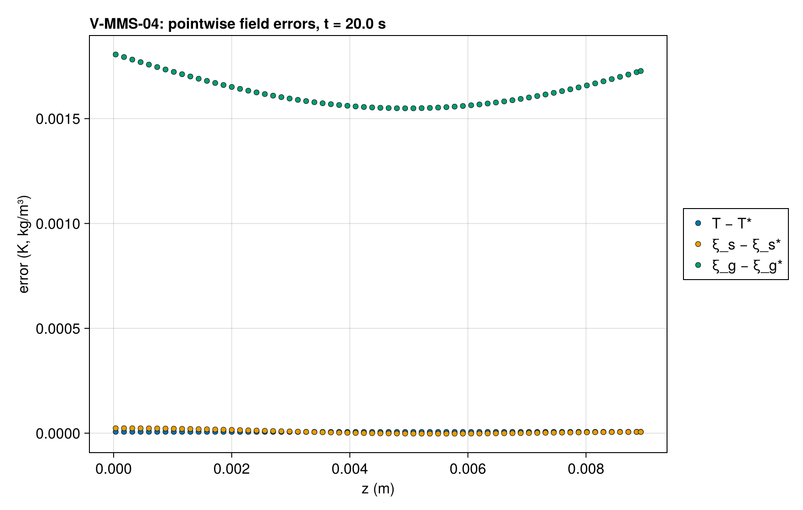
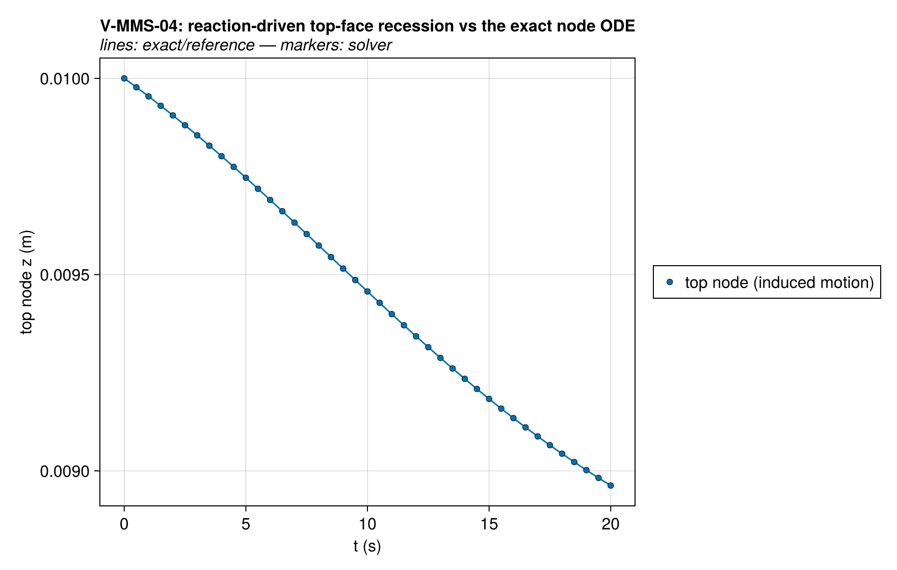
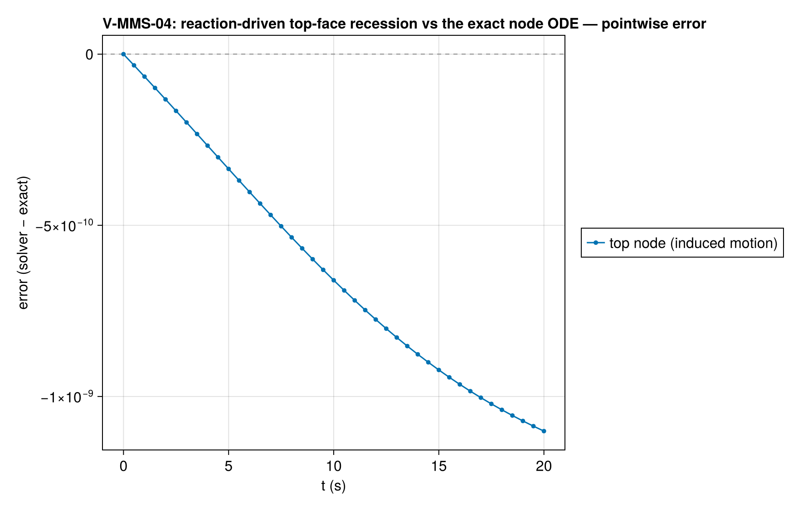
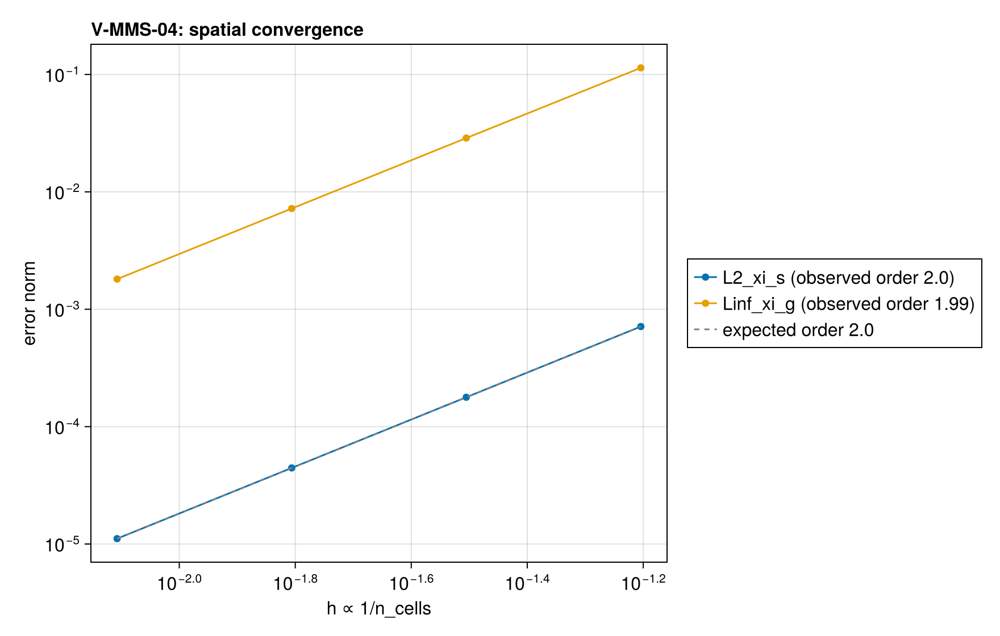

# V-MMS-04 — Induced-motion ALE manufactured solution (reaction-driven mesh)

**Tags:** `mms`, `ale`, `kinetics`, `order_verification`

**References:**

- Roache, Verification and Validation in Computational Science (MMS methodology)
- docs/guide/technical_reference/18_verification-validation.md §18.2 (MMS driver, ALE cases)

## Problem statement

(`w_override`), which moves the mesh over a solid at rest and deliberately
bypasses the balance rows' mesh velocity (the integral of θ) and the
cell-volume change with θ ≠ 0. Here the kinetics are manufactured so the
rates are analytic on the manufactured fields and the motion is genuinely
REACTION-DRIVEN — no `w_override` — closing the kinetics→θ→w→geometry chain.

## Manufactured design (see exact/mms.jl, "Induced mesh motion")

Constant intrinsic densities, γ_solid = 1 / γ_gas = 0 (canonical), single
first-order reaction s → g with the depletion limiter numerically inactive
over the manufactured range (tanh(ξ_s/1.0) ≡ 1.0 in Float64 for
ξ_s ≳ 20 kg/m³; here ξ_s ≥ 500). T* is spatially UNIFORM (time-varying):
V-MMS-01/03 already order-verify the spatial T operators — this case's
target is the kinetics→geometry chain. The solid and the gas are both
z-VARYING and both ride the reacting mesh: every species source is
assembled in the material frame, S = ∂tξ* + w*·∂zξ* + [∂zJ*]_gas − ω̇* +
ξ*·θ*, so the moving-point chain rule and the growth of the cell volume are
built in (`mms_species_source` with `w` from the `MMSMotion` companion).

  θ*(z,t) = −rate*/ρ_s = −k(T*(t))·ξ_s*(z,t)/ρ_s   (volume_change_rate)
  w*(z,t) = ∫₀ᶻ θ* dζ = −(k(t)/ρ_s)·[a(t)·z + b(t)·(L/π)(1 − cos(πz/L))]

The case builds w* with `mms_mesh_velocity` (32-node Gauss–Legendre on the
package kinetics — machine precision, requirement 4); the closed form above
is the independent hand-check in exact/selftests.jl. θ* < 0 throughout ⇒
monotone ~8 % compression over 20 s, every node inside the maximal domain
[0, L].

## Moving-boundary BC positions

Induced motion means the exact top-face trajectory solves the 1D node ODE
dz*/dt = w*(z*, t), z*(0) = L — not analytic here, so `build` precomputes it
with Vern9 at 1e-14 tolerances (requirement-4 compliant) and the BC closures
read the dense interpolant. The bottom node is pinned (w*(0,t) = 0).

### Quantities of interest (n = 128)

| QoI | value | exact | error | tolerance | within tol | provenance |
| --- | --- | --- | --- | --- | --- | --- |
| L∞ T error, t=20.0 s | 6.669e-06 | — | 6.669e-06 | 6e-05 | yes | z-uniform T* — kinetics/source channel through ρcp(ξ_g) |
| relative L∞ ξ_solid (z-varying, material frame) error, t=20.0 s | 3.949e-08 | — | 3.949e-08 | 2e-06 | yes | solid rides the reaction-driven mesh: balance-row w + dilation of m/V + material-frame source |
| relative L∞ ξ_gas error, t=20.0 s | 0.0009029 | — | 0.0009029 | 0.007 | yes | gas rides the reacting, compressing mesh: dilation of m/V + diffusion + material-frame source |
| relative surface-position error, t=20.0 s | 1.062e-06 | 0.008963 | 1.062e-06 | 5e-05 | yes | \|z_top − z*_top\| / (L − z*_top); recession ≈ 1.04 mm |

### Convergence

| n_cells | h | wall (s) | L2_xi_s | Linf_xi_g |
| --- | --- | --- | --- | --- |
| 16 | 0.0625 | 0.1121 | 0.0007125 | 0.1139 |
| 32 | 0.03125 | 0.233 | 0.000178 | 0.02873 |
| 64 | 0.01562 | 0.624 | 4.448e-05 | 0.00721 |
| 128 | 0.007812 | 1.891 | 1.111e-05 | 0.001806 |

Observed order 2.001 (L2_xi_s), expected 2.0.

### Solver configuration

| setting | value |
| --- | --- |
| integrator | Rodas5P (default) |
| abstol | 1.0e-11 |
| reltol | 1.0e-9 |
